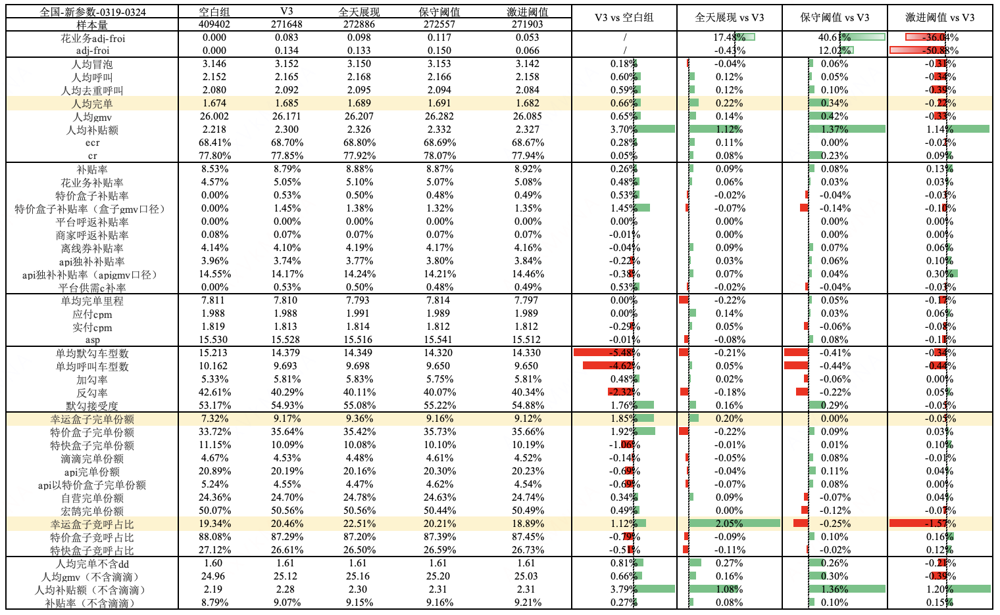
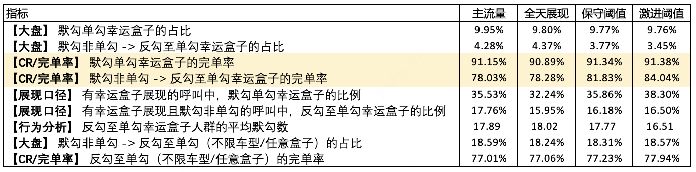
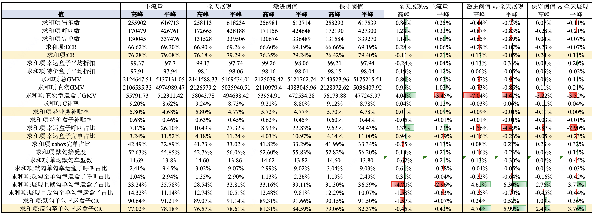

# 【LR26-007】乘客与增长-表单策略-平台联合决策V3幸运盒子全天展现

[Cooper 原文](https://cooper.didichuxing.com/knowledge/2199610335356/2207470039805)

# 一、背景

联合决策V3策略上线时，幸运盒子展现时段有全国一致的时段限制。业务方基于以下两个原因，推出幸运盒子全天展现策略：

- 幸运盒子整体承接能力比较好且有算法和参数兜底，且需要涨份额，因此放开了高峰不能展现的限制

- 不同城市峰期时段有差异，全国城市一刀切配置展现时段，不能很好的适配不同城市的供需，因此为分城市、时段配置幸运盒子B参数

同时，为提升完单规模，避免默勾单勾或乘客反勾至单勾幸运盒子时，因幸运盒子CR差造成不能完单，在联合决策中设置了幸运盒子CR阈值，在决策时，删除了所有单勾幸运盒子CR不满足阈值的决策空间。

# 二、目标 & 约束

- 策略目标

	- H1 整体人均完单 +1%

- 约束指标项

	- 拉齐花业务补贴率，默勾接受度、幸运盒子完单份额不负

# 三、技术方案

## 3.1 幸运盒子CR阈值

- 剪枝策略

	- 基于联合决策幸运盒子定价、特价盒子折扣、默勾的决策空间，幸运盒子CR阈值会删除所有幸运盒子CR < 阈值的决策。

- 阈值设定规则：基于未完单订单中，模型预估CR的分位点，产出幸运盒子CR阈值

	- 保守幸运盒子CR阈值：幸运盒子CR阈值为未完单预估CR的20分位点

	- 激进幸运盒子CR阈值：幸运盒子CR阈值为未完单预估CR的30分位点，相比保守阈值，幸运盒子展现面更低

## 3.2 幸运盒子全天展现策略

> [幸运盒子分区县参数](https://cooper.didichuxing.com/docs2/sheet/2204410129673?sheetId=Zl8NT)

全天展现策略放开了时段限制，通过在平高峰设置不同的B参数，来控制平高峰的展现面。

# 四、实验结果

## 4.1 实验背景

- **实验城市**：==全国==

- **实验周期**：2026.03.19-2026.03.24

- **实验分组**：如下表

| 分组名 <br> | 分组策略 <br> | 流量比例 <br> |
| --- | --- | --- |
| union_stg_v3_max_order_v1_only_box_mogou_acc_cr_60_new <br> | 对照组：主流量策略 <br> | 2% <br> |
| union_stg_v3_max_order_v1_only_box_lucky_all_day_new <br> | 实验组1：幸运盒子全天展现 <br> | 2% <br> |
| union_stg_v3_max_order_v1_only_box_acc_cr_thre_a_new <br> | 实验组2：幸运盒子全天展现+保守幸运盒子CR阈值 <br> | 2% <br> |
| union_stg_v3_max_order_v1_only_box_acc_cr_thre_b_new <br> | 实验组3：幸运盒子全天展现+激进幸运盒子CR阈值 <br> | 2% <br> |

## 4.2 实验结果

vs主流量，实验结果如下：

- 全天展现：

	- 交易漏斗：人均呼叫+0.12%，人均完单**+0.22%**，ECR+0.11pp

	- 补贴率：花业务补贴率+0.06pp

	- 乘客体验：默勾接受度+0.16pp

	- 品类份额：幸运盒子完单份额+0.20pp，特价盒子完单份额-0.22pp

- 保守阈值：

	- 交易漏斗：人均呼叫+0.05%，人均完单**+0.34%**，CR**+0.23pp**

	- 补贴率：花业务补贴率+0.03pp

	- 乘客体验：默勾接受度+0.29pp

	- 品类份额：幸运盒子完单份额不变，特价盒子完单份额+0.09pp



## 4.3 实验分析

### 4.3.1 幸运盒子单勾分析

```PlainText
WITH 
-- 1. 实验分组圈选：从日志表中获取属于指定实验组的 trace_id
exp_source AS (
    SELECT DISTINCT
        param['traceid'] as trace_id,
        concat_ws('-', year, month, day) as dt,
        get_json_object(param['flow_control'], '$.ExpGroupName') as exp_group_name
    FROM 
        kflower_marketplace.ods_log_kflower_platform_call_return_public_log_h
    WHERE 
        concat_ws('-', year, month, day) BETWEEN '2026-03-18' and '2026-03-24'
        AND param['is_fuse'] = 'false'
        AND get_json_object(param['flow_control'], '$.ExpGroupName') IN (
            'union_stg_v3_max_order_v1_only_box_mogou_acc_cr_60_new',
            'union_stg_v3_max_order_v1_only_box_lucky_all_day_new',
            'union_stg_v3_max_order_v1_only_box_discount_new',
            'union_stg_v3_max_order_v1_only_box_acc_cr_thre_a_new',
            'union_stg_v3_max_order_v1_only_box_acc_cr_thre_b_new',
            'union_stg_v3_max_order_v1_only_box_discount_acc_cr_a_new',
            'union_stg_v3_max_order_v1_only_box_discount_acc_cr_b_new'
        )
),

-- 2. 基础人群关联：将实验组Trace与呼叫完单表关联 (作为核心驱动表)
base_metrics AS (
    SELECT  
        e.exp_group_name,          -- 保留实验组名称
        b.trace_id,
        b.dt,
        1 as is_td_call,
        max(b.is_td_finish) as is_td_finish
    FROM 
        kflower_strategy.pltf_cr_model_bubble_call_base_info b
    JOIN 
        exp_source e 
        ON b.trace_id = e.trace_id AND b.dt = e.dt
    WHERE 
        b.dt BETWEEN '2026-03-18' and '2026-03-24'
    GROUP BY 
        e.exp_group_name, b.trace_id, b.dt
    HAVING 
        max(is_td_call) = 1        -- 核心过滤：仅保留实际产生呼叫的订单
),

-- 3. 明细处理：关联呼叫订单，进行盒子ID映射
pre_process AS (
    SELECT  
        b.exp_group_name,          -- 透传实验组名称
        a.trace_id,
        a.selected_status,
        a.is_send,
        -- ID 映射逻辑
        CASE 
            WHEN a.level_type = 105 THEN -1 -- 特价盒子
            WHEN a.level_type = 200 THEN -2 -- 特快盒子
            WHEN a.level_type = 107 THEN -3 -- 幸运盒子
            ELSE a.product_2level 
        END as mapped_id,
        -- 特殊盒子去重
        CASE 
            WHEN a.level_type IN (105, 200, 107) THEN 
                 row_number() OVER(PARTITION BY a.trace_id, a.level_type ORDER BY a.product_2level)
            ELSE 1 
        END as rn
    FROM    
        kflower_dw.dwd_kf_trd_bubble_base_all_di a
    JOIN    
        base_metrics b 
        ON a.trace_id = b.trace_id AND a.dt = b.dt
    WHERE   
        a.dt BETWEEN '2026-03-18' and '2026-03-24'
        AND a.is_fold_cp <> 1
        AND a.product_1level <> 4
),

-- 4. 维度聚合：按订单维度计算标签及默勾数量
trace_stats AS (
    SELECT 
        p.exp_group_name,          -- 透传实验组名称
        p.trace_id,
        
        -- 【维度1】是否有幸运盒子展现
        max(CASE WHEN p.mapped_id = -3 THEN 1 ELSE 0 END) as has_lucky_box,

        -- 【维度2】是否默勾单勾幸运盒子
        CASE WHEN sum(p.selected_status) = 1 
              AND sum(CASE WHEN p.selected_status = 1 AND p.mapped_id = -3 THEN 1 ELSE 0 END) = 1
             THEN 1 ELSE 0 
        END as is_default_single_lucky,
        
        -- 【维度3】是否呼叫单勾幸运盒子
        CASE WHEN sum(p.is_send) = 1 
              AND sum(CASE WHEN p.is_send = 1 AND p.mapped_id = -3 THEN 1 ELSE 0 END) = 1
             THEN 1 ELSE 0 
        END as is_called_single_lucky,

        -- 【维度4】默勾选项的数量
        sum(p.selected_status) as default_selected_count,

        -- 【维度5】是否默勾单勾（不限车型）
        CASE WHEN sum(p.selected_status) = 1 THEN 1 ELSE 0 END as is_default_single,

        -- 【维度6】是否呼叫单勾（不限车型）
        CASE WHEN sum(p.is_send) = 1 THEN 1 ELSE 0 END as is_called_single

    FROM 
        pre_process p
    WHERE 
        p.rn = 1 
    GROUP BY 
        p.exp_group_name, p.trace_id
)

-- 5. 最终指标计算 (按实验组分组)
SELECT 
    t.exp_group_name, 
    
    -- 1. 【大盘】默勾单勾幸运盒子的占比
    CAST(sum(t.is_default_single_lucky) AS DOUBLE) / count(1) AS ratio_default_single_lucky,
    
    -- 2. 【修改：大盘】默勾非单勾 -> 反勾至单勾幸运盒子的占比
    CAST(sum(CASE WHEN t.is_default_single = 0 AND t.is_called_single_lucky = 1 THEN 1 ELSE 0 END) AS DOUBLE)
    / sum(CASE WHEN t.is_default_single = 0 THEN 1 ELSE 0 END) AS ratio_switch_to_lucky,
    
    -- 3. 【CR】默勾单勾幸运盒子的完单率
    CAST(sum(CASE WHEN t.is_default_single_lucky = 1 THEN b.is_td_finish ELSE 0 END) AS DOUBLE)
    / sum(CASE WHEN t.is_default_single_lucky = 1 THEN 1 ELSE 0 END) AS cr_default_lucky,
    
    -- 4. 【同步修改：CR】反勾至单勾幸运盒子的完单率
    CAST(sum(CASE WHEN t.is_default_single = 0 AND t.is_called_single_lucky = 1 THEN b.is_td_finish ELSE 0 END) AS DOUBLE)
    / sum(CASE WHEN t.is_default_single = 0 AND t.is_called_single_lucky = 1 THEN 1 ELSE 0 END) AS cr_switch_to_lucky,

    -- 5. 【展现口径】有幸运盒子展现的呼叫中，默勾单勾幸运盒子的比例
    CAST(sum(CASE WHEN t.has_lucky_box = 1 AND t.is_default_single_lucky = 1 THEN 1 ELSE 0 END) AS DOUBLE)
    / sum(t.has_lucky_box) AS ratio_default_lucky_in_exposed,

    -- 6. 【修改：展现口径】有幸运盒子展现且默勾非单勾，反勾至单勾幸运盒子的比例
    CAST(sum(CASE WHEN t.has_lucky_box = 1 AND t.is_default_single = 0 AND t.is_called_single_lucky = 1 THEN 1 ELSE 0 END) AS DOUBLE)
    / sum(CASE WHEN t.has_lucky_box = 1 AND t.is_default_single = 0 THEN 1 ELSE 0 END) AS ratio_switch_lucky_in_exposed,

    -- 7. 【同步修改：行为分析】反勾至单勾幸运盒子人群：平均默勾选项数
    avg(CASE 
        WHEN t.is_default_single = 0 AND t.is_called_single_lucky = 1 
        THEN t.default_selected_count
        ELSE NULL 
    END) AS avg_default_selected_count_switch_lucky,

    -- 8. 【新增大盘】默勾非单勾 -> 反勾至单勾(不限车型)的占比
    CAST(sum(CASE WHEN t.is_default_single = 0 AND t.is_called_single = 1 THEN 1 ELSE 0 END) AS DOUBLE)
    / sum(CASE WHEN t.is_default_single = 0 THEN 1 ELSE 0 END) AS ratio_switch_to_single_any,

    -- 9. 【新增CR】反勾至单勾(不限车型)的完单率
    CAST(sum(CASE WHEN t.is_default_single = 0 AND t.is_called_single = 1 THEN b.is_td_finish ELSE 0 END) AS DOUBLE)
    / sum(CASE WHEN t.is_default_single = 0 AND t.is_called_single = 1 THEN 1 ELSE 0 END) AS cr_switch_to_single_any

FROM 
    trace_stats t
JOIN 
    base_metrics b ON t.trace_id = b.trace_id
GROUP BY 
    t.exp_group_name;
```

为拆解收益链路，我们对默勾单勾幸运盒子、反勾至幸运盒子的呼叫进行分析。对比全天展现组，保守阈值组通过在幸运盒子差CR情况下不展现幸运盒子，使得：

- 反勾至单勾幸运盒子的呼叫占比降低0.6pp

- 默勾单勾幸运盒子CR提升0.45pp，反勾至单勾幸运盒子的CR提升3.55pp

从而在几乎不影响幸运盒子完单份额的前提下，提升CR，进一步提升大盘完单。

<!--评论:[{"u":"zhouzhishuo","c":"全天展现组的默勾单勾幸运盒子占比降低？（分母是该组大盘冒泡 or 该组有幸运盒子的冒泡？）"}] -->

### 4.3.2 分平高峰分析

基于基础定价的平高峰定义，根据冒泡时间将冒泡拆分为平高峰进行分析，结论如下：

- 全天展现：收益来源于高峰对低价品类幸运盒子呼叫占比+3.32pp，带来高峰冒、呼、完的增长

- 保守阈值：收益主要来源于**在不影响平高峰冒泡的同时，高峰CR+0.24pp，从而提升整体完单**

- 激进阈值：负向来源于平高峰低价品类幸运盒子呼叫占比降低过多，导致冒泡负向

后续优化方向：

- 平峰更缺呼叫，可略降低平峰的幸运盒子CR阈值，提升幸运盒子展现面及ECR



# 五、后续规划

全天展现的放量节奏如下：

- 03.18：开启24%流量小流量实验

- 03.25：扩量至50%

- 03.30：扩量至70%

- 04.02：扩量至97%，线上长期保留3%无幸运盒子展现的流量

# 六、引用和鸣谢

## 引用

- 实验方案及评估结果：[联合决策品类调优实验四期实验方案260304](https://cooper.didichuxing.com/knowledge/2199610335356/2206903441885)

- 联合决策品类调优实验分析：[联合决策品类调优分析](https://cooper.didichuxing.com/knowledge/2199610335356/2206622876759)

## 鸣谢

感谢业务方苏格与袁宜东对于幸运盒子全天展现策略的制定。

感谢之烁对于实验分析的帮助，感谢价格策略所有同学。

# 七、放量决策

|  <br> |  <br> | 预期扩量时间节奏 <br> | 实际扩量时间 <br> | 实际放量暂停点 <br> | 放量暂停点效果评估 <br> | 是否需要设置长期对照组（默认不需要，此列无需填写） <br> |
| --- | --- | --- | --- | --- | --- | --- |
|  <br> |  <br> |  <br> | LR通过后，根据实际情况，填写这3列 <br> |  <br> |
| 放量决策意见 <br> | 决策人 <br> |  <br> | —— <br> | —— <br> | —— <br> | —— <br> |
| 决策意见：通过 <br>- 通过 <br><br>- 不通过，给出原因 <br><br>- 扩大流量实验 <br><br> |  <br> |  <br> |  <br> |  <br> |  <br> |
| 放量需要周知的利益相关方 <br> | 没有的话，无需填写 <br> | 行业策略幸运盒子业务方 <br> |
| 放量策略 <br> |  <br> | 实验组2 <br> |
| 放量决策 <br> | 分批放量 <br> | 2026.3.18 放量24%流量 <br> | 2026.3.18 放量20%流量 <br> | 不评估 <br> | / <br> | —— <br> |
| 2026.3.25 放量50%流量 <br> | 2026.3.25 放量50%流量 <br> | 不评估 <br> | / <br> | —— <br> |
| 2026.3.30 放量80%流量 <br> | 2026.3.30 放量80%流量 <br> | 不评估 <br> | / <br> | —— <br> |
| 2026.4.02 放量97%流量 <br> | 2026.4.02 放量97%流量 <br> | 不评估 <br> | / <br> | 保留空白组3%流量， <br>空白组：幸运盒子不展现、特价盒子不补贴 <br> |
