# 【LR26-008】司机与调节-城市投资效率-城市投资效率量化评估与链路建设

[Cooper 原文](https://cooper.didichuxing.com/knowledge/2199610335356/2207516558300)

| brd文档链接   | 无   |
| --- | --- |
| 最后通过的策略方案链接   | 无   |
| 实验链接（评估大师）   | 无   |
| 核心贡献点（创新点，可供其他算法同学借鉴的点）   | 构建了城市级投资效率仿真框架，将平台调价、B/C 补投放等运营干预统一映射到 ECR、TSH、CR、完单等核心指标，实现弹性能力的模块化沉淀与多场景复用。   |
| 第一贡献人   | 刘建玲   |
| 共同贡献人（没有的话，可以置空）   | 刘荣、门畅   |
| 后续策略负责人   | 亓旻昊   |

## 一、业务背景<!--评论:[{"u":"menchang","c":"本次LR内容，与【LR25029】城市维度B弹建模的关系是什么，与【LR25048】 赋能小猪端区县调价项目的关系是什么"},{"u":"liujianling","c":"已在该章节中进行详细说明，见“一、业务背景”章节末尾相关说明。"}] -->

网约车市场中 投放B补/C补 或 调价 是供需调节的核心手段，我们需要从平台视角下量化不同城市的投资效率，为平台定价、资源分配等业务场景提供决策支持。

以==平台调价==为例，我们需要回答“与上周同期相比，在一定调价区间内不同城市成交率与完单数如何变化?”，示例如下：

| 城市成交率   | 城市完单数   |
| --- | --- |
| 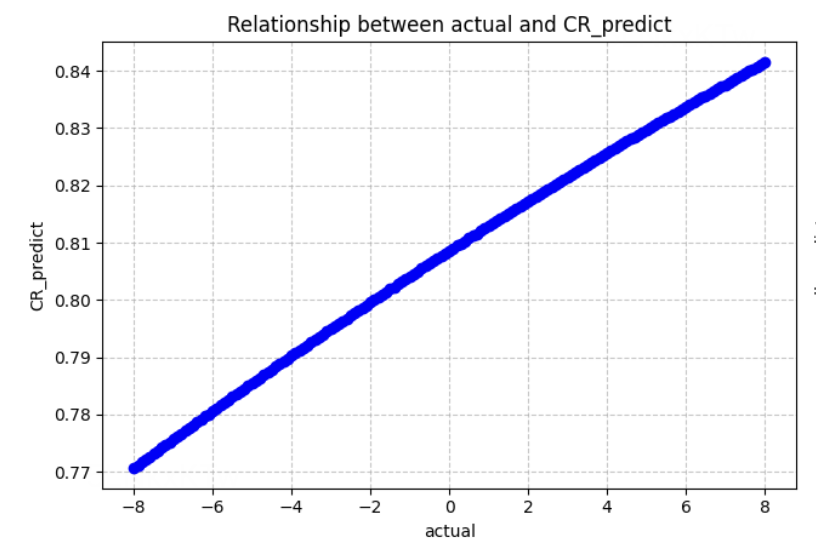   | 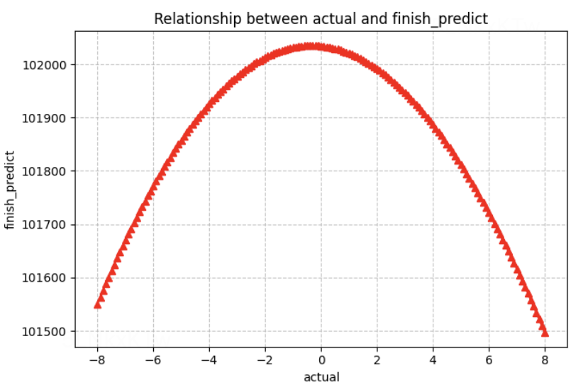   |

而如何量化城市成交率与完单数的变化，需要基于各种城市底层弹性能力，如城市维度的冒泡弹性、ECR弹性、TSH弹性与CR弹性等。

但这些底层弹性拟合能力建设完成后，我们发现在实际业务应用中存在诸多问题。主要问题如下：

- **数据口径未拉齐**：下游业务方多是口头协议，未明确拉齐数据口径，如因建模ECR的C补率口径与平台投放C补的口径未拉齐，会导致城市ECR弹性计算错误。

- **数据输出不规范**：底层数据链路复杂，很多数据输出不规范，如存在TSH关注的是相对变化而不是绝对变化、TSH弹性是在基期补贴率基础上增加1pp补贴率的弹性，还是在某个补贴率实际取值上的弹性等问题。

- **维护耗费人力**：对于不同的运营动作（如投放C补、投放B补、平台调价），需要额外的人力频繁支持业务的相关指标弹性测算。

针对以上问题，我们通过对问题重新定义与分析、以及数据标准化，搭建了一套满足各方需求的城市投资效率仿真系统，来降低维护成本，提高资源分配效率。整体框架如下：

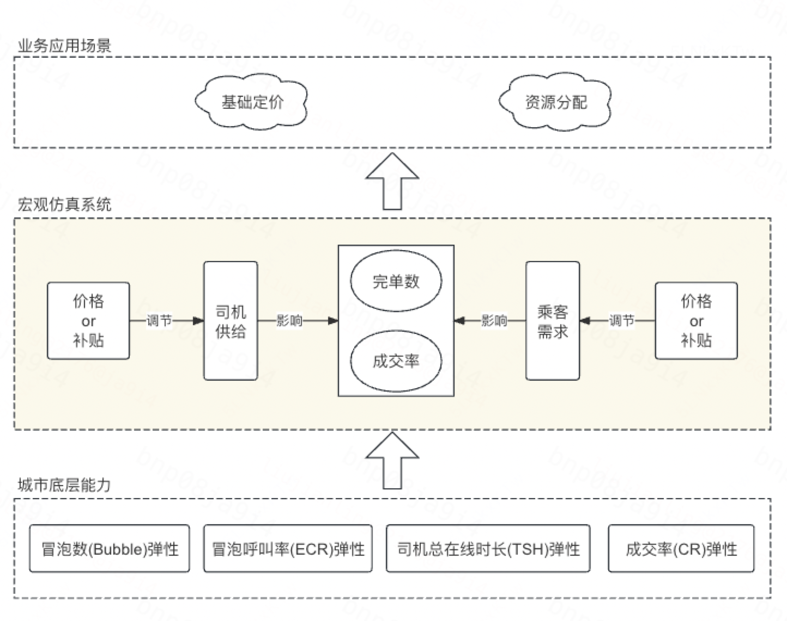

> 相关说明：

> 1、本文与【LR25029】城市维度B弹建模的关系：本文主要估计的是城市成交率和完单弹性（涉及BC两端），而城市维度B弹建模是城市总TSH弹性（只涉及B端），仅作为计算成交率及完单数的底层弹性支撑能力之一。

> 2、本文与【LR25048】 赋能小猪端区县调价项目的关系，二者在各种弹性计算逻辑上一致，主要区别如下：

> 1）弹性测算维度不同：赋能小猪端区县调价项目 主要针对【区县维度】测算完单数与CR的弹性测，而城市投资效率主要在【城市维度】测算完单数与CR的弹性。

> 2）应用运营场景不同：赋能小猪端区县调价项目 针对【平台调价】，而城市投资效率的运营干预类型包括【平台调价、投放C补、投放B补】，后者可满足不同业务方需求，更通用。

> 3）覆盖弹性指标不同：赋能小猪端区县调价项目 产出结果只包括【城市CR与城市完单数】，而城市投资效率的产出结果包括【城市呼叫数、不同运力TSH与总TSH、CR、完单】，后者可满足不同业务方需求，更通用。

## 二、问题定义

如何量化城市投资效率，本质是估计业务指标关于运营干预的弹性。在平台定价与资源分配业务中，涉及相关业指标与变量定义如下（业务指标均指小猪端）：

| 变量类型   | 变量名称   | 变量表示   | 取值   |
| --- | --- | --- | --- |
| 业务指标   | 城市成交率   | CR   | -   |
| 城市完单数   | Finish   | -   |
| 运营干预  X = \[X1, X2\]   | 干预类型   | X1   | 投放C补、投放B补、定价   |
| 干预取值   | X2   | \[-10pp, +10pp\]，指在上周基准补贴率（或基准定价）的基础上，增加 X2 pp   |

## 三、问题分析

如何量化运营干预对城市成交率、城市完单数的影响，我们需要结合交易漏斗，从城市视角下，从运营干预到城市完单数的整个影响链路，具体如下图所示：

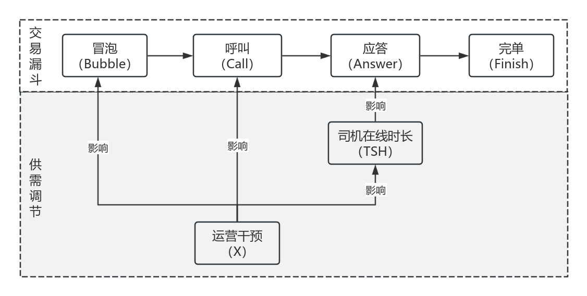

其中：

- 冒泡呼叫率（）：从冒泡到呼叫的转化，主要受到价格的影响；

- 成交率（）：从呼叫到完单的转化，同时受到供需状态的影响，初步可基于Call与TSH二者建模。即：

因此，城市成交率（CR）与 城市完单数（Finish）均受到 冒泡数（Bubble）、冒泡呼叫率（ECR）、司机在线时长（TSH）三者的影响，而这三个指标均受到 运营干预（X）的影响，那么，函数表示如下：

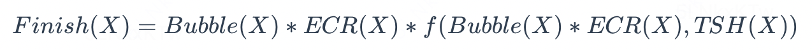

因此，城市完单数关于运营干预的弹性建模问题，可拆解为城市维度 冒泡数、冒泡呼叫率、司机在线时长、成交率 关于 运营干预（即价格） 的弹性建模问题。

## 四、问题建模

### 4.1 城市冒泡数弹性

在建模之前，我们对 城市冒泡数 与 运营干预 之间是否具有相关性作出分析，选取小猪端特价盒子品类【2025.08.26 \~ 2025.09.08】周期（共2周）的RCT数据，分析了Top35城市的 补贴率与人均冒泡 之间是否有相关性。

从分析结果来看，Top35城市中只有 约30% 的城市补贴率与人均冒泡强相关（相关性>70%），剩余 约70% 的城市二者相关性较弱，分析发现是由于本次RCT实验流量较小，对于一些城市来说冒泡人数少（冒泡人数<8000）不足以呈现一定的规律，结果如下：

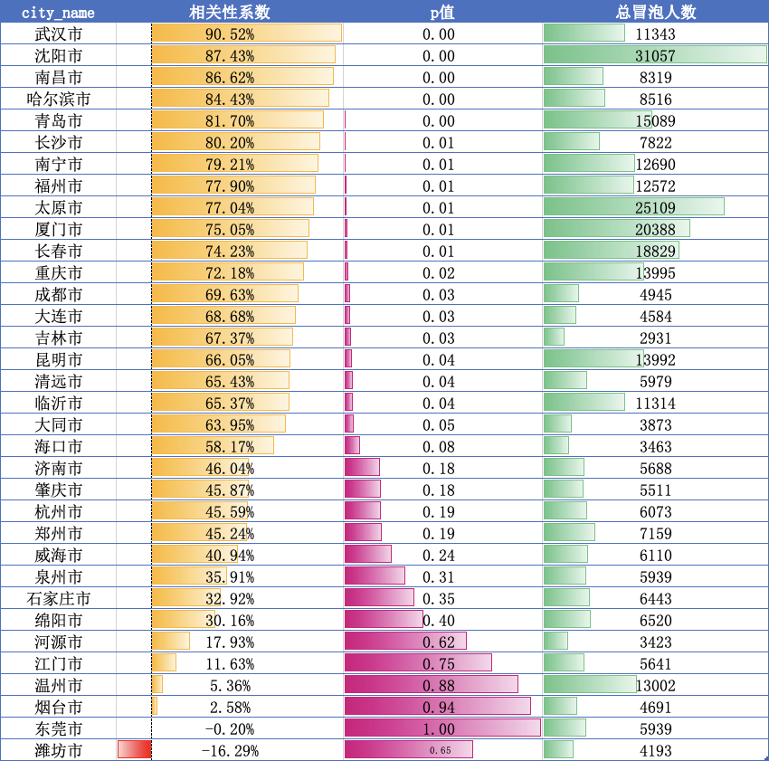

最终结论：由于本次RCT实验流量较小且周期较短，补贴率与人均冒泡只在头部城市呈现强相关。因此，在城市投资效率建模中，我们只在上述RCT数据拟合较好的城市引入冒泡弹性，其余城市暂不引入，直接使用同周期冒泡数进行建模。

### 4.2 城市TSH弹性

对于城市总TSH的弹性建模详见[【LR25029】城市维度 B 弹建模](https://cooper.didichuxing.com/knowledge/2199610335356/2205200233446)，其建模方式是双重鲁棒估计器(DRL)，基于特征协变量$$Z$$与总净B补率$$X$$对$$TSH$$进行建模，具体公式如下：

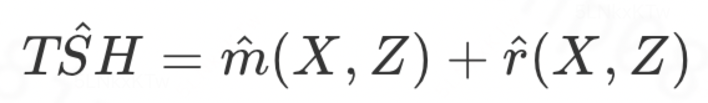

其中：*X* 表示干预变量，指 城市总净 B 补率；*Z* 表示特征协变量，指 影响城市与司机行为指标的其他因素；*TSH 表示* 结果变量（即响应值），指 城市总司机在线时长。

### 4.3 城市ECR弹性

对于城市冒泡呼叫率（ECR）的弹性建模详见[小猪端城市C弹 (ECR) 建模](https://cooper.didichuxing.com/knowledge/2199610335356/2206371752526)，其建模方式为基于特价盒子观测数据，先运用DRCFR模型建模冒泡个体ECR，再聚合城市ECR。

不同补贴率干预(X)下的 个体ECR 为：

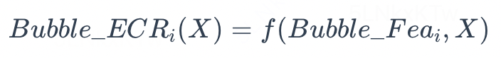

其中，Bubble_Fea表示冒泡特征，X表示干预，f(Bubble_Fea, X)表示模型预测函数，那么，N表示同周期总冒泡数，不同补贴率干预(X)下的 城市ECR 如下：

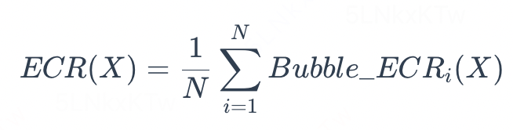

### 4.4 城市CR弹性

对于城市成交率（CR) 的弹性建模详见[【LR25026】资源分配中使用的小猪端成交率模型更新](https://cooper.didichuxing.com/knowledge/2199610335356/2205100457409)，由于样本量较少与可解释性要求高，其建模方式基于广义线性模型框架，采用 Logistic Regression 来建模成交率与关键供需特征之间的关系。公式如下：

出于对可解释性、策略联动可行性的综合考量，仅引入三个关键供需变量，以【城市维度 x 天维度】构建样本进行训练，以实现模型精度与系统可落地性的平衡。涉及到的变量如下：

- Call : 指小猪平台的竞争呼叫数，受乘客补贴或价格调控

- TSH : 指小猪平台的司机总在线时长，由司机补贴或价格调控

- thlm_Call : 滴滴端的小猪品类竞争呼叫数，后期用于刻画特惠联盟渠道在供需竞争中的影响，从而提高模型在多渠道背景下的拟合与泛化能力

## 五、框架搭建

对于以上提到的数据口径未拉齐、数据输出不规范、维护耗费人力 三个问题，我们搭建了一套满足各方需求的城市投资效率仿真系统。具体设计如下：

### 5.1 数据标准化

#### 5.1.1 数据口径标准化

针对数据口径存在歧义的问题，我们对如下指标进行了标准化定义，并与业务方已拉齐：

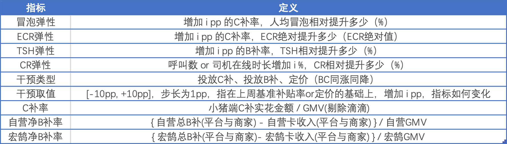

该仿真系统【覆盖城市】包括Top60 城市（上海市、天津市、西安除外，主要是API运力，CR建模不包含这两个城市）。

#### 5.1.2 数据输出标准化

针对数据输出不规范的问题，我们设计了城市ECR弹性底表、TSH弹性底表、CR与完单预估底表的数据输出形式，具体如下：

- by城市C弹底表（  [小猪端ECR弹性底表（top60城）](https://datamap.didichuxing.com/detail?uri=hive://mycluster-tj:kflower_strategy:hxz_ecr_elasticity_pred_result_by_city&keyword=result)）

| city_id   | city_name   | 基准日期   | 周类型   | 基期平均C补率   | 基期平均ECR   | ECR弹性\_down_10pp   | ...   | ECR弹性\_add_10pp   |
| --- | --- | --- | --- | --- | --- | --- | --- | --- |
| 1   | 北京市   | 2025-12-01   | 全周   |    |    |    |    |    |
| 1   | 北京市   | 2025-12-01   | 周中   |    |    |    |    |    |
| 1   | 北京市   | 2025-12-01   | 周末   |    |    |    |    |    |
| ...   | ...   | ...   | ...   |    |    |    |    |    |

- by城市B弹底表（  [宏鹄 TSH 弹性底表](https://datamap.didichuxing.com/detail?uri=hive://mycluster-tj:kflower_strategy:hh_tsh_elasticity_pred_result_by_city&keyword=kflower_strategy)、[自营 TSH 弹性底表](https://datamap.didichuxing.com/detail?uri=hive://mycluster-tj:kflower_strategy:zy_tsh_elasticity_pred_result_by_city&keyword=kflower_strategy)）

| city_id   | city_name   | 基准日期   | 周类型   | 基期平均B补率   | 基期平均TSH   | TSH弹性\_down_10pp   | ...   | TSH弹性\_add_10pp   |
| --- | --- | --- | --- | --- | --- | --- | --- | --- |
| 1   | 北京市   | 2025-12-01   | 全周   |    |    |    |    |    |
| 1   | 北京市   | 2025-12-01   | 周中   |    |    |    |    |    |
| 1   | 北京市   | 2025-12-01   | 周末   |    |    |    |    |    |
| ...   | ...   | ...   | ...   |    |    |    |    |    |

- by城市在不同补贴率下呼叫、TSH、CR、完单预估底表（[城市投资效率底表](https://datamap.didichuxing.com/detail?uri=hive://mycluster-tj:kflower_strategy:hxz_business_metric_elasticity_pred_result_by_city&keyword=business)）

| city_id   | city_name   | 基准日期   | 周类型   | 基期冒泡数   | 基期呼叫数   | 基期完单数   | 基期CR   | 基期ECR   | 基期C补率   | 基期宏鹄TSH   | 基期自营TSH   | 基期总TSH   | 基期自营净B补率   | 基期宏鹄净B补率   | 干预类型   | 干预取值(pp)   | pred\_呼叫数   | pred\_宏鹄TSH   | pred\_自营TSH   | pred\_总TSH   | pred_CR   | pred\_完单数   | 是否最优值   |
| --- | --- | --- | --- | --- | --- | --- | --- | --- | --- | --- | --- | --- | --- | --- | --- | --- | --- | --- | --- | --- | --- | --- | --- |
| 1   | 北京市   | 2025-12-01   | 全周   |    |    |    |    |    |    |    |    |    |    |    | 投放C补   | +2   |    |    |    |    |    |    |    |
| 1   | 北京市   | 2025-12-01   | 周中   |    |    |    |    |    |    |    |    |    |    |    | 投放B补   | -2   |    |    |    |    |    |    |    |
| 1   | 北京市   | 2025-12-01   | 周末   |    |    |    |    |    |    |    |    |    |    |    | 定价   | -5   |    |    |    |    |    |    |    |
| ...   | ...   | ...   | ...   |    |    |    |    |    |    |    |    |    |    |    | ...   | ...   |    |    |    |    |    |    |    |

by城市在不同补贴率下呼叫、TSH、CR、完单预估底表-计算逻辑

[城市投资效率计算逻辑-示例数据.xlsx](附件/LR26-008/016.xlsx)

### 5.2 链路搭建

针对当前各类业务运营动作（C 端补贴、B 端补贴、价格调整等）需频繁投入人力、临时开展指标弹性测算的痛点，我们将各场景弹性模型进行模块化拆解与输出标准化，并搭建了一套完整的城市投资效率仿真系统，以调价场景为例，其具体链路设计如下：

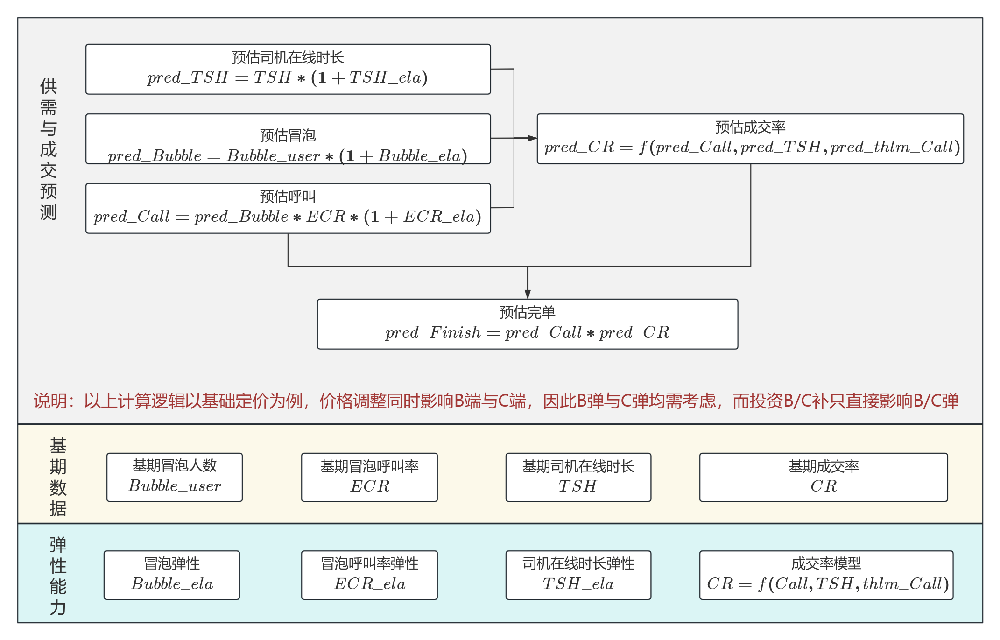

## 六、业务收益

（1）预期收益

该项目为离线探索，不需要线上推全，主要收益来源是节约每周人力 约 1人日。

（2）实际收益

目前该仿真系统，同时支持不同业务方对各种弹性的测算需求（投放C补、投放B补、平台调价），其可以节约人力约 1人日/周。<!--评论:[{"u":"menchang","c":"与LR25048的关系是什么"},{"u":"liujianling","c":"已在文档中进行详细说明，见“一、业务背景”章节末尾相关说明。"}] -->

## 七、推全情况与现状追踪

- 2026.01：该项目为离线探索，不需要线上推全，已经正式上线并正常运行。

## 八、引用和鸣谢

感谢业务方苏格、Lucas、雨潭提供的相关业务经验与帮助

感谢门畅老师，刘荣老师在全流程的指导，以及价格策略全体成员的帮助。

参考文档：

1、[【LR25029】城市维度 B 弹建模](https://cooper.didichuxing.com/knowledge/2199610335356/2205200233446)

2、[小猪端城市C弹 (ECR) 建模](https://cooper.didichuxing.com/knowledge/2199610335356/2206371752526)

3、[【LR25026】资源分配中使用的小猪端成交率模型更新](https://cooper.didichuxing.com/knowledge/2199610335356/2205100457409)

4、[【LR25048】赋能小猪端区县调价](https://cooper.didichuxing.com/knowledge/2199610335356/2206007427981)
