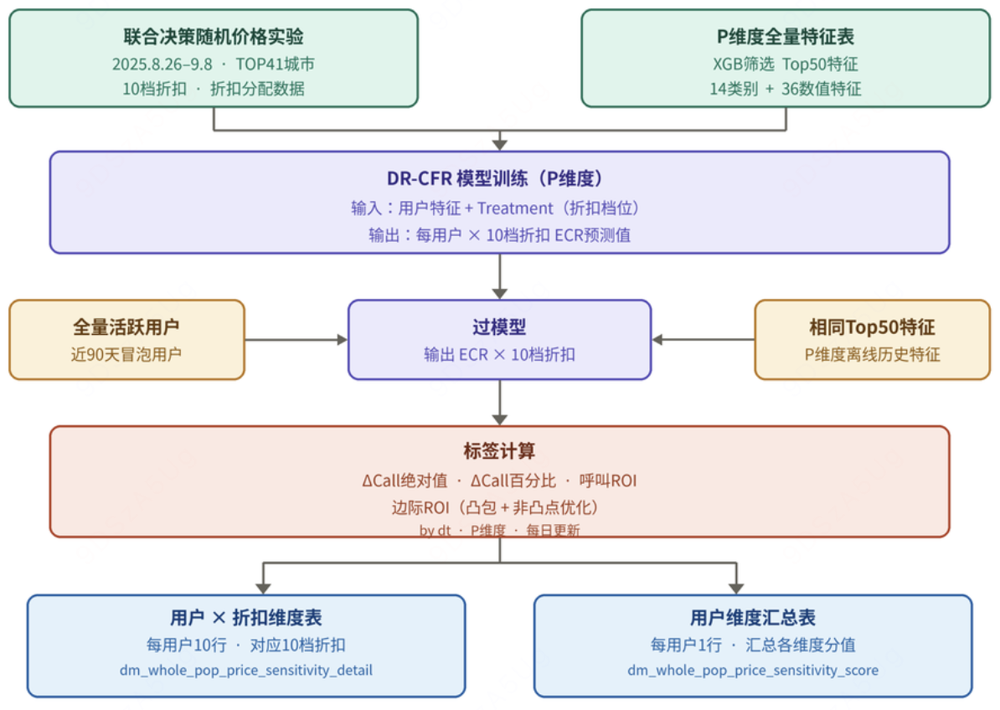
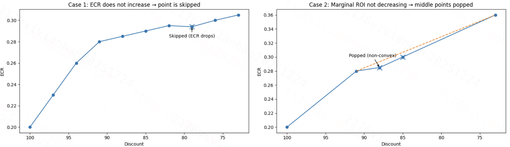
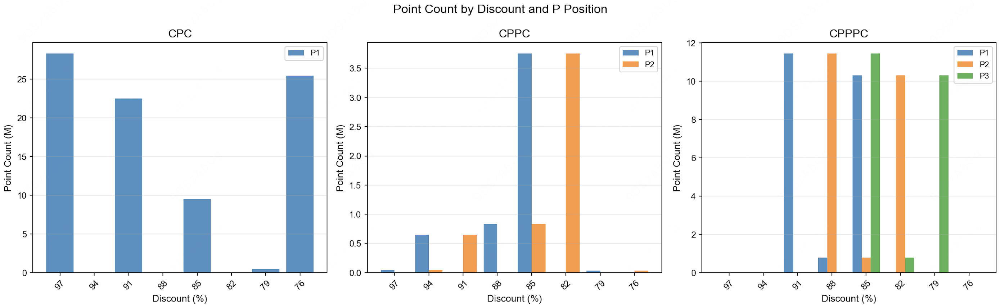
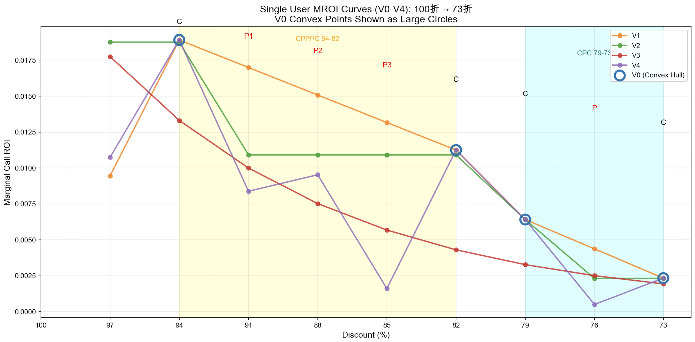
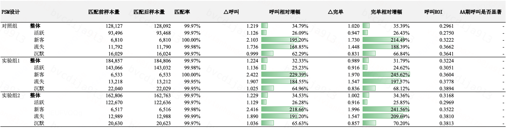
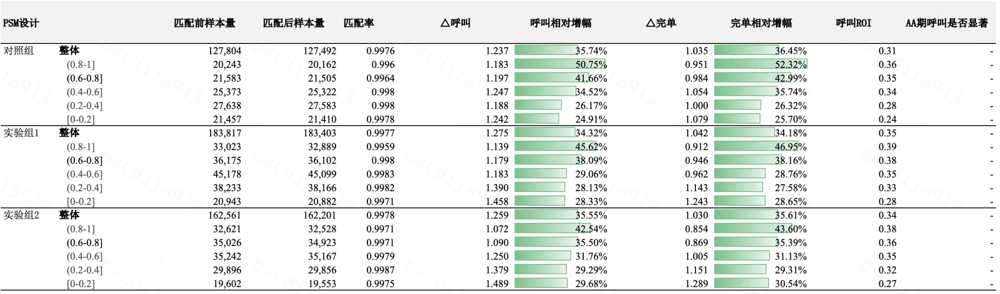
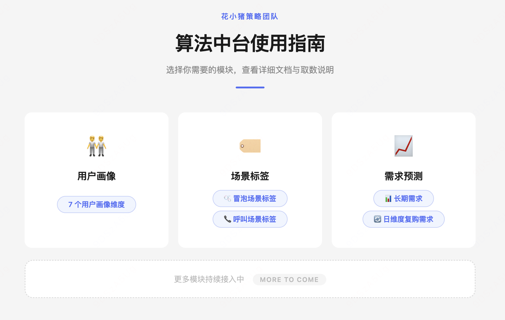

# 【LR26-011】乘客与增长-增长策略-全量价敏人群标签-V1

[Cooper 原文](https://cooper.didichuxing.com/knowledge/2199610335356/2207983255568)

> BRD：[全量活跃用户价敏标签BRD](https://cooper.didichuxing.com/knowledge/share/page/aXrGCOUyQVjT)

> 策略方案：[【全量活跃用户价敏标签】策略方案](https://cooper.didichuxing.com/knowledge/2199610335356/2206384490717)

# 0. 基础信息

| 字段 <br> | 内容 <br> |
| --- | --- |
| BRD文档链接 <br> | [全量活跃用户价敏标签BRD](https://cooper.didichuxing.com/knowledge/share/page/aXrGCOUyQVjT) <br> |
| 最后通过的策略方案链接 <br> | [【全量活跃用户价敏标签】策略方案](https://cooper.didichuxing.com/knowledge/2199610335356/2206384490717) <br> |
| 实验链接（评估大师） <br> | 无（因合规原因没有开放空白组，DS产出PSM评估） <br> |
| 核心贡献点 <br> | 将价敏标签扩展至全量活跃用户 <br>更细致折扣档位 <br>多维度价敏标签 <br> |
| 第一贡献人 <br> | 韩一玮 <br> |
| 共同贡献人 <br> | 周之烁，陈嘉曦，张梦迪，王艺霖 <br> |
| 后续策略负责人 <br> | 韩一玮 <br> |

# 一、需求背景

## 1.1 项目背景

在ACTI项目消暑畅行优惠中，已验证竞争人群价敏标签对提升补贴效率的有效性。与此同时，其他业务场景（如主题营销）在策略投放与日常分析上也提出了使用价敏标签的诉求。然而，当前价敏标签仅覆盖竞争人群，在其他营销抓手上的泛化能力有限。为提升全场景补贴效率，需构建独立的全量用户价格敏感度标签，实现精细化人群分层与差异化补贴策略，将有限的补贴资源精准投放给高价敏用户以最大化呼叫增量。

之前版本仅覆盖竞争人群，本版本扩展至全量活跃用户，并在折扣档位上进行了更细粒度划分，产出多维度价敏指标，支持不同业务场景的人群圈选需求。

| 维度 <br> | 之前版本（竞争用户价敏） <br>[]()[价敏画像策略方案v0](https://cooper.didichuxing.com/docs2/document/2204650154251) <br> | 当前版本（全量活跃用户价敏） <br> |
| --- | --- | --- |
| 覆盖人群 <br> | 仅竞争人群 <br> | 90天有冒泡用户（下称全量用户） <br> |
| 折扣档位数 <br> | 5档 <br> | 10档 <br> |
| 折扣范围 <br> | 75折 - 100折 <br> | 73折 - 100折 <br> |
| 折扣粒度 <br> | 5%间隔（75/80/85/90/100） <br> | 3%间隔（73/76/79/.../100） <br> |

## 1.2 目标&约束

**策略目标**

将竞争人群价敏标签扩充为全量活跃用户价敏标签，在折扣档位上进行了更细粒度划分，产出多维度价敏指标。

在相同 C 补水平下，验证分层差异化曝光策略的呼单拉动效果，验证将低弹性人群的曝光资源腾挪至高弹性人群能带来增量收益。

全量价敏人群标签有效性验证，随着弹性增加，呼叫roi增加。

**约束**

无。

# 二、整体链路

## 2.1 Overview



## 2.2 模型训练

[全量价敏人群步骤&记录](https://cooper.didichuxing.com/knowledge/2199610335356/2206384616306)

**数据来源**

- 联合决策随机价格实验

- 实验时间：2025.8.26 00:00 \~ 2025.9.8 24:00

- 实验城市：TOP41城市（北京、广州除外）

- 折扣档位：\[100, 97, 94, 91, 88, 85, 82, 79, 76, 73\]

**特征选取**

- 通过XGB模型筛选Top50特征（AUC = 0.7157）

- 特征类别：14个类别特征 + 36个数值特征

**DR-CFR模型**

- 框架：TensorFlow 2.0.0

- 输入：用户特征 + Treatment（折扣档位）

- 输出：每个用户在10档折扣下的ECR预测值（ECR_100, ECR_97, ..., ECR_73）

- 模型效果：

	- Overall: AUCC=0.89319, QINI=0.40277

	- Train AUC: 0.7162, Test AUC: 0.6977

## 2.3 标签搭建

### 2.3.1 ΔCALL 绝对值

**含义：**相比100折（无折扣），该折扣下每天预期增加的呼叫次数。

**公式：**$$\Delta \mathrm{CALL}_{\text{绝对值}} = \left( \frac{\text{bubble\_cnt\_90d}}{90} \right) \bigl( \mathrm{ECR}_d - \mathrm{ECR}_{100} \bigr)$$

### 2.3.2 ΔCALL 百分比

**含义：**相比100折（无折扣），ECR的提升比例。

**公式：**$$\Delta \mathrm{CALL}_{\mathrm{pct}} = \frac{\mathrm{ECR}_{d} - \mathrm{ECR}_{100}}{\mathrm{ECR}_{100}}$$

### 2.3.3 呼叫ROI

**含义：**每单位补贴成本带来的呼叫增量。

**公式：**$$\mathrm{Call\ ROI} = \frac{\Delta \mathrm{CALL}}{\Delta \mathrm{Cost}}$$

其中，

$$\Delta \mathrm{CALL} = \mathrm{ECR}_{d} - \mathrm{ECR}_{100}$$

$$\Delta \mathrm{Cost} = \mathrm{ECR}_{d} \times \mathrm{CR} \times \mathrm{Price} \times \mathrm{discount\_rate}$$

### 2.3.4 边际ROI

**凸包**

在折扣-ECR曲线上，并非所有折扣点都是"高效"的。只有位于凸包上的点才是帕累托最优的——即在相同成本下获得最大ECR提升，或在相同ECR提升下成本最低。

```PlainText
ECR
 ↑
 │                    ★ 73折
 │                 ★ 76折
 │              ● 79折 (非凸包点，被跳过)
 │           ★ 82折
 │        ★ 85折
 │     ● 88折 (非凸包点，被跳过)
 │  ★ 91折
 │★ 100折 (基准)
 └──────────────────────────→ Cost (折扣成本)

★ = 凸包上的点（计算marginal_roi）
● = 非凸包点（marginal_roi = NULL）
```

如果一个点位于其相邻两点连线的下方或连线上，则该点不在凸包上，应被移除。

**步骤**

1. 将折扣点按折扣率从小到大排序：\[100折, 97折, 94折, ..., 73折\]

2. 初始化凸包列表，加入第一个点（100折）

3. 依次处理每个点：

	- 当凸包中至少有2个点时，检查最后三个点是否满足"左转"条件

左转
左转判定公式：

对于三个点 $$P_1(x_1, y_1)，P_2(x_2, y_2)，P_3(x_3, y_3)$$：

$$cross = (x_2 - x_1)(y_3 - y_1) - (y_2 - y_1)(x_3 - x_1)$$

- 如果 cross>0：左转（保留中间点）

- 如果 cross≤0：右转或共线（移除中间点）

	- 如果不满足（即中间点在连线下方或上方），移除中间点

	- 将当前点加入凸包

4. 最终凸包列表中的点即为有效点

**边际呼叫ROI**

**含义**：在凸包上，从上一个折扣点到当前折扣点的增量呼叫ROI。

**公式：**$$\mathrm{Marginal\ ROI} = \frac{\mathrm{Call}_{d} - \mathrm{Call}_{\mathrm{prev}}} {\mathrm{Cost}_{d} - \mathrm{Cost}_{\mathrm{prev}}}$$

**注意：**

- 100折：作为基准点，`marginal_call_roi = NULL`（无前一个点）

- 非凸包点：`marginal_call_roi = NULL`

- 凸包上的点：计算与前一个凸包点的边际ROI

## 2.4 marginal_call_roi非凸点优化

[非凸点优化分析](https://cooper.didichuxing.com/knowledge/2205119588036/2206245629813)

### 2.4.1 问题现状

marginal call roi 对每个用户在不同折扣下的 ECR 曲线进行筛选，只在被认为“有效”的折扣点上计算边际效果，其余折扣点的 marginal 结果为空值。在实际执行中，非凸点主要通过以下两类规则被过滤掉：

- **Case 1：折扣加深但 ECR 未提升 （D点）**

	- 如果折扣更深，但预测的 ECR 没有高于上一个已保留的折扣点会被直接判定为无效并跳过

- **Case 2：破坏凸性 （P点）**

	- 对于通过 Case 1 的折扣点，会基于“边际收益递减”的假设做凸性检查：当新折扣加入后，如果当前折扣相对上一个保留折扣的边际收益不低于前一段边际收益，则认为中间折扣点为非凸点并从结果中移除。

	- 采用栈式回溯方式，可能连续移除多个中间折扣点，直到边际收益重新呈现递减趋势为止。

在上述两类规则下，很多折扣点都不能留在最终的凸包中，其 marginal 结果是NULL，不利于按折扣粒度分析用户价格敏感度，因此需要对现有的非凸点处理方式进行优化。



从原始 V0 方案的空值分布来看，越靠近折扣两端非空率越低；位于中间区间的折扣大量出现空值，其中 85 折非空率仅为 0.0045%；91 折非空率只有 4.37%。

分折扣统计marginal call roi 空值
| version <br> | discount <br> | total_rows <br> | not_null_cnt <br> | not_null_rate <br> |
| --- | --- | --- | --- | --- |
| V0 <br> | 97 <br> | 57121311 <br> | 28760623 <br> | 50.35% <br> |
| V0 <br> | 94 <br> | 57121311 <br> | 56269415 <br> | 98.51% <br> |
| **V0** <br> | **91** <br> | **57121311** <br> | **2496076** <br> | **4.37%** <br> |
| V0 <br> | 88 <br> | 57121311 <br> | 23725548 <br> | 41.53% <br> |
| **V0** <br> | **85** <br> | **57121311** <br> | **2558** <br> | **0.0045%** <br> |
| V0 <br> | 82 <br> | 57121311 <br> | 21880530 <br> | 38.31% <br> |
| V0 <br> | 79 <br> | 57121311 <br> | 29653598 <br> | 51.91% <br> |
| V0 <br> | 76 <br> | 57121311 <br> | 31139031 <br> | 54.51% <br> |
| V0 <br> | 73 <br> | 57121311 <br> | 57116603 <br> | 99.99% <br> |

统计后发现，绝大部分用户的非凸点都集中在以下三种模式：

| 模式 <br> | 含义 <br> | 比例（占所有非凸模式） <br> |
| --- | --- | --- |
| **CPC** <br> | 1个被凸包删除的点 <br> | 75.60% <br> |
| **CPPPC** <br> | 3个连续被凸包删除的点 <br> | 19.74% <br> |
| **CPPC** <br> | 2个连续被凸包删除的点 <br> | 4.65% <br> |

无论是单非凸点（CPC），还是双、三连续非凸点（CPPC、CPPPC），其位置都大量落在 91、88、85、82 等中部折扣区间。尤其是在 CPPC 和 CPPPC 场景中，非凸点沿着折扣加深方向成片出现，导致这些折扣在 V0 逻辑下被整体删除。结合起来，像 91/ 85 折这样非空率几乎为 0 的档位，因为它在高频的 CPC / CPPC / CPPPC 模式中处于“被删除位置”的中心。91/85折并不是高效补贴档位—— 加深到91/85折所带来的边际收益，可能不如直接跳到更深折扣划算。



### 2.4.2 优化方案

| 版本 <br> | Case 1：折扣加深但 ECR 未提升 <br> | Case 2：非凸点处理方式 <br> |
| --- | --- | --- |
| V1 线性插值 <br> | marginal call roi 填充为 0 <br> | 在折扣维度找左右最近两个凸包点，按折扣距离比例对二者的 marginal call roi 做线性插值 <br> |
| V2 Isotonic Regression <br> | marginal call roi 填充为 0 <br> | 使用 PAV（Pool Adjacent Violators）对边际序列做单调递减的保序回归，发现某段边际高于前一段，就将相邻的违规段合并为一个块并取平均值，反复合并直到整个序列恢复为单调递减。完成拟合后，再将拟合后的边际序列映射回各折扣档位，得到每个有效折扣点对应的 marginal call roi。 <br> |
| V3 Curve Fitting <br> | marginal call roi 填充为 0 <br> | 引入一条预设形状的衰减曲线对边际收益进行整体拟合，并通过后处理将残余反弹强制压平，减少非凸带来的不稳定与极端值。先按相邻折扣逐段计算原始边际收益（只保留能够计算出有效成本增量的段），把每个折扣段映射为一个离散的序号索引，形成一组用于拟合的 (x, y) 样本，其中 x 表示折扣段位置，y 表示该段的原始边际收益。随后在 y 为正的样本上拟合一条指数衰减形状的曲线，用该曲线对所有折扣档位生成平滑后的边际收益预测。 <br> |
| V4 凸包用跨段；非凸用相邻 <br> | marginal call roi 填充为 0 <br> | 凸包点沿用原凸包口径（与 V0 一致，可跨折扣段）；非凸包点改为计算该点与其上一档折扣之间的 marginal call roi <br> |

下图选了一个用户样本，展示不同非凸点处理方案在同一用户上的表现差异。

该用户在 94–82 区间呈现出 CPPPC ，在 79–73 区间呈现出 CPC。不同颜色的折线分别对应四种优化方案（V1–V4）在该用户上的填充结果，蓝色空心圆标记的是 V0 原始凸包方法下算出的凸包。



### 2.4.3 方案结论

|  <br> | V0 <br> | V1 <br> | V2 <br> | V3 <br> | V4 <br> |
| --- | --- | --- | --- | --- | --- |
| 空值率 <br> | 48.83% <br> | 0%  <br> | 0%  <br> | 0%  <br> | 0%  <br> |
| 单调性违规率 <br> | 0% <br> | 6.23% <br> | 0%  <br> | 0%  <br> | 39.27%  <br> |
| 与V0相关性 <br> | / <br> | 0.9641 <br> | 0.9821  <br> | 0.9745 <br> | 0.9706 <br> |
| 排名偏移 <br> | / <br> | 5.5% <br> | 3.5%  <br> | 4.2% <br> | 4.9% <br> |
| 曲线平滑度 <br> | / <br> | 线性 <br> | 阶梯状 <br> | 平滑曲线 <br> | 剧烈波动  <br> |

应用场景下最推荐使用V2（Isotonic regression），在保证单调性的同时最大程度保持与原始凸包结果的一致性（V0相关性与排名偏移）；

若业务上需要保留原始边际值的诉求，可选用V4（原始值填充），但需注意其单调性违规问题。

## 2.5 产出内容

[全量价敏人群使用方法](https://cooper.didichuxing.com/knowledge/2205119588036/2206051030088)

全量人群价敏标签每日自动更新，并配置了监控报警机制：报警基线设置为增长方向（T+2），保障时间20:00，SLA时间20:30，优先级5。

已与DE标签平台完成对接，标签已配置DiTag，接入T-2的价敏标签数据。

### 2.5.1 用户 x 折扣维度表

- **表名：**kflower_strategy.dm_whole_pop_price_sensitivity_detail

- **粒度：**用户 × 折扣（每个用户10行，对应10个折扣档位）

- **分区字段：**dt（业务日期）

- **数据范围：**最近90天有冒泡行为的用户

- **数梦链接：**<https://datamap.didichuxing.com/detail?uri=hive://mycluster-tj:kflower_strategy:dm_whole_pop_price_sensitivity_detail&keyword=whole_pop&version=next>

表结构
| 字段名 <br> | 含义 <br> | 逻辑 <br> | 示例 <br> |
| --- | --- | --- | --- |
| dt <br> | 分区日期 <br> | 对应数据为dt-89 \~ dt <br> | 2025-12-02 <br>解释：该条数据的业务日期，指标基于该日期往前推90天计算 <br> |
| passenger_id <br> | 用户 ID <br> | 最近90天有冒泡用户 <br> | 52776918977005 <br>解释：用户的唯一标识 <br> |
| city_id <br> | 城市 ID <br> | 用户归属城市 ID（kflower_dw.dwm_kf_pas_profile_df表中的resident_city_id字段） <br> | 156 <br>解释：用户常驻城市是156 <br> |
| discount <br> | 折扣档位 <br> | \[100, 97, 94, 91, 88, 85, 82, 79, 76, 73\] <br> | 73 <br>解释：对应的折扣档位是73折 <br> |
| ecr_pred <br> | 预测ECR <br> | 0当前折扣下的预测冒泡发单率，来自DR-CFR模型输出 <br> | 0.644814133644104 <br>解释：模型预测该用户在73折下的冒泡发单率为0.644814133644104 <br> |
| bubble_cnt_90d <br> | 90天冒泡数 <br> | 用户过去90天的总冒泡次数 <br> | 195 <br>解释：该用户过去90天共冒泡195次 <br> |
| price <br> | 单均价 <br> | 过去90天冒泡单均价（应附价） <br> | 8.734273617257553 <br>解释：该用户过去90天的平均单价为8.73元 <br> |
| cr <br> | 过去90天cr <br> | 过去90天的cr <br> | 0.75 <br>解释：该用户cr是0.75 <br> |
| delta_call_abs <br> | ΔCALL绝对值 <br> | (bubble_cnt_90d / 90) × (ECR_d - ECR_100) <br> | 0.06289012233416238 <br>解释：相比无折扣，给73折预计每天增加0.0629次呼叫 <br> |
| delta_call_abs_pct <br> | ΔCALL绝对值百分位 <br> | 用户在当前折扣下delta_call_abs的百分位排名 <br> | 0.51626183525508413 <br>解释：在73折档位下，该用户的呼叫增量绝对值超过了51.63%的用户 <br> |
| delta_call_pct <br> | ΔCALL百分比 <br> | (ECR_d - ECR_100) / ECR_100，ECR相对提升比例 <br> | 0.047136699516329504 <br>解释：给73折后，该用户的ECR相比无折扣提升了4.71% <br> |
| delta_call_pct_pct <br> | ΔCALL百分比百分位 <br> | 用户在当前折扣下delta_call_pct的百分位排名 <br> | 0.32135836792399514 <br>解释：在73折档位下，该用户的ECR提升比例超过了32.14%的用户 <br> |
| call_roi <br> | 呼叫ROI <br> | delta_call / delta_cost，单位补贴成本带来的呼叫增量（d折 vs 100折），100折为NULL <br> | 0.025450948314512712 <br>解释：在73折下，每投入1元补贴成本，可带来0.0255次增量呼叫 <br> |
| call_roi_pct <br> | 呼叫ROI百分位 <br> | 用户在当前折扣下call_roi的百分位排名 <br> | 0;6796403866068916 <br>解释：在73折档位下，该用户的补贴ROI超过了67.96%的用户 <br> |
| marginal_call_roi <br> | 边际ROI <br> | 相邻折扣的增量ROI，仅凸包上的点有值，100折为NULL <br> | 0.019874209531757978 <br>解释：从上一个凸包折扣加深到73折，每多投入1元补贴可多带来0.0199次呼叫 <br> |
| marginal_call_roi_pct <br> | 边际ROI百分位 <br> | 用户在当前折扣下marginal_call_roi的百分位排名 <br> | 0.26389213563360947 <br>解释：在73折档位下，该用户的边际ROI超过了26.39%的用户（仅与凸包点用户比较） <br> |

### 2.5.2 用户维度表

- **表名：**kflower_strategy.dm_whole_pop_price_sensitivity_score

- **粒度：**用户（每个用户1行）

- **分区字段：**dt（业务日期）

- **数据范围：**最近90天有冒泡行为的用户

- **数梦链接**：<https://datamap.didichuxing.com/detail?uri=hive://mycluster-tj:kflower_strategy:dm_whole_pop_price_sensitivity_score&keyword=whole_pop&version=next>

表结构
| 字段名 <br> | 含义 <br> | 逻辑 <br> | 示例 <br> |
| --- | --- | --- | --- |
| dt <br> | 业务日期 <br> | EVE 分区日期 <br> | 2025-12-02 <br>解释：该条数据的业务日期，指标基于该日期往前推90天计算 <br> |
| passenger_id <br> | 用户 ID <br> | 最近90天有冒泡用户 <br> | 52778428410280 <br>解释：用户的唯一标识 <br> |
| city_id <br> | 城市 ID <br> | 用户归属城市 ID（kflower_dw.dwm_kf_pas_profile_df表中的resident_city_id字段） <br> | 3 <br>解释：用户常驻城市是3 <br> |
| delta_call_abs_score <br> | 平均ΔCALL 绝对值  <br> | 用户10个折扣下delta_call_abs_pct的平均值 <br> | 0.1609293404272413 <br>解释：该用户在10个折扣档位的呼叫增量绝对值百分位平均为16.09% <br> |
| delta_call_abs_score_pos <br> | 平均ΔCALL 绝对值百分位数 <br> | delta_call_abs_score的全量用户百分位排名 <br> | 0.15904101738278903 <br>解释：该用户的增量绝对值分数超过了15.90%的用户 <br> |
| delta_call_pct_score <br> | 平均ΔCALL 百分比 <br> | 用户10个折扣下delta_call_pct_pct的平均值 <br> | 0.344261217209845 <br>解释：该用户在10个折扣档位的ECR提升比例百分位平均为34.43% <br> |
| delta_call_pct_score_pos <br> | 平均ΔCALL 百分比百分位数 <br> | delta_call_pct_score的全量用户百分位排名 <br> | 0.36516091814320367 <br>解释：该用户的ECR提升比例分数超过了36.52%的用户 <br> |
| call_roi_score <br> | 平均呼叫 ROI <br> | 用户10个折扣下call_roi_pct的平均值 <br> | 0.39814525159273656 <br>解释：该用户在10个折扣档位的平均呼叫ROI百分位平均为39.81% <br> |
| call_roi_score_pos <br> | 平均呼叫 ROI百分位数 <br> | call_roi_score的全量用户百分位排名 <br> | 0.39118082308483487 <br>解释：该用户的平均呼叫ROI分数超过了39.12%的用户 <br> |
| marginal_call_roi_score <br> | 平均边际 ROI <br> | 用户10个折扣下marginal_call_roi_pct的平均值（去除非凸点） <br> | 0.5242736461083288 <br>解释：该用户凸包点的边际ROI百分位平均为52.43% <br> |
| marginal_call_roi_score_pos <br> | 平均边际 ROI百分位数 <br> | marginal_call_roi_score的全量用户百分位排名 <br> | 0.3403050512376234 <br>解释：该用户的边际ROI分数超过了34.03%的用户 <br> |

# 三、实验方案&结果

## 3.1 实验背景

营销活动持续精细化运营，在有限的预算下，基于呼叫 ROI 弹性对用户分层，差异化分配曝光资源：对高弹性用户加大曝光力度促进呼单，对低弹性用户收缩曝光降低无效核销概率，在拉动大盘呼单的同时提升营销钱效。

在相同 C 补水平下，对比人群通投与分层差异化曝光两种策略的呼单拉动效果，验证将低弹性人群的曝光资源腾挪至高弹性人群能否带来增量收益，并确定收益最大化的曝光腾挪比例。

**人群划分逻辑：**当前补贴集中在 9 折档位，以 91 折场景下的呼单 ROI 为依据划分弹性层级，界定高弹性与低弹性用户范围，明确界定低弹性用户与高弹性用户的范围，作为差异化曝光的分层基准。

## 3.2 实验方案

**实验日期：**2026-03-23 ～ 2026-04-02

**实验城市：**A框城市（GMV占比～65%）

| **实验组** <br> | **流量比例** <br>**（A框城市）** <br> | **策略 3.23-4.2** <br>**（更换城市分框，开A框城市实验分流）** <br> |
| --- | --- | --- |
| 对照组-非差异化策略 <br> | 34% <br> | - 全部用户资源位一致 <br><br>- 线上常规策略-普通弹窗频次2，领券率14.8% <br><br>  <br> |
| 实验组1-差异化策略1 <br> | 33% <br> | - 人群定义 <br><br>	- 低弹人群：91折下，呼单ROI&lt;0.0185，占比40% <br><br>	- 高弹人群：91折下，呼单ROI&gt;=0.0185，占比60% <br><br>- **差异化渗透：将低弹人群补贴全部腾挪给高弹人群** <br><br>	- 低弹人群：关闭弹窗 <br><br>		- 领券率从16%（频次2）下降至6% <br><br>	- 高弹人群：一键领券模板 频次2+普通弹窗 频次1 <br><br>		- 领券率从16%（频次2）上升至24% <br><br> |
| 实验组2-差异化策略2 <br> | 33% <br> | - 人群定义 <br><br>	- 低弹人群：91折下，呼单ROI&lt;0.0155，占比25% <br><br>	- 高弹人群：91折下，呼单ROI&gt;=0.0265，占比50% <br><br>- **差异化渗透：低弹人群补贴部分腾挪给高弹人群** <br><br>	- 低弹人群：关闭弹窗 <br><br>		- 领券率从16%（频次2）下降至6% <br><br>	- 高弹人群：一键领券模板 频次1+普通弹窗 频次1 <br><br>		- 领券率从16%（频次2）上升至24% <br><br>	- 其他（包含新流）：普通弹窗频次2 <br><br> |

## 3.3 实验评估结果

由于实验期运营未设置空白组（<!--评论:[{"u":"rongbohui","c":"什么原因未设置？"}] -->因为活动进行时间太久了，贸然开空白组会有大量用户投诉以及法律风险），<!--评论:[{"u":"rongbohui","c":"什么原因未设置？"}] -->无法直接通过组间对比衡量钱效，需借助 PSM进行额外评估。PSM 通过为实验组中每个用户匹配一个特征相近的未参与用户作为对照，构造出"空白组"，从而剔除用户本身特征差异的干扰，更准确地估计补贴策略带来的真实增量效果。PSM匹配逻辑：对于实验组中的每一位用户，首先以其生命周期阶段作为分层条件，仅在生命周期相同的候选池中筛选潜在对照用户；在此基础上，再以用户活动开始前历史窗口内的行为数据进一步匹配，匹配维度涵盖访问次数、冒泡次数、呼叫次数、完单次数、GMV 及 C 补，最终为每位实验组用户找到行为特征最为相近的对照用户，构成可比的"空白组"。

### 3.3.1 实验评估

**结论：**

基于算法价敏标签的流量倾斜策略在营销场景能拿到显著收益，能提升营销roi。

整体呼叫ROI: 实验组1 0.3224（+8.88%） > 组2 0.3168 （+6.99%） > 对照组0.2961。



### 3.3.2 标签有效性评估

**结论：**

已有的算法价敏标签有效。

- 分是否策略倾斜，呼叫ROI：组内高弹人群>低弹 ，组1和组2结论一致。

- 分弹性标签，呼叫ROI：实验组1 > 组2 > 对照组。 各组内随着弹性增加，呼叫roi增加，实验组1/2中，资源倾斜更多的组1比倾斜少组2更高。



# 四、后续规划

## 4.1 线上策略

基于实验结论，实验组1方案在整体呼叫 ROI 和各弹性分层表现上均优于实验组2，计划将实验组1策略应用全量。

## 4.2 后续迭代

### 4.2.1 营销敏感标签

[【策略方案】主题营销曝光敏感用户标签V0](https://cooper.didichuxing.com/knowledge/2199610335356/2207811319756)

当前线上使用的全量价敏人群标签基于平台整体呼返行为建模，反映的是用户对价格变动的整体敏感程度，并非针对营销曝光场景设计，无法准确刻画用户在"有无曝光"情况下的呼叫增量差异。为更好支撑主题营销精细化运营，计划建设营销敏感标签，核心转变在于：从"用户对价格是否敏感"升级为"用户对营销曝光是否敏感"，即直接预测曝光带来的呼叫增量，以 Call ROI 为最终目标指标，识别单位补贴成本带来呼叫增量最高的用户群体。并将本次建设的能力泛化为一个通用营销敏感标签，复用至竞争、学生、异地等所有有弹窗曝光的营销活动场景。

预计6月建设完成后实验。

### 4.2.2 主题营销

- **V0（当前）**：曝光基于全量价敏标签人工配置差异化策略

- **V1**：曝光升级为基于营销敏感标签的差异化投放，更精准识别曝光响应敏感用户；一键领券算法策略，实现折扣个性化（已实现）[【LR26009】主题营销主会场“一键领券”组件接算法策略V1](https://cooper.didichuxing.com/knowledge/2199610335356/2207596402237)

- **V2**：曝光与一键领券在同一优化目标下联合决策，流量分配与折扣定价同步求解，在全局预算约束下最大化整体呼单增量（Q3末）

# 五、放量决策

业务已经于5月完成实验组1策略应用全量，支持分层差异化曝光策略。

主题营销曝光敏感用户标签建设完成后，会对曝光敏感用户标签vs全量价敏人群标签新开实验，后评估实验效果决定是否继续全量使用全量价敏人群标签作为分层差异化曝光策略。

# 六、其他

基于现在已有中台能力，搭建了一个用户手册，方便对比不同版本的策略&运营取数。

链接：<http://10.191.156.42:8001/>


