# 【LR26-013】交易效率-乘客引导-接驾远换车策略-V2.1

[Cooper 原文](https://cooper.didichuxing.com/knowledge/2199610335356/2207853025753)

## 基础信息（必需）

| brd文档链接   | [brd-应答后换车优化](https://cooper.didichuxing.com/knowledge/2204598041545/2204686254138)   |
| --- | --- |
| 最后通过的策略方案链接   | [接驾远换车v2.1策略方案](https://cooper.didichuxing.com/knowledge/2199610335356/2204880840509)   |
| 实验链接（评估大师）   | [https://x.intra.hongyibo.com.cn/exp/484399093383169?globalBusinessId=120000&globalProjectId=406437792776193&expFlowTab=dashboard&dashboardTab=metricDetail](https://x.intra.hongyibo.com.cn/exp/484399093383169?globalBusinessId=120000&globalProjectId=406437792776193&expFlowTab=dashboard&dashboardTab=metricDetail)   |
| 核心贡献点（创新点，可供其他算法同学借鉴的点）   |    |
| 第一贡献人   | 秦嘉彤   |
| 共同贡献人（没有的话，可以置空）   | 吴健   |
| 后续策略负责人   | 秦嘉彤   |

# 一、背景

- **接驾远V1策略**：基于简单规则的换车策略，对于eta大于300秒的订单进行手动换车，相比空白组拿到显著收益：人均完单+0.26%，应答后不含改c取消显著-0.33pp。

- **接驾远V2.1做什么**：对于预估应答后取消率高的接驾远订单进行换车，进而降低应答后乘客取消、提升CR与完单。核心策略改进如下：

	- **V2.1新增预估取消率模型，分档触发策略**：对接驾远订单（预估接驾时长符合准入门槛），通过模型预估取消率,高取消率且高用车意愿→直接换车，中取消率→手动换车，低取消率→不换车（每2min轮询判断）。

	- **V2.1提升连环派订单换车触发面**：连环派准入阈值和取消率阈值更低；AB段预估时长>90s直接发起换车。

- **接驾远V2.1迭代动机：**

	- **自动换车的必要性**：V1满足换车条件的订单占大盘应答的18%，但由于需要乘客主动点击"换车"按钮，实际点击率仅为触发订单的10%，大部分用户没有主动换车，而在未换车且被取消的订单中，61%有寻找更近司机的诉求，取消中75%仍有用车意愿。

	- **连环派扩大触发的逻辑**：连环派换车时若上一单未完成，则不造成司机空驶，不折损大盘效率；且相同接驾距离下连环派B、C取消双高。

- **产品形态：**

| V1产品形态   | V2产品形态   |
| --- | --- |
| 手动换   | 自动换   | 手动换   |
| 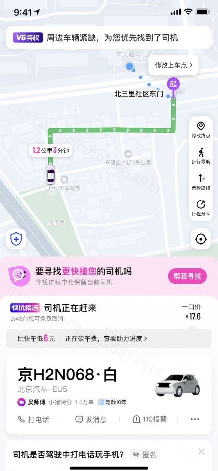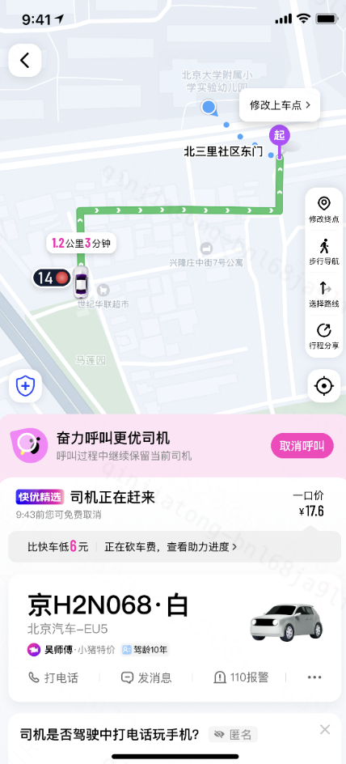   |    |    |
| - 仅手动换，用户点击后进入找车界面    | - 若命中手动换，用户点击后进入找车界面（与V1相同）   - 若命中自动换车则直接发起找车，直接进入找车界面    |

# 二、目标&约束

- **目标**：降低归一后应答后乘客取消0.3pp，提升CR0.2pp

- **约束**：**司乘体验约束**：乘客命中接驾远换车并成功换车后不会继续命中接驾远换车

> 从交易效率的角度，站在应答后节点来看，被换车司机的空驶时长是“沉没成本”而不是换车带来的“策略折损”；接驾远换车本质上是把已匹配的订单仍保留在分单系统寻找更优的匹配结果，因此从交易效率的角度来说换更近的车总是提升效率的。所以，接驾远换车的约束主要是司乘体验方面的约束。

# 三、技术方案

## 3.1 策略流程

**整体流程**

- 接驾远换车策略在交易链路中的位置：**应答后等接驾过程**。

- 接驾远换车策略V2.1流程简述：应答后等接驾过程中，每2min触发轮询判断是否触发策略，具体的策略触发由eta阈值规则+应答后乘客取消率模型判断，区分为自动换车、手动换车（需乘客点击换车）、不换车三种结果，实际触发换车（包括自动换车和手动换车乘客点换）后会在分单系统中带着更近90秒的约束再次发单寻找新车，同时保留原车。找到符合条件的新车后原车被取消，由新车继续接驾；未找到新车、不换车的情况都会继续等待原车接驾，在等接驾过程中始终经历每2min的轮询，直至司机点击到达。

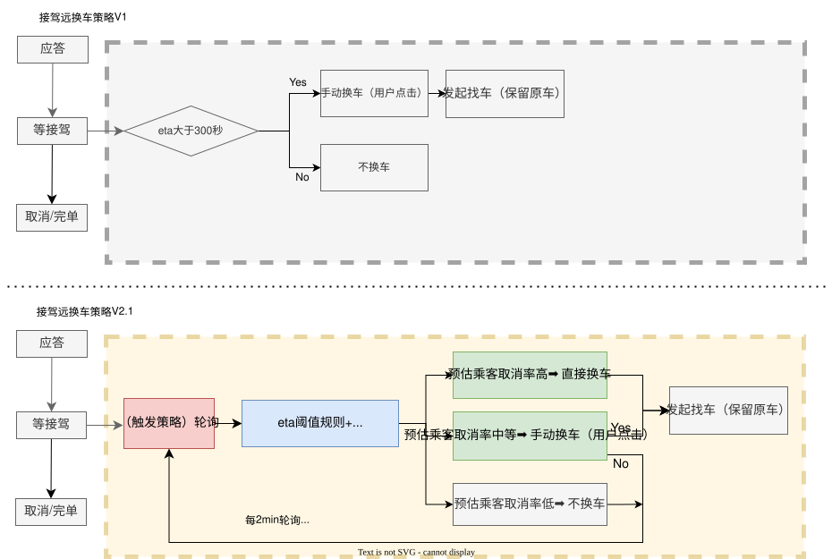

## 3.2 策略细节

**轮询机制**

- **轮询机制**：

	- 每2min对仍在等接驾流程中的订单判断**是否需要触发换车策略**（包括除了已经换到车的订单以外的所有等接驾中订单，包括策略判断不换、乘客手动不换/无操作、发起找车但未找到新车的订单）

	- 目前用户每次切端也会调用接口触发轮询，因此实际轮询频率可能会比2min轮询更频繁。

- **动机**：实时判断接驾中订单是否需要换车，轮询机制核心是处理首次判断未换车成功的订单后续是否需要换车。

	- 理想的状态是在首次判断时就找到更近的车，而不是让乘客先等待再换车；

	- **轮询机制的必要性**：但存在首次换车但找不到可用新车的情况，此时如果乘客后续仍符合换车条件，则应该重新发起找车；以及存在部分前序无需换车、但后续需要换车的情况（例如堵车、司机开远等动态变化）。

	- **轮询效果**：在「3.4.5轮询效果」说明了轮询的实验效果，约20%的实际成功换车是轮询时换车，证明了轮询的必要性。

**找车约束**

- **找车距离约束**：新车须比原车更近90秒；更近90秒的距离约束是在PK模块进行实时判断，使用的是已经找到新车后实时的新车eta和原车eta比较，从而保证换到的一定是实时接驾时长更短90秒以上的车。

- **找车时间**：目前每次找车时间为90秒，若90秒内找不到符合条件的新车则结束找车流程，继续等原车接驾以及后续的轮询判断。

**直线距离兜底**

- **动机**：badcase拦截，用于防止导航定位不准/定位漂移/司机开过头导致导航路线变化造成的司机已碰面/即将碰面时的误换车。

	- **badcase描述**：司乘直线距离很近但是导航距离仍很远导致触发换车（例如司机即将到达但开过头很短距离，导致导航距离突变，从而触发换车策略），但此时司乘即将碰面，此时误换车会带来司乘差体验甚至导致进线，因此有必要进行badcase兜底。

	- **需防误伤场景**：司乘直线距离近但是确实需要换车，例如在街/桥对面，虽然直线距离短但确实接驾时间长的。这类正常换车场景需要防止兜底策略误伤。

	- 因此，在直线距离兜底时考虑到badcase拦截与正常换车场景防误伤之间的权衡。具体的兜底机制设计如下：

- **兜底机制**：

	- 在策略触发环节，**直线距离小于50米的会将自动换车降级为手动换车**；

		- 在触发环节，仅将自动换车降级为手动换车而非直接拦截，目的是防止误伤直线距离短但确实接驾时间长的正常换车场景。

		- 由于手动换车的用户点击率仅10%左右，降级策略有降低策略效果的可能；降级影响在「3.4.4直线距离拦截效果」进行说明，实验结果表明触发阶段的拦截误伤对实验效果影响较小（降级比例占触发换车数的0.5%）。

	- 在换车生效环节（PK模块，已找到新车、判断新车是否比原车更近90秒的环节），**直线距离小于50米的非连环派会拦截换车**。

		- 对非连环派拦截存在误伤可能，目前使用直线距离兜底难以区分司乘是会碰面的导航漂移badcase场景还是正常换车场景；误伤影响在「3.4.4直线距离拦截效果」进行说明，实验结果表明这类拦截误伤对实验效果影响较小（拦截比例占换车成功数的0.5%）。

		- 不对连环派生效拦截的原因：属于是可区分的误伤场景，连环派的直线距离短但导航距离长基本属于确实需要换车的正常换车场景。

**触发策略**

- 实验组a和实验组b差异在于连环派的换车策略，两个实验组对于非连环派的策略完全一致。

	- 实验组a：仅用eta阈值判断连环派触发。对于符合eta准入门槛且ab段eta>90秒的连环派全部触发自动换车。

	- 实验组b：eta阈值+应答后乘客取消率阈值判断连环派触发。对于符合eta准入门槛且符合应答后乘客取消率阈值的连环派分档触发手动换车或自动换车。

实验组具体触发阈值参数和流程
实验组a：

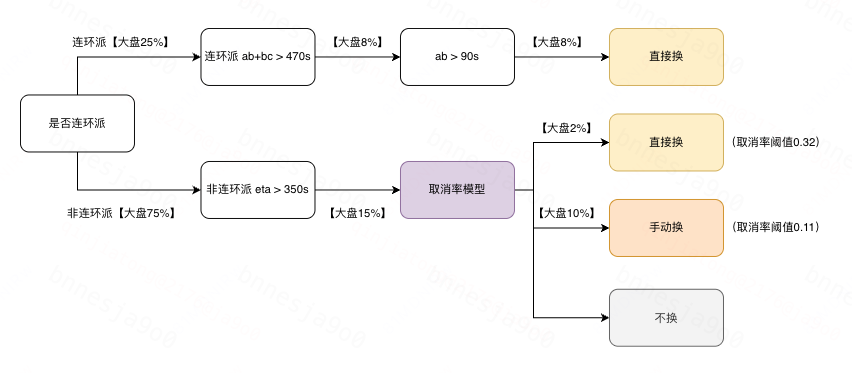

实验组b：

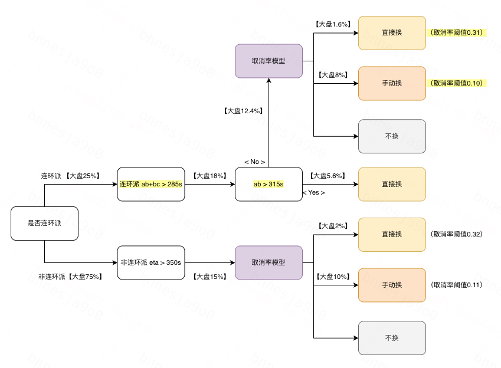

## 3.3 模型方案

**问题建模**

- 应答后乘客取消率的二分类任务

**样本空间**

- 正样本：应答后乘客取消的订单。正样本占全体应答样本（剔除应答后司机取消）约15%。

- 负样本：应答后完单的订单（剔除应答后司机取消的样本）。

**特征选择**

| 类别   | 代表性特征   | 特征数   |
| --- | --- | --- |
| 订单维度   | 城市id、接驾距离、是否连环派、是否滴滴司机等   | 22   |
| 供需特征   | 起点坐标格子5分钟内订单数、天气等   | 28   |
| 乘客历史   | 近7/14/28天自营/三方取消率、完单率等   | 16   |
| 司机历史   | 近1/3/7/14/28天连环派/非连环派拒单、应答、完单、取消等   | 71   |

**模型结构**

- 使用DNN模型进行应答后乘客取消率的二分类任务建模

[图表02 · 源文件](附件/LR26-013/图表02.json) · [在 Cooper 查看图形](https://cooper.didichuxing.com/knowledge/2199610335356/2207853025753)

**离线训练效果** 

- 训练集：2025-07-01～2025-07-28 平台全量应答后乘客取消和完单样本

- 测试集：2025-07-29～2025-08-04 平台全量应答后乘客取消和完单样本

- 离线评估效果：模型在测试集上离线auc为0.76<!--评论:[{"u":"tommywujian","c":"未来也要应用DO价值模型，需要和DO价值模型中O履约的AUC比较"}] -->

# 四、实验评估

## 4.1 实验设计

- 实验方式：应答后pid分流

- 流量端：小猪端

- 实验城市：全国

- 实验周期：评估周期为2026-05-11～2026-05-17

- 实验分组：

|    | 对照组   | 实验组a   | 实验组b   |
| --- | --- | --- | --- |
| 分组   | 线上老换车策略：eta&gt;300手动换   | 换车策略1：  - 连环派：对于符合eta准入门槛且ab段eta&gt;90秒的连环派全部触发自动换车。   - 非连环派：对于符合eta准入门槛且符合应答后乘客取消率阈值的连环派分档触发手动换车或自动换车。    | 换车策略2：  - 连环派：对于符合eta准入门槛且符合应答后乘客取消率阈值的连环派分档触发手动换车或自动换车。   - 非连环派：对于符合eta准入门槛且符合应答后乘客取消率阈值的连环派分档触发手动换车或自动换车。    |
| 实验流量   | 60%   | 20%   | 20%   |

- 核心关注指标：应答后乘客取消率（归一口径），CR，完单；约束交易效率ETP、司机接驾时长。

## 4.2 迭代历程

==V2.1.1\~V2.1.3共经历3轮问题修复，核心围绕==**连环派eta计算**==和==**改派锁机制**==两类技术问题。修复后V2.1.4实验数据符合预期。==

==备注：本实验所有分析评估文档中，treatment_group_a和treatment_group等价， treatment_group_b和treatment_group_2等价。==

| 版本   | **实验周期**   | **核心问题**   | **根因**   | **修复动作**   | **修复后效果**   | 实验评估报告   |
| --- | --- | --- | --- | --- | --- | --- |
| **V2.1.1**   | 10.17\~10.22   | - 归一最终司机取消率异常上涨 +0.67%/+0.65%    | - 父单司机取消后父子单都被取消，且无法改派    | - 聚合平台技术团队修复父子单取消联动逻辑问题    | - 归一最终司机取消率涨幅收窄至 +0.19%/+0.18%，仍不符合预期    | [接驾远换车v2.1.1实验评估](https://cooper.didichuxing.com/knowledge/2199610335356/2205851179626)   |
| - 较多进线，司乘已碰面但仍触发换车    | - PK模块连环派eta计算错误：已完成送驾的连环派仍使用ab+bc计算，eta虚高    | - 交易引擎团队修复连环派eta计算逻辑问题    | - 无大量司乘碰面后换车badcase进线，符合预期    |
| **V2.1.2**   | 11.28\~12.11   | - 归一最终司机取消率仍然异常上涨 +0.19%/+0.18%    | - 改派锁限制：改派固有逻辑15秒内无法二次改派，导致部分司机取消未被改派    | - 聚合平台技术团队修复改派锁逻辑问题，将改派锁时间降到3秒    | - 归一最终司机取消率显著下降-0.03pp｜-0.04pp，符合预期    | [接驾远换车v2.1.2实验评估](https://cooper.didichuxing.com/knowledge/2199610335356/2206213943292)   |
| - 连环派找车成功率下降    | - 触发环节上游传入的连环派标签未去除，导致eta/eda计算错误，轮询换车次数增多    | - 聚合平台技术团队修复连环派标签透传问题    | - 触发面下降，连环派找车成功率上升，数据结果符合预期    |
| - 偶发进线，司乘已碰面但仍触发换车    | - 导航定位不准导致误换车、定位漂移导致eta计算偏差    | - 交易引擎团队增加badcase直线距离拦截兜底逻辑    | - 拦截生效符合预期，暂无进线    |
| **V2.1.3**   | 01.16\~01.29   | - 验收改派锁修复效果    | —   | —   | - 归一最终司机取消率显著下降-0.03pp｜-0.04pp，符合预期    | [接驾远换车v2.1.3实验评估](https://cooper.didichuxing.com/knowledge/2199610335356/2206903780552)   |
| **V2.1.4（LR）**   | 05.11\~05.17   | - 验收连环派eta修复效果   - 验收badcase直线距离兜底效果    | —   | —   | - 完单+0.1%/+0.17%   - CR+0.22pp/+0.25pp   - 归一最终乘客应答后取消率-0.2pp/-0.23pp    | [接驾远换车v2.1.4实验评估](https://cooper.didichuxing.com/knowledge/2199610335356/2207852913939)   |

## 4.3 实验结果

**【完单收益】完单显著+0.1%｜显著+0.17%**，**==CR显著==****==+0.22pp==****==｜显著==****==+0.25pp==**

【**乘客体验】==归一后乘客应答后取消率 显著 -0.2pp | 显著 -0.23pp==**

**【交易效率】**实验组乘客每次发单后乘客ETP下降约2秒，司机接驾时长上升约1-2秒。

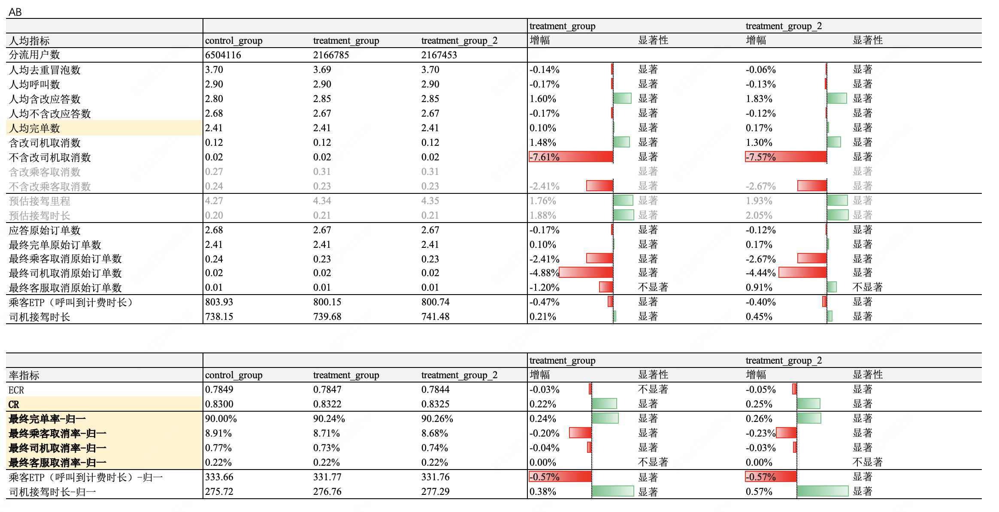

> 乘客ETP：归一完单，乘客视角，单均 应答时长+接驾时长。

> 司机接驾时长：归一应答，司机视角，单均司机接驾时长。完单：开始计费时间 - 呼叫时间；取消：取消时间 - 呼叫时间。

## 4.4 下钻分析

### 4.4.1换车触发面和找车成功率

- **换车触发面**：实验组相比对照组实际换车率提高，尤其**提高了连环派的实际换车率<!--评论:[{"u":"tommywujian","c":"连环派换车占用很少的司机接驾时长，补充下数据"},{"u":"qinjiatong","c":"单独看换车成功订单，实验组单均司机空驶时长约为15秒，其中连环派单均司机空驶时长不到1秒，非连环派单均司机空驶时长约为30秒。已补充至3.4.3"}] -->**（对照组｜组a｜组b**连环派实际换车率为2.5%｜18.9%｜22.7%**）。

- **找车成功率**：实验组连环派和非连环派找车成功率基本持平在约**40%**。连环派和非连环派的找车成功率无明显差异；自动换和手动换的找车成功率也无明显差异，均约为40%。

- **换车成功子单中，70%+是来源于自动换**。两个实验组分别有74%和70%找车成功是来源于自动换。

- 核心数据结果：

	- 对照组：应答含改订单量 260.5w/每天，连环派占比 15.4%，实际发起换车占比 **2.32%**，找车成功率**34%**。

	- 实验组A：应答含改订单量 88.2w/每天，连环派占比 15.5%，应答订单触发换车占比 **16.5%**，实际发起换车占比 **5.9%**，找车成功率**41.4%**。

	- 实验组B：应答含改订单量 88.4w/每天，连环派占比 15.5%，应答订单触发换车占比 **20.6%**，实际发起换车占比 **6.5%**，找车成功率**40.4%**。

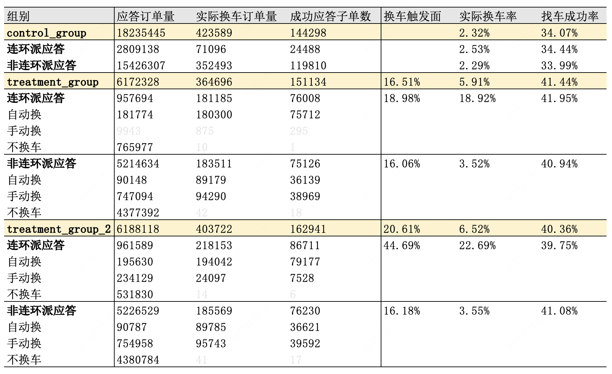

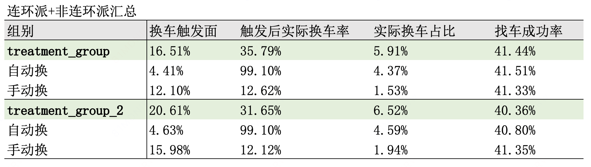

### 4.4.2 取消原因和重发单

**取消原因**

- 实验组a｜实验组b 应答后乘客取消数分别**-2.41%｜-2.67%**。

- 根据取消原因中乘客勾选结果，**“离我太远”取消数-4.69%｜-5.09%，“路程太堵”取消数-4.1%｜-5.66%**。

- **“离我太远”取消原因占比-0.71pp｜-0.75pp，“路程太堵”取消原因占比-0.08pp｜-0.15pp。**

- 取消原因变化结果符合接驾远换车策略的收益链路预期。

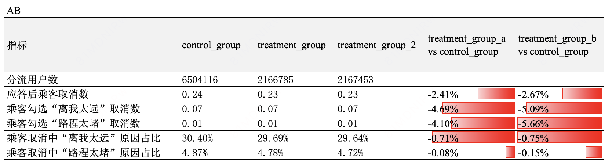

**重发单**

- 实验组a｜实验组b 重呼叫占比分别下降 **-0.21pp｜-0.15pp**（换车策略降低了应答后C取消，从而减少了重发单）。

- 大盘数据评估数据冒泡和呼叫负向，原因是重发单下降，剔除重呼叫后的人均呼叫数小幅上涨+0.05%｜+0.02%。

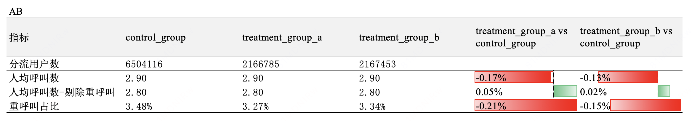

### 4.4.3 交易效率

- 大盘归一完单口径**乘客ETP（从呼叫到计费的总等待时长）**下降**2秒**，降幅**-0.57%**。

- 大盘归一应答订单口径司机接驾时长反而上涨，是因为换车降低了乘客取消率，**原本快速取消的订单被挽留完单，最终拉长了每个归一应答订单的司机接驾时长**。

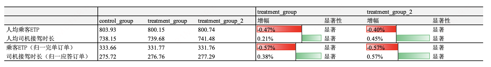

> 乘客ETP：反映乘客侧交易效率，指乘客从呼叫到最终开始计费的总等待时长，包括等应答+等接驾。

> 司机接驾时长：反映司机侧交易效率，指司机花费在接驾过程中的总时长，包括完单订单的接驾时长、取消订单的接驾空驶时长；其中对于连环派订单，其ab段（用于上一单送驾）不会被计入接驾时长。

> 乘客ETP（归一完单订单）= 人均乘客ETP / 人均最终完单原始订单数

> 司机接驾时长（归一应答订单）= 人均司机接驾时长 / 人均应答原始订单数

- 单独看换车成功订单，**实验组单均司机空驶时长约为15秒，其中连环派单均司机空驶时长不到1秒，非连环派单均司机空驶时长约为30秒。**

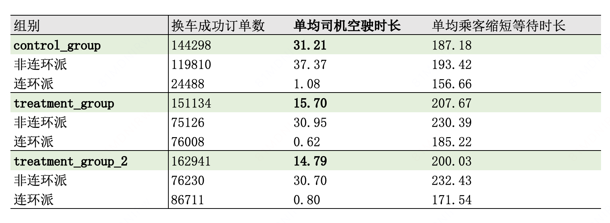

> 数据口径：取自举手表

> 换车成功，乘客缩短时长 = 换车时父单最新eta - 换车时子单eta

> 换车成功，父单空驶时长 = 父单举手时eta - 换车时父单最新eta，连环派额外减父单ab时间，下限为0

### 4.4.4 直线距离拦截效果

- 触发阶段直线距离过滤（策略降级）触发比例占自动换车触发量的约**0.5%**，pk阶段直线距离过滤（拦截换车）触发比例占成功换车数的约**0.5%。表明直线距离拦截仅用于减少badacse，对换车触发面和成功率影响小。**

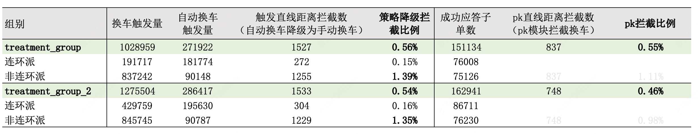

### 4.4.5 轮询效果

- 在实验组所有发起换车且找车成功的换车单中，**约20%是在轮询中换车的**（即非首次判断就换车）。

- 首次未换车、轮询才换车的主要原因是前序乘客未点换或未找到车（该原因在两个实验组中占比分别为46%和62%，在实验组b中占比更高的原因是组b的手动换车比例更高），以及前序不换车但司机开远导致后续进换车（该原因在两个实验组中占比分别为40%和27%）。

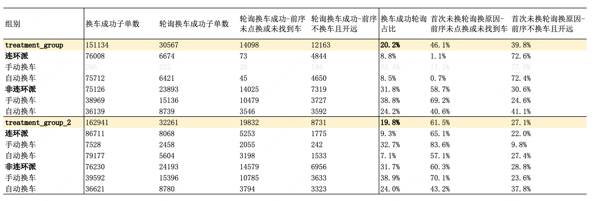

# 五、放量决策

- ==计划通过LR后放量V2.1的实验组b。==

- 后续计划进一步扩大连环派触发面（预计连环派触发面提升至60%）。

|    |    | 预期扩量时间节奏   | 实际扩量时间   | 放量暂停点详情   | 放量暂停点效果评估   | 是否需要设置长期对照组（默认不需要，此列无需填写）   |
| --- | --- | --- | --- | --- | --- | --- |
|    |    |    | LR通过后，根据实际情况，填写这3列   |    |
| 放量决策意见   | 决策人   | ——   | ——   | ——   | ——   | ——   |
| 决策意见：**通过**   |    |    |    |    |    |
| 放量需要周知的利益相关方   | 没有的话，无需填写   | ——   | ——   | ——   | ——   | ——   |
| 放量策略   | - ==V2.1的实验组b==   - ==放量组收益：CR显著+0.25pp，归一后乘客取消率-0.23pp==    | ——   | ——   | ——   | ——   | ——   |
| 放量节奏   | - 直接推全-随机分流    | 2026.6.9放量至55%  （有40%流量用于二阶段实验的实验组）   | - 2026.6.9 全国城市 流量放量至55%（有40%流量用于二阶段pid实验的实验组，5%老换车组）   - 2026.7.8 全国城市（除了下述时间片实验城市）结束二阶段pid实验，一阶段实验的放量组全国放量至100%。   - 2026.7.8～7.28 下列城市进行二阶段时间片实验；实验结束后7.28全国100%全量一阶段放量组。    | - 二阶段pid实验：[https://x.intra.hongyibo.com.cn/exp/491453417783297?globalBusinessId=120000&globalProjectId=406437792776193&expFlowTab=design&dashboardTab=metricDetail](https://x.intra.hongyibo.com.cn/exp/491453417783297?globalBusinessId=120000&globalProjectId=406437792776193&expFlowTab=design&dashboardTab=metricDetail)   - 二阶段时间片实验：[https://x.intra.hongyibo.com.cn/exp/497431760732161?globalBusinessId=120000&globalProjectId=261878894821377&expFlowTab=resourceApply&dashboardTab=metricDetail](https://x.intra.hongyibo.com.cn/exp/497431760732161?globalBusinessId=120000&globalProjectId=261878894821377&expFlowTab=resourceApply&dashboardTab=metricDetail)    | 评估数据：核心指标、核心约束  - 核心指标：CR，归一后乘客取消率   - 核心约束：司乘体验约束    | 需要保留长期对照组:否（仅保留实验能力）  对照组流量比例：  定期review人：  定期review频率：  定期review结果：   |

# 六、后续规划

- 计划通过LR后放量V2.1的实验组b。

- 后续计划进一步扩大连环派触发面（预计连环派触发面提升至60%）。

# 七、引用与鸣谢

感谢辉哥和健哥的指导和帮助，感谢产品美玲、DS健鹏、工程团队的支持，感谢交易策略组同学的帮助。
