# 【LR26-014】司机与调节-交易市场效率-B宏鹄平台免佣策略时段弹性策略

[Cooper 原文](https://cooper.didichuxing.com/knowledge/2199610335356/2208092253269)

| brd文档链接   | [宏鹄平台免佣策略时段弹性模型](https://cooper.didichuxing.com/docs2/document/2206969989019)（密码：503599）   |
| --- | --- |
| 最后通过的策略方案链接   | [【策略方案】宏鹄平台免佣策略时段弹性模型](https://cooper.didichuxing.com/knowledge/2199610335356/2207051974018)   |
| 实验链接（评估大师）   | 无   |
| 核心贡献点（创新点，可供其他算法同学借鉴的点）   | 采用 Causal Transformer 对观测数据下的城市×小时序列中的**时变混杂与策略选择偏差**进行建模   |
| 第一贡献人   | 亓旻昊   |
| 共同贡献人（没有的话，可以置空）   | 刘荣、门畅、吴炎   |
| 后续策略负责人   | 亓旻昊   |

## 一、 背景与目标

### 1.1 现状问题

随着宏鹄完单份额进入 2025 年以来的持续提升，在资源分配和调价视角下，**司机端补贴（时段免佣）对 TSH 的影响**愈发需要关注。当前平台尚无宏鹄平台 TSH-时段免佣弹性的城市×时段粒度预估能力。

自 2024 年以来，花小猪业务的 B 补大多以**免佣活动**形式发放。按业务运营经验，时段免佣活动对司机当日出车数、策略时段出车数有明显影响，且在不同城市下影响显著不同。平台希望根据城市-时段弹性，判断对哪些城市的哪些时段实施时段免佣策略能达到收益最大化。

当前时段免佣的城市级弹性**主要依赖运营经验和人工判断**，缺少一套**可周期化、可量化的方法**来判断不同城市在不同时段下的 B 补弹性，难以稳定**指导资源分配和 B 补投放**。

### 1.2 为什么做

平台需要建模城市级别的宏鹄平台-司机 TSH 关于时段免佣策略的弹性，并周期例行化产出，供下游资源分配模块和 B 补的业务方使用和参考。需要建设一张 hive 表，by 天测算不同城市在不同时段下有免佣/无策略两种情况下的 TSH 反事实和时段免佣弹性。

在时段免佣策略中，运营同学 by 城市 by 时段来发放 B 补，因此无法直接复用组内基于 RCT 数据训练和验证的弹性判断方法：一方面，by 城市维度无法做到小流量随机，针对 10% 城市的 RCT 无法外推到其余 90% 城市；另一方面，B 侧 RCT 实验时间间隔太久，无法及时捕捉 B 弹变化。因此需要采用观测数据因果建模，在非 RCT 场景下构建城市×时段弹性预估能力。

本项目为组内首次将**时序因果建模**引入 B 补弹性预估场景，并首次使用自回归 **Causal Transformer 类**建模。模型采用 Causal Transformer 对城市×小时序列中的**时变混杂与策略选择偏差**进行建模，相比组内已有B弹 DRL 模型具备更强的反事实估计能力。

### 1.3 目标

在观测数据下，**建模模型较组里现有 B 补弹性模型 DRL 在预估精度 MAPE 中提升 5%+，并能够正确识别城市×时段的弹性排序**。

通过提升响应值预估精度和弹性排序一致性，提高宏鹄平台高份额城市和高 B 补城市在现有资源分配框架下的预估准确性及分配合理性。

$$\text{时段免佣弹性} = \frac{\text{有免佣的 TSH} - \text{无策略的 TSH}}{\text{无策略的 TSH}}$$

$$\text{MAPE} = \frac{|\text{当期真实 TSH} - \text{当期预估 TSH}|}{|\text{当期真实 TSH}|}$$

**产出：**

- by城市by天下宏鹄时段免佣策略Hive 表：[kflower_strategy.hh_sdmy_tsh_elas](https://datamap.didichuxing.com/detail?uri=hive://mycluster-tj:kflower_strategy:hh_sdmy_tsh_elas)

- 建模任务：[Ether Labs 15395](https://ether.intra.hongyibo.com.cn/labs/new/15395)

- 写表任务：[DataStudio taskId=59843289](https://studio.data.didichuxing.com/?projectId=1143&taskId=59843289&subType=SQLSCAN)

## 二、目标与约束

给定 $$N$$ 个城市、每个城市 $$T$$ 个时段的观测序列，目标是估计时段免佣策略对 TSH 的因果效应。

#### （1）因果效应响应函数

对于城市 $$i$$ 在时刻 $$t$$，给定历史动态协变量序列 $$\mathbf{Z}_{i,1:t}$$ 和静态特征 $$V_i$$，在策略 $$T$$ 下的期望响应为：

$$\hat{Y}_{i,t}(T) = \mathbb{E}[Y_{i,t} \mid T_{i,t}=T, \mathbf{Z}_{i,1:t}, V_i]$$

#### （2）弹性定义

时段免佣弹性定义为有策略与无策略两种反事实下 TSH 的相对差异：

$$\text{Elasticity}_{i,t} = \frac{\hat{Y}_{i,t}(T=1) - \hat{Y}_{i,t}(T=0)}{\hat{Y}_{i,t}(T=0)}$$

#### （3）评估指标

**模型在响应值维度使用 MAPE 评估预估精度**：

$$\text{MAPE} = \frac{1}{N}\sum_{i,t}\frac{|\hat{Y}_{i,t} - Y_{i,t}|}{Y_{i,t}}$$

### 2.2 约束指标项

本模型为弹性估计模型，无前置约束项。

## 三、 技术方案

| 决策   | 选择   | 原因   |
| --- | --- | --- |
| 数据来源   | 观测数据   | 城市级 RCT 无法外推：10% 城市 RCT 结果无法泛化到其余 90% 城市；B 侧 RCT 实验周期过长（通常需 2 周），无法及时捕捉弹性变化   |
| 建模粒度   | 城市 x 小时   | 时段免佣策略以城市 x 时段粒度发放，司机级干预无法观测；同时城市级聚合降低噪声，提升弹性信号强度   |
| 模型范式   | 时序因果模型   | TSH 受当期和历史策略共同影响，截面模型（如 DRL）忽略时变混杂会引入偏误   |
| 训练策略   | 全局训练   | 单城市序列过短，正则性不足；跨城市联合训练通过 City Embedding 借用相似城市信息，解决稀疏 treatment 问题   |

### 3.1 数据来源

选取了小猪端完单额 Top 62 城市在 2025-10-01 到 2026-02-07 的观测数据，剔除了节假日和周末调休日。

| 维度   | 说明   |
| --- | --- |
| 颗粒度   | 城市 × 小时级别   |
| 样本量   | 249,984 条   |
| Treatment 类型   | 是否实施时段免佣策略（38.22% 实施）   |
| 滚动更新   | 每周滚动训练，训练窗口约 6 个月   |

### 3.2 特征选取

为确保无未观测混杂假设满足，需尽可能寻找同时影响"时段免佣"策略和司机行为的变量。我们首先梳理了"时段免佣"策略发放的完整链路，从数据生成机制出发，分析运营同学在制定策略时所参考的信息集。

#### （1）策略分发机制与信息集

> **当前时段免佣策略的发放机制**：运营同学根据上周同期数据来提前一周制定决策。 

> **【1】周三**产出本周周五、周六、周日的策略（分别参考上周周五、周六、周日的数据表现）； 

> **【2】周四**产出下周周一至周四的策略（下周周一策略参考当周周一数据，下周周二至周四参考当周周二至周三数据）。

>  **补贴发放依据（三类信号）：** 

> （1）**宏鹄服占比水平**——判断市场格局与竞争态势； 

> （2）**小猪 CR、宏鹄竞争呼叫、宏鹄客观成交率及服占比**等核心供需指标——判断供需紧张度； 

> （3）**平台策略前置**——结合小猪整体供需策略，并根据市场份额波动情况进行调整，用于应对竞争变化。

>  这一机制意味着模型特征中的 LG7（一周前同期）变量可有效代理运营决策时的信息集。

下图展示了时段免佣策略的完整发布链路。补贴资金从平台运营（共补）出发，分流至宏鹄运营和自营商家两条路径，各方在预算剩余条件下可额外追加独补，最终汇聚为"时段免佣 / 流水翻倍"活动发布与实施。这一多方参与的链路结构意味着，**影响策略实施的因素不仅来自平台运营决策，还包括商家侧的预算分配行为**——后者是当前模型尚未完全覆盖的混杂来源。

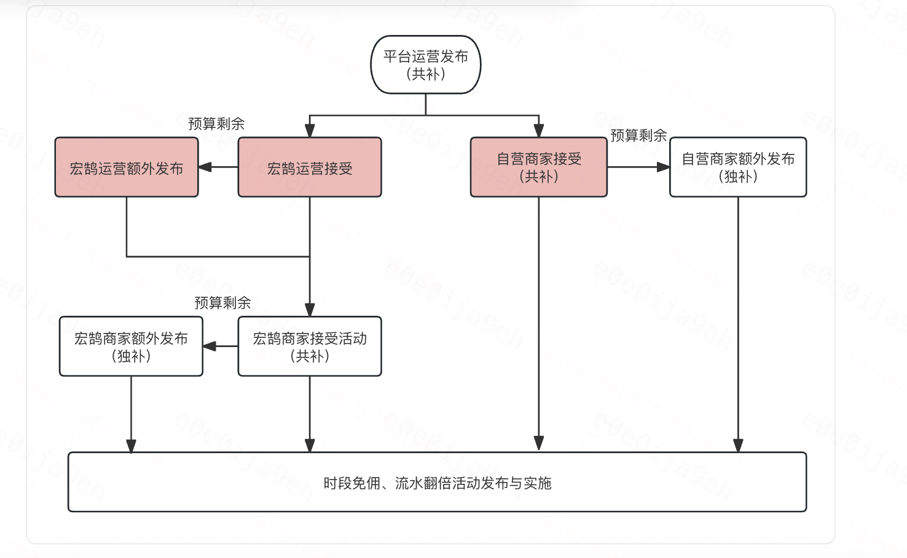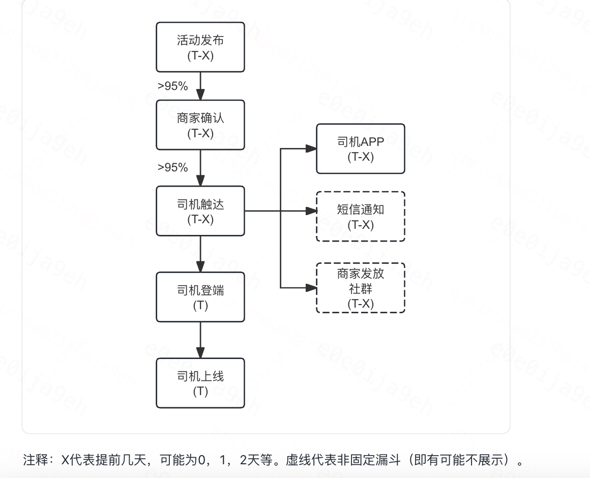

> 左图：时段免佣策略发布链路 — 平台共补 → 宏鹄运营/自营商家 → 独补追加 → 活动发布与实施

> 右图：时段免佣活动漏斗 — 活动发布(T-X) → 商家确认(>95%) → 司机触达(APP/短信/社群) → 司机登端(T) → 司机上线(T)

从策略触达司机的视角来看，活动从发布（T-X 天）到司机实际上线（T 天）经历多个环节：活动发布 → 商家确认（>95% 通过率）→ 司机触达（APP / 短信 / 商家社群）→ 司机登端 → 司机上线。其中**商家确认到司机触达的转化率极高（>95%），说明策略的有效性瓶颈不在触达而在司机的出车决策本身**——这正是弹性建模需要关注的核心环节。

#### （2）特征选取框架

基于上述策略链路分析，影响"免佣策略"的因素主要为**平台策略**与**上周同期服占比、小猪 CR、宏鹄竞争呼叫、宏鹄客观成交率**等市场供需情况。

在此基础上，我们进一步探究了影响司机行为指标的因素。根据业务理解和数据可得性，从以下四个维度选取协变量：

| 维度   | 考虑方面   | 代表特征   |
| --- | --- | --- |
| **a. 城市基本特性因素**   | 捕捉城市间固有差异   | City Embedding（可学习向量 $$E_{\text{city}} \in \mathbb{R}^d$$）、城市等级   |
| **b. 影响司机基础收入的因素**   | 司机出车的经济动机   | 小猪端价格、WYC 对标车型价格、水位相关数据、司机完单 CPM   |
| **c. 影响成交率的因素**   | 市场供需匹配效率   | 小猪端对应运力类型的业务、交易、网约车业务相关数据（CR、STR、竞争呼叫）   |
| **d. 反映行业总体情况的因素**   | 竞对策略与行业趋势   | 滴滴泛快相关指标、滴滴特惠 CPM、API 打包水位   |

#### （3）入模特征全景

本次特征选取参考已有的 B 弹建设，并与宏鹄业务同学多次确认对齐，最终模型采用的全部特征如下图所示。

特征分为两大面板：**Panel A** 覆盖价格、水位、自营宏鹄业务和特价盒子相关特征；**Panel B** 覆盖司乘行为、城市环境、WYC 对标和竞争相关特征。

其中标注 "+ LG7" 的变量会同时纳入一周前同期值作为历史代理，用于代理运营决策信息集并缓解时序混杂。

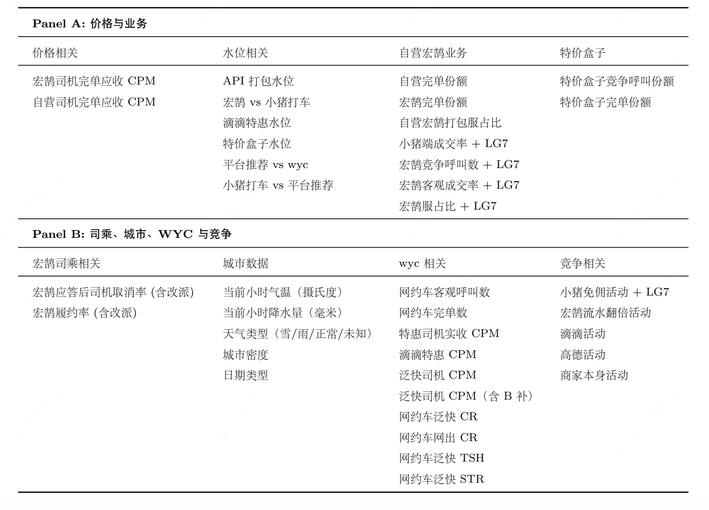

>  图：入模特征全景 — Panel A: 价格与业务类特征（CPM、水位、份额）；Panel B: 司乘、城市、WYC 与竞争类特征（气温、呼叫、CR、竞对活动）

> 注意：宏鹄时段免佣策略可能受到滴滴活动和高德活动的影响，这两个变量暂时无法获取。

> 此外，商家独补、卡券等 B 端策略目前尚未纳入特征集，是后续迭代的补全方向。

#### （4）关于无未观测混杂的特征完备性论证

> **如何确保无未观测混杂假设满足？** 

> 无未观测混杂本身无法通过数据检验是否满足，只能通过数据生成机制来确认。

> 在本次建模中：

> 【1】我们分析了"时段免佣"策略发放的**完整链路**，剖析了所有可能会影响时段免佣的因素，并将这些因素纳入到建模中； 

> 【2】与非时序模型相比，我们引入了更多**历史（时序）变量**，能在一定程度上阻断其他混杂变量对于处理变量的影响； 

> 【3】当前仍存在残余混杂风险：高德活动、wyc活动和商家独补尚未纳入模型，可能部分影响部分城市×时段的真实弹性估计； 在与业务同学确认后，上述因素在样本期变动不大<!--评论:[{"u":"zhouzhishuo","c":"会出现“在样本期变动不大，但使用期与样本期差别较大”的情况吗"}] -->，可以近似认为模型满足无未观测混杂假设。

### 3.3 模型架构：Causal Transformer

#### （1）变量定义

采用多城市混合训练（Global Training）策略，输入数据包含 $$N$$ 个城市的历史序列。

| 变量   | 定义   | 处理方式   |
| --- | --- | --- |
| 结果变量 $$Y_t$$   | TSH   | By-City Z-Score Standardization   |
| 干预变量 $$T_t$$   | 是否时段免佣补贴   | Categorical: {0: 无策略, 1: 时段免佣}   |
| 动态协变量 $$\mathbf{Z}_t$$   | 随时间变化的混杂因子及环境特征   | 时间特征 + 环境特征 + 供需特征   |
| 静态协变量 $$V_i$$   | 不随时间变化的城市属性   | City Embedding   |

#### （2）模型架构

模型整体采用 **Encoder-Only Causal Transformer** 架构，结合多任务对抗训练。具体架构如下图所示：

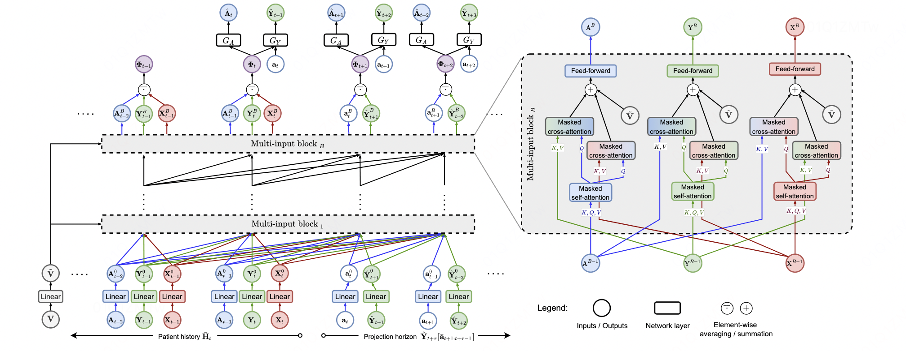

>  图：Causal Transformer 模型架构 

> — 左侧为整体流程（Input Embedding → Multi-input Block × B → Outcome/CDC Head）

> —右侧为 Multi-input Block 内部结构（Masked Self-Attention → Masked Cross-Attention → Feed-forward）

在输入层中，输入每个城市的历史序列以及每个城市的 embedding，堆叠 $$B$$ 层 Transformer Block，并在 Attention 中采用 Causal Mask 防止未来信息泄露。

模型包含三路输入：干预变量<!--评论:[{"u":"arkshifangzhou","c":"后面treatment是用T表示，notion最好拉齐一下"},{"u":"qiminhao","c":"已更正为T"}] --> $$\mathbf{T}$$（Treatment）<!--评论:[{"u":"arkshifangzhou","c":"后面treatment是用T表示，notion最好拉齐一下"},{"u":"qiminhao","c":"已更正为T"}] -->、结果变量 $$\mathbf{Y}$$（Outcome）、协变量 $$\mathbf{X}$$（Covariates），每路输入经过独立 Linear 映射后，在 Multi-input Block 中通过 Masked Self-Attention 建模各自序列依赖，再通过 Masked Cross-Attention 进行跨路信息交互。

**Input Embedding：**

$$\mathbf{x}_{i,t} = \text{Concat}\!\left(\text{Emb}(\mathbf{Z}_{i,t-1}),\; \text{Emb}(T_{i,t}),\; \text{Emb}(T_{i,t-1}),\; \text{Emb}(Y'_{i,t-1}),\; \mathbf{E}_i\right) + \text{RPE}(t)$$

其中 $$\mathbf{E}_i$$ 为可学习的城市嵌入向量，$$\text{RPE}(t)$$ 为相对位置编码，显式注入时间距离信息以捕捉策略的滞后效应（Lagged Effect）。

**Backbone（堆叠** $$B$$ **层 Transformer Block）：**

$$\text{Attention}(Q,K,V) = \text{softmax}\!\left(\frac{QK^\top}{\sqrt{d_k}} + \mathbf{M}_{\text{causal}}\right)V$$

Attention 机制采用 Causal Mask $$\mathbf{M}_{\text{causal}}$$，防止未来信息泄露。Backbone 输出：

$$\mathbf{H}_{i,t} = \text{TransformerEncoder}_B(\mathbf{x}_{i,1:t})$$

**输出头与损失函数**：模型包含两个分支，进行对抗博弈：

**Outcome Prediction Head**（结果预测头）：

$$\hat{Y}'_{i,t+1} = G_Y(\mathbf{H}_{i,t}, T_{i,t})$$

$$\mathcal{L}_{\text{outcome}} = \frac{1}{NT}\sum_{i,t}\text{MSE}\!\left(Y'_{i,t+1},\; \hat{Y}'_{i,t+1}\right)$$

**CDC Head<!--评论:[{"u":"arkshifangzhou","c":"CDC head的loss，conf和discrim分别的形式是什么样的？"}] -->**（<!--评论:[{"u":"arkshifangzhou","c":"CDC head的loss，conf和discrim分别的形式是什么样的？"}] -->Counterfactual Distribution Confusion，策略混淆头）：

$$\hat{P}(T_{i,t}) = G_A(\mathbf{H}_{i,t})$$

$$\mathcal{L}_{\text{CDC}} = \mathcal{L}_{\text{conf}}(\Phi) + \mathcal{L}_{\text{discrim}}(G_A)$$

CDC 头迫使 Backbone 表征 $$\mathbf{H}_{i,t}$$ 去除与策略 $$T$$ 的相关性，模拟随机实验环境下的表征分布。

**总损失：**

$$\mathcal{L}_{\text{total}} = \mathcal{L}_{\text{outcome}} + \lambda \cdot \mathcal{L}_{\text{CDC}}$$

| 输出头   | 公式   | Loss   | 作用   |
| --- | --- | --- | --- |
| 结果预测头   | $$G_Y(\mathbf{H}_{i,t}, T_{i,t}) \to \hat{Y}'_{i,t+1}$$   | $$\mathcal{L}_{\text{outcome}}$$   | 保证预测准确性   |
| 策略混淆头 (CDC)   | $$G_A(\mathbf{H}_{i,t}) \to \hat{P}(T_{i,t})$$   | $$\mathcal{L}_{\text{CDC}}$$   | 迫使表征去除选择偏差，模拟随机实验环境   |

#### （3）弹性输出

模型预估每个城市在免佣和无策略下的 TSH 反事实。首先将标准化预测反变换回原始尺度：

$$\hat{Y}_{i,t}(1) = \sigma_i \cdot G_Y(\mathbf{H}_{i,t},\; T\!=\!1) + \mu_i$$

其中 $$\mu_i, \sigma_i$$ 为城市 $$i$$ 的 Z-Score 均值和标准差。最终弹性：

$$\text{Elasticity}_{i,t} = \frac{\hat{Y}_{i,t}(1) - \hat{Y}_{i,t}(0)}{\hat{Y}_{i,t}(0)}$$

#### （4）核心难点与解决方案<!--评论:[{"u":"arkshifangzhou","c":"是否可验证"}] -->

| 难点   | 描述   | 解决方案   |
| --- | --- | --- |
| 未观测混杂   | 时段免佣策略实施受业务经验、直觉、市场影响，部分混杂难以直接观测   | 历史序列代理 + CDC 对抗损失。利用 Transformer 对长历史序列的编码作为混杂因子的代理，通过对抗训练剥离表征中与策略的相关性   |
| 正则性缺失   | 部分时段 treatment 变化程度小，数据无法识别缺失 treatment 下的反事实   | Global Training + City Embedding 插值。借鉴合成控制法思想，利用 City Embedding 相似性将不违背正则性的城市效应"借用"给缺失城市   |
| 时变处理影响   | TSH 受当期和历史免佣策略共同影响，忽略时变混杂会引入偏误   | Transformer 天然处理序列依赖，结合相对位置编码准确捕捉 $$t\!-\!k$$ 时刻策略对 $$t$$ 时刻 TSH 的滞后及累积效应   |
| 分布偏移   | 竞对策略变化导致数据分布变化   | 滚动周度训练；竞争对手策略变化较慢，可近似稳定   |

#### （5）模型假设

为确保弹性可识别性，做出如下因果推断假设：

**假设 1：无未观测混杂（Unconfoundedness / Conditional Ignorability）**

$$Y(0), Y(1) \perp\!\!\!\perp T \mid \mathbf{Z}, V$$

所有同时影响 TSH 和时段免佣策略的变量都已纳入建模。通过分析策略发放链路和引入时序变量阻断混杂路径来满足。

**假设 2：正则性（Positivity / Overlap）**

$$0 < P(T=1 \mid \mathbf{Z}, V) < 1$$

给定城市历史序列下，每个个体被处理的概率在 0 和 1 之间。通过 Global Training 跨城市借用满足。

**假设 3：SUTVA（Stable Unit Treatment Value Assumption）**

$$Y_i(T_i) = Y_i(T_i, T_{-i})$$

给定城市历史序列下，每个个体的结果与其他个体是否收到处理无关。网约车市场存在地理隔绝，更容易满足此假设。

#### （6）AutoResearch：AI 驱动的模型迭代

**目标：**降低模型调参和结构迭代中的重复劳动成本，让 AI 在明确数据、模型框架、评估指标和运行环境后，自动完成参数搜索、结构修改、训练、评估和结果复盘，从而提高模型探索效率。

**方法：**整体流程：

- **固定不可变部分：**数据集、基础训练框架、评估指标、运行环境和结果记录方式

- **允许 AI 修改部分：**模型参数、特征处理方式、网络结构和训练策略

- **优化目标：**最小化测试集 MAPE

- **安全约束：**日志检查、训练失败回滚、指标对比和结果汇总

**结果：**AutoResearch 连续运行约 20 小时后，将测试集误差从 6.9% 降低到 5.3%，相对误差下降约 23.2%。共执行 97 次实验，其中 21 次 Kept Improvements。Phase 1（超参搜索）将 MAPE 从 6.35% 降至约 5.9%；Phase 2（模型结构编辑 + ensemble）进一步降至 5.3%。

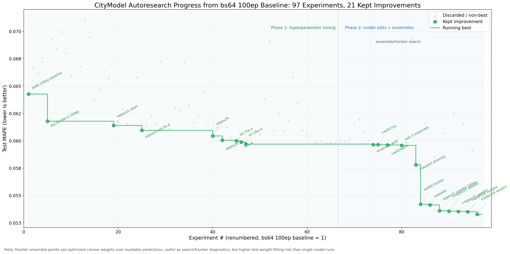

> 图：CityModel AutoResearch 进度 — bs64 100ep Baseline 起步，97 次实验，21 次保留改进，Test MAPE 从 6.35% 降至 5.3%

### 3.4 对比基线：双重鲁棒估计器（DRL）

复用城市资源分配-B 补双重鲁棒估计器作为基线。DRL 本质是基于树模型的残差拟合模型，适用于独立同分布数据，无法直接通过 embedding 学习其他城市数据，在大量数据和复杂时序情景下底座树模型难以正确划分属性区间。

DRL 估计量的数学形式为：

$$\hat{\tau}_{\text{DRL}} = \frac{1}{n}\sum_{i}\!\left[\hat{\mu}_1(\mathbf{Z}_i) - \hat{\mu}_0(\mathbf{Z}_i) + \frac{T_i\!\left(Y_i - \hat{\mu}_1(\mathbf{Z}_i)\right)}{\hat{e}(\mathbf{Z}_i)} - \frac{(1-T_i)\!\left(Y_i - \hat{\mu}_0(\mathbf{Z}_i)\right)}{1-\hat{e}(\mathbf{Z}_i)}\right]$$

其中 $$\hat{\mu}_t(\cdot)$$ 为结果模型，$$\hat{e}(\cdot)$$ 为倾向性得分模型。DRL 对两个模型之一的错误指定具有鲁棒性（doubly robust），但无法处理时序依赖和跨城市借用。

### 3.5 离线评估结果

训练期样本 2025-10-01 到 2026-01-31，测试期 2026-02-01 到 2026-02-07。直接比较组里已有最优模型 DRL 作为对比基线。

#### （1）训练配置与收敛验证

为保证离线评估结果可复现，核心训练超参数如下。模型使用 168 小时历史序列作为输入窗口，按 24 小时步长滑窗构造训练样本；Causal Transformer 主干采用 2 层 Transformer Block、2 个 attention head，并使用 per-city outcome scaler 对不同城市 TSH 水平差异进行归一化。

| 配置项   | 取值   | 说明   |
| --- | --- | --- |
| 训练样本   | 183,024 rows / 7,626 windows   | 2025-10-01 到 2026-01-31   |
| 测试样本   | 10,416 rows / 434 windows   | 2026-02-01 到 2026-02-07   |
| Transformer 层数   | 2   | 堆叠 2 层 Causal Transformer Block   |
| d_model / hidden   | 96   | 主干隐层维度   |
| Attention head 数   | 2   | 多头注意力配置   |
| BR / FC 维度   | 48 / 96   | bottleneck 与全连接隐层维度   |
| seq_length / seq_stride   | 168 / 24   | 历史 7 天窗口，按天滑动   |
| batch_size / epochs   | 32 / 80   | 训练 80 个 epoch   |
| 学习率   | 1. 0002    | 固定学习率   |
| optimizer   | Adam   | 一阶矩与二阶矩自适应优化   |
| Outcome loss   | MSE   | 响应值预测损失   |
| CDC / 对抗权重   | alpha=0.002   | 训练中从 0.000020 线性 warm-up 到 0.002   |

下图展示了 100 个 epoch 的训练收敛过程。train loss 在前 10 个 epoch 快速下降，随后平滑收敛；val loss 在 epoch 67 达到最低值 0.0104，最终 epoch 100 为 0.0105，说明模型后半程没有出现明显验证集发散，离线评估结果具备稳定性。

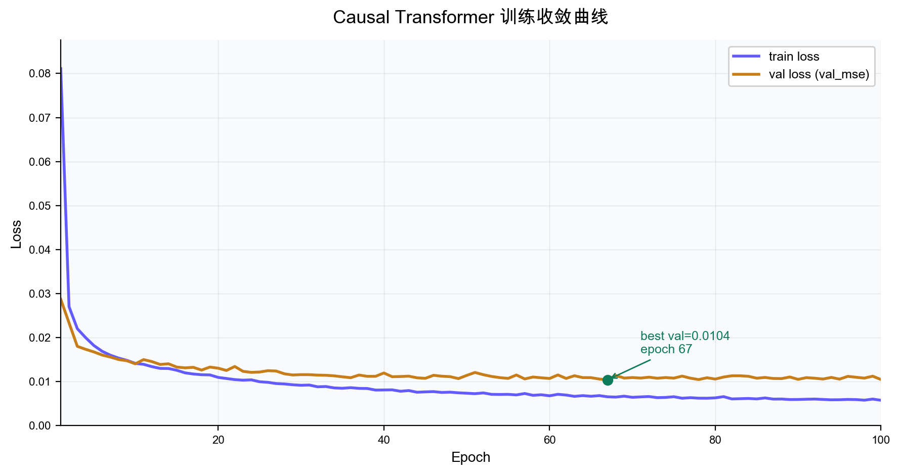

> 图：Causal Transformer 训练收敛曲线 — train loss 快速下降后稳定收敛，val loss 在 epoch 67 达到最优 0.0104

#### （2）响应值预测精度（MAPE）

| 方法   | 全周   | 周一-周四   | 周五   | 周六-周日   |
| --- | --- | --- | --- | --- |
| **Causal Transformer**   | **0.0528**   | **0.0502**   | **0.0565**   | **0.0560**   |
| DRL（基线）   | 0.1237   | 0.1178   | 0.1363   | 0.1292   |
| 较 Baseline 绝对提升   | 0.0709   | 0.0676   | 0.0798   | 0.0732   |
| 较 Baseline 相对提升   | **57.32%**   | **57.39%**   | **58.55%**   | **56.66%**   |

进一步从城市维度观察 MAPE1 的误差分布。下图基于测试集逐小时样本计算 $$|y\_pred\_mape1-y\_true|/|y\_true|$$，并按城市平均 MAPE 将 62 城分为高误差、中高误差、中低误差和低误差四组。

箱体展示 Q1-Q3，须表示 5%-95% 分位，虚线为全局均值 5.4%，点线为全局中位数 3.3%。

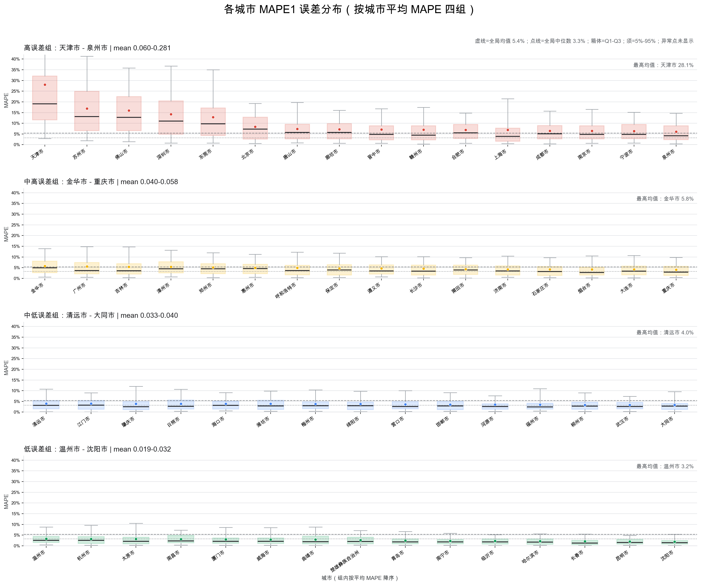

> 图：各城市 MAPE1 误差分布箱线图 — 按城市平均 MAPE 分为四组，展示城市级误差区间与波动范围

从图中可以看出，大多数城市的中位误差集中在 3%-5% 左右，低误差组整体分布稳定；天津、苏州、佛山、深圳、东莞等高误差城市箱体和 95% 分位更高，说明这些城市在小时级 TSH 波动下存在更大的预测不确定性，后续资源分配中可结合 MAPE 阈值进行置信度过滤。

#### （3）弹性排序准确性验证

使用宏鹄在 2026-01-16（5 城市多补中午时段）和 2026-01-09（20 城市多补午夜时段）的**伪实验数据**验证排序。

实验弹性将采用时段免佣时段的 TSH 作为 $$Y(1)$$，非采用时段免佣时段的 TSH 作为 $$Y(0)$$。

2026-01-16 当天实验计算弹性排序：**泉州 > 广州 > 长沙 \~ 烟台 > 石家庄**；CT 模型预测排序完全一致。

排序指标定义：

$$\text{NDCG@}k = \frac{\text{DCG@}k}{\text{IDCG@}k}, \quad \text{其中 } \text{DCG@}k = \sum_{j=1}^{k}\frac{2^{r_j}-1}{\log_2(j+1)}$$

$$\tau_{\text{Kendall}} = \frac{C - D}{\binom{n}{2}}$$

其中 $$C$$ 为一致对数（concordant pairs），$$D$$ 为不一致对数（discordant pairs）。

| 方法   | NDCG@5 (午)   | NDCG@19 (晚)   | Kendall's $$\tau$$ (午)   | Kendall's $$\tau$$ (晚)   |
| --- | --- | --- | --- | --- |
| DRL   | 1. 0000    | 1. 9494    | 1. 9487    | 1. 4503    |
| **Causal Transformer**   | **1.0000**   | **0.9568**   | **0.9487**   | **0.6140**   |

> **结论：**Causal Transformer 在响应值预测和弹性排序方面均表现最优。相比基线模型 MAPE 降低 57.32%，弹性排序与宏鹄实验结果一致。优势来源：（1）时序模型架构阻断时序混杂影响；（2）Attention 机制通过 city embedding 大规模数据学习长期规律。

#### （4）指定城市小时弹性对比

下图展示了**业务经验中的高弹城市（泉州、长沙、广州）和低弹城市（沈阳）在测试期内的小时级弹性分布**，叠加全 62 城中位数和均值作为聚合参考线。从图中可以清晰看出：

- 高弹城市（泉州、广州）的弹性曲线在全天各时段均显著高于 62 城均值，符合业务认知；

- 低弹城市（沈阳）的弹性曲线始终低于 62 城均值，验证模型对低弹城市的识别能力；

- **6 点弹性最高**（部分城市超 120%），随后快速回落至 8 点趋于稳定——这与司机在凌晨出车决策门槛高、免佣撬动效果最强的业务直觉一致；

- **17 点出现全局性弹性谷值**，所有城市弹性在该时段同步下降，与晚峰竞争加剧、模型预估能力不足的后续实验评估结论相互印证。

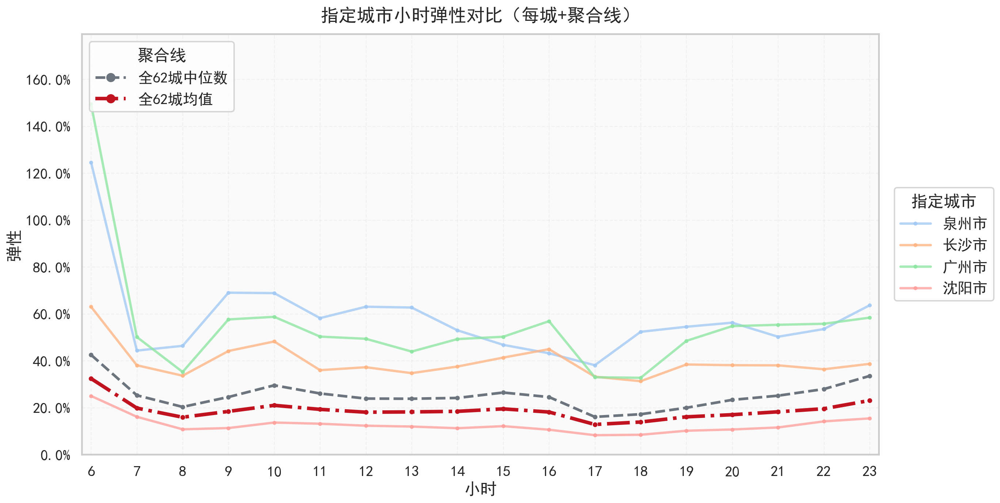

> 图：指定城市小时弹性对比（每城+聚合线） — 高弹城市（泉州、广州、长沙）vs 低弹城市（沈阳）vs 62 城中位数/均值

### 3.6 模型结果分析

仅保留 MAPE<0.08 的高置信样本，按城市平均弹性将当前城市分为三档：高弹城市（均值 >0.15）、中弹城市（0.10-0.15）、低弹城市（均值 <0.10）。

| 弹性层级   | 判定口径   | 城市数   | 城市   |
| --- | --- | --- | --- |
| **高弹城市**   | 均值 &gt; 0.15   | 44   | 佛山市、东莞市、北京市、深圳市、泉州市、苏州市、广州市、惠州市、金华市、成都市、廊坊市、宁波市、漳州市、郑州市、大连市、长沙市、济南市、赣州市、烟台市、武汉市、石家庄市、保定市、潍坊市、呼和浩特市、合肥市、莆田市、晋中市、唐山市、天津市、南京市、日照市、邯郸市、杭州市、营口市、海口市、重庆市、福州市、绵阳市、江门市、上海市、大同市、遵义市、肇庆市、厦门市   |
| **中弹城市**   | 1. 10 ≤ 均值 ≤ 0.15    | 9   | 清远市、吉林市、南昌市、青岛市、温州市、柳州市、太原市、梅州市、沈阳市   |
| **低弹城市**   | 均值 &lt; 0.10   | 9   | 南宁市、威海市、昆明市、河源市、曲靖市、临沂市、长春市、哈尔滨市、楚雄彝族自治州   |

按运营重点时段切分后，不同城市的弹性层级存在明显迁移。下表在每个时段内按城市均值重新分档：

| 时期   | 高弹城市   | 中弹城市   | 低弹城市   |
| --- | --- | --- | --- |
| **周一到周四早峰（6-9点）**   | 佛山市、泉州市、北京市、深圳市、东莞市、郑州市、惠州市、宁波市、苏州市、漳州市、济南市、廊坊市、大连市、长沙市、成都市、保定市、赣州市、天津市、杭州市、武汉市、广州市、金华市、石家庄市、呼和浩特市、邯郸市、日照市、潍坊市   | 莆田市、海口市、合肥市、烟台市、重庆市、福州市、晋中市、唐山市、南京市、营口市、南宁市、遵义市、清远市、肇庆市、温州市、江门市   | 吉林市、绵阳市、上海市、南昌市、厦门市、大同市、柳州市、青岛市、梅州市、沈阳市、太原市、曲靖市、昆明市、威海市、哈尔滨市、临沂市、楚雄彝族自治州、长春市、河源市   |
| **周一到周四晚峰（17-19点）**   | 佛山市、东莞市、北京市、深圳市、苏州市、广州市、泉州市、廊坊市、成都市、长沙市、惠州市、漳州市、郑州市、石家庄市、大连市、宁波市、武汉市、金华市、赣州市、烟台市、济南市、杭州市、保定市、合肥市   | 莆田市、海口市、呼和浩特市、唐山市、潍坊市、晋中市、江门市、重庆市、邯郸市、日照市、营口市、天津市、福州市、大同市、遵义市、南京市、吉林市、厦门市、清远市   | 绵阳市、肇庆市、南昌市、柳州市、梅州市、青岛市、太原市、温州市、沈阳市、南宁市、河源市、威海市、昆明市、临沂市、曲靖市、长春市、哈尔滨市、上海市、楚雄彝族自治州   |
| **周五早峰（6-9点）**   | 泉州市、广州市、惠州市、大连市、北京市、郑州市、深圳市、济南市、廊坊市、长沙市、漳州市、东莞市、潍坊市、金华市、宁波市、绵阳市、保定市、邯郸市、武汉市、营口市、石家庄市、海口市、日照市、赣州市、莆田市、福州市、晋中市、烟台市、重庆市、唐山市、南昌市、呼和浩特市、遵义市、肇庆市、清远市、温州市、南宁市、合肥市   | 江门市、大同市、成都市、南京市、梅州市、太原市、厦门市、沈阳市、昆明市、青岛市、威海市、杭州市   | 吉林市、曲靖市、柳州市、上海市、楚雄彝族自治州、临沂市、哈尔滨市、河源市、长春市   |
| **周五晚峰（15-20点）**   | 佛山市、东莞市、深圳市、北京市、泉州市、苏州市、惠州市、漳州市、广州市、郑州市、廊坊市、晋中市、烟台市、成都市、长沙市、石家庄市、呼和浩特市、宁波市、武汉市、大连市、赣州市、海口市、金华市、济南市、保定市、营口市、潍坊市、莆田市、合肥市、唐山市、邯郸市、日照市、南京市、重庆市、绵阳市、大同市   | 江门市、肇庆市、吉林市、福州市、遵义市、上海市、柳州市、厦门市、杭州市、清远市、南昌市、梅州市、青岛市   | 温州市、太原市、沈阳市、河源市、威海市、昆明市、南宁市、曲靖市、哈尔滨市、长春市、临沂市、楚雄彝族自治州   |
| **周末下午（12-19点）**   | 佛山市、东莞市、深圳市、北京市、苏州市、泉州市、广州市、漳州市、惠州市、宁波市、成都市、金华市、赣州市、廊坊市、石家庄市、保定市、烟台市、长沙市、武汉市、郑州市、晋中市、莆田市、呼和浩特市、济南市、潍坊市、唐山市、日照市、大连市、杭州市、天津市、合肥市、邯郸市、海口市、南京市、营口市、重庆市、绵阳市、江门市、福州市、肇庆市、大同市、遵义市、上海市、吉林市   | 清远市、南昌市、青岛市、梅州市、柳州市、厦门市、温州市、昆明市   | 太原市、沈阳市、威海市、曲靖市、南宁市、河源市、临沂市、长春市、哈尔滨市、楚雄彝族自治州   |
| **周末晚上（20-22点）**   | 佛山市、东莞市、北京市、广州市、泉州市、苏州市、深圳市、漳州市、廊坊市、惠州市、赣州市、宁波市、大连市、金华市、长沙市、保定市、武汉市、成都市、晋中市、郑州市、营口市、济南市、烟台市、潍坊市、莆田市、天津市、日照市、邯郸市、南京市、石家庄市、唐山市、呼和浩特市、合肥市、杭州市、绵阳市、江门市、海口市、遵义市、肇庆市、清远市、大同市、重庆市、福州市、南昌市、厦门市、吉林市   | 柳州市、青岛市、梅州市、威海市、温州市、上海市、太原市、昆明市、南宁市   | 曲靖市、沈阳市、河源市、长春市、临沂市、哈尔滨市、楚雄彝族自治州   |

> **分析结论：**模型识别出的高弹城市覆盖 44 城，占全部 62 城的 71.0%，

> 其中佛山、东莞、北京、深圳、泉州、苏州等城市弹性显著靠前；

> 低弹城市集中在南宁、威海、昆明、河源、曲靖、临沂、长春、哈尔滨、楚雄等城市。

### 3.7 模型归因

为了理解模型学到了什么、验证特征贡献是否与业务直觉一致，我们对 2026年5 月学习到四个周模型（20260504 / 20260511 / 20260518 / 20260525）进行了系统化归因分析。

#### （1）月度模型效果概览

当月四个周模型覆盖 62 城，整体 MAPE 稳定在 5.3%-6.5% 区间，平均弹性在 0.24-0.27 之间波动，验证模型线上稳定性和弹性预估的连续性：

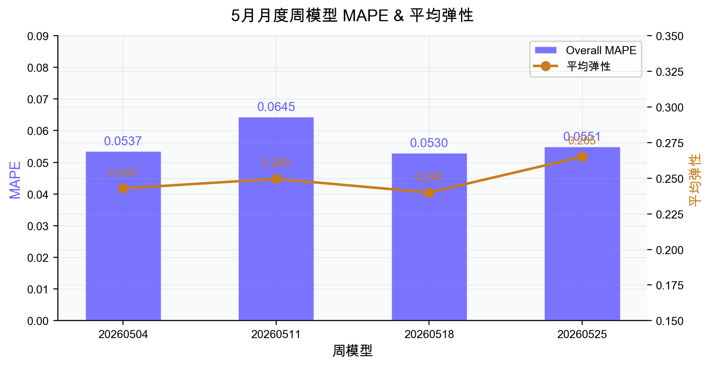

> 图：当月周模型 MAPE 对比（20260504 / 20260511 / 20260518 / 20260525）

| 周模型   | 训练起始   | 训练终止   | 测试起始   | 测试终止   | Overall MAPE   | 平均弹性   | 城市数   |
| --- | --- | --- | --- | --- | --- | --- | --- |
| 20260504   | 2025-10-27   | 2026-04-24   | 2026-04-25   | 2026-05-01   | 0.0537   | 0.2428   | 62   |
| 20260511   | 2025-11-03   | 2026-05-01   | 2026-05-02   | 2026-05-08   | 0.0645   | 0.2495   | 62   |
| 20260518   | 2025-11-10   | 2026-05-08   | 2026-05-09   | 2026-05-15   | 0.0530   | 0.2399   | 62   |
| 20260525   | 2025-11-17   | 2026-05-15   | 2026-05-16   | 2026-05-22   | 0.0551   | 0.2650   | 62   |

#### （2）归因方法说明

我们采用三种互补的归因口径，从不同视角衡量每个特征对模型预测的贡献度。三种方法各有优劣，当某个特征在三种方法下均排名靠前时，说明其重要性具有方法鲁棒性：

| 归因方法   | 全称   | 原理   | 优势   |
| --- | --- | --- | --- |
| **AttnLRP proxy**   | [Attention-aware Layer-wise Relevance Propagation](https://arxiv.org/abs/2402.05602)   | 结合注意力权重与 LRP 反向传播，将模型输出的贡献逐层回溯到输入特征   | 能区分特征在不同 attention head 中的作用，反映模型内部信息路由   |
| **Input LRP proxy**   | [Input-side Gradient Relevance](https://arxiv.org/abs/1711.06104)   | 从输入侧计算梯度相关性，衡量输入特征微小扰动对预测结果的边际影响   | 计算高效，直接反映模型对输入的局部敏感度   |
| **Occlusion**   | [Occlusion Sensitivity](https://cs.nyu.edu/~fergus/papers/zeilerECCV2014.pdf)   | 逐一将特征置零（mask），观察预测值变化幅度   | 模型无关（model-agnostic），直观反映特征缺失对预测的全局影响   |

#### （3）全局关键因子归因（剔除 hh_tsh 与 hh_treatment 后）

由于 hh_tsh（历史 TSH）和 hh_treatment（处理变量本身）的归因占比最高但属于目标变量自身的历史和干预信号，我们将其剔除后，观察**纯业务因子**对 TSH 预测的贡献。

以下为剔除后重新排序的 Top 18 业务因子：

从图和表可以看出，模型并非仅依赖单一价格或补贴信号，而是同时吸收了**环境、竞对价格、供需匹配、城市规模和打包水位**等多类信息。其中气温、滴滴特惠 CPM、小猪端成交率、宏鹄完单份额在三种归因方法下均保持靠前，说明这些因素对 TSH 预测具有较稳定的解释力；同时，部分水位与 CPM 比值类特征方向接近中性，更适合作为城市差异和价格结构的校准变量，而非直接解释为单向拉动因素。

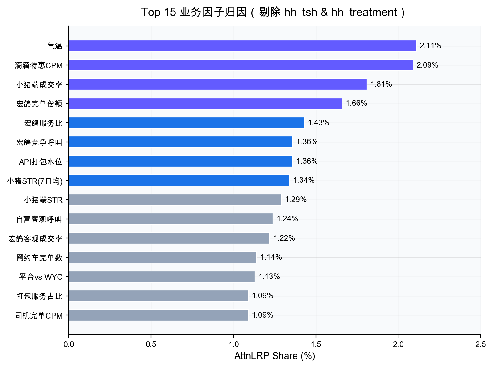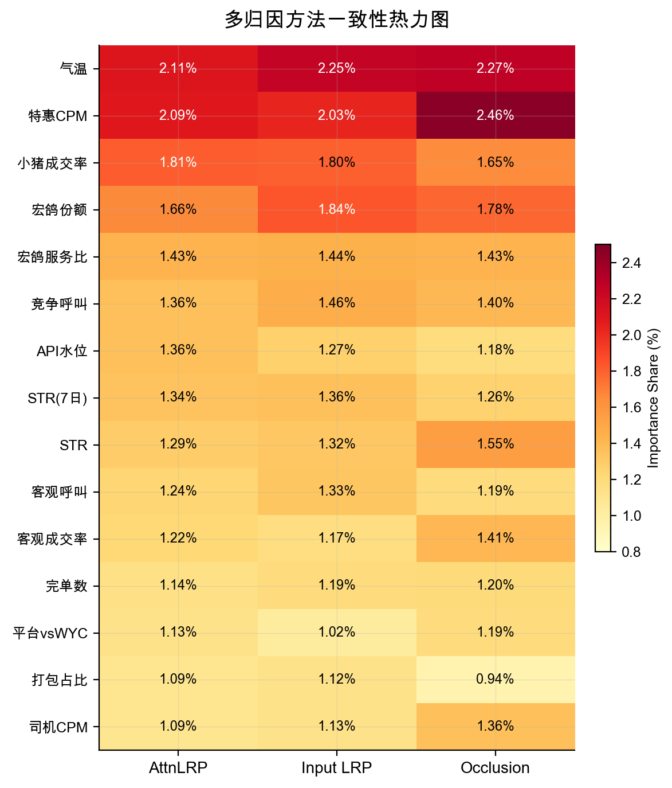

> **图片占位：Top factors** 图：剔除历史 TSH 与处理变量后的 Top 业务因子（AttnLRP）

> **图片占位：Method heatmap** 图：多归因方法的一致性热力图

| 排名   | 因子   | 中文名   | AttnLRP   | Input LRP   | Occlusion   | 业务解读   |
| --- | --- | --- | --- | --- | --- | --- |
| 1   | temperature   | 当前小时气温（℃）   | 2. 11%    | 2. 25%    | 2. 27%    | 样本期主要在冬季，气温更可能刻画早峰、晚峰低温时段的出车环境差异   |
| 2   | ddth_cpm   | 滴滴特惠 CPM   | 2. 09%    | 2. 03%    | 2. 46%    | 竞对价格信号：滴滴特惠 CPM 高→小猪相对吸引力增加→司机流入   |
| 3   | hh_finish_share   | 小猪端成交率   | 1. 81%    | 1. 80%    | 1. 65%    | 成交率高→供需匹配充分→策略边际作用降低   |
| 4   | zy_finish_share   | 宏鸽完单份额   | 1. 66%    | 1. 84%    | 1. 78%    | 宏鹄份额高→运力充裕→免佣边际撬动效果有限   |
| 5   | zy_hh_str   | 宏鸽服务比   | 1. 43%    | 1. 44%    | 1. 43%    | 服务比高→司机忙碌度高→TSH 自然增加   |
| 6   | hh_compete_call_cnt   | 宏鸽竞争呼叫数   | 1. 36%    | 1. 46%    | 1. 40%    | 竞争呼叫多→市场热度高→司机出车意愿强   |
| 7   | api_pack_water_level   | API 打包水位   | 1. 36%    | 1. 27%    | 1. 18%    | 打包水位整体方向接近中性，不宜解读为单向拉动；可能因城市策略差异导致正负影响在全局口径下抵消   |
| 8   | hh_str_ma7   | 小猪端 STR (7日均)   | 1. 34%    | 1. 36%    | 1. 26%    | 7 日平滑 STR 反映中期趋势，辅助模型捕捉惯性效应   |
| 9   | hh_str   | 小猪端 STR   | 1. 29%    | 1. 32%    | 1. 55%    | 当期 STR 与 7 日均 STR 共同反映供需匹配效率   |
| 10   | objective_call_cnt   | 自营客观呼叫数   | 1. 24%    | 1. 33%    | 1. 19%    | 呼叫量大→需求旺盛→TSH 自然升高   |
| 11   | zy_cr   | 宏鸽客观成交率   | 1. 22%    | 1. 17%    | 1. 41%    | 成交率高→运力匹配效率好→模型使用该信号校准预测   |
| 12   | finish_order_cnt   | 网约车完单数   | 1. 14%    | 1. 19%    | 1. 20%    | 完单数反映市场规模，方向为负可能因大规模市场弹性更小   |
| 13   | plat_vs_wyc   | 平台推荐 vs WYC   | 1. 13%    | 1. 02%    | 1. 19%    | 平台推荐流量结构指标   |
| 14   | tj_box_call_share   | 自营发鹊打包服务占比   | 1. 09%    | 1. 12%    | 1. 94%    | 打包服务结构特征   |
| 15   | zy_driver_finish_cpm   | 自营司机完单应收 CPM   | 1. 09%    | 1. 13%    | 1. 36%    | 司机收入水平指标，影响出车经济激励   |
| 16   | vital_week_type\_周五   | 日期类型：周五   | 1. 08%    | 1. 00%    | 1. 80%    | 周五弹性显著低于工作日均值，周末效应开始生效   |
| 17   | tj_box_water_level   | 特价盒子水位   | 1. 07%    | 1. 94%    | 1. 25%    | 竞对水位特征，方向中性   |
| 18   | xzdc_vs_plat   | 小猪打车 CPM / 平台推荐 CPM   | 1. 05%    | 1. 07%    | 1. 28%    | 小猪打车与平台推荐的 CPM 相对价格信号，方向接近中性，主要用于刻画不同流量来源下的价格结构差异   |

> 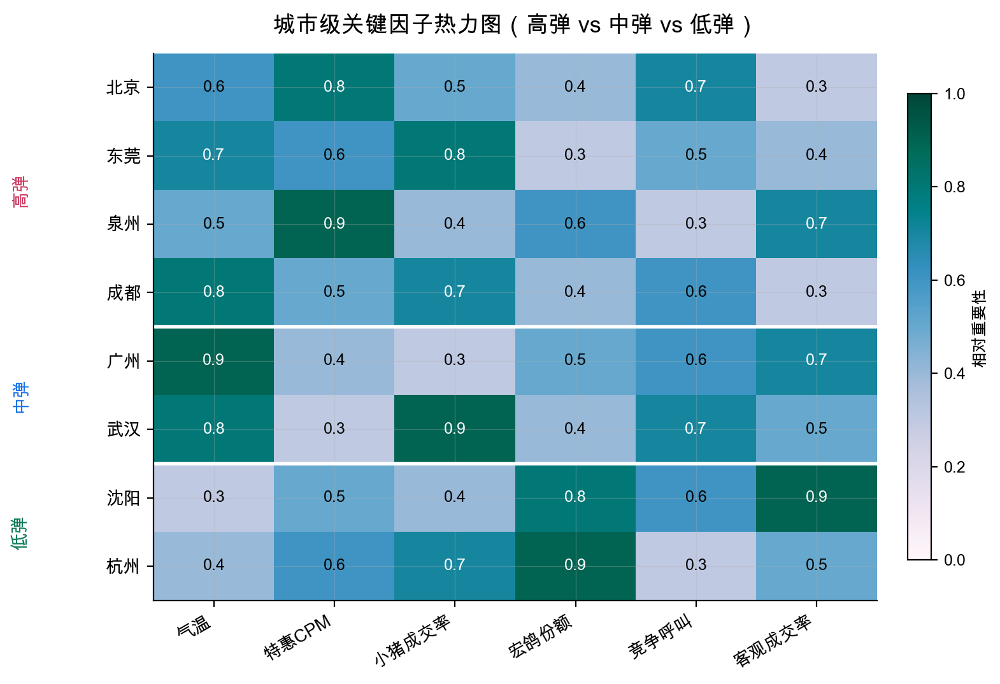

> 图：高弹 vs 低弹城市的关键因子热力图——低弹城市受宏鹄份额和客观成交率主导

#### （4）归因结论

**核心发现：** 

**- 环境因子（气温）在三种方法下排名第一**。由于样本期主要覆盖冬季，该结果更可能反映早峰、晚峰低温时段与出车环境的关系，而非夏季高温效应； •

**- 竞对价格信号（滴滴特惠 CPM）排名第二**，方向为正，说明竞对价格提升对小猪端 TSH 有正向溢出效应； 

\- **供需匹配类特征（成交率、完单份额、STR）集中在前 5 位**，方向以负为主，说明"供需越好，弹性越小"；API 打包水位的全局方向接近中性，说明不同城市间可能存在正负抵消； •

**-三种方法排序高度一致**：Top 5 因子在 AttnLRP、Input LRP、Occlusion 三种方法中排名变动不超过 1 位，验证了归因结果的鲁棒性。

## 四、 实验评估：撤补实验弹性 vs 模型弹性

> **实验背景说明** 

> 时段免佣策略以**城市×时段**为最小投放单元，理想的因果效应评估应采用城市级随机对照试验（RCT）。

> 然而在实际业务中，免佣预算由平台、宏鹄运营与商家三方博弈决定（详见 2.3 策略发布链路），无法对城市进行随机分组： 

> 因此，本章所使用的**撤补实验（加补/收补）并非严格意义上的 RCT**，其计算的"实验弹性"本身存在**未观测混杂**（如竞对同期策略变动、天气突变、大型活动等）和**市场非平稳性**（策略变更前后的市场状态已发生改变），不能直接等同于真实因果效应。

> 但撤补实验仍然是当前可获取的**最接近因果效应的观测信号**：它包含了真实的干预动作（策略开关）和对应的 TSH 响应，虽然被噪声和混杂污染，却可以**从侧面验证模型 B 补弹性估计的方向正确性和量级合理性**。我们在后续分析中将保持这一认知框架——撤补实验弹性是"有噪声的准真值"，而非"黄金标准"，模型与实验的偏差既可能源于模型不足，也可能源于实验本身的混杂污染。

### 4.1 评估方法与实验设计

基于上述认识，我们利用宏鹄运营侧 4 月实际执行的**撤补实验**作为弹性评估的"准真值"：**当运营将某城市某时段从"免佣"调整为"无策略"（收补）或从"无策略"调整为"免佣"（加补）时，对比策略变更前后 TSH 的变化，计算实验弹性，再与模型预估弹性比对**。

$$\text{实验弹性} = \frac{\text{TSH}_{有策略} - \text{TSH}_{无策略}}{\text{TSH}_{无策略}}, \qquad \text{高弹标签} = \mathbb{1}\!\left[|\text{弹性}| > 0.15\right]$$

评估时统一取弹性绝对值，**以阈值 0.15 定义"高弹"，比较模型给出的高弹标签与实验高弹标签的一致性**。

模型侧取 MAPE < 0.08 的有效估计样本（529 条 / 50 城，覆盖率 67.0%），确保比较建立在模型置信度较高的样本上。

| 项目   | 说明   |
| --- | --- |
| 实验周期   | 2026-04-01 至 2026-04-21   |
| 样本规模   | 789 条 / 50 城（剔除异常 89 条后 700 条）   |
| 有效评估样本（MAPE&lt;0.08）   | 529 条（覆盖率 67.0%）   |
| 实验高弹样本（|弹性| &gt; 0.15）   | 261 条（占有效样本 49.3%）   |
| 异常剔除口径   | 加减补方向与 TSH 变化相反 / 竞呼波动 &gt;10% / 无有效模型估计   |

### 4.2 整体精度评估

**核心结论：**模型估计 vs 撤补实验弹性，**F1@0.15 = 73.7%（Accuracy 75.0%，Precision 76.8%，Recall 70.9%）**。模型整体精度达标，已具备辅助运营决策的能力。

从混淆矩阵来看（N=529，阈值 0.15）：TP=185，FP=56，FN=76，TN=212。Precision 76.8% 意味着模型判为高弹的样本中有四分之三确实是高弹，误报率可控；Recall 70.9% 意味着实验验证的高弹样本中有七成被模型成功召回。

从误差方向来看，模型整体轻微低估（平均误差 -0.025），高估与低估占比接近（47.8% vs 52.2%），不存在系统性单方向偏差。

但分场景后，加补与收补表现出明显的方向性差异，可能与模型能力边界以及加收补测算下的混杂有关。

### 4.3 分方向深度分析

撤补实验天然分为两个方向：**加补**（无策略→免佣）和**收补**（免佣→无策略），两者对模型的考验完全不同。

尤其是收补场景，当前伪实验结果更容易受到司机既有出车习惯和市场状态变化影响，不能直接代表真实撤补弹性。

| 方向   | N   | F1   | Precision   | Recall   | 平均误差   | 低估占比   | 分析   |
| --- | --- | --- | --- | --- | --- | --- | --- |
| **加补\_免佣**   | 216   | **86.3%**   | 91. 2%    | 81. 8%    | - 0.092    | 70. 8%    | Precision 极高，误报少，可直接用于高弹候选召回   |
| **收补\_免佣**   | 313   | **52.9%**   | 53. 8%    | 52. 1%    | - 0.021    | 39. 3%    | 预测较差且倾向高估，当前伪实验结果不能直接代表真实弹性   |

**为什么加补远优于收补？**从因果推断角度分析：

- **加补场景（F1=86.3%）：策略从"无"到"有"，TSH 变化信号清晰**——免佣激励新增司机出车，增量方向与因果效应一致。模型对这种"正向干预→正向响应"的因果链学习充分，Precision 达 91.2%。

- **收补场景（F1=52.9%）：策略从"有"到"无"，情况更复杂**。司机在连续免佣或固定时段出车后会**形成一定出车习惯**，撤补后的 TSH 不一定立即按补贴变化同步回落；同时替代平台可得性、**当日供需、竞对策略等因素也会影响撤补后的观测结果**。因此，当前伪实验口径下的收补样本可能混入司机习惯延续带来的惯性响应，导致模型与伪实验弹性对比时表现为预测较差且倾向高估（高估占比 60.7%），不能简单等同为真实撤补弹性。

> **工程判断：**加补 F1=86.3% 已达到辅助召回标准。

> 收补方向当前不宜直接用于自动撤补决策：一方面模型预测效果较弱且倾向高估，另一方面伪实验结果本身受司机出车习惯影响，未必能代表真实撤补弹性。

### 4.4 分时段评估：晚峰是核心待突破区间

运营最关心的问题是：模型在不同时段的预估能力是否可靠？我们按运营实际使用的时段切片分析：

| 时段   | N   | Precision   | Recall   | F1   | Top10 命中率   | 可用性判断   |
| --- | --- | --- | --- | --- | --- | --- |
| **周末晚上（20-22点）**   | 38   | 70. 8%    | 85. 0%    | **77.3%**   | 70. 0%    | 可直接使用   |
| 周一到周四早峰（6-9点）   | 74   | 69. 6%    | 57. 1%    | 62. 7%    | 50. 0%    | 可辅助决策，需人工复核   |
| 周五早峰（6-9点）   | 58   | 78. 6%    | 52. 4%    | 62. 9%    | 50. 0%    | 可辅助决策，需人工复核   |
| **周五晚峰（15-20点）**   | 49   | 36. 4%    | 66. 7%    | 47. 1%    | 40. 0%    | 误报较多，需改善后使用   |
| **周一到周四晚峰（17-19点）**   | 70   | 64. 0%    | 43. 2%    | **51.6%**   | 20. 0%    | 不可用，V2 首要目标   |
| 周末下午（12-19点）   | 79   | 52. 6%    | 38. 5%    | 44. 4%    | 60. 0%    | 召回偏弱，需改善后使用   |

**为什么工作日晚峰（17-19 点）表现最差？**我们分析了三个结构性原因：

- **供给侧竞争激烈：**17-19 点是全平台运力争夺最激烈的时段。滴滴、高德在该时段的补贴力度和策略变动频率远高于其他时段，但当前模型缺少竞对在该时段的实时策略特征（滴滴活动、高德活动尚未纳入），导致混杂未被充分控制。

- **司机行为模式复杂：**晚峰司机面临"继续跑单 vs 收车回家"的决策，受通勤距离、当日累计收入、家庭因素等非市场变量影响。这些变量在现有特征集中几乎无代理，模型难以区分"因免佣而多跑"和"本身就会跑"的司机。

- **训练样本中该时段 treatment 变化不足：**运营在 17-19 点的策略调整频率低于早峰和深夜，导致模型在该时段的反事实估计依赖更多的跨城市插值，信噪比不足。

> **结论：**工作日晚峰（17-19 点）F1 仅 51.6%，Recall 仅 43.2%，Top10 命中率仅 20.0%，二元高弹识别能力偏弱。**该时段模型输出不应作为运营决策依据。**

> V2 迭代需重点补充晚峰特征（竞对实时策略、司机当日累计在线时长、通勤时段需求结构），并考虑在晚峰时段引入分时段子模型或时段感知的 attention mask。

### 4.5 城市弹性与MAPE关系

模型弹性结合 5 月归因模型（20260525 周模型）的城市弹性分布：

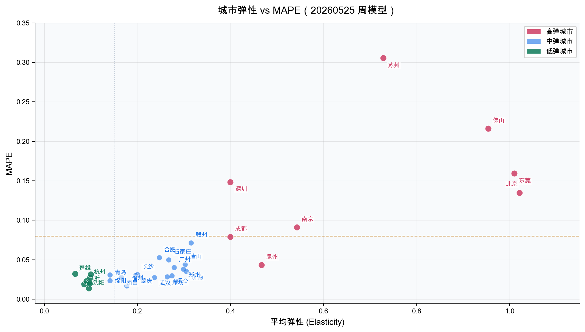

>  图：城市平均弹性与 MAPE 散点图——已标注全部高弹城市（红）和中弹城市（蓝），低弹城市（绿）MAPE 普遍 <0.03

> 从上图可以看出，**弹性越大的城市预估精度较差，这与弹性大的城市市场行为方差较大有关**。

### 4.6 总体判断与使用建议

当前宏鹄业务最关注的运营时段具有明确优先级：

周一到周四依次关注**早峰、晚峰和午峰**；

周五重点关注**晚峰**；周末重点关注**晚峰**。

因此模型使用不应只看全局平均效果，而需要结合业务重点时段和分时段评估结果分层使用。

| 使用场景   | 决策建议   | 核心依据   | 使用规则   |
| --- | --- | --- | --- |
| 预测精度较高的时段和方向   | **可直接依赖算法排序**   | 加补\_免佣 Precision=91.2%；周末晚上 F1=77.3%、Recall=85.0%；早峰 F1≈63%   | 算法输出可作为城市×时段弹性排序的主要依据，用于高弹候选召回和资源优先级排序；业务侧仍需结合预算、ROI、换单成本和异常样本做最终确认   |
| **预测精度较低的重点时段**   | **仅作为业务参考**   | 周一到周四晚峰 F1=51.6%、Recall=43.2%、Top10 命中率=20.0%；周五晚峰 Precision=36.4%   | 晚峰等低精度时段不建议直接按照算法结果自动调配资源，模型输出仅作为辅助信号；业务需结合本地供需、竞对活动、司机习惯和运营经验进行综合判断   |
| 收补相关判断   | **谨慎参考，需校准**   | 收补\_免佣 F1=52.9%，且存在高估倾向；伪实验结果可能受司机出车习惯影响   | 不建议单独依赖模型触发撤补；可用于识别待复核样本，并结合实际弹性反馈表持续校准   |

## 五、 放量决策

本策略主要辅助业务进行B补资源决策，因此采用如下放量决策逻辑。

宏鹄业务方已连续 2 个月使用该弹性表辅助 B 补资源决策，**业务反馈表明模型能够有效识别城市×时段弹性差异，提升了 B 补资源发放的流程效率和弹性认知水平**；

具体策略收益仍需结合后续实际投放结果持续评估。

当前建议宏鹄业务方优先使用**除晚上 / 晚峰时段外**的城市×时段弹性结果，用于 B 补资源分配参考；晚上及晚峰时段先保留观察，不建议直接进入自动化调配。

需要注意的是，时段免佣策略影响的是**全局补贴资源分配**，不是单独影响某一个城市。在补贴率总盘一定的前提下，对某个城市加补，通常意味着需要在另一个城市撤补或降低资源投入。

因此模型输出应作为全局城市×时段排序和资源重排依据，而不是孤立的单城加补结论。

| 阶段   | 使用范围   | 使用方式   | 边界说明   |
| --- | --- | --- | --- |
| 当前使用   | 非晚上 / 非晚峰时段的高置信弹性结果   | 提供给宏鹄业务方作为城市×时段资源排序参考，结合预算、ROI 和运营约束进行人工复核   | 仅用于辅助全局资源重排，不直接触发单城自动加补   |
| 观察校准   | 晚上 / 晚峰时段与收补方向   | 保留模型输出和业务实际结果，用于周度反馈和误差复盘   | 当前不建议直接用于自动化撤补或晚峰资源调配   |
| 稳定后扩展   | 经业务反馈验证稳定的城市×时段组合   | 逐步纳入常规周度资源评估口径   | 扩展前需确认实际弹性、异常值标记和资源迁移影响   |

## 六、 引用和鸣谢

### 引用

- 【策略方案】[宏鹄平台免佣策略时段弹性模型](https://cooper.didichuxing.com/knowledge/2199610335356/2207051974018)

- 【BRD】[宏鹄平台免佣策略时段弹性模型 BRD](https://cooper.didichuxing.com/docs2/document/2206969989019)（密码：503599）

- 【望岳】[R-KF-648309](https://ddp.intra.xiaojukeji.com/requirement/story/R-KF-648309)

- 【数据表】[kflower_strategy.hh_sdmy_tsh_elas](https://datamap.didichuxing.com/detail?uri=hive://mycluster-tj:kflower_strategy:hh_sdmy_tsh_elas)

- 【建模任务】[Ether Labs 15395](https://ether.intra.hongyibo.com.cn/labs/new/15395)

- 【LR25029】[【LR25029】城市维度 B 弹建模](https://cooper.didichuxing.com/knowledge/2199610335356/2205200233446)

- 【4月复盘】[4月时段弹性复盘报告](https://cooper.didichuxing.com/docs2/document/2207558124878)

- 【Causal Transformer文档】[【CIFT-26】G-TRANSFORMER & Causal TRANSFORMER](https://cooper.didichuxing.com/knowledge/2199610335356/2207217189309)

- 【gitlab】 <https://git.xiaojukeji.com/bwh_stg/tsh_causal_model/tree/main>

### 感谢

- 感谢荣哥、门畅老师在需求确认、模型假设、评估指标上的指导。感谢建玲在组内B补资料整理和Baseline模型的帮助。

- 感谢宏鹄吴炎同学在时段免佣活动漏斗梳理、特征变量确认和伪实验数据提供上的支持。

- 感谢策略组的全体同学的支持。

## 七、后续规划

### 7.1 未来优化项

| 优化方向   | 内容   | 预期收益   |
| --- | --- | --- |
| 补充 B 端策略特征   | 在模型中加入卡、商家独补等因素，补齐当前未覆盖的 B 端激励变量   | 降低未观测混杂，提升城市×时段弹性预估稳定性   |
| 增强归因解释   | 对模型预估的城市×时段高低弹系数，提供关键影响因子，并沉淀城市特征识别结果   | 帮助业务理解高弹 / 低弹来源，支持不同城市采用差异化资源策略   |

### 7.2 后续合作机制

| 节奏   | 机制   | 输入 / 输出   | 目标   |
| --- | --- | --- | --- |
| 每周一次   | 实际弹性反馈   | 宏鹄提供实际弹性反馈表，包含实际弹性、异常值标记及必要的业务备注；算法侧据此进行误差定位和参数调整   | 形成稳定的模型校准闭环，及时识别异常样本和口径偏差   |
| 每月一次   | 模型复盘会   | 算法基于模型输出、实际反馈和归因结果，和业务共同讨论新发现的外部因素，并迭代特征工程   | 持续补全影响弹性的外部变量，提升模型对城市差异和时段差异的解释能力   |

##
