# 【LR26-015】乘客与增长-表单策略-平台联合决策V3.3 CR阈值优化

[Cooper 原文](https://cooper.didichuxing.com/knowledge/2199610335356/2208199387389)

## 基础信息

| 项目   | 内容   |
| --- | --- |
| brd 文档链接   | [联合决策 V3 BRD](https://cooper.didichuxing.com/knowledge/2199610335356/2204407187371)   |
| 最后通过的策略方案链接   | [联合决策 V3 策略方案](https://cooper.didichuxing.com/knowledge/2199610335356/2204440442440)   |
| 实验链接（评估大师）   | [一期实验](https://yunchou.intra.hongyibo.com.cn/experimentManage/3563) [二期实验](https://yunchou.intra.hongyibo.com.cn/experimentManage/3661)   |
| 核心贡献点   | 1）通过离线仿真确认 CR 阈值存在优化空间 2）简化 CR 阈值参数产出逻辑，便于后续问题排查   |
| 第一贡献人   | 陈嘉曦、周之烁   |
| 共同贡献人   | 门畅、一鹏、苏格、袁宜东、张聪、朱生林及价格策略同学   |
| 后续策略负责人   | 陈嘉曦   |

## 1 背景

联合决策 V3 在决定最优决策前，会先基于 CR 阈值做候选空间剪枝。

- 默勾 CR 阈值的逻辑是：当前决策累计 CR < 默勾 CR 阈值时，该决策被剪枝。

- 幸运盒子 CR 阈值的逻辑是：当前决策幸运盒子单勾 CR < 幸运盒子 CR 阈值时，该决策被剪枝，防止因乘客反勾至幸运盒子单勾时 CR 差造成完单折损。

两类阈值都会改变可进入最终打分排序的候选决策集合。因此从决策上看，不仅会影响默勾数和幸运盒子展现，也可能改变最终被选中的幸运盒子定价、特价盒子折扣；从优化目标上看，会影响 CR、完单。

现状中，CR 阈值依赖离线仿真未完单预测 CR 的分位点产出：默勾 CR 阈值使用未完单 50 分位点，幸运盒子 CR 阈值使用未完单 10 分位点。该方式存在两个主要问题：

1. 阈值产出链路长，出现异常时难以快速判断是特征、模型、EVE 调度哪个环节的问题。

2. 阈值存在分城市优化空间。

本次实验首先希望明确默勾 CR 阈值是如何改变最终决策的，观察被剪枝逻辑改变的冒泡在 CR、默勾接受度、反勾率、全勾率等指标上的表现。同时，本次实验也优化 CR 阈值的产出逻辑，将原本依赖离线分位点的阈值，调整为基于历史真实 CR x 系数的方式，并通过实验找到更优的默勾 CR 阈值系数、幸运盒子 CR 阈值系数。

## 2 目标 & 约束

- 策略目标

	- 人均完单 +0.1%，H1 整体人均完单 +1%<!--评论:[{"u":"rongbohui","c":"这个怎么理解？"},{"u":"chenjiaxi","c":"CR阈值优化的目标是人均完单+0.1%，平台联合决策的H1目标是人均完单+1%"}] -->

- 约束指标项

	- 拉齐花业务补贴率，默勾接受度、幸运盒子完单份额不负

## 3 技术方案

### 3.1 离线仿真默勾 CR 阈值影响

> 分析口径：2026-01-11；V3 修复组的冒泡

#### 3.1.1 决策结果怎么改变

对比无/有默勾 CR 阈值剪枝逻辑下的最优决策，结论如下：

1. 整体看，37.75% 的冒泡改变了最终决策结果。

2. 拆分是否有特价盒子补贴率、是否有幸运盒子展现的场景看，默勾 CR 阈值对“无特价盒子补贴率”的冒泡影响更大，无特价盒子补贴率且有幸运盒子展现时，45.10% 的冒泡决策结果改变；无特价盒子补贴率且无幸运盒子展现时，41.60% 的冒泡决策结果改变。

| 特价盒子补贴率   | 是否有幸运盒子   | 决策结果改变   | 折扣改变   | 默勾改变   |
| --- | --- | ---: | ---: | ---: |
| /   | /   | 37.75%   | 13.47%   | 35.70%   |
| 有   | 有   | 37.28%   | 27.32%   | 30.64%   |
| 有   | 无   | 29.45%   | 13.56%   | 28.72%   |
| 无   | 有   | 45.10%   | 26.54%   | 42.51%   |
| 无   | 无   | 41.60%   | 0.00%   | 41.60%   |

#### 3.1.2 改变决策冒泡的变化

Q:对于改变决策结果的冒泡，特价盒子折扣、幸运盒子折扣、默勾数如何改变？

A：

- 有特价盒子补贴率且有幸运盒子时，特价盒子折扣均值变浅 1.53pp；有特价盒子补贴率但无幸运盒子时，特价盒子折扣均值仅变浅 0.11pp，说明幸运盒子存在时对特价盒子折扣改变更大。

- 有幸运盒子场景，幸运盒子折扣均值约变浅 4pp，原因是需要用更浅的折扣提升 ECR 来弥补多勾带来的 DSAR 折损。

- 默勾数平均增加约 5-6 个同价合并后的车型。

| 特价盒子补贴率   | 是否有幸运盒子   | 特价盒子折扣相同   | 特价盒子折扣更深   | 特价盒子折扣更浅   | 幸运盒子折扣相同   | 幸运盒子折扣更深   | 幸运盒子折扣更浅   | 默勾相同   | 默勾更多   | 特价盒子折扣改变均值   | 幸运盒子折扣改变均值   | 默勾改变均值（同价车型合并）   |
| --- | --- | ---: | ---: | ---: | ---: | ---: | ---: | ---: | ---: | ---: | ---: | ---: |
| 有   | 有   | 52.1%   | 13.8%   | 34.2%   | 41.8%   | 13.6%   | 44.6%   | 19.1%   | 80.9%   | 浅1.53   | 浅3.98   | 多5.29   |
| 有   | 无   | 58.0%   | 19.4%   | 22.6%   | 100.0%   | 0.0%   | 0.0%   | 2.2%   | 97.7%   | 浅0.11   | 浅0.00   | 多6.88   |
| 无   | 有   | 100.0%   | 0.0%   | 0.0%   | 40.7%   | 13.4%   | 45.9%   | 6.0%   | 94.0%   | 浅0.00   | 浅3.95   | 多5.05   |
| 无   | 无   | 100.0%   | 0.0%   | 0.0%   | 100.0%   | 0.0%   | 0.0%   | 0.0%   | 100.0%   | 浅0.00   | 浅0.00   | 多5.94   |

Q:对于改变决策结果的冒泡，预测的 acc_cr、dsar 如何改变？

A:

- acc_cr 增加 13～21pp，但默勾接受度降低 47～60pp

- 说明对于被默勾 CR 阈值改变最终决策的冒泡，剪枝后的候选决策会显著提高累计 CR，但同时牺牲默勾接受度

| 特价盒子补贴率   | 是否有幸运盒子   | score改变   | 排序改变   | acc_cr改变   | dsar改变   |
| --- | --- | ---: | ---: | ---: | ---: |
| 有   | 有   | -0.120   | 86.664   | +13.63%   | -47.20%   |
| 有   | 无   | -0.141   | 34.515   | +14.02%   | -60.04%   |
| 无   | 有   | -0.072   | 20.975   | +17.02%   | -46.73%   |
| 无   | 无   | -0.062   | 5.114   | +21.82%   | -55.72%   |

Q:原决策结果的 acc_cr 分位数是多少？

A:

- 被默勾 `acc_cr` 约束改变的冒泡中，原全空间最优决策只有不到 10% 的冒泡属于低 CR（`acc_cr < 0.5`）。

- 说明默勾 CR 阈值并不是只在“预估低 CR”场景下选择多勾。

| 特价盒子补贴率   | 是否有幸运盒子   | p0   | p10   | p20   | p30   | p40   | p50   | p60   | p70   | p80   | p90   | p100   |
| --- | --- | ---: | ---: | ---: | ---: | ---: | ---: | ---: | ---: | ---: | ---: | ---: |
| 有   | 有   | 13.85%   | 57.85%   | 64.42%   | 68.45%   | 72.18%   | 75.15%   | 77.50%   | 79.56%   | 81.54%   | 85.16%   | 92.12%   |
| 有   | 无   | 7.90%   | 57.30%   | 63.76%   | 67.91%   | 71.53%   | 74.53%   | 76.99%   | 79.16%   | 81.17%   | 85.28%   | 92.12%   |
| 无   | 有   | 8.43%   | 54.83%   | 62.79%   | 67.46%   | 71.00%   | 73.92%   | 76.35%   | 78.58%   | 80.54%   | 82.90%   | 91.92%   |
| 无   | 无   | 1.92%   | 39.23%   | 47.87%   | 56.08%   | 62.21%   | 66.91%   | 70.98%   | 74.75%   | 78.24%   | 81.54%   | 92.10%   |

#### 3.1.3 决策公式影响

本节用于解释为什么在 V3 简化版决策公式下，需要通过默勾 CR 阈值来强制多勾。

V3 简化版决策公式和 V1 完整决策公式对默勾方向的偏好不同：

- V3 简化版决策公式会忽略默勾不接受的完单：

	- $$\sum_{jk} dsar_{ijk} \cdot ecr_{ij} \cdot acc\_cr_{ijk}$$

	- V3 简化版决策公式倾向于少勾，核心原因是忽略了默勾不接受后的完单：现有公式中，默勾不接受被近似为“不发单、不完单”，因此默勾接受度越高的候选 score 越高；而默勾接受度随勾选数增多单调递减，递减越快，越容易被公式推向少勾。

- V1 完整版决策公式，假设默勾不接受时以单勾呼叫：

	- $$\sum_{jk} dsar_{ijk} \cdot ecr_{ij} \cdot acc\_cr_{ijk} + (1-dsar_{ijk}) \cdot ecr_{ij} \cdot acc\_cr_{ij0}$$

	- V1 完整决策公式倾向于多勾，核心原因是忽略了默勾比例增加时 ECR 的降低。历史随机默勾实验显示，默勾比例从 0 到 0.6 时 ECR 下降约 1.1pp，从 0 到 1 时 ECR 下降约 2.1pp；如果不在公式或模型中刻画该 ECR 递减，多勾的完单会被高估。

基于冒泡明细示例，三类决策公式对应的最优决策如下；结果说明，当考虑 ECR 随默勾递减时，勾选数会居中。

1. V1 完整决策公式：最优默勾数为 8。

2. V1 完整决策公式-优化 ecr：最优默勾数为 2。

3. V3 简化版决策公式：最优默勾数为 0。

| 默勾数   | dsar   | ecr   | ecr-随默勾数增加递减   | acc_cr   | 完单-V1完整决策公式   | 完单-V1完整决策公式-优化ecr   | 完单-V3简化版决策公式   |
| ---: | ---: | ---: | ---: | ---: | ---: | ---: | ---: |
| 0   | 0.988   | 0.280   | 0.280   | 0.792   | 0.2220   | 0.2220   | 0.2193   |
| 1   | 0.767   | 0.280   | 0.280   | 0.790   | 0.2217   | 0.2212   | 0.1700   |
| 2   | 0.507   | 0.280   | 0.279   | 0.799   | 0.2231   | 0.2221   | 0.1135   |
| 3   | 0.396   | 0.280   | 0.279   | 0.799   | 0.2228   | 0.2214   | 0.0888   |
| 4   | 0.276   | 0.280   | 0.278   | 0.762   | 0.2198   | 0.2179   | 0.0589   |
| 5   | 0.207   | 0.280   | 0.277   | 0.762   | 0.2203   | 0.2180   | 0.0442   |
| 6   | 0.131   | 0.280   | 0.277   | 0.867   | 0.2248   | 0.2219   | 0.0318   |
| 7   | 0.083   | 0.280   | 0.276   | 0.871   | 0.2239   | 0.2205   | 0.0202   |
| 8   | 0.084   | 0.280   | 0.276   | 0.923   | 0.2251   | 0.2212   | 0.0218   |
| 9   | 0.065   | 0.280   | 0.275   | 0.923   | 0.2244   | 0.2201   | 0.0169   |
| 10   | 0.039   | 0.280   | 0.274   | 0.928   | 0.2235   | 0.2187   | 0.0101   |

#### 3.1.4 迭代思路指导

1. 短期迭代思路：当前阈值存在分城市优化空间

2. 长期迭代思路：不再保留“默勾不接受等于不会完单”的假设，而是在模型中端到端预测联合决策下的 BCR，由模型学习默勾接受/不接受时的 BCR

### 3.2 CR 阈值现状分析

#### 3.2.1 默勾 CR 阈值分析

分析目的：看清当前分城市默勾 CR 阈值相对城市历史 14 天真实 CR 的系数是多少。

结论：

1. 默勾 50 分位点系数均值为 0.771，约 60% 的系数 > 0.8。

2. 默勾 60 分位点系数均值为 0.885，约 60% 的系数 > 0.9。

基于此分析，实验时的默勾 CR 系数包含 1、0.9、0.8、0.7、0.6、0.5、0.4 组。

| 系数分位点   | 50分位点系数   | 60分位点系数   |
| ---: | ---: | ---: |
| 0   | 0.029   | 0.034   |
| 10   | 0.305   | 0.546   |
| 20   | 0.636   | 0.766   |
| 30   | 0.732   | 0.840   |
| 40   | 0.790   | 0.907   |
| 50   | 0.841   | 0.942   |
| 60   | 0.877   | 0.968   |
| 70   | 0.905   | 0.997   |
| 80   | 0.943   | 1.022   |
| 90   | 0.998   | 1.075   |
| 100   | 2.217   | 2.433   |
| 均值   | 0.771   | 0.885   |

#### 3.2.2 幸运盒子 CR 阈值分析

分析目的：在有幸运盒子城市中，看清当前分城市幸运盒子 CR 阈值相对城市历史 14 天幸运盒子单勾真实 CR 的系数是多少。

结论：

1. 10 分位点系数均值为 0.3279。

2. 90% 的系数 > 0.2，50% 的系数 > 0.3。

基于此分析，实验时的幸运盒子 CR 系数包含 0、0.2、0.3、0.4、0.5 组。

| 系数分位点   | 10分位点系数   |
| ---: | ---: |
| 0   | 0.1161   |
| 10   | 0.1913   |
| 20   | 0.2366   |
| 30   | 0.2566   |
| 40   | 0.2879   |
| 50   | 0.3282   |
| 60   | 0.3632   |
| 70   | 0.3805   |
| 80   | 0.4051   |
| 90   | 0.4724   |
| 100   | 0.6181   |
| 均值   | 0.3279   |

## 4 实验结果/评估结果

### 4.1 一期-默勾 CR 阈值实验

#### 4.1.1 实验方案

基于城市历史 14 天 CR \* 系数，产出默勾 CR 阈值。

| 项目   | 内容   | 备注   |
| --- | --- | --- |
| 实验方式   | 乘客分流   |    |
| 分流方式   | 随机分流，默勾系数组内部每天翻转   |    |
| 分流策略内容   | V3 主流量 82%；默勾 10/9/8/7/6/5/4 共18%，其中默勾 8 组占比 16%，其余 14%   | 默勾 10 代表默勾系数为 1   |
| 实验周期   | 2026-05-08 至 2026-05-14   |    |
| 流量范围   | 小猪端；全部品类；全部分单场景；全国；全部商家   |    |
| 是否联动实验   | 否   |    |
| 评估人   | 算法   |    |

#### 4.1.2 实验结论

一期以 V3 为对照组，默勾 10/9/8/7/6/5/4 分别与 V3 对比。核心结论如下：

- 默勾 7 的人均完单 +0.33%，收益最高。

- 随系数增加，默勾接受度下降、CR 上升，但完单先增后减，说明系数不是越低越好。

| 实验组   | 人均完单   | CR   | 默勾体验   | 品类结构   | 总实验结果   |
| --- | --- | --- | --- | --- | --- |
| 默勾 8   | +0.25%   | +0.02pp   | 单均默勾车型数 -5.22%，默勾接受度 +1.68pp   | 幸运盒子完单份额 +0.58pp，特价盒子完单份额 -0.01pp   | 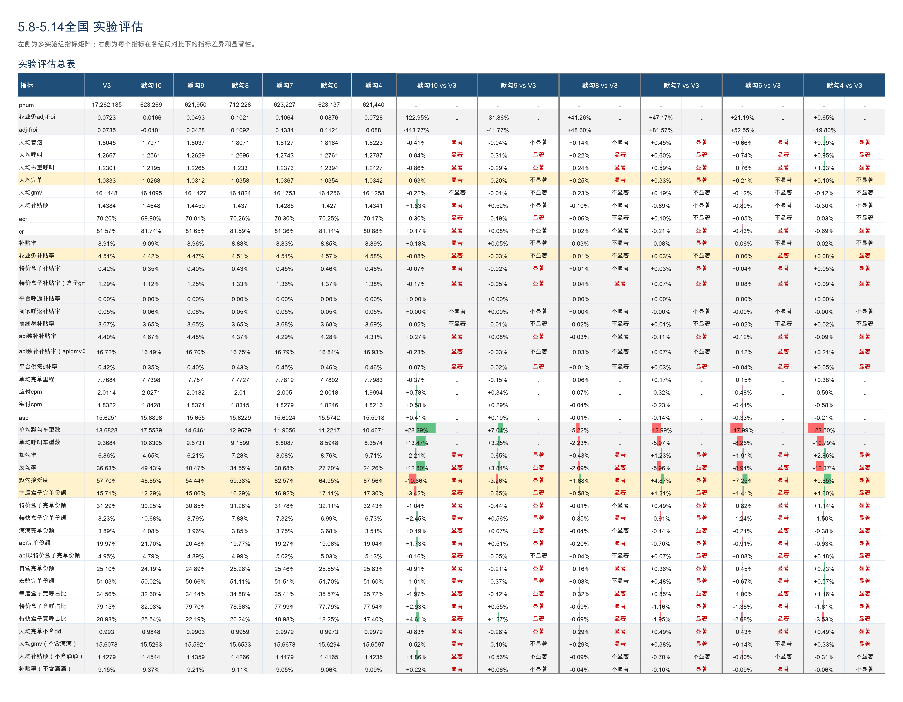   |
| 默勾 7   | +0.33%   | -0.21pp   | 单均默勾车型数 -12.99%，默勾接受度 +4.87pp   | 幸运盒子完单份额 +1.21pp，特价盒子完单份额 +0.49pp   |
| 默勾 6   | +0.21%   | -0.43pp   | 单均默勾车型数 -17.99%，默勾接受度 +7.25pp   | 幸运盒子完单份额 +1.41pp，特价盒子完单份额 +0.82pp   |

#### 4.1.3 收益下钻

按照默勾 7 vs V3 的单均默勾数对城市进行拆分，拆分为多勾城市和少勾城市。实验数据表明，多勾城市和少勾城市的人均完单均为正向，说明默勾 7 的收益不仅来源于少勾。

- 多勾城市：人均完单 不显著+0.57%。

- 少勾城市：人均完单 显著+0.35%。

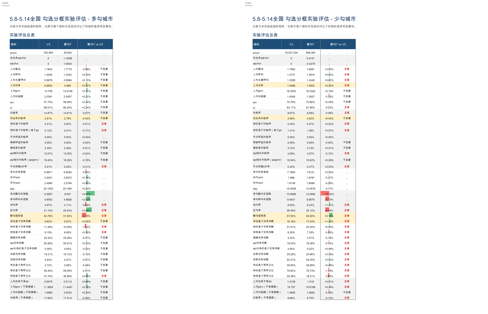

#### 4.1.4 分框分析

周中周末分析，对比默勾 7、默勾 8 组：

- 周一至周四，默勾 7 优于默勾 8：人均完单 +0.32% vs +0.11%，默勾接受度 +5.43% vs +2.73%，反勾率 -6.75% vs -3.33%，建议优先默勾 7。

- 周五，默勾 7 明显更优：人均完单 +0.38% vs +0.05%，默勾接受度 +2.39% vs -0.39%，反勾率 -2.97% vs +0.55%，建议优先默勾 7。

- 周六至周日，默勾 8 完单更优，为人均完单 +0.55%。

| 日期档   | 系数   | 人均完单增幅   | 花业务补贴率变化   | 默勾接受度变化   | 反勾率变化   | 单均默勾车型数变化   | 幸运盒子完单份额变化   |
| --- | --- | ---: | ---: | ---: | ---: | ---: | ---: |
| 周一至周四   | 默勾7   | +0.32%   | +0.03%   | +5.43%   | -6.75%   | -13.48%   | +1.33%   |
| 周一至周四   | 默勾8   | +0.11%   | +0.03%   | +2.73%   | -3.33%   | -6.90%   | +0.84%   |
| 周五   | 默勾7   | +0.38%   | +0.00%   | +2.39%   | -2.97%   | -8.64%   | +1.21%   |
| 周五   | 默勾8   | +0.05%   | -0.06%   | -0.39%   | +0.55%   | -0.58%   | +0.17%   |
| 周六至周日   | 默勾7   | +0.33%   | +0.05%   | +4.98%   | -5.90%   | -13.81%   | +1.01%   |
| 周六至周日   | 默勾8   | +0.55%   | -0.01%   | +0.82%   | -1.15%   | -4.46%   | +0.32%   |

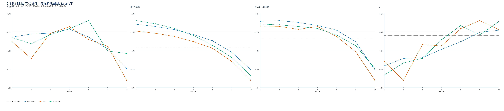

CR 分框分析：

- 低 CR 分框（低于 70）在默勾 8 最优，高 CR 城市（高于 70）更偏默勾 7。

- 机制上，低 CR 城市更适合通过多勾提升 CR，虽然会折损默勾接受度和增加反勾风险，但可以带来完单提升；高 CR 城市本身转化基础较好，更适合通过少勾改善冒泡、默勾接受度和反勾体验，从而带来更稳的完单提升。

- 从折线趋势看，CR 变化呈现明显分层：低 CR 分框在较高默勾系数下更容易获得 CR 提升；高 CR 分框随着系数降低 CR 会有所回落，但完单仍能保持正收益，说明其收益更多来自体验改善和冒泡改善。

- 单均默勾车型数随默勾系数降低整体下降，高 CR 分框下降更明显，对应默勾接受度提升也更明显。

| CR分框   | 最优系数   | 人均完单增幅   | CR变化   | 花业务补贴率变化   | 默勾接受度变化   | 反勾率变化   | 单均默勾车型数变化   | 幸运盒子完单份额变化   |
| --- | --- | ---: | ---: | ---: | ---: | ---: | ---: | ---: |
| CR_50-   | 默勾8   | +2.38%   | +0.64%   | +0.05%   | -2.12%   | +2.82%   | +3.10%   | +0.00%   |
| CR_50-60   | 默勾8   | +0.19%   | +0.47%   | +0.03%   | -1.40%   | +1.95%   | +4.87%   | +0.00%   |
| CR_60-70   | 默勾8   | +1.08%   | +0.17%   | -0.08%   | -0.03%   | +0.14%   | -1.27%   | +0.09%   |
| CR_70-80   | 默勾7   | +0.57%   | -0.26%   | +0.08%   | +5.38%   | -6.70%   | -15.54%   | +0.90%   |
| CR_80-90   | 默勾7   | +0.32%   | -0.17%   | +0.00%   | +5.28%   | -6.35%   | -12.84%   | +1.62%   |

 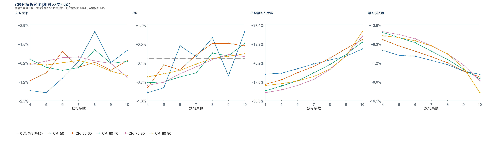

增长分框分析：

- 其他城市和战略收缩城市按默勾 8 处理，核心城市和行业增长-小最优为默勾 7，行业增长-大最优为默勾 6。

- 核心城市、行业增长城市主要通过低价心智换完单，因此更适合低默勾 CR 系数；战略收缩、其他城市更适合高默勾 CR 系数，通过多勾提升 CR，从而带来完单提升。

- CR 侧，其他城市和战略收缩城市的 CR 更容易随默勾系数增加转正，说明多勾对这两类城市有补转化作用；核心城市、行业增长-大在高系数下 CR 压力有所缓解但未形成稳定优势；行业增长-小整体相对平稳。

- 体验侧，随着默勾系数增加，各分框单均默勾车型数整体上升、默勾接受度整体下降，核心城市和行业增长-大变化更明显。

| 增长分框   | 最优系数   | 人均完单增幅   | CR变化   | 花业务补贴率变化   | 默勾接受度变化   | 反勾率变化   | 单均默勾车型数变化   | 幸运盒子完单份额变化   |
| --- | --- | ---: | ---: | ---: | ---: | ---: | ---: | ---: |
| 其他   | 默勾8   | +1.21%   | +0.23%   | -0.05%   | -0.30%   | +0.67%   | +0.19%   | +0.11%   |
| 战略收缩城市   | 默勾8   | +0.29%   | +0.13%   | +0.04%   | +1.08%   | -1.39%   | -4.53%   | +0.57%   |
| 核心城市   | 默勾7   | +0.25%   | -0.13%   | -0.02%   | +5.58%   | -6.70%   | -13.41%   | +1.75%   |
| 行业增长-大   | 默勾6   | +0.59%   | -0.41%   | +0.13%   | +7.41%   | -9.13%   | -19.30%   | +1.12%   |
| 行业增长-小   | 默勾7   | +0.68%   | +0.05%   | +0.05%   | +4.32%   | -5.10%   | -8.81%   | +0.47%   |

 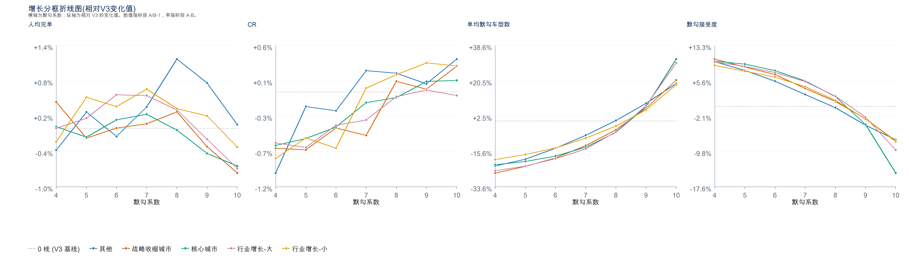

#### 4.1.5 冒泡拆分分析

冒泡拆分用于解释改变决策的冒泡发生了什么变化、全勾风险是否可控。以下表格均展示相对 V3 的指标变化。

决策改变分析：

- V3 中决策改变冒泡占比约 24.67%；

- 随默勾系数增加，决策改变占比增加，决策改变冒泡的 CR 变高。

- 相比决策未改变冒泡，决策改变冒泡的默勾接受度更低。因此不能只看完单和 CR，还需要持续监控默勾接受度、反勾率和全勾率。

| 实验组   | 决策改变占比   | 决策未改变占比   | 实验结果图   |
| --- | ---: | ---: | ---: |
| V3   | 24.67%   | 75.33%   | 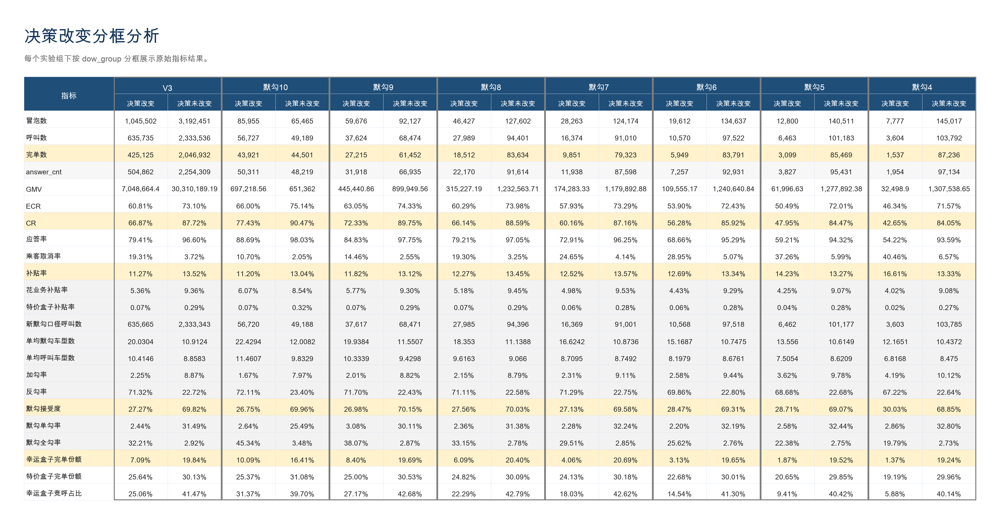  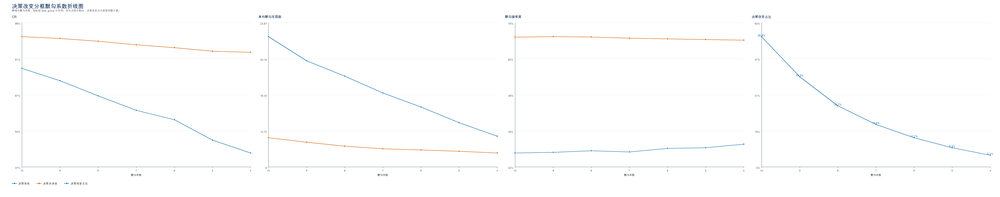   |
| 默勾 10   | 56.77%   | 43.23%   |
| 默勾 9   | 39.31%   | 60.69%   |
| 默勾 8   | 26.68%   | 73.32%   |
| 默勾 7   | 18.54%   | 81.46%   |
| 默勾 6   | 12.71%   | 87.29%   |
| 默勾 5   | 8.35%   | 91.65%   |
| 默勾 4   | 5.09%   | 94.91%   |

勾选形态拆分分析：

- 随默勾系数增加，单勾占比降低，全勾占比上升，默勾接受度下降。

- 默勾单勾本身 CR 较高、反勾率低，是体验相对健康的形态。

- 默勾全勾反勾率明显更高，默勾接受度不足 30%，是需要重点防控的风险形态。

- 从 CR 看，整体排序为：默勾单勾 > 接受默勾 > 加勾 > 反勾 > 全勾。

| 实验组   | 加勾占比   | 反勾占比   | 接受默勾占比   | 默勾全勾占比   | 默勾单勾占比   | 实验结果图   |
| --- | ---: | ---: | ---: | ---: | ---: | ---: |
| V3   | 4.97%   | 26.53%   | 41.78%   | 9.79%   | 16.93%   | 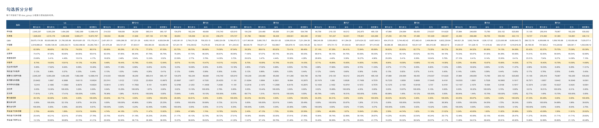  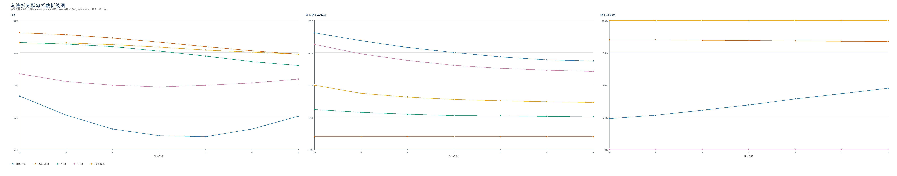   |
| 默勾10   | 3.27%   | 34.72%   | 32.89%   | 19.32%   | 9.80%   |
| 默勾9   | 4.47%   | 29.11%   | 39.14%   | 12.38%   | 14.91%   |
| 默勾8   | 5.29%   | 25.09%   | 43.11%   | 8.40%   | 18.10%   |
| 默勾7   | 5.89%   | 22.37%   | 45.60%   | 5.96%   | 20.18%   |
| 默勾6   | 6.39%   | 20.20%   | 47.36%   | 4.41%   | 21.63%   |
| 默勾5   | 6.79%   | 18.68%   | 48.36%   | 3.48%   | 22.68%   |
| 默勾4   | 7.05%   | 17.61%   | 49.03%   | 2.85%   | 23.45%   |

全勾冒泡分析：

- 全勾冒泡是重点风险形态：全勾中决策改变占比随默勾系数增加而增加，决策改变冒泡的默勾接受度下降、CR 增加。

- 决策未改变冒泡的默勾接受度仍在 50% 以上，但决策改变冒泡的默勾接受度在 20% 左右，说明高系数带来的全勾增量需要重点关注接受度风险。

| 实验组   | 全勾决策改变占比   | 全勾决策未改变占比   | 实验结果图   |
| --- | ---: | ---: | ---: |
| V3   | 75.04%   | 24.96%   | 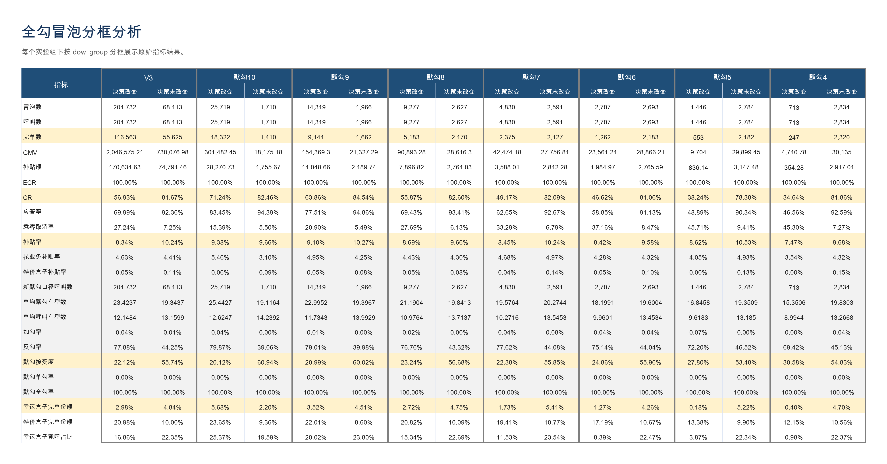  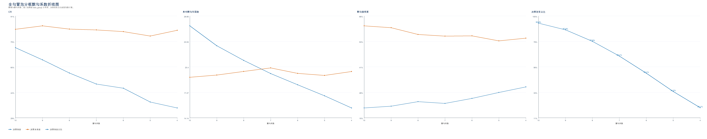   |
| 默勾10   | 93.77%   | 6.23%   |
| 默勾9   | 87.93%   | 12.07%   |
| 默勾8   | 77.93%   | 22.07%   |
| 默勾7   | 65.09%   | 34.91%   |
| 默勾6   | 50.13%   | 49.87%   |
| 默勾5   | 34.18%   | 65.82%   |
| 默勾4   | 20.10%   | 79.90%   |

#### 4.1.6 分城市最优默勾系数选取

##### 选取方式

分城市 CR 系数确定方式按 `城市 x 日期类型` 确定最优默勾系数。由于周中周末分析显示周一至周四、周五最优系数均为默勾 7，周六至周日最优系数为默勾 8，因此日期类型分为周一至周五、周六至周日。

每个城市日期档由 CR 分框、增长分框、城市自身完单最优系数三票决定。平票时，选 CR 分框、增长分框中分框完单增幅最高的系数。该方式引入城市自身完单最优票，能够在部分城市日期档上跳出固定分框结论；同时平票时仍回到 CR 分框和增长分框的完单增幅约束，避免完全被城市小样本尖点牵引。

##### 分框 X 周中周末最优系数

- 这一层结果是城市推荐投票的直接输入：每个城市先命中对应的城市分框，再按周中/周末使用下表中的最优系数参与投票。

- 若某条曲线存在孤立异常点，则先剔除异常点，再从剩余候选系数中选出该分框、该日期档的最优系数。

| 分框维度   | 城市分框   | 日期类型   | 最优系数   | 人均完单增幅   | 剔除异常系数   | 折线图   |
| --- | --- | --- | --- | --- | --- | --- |
| CR分框   | CR_50-   | 周一至周五   | 默勾8   | +4.19%   | 默勾9   | 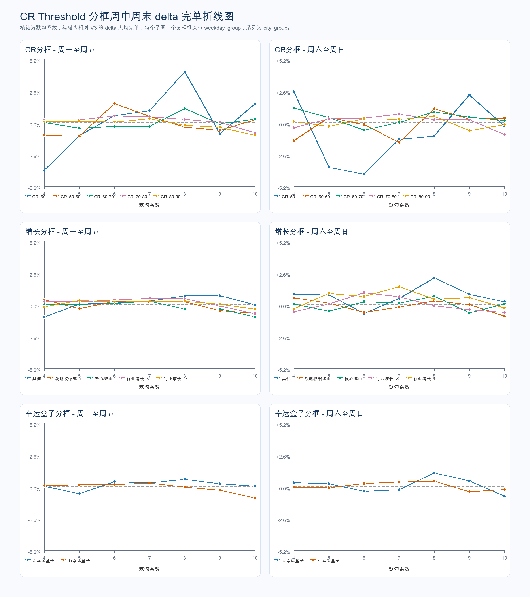   |
| CR分框   | CR_50-   | 周六至周日   | 默勾9   | +2.27%   | 默勾4   |
| CR分框   | CR_50-60   | 周一至周五   | 默勾8   | -0.35%   | -   |
| CR分框   | CR_50-60   | 周六至周日   | 默勾8   | +1.16%   | -   |
| CR分框   | CR_60-70   | 周一至周五   | 默勾8   | +1.17%   | -   |
| CR分框   | CR_60-70   | 周六至周日   | 默勾8   | +0.89%   | 默勾4   |
| CR分框   | CR_70-80   | 周一至周五   | 默勾6   | +0.57%   | -   |
| CR分框   | CR_70-80   | 周六至周日   | 默勾7   | +0.71%   | -   |
| CR分框   | CR_80-90   | 周一至周五   | 默勾7   | +0.34%   | -   |
| CR分框   | CR_80-90   | 周六至周日   | 默勾8   | +0.53%   | -   |
| 增长分框   | 其他   | 周一至周五   | 默勾8   | +0.73%   | -   |
| 增长分框   | 其他   | 周六至周日   | 默勾8   | +2.20%   | 默勾6   |
| 增长分框   | 战略收缩城市   | 周一至周五   | 默勾8   | +0.24%   | 默勾4、默勾6   |
| 增长分框   | 战略收缩城市   | 周六至周日   | 默勾8   | +0.32%   | 默勾4   |
| 增长分框   | 核心城市   | 周一至周五   | 默勾7   | +0.29%   | -   |
| 增长分框   | 核心城市   | 周六至周日   | 默勾8   | +0.69%   | -   |
| 增长分框   | 行业增长-大   | 周一至周五   | 默勾7   | +0.54%   | -   |
| 增长分框   | 行业增长-大   | 周六至周日   | 默勾6   | +0.99%   | -   |
| 增长分框   | 行业增长-小   | 周一至周五   | 默勾8   | +0.29%   | 默勾5   |
| 增长分框   | 行业增长-小   | 周六至周日   | 默勾7   | +1.47%   | -   |

##### 最终推荐系数分布

分城市最终推荐系数分布如下：

| 日期类型   | 默勾10   | 默勾9   | 默勾8   | 默勾7   | 默勾6   | 默勾5   | 默勾4   |
| --- | ---: | ---: | ---: | ---: | ---: | ---: | ---: |
| 周一至周五   | 0   | 0   | 269   | 32   | 49   | 0   | 0   |
| 周六至周日   | 0   | 59   | 205   | 71   | 15   | 0   | 0   |

| 整体   | 默勾10   | 默勾9   | 默勾8   | 默勾7   | 默勾6   | 默勾5   | 默勾4   |
| --- | ---: | ---: | ---: | ---: | ---: | ---: | ---: |
| 整体   | 0   | 59   | 474   | 103   | 64   | 0   | 0   |

有 10 个城市缺少城市自身实验数据，仍保留推荐行，按 CR 分框 + 增长分框两票处理。

收益对比如下：

| 系数确定方式   | 周一至周五完单增幅   | 周六至周日完单增幅   | 整体完单增幅   | 纳入城市日期行   | 缺失城市日期行   |
| --- | ---: | ---: | ---: | ---: | ---: |
| 统一默勾7   | +0.2893%   | +0.2975%   | +0.2919%   | 676   | 20   |
| 统一默勾8   | +0.0245%   | +0.5252%   | +0.1836%   | 681   | 15   |
| 分城市最优默勾 CR 系数   | +0.5551%   | +0.9956%   | +0.6951%   | 680   | 20   |

从完单收益看，分城市 CR 系数确定方式整体完单增幅约 +0.70%，高于统一默勾7和统一默勾8。该结论作为当前候选策略证据，不作为最终放量决策。

### 4.2 二期-幸运盒子CR阈值实验

#### 4.2.1 实验方案

基于城市历史 14 天幸运盒子单勾真实 CR x 系数，产出幸运盒子 CR 阈值；默勾 CR 阈值沿用一期候选策略中的默勾 0.7 或 by 城市最优系数。二期实验用于进一步确认幸运盒子 CR 阈值系数，并评估其与默勾 CR 阈值的组合效果。

| 项目   | 内容   | 备注   |
| --- | --- | --- |
| 实验方式   | 乘客分流   | 重新分流   |
| 分流方式   | 随机分流   | 二期重新切流，区别于一期默勾 CR 阈值实验   |
| 分流策略内容   | 主流量73%，实验组各 2%   |    |
| 实验周期   | 2026-06-01 至 2026-06-07   |    |
| 流量范围   | 小猪端；全部品类；全部分单场景；全国；全部商家   | 实验城市为全国   |
| 是否联动实验   | 否   |    |
| 评估人   | 算法   |    |

实验组合如下：

| 幸运盒子 CR 系数 / 默勾 CR 系数   | 0   | 0.2   | 0.3   | 0.4   | 0.5   |
| --- | --- | --- | --- | --- | --- |
| 0.7   | -   | 实验   | 实验   | 实验   | -   |
| by 城市最优系数   | 实验   | 实验   | 实验   | 实验   | 实验   |

#### 4.2.2 实验结论

- 默勾 0.7 组合中，`默勾0.7 + 幸运0.2` 的人均完单+0.74%，收益最高；

- by 城市最优组合中，`分城市最优默勾系数 + 幸运0.4` 的**人均完单+1.03%**，收益最高；

- 相比`默勾0.7 + 幸运0.2`，`分城市最优默勾系数 + 幸运0.4` 人均完单+0.28%

| 实验组   | 人均完单   | CR   | 默勾体验   | 品类结构   | 实验结果图   |
| --- | --- | --- | --- | --- | --- |
| 默勾0.7 + 幸运0.2   | +0.74%   | -0.50pp   | 单均默勾车型数 -16.44%，默勾接受度 +7.58pp，反勾率 -8.97pp   | 幸运盒子完单份额 +2.23pp，特价盒子完单份额 +0.44pp   | 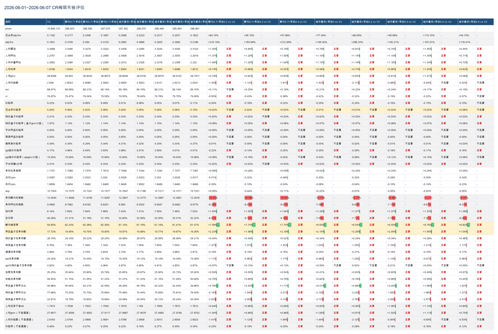   |
| 分城市最优默勾系数 + 幸运0.4   | +1.03%   | -0.22pp   | 单均默勾车型数 -14.27%，默勾接受度 +6.76pp，反勾率 -7.97pp   | 幸运盒子完单份额 +1.95pp，特价盒子完单份额 +0.26pp   |

## 5 放量决策

|    |    | 预期扩量时间节奏   | 实际扩量时间   | 实际放量暂停点   | 放量暂停点效果评估   | 是否需要设置长期对照组（默认不需要，此列无需填写）   |
| --- | --- | --- | --- | --- | --- | --- |
|    |    |    | LR通过后，根据实际情况，填写这3列   |    |
| 放量决策意见   | 决策人   | ——   | ——   | ——   | ——   | ——   |
| 决策意见：  - 通过   - 不通过，给出原因   - 扩大流量实验    |    |    |    |    |    |
| 放量需要周知的利益相关方   | 没有的话，无需填写   | 行业策略幸运盒子业务方   |
| 放量策略   | eg. 实验组1   | 分城市最优默勾系数 + 幸运0.4   |
| 放量决策   | 分批放量   | 2026.6.9 放量30%流量   | 变更原因：幸运盒子业务方希望能尽快提升幸运盒子份额  2026.6.9 放量40%流量   | 需要评估   | 拉齐花业务补贴率，放量组完单显著+0.59%   | ——   |
| 2026.6.18 放量80%流量   |    | 需要评估   | 评估数据：人均完单、花业务补贴率   | ——   |
| 2026.6.26 放量97%流量   |    | 需要评估   | 评估数据：人均完单、花业务补贴率   | 需要保留长期对照组默勾系数0.7组<!--评论:[{"u":"rongbohui","c":"长期的review机制是什么？"},{"u":"chenjiaxi","c":"调度任务by天评估，看人均完单呢、默勾接受度等指标"}] -->  对照组流量比例：3%<!--评论:[{"u":"rongbohui","c":"长期的review机制是什么？"},{"u":"chenjiaxi","c":"调度任务by天评估，看人均完单呢、默勾接受度等指标"}] -->   |

## 6 引用和鸣谢

### 引用

- [联合决策CR阈值优化实验方案](https://cooper.didichuxing.com/knowledge/2199610335356/2207474839138)

- [默勾acc_cr阈值影响分析](https://cooper.didichuxing.com/knowledge/2199610335356/2206445405535)

- [默勾 CR 阈值优化实验分析报告](https://cooper.didichuxing.com/knowledge/2199610335356/2208013300120)

### 鸣谢

感谢之烁、门畅老师在分析、迭代思路、实验设计上的关键指导

感谢一鹏对表单策略迭代付出的贡献

感谢苏格、袁宜东在业务上的支持

感谢张聪、朱生林在实验配置上的大力支持

感谢价格策略所有同学

## 7 后续规划

- 放量分城市最优默勾系数 + 幸运0.4组，并长期保留默勾CR系数0.7组观察

- 在联合决策V4迭代中，不再保留“默勾不接受等于不会完单”的假设，而是在模型中端到端预测 BCR，由模型学习默勾接受/不接受时的 BCR，直接优化完单。
