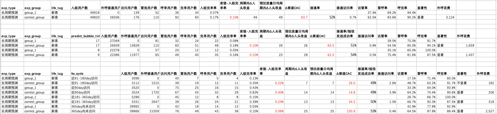
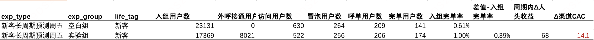
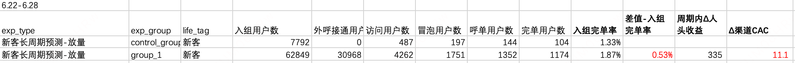

# 【LR26-016】乘客与增长-增长策略-用户长期需求预测-MVP

[Cooper 原文](https://cooper.didichuxing.com/knowledge/2199610335356/2208199474275)

# 0. 基础信息

| 字段   | 内容   |
| --- | --- |
| BRD文档链接   | [BRD-用户需求预测](https://cooper.didichuxing.com/docs2/document/2207086393691)   |
| 最后通过的策略方案链接   | [【策略方案】用户需求预测](https://cooper.didichuxing.com/knowledge/2199610335356/2207175434661)   |
| 实验链接（评估大师）   | 无（ab实验是Pope直接在apollo生成的，不是用的评估大师）   |
| 核心贡献点   | 打通花小猪/\*\*\*/PBD三端跨端冒泡数据，构建行业全量用户冒泡序列；  产出用户长期行为预测表，支撑外呼精准触达   |
| 第一贡献人   | 韩一玮   |
| 共同贡献人   | 周之烁，陈嘉曦，张志茹   |
| 后续策略负责人   | 韩一玮   |

# 一、背景

花小猪现有触达策略以承接用户已有需求为主，缺乏对潜在需求的主动识别能力。历史上通过人工方式对学生、通勤等特定场景做过粗粒度需求预测，并在触达渠道上验证了商业价值。但人工分析方式存在三个核心瓶颈：效率低、成本高，难以规模化延伸至全量用户和全场景；分析粒度粗，缺乏用户个体维度的需求概率量化，触达效率有较大提升空间。

同时，仅依赖花小猪主端的冒泡和行为数据，无法完整还原用户真实的出行需求全貌。端外冒泡用户数约为花小猪呼叫用户的 5 倍，大量用户在花小猪侧没有任何行为信号，但实际上具有强烈的出行需求，需求在其他端被满足或流失。若模型仅基于花小猪单端数据构建，对在滴滴主端/PBD 高频使用的用户，历史行为特征极度稀疏，预测能力不高。

本次 MVP 版本聚焦两项核心能力：跨端用户冒泡行为序列构建，以及基于用户长期行为的需求预测规则版本。

# 二、目标 & 约束

## 2.1 策略目标

### 总体策略目标

通过算法精准预测用户需求，系统性替代人工分析，驱动触达策略全面提效，进组完单率显著提升。<!--评论:[{"u":"rongbohui","c":"和策略评审中目标不一致？"},{"u":"vivianhan","c":"策略评审那个是新客+流失两个人群 &amp; 长期行为+日维度复购两个行为预测的目标。本次只有新客+长期行为"}] -->

- **拉新方向（外呼）：<!--评论:[{"u":"rongbohui","c":"和策略评审中目标不一致？"},{"u":"vivianhan","c":"策略评审那个是新客+流失两个人群 &amp; 长期行为+日维度复购两个行为预测的目标。本次只有新客+长期行为"}] -->** 面向端外溢出需求人群，通过算法识别在\*\*\*/PBD端有冒泡行为且对花小猪有潜在意向的用户，结合触达转化概率模型筛选高价值人群，以外呼方式进行强触达，引导用户进端释放需求。预计可触达人群规模从当前20万扩大至100万量级（端外冒泡/呼叫花小猪运力=5/1）。<!--评论:[{"u":"rongbohui","c":"和策略评审中目标不一致？"},{"u":"vivianhan","c":"策略评审那个是新客+流失两个人群 &amp; 长期行为+日维度复购两个行为预测的目标。本次只有新客+长期行为"}] -->

- **促活方向（push/订阅消息）：<!--评论:[{"u":"rongbohui","c":"和策略评审中目标不一致？"},{"u":"vivianhan","c":"策略评审那个是新客+流失两个人群 &amp; 长期行为+日维度复购两个行为预测的目标。本次只有新客+长期行为"}] -->** 面向端内存量用户，通过长周期需求预测（覆盖通勤、学生等规律性场景，预计覆盖大盘10%呼叫用户），在用户需求即将发生前的最优时间窗口内推送触达消息，提升呼叫转化效率。<!--评论:[{"u":"rongbohui","c":"和策略评审中目标不一致？"},{"u":"vivianhan","c":"策略评审那个是新客+流失两个人群 &amp; 长期行为+日维度复购两个行为预测的目标。本次只有新客+长期行为"}] -->

为支撑上述业务目标，本次需要完成两项核心算法能力的从0到1搭建

- **跨端用户冒泡行为序列构建（数据底座）<!--评论:[{"u":"rongbohui","c":"算法本身有评估指标吗"},{"u":"vivianhan","c":"探索性，没有算法目标，后面第四章有离线评估的一些结果"},{"u":"vivianhan","c":"如果说算法在意什么评估指标，那就是预测时间的准确性+置信度的可信度，第四章都有"}] -->**：打通花小猪、\*\*\*、PBD三端用户行为数据，以花小猪全量注册用户为锚点，构建用户完整的跨端日度冒泡序列，为后续所有需求预测模型提供统一的特征数据基础。<!--评论:[{"u":"rongbohui","c":"算法本身有评估指标吗"},{"u":"vivianhan","c":"探索性，没有算法目标，后面第四章有离线评估的一些结果"},{"u":"vivianhan","c":"如果说算法在意什么评估指标，那就是预测时间的准确性+置信度的可信度，第四章都有"}] -->

- **基于用户长期行为的预测（MVP版本）：<!--评论:[{"u":"rongbohui","c":"算法本身有评估指标吗"},{"u":"vivianhan","c":"探索性，没有算法目标，后面第四章有离线评估的一些结果"},{"u":"vivianhan","c":"如果说算法在意什么评估指标，那就是预测时间的准确性+置信度的可信度，第四章都有"}] -->**基于跨端冒泡行为序列，通过统计规则识别具有规律性出行习惯的用户，预测其T+1的冒泡时间和OD对，输出用于触达的长期需求预测表。<!--评论:[{"u":"rongbohui","c":"算法本身有评估指标吗"},{"u":"vivianhan","c":"探索性，没有算法目标，后面第四章有离线评估的一些结果"},{"u":"vivianhan","c":"如果说算法在意什么评估指标，那就是预测时间的准确性+置信度的可信度，第四章都有"}] -->

### 长周期行为预测V0策略目标

对于长周期行为预测V0版本，目标预计新客+300人，流失+600人。

## 2.2 策略约束

无

# 三、技术方案

## 3.1 跨端冒泡行为序列构建

**人群映射**：以花小猪全量注册用户的 passenger_id 为锚点，通过集团 OneID 体系完成三端身份对齐。花小猪侧直接通过映射表中的 hxz_pas_pid 字段匹配 oneid；滴滴主端侧通过 oneid 反查映射表中的滴滴主端 pid，再驱动冒泡大表圈人；PBD 侧由于映射表中无独立 pid 字段，需以冒泡表中的 passenger_id 先查询 oneid 后再与花小猪锚点对齐。全链路统一以花小猪 passenger_id 作为主键输出。

**各端数据处理**：各端经各自冒泡去重逻辑处理后，分别关联对应场景表，获取起终点 POI 类型（start_poi_type / dest_poi_type）和一级场景（scene_l1）三个核心字段，端标识分别记为 0（花小猪）、1（滴滴主端）、2（PBD）。

**端内 10 分钟 Session 去重**：对同一用户按冒泡时间排序，若相邻两条冒泡时间差小于 10 分钟则归为同一 Session，否则开启新 Session。每个 Session 取最早冒泡时间作为需求触发时刻，取时间最晚的冒泡对应的起终点 POI 和场景，还原用户经多次调整后最终确认的出行意图。

**跨端聚合**：三端数据各自完成端内去重后，直接 UNION ALL 合并，对每个用户按时间排序后聚合为当日序列，产出表：`kflower_strategy.all_pltf_user_long_term_behaviors_by_day_pid`

| 字段名   | 字段含义   |
| --- | --- |
| passenger_id   | 花小猪乘客 ID，全链路统一主键   |
| life_cycle   | 用户生命周期   |
| bubble_cnt   | 当日冒泡次数   |
| dow   | 星期几（1=周一，7=周日）   |
| trips   | 当日 OD 对序列，格式：\[\[start_poi_type_1, dest_poi_type_1\], ...\]   |
| trips_time   | 当日冒泡时间序列，格式：\["时间1", "时间2", ...\]   |
| trips_scene   | 当日一级场景序列   |
| platforms   | 各次冒泡对应端标识序列，格式：\[0, 1, 2, ...\]（0=花小猪，1=滴滴主端，2=PBD）   |
| city_ids   | 各次冒泡对应城市 ID 序列   |
| dt   | 日期分区   |

## 3.2 长期行为预测

**长期行为定义**：长期行为是指用户在过去90天内，同一用户在同一OD对（起点→终点）上，存在时间规律稳定、出现频次足够的重复出行模式。具体定义如下：

- 数据范围：行业全量冒泡数据，覆盖花小猪（HXZ）、滴滴主端（WYC）、第三方渠道（PBD）三端，以花小猪全量注册用户为人群锚点，统计窗口为过去90天

- 频次阈值：同一用户在同一OD对的同一出行时段内，冒泡次数 ≥ 6次

- 时间稳定性：同一OD对同一出行时段内，冒泡时间的标准差 ≤ 45分钟

时间标准差占比
| 时间标准差区间   | 长期行为数量   | 占比   |
| --- | --- | --- |
| 0 – 5分钟   | 11,292   | 15.8%   |
| 5 – 10分钟   | 12,100   | 16.9%   |
| 10 – 15分钟   | 9,148   | 12.8%   |
| 15 – 20分钟   | 7,858   | 11.0%   |
| 20 – 25分钟   | 7,228   | 10.1%   |
| 25 – 30分钟   | 6,666   | 9.3%   |
| 30 – 35分钟   | 6,002   | 8.4%   |
| 35 – 40分钟   | 5,793   | 8.1%   |
| 40 – 45分钟   | 5,427   | 7.6%   |
| 合计（≤ 45分钟）   | 71,514   | 100%   |
| 其中 ≤ 15分钟   | 32,540   | 45.5%   |
| 其中 ≤ 30分钟   | 54,292   | 75.9%   |

- 多时段识别：同一用户同一 OD 对内，若相邻冒泡记录时间差超过 3 小时，则标记为新的时段。每个时段独立进行频次与稳定性校验，满足条件的均视为独立的长期行为，避免混合计算导致时间标准差虚高被错误过滤。

**冒泡时间预测**：对每个识别出的长期行为，取历史出行时间中出现次数最多的小时段的最早值作为预测冒泡时间（向下取整）（不希望延迟触达）。

**置信度体系：**置信度分按星期类型独立计算，分为三类：工作日（WD，周一至周四）、周五（FRI）、周末（WE，周六至周日），分值范围 \[0, 1\]，分值越高代表该用户在对应星期类型下该行为的冒泡概率越大。各维度最大值均在 clip 到 Q3+1.5\*IQR 后归一化处理后输出。

$$\text{conf\_wd} = \text{最近冒泡距今天数} \times 0.1 + \text{近30天工作日冒泡次数} \times 0.8 + \text{工作日跨越周数} \times 0.1$$

$$\text{conf\_fri} = \text{最近冒泡距今天数} \times 0.1 + \text{近30天周五冒泡次数} \times 0.2 + \text{周五跨越周数} \times 0.1 + \text{周五90天总次数} \times 0.1 + \text{近30天工作日冒泡次数} \times 0.5$$

$$\text{conf\_we} = \text{最近距今天数} \times 0.1 + \text{近30天周末冒泡次数} \times 0.5 + \text{周末90天总次数} \times 0.2 + \text{周末跨越周数} \times 0.2$$

**产出表**：

- pid × 行为粒度预测表：`kflower_strategy.all_pltf_user_long_term_behaviors_by_day_pid_behavior` 

| 字段名   | 含义   |
| --- | --- |
| pid   | 花小猪乘客 ID   |
| user_lifecycle   | 用户生命周期（取最近一次冒泡日期对应的值）   |
| p_hxz / p_wyc / p_pbd   | 该长期行为在三端的历史冒泡占比   |
| predict_city   | 预计需求城市 ID（发生城市众数）   |
| p_weekday / p_friday / p_weekend   | 该长期行为在各星期类型的冒泡占比   |
| predict_bubble_time   | 预计冒泡小时（cluster 起始时间向下取整）   |
| predict_scene   | 预计冒泡场景   |
| conf_weekday / conf_friday / conf_weekend   | 三类星期类型置信度   |
| poi_o / poi_d   | 起点/终点 POI   |
| dt   | 日期分区   |

# 四、离线评估 & AB实验结果

## 4.1 离线评估

**跨端口径覆盖面**：以花小猪全量注册用户（3.78 亿人）为基准，过去 90 天内在行业内有冒泡记录的用户约 2.03 亿人，在此基础上识别出存在长期行为的用户共 10,656,469 人，覆盖比例约 5.26%。与花小猪单端历史口径（≥5 次，标准差 ≤ 45 分钟，覆盖比例 4%）对比，两套口径下有长期行为用户覆盖比例均在 4%\~5% 区间内，规模基本对齐。

**时间准确率：**

长期行为预测日期为 2026年5月10日，验证日期为 5月11日至5月17日。

- 整体分布（分母 = 全部冒泡）：

| 命中类型   | 冒泡数   | 总冒泡数   | 占比   |
| --- | --- | --- | --- |
| 正确触达（diff ∈ \[0, 3)）   | 8,715,293   | 10,838,064   | 80.41%   |
| 延迟触达（diff ∈ \[-2, 0)）   | 340,044   | 10,838,064   | 3.14%   |
| 未覆盖   | 1,782,727   | 10,838,064   | 16.45%   |

注：未覆盖的冒泡主要来自测试期新增行为或偶发需求，历史 90 天内不满足长期行为条件，属合理排除。

- 有效冒泡口径（排除未覆盖）：

| 命中类型   | 冒泡数   | 有效冒泡总数   | 有效口径占比   |
| --- | --- | --- | --- |
| 正确触达   | 8,715,293   | 9,055,337   | 96.24%   |
| 延迟触达   | 340,044   | 9,055,337   | 3.76%   |

**置信度验证：**

长期行为预测日期为 2026年5月10日，验证日期为 5月11日至5月17日。

置信度越高的行为，在验证期实际发生的概率应越高（单调性）。

注：conf = 1.0 时单独归入 100-100% 桶；分桶时使用 Floor 函数。

| **wd****conf 区间**   | **总行为数**   | **命中数**   | **命中率%**   | **fri****conf 区间**   | **总行为数**   | **命中数**   | **命中率%**   | **we****conf 区间**   | **总行为数**   | **命中数**   | **命中率%**   |
| :---: | :---: | :---: | :---: | :---: | :---: | :---: | :---: | :---: | :---: | :---: | :---: |
| 0-10%   | 4,597,186   | 213,422   | 4.64   | 0-10%   | 4,321,992   | 91,136   | 2.11   | 0-10%   | 6,828,185   | 174,045   | 2.55   |
| 10-20%   | 3,016,047   | 408,573   | 13.55   | 10-20%   | 3,485,426   | 187,071   | 5.37   | 10-20%   | 2,669,972   | 167,803   | 6.28   |
| 20-30%   | 2,287,235   | 555,136   | 24.27   | 20-30%   | 2,367,715   | 244,797   | 10.34   | 20-30%   | 1,663,202   | 182,169   | 10.95   |
| 30-40%   | 1,629,253   | 562,872   | 34.55   | 30-40%   | 1,681,291   | 280,407   | 16.68   | 30-40%   | 1,204,168   | 215,524   | 17.90   |
| 40-50%   | 1,099,859   | 474,847   | 43.17   | 40-50%   | 1,070,940   | 254,877   | 23.80   | 40-50%   | 838,738   | 211,194   | 25.18   |
| 50-60%   | 735,113   | 356,432   | 48.49   | 50-60%   | 674,796   | 188,184   | 27.89   | 50-60%   | 654,114   | 213,432   | 32.63   |
| 60-70%   | 518,708   | 298,804   | 57.61   | 60-70%   | 498,638   | 169,826   | 34.06   | 60-70%   | 520,272   | 207,509   | 39.88   |
| 70-80%   | 386,401   | 253,230   | 65.54   | 70-80%   | 416,655   | 173,518   | 41.65   | 70-80%   | 373,221   | 167,521   | 44.89   |
| 80-90%   | 473,595   | 324,292   | 68.47   | 80-90%   | 429,252   | 223,063   | 51.97   | 80-90%   | 329,003   | 179,972   | 54.70   |
| 90-100%   | 742,963   | 656,119   | 88.31   | 90-100%   | 502,658   | 351,724   | 69.97   | 90-100%   | 260,442   | 158,181   | 60.74   |
| 100%   | 50,398   | 45,491   | 90.26   | 100%   | 83,672   | 58,964   | 70.47   | 100%   | 187,293   | 142,754   | 76.22   |

## 4.2 线上AB实验

**实验方案**：

|    | **内容**   |
| --- | --- |
| **实验方式**   | 乘客分流   |
| **分流方式**   | 随机分流   |
| **分流策略内容**   | - 对照组（group_1）：长周期预测命中用户，不做外呼，仅做行为数据记录<!--评论:[{"u":"menchang","c":"实验评估的是外呼+需求预测的打包收益。需求预测的收益受限于业务支持，无法做剥离的线上实验，通过与人工预测+外呼的对比，来体现算法需求预测的效果，补充在五、放量决策中。"}] -->   - 实验组（control_group）：相同人群口径，叠加外呼触达<!--评论:[{"u":"menchang","c":"实验评估的是外呼+需求预测的打包收益。需求预测的收益受限于业务支持，无法做剥离的线上实验，通过与人工预测+外呼的对比，来体现算法需求预测的效果，补充在五、放量决策中。"}] -->    |
| **实验周期**   | 2026年6月2日9:00 & 17:00   |
| **流量范围**   | 流量端：小猪端   |
| 实验生效品类：不限   |
| 分单场景：不涉及   |
| 全国   |
| 实验生效商家：不涉及   |
| **是否联动实验**   | 不涉及   |
| **评估人**   | 业务自评（运营：张志茹）   |

**完整实验结果：**

**核心实验结果总结：**

| exp_group   | 入组用户数   | Δ入组完单率   | Δ渠道CAC   | 显著性   |
| --- | --- | --- | --- | --- |
| group_1（不触达）   | 49,918   | —   | —   | —   |
| control_group（外呼）   | 49,820   | +0.10%   | ¥63.7   | 显著   |

| fw_cycle分层   | Δ入组完单率   | Δ渠道CAC   | 显著性   |
| --- | --- | --- | --- |
| 近90天访问   | +0.40%   | ¥14.8   | 显著   |
| 近181–365天访问   | +0.24%   | ¥24.5   | 显著   |
| 近91–180天访问   | +0.22%   | ¥26.0   | 不显著   |
| 365天内未访问   | +0.06%   | ¥100.9   | 显著   |

# 五、放量决策

**触达人群：**实验结论表明，365天内未访问用户已与平台长期断联、品牌认知极低，外呼虽有统计显著增量（Δ完单率+0.06%），但渠道CAC高达¥100.9，远高于其他分层，暂不纳入触达范围。后续外呼人群收窄至365天内有过访问记录的新客。

**放量节奏：**由于每个外呼时点均需单运营独配置活动，预计2–3周内完成全量配置。放量过程中无需观察线上展示效果，主要瓶颈为人力配置节奏。

**预期收益：**放量后渠道ΔCAC预计约¥25，新增新客规模约300人。

---

**历史长周期外呼策略对比**

- 人群：wyc 是hxz新流用户，近90天周五17-19点同起点呼单量大于等于5，交叉增长投入的城市，交叉花小猪近365day有访问

- 时间：4.3-4.6

- 实验组：Δ入组完单率0.39%，周期内Δ人头收益68人，Δ渠道CAC14.1

---

**放量情况：**周中、周五、周末可外呼时段已放量，控频30day外呼成功1次

**6.22-6.28放量实验结果（因预算有限，只对新客放量）：**

- 10%空白组

- 90%实验组：Δ入组完单率0.53%，周期内Δ人头收益335人，Δ渠道CAC11

**==对总目标的贡献度：==**

- 总目标：预计新客+300人；流失+600人。

- 目标完成度：完成对新客人头数目标；待对流失人群放量试验。

---

**长周期需求预测部分收益：**

对比历史长周期外呼策略：

- 覆盖面基本一致：4天40500人 vs 7天70641人

- Δ入组完单率+0.14pp（历史0.39%vs现0.53%）

- Δ渠道CAC -3（历史14.1vs现11.1）
