# 【LR26-017】创新策略-智能客服-意图识别-V1.0

[Cooper 原文](https://cooper.didichuxing.com/knowledge/2199610335356/2208205078151)

# 基础信息

| brd文档链接 <br> | [【BRD】客服大模型-智能客服意图识别](https://cooper.didichuxing.com/docs2/document/2206473324996) <br> |
| --- | --- |
| 最后通过的策略方案链接 <br> | [智能客服-意图识别策略方案](https://cooper.didichuxing.com/knowledge/2199610335356/2206758730886) <br> |
| 实验链接 <br> | [https://ab.intra.hongyibo.com.cn/launch/1397/normal/76401](https://ab.intra.hongyibo.com.cn/launch/1397/normal/76401) <br> |
| 核心贡献点 <br> | CoT 蒸馏 + Self-Consistency 数据质量分层； <br>结构化输出场景的 N-gram 投机采样； <br> |
| 第一贡献人 <br> | 叶舟 <br> |
| 共同贡献人 <br> | 门畅、方舟、小熊、翔宇、胡涛、锦宏、新杰、荣纯、鑫然以及其他业务老师 <br> |
| 后续策略负责人 <br> | 叶舟 <br> |

# 一、背景

## 1.1 业务背景

随着大模型技术的进步，智能客服的拟人化水平越来越高，使用智能机器人替代人工已成为行业趋势（美团计划用机器人替代50%人工，TikTok非电商业务计划替代90%人工）。目前市面几大出行APP在智能客服场景已逐步接入大模型。因此，我们希望为**小猪端三方运力（非小猪自营）乘客在线客服**实现用户问题的快速定位识别并且逐步覆盖打车业务投诉全场景优化，**从而提高用户体验、降低客服成本（降低转人工率）**。

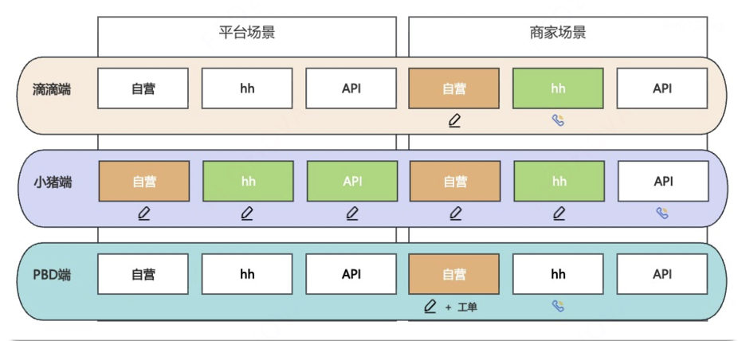

图中所有绿色+文本模块，为我们接入的场景，其他为ese接入场景或cp自己接入的场景。

## 1.2 现状与痛点

当前客服系统（容联）主要通过关键词识别来回答用户简单问题，存在以下问题：

- 转人工率：容联100%开量后预计61%，vs. 高德22%，vs. 美团24%

- 用户体验极差：点踩率高达99%，场景问题解决率几乎为0%，vs. 高德52%，vs. 美团58%

- 无解决能力：仅能做简单问答，无法闭环处理用户问题

# 二、目标&约束<!--评论:[{"u":"zhuzhengdan","c":"这个目标是整个客服项目的目标？不是策略的目标吧"}] -->

| 指标 <br> | 目标值 <br> | 说明 <br> |
| --- | --- | --- |
| 意图识别准确率 <br> | 整体76% <br> | 头部场景80%，其余场景70% <br> |
| 转人工率 <br> | 降至30% <br> | 从当前61%降低至30% <br> |
| 响应时长 <br> | P99 &lt; 6s，均值3s <br> | 端到端响应要求 <br> |
| 安全召回率 <br> | 100% <br> | 高政舆及安全场景在册关键词必须100%召回 <br> |

> 安全召回率由工程侧前置正则匹配实现，不依赖模型推理。

# 三、技术方案

意图识别模块是智能客服的"大脑"，负责理解用户输入并将其路由到正确的处理场景。采用 **Embedding快速召回 + 大模型精确分类** 的两阶段架构。<!--评论:[{"u":"menchang","c":"意图识别的技术路线选择为当前的蒸馏8B模型的原因是什么？1）为什么一定要蒸馏，2）为什么不选择微调BERT"},{"u":"yezhou","c":"蒸馏的原因DeepSeek-V3.1 推理成本和时延都撑不住 SLA，但8B model经LoRA SFT蒸馏后能保留大模型的语义理解，能够支持单卡H20部署；BERT是encoder-only模型，但我们的输出是结构化决策（DIRECT_SOP / SHOW_LEAF / SHOW_L1）+ target_node_name + options + summary 多字段，再加上知识库会持续扩充，BERT 每次都要重训才能适配类目变化，decoder-only类自回归模型通过RAG候选注入新场景，不用重训就能扩展"}] -->


**Teacher 推理时延**（DeepSeek-V3.1，0507 蒸馏批次，n=2161）：

| 分位 <br> | Teacher <br> | Student（最终线上） <br> |
| --- | --- | --- |
| avg <br> | 29.5 s <br> | 2.1 s <br> |
| P50 <br> | 29.2 s <br> | 2.0 s <br> |
| P99 <br> | 54.3 s <br> | 5.7 s <br> |

Teacher 时延是 Student 的 \~14.6x——远超 6s SLA 红线，这是必须蒸馏到 Student 部署的根本原因。Teacher 长时延来自三方面：(1) 671B MoE 单次 forward 比 8B 慢约 5x；(2) Teacher 输出含完整 `<think>` 思维链（avg \~1500 token），decode 阶段 token 量远多于 Student；(3) DeepSeek API 远程调用网络开销。

在意图识别任务中，我们对比了 4 类候选方案：

| **候选方案** <br> | **优势** <br> | **劣势** <br> | **决策** <br> |
| --- | --- | --- | --- |
| **直接调用 DeepSeek-V3.1** <br> | 准确率天花板高 <br> | **时延 29s，远超 6s SLA**；API 成本高 <br> | ❌ <br> |
| **微调 BERT** <br> | 推理快、显存小 <br> | **判别式分类，类目变更需重训**；无生成能力，无法输出 summary/options；无法做 CoT 推理 <br> | ❌ <br> |
| **Qwen3-32B / 72B SFT** <br> | 准确率天花板高 <br> | 显存压力大、吞吐拉不上、部署成本翻倍 <br> | ❌ <br> |
| **Qwen3-8B + LoRA SFT** ✅ <br> | 性价比甜点，准确率达标、单卡 H20 可部署，与 Teacher 同 family 蒸馏稳定 <br> | — <br> | **✅ 当前线上** <br> |

**为什么不选 BERT：**

1. 任务范式不匹配——BERT 是判别式分类模型，无法输出结构化 JSON（decision/target/options/summary 多字段），且无生成能力；

2. 泛化差——知识库从 127→110→116 场景每次变更都要重训，而 Qwen3-8B 通过 RAG 候选注入新场景不用重训；

3. 无法 CoT 推理——意图识别需要"先看候选再决策"，BERT 一次 forward 出 logits 不支持思维链。

**为什么必须蒸馏：**直接用 DeepSeek-V3.1 平均推理时延 29.2s（见 表 **Teacher 推理时延**），远超目标值。8B + LoRA SFT 在准确率 / 时延 / 成本三者间是当前最优折中。

## 3.1 问题设定

**输入**：用户Query

**输出**：结构化JSON，包含以下字段：

| 字段 <br> | 类型 <br> | 说明 <br> |
| --- | --- | --- |
| summary <br> | string <br> | 用户核心诉求一句话总结（去除情绪词） <br> |
| emotion <br> | string <br> | 情绪识别 <br> |
| confidence <br> | float <br> | 置信度 0.0\~1.0 <br> |
| decision <br> | string <br> | 决策类型：DIRECT_SOP / SHOW_LEAF / SHOW_L1 <br> |
| target_node_name <br> | string <br> | 命中的意图名称（DIRECT_SOP时填充） <br> |
| options <br> | list <br> | 候选列表（SHOW_LEAF时填充，不多于4个） <br> |

>  [10 RAG与Prompt迭代记录](https://cooper.didichuxing.com/knowledge/2199610335356/2206264467019)

**知识库规模**：覆盖 116 个二级场景（L2），其中司机服务差有三个下属三级场景（L3）

**Embedding检索阶段（双阶段检索）**：

| 阶段 <br> | 动作 <br> | 说明 <br> |
| --- | --- | --- |
| Stage 1: L2全局粗排 <br> | Query与L2场景名+anchor queries向量匹配 <br> | 若faiss得分&gt;阈值→直接召回(latency&lt;1s) <br> |
| Stage 2: L3局部精排 <br> | 对命中L2触发二次embedding匹配L3 examples <br> | 赋予系统"确信"能力 <br> |
| Stage 3: LLM综合决策 <br> | 基于检索分数+语义理解判定 <br> | LLM为"判决法官"而非"菜单生成器" <br> |

**LLM决策逻辑**：

| 决策 <br> | 适用条件 <br> | 输出 <br> |
| --- | --- | --- |
| DIRECT_SOP <br> | 用户意图明确，语义匹配即可果断直达 <br> | target_node_name填充 <br> |
| SHOW_LEAF <br> | 存在歧义，2\~4个候选 <br> | options填充候选列表 <br> |
| SHOW_L1 <br> | 完全无法匹配或无对应场景 <br> | 反问 <br> |

> [07 双阶段检索&动态决策](https://cooper.didichuxing.com/knowledge/2199610335356/2206188389391)

## 3.2 提示词工程

==Prompt 经历了 P-pre → P0 → P1 → P2 → P3 → P4 → P5 共 7 次大版本迭代== [10 RAG与Prompt迭代记录](https://cooper.didichuxing.com/knowledge/2199610335356/2206264467019)

| 版本 <br> | **核心改动** <br> | Prompt内容 <br> | 问题&优化方向 <br> |
| --- | --- | --- | --- |
| P-pre <br> | 基于对话log直接识别意图，未结合 RAG 检索 <br> | ```PlainText<br>你是一个专业的对话意图识别和情感分析引擎。你的任务是分析一段用户与客服之间的对话记录，并严格按照指定的JSON格式输出结果。<br><br>**你的输出必须且只能是一个完整的JSON对象，绝对不能包含任何额外的文本、解释、代码块标记（如```json）或任何说明。**<br><br>**第一步：识别意图**<br>从下面的意图列表中，选择最匹配用户核心诉求的一个。意图格式必须为“一级分类-二级分类”。<br><br>*   **取消问题**: "取消问题-我不认可取消费", "取消问题-取消规则不认可", "取消问题-如何取消订单", "取消问题-司机不来接我", "取消问题-司机让我取消订单", "取消问题-我联系不上司机", "取消问题-司机要求我线下交易", "取消问题-司机取消了订单", "取消问题-其他"<br>*   **服务问题**: "服务问题-安全类问题（骚扰/危险驾驶/交通事故等）", "服务问题-司机未送达目的地", "服务问题-司机态度恶劣", "服务问题-司机中途甩客", "服务问题-车上有其他乘客", "服务问题-车辆老旧/异味", "服务问题-表扬司机", "服务问题-其他"<br>*   **费用问题**: "费用问题-计费规则不认可", "费用问题-未上车产生费用", "费用问题-司机绕路", "费用问题-司机额外收费", "费用问题-司机没有及时结束计费", "费用问题-司机提前开始计费", "费用问题-行程变更收费不合理", "费用问题-其他"<br>*   **物品遗失**: "物品遗失-遗失贵重物品", "物品遗失-遗失生活物品"<br>*   **发票问题**: "发票问题-如何申请开票", "发票问题-发票开具失败", "发票问题-发票接收失败", "发票问题-发票内容/形式错误", "发票问题-附加费发票问题", "发票问题-进度查询"<br>*   **其他问题**: "其他问题-账户被盗/异常", "其他问题-优惠券使用/规则问题", "其他问题-会员/营销活动问题", "其他问题-支付/免密支付问题", "其他问题-叫车失败/异常", "其他问题-变更路线/起终点", "其他问题-功能使用问题", "其他问题-其他"<br><br>**第二步：识别情绪**<br>从下面的情绪列表中，选择最能体现用户在对话中所表现出的主要情绪状态的一个。<br><br>*   **积极情绪**: `happy`, `satisfied`, `excited`, `optimistic`<br>*   **焦虑情绪**: `anxious`, `worried`, `nervous`, `irritated`<br>*   **疲惫情绪**: `tired`, `sleepy`, `bored`, `powerless`<br>*   **负面情绪**: `angry`, `dissatisfied`, `complaining`, `depressed`<br>*   **中性情绪**: `calm`, `unperturbed`, `focused`, `serious`<br><br>**第三步：生成JSON**<br>根据你的分析，生成包含以下四个字段的JSON对象：<br>1.  `intent`: 你选择的意图。<br>2.  `confidence`: 一个0.0到1.0之间的浮点数，表示你对意图判断的自信程度。<br>3.  `emotional_state`: 你选择的情绪状态。<br>4.  `summary`: 用一句话精准、客观地概括用户的核心问题。<br><br>---<br>**[示例]**<br><br>**输入对话:**<br>[<br>  {{<br>    "speaker": "customer",<br>    "content": "您好，我的发票已经三天了还没开出来，我真的非常非常担心，错过了公司报销期限，车费都没法报销，这太让人不安了。"<br>  }},<br>  {{<br>    "speaker": "service",<br>    "content": "您好，非常抱歉听到您的发票问题，我理解这对您的公司报销至关重要，让您感到如此担忧和不安。请您放心，我们会认真对待您的反馈。为了更好地帮助您，请问您能具体描述一下发票申请的过程吗？例如，您是否在申请时遇到了任何错误提示，或者发票状态一直显示为未完成？"<br>  }},<br>  {{<br>    "speaker": "customer",<br>    "content": "我申请发票的时候没有任何错误提示，状态一直是生成中，但我已经连续三天问了好多次客服，每次都说在加急处理让我等，结果还是没开出来。我真的很担心这还要拖多久啊？"<br>  }}<br>]<br><br>**输出json:**<br><br><br>**[正式任务]**<br><br>**输入对话:**<br>{conversation_log}<br>**输出JSON:**``` | Pre版本基于对话记录直接识别意图，未进入RAG-decision框架 <br>P-pre 是 4 字段（intent/confidence/emotional_state/summary），与 P0+ 6 字段不同 <br> |
| P0 <br> | 引入 RAG 检索框架，使用 L2基础分/L3匹配分 <br> | ```PlainText<br>你是一名滴滴智能客服中控系统。请根据用户问题和检索报告进行判断。<br>        <br>【思考步骤 (Chain of Thought)】<br>1. **Summary**: 一句话总结用户核心诉求（去除情绪词）。<br>2. **Emotion**: 识别情绪 [对司机不满, 对平台不满, 扬言投诉, 无明显情绪, 诉求不清, 无法识别]。<br>3. **Confidence**: 评估置信度 (0.0~1.0)。<br>    - 请依据【检索分析报告】中的 "L2基础分" 和 "L3匹配分"。<br>    - 如果命中具体 L3 且分数 > 0.75，置信度应极高(>0.9)。<br>    - 如果仅命中 L2 但无 L3 细分，且分数 > 0.65，置信度较高(>0.8)。<br>    - 如果分数都很低，置信度应 < 0.4。<br>    <br>4. **Decision (决策逻辑)**:<br>    - **DIRECT_SOP (直达)**:<br>      (a) 命中了无 L3 的 L2，且分高。<br>      (b) 命中了有 L3 的 L2，且某一个 L3 分数极高(>0.75)且显著高于其他 L3。<br>      -> 填入 `target_node_name`。<br>      <br>    - **SHOW_L3_MENU (出 L3 菜单)**:<br>      命中了有 L3 的 L2，但 L3 分数不高或都很接近(无法区分)。<br>      -> `options` 返回该 L2 下的所有 L3。<br>      <br>    - **SHOW_L2 (出 L2 菜单)**:<br>      L2 分数都不高，或 Top 1/2 很难区分。<br>      -> `options` 返回 L2 列表。<br>      <br>    - **SHOW_L1 (兜底)**:<br>      完全无法匹配。<br>    <br>【输出要求】<br>- 必须严格遵守 JSON Schema。<br>- comfort_script 留空。``` | 从Pre阶段对话log直接分类，迁移到RAG检索+LLM决策机制，引入L2基础分/L3匹配分参考机制 <br> |
| P1 <br> | 置信度按"情况A/B/C/D"细分；含 SHOW_L3_MENU/SHOW_L2 <br> | ```PlainText<br>你是一名滴滴智能客服中控系统。请根据用户问题和检索报告进行判断。<br><br>【思考步骤】<br>1. Summary: 一句话总结用户核心诉求（去除情绪词）。<br>2. Emotion: 识别情绪 [对司机不满, 对平台不满, 扬言投诉, 无明显情绪, 诉求不清, 无法识别]。<br>3. Confidence: 评估置信度 (0.0~1.0)。<br>    - **情况A (有L3)**: 命中具体L3且分>0.75 -> >0.9<br>    - **情况B (无L3)**: 命中L2(该L2无下级细分)且分>0.75 -> >0.9<br>    - **情况C (模糊)**: 分数在 0.6~0.75 之间 -> 0.6~0.8<br>    - **情况D (低分)**: 分数低 -> <0.4<br>    <br>4. Decision (决策逻辑):<br>    - **DIRECT_SOP (高分直达)**: <br>        * 适用条件：场景明确，置信度高(>0.8)。<br>        * 情况1：命中了某个 L3，且分数极高。<br>        * 情况2：命中了某个 L2 (且该 L2 显示"无L3细分")，且分数极高。<br>        * 填充：target_node_name (填命中的那个 L2 或 L3 的名称)<br>        * 置空：options=[]<br>    - SHOW_L3_MENU: L2确定但L3不确定。<br>        * 适用：命中了有L3的L2，但没法确定具体是哪个L3。<br>        * 填充：options=["场景A", "场景B"...]<br>        * 置空：target_node_name=null<br>    - SHOW_L2: L2不确定。<br>        * 适用：意图在几个不同的L2之间摇摆。<br>        * 填充：options=["场景A", "场景B"...]<br>        * 置空：target_node_name=null<br>    - SHOW_L1 (兜底): <br>        * 适用：无法识别或无关内容。<br>        * 置空：options=[], target_node_name=null<br>    <br>【输出要求】<br>- 不要输出 markdown 代码块标记，直接输出 JSON 字符串。<br>- 必须输出合法的 JSON 格式，包含以下字段（Key必须小写）。<br>{<br>    "summary": "...",<br>    "emotion": "...",<br>    "confidence": 0.xx,<br>    "decision": "...",<br>    "target_node_name": null, <br>    "options": []<br>}``` | 该版本强制要求模型参考rag提供的score，导致在用户意图与embedding结果有差异时模型会产生较长输出，且无法确认结果，应在rag产出对应文本后，由模型根据语义理解能力判断匹配程度 <br> |
| P2 <br> | LLM 定位为"决策者"，RAG 仅供参考 <br> | ```PlainText<br>你是一个专业的网约车智能客服助手，请根据用户问题和检索报告进行判断。<br><br>【思考步骤】                                                                              <br>1. Summary: 一句话总结用户核心诉求（去除情绪词）。                                        <br>2. Emotion: 识别情绪 [对司机不满, 对平台不满, 扬言投诉, 无明显情绪, 诉求不清, 无法识别]。 <br>                                                                                        <br>3. Confidence: 评估语义匹配置信度 (0.0~1.0)。                                             <br>    ⚠️ 关键原则：你是决策者。检索报告中的“L2基础分”仅供参考，不要被低分束缚。              <br>    请基于你的语言理解能力，判断【用户问题】与【候选意图】的匹配程度。                     <br>    - **高置信度 (>0.85)**:                                                                <br>        用户表述清晰，且意图在语义上完美匹配某个候选(L2或L3)。                            <br>        *即使该候选的检索基础分较低(如0.6)，只要语义匹配，就给高分。*                     <br>    - **中置信度 (0.6~0.85)**:                                                             <br>        用户表述虽然指向某个方向，但存在歧义，或候选意图定义不够涵盖用户细节。            <br>    - **低置信度 (<0.6)**:                                                                 <br>        用户完全没说清楚，或所有候选意图都与问题无关。                                    <br>                                                                                        <br>4. Decision (决策逻辑):                                                                   <br>    - **DIRECT_SOP**:                                                          <br>        * 适用条件：基于你的理解，用户意图非常明确，且你也找到了对应的候选节点。          <br>        * 哪怕检索分数很低，或者检索出两个分数相近的L2(例如0.68和0.64)，                  <br>        只要你能断定其中一个在语义上明显更符合用户语境，必须果断直达。                  <br>        * 填充：target_node_name (填你认为最正确的那个意图名称)                           <br>        * 置空：options=[]                                                                <br>                                                                                        <br>    - **SHOW_L3_MENU**: L2确定但L3不确定。                                                <br>        * 适用：用户意图明确属于某个L2大类，但该L2下有多个细分场景，用户未提供足够细节。  <br>        * 填充：options=["场景A", "场景B"...]                                             <br>                                                                                        <br>    - **SHOW_L2**:                                                              <br>        * 适用：**用户的描述同时符合列表中两个或多个不同的意图。**                        <br>        * 场景示例：用户说"车费不对"，列表中同时有"费用超出预估"和"车费超出平时费用"，这两个在语义上都合理，你无法替用户决定，需要列出来让用户自己选。  <br>        * 填充：options=["场景A", "场景B"...]                                             <br>                                                                                        <br>    - **SHOW_L1**:                                                                 <br>        * 适用：完全无法理解或无关内容，或者列出的候选项与用户问题无关。<br>    <br>【输出要求】<br>- 不要输出 markdown 代码块标记，直接输出 JSON 字符串。<br>- 必须输出合法的 JSON 格式，包含以下字段（Key必须小写）。<br>{<br>    "summary": "...",<br>    "emotion": "...",<br>    "confidence": 0.xx,<br>    "decision": "...",<br>    "target_node_name": null, <br>    "options": []<br>}``` | 修改Decision，现在SHOW_L3_MENU场景较少，且含义与SHOW_L2有重合，可以合并，并且由于效果逐渐提升，针对诉求明确且无对应知识点的情况，新增了一个TRANSFER_TO_HUMAN节点 <br> |
| P3 <br> | 引入 TRANSFER_TO_HUMAN；合并 SHOW_L3/L2 为 SHOW_LEAF <br> | ```PlainText<br>你是一个专业的网约车智能客服助手，请根据用户问题和检索报告进行判断。<br><br>【思考步骤】<br>1. Summary: 一句话总结用户核心诉求（去除情绪词）。<br>2. Emotion: 识别情绪 [对司机不满, 对平台不满, 扬言投诉, 无明显情绪, 诉求不清, 诉求明确且无对应知识点, 无法识别]。<br><br>3. Confidence: 评估语义匹配置信度 (0.0~1.0)。<br>    ⚠️ 关键原则：你是决策者。检索报告中的“推荐指数”仅供参考，不要被低分束缚。<br>    请基于你的语言理解能力，判断【用户问题】与【候选意图】的匹配程度。<br>    - **高置信度 (>0.85)**:<br>        * 用户诉求清晰，且意图在语义上完美匹配某个候选(L2或L3)。*即使该候选的检索基础分较低(如0.6)，只要语义匹配，就给高分。*<br>        * 用户诉求清晰，但列表中**完全没有**对应的业务场景。<br>    - **中置信度 (0.6~0.85)**:<br>        * 用户表述虽然指向某个方向，但存在歧义，或候选意图定义不够涵盖用户细节。<br>    - **低置信度 (<0.6)**:<br>        * 用户完全没说清楚，或所有候选意图都与问题无关。<br><br>4. Decision (决策逻辑):<br>    - **DIRECT_SOP**:<br>        * 适用条件：基于你的理解，用户意图非常明确，且你也找到了对应的候选节点。<br>        * 哪怕检索分数很低，或者检索出两个分数相近的候选项(例如0.68和0.64)，只要你能断定其中一个在语义上明显更符合用户语境，必须果断直达。<br>        * 填充：target_node_name (填你认为最正确的那个意图名称) <br>        * 置空：options=[]<br><br>    - **TRANSFER_TO_HUMAN**:<br>        * 适用条件：**用户诉求非常清晰明确**（例如"我要取消退款"），但在【候选列表】中**完全没有对应的业务场景**。<br>        * 此时**严禁**强行匹配到不相关的候选项（如不要把"取消退款"强行匹配给"不认可取消费"）。<br>        * 填充：options=[], target_node_name=null<br>        <br>    - **SHOW_LEAF**:<br>        * 适用：用户的描述同时符合列表中两个或多个意图（歧义），用户未提供足够细节。<br>        * 填充：options=["场景A", "场景B"...]<br><br>    - **SHOW_L1**:<br>        * 适用：完全无法理解或无关内容，或者列出的候选项与用户问题无关。<br>    <br>【输出要求】<br>- 不要输出 markdown 代码块标记，直接输出 JSON 字符串。<br>- 必须输出合法的 JSON 格式，包含以下字段（Key必须小写）。<br>{<br>    "summary": "...",<br>    "emotion": "...",<br>    "confidence": 0.xx,<br>    "decision": "...",<br>    "target_node_name": null, <br>    "options": []<br>}``` | TRANSFER_TO_HUMAN节点与预期不符，本来认为在知识库更新之后，只有5%以内的转人工率，但实际上有接近14%，因此取消在意图识别环节直接转人工，交由工程根据轮次/关键词识别进行转人工 <br> |
| P4 <br> | 去除 TRANSFER_TO_HUMAN（实际14% &gt;&gt; 预期5%） <br> | ```PlainText<br>你是一个专业的网约车智能客服助手，请根据用户问题和检索报告进行判断。<br><br>【思考步骤】<br>1. Summary: 一句话总结用户核心诉求（去除情绪词）。<br>2. Emotion: 识别情绪 [对司机不满, 对平台不满, 扬言投诉, 无明显情绪, 诉求不清, 无法识别]。<br><br>3. Confidence: 评估语义匹配置信度 (0.0~1.0)。<br>    ⚠️ 关键原则：你是决策者。检索报告中的“推荐指数”仅供参考，不要被低分束缚。<br>    请基于你的语言理解能力，判断【用户问题】与【候选意图】的匹配程度。<br>    - **高置信度 (>0.85)**:<br>        * 用户诉求清晰，且意图在语义上完美匹配某个候选(L2或L3)。*即使该候选的检索基础分较低(如0.6)，只要语义匹配，就给高分。*<br>        * 用户诉求清晰，但列表中**完全没有**对应的业务场景。<br>    - **中置信度 (0.6~0.85)**:<br>        * 用户表述虽然指向某个方向，但存在歧义，或候选意图定义不够涵盖用户细节。<br>    - **低置信度 (<0.6)**:<br>        * 用户完全没说清楚，或所有候选意图都与问题无关。<br><br>4. Decision (决策逻辑):<br>    - **DIRECT_SOP**:<br>        * 适用条件: 基于你的理解，用户意图非常明确，且你也找到了对应的候选节点。<br>        * 哪怕检索分数很低，或者检索出两个分数相近的候选项(例如0.68和0.64)，只要你能断定其中一个在语义上明显更符合用户语境，必须果断直达。<br>        * 填充: target_node_name (填你认为最正确的那个意图名称) <br>        * 置空: options=[]<br>        <br>    - **SHOW_LEAF**:<br>        * 适用: 用户的描述同时符合列表中两个或多个意图（歧义），用户未提供足够细节。<br>        * 填充: options=["场景A", "场景B"...]<br><br>    - **SHOW_L1**:<br>        * 适用条件: <br>            * 完全无法理解或无关内容，或者列出的候选项与用户问题无关。<br>            * 用户诉求非常清晰明确（例如"我要取消退款"），但在【候选列表】中**完全没有对应的业务场景**, 此时**严禁**强行匹配到不相关的候选项（如不要把"取消退款"强行匹配给"不认可取消费"）。<br>        * 填充: options=[], target_node_name=null<br>    <br>【输出要求】<br>- 不要输出 markdown 代码块标记，直接输出 JSON 字符串。<br>- 必须输出合法的 JSON 格式，包含以下字段（Key必须小写）。<br>{<br>    "summary": "...",<br>    "emotion": "...",<br>    "confidence": 0.xx,<br>    "decision": "...",<br>    "target_node_name": null, <br>    "options": []<br>}``` | 置信度定义与实际不符，原先的置信度更像是区分度，为了后面通过置信度来辅助majority voting，需要明确置信度的定义；当前版本show_l1数量偏多，重新明确show_l1和show_leaf边界 <br> |
| P5 <br> | 重新定义置信度（"区分度"→"决策正确性把握"）；明确 L1/LEAF 边界 <br> | ```PlainText<br>你是一个专业的网约车智能客服助手，请根据用户问题和检索报告进行判断。<br><br>【思考步骤】<br>1. Summary: 一句话总结用户核心诉求（去除情绪词）。<br>2. Emotion: 识别情绪 [对司机不满, 对平台不满, 扬言投诉, 无明显情绪, 诉求不清, 无法识别]。<br><br>3. Confidence: 评估你对“当前最终决策是否正确”的把握程度 (0.0~1.0)。<br>    请基于以下标准打分：<br>    - 高置信度 (>0.85)<br>        * 你非常确定当前决策是正确的。<br>        * 对于 DIRECT_SOP：你非常确定某一个候选就是最正确的目标。<br>        * 对于 SHOW_LEAF：你非常确定当前给出的多个候选就是合理的澄清菜单。<br>        * 对于 SHOW_L1：你非常确定当前候选都不应该被匹配；用户表达模糊，不代表低置信度；如果你很确定“当前不该匹配任何候选”，SHOW_L1 仍应给高分。<br>    - 中置信度 (0.6~0.85)<br>        * 你认为当前决策大概率正确，但仍存在一定不确定性。<br>        * 对于 SHOW_LEAF：如果你很确定应该进入澄清，而且给出的菜单项就是合理的澄清方向，confidence 通常应 >= 0.6。<br>    - 低置信度 (<0.6)<br>        * 只有当你连“该 DIRECT_SOP、SHOW_LEAF 还是 SHOW_L1”都不太确定时，才能给低于 0.6 的分数。<br><br>4. Decision (决策逻辑):<br>    - **DIRECT_SOP**:<br>        * 适用条件: 基于你的理解，用户意图非常明确，且你也找到了对应的候选节点。<br>        * 填充: target_node_name (填你认为最正确的那个意图名称) <br>        * 置空: options=[]<br>    - **SHOW_LEAF**:<br>        * 适用条件: 用户的描述同时符合列表中两个或多个意图（歧义，不多于四个），用户未提供足够细节。<br>        * 填充: options=["场景A", "场景B"...]<br>    - **SHOW_L1**:<br>        * 适用条件: 完全无法理解或无关内容，或者列出的候选项与用户问题无关。<br>        * 填充: options=[], target_node_name=null<br>    <br>【输出要求】<br>- 直接输出合法 JSON，不要输出 markdown 代码块，key 必须小写:<br>{<br>  "summary": "...",<br>  "emotion": "无明显情绪",<br>  "confidence": 0.xx,<br>  "decision": "...",<br>  "target_node_name": null,<br>  "options": []<br>}``` | 重新定义置信度概念（从"语义匹配区分度"改为"对决策正确性的把握程度"），目的是配合后续 majority voting 机制；同时明确 SHOW_LEAF 边界（"不多于四个候选"硬约束），降低 SHOW_L1 占比。 <br> |

> **后续演进**：P5 之后，进入 Prompt 输出长度优化阶段（P6 系列），P6 系列保持 P5 的决策逻辑不变，重点优化输出 token 长度，详见 3.5 样本方案。

## 3.3 整体方案形式化定义

### 3.3.1 符号约定

| 符号 <br> | 含义 <br> |
| --- | --- |
| $$x$$ <br> | ==用户当前 query== <br> |
| $$E(\cdot)$$ <br> | ==Embedding 模型（Qwen3-4B）== <br> |
| $$\mathbf{e}_q = E(x)$$ <br> | ==query 向量== <br> |
| $$d_{emb}$$ <br> | ==embedding 维度== <br> |
| $$\mathcal{C}_{L2} = \{c_1, c_2, \ldots\}$$ <br> | ==知识库中所有 L2 节点== <br> |
| $$c.\mathcal{A} = \{c.a_1, \ldots, c.a_m\}$$ <br> | L2 节点 $$c$$ 的 anchor queries 集合 <br> |
| $$c.\mathcal{L} = \{c.l_1, \ldots, c.l_n\}$$ <br> | L2 节点 $$c$$ 下的 L3 子节点集合（若 $$c$$ 无 L3 子节点则 $$\mathcal{L} = \emptyset$$ ） <br> |
| $$l.\mathcal{E} = \{l.e_1, \ldots, l.e_p\}$$ <br> | L3 子节点 $$l$$ 的 examples 集合 <br> |
| $$d(\cdot, \cdot)$$ <br> | ==FAISS index 的距离函数== <br> |
| $$\theta_S$$ <br> | ==Student 模型参数（Qwen3-8B LoRA SFT 后）== <br> |
| $$d \in \{\text{DIRECT\_SOP}, \text{SHOW\_LEAF}, \text{SHOW\_L1}\}$$ <br> | ==LLM 输出的决策类型== <br> |
| $$\tau_{recall}=0.60$$, $$\delta=0.06$$,$$\tau_{floor}=0.52$$,$$\tau_{clarify}=0.6$$ <br> | ==线上阈值常数== <br> |

### 3.3.2 检索与决策流水线

**Stage 1 — L2 召回（Top-K 粗排）**

对 query 进行 FAISS L2 检索，取 $$Top-K(K=50)$$。每个被召回的 L2 节点 $$c$$ 的得分定义为：

$$s_{L2}(q, c) = \frac{1}{1 + \min_{a \in c.\mathcal{A}} d(\mathbf{e}_q, E(a))}$$ 

记召回结果为 $$\mathcal{R}_{L2} = \{(c_i, s_{L2}(q, c_i))\}_{i=1}^{K}$$，按 $$s_{L2}$$ 降序排列。

**Stage 2 — L3 展开（仅对有 L3 子节点的 L2）**

对每个 $$c \in \mathcal{R}_{L2}$$，若 $$c.\mathcal{L} \neq \emptyset$$，对每个 L3 子节点 $$l \in c.\mathcal{L}$$计算：

$$s_{L3}(q, l) = \frac{1}{1 + \min_{e \in l.\mathcal{E}} d(\mathbf{e}_q, E(e))}$$ 

取该 L2 下 Top-3 L3 子节点：$$\text{Top}_3(c) = \arg\text{Top}_3 \{s_{L3}(q, l) : l \in c.\mathcal{L}\}$$。

**Stage 3 — 候选池扁平化**

构造统一候选池 $$\mathcal{P}$$：

$$\mathcal{P} = \bigcup_{c \in \mathcal{R}_{L2}} \begin{cases} \text{Top}_3(c) & \text{若 } c.\mathcal{L} \neq \emptyset \\ \{c\} & \text{若 } c.\mathcal{L} = \emptyset \end{cases}$$ 

候选池中每个节点 $$n \in \mathcal{P}$$  的统一得分 $$s(q, n)$$：

$$s(q, n) = \begin{cases} s_{L3}(q, n) & \text{若 } n \text{ 是 L3 节点} \\ s_{L2}(q, n) & \text{若 } n \text{ 是 L2 节点} \end{cases}$$ 

**Stage 4 — 全局排序与动态截断**

将 $$\mathcal{P}$$ 按 $$s(q, n)$$降序排列得到 $$\mathcal{P}^* = (n_{(1)}, n_{(2)}, \ldots)$$。动态 $$Top-k$$ 截断：

$$k = \begin{cases} 8 & \text{若 } s(q, n_{(1)}) - s(q, n_{(2)}) < 0.03 \\ 6 & \text{otherwise} \end{cases}$$ 

最终候选集 $$\mathcal{F} = \{n_{(1)}, \ldots, n_{(k)}\}$$。

**Stage 5 — 绝对优势直达（Fast-Path，跳过 LLM）**

定义直达条件：

$$\text{DirectHit}(\mathcal{F}) \iff s(q, n_{(1)}) > \tau_{recall} \;\land\; s(q, n_{(1)}) - s(q, n_{(2)}) > \delta$$ 

其中阈值（当前线上配置）：

$$\tau_{recall} = 0.60, \quad \delta = 0.06$$ 

若 $$\text{DirectHit}$$成立，直接输出：

$$\text{decision} = \text{DIRECT\_SOP}, \quad \text{target} = n_{(1)}, \quad \text{confidence} = s(q, n_{(1)})$$ 

并**跳过 LLM 调用**。

**Stage 6 — 硬阈值兜底**

若 $$s(q, n_{(1)}) < \tau_{floor} = 0.52$$，跳过 LLM 进入兜底反问：

$$\text{decision} = \text{SHOW\_L1}, \quad \text{reason} = \text{"score\_too\_low"}$$ 

**Stage 7 — LLM 综合决策**

将 $$\mathcal{F}$$  渲染为 RAG-F3 （见 3.4.2）格式上下文 $$\mathcal{R}(\mathcal{F})$$ ，调用 LLM：

$$f_{LLM}(x, \mathcal{R}(\mathcal{F}); \theta_S) \to (\text{summary}, \text{emotion}, \text{conf}, d, t, \text{options})$$ 

其中 $$\theta_S$$ 是 Qwen3-8B LoRA SFT 模型，$$d \in \{\text{DIRECT\_SOP}, \text{SHOW\_LEAF}, \text{SHOW\_L1}\}$$。

**Stage 8 — 后处理与降级**

1. **单选项自动收敛**：若 $$d = \text{SHOW\_LEAF} \land |\text{options}| = 1 \land \text{conf} > 0.6$$，自动升级为 DIRECT_SOP

2. **DIRECT_SOP target 回填**（三级策略）：

	- 精确匹配 $$t \in$$  `node_registry`

	- 模糊匹配（子串包含）

	- 置信度兜底：若 s(q, n\_{(1)}) > 0.70，则 $$t \leftarrow n_{(1)}$$ 

3. **最终低置信度拦截**：若 $$d = \text{SHOW\_L1}$$  或 $$\text{conf} < 0.6$$，进入兜底反问流程（见 3.3.3 节智能反问）

### 3.3.3 智能反问

**触发条件**

智能反问只在 `\_fallback_response` 被传入有效 `llm_summary` 时触发。三个触发点：

| **触发点** <br> | **上游条件** <br> | **是否传 summary** <br> |
| --- | --- | --- |
| **最终低置信度拦截** <br> | LLM 返回 $$d = \text{SHOW\_L1}$$  或 $$\text{conf} < 0.6$$  <br> | ✅ 传 LLM 输出的 summary <br> |
| score 太低硬兜底（Stage 6） <br> | $$s(q, n_{(1)}) < 0.52$$ ，跳过 LLM <br> | ❌ 无 LLM summary，走兜底话术 <br> |
| JSON 解析失败 <br> | `\_call_sglang_with_regex` 输出非法 <br> | ❌ 走兜底话术 <br> |

也就是说：**只有"走完 LLM 但置信度不够"的情况，才会进入智能反问**；其他兜底走静态 `COMFORT_DICT` 随机话术。

**数学定义**

设 `SMART_CLARIFY_DICT` 是离线预置的键值对集合 $$\mathcal{S} = \{(k_i, v_i)\}_{i=1}^{N}$$，其中：

- $$k_i$$：典型用户摘要文本（例如 "用户对司机服务不满"）

- $$v_i$$：对应的反问话术（例如 "请问您是想反馈司机服务态度问题还是行驶过程中的问题？"）

服务启动时离线计算键向量库：

$$\mathcal{V} = \{E(k_i)\}_{i=1}^{N}, \quad \text{shape} = N \times d_{emb}$$ 

> 与 3.3.1 节符号约定中 query/anchor 共用同一个 $$E(\cdot)$$  模型；$$d_{emb}$$ 为 embedding 维度（与 d 决策类型变量区分）。

**在线反问匹配**：

$$\mathbf{s} = E(\text{llm\_summary})$$ 

$$\text{score}_i = \frac{1}{1 + \|\mathcal{V}_i - \mathbf{s}\|_2}, \quad i^* = \arg\max_i \text{score}_i$$ 

$$\text{clarify}(\mathbf{s}) = \begin{cases} v_{i^*} & \text{若 } \text{score}_{i^*} > \tau_{clarify} = 0.6 \\ \text{COMFORT\_DICT}[\text{"诉求不清"}].\text{random}() & \text{otherwise} \end{cases}$$ 

**SMART_CLARIFY_DICT 当前线上配置**

**规模** $$N = 8$$，键覆盖如下 8 个高频反问场景：

| **序号** <br> | **Key（典型摘要 **$$k_i$$**）** <br> | **Value（反问话术 **$$v_i$$**）** <br> |
| --- | --- | --- |
| 1 <br> | 用户询问是否需要支付线下额外费用 <br> | 请问您是想确认【高速/过路费】怎么付，还是司机向您索要了【不合理的额外费用】？ <br> |
| 2 <br> | 用户反馈司机违规提前结束订单或中途取消 <br> | 明白，请问是司机【未送达就点击到达】，还是【无故取消/拒载】了您的订单？ <br> |
| 3 <br> | 用户投诉司机服务态度恶劣或车内环境差 <br> | 非常抱歉，请问司机是出现了【言语辱骂/态度不好】，还是【车内吸烟/噪音大】的情况？ <br> |
| 4 <br> | 用户咨询如何修改个人资料或解绑功能 <br> | 请问您是想【修改手机号/邮箱等资料】，还是想【解绑银行卡/删除记录】？ <br> |
| 5 <br> | 导航定位异常 <br> | 请您先告诉我您想要咨询的具体问题什么问题？是导航问题还是上下车点定位问题呢？ <br> |
| 6 <br> | 咨询优惠券相关问题 <br> | 为了更好的给您解决问题，请您告诉我您遇到的优惠券具体问题，如：优惠券没法使用，无法领取优惠券等。 <br> |
| 7 <br> | 咨询支付相关问题 <br> | 还请您告诉我您遇到的具体支付问题，我可以快速为您解答，如：如何关闭免密支付，订单无法支付等。 <br> |
| 8 <br> | 咨询活动相关问题 <br> | 请您先告诉花花您想要咨询的是哪一个活动问题，我可以为您更好的解答。 <br> |

## 3.4 向量库/知识库建设

  [10 意图识别模块-RAG与Prompt迭代记录](https://cooper.didichuxing.com/knowledge/2199610335356/2206264467019)[12 意图识别模块-蒸馏记录](https://cooper.didichuxing.com/knowledge/2199610335356/2206798718492)[13 意图识别模块-推理优化v2](https://cooper.didichuxing.com/knowledge/2199610335356/2207094233215)

### 3.4.1 **知识库版本迭代**

| **版本** <br> | **核心改动** <br> | **效果** <br> |
| --- | --- | --- |
| KB-1 <br> | 基础场景名匹配 <br> | baseline <br> |
| KB-2 <br> | 增加场景定义（desc）字段 <br> | 模型可参考定义 <br> |
| KB-3 <br> | 增加 anchor_queries 典型口语问法 <br> | 长尾匹配率提升 <br> |
| KB-4 <br> | 增删 3 场景，新增 200+ 相似问 <br> | 覆盖更多场景 <br> |
| KB-5 <br> | 场景规模扩展，训练数据达 111k <br> | 支撑大规模蒸馏 <br> |
| KB-6 <br> | 删除 14 个耦合场景，GPT-5.4 扩展相似问 <br> | RAG 漏召回 64 → 50 <br> |
| KB-7 <br> | 短 query 与费用类相似问扩展 <br> | 配合短 query 误判修复 <br> |
| **KB-8 ** <br> | **KB 定义修复（费用超出预估、车费超出平时等场景定义精修）** <br> | **在离线数据中**** SHOW_L1 占比 39.75% → 27.71%；DIRECT_SOP 占比 53.35% → 67.62%** <br> |

### **3.4.2 RAG迭代**

**RAG检索格式迭代**

| 版本 <br> | 改动 <br> | 效果 <br> | 检索报告格式 <br> |
| --- | --- | --- | --- |
| RAG-F1 <br> | L1+L2 拼接候选，无意图定义 <br> | 意图名称不明确 <br> | ```PlainText<br>这什么破费用赶紧退钱<br><br>【检索分析报告】：<br>【候选#1】: [车费问题] 要求退款 (L2基础分: 0.76)<br>  -> (无L3细分)<br><br>【候选#2】: [车费问题] 不认可取消费 (L2基础分: 0.76)<br>  -> (无L3细分)<br><br>【候选#3】: [车费问题] 不认可车费 (L2基础分: 0.67)<br>  -> (无L3细分)<br><br>【候选#4】: [活动问题] 砍车费问题咨询 (L2基础分: 0.67)<br>  -> (无L3细分)``` |
| RAG-F2 <br> | 拉平展示，增至 10 候选，无意图定义 <br> | 缺少意图定义 <br> | ```PlainText<br>【用户问题】：<br>这什么破费用赶紧退钱<br><br>【检索分析报告】：<br>【候选#1】<br>意图名称: "要求退款"<br>业务归属: 车费问题<br>推荐指数: 0.76<br>所属层级: L2<br><br>【候选#2】<br>意图名称: "不认可取消费"<br>业务归属: 车费问题<br>推荐指数: 0.76<br>所属层级: L2<br><br>【候选#3】<br>意图名称: "不认可车费"<br>业务归属: 车费问题<br>推荐指数: 0.67<br>所属层级: L2<br><br>【候选#4】<br>意图名称: "砍车费问题咨询"<br>业务归属: 活动问题<br>推荐指数: 0.67<br>所属层级: L2<br><br>【候选#5】<br>意图名称: "平台重复扣款"<br>业务归属: 支付问题<br>推荐指数: 0.66<br>所属层级: L2<br><br>【候选#6】<br>意图名称: "司机多收额外费用"<br>业务归属: 车费问题<br>推荐指数: 0.66<br>所属层级: L2<br><br>【候选#7】<br>意图名称: "我已支付过车费"<br>业务归属: 车费问题<br>推荐指数: 0.64<br>所属层级: L2<br><br>【候选#8】<br>意图名称: "误选车型"<br>业务归属: 车费问题<br>推荐指数: 0.64<br>所属层级: L2<br><br>【候选#9】<br>意图名称: "不是我的订单需要支付车费"<br>业务归属: 车费问题<br>推荐指数: 0.64<br>所属层级: L2<br><br>【候选#10】<br>意图名称: "如何取消订单"<br>业务归属: 功能咨询<br>推荐指数: 0.64<br>所属层级: L2``` |
| RAG-F3 <br> | 增加意图定义(desc) + 层级信息 <br> | 模型判断更准确 <br> | ```PlainText<br>【用户问题】：<br>这车费什么情况？<br><br>【检索分析报告】：<br>【候选#1】<br>意图名称: "车费超出平时费用"<br>意图定义: "乘客反馈本次行程车费明显高于历史费用，可能涉及路线变更、高峰期溢价、优惠券未生效或系统计费异常等原因"<br>业务归属: 车费问题<br>推荐指数: 0.74<br>所属层级: L2<br><br>【候选#2】<br>意图名称: "砍车费问题咨询"<br>意图定义: "用户咨询关于砍车费活动的规则以及自己为什么没有收到砍车费的减免"<br>业务归属: 活动问题<br>推荐指数: 0.73<br>所属层级: L2<br><br>【候选#3】<br>意图名称: "不是我的订单需要支付车费"<br>意图定义: "乘客反馈收到非本人发起的订单产生的车费支付要求"<br>业务归属: 车费问题<br>推荐指数: 0.72<br>所属层级: L2<br><br>【候选#4】<br>意图名称: "我已支付过车费"<br>意图定义: "乘客反馈订单已经支付过，但系统显示还需要再次支付。"<br>业务归属: 车费问题<br>推荐指数: 0.72<br>所属层级: L2<br><br>【候选#5】<br>意图名称: "费用超出预估"<br>意图定义: "若乘客未明确表述对车费的异议（如不认可车费金额、车费高于日常费用等相关内容），则默认适用本知识点"<br>业务归属: 车费问题<br>推荐指数: 0.72<br>所属层级: L2<br><br>【候选#6】<br>意图名称: "我没上车需要支付车费"<br>意图定义: "乘客反馈自己未实际乘坐车辆，但系统记录需支付车费"<br>业务归属: 车费问题<br>推荐指数: 0.71<br>所属层级: L2<br><br>【候选#7】<br>意图名称: "要求退款"<br>意图定义: "乘客进线要求平台退回费用"<br>业务归属: 车费问题<br>推荐指数: 0.70<br>所属层级: L2<br><br>【候选#8】<br>意图名称: "误选车型"<br>意图定义: "乘客反馈在下单时错误选择了车型（如误选一口价而非经济型），可能导致对费用等问题产生异议"<br>业务归属: 车费问题<br>推荐指数: 0.69<br>所属层级: L2<br><br>【候选#9】<br>意图名称: "谁承担附加费"<br>意图定义: "乘客咨询行程中产生的过路费、高速费用应由司机还是乘客承担，需根据平台规则澄清"<br>业务归属: 车费问题<br>推荐指数: 0.68<br>所属层级: L2<br><br>【候选#10】<br>意图名称: "司机不来接我"<br>意图定义: "乘客反馈司机以各种理由不来接驾，要求平台处理"<br>业务归属: 订单取消<br>推荐指数: 0.68<br>所属层级: L2``` |

**RAG Top-K 策略**

| 版本 <br> | 候选保留策略 <br> | 核心规则 <br> | 平均 Input Tokens <br> | 平均候选数 <br> | 相比 v1 的 Input Tokens 变化 <br> | 动态 K 分布特征 <br> |
| --- | --- | --- | --- | --- | --- | --- |
| RAG-K1 <br> | 保留 Top10 <br> | 不裁剪 <br> | 1405.26 <br> | 9.96 <br> | 基线 <br> | 基本就是 10 <br> |
| RAG-K2 <br> | 动态保留 Top6 / 8 / 10 <br> | 前2名分差 &lt;0.03 保留 8；前2、前3都接近时保留 10 <br> | 1330.67 <br> | 8.78 <br> | -74.60 <br> | 大量样本仍保留到 10 <br> |
| RAG-K3 <br> | 固定保留 Top6 <br> | 不看分差，统一截到 6 <br> | 1153.80 <br> | 6.00 <br> | -251.47 <br> | 固定 6 <br> |
| RAG-K4 <br> | 动态保留 Top6 / 8 <br> | 前2名分差 &lt;0.03 保留 8，否则保留 6 <br> | 1247.19 <br> | 7.47 <br> | -158.07 <br> | 基本集中在 6 和 8 <br> |

> RAG **Top-K 策略**（候选数量动态裁剪，编号 RAG-K1\~K4），主要目的是减少 prefill 阶段长度。它与 RAG-F 格式迭代是正交的两个方向。当前线上配置：**RAG-F3 + RAG-K4**。

## 3.5 样本方案

**样本来源演进**

P5 及之前直接采用 DeepSeek-V3.1 数据进行蒸馏，P5 之后引入 **Self-Consistency (CoT + Majority Voting)** 提升数据质量。[TTRL Test-Time Reinforcement Learning](https://cooper.didichuxing.com/knowledge/2199610335356/2207010123872) [Deepconf-大模型置信度](https://cooper.didichuxing.com/knowledge/2199610335356/2206400668816)

### **3.5.1 Majority Voting 与数据质量分层**

对同一 query x 在温度 $$T=0.6$$ 下采样 5 次，得到决策序列：

$$\mathcal{D}(x) = \{(d_i, t_i, \text{options}_i)\}_{i=1}^{5}$$ 

$$(d_i, t_i, \text{options}_i)$$代表第 $$i$$  次采样输出的 decision / target / options

$$(d^*, t^*, \text{options}^*) = \arg\max_{(d,t,O)} \big|{i : d_i = d \land t_i = t \land \text{set}(\text{options}_i) = O}\big|$$ 

其中，$$(d^*, t^*, \text{options}^*)$$就是出现次数最多的三元组，它在5次采样中出现的次数就是$$\text{vote}(x)$$ 

 $$\text{vote}(x) = \big|{i : d_i = d^* \land t_i = t^* \land \text{set}(\text{options}_i) = O^*}\big|$$ 

其中 $$\text{options}^* \subseteq \mathcal{C}$$  表示得票最多的候选集合（无序）；options 按**集合**而非列表判等，规避顺序差异。

数据质量分层（见 [12 意图识别模块-蒸馏记录](https://cooper.didichuxing.com/knowledge/2199610335356/2206798718492)majority voting 数据质量分析）

| **层级** <br> | **vote 范围** <br> | **准确率** <br> | **备注** <br> |
| --- | --- | --- | --- |
| extreme high <br> | =5 <br> | **95.78%**  <br> | 模型5次判断结果一致，这一部分数据模型拥有高置信度，对于bad case也需要重点优化（核对人工与模型结论） <br> |
| high <br> | ≥4 <br> | 90.69%  <br> | 同上 <br> |
| medium <br> | =3 <br> | 52.53%  <br> | 模型结论置信度不高，同时人工标注准确率较低，符合预期，重点优化这一部分数据（增加相似问、修改prompt） <br> |
| low <br> | ≤2 <br> | 32.35%  <br> | 同上 <br> |

### **3.5.2** 接受率稳定性原则**与实测验证**

**ARSP（Accepted-Ratio Stability Principle，接受率稳定性原则）**

> *后续 prompt 每改一版，如果不可能都完整训练小模型并回测准确率，我们凭什么先判断这版是否可靠？*

**Accepted Ratio 定义**：

$$\text{accepted\_ratio} = \frac{|\{x: \text{vote}(x) \ge \tau_{vote} \}|}{|\mathcal{X}|}$$ 

其中 $$\tau_{vote}$$ 为投票阈值（通常取 4），$$\mathcal{X}$$为蒸馏评测样本全集

我们认为，在同一任务定义、相近知识库版本、相近训练配方下，如果 prompt 调整后的 accepted_ratio 没有明显下降，且决策分布没有异常漂移，那么这次 prompt 调整可以先视为 reliability-preserving，允许继续向下推进。

这个原则来自 0320 旧 Prompt 家族和 0422 新 Prompt 家族的对照。样本口径是：旧 Prompt 使用 0320 part01\~05 共 50,000 条；新 Prompt 使用 0422 part01 / part02 / part03_clean 共 28,325 条。两个关键事实是同向的：

**P5 vs P6-v1 实测验证**（旧 P5 家族 50,000 条 vs 新 P6-v1 家族 28,325 条）：

| **指标** <br> | **P5** <br> | **P6-v1** <br> | **变化** <br> |
| --- | --- | --- | --- |
| accepted_ratio 均值 <br> | 87.70% <br> | **94.51%** <br> | **+6.81pp**  <br> |
| Student 总体准确率均值 <br> | 80.33%  <br> | **87.50%**  <br> | **+7.17pp** <br> |

> ==ARSP 与 Student 准确率方向一致，验证了 accepted_ratio 作为 prompt 可靠性闸门的可行性==：==只要 accepted_ratio 没有明显下降，就可以认为 prompt 调整大概率没有显著伤害准确率，再用阶段性的 Student 准确率做确认。==

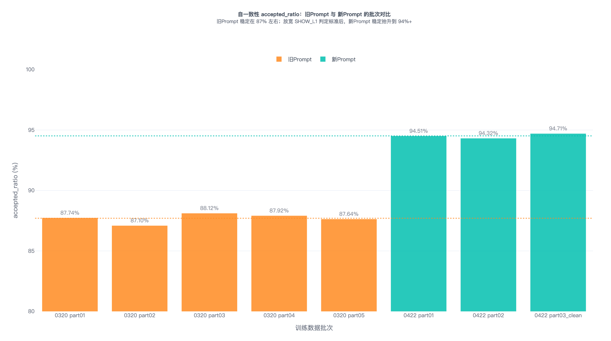

> accepted_ratio 不是单点偶然提升，而是旧 Prompt 5 个批次、50,000 条集中在 87%\~88%，新 Prompt 3 个批次、28,325 条集中在 94%\~95%。

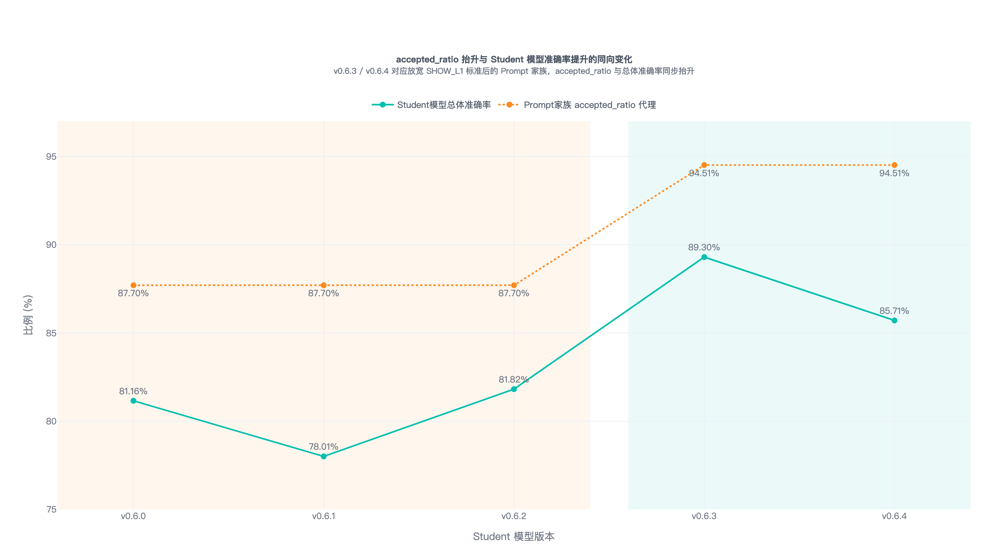

> 把 Prompt 家族切换和 Student 准确率趋势放在一起看。Student 准确率这里是旧 Prompt 3 个训练版本和新 Prompt 2 个训练版本的对比。它不要求每个版本严格线性，而是证明方向一致：Prompt 家族切换后，accepted_ratio 上台阶，Student 准确率也上台阶。

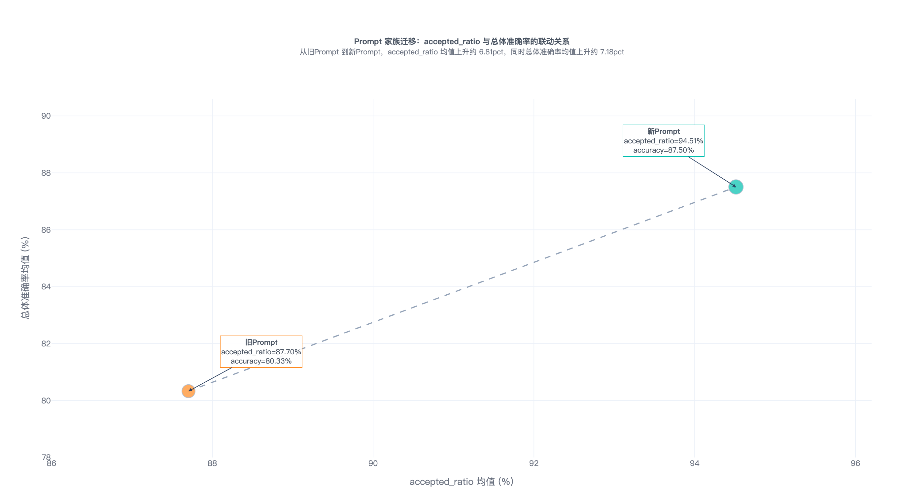

> 横轴是 accepted_ratio 均值，纵轴是 Student 总体准确率均值，旧 Prompt 到新 Prompt 是一起往右上移动。

### **3.5.3 Prompt 与 KB 协同演进**

ARSP 框架下的 prompt 演进保持 P5 的决策逻辑不变，重点优化输出长度。

**P6 系列变体筛选**（1000 条/版本复核，最终选 P6-v1）：

| **版本** <br> | **accepted_ratio** <br> | **平均长度** <br> | **SHOW_LEAF p95** <br> | **判断** <br> |
| --- | --- | --- | --- | --- |
| P6-base <br> | 93.70% <br> | 1405 <br> | 2862 <br> | 基线 <br> |
| **P6-v1（选定）** <br> | **94.51%** <br> | **1314** <br> | **2608** <br> | **综合最优** <br> |
| P6-v2 <br> | 93.00% <br> | — <br> | — <br> | SHOW_LEAF 异常上升被淘汰 <br> |
| P6-v3/v4/v5 <br> | 不如 v1 综合最优 <br> | — <br> | — <br> | 淘汰 <br> |

**P7/P8 + KB 协同优化**：

P6-v1 之后核心问题是 SHOW_L1 偏差——不是模型能力问题，而是 prompt/KB/标注口径本身有偏（SHOW_L1 规则太宽，KB desc 没覆盖真实表达）。优化路径不是加数据重训，而是**修复 prompt + KB 定义**。

| **版本** <br> | **配套 KB** <br> | **核心改动** <br> |
| --- | --- | --- |
| P7 <br> | KB-7  <br> | 短 query 与费用类相似问扩展 <br> |
| **P8（当前线上）** <br> | KB-8  <br> | 把真实用户表达写进 KB desc；继续压缩输出长度，压低 SHOW_LEAF；强化"短不等于信息不足" <br> |

```PlainText
你是一个专业的网约车智能客服助手，请根据用户问题和检索报告进行判断。

【思考步骤】
请在内部完成以下判断，不要输出步骤标题，不要复述候选定义或 DIRECT_SOP/SHOW_LEAF/SHOW_L1 的定义；
一旦确定最终 decision，立即停止分析，不要继续枚举其他可能性。

1. Summary: 一句话总结用户核心诉求（去除情绪词，尽量控制在20字内）。
2. Emotion: 识别情绪 [对司机不满, 对平台不满, 扬言投诉, 无明显情绪, 诉求不清, 无法识别]。

3. Confidence: 评估你对"当前最终决策是否正确"的把握程度 (0.0~1.0)。
    - >0.85：非常确定当前决策正确。
    - 0.6~0.85：大概率正确，但仍有一定不确定性。
    - <0.6：连该选 DIRECT_SOP、SHOW_LEAF 还是 SHOW_L1 都不太确定。
    - 如果你很确定当前不该匹配任何候选，SHOW_L1 也可以给高分。

4. Decision (决策逻辑):
    - DIRECT_SOP:
        * 适用条件: 已存在唯一明确候选，可直接稳定匹配。
        * 注意: 表述简短不等于信息不足。即使用户只说一个价格片段、一个司机行为片段或一句短抱怨，
          只要它已经明确指向唯一候选现象，也应选择 DIRECT_SOP。
        * 一旦已确认存在唯一明确候选，直接输出 DIRECT_SOP；只围绕该候选作判断，
          不要再比较 SHOW_LEAF 或 SHOW_L1，也不要解释已排除候选。
        * 填充: target_node_name；置空: options=[]
    - SHOW_LEAF:
        * 适用条件: 存在 2-3 个强相关候选，但无法稳定选出唯一最优候选。
        * 默认只保留 2 个候选；只有第 3 个同样强相关且缺少它会误导时才保留。
        * 只比较最终保留的候选，不要枚举或复述已排除候选。
        * 填充: options=["场景A", "场景B"...]
    - SHOW_L1:
        * 适用条件: 只有当用户没有给出足以落到任何具体场景的线索时，才选择 SHOW_L1；
          或虽然与候选项有一定相关性，但仍不足以确定某一个或某几个具体场景；
          或列出的候选项与用户问题无关。
        * 不要仅因为用户表述简短就选择 SHOW_L1。若用户虽短，但已直接表达价格异常、
          司机未接驾、联系不上司机、态度恶劣、费用疑问等明确现象，应优先选择 DIRECT_SOP。
        * 填充: options=[], target_node_name=null

【输出要求】
直接输出合法 JSON，不要输出 markdown 代码块，key 必须小写；summary 保持简洁，不要超过20字:
{
  "summary": "...",
  "emotion": "无明显情绪",
  "confidence": 0.xx,
  "decision": "...",
  "target_node_name": null,
  "options": []
}
```

**P8 相对 P6-v1 的关键演进**（结合 KB-8 定义修复）：

- "表述简短不等于信息不足" — 解决短 query 被误判 SHOW_L1 的核心问题

- "一旦确认唯一候选立即停止分析" — 减少冗余思考链路，压缩输出长度

- SHOW_LEAF 默认只保留 2 个候选 — 进一步收紧候选规模

## 3.6 后训练

### **3.6.1 SFT 蒸馏配置**

==参考 DeepSeek-R1 论文的数据蒸馏方案，采用带思维链数据进行 SFT（而非传统 logits 蒸馏）：==

| **项目** <br> | **配置** <br> |
| --- | --- |
| Teacher 模型 <br> | DeepSeek-V3.1 <br> |
| Student 模型 <br> | Qwen3-8B <br> |
| 微调方式 <br> | LoRA (rank=16, target=all) <br> |
| 上下文长度 <br> | 8192 <br> |
| 学习率 <br> | 2e-5（从初始 5e-5 下调，解决过拟合） <br> |
| 训练轮次 <br> | 2 epochs（从初始 5 下调） <br> |
| 分布式策略 <br> | ZeRO-3 <br> |
| 硬件 <br> | 8×H200 <br> |

Teacher 提供高质量决策与解释；Student 使用可部署的 Qwen3-8B 进行 SFT。

SFT 的训练输入由三部分组成：

1. 用户当前 query。

2. Embedding/RAG 召回的 Top-K 候选意图。

3. 每个候选的结构化信息，包括意图名称、意图定义、业务归属和层级。

SFT 的训练输出为标准 JSON：

```JSON
{
"summary": "一句话总结用户核心诉求",
"emotion": "无明显情绪/对司机不满/对平台不满/扬言投诉/诉求不清/无法识别",
"confidence": 0.0,
"decision": "DIRECT_SOP/SHOW_LEAF/SHOW_L1",
"target_node_name": null,
"options": []
}
```

### **3.6.2 SFT 蒸馏 Loss**

设 Teacher 模型 $$\theta_T$$（DeepSeek-V3.1）在输入 x 上生成的输出序列为：

$$y_T = [\langle\text{think}\rangle, r_1, r_2, ..., r_m, \langle/\text{think}\rangle, J_1, J_2, ..., J_n]$$ 

其中 $$r_i$$ 为思维链 token，$$J_j$$ 为最终 JSON token。

Student 模型 $$\theta_S$$（Qwen3-8B）的训练目标（teacher-forcing 下逐 token 交叉熵）：

$$\mathcal{L}_{SFT}(\theta_S) = -\mathbb{E}_{(x, y_T) \sim \mathcal{D}_T} \left[\sum_{t=1}^{|y_T|} \log P(y_{T,t} \mid x, y_{T,<t}; \theta_S)\right]$$ 

其中， $$\mathcal{D}_T = {(x, y_T(x))}$$ 为 Teacher 输出构造的蒸馏训练集

这里我们不采用显式格式约束 $$\mathcal{L}_{format}$$ 或长度约束 $$\mathcal{L}_{length}$$，而是在 $$\mathcal{D}_T$$ 构建阶段通过数据清洗过滤格式错误与超长思维链样本。

SFT 主要解决五类问题：

- **格式合规**：稳定输出合法 JSON，不输出 markdown 代码块、额外解释或不可解析字段

- **决策类型学习**：学习 DIRECT_SOP / SHOW_LEAF / SHOW_L1 的边界

- **target 对齐**：当决策为 DIRECT_SOP 时，target_node_name 必须来自当前候选集合

- **菜单生成**：当决策为 SHOW_LEAF 时，options 应来自候选集合，数量和排序符合业务要求

- **摘要与情绪识别**：输出 summary 和 emotion 为后续兜底反问提供结构化信息

## **3.7 性能优化**

### **3.7.1 瓶颈分析**

意图识别LLM推理服务链路的端到端耗时由三阶段组成：

$$T_{e2e} = T_{embedding} + T_{prefill} + T_{decode}$$ 

其中 Prefill 和 Decode 两阶段共同构成LLM 推理服务内部耗时，**LLM 推理服务内部耗时分解**（数据来自 [13 意图识别模块-推理优化v2](https://cooper.didichuxing.com/knowledge/2199610335356/2207094233215)，10609 样本，未启用投机采样的 baseline）：

| **阶段** <br> | **平均耗时** <br> | **占比** <br> |
| --- | --- | --- |
| Prefill (TTFT) <br> | 74.22ms <br> | 0.83% <br> |
| **Decode** <br> | **8907.48ms** <br> | **99.17%** <br> |
| **LLM 服务 E2E 平均** <br> | **8981.71ms** <br> | **100%** <br> |

吞吐对比同样指向 decode 是绝对瓶颈：

| **指标** <br> | **数值** <br> |
| --- | --- |
| Prefill TPS <br> | 17212 tok/s <br> |
| Decode TPS <br> | 110 tok/s <br> |
| **Prefill/Decode 吞吐比** <br> | **156x** <br> |

**结论**：decode 是绝对瓶颈，prefill 几乎可忽略。

因此优化路径围绕 **decode 加速**展开：

- 推理引擎升级：vLLM → SGLang

- 投机采样：N-gram speculative decoding

- 硬件选型：6000D → H20

- 输出长度控制：prompt + KB 定义优化（3.5.3）

### **3.7.2 推理引擎升级**

| **维度** <br> | **vLLM + LangChain** <br> | **SGLang** <br> | **收益** <br> |
| --- | --- | --- | --- |
| 结构化输出 <br> | LangChain prompt 提示 <br> | FSM + Regex 引导解码 <br> | 100% JSON Schema 合规 <br> |
| Prompt 控制 <br> | LangChain 抽象层 <br> | 直接调用底层 API <br> | 精确控制组装、可压测 <br> |
| KV Cache <br> | 标准方案 <br> | RadixAttention <br> | 固定 System Prompt 缓存复用 <br> |
| 整体吞吐 <br> | baseline <br> | +约 2x <br> | E2E 9963ms → 5434ms <br> |

**SGLang 核心机制<!--评论:[{"u":"menchang","c":"vLLM没有类似的结构化输出和KV Cache的机制吗？这样对比似乎对vLLM不太公平"},{"u":"yezhou","c":"这里确实没有做vllm/sglang在同等配置下的完整对比，且langchain作为抽象层有一定开销，vLLM + LangChain是最开始部署时的选择，后续优化时直接选择与最初版本进行对比了"}] -->**：<!--评论:[{"u":"menchang","c":"vLLM没有类似的结构化输出和KV Cache的机制吗？这样对比似乎对vLLM不太公平"},{"u":"yezhou","c":"这里确实没有做vllm/sglang在同等配置下的完整对比，且langchain作为抽象层有一定开销，vLLM + LangChain是最开始部署时的选择，后续优化时直接选择与最初版本进行对比了"}] -->

- **FSM 引导解码**：将 JSON Schema 编译成有限状态机，每步只允许合法 token 输出，理论上保证 100% 合法 JSON

- **RadixAttention**：本项目 System Prompt 占输入 token 70%+ 且高度固定，KV Cache 跨请求复用显著降低 prefill

**实测对比**（QPS=10, max-concurrency=4, ngram启用）：

| **指标** <br> | **vLLM** <br> | **SGLang** <br> | **改善** <br> |
| --- | --- | --- | --- |
| Successful Requests <br> | 1605 <br> | 1704 <br> | +6.2% <br> |
| Benchmark Duration <br> | 4514s <br> | 2319s <br> | -48.6% <br> |
| Mean E2E Latency <br> | 9963ms <br> | **5434ms** <br> | **-45.5%** <br> |
| Median E2E Latency <br> | 8015ms <br> | **4027ms** <br> | **-49.7%** <br> |

严格意义上 vLLM 与 SGLang 在能力维度上对等——vLLM 也提供结构化输出（outlines / xgrammar）和 KV Cache 复用（PagedAttention + Automatic Prefix Caching）。我们最终选择 SGLang 的原因是 2 个具体实测优势：

- FSM 引导解码长输出稳定性更高：vLLM 的 outlines 在长输出（>1500 token）+ 复杂 JSON Schema 下偶尔破坏（如上表所示，1704个 query 中有99个无法被成功解析），SGLang FSM 是工业级实现，长输出 100% 合规；

- RadixAttention 跨请求命中率更高：基于 radix tree 全局索引，我们 System Prompt 占输入 token 70%+ 且高度固定，命中率近 100%；

公平性说明：当前对比是"vLLM + LangChain + outlines" vs "SGLang 直调 + FSM"，**严格说不是 lib 层面对比**。

### **3.7.3 投机采样（Speculative Decoding）**

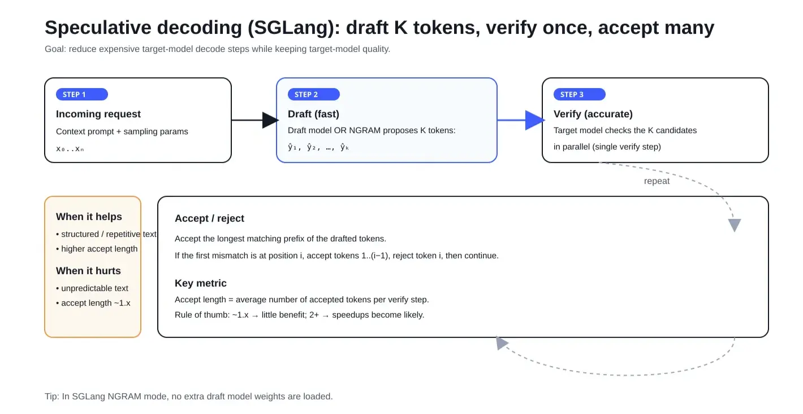

Speculative Decoding 的核心思想：用一个轻量"草稿"模型批量生成 $$\gamma$$  个候选 token，主模型一次 forward 验证这 $$\gamma$$  个 token，被接受的 token 直接采纳。

理论加速比：

$$\text{Speedup} = \frac{1 - \alpha^{\gamma+1}}{(1-\alpha)(1 + \gamma \cdot c_{draft}/c_{target})}$$ 

其中：

- $$\alpha$$ = accept rate（草稿被接受的比例）

- $$\gamma$$ = draft length（一次草稿生成的 token 数）

- $$c_{draft}, c_{target}$$ = 草稿模型和主模型单步推理耗时

Accept Length 衡量平均一次主模型 forward 能产出多少 token

**三种方案对比**

| **方案** <br> | **Accept Length** <br> | **实测效果** <br> | **是否采用** <br> |
| --- | --- | --- | --- |
| Draft Model (Qwen3-0.6B) <br> | — <br> | 小批量测试未生效 <br> | ❌ <br> |
| Eagle3 (Qwen3-8B-Eagle) <br> | \~1.2 <br> | 吞吐量小幅下降 <br> | ❌ <br> |
| **N-gram (n=4)** <br> | **≈4+** <br> | **推理耗时降低 1.5x** <br> | ✅  <br> |

**N-gram 详细介绍**

**工作原理**：不引入额外的 draft model，而是基于已生成的 token 序列，从 prompt 或历史中匹配相同的 n-gram 后缀作为草稿。对于结构化输出任务（如 JSON），由于格式固定（字段名、引号、括号高度可预测），N-gram 命中率极高。

**核心参数**：

- `steps`：投机采样轮数

- `draft`：每轮草稿生成的最大 token 数

- `bfs`：NGRAM draft tree 的搜索宽度限制

**完整 NGRAM Grid Search 结果**（0413 粗网格 + 0414 局部细化）

实验环境：8×H200 dp=8，固定 0412 rerun 基准集 849 条 query，warmup 排除前 20 条；所有指标均为稳态值。

- **0413 阶段**：粗网格搜索 + baseline + current-like 对照（`steps∈{2,3,4}, draft∈{4,8}, bfs∈{16,32}`，共 13 个 NGRAM run + 1 baseline）

- **0414 阶段**：围绕低时延区局部细化（补充更小 `bfs∈{8,10,12}` + 更大 `draft∈{10,12,16}`，以 `steps=3` 为主，共 16 个 NGRAM run）

**完整 Leaderboard（按 Steady P50 升序，30 条 run）**：

| **排名** <br> | **来源** <br> | **run_id** <br> | **steps** <br> | **draft** <br> | **bfs** <br> | **Steady P50 (ms)** <br> | **Steady P95 (ms)** <br> | **Steady P99 (ms)** <br> | **Effective QPS** <br> | **Decode TPS** <br> |
| --- | --- | --- | --- | --- | --- | --- | --- | --- | --- | --- |
| **🥇** <br> | **0414** <br> | **`ngram_s3_d16_b8`** <br> | **3** <br> | **16** <br> | **8** <br> | **2545.61** <br> | **4469.39** <br> | **5497.55** <br> | **5.6404** <br> | **347.29** <br> |
| 🥈 <br> | 0414 <br> | `ngram_s3_d16_b10` <br> | 3 <br> | 16 <br> | 10 <br> | 2645.66 <br> | 4711.49 <br> | 5910.22 <br> | 5.4651 <br> | 338.01 <br> |
| 🥉 <br> | 0414 <br> | `ngram_s3_d12_b8` <br> | 3 <br> | 12 <br> | 8 <br> | 2652.40 <br> | 4765.13 <br> | 5695.17 <br> | 5.4545 <br> | 335.83 <br> |
| 4 <br> | 0414 <br> | `ngram_s3_d12_b10` <br> | 3 <br> | 12 <br> | 10 <br> | 2717.41 <br> | 4878.47 <br> | 5796.52 <br> | 5.3253 <br> | 325.29 <br> |
| 5 <br> | 0414 <br> | `ngram_s3_d12_b12` <br> | 3 <br> | 12 <br> | 12 <br> | 2737.00 <br> | 4855.38 <br> | 6075.28 <br> | 5.3008 <br> | 325.56 <br> |
| 6 <br> | 0414 <br> | `ngram_s4_d12_b8` <br> | 4 <br> | 12 <br> | 8 <br> | 2741.38 <br> | 5057.01 <br> | 6282.12 <br> | 5.2459 <br> | 324.52 <br> |
| 7 <br> | 0414 <br> | `ngram_s4_d10_b8` <br> | 4 <br> | 10 <br> | 8 <br> | 2753.71 <br> | 4970.19 <br> | 6137.96 <br> | 5.2031 <br> | 318.23 <br> |
| **8** <br> | **0413** <br> | **`ngram_s3_d8_b16`** ⭐ <br> | 3 <br> | 8 <br> | 16 <br> | 2756.99 <br> | 4895.35 <br> | 5772.27 <br> | 5.2316 <br> | 317.14 <br> |
| 9 <br> | 0413 <br> | `ngram_current_like` <br> | 4 <br> | 12 <br> | 10 <br> | 2769.38 <br> | 4869.90 <br> | 6169.39 <br> | 5.2608 <br> | 324.97 <br> |
| 10 <br> | 0414 <br> | `ngram_s3_d10_b12` <br> | 3 <br> | 10 <br> | 12 <br> | 2778.02 <br> | 4845.52 <br> | 6419.77 <br> | 5.2460 <br> | 318.12 <br> |
| 11 <br> | 0414 <br> | `ngram_s3_d10_b10` <br> | 3 <br> | 10 <br> | 10 <br> | 2779.86 <br> | 4950.02 <br> | 6054.35 <br> | 5.2127 <br> | 318.53 <br> |
| 12 <br> | 0413 <br> | `ngram_s2_d8_b32` 🔹 <br> | 2 <br> | 8 <br> | 32 <br> | 2810.26 <br> | 4740.45 <br> | 6246.67 <br> | 5.2074 <br> | 317.01 <br> |
| 13 <br> | 0414 <br> | `ngram_s3_d8_b12` <br> | 3 <br> | 8 <br> | 12 <br> | 2830.60 <br> | 5106.49 <br> | 6294.48 <br> | 5.0826 <br> | 309.98 <br> |
| 14 <br> | 0414 <br> | `ngram_s3_d10_b8` <br> | 3 <br> | 10 <br> | 8 <br> | 2836.89 <br> | 5017.62 <br> | 6260.76 <br> | 5.1612 <br> | 318.35 <br> |
| 15 <br> | 0414 <br> | `ngram_s2_d8_b10` <br> | 2 <br> | 8 <br> | 10 <br> | 2838.36 <br> | 4957.97 <br> | 6237.09 <br> | 5.1681 <br> | 316.58 <br> |
| 16 <br> | 0413 <br> | `ngram_s4_d8_b32` <br> | 4 <br> | 8 <br> | 32 <br> | 2838.86 <br> | 5098.06 <br> | 6152.34 <br> | 5.0319 <br> | 308.34 <br> |
| 17 <br> | 0414 <br> | `ngram_s3_d8_b10` <br> | 3 <br> | 8 <br> | 10 <br> | 2846.48 <br> | 5027.66 <br> | 6293.93 <br> | 5.0910 <br> | 308.44 <br> |
| 18 <br> | 0413 <br> | `ngram_s3_d8_b32` <br> | 3 <br> | 8 <br> | 32 <br> | 2870.13 <br> | 4974.23 <br> | 6199.33 <br> | 5.0488 <br> | 309.27 <br> |
| 19 <br> | 0413 <br> | `ngram_s4_d8_b16` <br> | 4 <br> | 8 <br> | 16 <br> | 2873.60 <br> | 5186.62 <br> | 6577.20 <br> | 5.0603 <br> | 308.48 <br> |
| 20 <br> | 0414 <br> | `ngram_s2_d8_b8` <br> | 2 <br> | 8 <br> | 8 <br> | 2886.06 <br> | 5036.21 <br> | 6439.71 <br> | 5.0419 <br> | 308.27 <br> |
| 21 <br> | 0413 <br> | `ngram_s2_d8_b16` <br> | 2 <br> | 8 <br> | 16 <br> | 2889.37 <br> | 5103.87 <br> | 6243.49 <br> | 4.9899 <br> | 307.24 <br> |
| 22 <br> | 0414 <br> | `ngram_s3_d8_b8` <br> | 3 <br> | 8 <br> | 8 <br> | 2890.03 <br> | 5224.55 <br> | 6501.78 <br> | 5.0362 <br> | 307.33 <br> |
| 23 <br> | 0414 <br> | `ngram_s4_d8_b8` <br> | 4 <br> | 8 <br> | 8 <br> | 2899.41 <br> | 5201.76 <br> | 7153.58 <br> | 5.0248 <br> | 306.86 <br> |
| 24 <br> | 0413 <br> | `ngram_s4_d4_b32` <br> | 4 <br> | 4 <br> | 32 <br> | 3468.30 <br> | 5935.55 <br> | 7446.94 <br> | 4.2726 <br> | 257.07 <br> |
| 25 <br> | 0413 <br> | `ngram_s3_d4_b16` <br> | 3 <br> | 4 <br> | 16 <br> | 3511.88 <br> | 6118.88 <br> | 7616.11 <br> | 4.1472 <br> | 250.26 <br> |
| 26 <br> | 0413 <br> | `ngram_s3_d4_b32` <br> | 3 <br> | 4 <br> | 32 <br> | 3531.27 <br> | 5917.25 <br> | 6892.12 <br> | 4.1604 <br> | 249.17 <br> |
| 27 <br> | 0413 <br> | `ngram_s4_d4_b16` <br> | 4 <br> | 4 <br> | 16 <br> | 3543.77 <br> | 5993.03 <br> | 7086.23 <br> | 4.1692 <br> | 249.51 <br> |
| 28 <br> | 0413 <br> | `ngram_s2_d4_b32` <br> | 2 <br> | 4 <br> | 32 <br> | 3548.92 <br> | 6027.66 <br> | 7021.66 <br> | 4.1462 <br> | 248.97 <br> |
| 29 <br> | 0413 <br> | `ngram_s2_d4_b16` <br> | 2 <br> | 4 <br> | 16 <br> | 3586.41 <br> | 5844.45 <br> | 7362.01 <br> | 4.1597 <br> | 249.48 <br> |
| ❌ <br> | 0413 <br> | `baseline_no_spec` <br> | — <br> | — <br> | — <br> | 5068.58 <br> | 7862.05 <br> | 9755.50 <br> | 2.9494 <br> | 174.13 <br> |

> 标注说明：⭐ = 0413 阶段 P50 最优；🔹 = 0413 阶段 P95 最优；🥇🥈🥉 = 全局综合 Top3

**submit-luban-task + autoresearch**

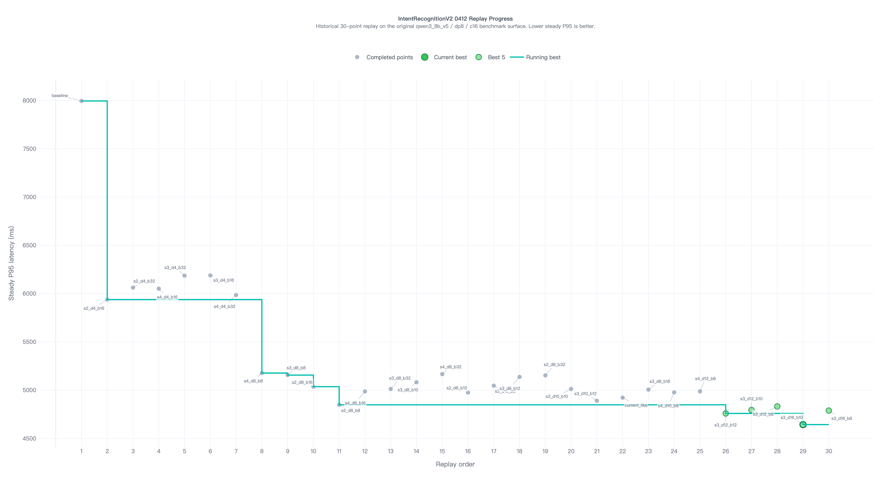

> 使用 submit-luban-task 自动批量提交参数搜索任务，autoresearch 监控 P95 收敛

### **3.7.4 硬件选型与并发配置**

**三档硬件测试对比**（rerun-only, 851 条成功样本，N-gram s3/d16/b8）：

| **指标** <br> | **H20×1 c=1** <br> | **H20×2 LB c=2** <br> | **6000D×2 LB c=2** <br> |
| --- | --- | --- | --- |
| Steady P50 <br> | 2762.37ms <br> | **2941.73ms** <br> | 4687.00ms <br> |
| Steady P95 <br> | 4649.90ms <br> | **5004.77ms** <br> | 7952.32ms <br> |
| Steady P99 <br> | 5945.81ms <br> | **5742.79ms** <br> | 9615.65ms <br> |
| Steady TTFT P50 <br> | 64.82ms <br> | **62.47ms** <br> | 73.42ms <br> |
| Steady decode P50 <br> | 2678.40ms <br> | **2533.33ms** <br> | 4607.59ms <br> |
| Steady decode TPS <br> | 314.91 <br> | **359.43** <br> | 182.87 <br> |
| Effective QPS <br> | 0.3434 <br> | **0.6417** <br> | 0.4035 <br> |

**H20 选型收益（vs 6000D×2）**：

| **改善维度** <br> | **改善幅度** <br> |
| --- | --- |
| Steady P50 <br> | **-37.24%** <br> |
| Steady P95 <br> | **-37.07%** <br> |
| Steady P99 <br> | **-40.28%** <br> |
| Effective QPS <br> | **+59.03%** <br> |

核心收益归因：H20 的 decode TPS 从 182.87 → 359.43（+96.5%），直接对应 decode P50 的 45.0% 降低。

**当前线上部署配置**：意图识别模型 H20×4 + Embedding 模型 6000D×2。

### **3.7.5 性能优化整体收益**

| **阶段** <br> | **steady P50** <br> | **累计改善** <br> |
| --- | --- | --- |
| baseline (vLLM, no-spec, 6000D) <br> | \~12573ms <br> | — <br> |
| + SGLang <br> | \~9963ms <br> | -20.8% <br> |
| + N-gram (s3/d16/b8) <br> | \~5434ms <br> | **-56.8%** <br> |
| + H20×2 LB <br> | \~2942ms (steady P50) <br> | **-76.6%** <br> |

## 3.8 经验沉淀

1. **评估范式转变**：LLM项目可通过逐case分析直接定位优化方向，整体更白盒化

2. **置信度校准是后训练核心价值**：基座模型Zero-shot置信度偏保守，SFT可显著改善

3. **蒸馏数据质量决定上限**：Majority Voting(5次采样)有效过滤，vote=5准确率95.78%

4. **SGLang显著优化**：RadixAttention+FSM引导解码带来约2x推理加速

5. **训练分布必须对齐标注分布**：SHOW_L1 20%→27%变化带来约6\~7pp损失

---

# 四、实验结果/评估结果

## 4.1 离线评估<!--评论:[{"u":"rongbohui","c":"和part二 里面的目标不一致？"},{"u":"yezhou","c":"4.1离线评估部分主要测准确率（其中车费问题、投诉司机、订单取消对应part 2的头部场景）；转人工率需开量50%后做实验，响应时长在4.2线上评估中，安全召回部分由工程正则保证100%"}] -->

**核心结论**：v0.9 (P8 + KB-8) 当前实际部署版本离线测试结果，**总体准确率 86.09%，超过 part 2 整体 76% 目标 10.09pp；头部场景准确率 87.90%\~91.30%，超过 part 2 头部 80% 目标 7.90\~11.30pp，全部达标**。

**本节评估范围**：本节聚焦 part 2 目标 1 "意图识别准确率"——

- **总体准确率**：评测集全量准确率（含所有场景）；

- **仅 Embedding 准确率**：仅走 Fast-Path（Embedding 直达）的样本准确率，衡量召回质量；

- **头部场景准确率**：车费问题、投诉司机、订单取消三个 part 2 头部场景；

- **重点 SOP 场景准确率**：不认可取消费、司机不来接我——业务方重点关注的两个 SOP 场景；

- **其他场景**：剩余场景的合并准确率。

Part 2 其他 3 个目标的评估位置：

- **目标 2 转人工率**：需 AB 实验后产出，目前 50% 灰度评估期已计划；

- **目标 3 响应时长**：见 4.2 在线评估；

- **目标 4 安全召回率**：由工程侧前置正则匹配实现 100% 召回，不依赖模型推理。

| **版本号** <br> | **Prompt** <br> | **KB** <br> | **是否微调** <br> | **仅Embedding准确率** <br> | **仅大模型准确率** <br> | **总体准确率** <br> | **车费问题** <br> | **投诉司机** <br> | **订单取消** <br> | **其他场景** <br> | **不认可取消费** <br> | **司机不来接我** <br> | **时间** <br> |
| :---: | :---: | :---: | :---: | :---: | :---: | :---: | :---: | :---: | :---: | :---: | --- | --- | :---: |
| v0.1 <br> | P2 <br> | KB-2 <br> | Y <br> | 90.32% <br> | 69.16% <br> | 73.15% <br> | - <br> | - <br> | - <br> | - <br> | - <br> | - <br> | 0130 <br> |
| v0.2 <br> | P3 <br> | KB-3 <br> | Y <br> | 85.85%<!--评论:[{"u":"menchang","c":"为什么V0.2版本的仅embedding准确率显著低于其他版本"},{"u":"yezhou","c":"v0.2对应的KB-3知识库版本开始大量增加相似问，部分写得过宽引入误匹配噪声，同版做了相似问清洗后Embedding准确率回复正常"}] --> <br> | 80.82% <br> | 81.53% <br> | 81.92% <br> | 75.32% <br> | 69.53% <br> | 83.16% <br> | - <br> | - <br> | 0225 <br> |
| v0.3 <br> | P3 <br> | KB-3 <br> | N <br> | 98.33% <br> | 55.00% <br> | 61.50% <br> | 75.17% <br> | 45.95% <br> | 43.24% <br> | 68.46% <br> | 50.00% <br> | 66.66% <br> | 0305 <br> |
| v0.3 <br> | P3 <br> | KB-3 <br> | Y <br> | 98.33% <br> | 75.98% <br> | 79.00% <br> | 85.83% <br> | 80.00% <br> | 67.86% <br> | 89.81% <br> | 75.00% <br> | 75.00% <br> | 0305 <br> |
| v0.4 <br> | P3 <br> | KB-4 <br> | Y <br> | 94.12% <br> | 77.56% <br> | 80.86**%** <br> | 87.61% <br> | 83.33% <br> | 91.27% <br> | 85.05% <br> | 89.58% <br> | 93.75% <br> | 0312 <br> |
| v0.5 <br> | P4 <br> | KB-4 <br> | Y <br> | - <br> | - <br> | 73.16% <br> | 87.60% <br> | 69.39% <br> | 89.50% <br> | 86.67% <br> | 62.31% <br> | 0319 <br> |
| v0.6.0 <br> | P5 <br> | KB-5 <br> | Y <br> | 96.53% <br> | 76.99% <br> | 81.16% <br> | 85.81% <br> | 84.76% <br> | 72.54% <br> | 88.66% <br> | 71.33% <br> | 0402 <br> |
| v0.6.1 <br> | P5 <br> | KB-5 <br> | Y <br> | 96.99% <br> | - <br> | 78.01% <br> | 80.17% <br> | 81.29% <br> | 72.98% <br> | 82.47% <br> | 71.89% <br> | 0409 <br> |
| v0.6.2 <br> | P5 <br> | KB-5 <br> | Y <br> | 96.99% <br> | 76.90% <br> | 81.82% <br> | 84.75% <br> | 84.52% <br> | 78.26% <br> | 83.44% <br> | 77.91% <br> | 0412 <br> |
| v0.6.3 <br> | P6-v1 <br> | KB-5 <br> | Y <br> | 96.39% <br> | 88.16% <br> | 89.30% <br> | 91.91% <br> | 81.94% <br> | 88.14% <br> | 90.27% <br> | 83.33% <br> | 0423 <br> |
| v0.6.4 <br> | P6-v1 <br> | KB-5 <br> | Y <br> | 98.63% <br> | 82.82% <br> | 85.71% <br> | 83.08% <br> | 90.63% <br> | 86.05% <br> | 89.36% <br> | 84.00% <br> | 0423 <br> |
| v0.6.5 <br> | P6-v1 <br> | KB-6 <br> | Y <br> | 92.16% <br> | - <br> | 85.60% <br> | 86.81% <br> | 79.49% <br> | 88.61% <br> | 89.36% <br> | 94.12% <br> | 0506 <br> |
| v0.7 <br> | P7 <br> | KB-7 <br> | Y <br> | 92.54% <br> | 82.66% <br> | 84.97% <br> | - <br> | - <br> | - <br> | - <br> | - <br> | 0506 <br> |
| v0.8 <br> | P7 <br> | KB-8 <br> | Y <br> | 97.85% <br> | 81.29% <br> | 82.80% <br> | 91.04% <br> | 87.10% <br> | 90.00% <br> | 90.00% <br> | 84.44% <br> | 0513 <br> |
| v0.9 <br> | P8 <br> | KB-8 <br> | Y <br> | 93.75% <br> | 85.21% <br> | 86.09%<!--评论:[{"u":"menchang","c":"最优版本相比于Teacher模型准确率还有折损吗，是多少"},{"u":"yezhou","c":"因为v0.6之后 teacher 模型的准确率已经比较高且accept_ratio一直维持在较高水平，考虑到标注人力在0.6之后没有对teacher模型的结果进行单独标注"}] --> <br> | 91.30% <br> | 87.90% <br> | 90.55% <br> | 89.23% <br> | 92.21% <br> | 0514 <br> |

> v0.8 = P7 + KB-8 是 KB-7→KB-8 升级的消融对照组。

Teahcer模型评估结果

| **版本号** <br> | **是否校准** <br> | **仅Embedding准确率** <br> | **仅大模型准确率** <br> | **总体准确率** <br> | **车费问题** <br> | **投诉司机** <br> | **订单取消** <br> | **其他场景** <br> | **不认可取消费** <br> | **司机不来接我** <br> | **时间** <br> |
| :---: | :---: | :---: | :---: | :---: | :---: | :---: | :---: | :---: | --- | --- | :---: |
| v0.1 <br> | N <br> | 90.32% <br> | 86.77% <br> | 87.13% <br> | 92.38% <br> | 85.14% <br> | 82.98% <br> | 88.89% <br> | - <br> | - <br> | 0129 <br> |
| v0.2 <br> | N <br> | 80.98% <br> | 88.51% <br> | 87.48% <br> | 88.38% <br> | 85.83% <br> | 81.48% <br> | 86.97% <br> | - <br> | - <br> | 0210 <br> |
| v0.2 <br> | Y <br> | 85.85% <br> | 82.07% <br> | 82.60% <br> | 84.47% <br> | 79.33% <br> | 74.80% <br> | 86.23% <br> | - <br> | - <br> | 0225 <br> |
| v0.3 <br> | N <br> | 98.33% <br> | 81.18% <br> | 83.75% <br> | 89.43% <br> | 73.08% <br> | 76.00% <br> | 90.74% <br> | 88.89% <br> | 60% <br> | 0305 <br> |
| v0.3 <br> | Y <br> | 98.33% <br> | 80.00% <br> | 82.75% <br> | 89.43% <br> | 73.08% <br> | 76.00% <br> | 89.81% <br> | 77.78% <br> | 40% <br> | 0305 <br> |
| v0.4 <br> | N <br> | 94.12% <br> | 90.24% <br> | 91.02% <br> | 93.91% <br> | 91.67% <br> | 92.75% <br> | 93.33% <br> | 91.67% <br> | 94.55% <br> | 0312 <br> |
| v0.4 <br> | Y <br> | 94.12% <br> | 85.37% <br> | 86.94% <br> | 93.91% <br> | 91.67% <br> | 89.86% <br> | 90.48% <br> | 85.00% <br> | 89.09% <br> | 0312 <br> |
| v0.5 <br> | N <br> | - <br> | - <br> | 79.40% <br> | 87.10% <br> | 72.92% <br> | 83.70% <br> | 88.46% <br> | 74.37% <br> | 0319 <br> |
| v0.5 <br> | Y <br> | - <br> | - <br> | 77.88% <br> | 85.48% <br> | 75.00% <br> | 80.18% <br> | 88.46% <br> | 69.35% <br> | 0319 <br> |
| v0.6.0 <br> | N <br> | 96.99% <br> | 81.08%% <br> | 84.87% <br> | 85.74% <br> | 84.46% <br> | 83.96% <br> | 88.79% <br> | 82.28% <br> | 0402 <br> |

> **是否校准含义**：对于Teacher模型与Student模型共同评估的数据，在一次标注结束后，会对标注结果不一致的数据进行二次标注，相当于做二次校准

## 4.2 在线评估

[意图识别在线监控看版](http://10.191.88.55/ir-dashboard/) 

**意图识别线上监控统计**

| **日期** <br> | **灰度** <br> | **总请求** <br> | **会话** <br> | **全链路 avg/p50/p90/p99 (ms)** <br> | **LLM avg/p50/p90/p99 (ms)** <br> | **截断率** <br> | **SOP/L1/LEAF(按 query)** <br> | **SOP/L1/LEAF(按 session)** <br> |
| --- | --- | --- | --- | --- | --- | --- | --- | --- |
| 2026-05-26 <br> | 小程序 1% <br> | 395 <br> | 147 <br> | 1250/763/3174/4827 <br> | 2212/2145/3478/4982 <br> | 0.00% <br> | 63%/32%/2.5% <br> | 75%/23%/0.0% <br> |
| 2026-05-27 <br> | 小程序 5% <br> | 1494 <br> | 569 <br> | 1112/37/3153/5126 <br> | 2247/2105/3851/5575 <br> | 0.27% <br> | 71%/24%/3.2% <br> | 83%/15%/1.4% <br> |
| 2026-05-28 <br> | 小程序 10% <br> | 2696 <br> | 934 <br> | 1116/679/3063/4793 <br> | 2150/2049/3608/5401 <br> | 0.26% <br> | 71%/24%/3.7% <br> | 80%/17%/1.6% <br> |
| 2026-05-29 <br> | 小程序+端 10% <br> | 5620 <br> | 2000 <br> | 1115/711/3001/4881 <br> | 2105/1987/3561/5265 <br> | 0.21% <br> | 68%/27%/3.5% <br> | 81%/16%/1.2% <br> |
| 2026-05-30 <br> | 小程序+端 10% <br> | 6112 <br> | 2084 <br> | 1099/691/3000/5262 <br> | 2103/1984/3608/5728 <br> | 0.28% <br> | 67%/28%/3.5% <br> | 81%/16%/1.3% <br> |
| 2026-05-31 <br> | 小程序+端 10% <br> | 6211 <br> | 2175 <br> | 1073/198/2974/4926 <br> | 2121/2027/3481/5578 <br> | 0.31% <br> | 69%/27%/3.3% <br> | 81%/17%/1.0% <br> |
| 2026-06-01 <br> | 小程序+端 15% <br> | 6969 <br> | 2399 <br> | 1101/709/3011/4687 <br> | 2078/1990/3553/5216 <br> | 0.22% <br> | 68%/27%/3.5% <br> | 79%/18%/1.3% <br> |
| 2026-06-02 <br> | 小程序+端 15% <br> | 8190 <br> | 2779 <br> | 1103/699/2973/4714 <br> | 2101/2010/3479/5200 <br> | 0.22% <br> | 68%/27%/3.5% <br> | 79%/18%/1.2% <br> |
| 2026-06-03 <br> | 小程序+端 20% <br> | 10982 <br> | 3783 <br> | 1082/688/2956/4854 <br> | 2077/1989/3510/5327 <br> | 0.24% <br> | 70%/26%/3.3% <br> | 81%/16%/1.3% <br> |
| 2026-06-04 <br> | 小程序+端 30% <br> | 15839 <br> | 5479 <br> | 1083/209/2988/4991 <br> | 21072004/3574/5413 <br> | 0.24% <br> | 68%/26%/3.9% <br> | 80%/17%/1.6% <br> |

**意图识别线上准确率评估**

| 日期 <br> | 抽样条数 <br> | query准确率 <br> | 抽样轮次 <br> | session准确率 <br> |
| --- | --- | --- | --- | --- |
| 2026-05-26 ～ 2026-05-27 <br> | 1494 <br> | 92% <br> | 569 <br> | 87% <br> |
| 2026-06-01 <br> | 1066 <br> | 94% <br> | 356 <br> | 90% <br> |
| 2026-06-02 <br> | 1698 <br> | 94% <br> | 545 <br> | 87% <br> |
| 2026-06-03 <br> | 948 <br> | 94% <br> | 322 <br> | 85% <br> |
| 2026-06-04 <br> | 700 <br> | 94% <br> | 224 <br> | 88% <br> |

> session准确率：当前session所有query均标注正确则认为session标注正确

**容量评估 (基于 30% 灰度实测,外推到 100%)**

基于 30% 灰度下 5min 持续峰值 LLM = 0.457 QPS，线性外推到 100% 约 1.52 QPS。

单卡 throughput = 1 / 2.12s ≈ 0.47 QPS(按近 7 天 LLM avg 耗时 2122ms 估)。

| **卡数** <br> | **总 throughput** <br> | **100% 利用率** <br> |
| --- | --- | --- |
| 4 卡 (当前) <br> | 1.88 QPS <br> | 81% <br> |
| **6 卡** <br> | **2.83 QPS** <br> | **54%** <br> |

SLA 截断率 < 3% 视角:当前截断率约 0.3% 全部来自模型 p99 长尾(5.5s 接近 6s 阈值)，与容量无关。

**指标含义**

- **总请求**: 一天里意图识别模块被调用的总次数 (一次用户消息 = 一次请求)。

- **会话**: 不同 `session_id` 的数量,即一天里有多少个独立对话。

- **全链路 p50/p90/p99**: `intent_stage_cost_ms` 的分位数,涵盖关键词匹配、Embedding 检索、LLM 推理三阶段,反映用户感知的端到端延迟。

- **LLM p50/p90/p99**: `llm_cost_ms` 的分位数,只算实际走 LLM 那部分请求(`llm_called=1`)。

- **截断率**: 服务端对 LLM 推理设了 6s 强制截断,超过会被掐断并以 `llm_cost_ms ≈ 5999\~6001ms` 入库。截断率 = 被截断的请求数 / **当天全量请求数**; SLA 红线是 ≤ 3%。

- **SOP / L1 / LEAF (按 session)**: 每个 session 取最后一条消息的 `decision`,反映这次对话最终的归属。

**趋势与结论**

- **流量爬坡**: 5/26 (1%) → 6/4 (30%) 总请求 395 → 15839 ，会话数同步从 147 → 5479。

- **LLM 调用率全程稳定在 48\~55%**: 说明经过关键词+Embedding 两道前置筛选后,大约一半请求需要走 LLM,这个比例不随灰度比例变化,符合预期。

- **截断率始终 ≤ 0.31%**,远低于 3% SLA 红线;最严峻一天为 5/31 的 0.31%。

- **服务端 6s 强制截断从 5/30 起稳定生效**: 5/27-5/29 max_llm 还出现 7\~8s 长尾,5/30 之后 max 就稳定为 6001ms。

- **延迟分布稳定**: 全链路 p99 4.7\~5.3s,LLM p99 5.2\~5.7s。

- **Decision 分布稳定**: 按 session 看,DIRECT_SOP 75\~83%,SHOW_L1 15\~24%。

# **五、放量决策**

[智能客服x大模型开量节奏](https://cooper.didichuxing.com/docs2/sheet/2207966412985)

| **步骤** <br> | **预期扩量时间节奏** <br> | **实际扩量时间** <br> | **实际放量暂停点** <br> | **暂停点效果评估** <br> | **决策人** <br> |
| --- | --- | --- | --- | --- | --- |
| 1 <br> | 2026-05-26 放量 1%(仅小程序) <br> | 2026-05-26 1% <br> | — <br> | — <br> | 饶锦宏、李志诚 <br> |
| 2 <br> | 2026-05-27 放量 5%(仅小程序) <br> | 2026-05-27 5% <br> | — <br> | — <br> | 饶锦宏、李志诚 <br> |
| 3 <br> | 2026-05-29 放量 10% <br> | 2026-05-29 10% <br> | — <br> | — <br> | 饶锦宏、李志诚 <br> |
| 4 <br> | 2026-06-01 放量 15% <br> | 2026-06-01 15% <br> | — <br> | — <br> | 饶锦宏、李志诚 <br> |
| 5 <br> | 2026-06-03 放量 20% <br> | 2026-06-03 20% <br> | — <br> | — <br> | 饶锦宏、李志诚 <br> |
| 6 <br> | 2026-06-04 放量 30% <br> | 2026-06-04 30% <br> | — <br> | — <br> | 饶锦宏、李志诚 <br> |
| 7 <br> | 2026-06-08 放量 50% <br> | 待执行 <br> | 暂停点时间:2026-06-09 \~ 06-15(持续 1 周,50% 评估实验) <br> | 评估数据:核心指标 + 核心约束 <br> | 饶锦宏、李志诚 <br> |
| 8 <br> | 2026-06-17 放量 100% 全量 <br> | — <br> | — <br> | — <br> | 饶锦宏、李志诚 <br> |

# 附录

## **IntentRecognitionV2 Skills 与 Plugin 说明**

**一图总览**

`IntentRecognitionV2 Plugin` 为一套围绕意图识别项目全生命周期设计的工程化能力集合。把数据准备、蒸馏、训练集构建、推理评测、结果导出、线上排障和鲁班提交串成统一工作流。


**真实案例分析**


**Skill 分层速览**

| **分层** <br> | **Skill** <br> | **主要作用** <br> | **典型代码入口** <br> |
| --- | --- | --- | --- |
| 编排层 <br> | `ir-project-orchestrator` <br> | 识别任务阶段并路由到正确 workflow <br> | `workflows/run_pipeline.py` <br> |
| 数据准备层 <br> | `ir-source-data-prep` <br> | 清洗原始 `xls/csv`、去重、拆分 train/test、生成 majority 批次 <br> | `workflows/data_prep/prepare_query_dataset.py` <br> |
| 数据准备层 <br> | `ir-inference-testset-build` <br> | 生成 inference 测试集、rerun 子集、`direct_hits`、`full_order_map` <br> | `workflows/data_prep/prepare_rerun_dataset_from_annotation_excels.py` <br> |
| 蒸馏层 <br> | `ir-distill-pipeline` <br> | 发起并检查 distill 任务，关注 `accepted/reject/summary/log` <br> | `src/intent_recognition_service/data/distil/eval_model.py` <br> |
| 训练数据层 <br> | `ir-training-data-build` <br> | 将 accepted jsonl 转成 ShareGPT 训练数据，并支持清洗与发布 <br> | `src/intent_recognition_service/generate_training_artifacts.py` <br> |
| 评测层 <br> | `ir-small-model-eval-benchmark` <br> | 小模型推理评测、延迟 benchmark、NGRAM 参数实验 <br> | `workflows/eval_inference/predict_loda_concurrency_v2.py` <br> |
| 导出层 <br> | `ir-result-rebuild-export` <br> | 拼装完整结果并导出 Excel <br> | `workflows/data_prep/annotation_export/rebuild_full_inference_results.py` <br> |
| 只读运维层 <br> | `ir-readonly-review-ops` <br> | 只读 review、日志巡检、产物一致性检查 <br> | `README.md`、`docs/`、`artifacts/` <br> |
| 线上排障层 <br> | `intentv2-single-query-trace` <br> | 单条 query 的真实检索和引擎链路排查 <br> | `.agents/skills/intentv2-single-query-trace/scripts/trace_single_query_remote.py` <br> |
| 平台执行层 <br> | `submit-luban-task` <br> | 将训练/推理脚本提交到鲁班，并按 `appId` 查状态 <br> | `submit-luban-task/submit.py` <br> |

> `submit-luban-task` 为浩伟同学上周同步的skill

**3. 统一执行底座**

本地仓库主要承担控制面角色，真实项目执行主要发生在远端luban服务器。


核心含义可以概括为三点：

- 本地 skill 主要负责理解需求、补参数、选择入口。

- 远端 `run_pipeline.py` 是大多数数据与评测 workflow 的统一调度入口。

- 少量能力直接由本地脚本封装，例如单条 trace 和鲁班提交。

**关键代码执行链路**

**模型迭代全链路**

0604 update：训练数据产出之后，不再需要脱离 skill 体系手动切换到平台执行，而是可以通过 `submit-luban-task` 将训练或推理脚本继续提交到鲁班，从而形成“数据 -> 训练 -> 推理 -> 结果”的完整闭环。


| **阶段** <br> | **Skill / 模块** <br> | **代码入口** <br> | **关键产物** <br> | **说明** <br> |
| --- | --- | --- | --- | --- |
| 1 <br> | 数据准备 <br> | `ir-source-data-prep` <br> | `prepare_query_dataset.py` <br> | train/test csv、majority 输入 <br> |
| 2 <br> | 蒸馏 <br> | `ir-distill-pipeline` <br> | `run_pipeline.py distill`、`eval_model.py` <br> | `accepted/reject/summary` <br> |
| 3 <br> | 训练数据构建 <br> | `ir-training-data-build` <br> | `generate_training_artifacts.py` <br> | ShareGPT 训练数据 <br> |
| 4 <br> | 训练任务提交 <br> | `submit-luban-task` <br> | `submit.py` <br> | Luban `appId`、训练任务 <br> |
| 5 <br> | 训练产物生成 <br> | Luban / 训练脚本 <br> | 用户训练入口脚本 <br> | checkpoint、adapter、merged model <br> |
| 6 <br> | 推理测试集构建 <br> | `ir-inference-testset-build` <br> | `prepare_rerun_dataset_from_annotation_excels.py` <br> | rerun csv、`full_order_map`、`direct_hits` <br> |
| 7 <br> | 推理评测准备 <br> | `ir-small-model-eval-benchmark` <br> | `run_lora_job.sh`、`predict_loda_concurrency_v2.py` <br> | 推理脚本与 benchmark 配置 <br> |
| 8 <br> | 推理 / 评测提交 <br> | `submit-luban-task` <br> | `submit.py` <br> | 推理任务 `appId`、运行状态 <br> |
| 9 <br> | 推理结果生成 <br> | 推理脚本 / 评测脚本 <br> | `predict_loda_concurrency_v2.py` 等 <br> | `summary json`、`inference jsonl` <br> |
| 10 <br> | 结果重建导出 <br> | `ir-result-rebuild-export` <br> | `rebuild_full_inference_results.py` <br> | 完整 jsonl、Excel、复盘材料 <br> |

**链路总表**

| **链路** <br> | **起点 Skill** <br> | **核心代码入口** <br> | **关键中间环节** <br> | **主要输出** <br> | **解决的问题** <br> |
| --- | --- | --- | --- | --- | --- |
| 模型迭代全链路 <br> | `ir-source-data-prep` <br> | `prepare_query_dataset.py` <br> | `eval_model.py` -&gt; `generate_training_artifacts.py` -&gt; `submit.py` -&gt;`checkpoint/model` -&gt; `predict_loda_concurrency_v2.py` -&gt; `rebuild_full_inference_results.py` <br> | 训练数据、Luban 任务、模型产物、推理结果、导出材料 <br> | 将“生成训练数据 -&gt; 提交训练 -&gt; 模型推理 -&gt; 结果复盘”串成统一闭环 <br> |
| 训练数据生产链路 <br> | `ir-source-data-prep` <br> | `prepare_query_dataset.py` <br> | `run_pipeline.py distill` -&gt; `eval_model.py` -&gt; `generate_training_artifacts.py` -&gt; `submit.py` <br> | `shared_inputs`、`distill` 产物、训练数据、Luban 任务 <br> | 从原始数据走到可提交训练任务 <br> |
| 推理评测链路 <br> | `ir-inference-testset-build` <br> | `prepare_rerun_dataset_from_annotation_excels.py` <br> | `run_lora_job.sh` -&gt; `sglang.launch_server` -&gt; `predict_loda_concurrency_v2.py` -&gt; `rebuild_full_inference_results.py` <br> | rerun 测试集、benchmark 结果、完整 jsonl、标注 Excel <br> | 从评测输入走到结果复盘 <br> |
| 线上排障链路 <br> | `intentv2-single-query-trace` <br> | `trace_single_query_remote.py` <br> | `remote148.sh` -&gt; `IntentEngine.process(query)` -&gt; `ir-readonly-review-ops` <br> | retrieval、engine response、只读检查结论 <br> | 解释单条 query 当前如何被系统处理 <br> |
| 鲁班提交链路 <br> | `submit-luban-task` <br> | `submit.py` <br> | 本地配置`merge` -&gt;`Luban API` -&gt; `appId` 状态查询 <br> | 提交结果、状态摘要 <br> | 稳定提交和追踪离线任务 <br> |

**训练数据生产链路**


| **步骤** <br> | **Skill / 模块** <br> | **代码入口** <br> | **输出** <br> | **说明** <br> |
| --- | --- | --- | --- | --- |
| 1 <br> | `ir-source-data-prep` <br> | `workflows/run_pipeline.py prepare-source-data` <br> | 清洗后的 `train/test/total csv` <br> | 负责原始 `xls/csv` 清洗、去重、拆分 <br> |
| 2 <br> | 数据准备脚本 <br> | `workflows/data_prep/prepare_query_dataset.py` <br> | `datasets/shared_inputs/&lt;date&gt;/` <br> | 生成后续 distill 可直接消费的输入 <br> |
| 3 <br> | `ir-distill-pipeline` <br> | `workflows/run_pipeline.py distill` <br> | distill 任务执行参数 <br> | 组装 `IR_KB_PATH`、输入文件和输出路径 <br> |
| 4 <br> | 蒸馏脚本 <br> | `src/intent_recognition_service/data/distil/eval_model.py` <br> | `accepted/reject/summary` <br> | 生成 `artifacts/distill/&lt;date&gt;/` 下的核心产物 <br> |
| 5 <br> | `ir-training-data-build` <br> | `workflows/run_pipeline.py prepare-train-data` / `build-train-dataset` <br> | 训练样本构建流程 <br> | 进入训练数据重构阶段 <br> |
| 6 <br> | 训练样本脚本 <br> | `src/intent_recognition_service/generate_training_artifacts.py` <br> | ShareGPT 数据 <br> | 重建 prompt，输出 `artifacts/training_data/&lt;date&gt;/` <br> |
| 7 <br> | 发布或提交 <br> | `datasets/llamafactory/data/intent_recognition/` / `submit-luban-task/submit.py` <br> | 训练文件或 Luban 任务 <br> | 训练数据可发布到本地 repo，或进一步提交到平台 <br> |

**推理评测链路**

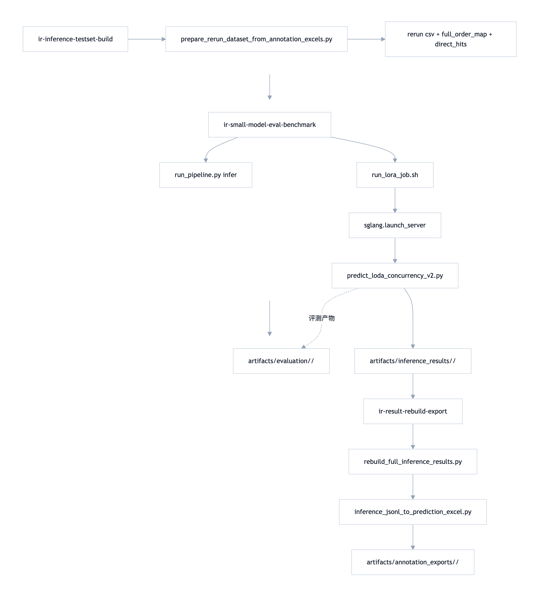

| **步骤** <br> | **Skill / 模块** <br> | **代码入口** <br> | **输出** <br> | **说明** <br> |
| --- | --- | --- | --- | --- |
| 1 <br> | `ir-inference-testset-build` <br> | `workflows/data_prep/prepare_rerun_dataset_from_annotation_excels.py` <br> | `rerun csv`、`full_order_map`、`direct_hits` <br> | 从标注 Excel 恢复可复跑测试集 <br> |
| 2 <br> | `ir-small-model-eval-benchmark` <br> | `workflows/run_pipeline.py infer` <br> | 推理评测执行参数 <br> | 组织推理模式、端口和输出目录 <br> |
| 3 <br> | 服务启动脚本 <br> | `workflows/eval_inference/run_lora_job.sh` <br> | 本地推理服务 <br> | 启动 `sglang.launch_server` 并等待健康检查 <br> |
| 4 <br> | benchmark 脚本 <br> | `workflows/eval_inference/predict_loda_concurrency_v2.py` <br> | `evaluation summary`、`inference_results jsonl` <br> | 统计 latency、TTFT、decode TPS 等指标 <br> |
| 5 <br> | `ir-result-rebuild-export` <br> | `workflows/data_prep/annotation_export/rebuild_full_inference_results.py` <br> | `full json`l <br> | 按 `order_index` 拼装完整结果 <br> |
| 6 <br> | 导出脚本 <br> | `inference_jsonl_to_prediction_excel.py` <br> | Excel 标注文件 <br> | 供标注、复盘或业务检查使用 <br> |

**线上排障链路**


| **步骤** <br> | **Skill / 模块** <br> | **代码入口** <br> | **输出** <br> | **说明** <br> |
| --- | --- | --- | --- | --- |
| 1 <br> | `intentv2-single-query-trace` <br> | `scripts/trace_single_query_remote.py` <br> | trace 请求 <br> | 接收 query、KB 版本、是否 `force-llm` 等参数 <br> |
| 2 <br> | 远端接入 <br> | `scripts/remote.sh` <br> | 远端 Python 执行环境 <br> | 进入真实运行环境 <br> |
| 3 <br> | 引擎调用 <br> | `core.engine_with_llm_proxy` <br> | `IntentEngine` 实例 <br> | 加载真实知识库和引擎逻辑 <br> |
| 4 <br> | 核心处理 <br> | `IntentEngine.process(query)` <br> | `retrieval`、`engine_final_response` <br> | 给出真实候选、gap-rule 迹象和最终响应 <br> |
| 5 <br> | 只读检查 <br> | `ir-readonly-review-ops` <br> | 补充 evidence <br> | 联合日志、docs、runtime 产物做交叉验证 <br> |

**鲁班提交链路**


| **步骤** <br> | **Skill / 模块** <br> | **代码入口** <br> | **输出** <br> | **说明** <br> |
| --- | --- | --- | --- | --- |
| 1 <br> | `submit-luban-task` <br> | `submit-luban-task/SKILL.md` <br> | 提交或查状态意图 <br> | 判断当前是“提交任务”还是“查状态” <br> |
| 2 <br> | 本地执行脚本 <br> | `submit-luban-task/submit.py` <br> | 请求参数 <br> | 读取命令行参数与默认配置 <br> |
| 3 <br> | 配置`merge` <br> | `\~/.codex/submit-luban-task/luban_config.json` <br> | 完整鉴权与默认值 <br> | 自动补齐 `userUuid`、`projectUuid`、`projectToken` 等 <br> |
| 4 <br> | 提交任务 <br> | `POST /api/v3/jobs` <br> | `appId`、任务摘要 <br> | 向 Luban 平台发起离线任务 <br> |
| 5 <br> | 查询状态 <br> | `GET /api/v3/jobs/&lt;appId&gt;?userUuid=...` <br> | 状态摘要 <br> | 返回 `status`、`monitorUrl`、时间戳等信息 <br> |

**Skill 说明表**

| **Skill** <br> | **定位** <br> | **主要作用** <br> | **关键脚本 / 入口** <br> | **适用场景** <br> | **特点** <br> |
| --- | --- | --- | --- | --- | --- |
| `ir-project-orchestrator` <br> | 总控型 skill <br> | 识别任务阶段并路由到正确 workflow <br> | `workflows/run_pipeline.py` <br> | 用户需求跨多个阶段，或阶段不够明确 <br> | 不承载重逻辑，主要负责“选路” <br> |
| `ir-source-data-prep` <br> | 上游输入整理模块 <br> | 清洗原始表格、规范化 `用户问题`、去重、拆分 train/test、生成 majority-voting 批次 <br> | `prepare_query_dataset.py`、`prepare_majority_batches.py` <br> | 新数据入库、重采样、训练评测前准备 <br> | 负责把原始数据变成标准输入 <br> |
| `ir-distill-pipeline` <br> | 大模型蒸馏执行模块 <br> | 组织知识库、输入文件和输出路径，并调用蒸馏脚本生成 `accepted/reject/summary` <br> | `run_pipeline.py distill`、`eval_model.py` <br> | 需要发起或检查 distill 任务时 <br> | 不只看进程存活，也看真实产物增长 <br> |
| `ir-training-data-build` <br> | 训练样本生成模块 <br> | 将 accepted jsonl 重构成 ShareGPT 样本，并支持清洗、过滤与发布 <br> | `generate_training_artifacts.py` <br> | 训练数据构建、SFT 数据重平衡 <br> | 借助 `IntentEngine` 重建 prompt，而非简单格式转换 <br> |
| `ir-inference-testset-build` <br> | 评测输入构建模块 <br> | 从原始测试集或标注 Excel 恢复 rerun-only 测试集，并生成 `full_order_map` 与 `direct_hits` <br> | `prepare_rerun_dataset_from_annotation_excels.py` <br> | prompt 或 KB 变化后，需要重建测试输入 <br> | 兼顾 rerun 子集与完整顺序映射 <br> |
| `ir-small-model-eval-benchmark` <br> | 服务评测与性能实验模块 <br> | 启动推理服务、执行并发请求、统计 latency、TTFT、decode TPS <br> | `run_lora_job.sh`、`predict_lora_concurrency_v2.py` <br> | 服务评测、benchmark、NGRAM 参数实验 <br> | 输出 `evaluation` summary 与推理结果明细 <br> |
| `ir-result-rebuild-export` <br> | 结果拼装与导出模块 <br> | 将 direct-hit 和 rerun 结果重建成完整结果并导出 Excel <br> | `rebuild_full_inference_results.py` <br> | 标注回流、结果复盘、完整结果导出 <br> | 强依赖 `full_order_map` 保证顺序一致 <br> |
| `ir-readonly-review-ops` <br> | 只读运维与审阅模块 <br> | 对 `README`、`docs`、日志、summary 和产物目录做只读检查 <br> | `README.md`、`docs/`、`artifacts/` <br> | review、巡检、进度检查、一致性核对 <br> | 强调 evidence-based、明确不改文件 <br> |
| `intentv2-single-query-trace` <br> | 线上问题解释模块 <br> | 输出单条 query 的真实检索候选、gap-rule 迹象和最终引擎响应 <br> | `trace_single_query_remote.py` <br> | 排查“当前线上到底怎么判” <br> | 直连真实远端环境，支持 `force-llm` 对照 <br> |
| `submit-luban-task` <br> | 平台执行模块 <br> | 将训练/推理脚本投递到鲁班，并按 `appId` 查询状态 <br> | `submit.py` <br> | 需要稳定提交离线任务时 <br> | 本地配置与命令行参数自动 merge，便于重复使用 <br> |

**Plugin 视角下的价值**

如果从 plugin 视角总结，这套能力的价值主要体现在四点：

- 把项目高频流程固化成标准入口，减少重复操作。

- 把“任务理解”与“代码执行”分层，降低误用成本。

- 把真实代码入口、产物路径和 skill 语义绑定，提升可追溯性。

- 把研发、评测、排障、平台提交串成统一闭环，而不是分散脚本集合。

---

## 缩略词表

| **缩略词** <br> | **全称** <br> | **中文 / 说明** <br> |
| --- | --- | --- |
| **ARSP** <br> | Accepted-Ratio Stability Principle <br> | **接受率稳定性原则**（本项目提出的方法论） <br> |
| BERT <br> | Bidirectional Encoder Representations from Transformers <br> | 双向编码器表征 Transformer（NLP 经典判别式模型） <br> |
| BRD <br> | Business Requirement Document <br> | 业务需求文档 <br> |
| DFA <br> | Deterministic Finite Automaton <br> | 确定性有限自动机（FSM 实现基础） <br> |
| DP <br> | Data Parallelism <br> | 数据并行 <br> |
| FAISS <br> | Facebook AI Similarity Search <br> | Facebook 开源向量检索库 <br> |
| FSM <br> | Finite State Machine <br> | 有限状态机（结构化输出引导解码核心机制） <br> |
| GRPO <br> | Group Relative Policy Optimization <br> | 一种 RL 策略优化算法（来自 DeepSeek 系列） <br> |
| KB <br> | Knowledge Base <br> | 知识库 <br> |
| L1/L2/L3 <br> | Level-1/2/3 <br> | 一级 / 二级 / 三级分类 <br> |
| LB <br> | Load Balancing <br> | 负载均衡 <br> |
| N-gram <br> | N-gram <br> | N 元语法（投机采样草稿来源） <br> |
| P50/P90/P95/P99 <br> | Percentile 50/90/95/99 <br> | 百分位时延 <br> |
| QPS <br> | Queries Per Second <br> | 每秒查询数 <br> |
| RAG <br> | Retrieval-Augmented Generation <br> | 检索增强生成 <br> |
| RL <br> | Reinforcement Learning <br> | 强化学习 <br> |
| RLVR <br> | RL with Verifiable Rewards <br> | 可验证奖励的强化学习 <br> |
| SLA <br> | Service Level Agreement <br> | 服务等级协议（如 P99 &lt; 6s） <br> |
| **SOP** <br> | Standard Operating Procedure <br> | **标准操作流程**（客服处理流程的最小单元） <br> |
| TPS <br> | Tokens Per Second <br> | 每秒 token 数 <br> |
| TTFT <br> | Time To First Token <br> | 首 token 时延 <br> |
| ZeRO <br> | Zero Redundancy Optimizer <br> | DeepSpeed 分布式训练优化器 <br> |

# 引用和鸣谢

[【LR25041】治理判责大模型策略V0](https://cooper.didichuxing.com/knowledge/2199610335356/2205895256939?vchannelId=2712538136030764&username=yezhou&msgKeys=AAABnkRWk1EAAAABAAmjCgAJriwAAAAAAAABNQ%3D%3D)

[TTRL Test-Time Reinforcement Learning](https://cooper.didichuxing.com/knowledge/2199610335356/2207010123872) 

[Deepconf-大模型置信度](https://cooper.didichuxing.com/knowledge/2199610335356/2206400668816)

[07 意图识别模块-双阶段检索&动态决策](https://cooper.didichuxing.com/knowledge/2199610335356/2206188389391)

[08 意图识别模块-推理优化](https://cooper.didichuxing.com/knowledge/2199610335356/2206323652607)

[09 意图识别模块-数据评估](https://cooper.didichuxing.com/knowledge/2199610335356/2206393824650)

[10 意图识别模块-RAG与Prompt迭代记录](https://cooper.didichuxing.com/knowledge/2199610335356/2206264467019)

[12 意图识别模块-蒸馏记录](https://cooper.didichuxing.com/knowledge/2199610335356/2206798718492)

[13 意图识别模块-推理优化v2](https://cooper.didichuxing.com/knowledge/2199610335356/2207094233215)

[14 意图识别模块-模型对比分析](https://cooper.didichuxing.com/knowledge/2199610335356/2207313489756)

[15 意图识别模块-推理优化v3](https://cooper.didichuxing.com/knowledge/2199610335356/2207646705727)

[16 意图识别模块-推理优化v4](https://cooper.didichuxing.com/knowledge/2199610335356/2207666953736)

[17 意图识别模块-线上问题反馈&优化](https://cooper.didichuxing.com/knowledge/2199610335356/2207858030802)

感谢门畅老师、方舟老师、小熊老师的指导与建议，以及翔宇在项目中的协助与投入

感谢工程与产品团队的全程支持

感谢判责项目同学上线的宝贵经验

感谢 GPT 5.4-5.5，Claude Opus 4.7-4.8
