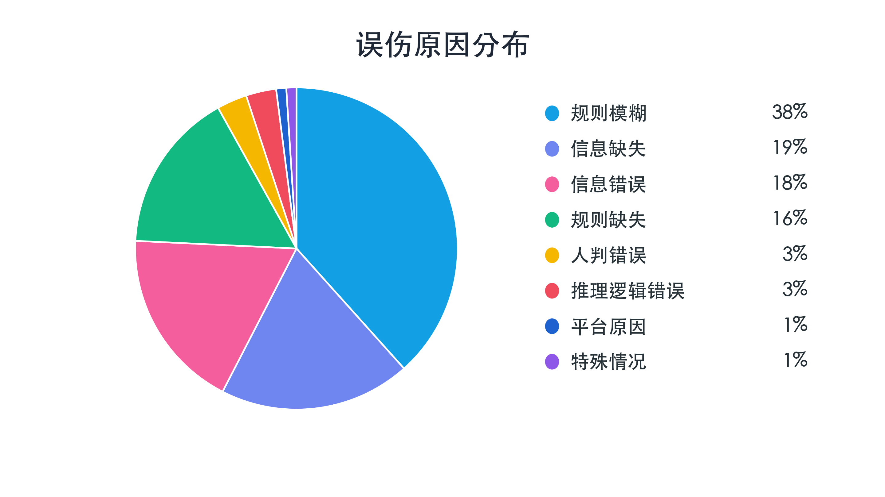
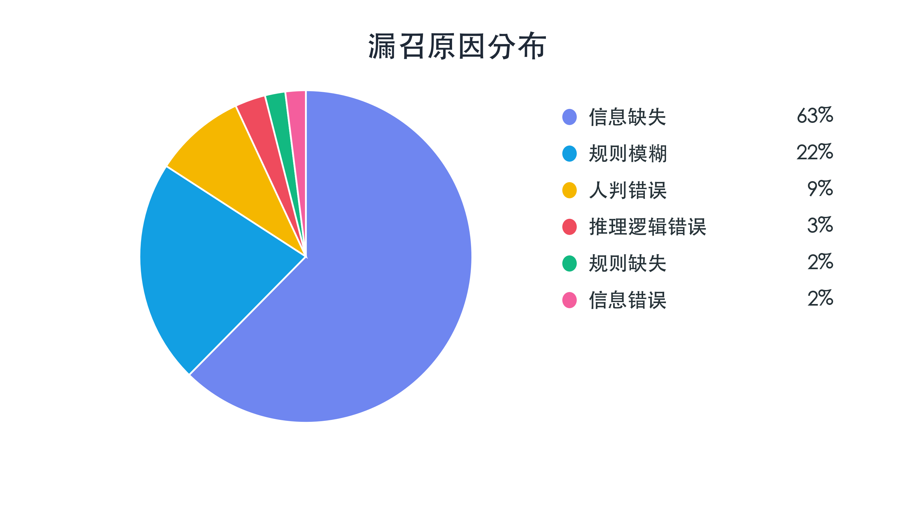

# 【LR26-018】交易生态-判责大模型-初判规则SOP化-v1.0

[Cooper 原文](https://cooper.didichuxing.com/knowledge/2199610335356/2208182346635)

# 零、基本信息

| brd文档链接 <br> | [【BRD】取消场景判责应用大模型能力](https://cooper.didichuxing.com/knowledge/2204793858906/2204812804928) <br> |
| --- | --- |
| 最后通过的策略方案链接 <br> | -<!--评论:[{"u":"rileywu","c":"对当前链路的迭代和模型优化，是否还需要上策略评审？整体不需要工程额外开发，是算法内部闭环实现，此处是否贴原来策略方案评审和brd文档就好？"}] --> <br> |
| 实验链接 <br> | [https://work.didi.cn/zhixing/machineStrategy?reHashPath=/stratety/version/detail/112/10478](https://work.didi.cn/zhixing/machineStrategy?reHashPath=/stratety/version/detail/112/10478) <br> |
| 核心贡献点 <br> | 判责规则SOP优化：==把原来模糊的规则堆叠，改成依赖具体判责证据有优先级的判责流程；蒸馏数据负采样进步一提升召回；== <br> |
| 第一贡献人 <br> | 王征宇 <br> |
| 共同贡献人 <br> | 荣莉、玮岚、志诚、玉添、金玮 <br> |
| 后续策略负责人 <br> | 王征宇 <br> |

# **一、背景**

取消治理判责大模型V0上线后，在实际判责过程中仍存在较明显的判责不准确问题。基于大模型看板4.5～5.18初判环节每日抽单标注数据还原大盘测算，当前大盘整体司机有责判责精确率为 89.20%，恶意有责精确率为 56.56%。误伤司机的情况较为突出，司机痛感较强，政诉压力大，影响判责公正性与平台治理体验，亟需提升模型判责精确率。

从前期误伤与漏召样本归因来看，问题主要集中在**规则表达不清晰**与**信息特征缺失或错误**两类原因上：

- 误伤侧，主要问题来自规则模糊和规则缺失，其中规则模糊占 38%，规则缺失占 16%，两者合计超过一半，说明当前部分场景下责任边界不够清晰，大模型容易在判责过程中产生理解偏差，将位置沟通、乘客表示不用车、车祸车坏等无责取消场景误判为司机有责。

- 漏召侧，信息缺失是最主要原因，占比 63%，其次是规则模糊，占比 22%。这说明除误伤问题外，当前模型也存在因关键事实特征不足、链路信息不完整，导致部分应判有责场景未被识别的问题。但从本期优化优先级来看，规则模糊和规则缺失是当前可通过 Prompt SOP 化较快收敛的问题，且在误伤侧占比较高，直接影响司机判责公正感。

因此，本期优先聚焦**判责规则不清晰**带来的**误判问题**，对取消治理判责规则进行 Prompt SOP 化改造，明确不同场景下的判责路径、豁免条件和责任边界，降低模型因规则理解偏差导致的误伤；对于信息缺失、信息错误等依赖特征建设的问题，待相关特征开发完成后，将在二期优化中继续接入完善。



统计周期：误伤：2.8-2.28、3.1-3.12、4.6-4.17、5.1-5.21共53天；漏召：2.8-2.27、5.1-5.8 共15天

# 二、目标&约束

目标：整体恶意有责精确提升10pp，约束整体恶意有责召回下降不超过4pp。

# 三、策略方案

本轮策略方案围绕 badcase 挖掘分析、Prompt 优化、学生模型蒸馏 三个模块展开。首先基于 badcase 挖掘定位机判与人判不一致的主要原因，明确误判、漏判集中场景；其次围绕归因结果重构 Prompt 判责链路，补齐规则覆盖并优化特征使用方式；最后通过学生模型蒸馏，将优化判责规则后的教师模型能力沉淀到可线上部署的轻量模型中。

## 3.1 Badcase挖掘分析

针对人判与机判结果不一致的问题，我们先对 badcase 进行分层归类，将问题划分为模型推理类、规则类、信息类、人判错误类、平台原因类等一级标签，并在各一级标签下设置二级标签，提升问题定位的准确性。同时，对误判和漏召各类二级标签下的 case 进行归因拆解，分别还原模型和人判的判断依据，回溯不一致的核心原因。

| 场景 <br> | 核心订单信息 <br> | 模型核心推理过程 <br> | 情况说明 <br> | prompt优化思路 <br> |
| :---: | :---: | :---: | :---: | :---: |
| 诱导取消-信息不符 <br> | 司机: 你可能是在上面定的你自己走 乘客: 酒店门口你在东广场啊我这边应该是在西广场的下面呢 **司机: 那你要取消重新叫一下你定位没定准确啊你要定站在那里才定位啊** 乘客: 我不知道这个是到怎么我定的不准确好吧好吧取消吧 司机: 是的 <br> | ... - 在通话中，司机先让乘客取消：\\"你要取消重新叫一下\\"，然后乘客同意并取消。\\n - 所以，司机诱导乘客取消。.... <br> | 模型并未识别乘客与司机之间的交互意图，实际意图为“乘客上车点与需求不符”，但模型只识别到司机说让乘客取消，从而推理出「司机诱导取消」的结论 <br> | 补充「乘客订单信息与实际需求不符」的场景，并且修改「司乘未碰面，诱导乘客取消」场景：“判断司机建议取消前是否存在合理上下文。合理上下文包括：**对定位或上车点产生困惑、司机或乘客说明位置不清、停车困难**” <br> |
|  |
| 乘客携带宠物 <br> | **乘客: 你好这边可以带宠物吗你好我带了宠物方便嘛 司机: 那你取消吧 **乘客: 你好 司机: 不好意思 <br> |   ...这里，乘客先问宠物问题，这不是表示不用车，而是询问服务。司机立即让取消，是诱导行为。.... <br> | 规则中未提及宠物单的判责方法，模型推理将「携带宠物」推理为「这不是表示不用车，而是询问服务」，从而通过识别到司机说让乘客取消，推理出「司机诱导取消」的结论 <br> | 修改「司乘未碰面，诱导乘客取消」场景：“判断司机建议取消前是否存在合理上下文。合理上下文包括：**乘客携带宠物**” <br> |
| 乘客不需要用车 <br> | 司机: 你说快点路打车吗 乘客: 唉我坐上车了师傅你是不是拉错人了 司机: 你坐上车了 乘客: 唉我坐上车了呀啊** 司机: 那你那你取消吧 **乘客: 我师傅你是不是拉错人了 <br> | .........n- 司机让乘客取消：在通话中，司机说“那你取消吧”。......\\n\\n因此，根因是\*\*司机扰乱平台秩序\*\*，具体特征是\*\*司乘未碰面，诱导乘客取消\*\*...... <br> | 乘客多平台叫车，但上车后小猪平台订单忘记取消，且已经表示不用车。但模型直接识别到司机说让乘客取消，推理出「司机诱导取消」的结论 <br> | 修改「司乘未碰面，诱导乘客取消」场景：“判断司机建议取消前是否存在合理上下文。合理上下文包括：**乘客已经表示不用车或准备重新叫车**” <br> |
| ==乘客: 唉唉你到了====** 司机: 车到了你喊你车吧 乘客: 我哪里喊到车了我取消了的的嘛\\**== <br> | ......\\n**\\n所以，乘客没有率先表示不用车；司机先诱导。**\\n\\n因此，根因应该是司机扰乱平台秩序..... <br> | 乘客表示不需要用车，但忘记取消。但模型直接识别到司机说让乘客取消，推理出「司机诱导取消」的结论 <br> | 修改「司乘未碰面，诱导乘客取消」场景：“判断司机建议取消前是否存在合理上下文。合理上下文包括：乘客已经表示不用车或准备重新叫车” <br> |
| 司机到达上车点后故意跑远 <br> | ==**\\n- 司机到达上车点\\n- 取消时刻司机行驶距离大于300米\\n**== <br> | ....**.\\n\\n此外，取消时刻司机行驶距离大于300米，结合司机到达上车点，表明司机离开了。....** <br> | 司机到达上车点后，乘客无特殊情况取消。而模型将「取消时刻司机行驶距离大于300米」幻觉推理为「取消时刻的司机位置与订单起点的直线距离&gt;200m」 <br> | 重构场景「司机到达上车点后故意跑远」，并点明核心：“检查订单是否命中“取消时刻的司机位置与订单起点的直线距离＞200m””，防止模型依旧出现幻觉 <br> |
| 派单距离错误 <br> | 输入订单信息：**预估接驾距离（米）：2815米** <br> | .....**\\n- 预估接驾距离2815米&lt;3000米，所以不是平台原因。**\\n- 无文本沟通，所以没有诱导行为。.... <br> | 人判实际距离为3.1km判责为无责，模型输入距离为2815m，机判为有责。**接驾距离特征不准确**，会导致模型很多误伤，降低司机的体验感 <br> | 采用修改规则的方式，将模型非路口/高架桥的距离判责阈值修改为2.7km 修改场景「非（司机排队单/抢单/拼车非首单/调度单/半指派），路况、定位等原因导致接驾距离异常」中：“检查预估接驾距离是否 &gt; 2.7 公里。若是，判定无责。” <br> |
| 车祸车坏 <br> | 乘客: 唉** 司机: 唉你好不好意思我车子被人撞**了 乘客: 起来被人撞了 司机: 对 乘客: 你是是不是被人撞了 司机: 我不对绕我不是接你吗你这么拉单的\\ <br> | .....**..\\n- 司机说“我不对绕我不是接你吗你这么拉单的”，这表示司机不想接单。**- 属于\*\*司机服务能力不足\*\*根因的特征........ <br> | 模型将司机说的「车被撞了」类比「没油没电」，从而推理出「因司机个人原因导致订单取消」的结论 <br> | 添加场景「车坏，车祸」，并且在场景核验中添加：“检查取消后 2 小时内是否有完单。若否，判定无责。若是，判定有责。”防止司机虚假描述 <br> |
| 无特殊情况取消 <br> | 司乘无交互记录、司机无任何违规情况 <br> | ....\\n\\n所以，我认为根因是\\"司机服务能力不足\\"，特征\\"无特殊情况，司机未到达上车点\\"，......**\\n\\n或许在无沟通时，司机未到达上车点是服务能力不足。**... <br> | 模型幻觉推理，将司机无责的场景推理为司机错误有责 针对这类司机无违规行为，司乘无交互记录/司乘交互记录中无有效信息且后续乘客自然取消的场景无相关规则声明 <br> | 添加场景「乘客在无责时间内不用车导致订单取消」与「乘客在无责时间外不用车导致订单取消」，并且考虑思维逻辑，将这两场景放置于思维链最后端，防止模型错误判断 为与工程接口拉齐，界定「“取消时间”减“接单时间”是否≤3min/＞3min」为乘客无责时间内/外的界限 <br> |
| 场站单 <br> | **订单起点：遥墙机场-**1F到达层-7、8号门-**- 是场站** <br> | .....。\\n- **但是，因为是场站单（起点是机场），并且没有线下交易和加价议价，所以应该适用“平台派单问题”的特征。**\\n\\n规则说：.....这直接指向平台派单问题。..... <br> | 人判场站单规则有迭代版本：现版本场站单统一有责，在申诉阶段如若司机申诉理由和图片能证明不接场站单则改判无责，之前版本统一无责，之间存在diff <br> | 针对场景「场站单」进行保留/剔除的prompt实验，通过实验结果选取正确率高的版本。最终选择剔除「场站单」场景 <br> |

## 3.2  Prompt优化

### 3.2.1  原 Prompt 存在的问题

原 Prompt 主要存在三类问题：

- **缺少明确的思考链路和判责优先级**： 原 Prompt 更像是规则和根因特征的堆叠，没有明确告诉模型应该先判断什么、后判断什么。当同一订单同时命中错误有责和恶意有责时，模型容易出现推理混乱。

- **机判规则与人判尺度存在偏差**：人判规则在持续迭代，但机判 Prompt 中的规则没有完全同步，导致场站单、禁停等场景的判断尺度与人工不一致。同时，原 Prompt 主要覆盖头部规则，对部分中游规则覆盖不足，例如拉货单、宠物单、车祸车坏等。

- **特征存在准确性、冗余和缺失问题**：一部分特征开发时间较早，未做维护，尤其模型元能力特征基于小模型开发，准确度不高，会干扰大模型推理；另一部分特征口径不清晰，含义不明确，导致user prompt映射含义不准确。

### 3.2.2  优化方向

针对原 Prompt 中存在的三类问题，本轮优化主要从**推理链路**、**规则尺度**、**特征治理**三个方向展开。

- **优化推理链路，明确判责优先级：**针对原 Prompt 缺少明确思考链路和判责优先级的问题，我们重新设计了模型判责流程，将判责规则SOP化，约束模型在推理过程中围绕各场景的关键判责证据逐项核对，减少发散式、无效推理。将整体链路调整为 “**无责 → 恶意有责 → 错误有责**” 的判责优先级结构。这样设计主要基于两点考虑：一是优先识别无责场景，若订单满足明确无责条件，则直接判为无责，避免继续进入有责判断造成误伤；二是当同一订单同时满足错误有责和恶意有责条件时，恶意有责的性质更恶劣、处置优先级更高，因此需要前置恶意有责判断，避免被错误有责场景截断或稀释。

- **对齐人判尺度，补齐规则覆盖：**针对机判规则与人判尺度存在偏差的问题，我们重点对 Prompt 规则进行了人工判责尺度对齐。一方面同步人判规则中的最新口径，修正场站单、上车点禁停等场景中机判与人判不一致的问题；另一方面补充原 Prompt 覆盖不足的中游规则，例如超载、宠物单、车祸车坏、运管查车等，提升模型对非头部场景的识别能力。

- **治理特征质量，降低无效特征干扰：**针对特征准确性不足、口径冗余和特征缺失的问题，我们对现有特征进行了随机抽样验证，重点**摸底特征准确率**、**实际含义**和**可解释性**，并沉淀一份[特征说明报告](https://cooper.didichuxing.com/docs2/document/2207461141043)，用于记录当前上线特征的真实表现、使用边界，以及部分特征被剔除的原因。对于后续仍需要但当前缺失的特征，已同步产品侧提需，后续会结合[底层特征梳理](https://cooper.didichuxing.com/docs2/sheet/2207095556484)和当前特征说明继续补齐相应规则，提升User Prompt 输入订单信息的可用性。

### 3.2.3 Prompt 优化迭代记录<!--评论:[{"u":"rileywu","c":"如何判断收益究竟来自SOP、规则变化、特征修复还是模型变化？"},{"u":"zanewang","c":"收益主要来规则prompt SOP化，未涉及特征修复和模型变化"}] -->

本节记录 DeepSeek-R1 在不同 Prompt 版本下的离线迭代评估结果，用于评估 Prompt SOP 化、规则补充和特征映射优化带来的效果变化。除 baseline1 为线上Qwen3-8B真实判责结果外，baseline2 与 v1-v5 均基于 DeepSeek-R1 直接推理，模型能力保持一致，因此 baseline2 与各迭代版本之间的差异，主要反映 Prompt 优化带来的收益。

| 版本 <br> | 说明 <br> | 有责 P <br> | 有责 R <br> | 恶意有责 P <br> | 恶意有责 R <br> | 错误有责 P <br> | 错误有责 R <br> |
| --- | --- | --- | --- | --- | --- | --- | --- |
| baseline1 <br> | 判责线上模型效果<!--评论:[{"u":"rileywu","c":"这个是抽单结果？并非是还原到大盘的？"},{"u":"zanewang","c":"基于初判环节每日抽单数据04-06～04-19测算，分司乘取消各抽取200单/天，为线上模型在这些抽单下的效果，并非还原大盘结果"}] --> <br> | 82.02% <br> | 69.27% <br> | 60.90% <br> | 50.00% <br> | 74.63% <br> | 63.95% <br> |
| baseline2 <br> | DeepSeek-R1基于线上Prompt直接推理 <br> | 82.64% <br> | 65.53% <br> | 63.59% <br> | 43.56% <br> | 72.72% <br> | 61.86% <br> |
| v1 <br> | 重点修复**诱导取消**、**长时停留**、**故意跑远、接驾距离异常**等场景<!--评论:[{"u":"rileywu","c":"整体有责精确为啥没有提升？同时召回降低了这么多？"},{"u":"zanewang","c":"v1/v2 阶段离线评估数据中的连环派特征构造存在口径错误（部分连环派订单被映射为非连环派订单），导致部分样本输入给模型的判责证据与线上真实特征不一致。"}] --> <br> | 81.31% <br> | 55.28% <br> | 82.24% <br> | 31.43% <br> | 68.58% <br> | 57.45% <br> |
| v2 <br> | 诱导取消场景新增判定司机建议取消是否存在合理的上下文：位置不清、堵车、停车困难、乘客携带宠物、乘客已经表示不用车等<!--评论:[{"u":"rileywu","c":"V2是在V1的基础上继续优化的？为啥V1整体有责没有提升，召回降低了，V2还在V1基础上做优化？"},{"u":"zanewang","c":"v2和v3并行定位问题"}] --> <br> | 83.10% <br> | 56.81% <br> | 86.38% <br> | 28.69% <br> | 67.92% <br> | 59.09% <br> |
| v3 <br> | 修复离线连环派特征<!--评论:[{"u":"rileywu","c":"连环派特征之前是什么问题？"},{"u":"zanewang","c":"已答复"}] --> <br> | 90.43% <br> | 55.78% <br> | 85.14% <br> | 27.98% <br> | 75.14% <br> | 57.83% <br> |
| v4 <br> | 修复上车点禁停规则提升召回 <br> | 91.04% <br> | 63.74% <br> | 86.65% <br> | 33.21% <br> | 78.69% <br> | 68.31% <br> |
| **v5** <br> | 去掉场站单判责进一步提升召回 <br> | 90.31% <br> | 67.66% <br> | 82.97% <br> | 35.95% <br> | 78.03% <br> | 71.53% <br> |

数据周期：基于初判环节每日抽单数据04-06～04-19测算，分司乘取消各抽取200单/天

注：v1/v2 阶段离线评估数据中的**连环派特征**构造存在口径错误（部分连环派订单被映射为非连环派订单），导致部分样本输入给模型的判责证据与线上真实特征不一致。因此，v1/v2 的指标下降不能直接理解为SOP化方向无效。v3修复该离线特征问题后，整体有责精确率明显恢复。

**选取v5作为终版system prompt**：

```PlainText
# 网约车订单取消判责任务

## 任务描述
你是一名网约车交易市场判责专家，负责根据司机接单后取消的订单信息，判断司机在订单取消中的责任。

## 判责流程
Step 1. **梳理订单信息**：订单信息主要有两类：订单起终点、预计接驾时长等基础信息；司乘沟通信息。

Step 2. **识别责任场景**：根据订单信息，结合“判责指南”中的责任场景，务必按照顺序逐一判定司机可能命中的责任场景，其中包括：13个无责场景、4个错误有责场景和7个恶意有责场景。

Step 3. **综合判断**：结合订单信息、司机和乘客行为及核实结果，得出最终判责结论。当**未命中任一无责场景**时，如果同时命中错误有责场景和恶意有责场景，输出恶意有责场景。

## 判责指南

### 通用规则
1. **适用说明**：通用规则适用于所有具体核实规则。
2. **司机提及前提**：对于司乘通话或消息记录提及的相关场景，如禁停、车坏车祸、政府管控或查车、道路无法通行和司机身体不适，需要司机提及才进行核实，无提及则跳过核实；对于所有场景，每一个场景都要检查是否符合，并根据核实规则步骤进行核实。
3. **特征命中**：除部分场景会明确提到命中与否（如：司机到达/未到达上车等） 外，其余场景订单信息中未声明则视为没有命中（如：上车点非禁停 订单信息中不会声明，则视为上车点非禁停等）
4. **特殊规则**：司机无责场景1需放在所有场景的后面进行判断，即判责流程为：无责场景（除场景1和场景2）-恶意有责场景-错误有责场景-无责场景1和无责场景2。在此流程中前置场景命中即可进行输出，无需进入下一场景判定。若场景规则中明确标注“判定有责”，则同时适用“恶意有责”和“错误有责”的判断。

### 责任场景
以下场景分为司机无责、恶意有责和错误有责情况，具体核实方法遵循每个场景下方的核实规则。

#### 司机无责场景
1. 乘客在无责时间内不用车导致订单取消。
    1. 检查取消方是否为乘客方，若是，则跳转第 2 步。
    2. 检查订单信息中的“取消时间”减“接单时间”是否≤3min，若是，则跳转第 3 步。
    3. 若司机无任何违规情况，则直接判定无责。
2. 乘客在无责时间外不用车导致订单取消。
    1. 检查取消方是否为乘客方，若是，则跳转第 2 步。
    2. 检查订单信息中的“取消时间”减“接单时间”是否＞3min，若是，则跳转第 3 步。
    3. 若司机无任何违规情况，则直接判定无责。
3. 乘客订单信息与实际需求不符。
    1. 检查司乘交流im和通话文本中提及的基础信息，确认乘客提供的实际起点、终点、人数、时间等信息与基础订单信息是否相符。若不相符，判定无责。若相符，跳转第 2 步。
    2. 检查司乘交流im和通话文本中提及的订单状态。若乘客已经重新下单、乘坐其他车辆（如乘客提及：“我在另一个位置”、“我走了”、“不用了”、“我取消了”），判定无责。若无相关对话内容，跳转第 3 步。
    3. 确认司机是否尝试沟通解决问题（如到达起点、询问乘客准确位置、建议重新定位）。若是，无论司机有无建议乘客取消订单的行为，都判定无责。
4. 合理加价，司乘协商未达成一致。
5. 乘客迟到。
    1. 确认司机是否到达上车点。若司机到达上车点，跳转第 2 步。
    2. 检查订单是否命中“司机在上车点等够时间”。若是，判定无责。
6. 上车点禁停。
    1. 在司乘交流im和通话文本中进行核验。“无法停车”、“禁止停车”等表述属于该场景。若司机提及禁停/限停，则跳转第 2 步。
    2. 在司乘交流im和通话文本中进行核验。若乘客未对司机"无法停车"等表述作出回复，或未明确表示不认可该表述，则判定为无责。
7. 乘客超载。
    1. 检查司乘交流im和通话文本中乘客提及的实际乘车人数，比较是否超过司机车辆所能够承载人数（＞4人）。若是，则无责。
8. 非（司机排队单/抢单/拼车非首单/调度单/半指派），路况、定位等原因导致接驾距离异常。
    1. 检查订单是否是（司机排队单/抢单/拼车非首单/调度单/半指派）等特殊订单。若是，跳出本场景判定。若否，跳转第 2 步。
    2. 检查预估接驾距离是否 > 2.7 公里。若是，判定无责。
    3. 若接单位置在路口/高架桥，且预估接驾距离> 2.5 公里（2500米），则判定无责，无需参考偏航信息。
9. 车坏，车祸。
    1. 检查司乘交流im和通话文本中，司机是否有提到“发生车祸”、“车辆坏了”和“跟别人剐蹭了”等字眼或相同意图，若是，则跳转第 2 步。
    2. 检查取消后 2 小时内是否有完单。若否，判定无责。若是，判定有责。
10. 政府管控或查车。
    1. 检查司乘交流im和通话文本中，司机是否有提到“道路管控”、“交管查车”等字眼或相同意图，若是，则判定无责。
11. 道路无法通行。
    1. 检查订单是否命中“司乘沟通、司机报备、申诉中、车载证据显示接驾路线存在无法通行的情况”，如是，则判定无责，如否，则跳转第 2 步。
    2. 检查司乘交流im和通话文本中，司机是否有提到“道路无法通行”等字眼或相同意图，若是，则判定无责。
12. 司机身体不适。
    1. 检查司乘交流im和通话文本中，司机是否有提到“身体不适”等字眼或相同意图，若否，则跳出此场景，若是，则跳转第 2 步。
    2. 检查取消后 2 小时内是否有完单。若否，判定无责。若是，判定有责。
13. 连环单司机接单后在平台允许时间内合理取消。
    1. 检查订单基础信息。若订单是连环派单，则跳转第 2 步。
    2. 检查取消方是否为司机，若是，则跳转第 3 步。
    3. 检查“取消时间”减“接单时间”是否≤15s（必须），若是，判定无责。

#### 司机恶意有责场景
1. 司机要求线下交易。
    1. 检查司乘交流im和通话文本，如果司机提及“不走平台”、“走线下”或“单独付给我”等字眼或者相关意图，则为恶意有责。
2. 司机要求加价议价。
    1. 检查司乘交流im和通话文本，如果司机提及“需要多加钱”或者“能不能加一点”等字眼或者相关意图，则为恶意有责。
3. 司机长时间停留。
    1. 检查订单是否命中“司机接驾途中在原地停留时长＞3min”，若是，则为恶意有责。
4. 司乘未碰面，诱导乘客取消。
    1. 检查司乘交流im和通话文本，判断司机建议取消前是否存在合理上下文。合理上下文包括：司乘找不到对方、对定位或上车点产生困惑、司机或乘客说明位置不清、堵车、停车困难、车辆无法停靠、乘客要求等一会、司机催促乘客、乘客携带宠物、乘客已经表示不用车或准备重新叫车等。若存在上述任一情况，则该场景不成立，判定无责，不再继续核验本场景。
    2. 检查司乘交流im和通话文本，判断乘客是否先表达取消订单、不用车、重新叫车、已经取消、不确定是否已取消、询问能否取消等意愿或困惑状态。若乘客先表达上述任一内容，则司机后续回复取消、同意取消或建议取消，均不属于诱导取消，判定无责，不再继续核验本场景。
    3. 检查司机是否存在主动诱导乘客取消。只有同时满足以下全部条件，才可以判定恶意有责：a. 第 1 步和第 2 步均不命中；b. 司机先于乘客主动提出让乘客取消订单；c. 司机没有说明定位、找人、堵车、停车、等待、乘客需求等合理原因；d. 司机文本中有明确要求乘客取消的表达。若不同时满足以上全部条件，判定无责。
    4. 注意：不能因为订单是乘客取消、司乘未碰面、司机未到达上车点、司机说过“取消”“重新叫”“换个车”等词语，就直接判定诱导取消；必须结合前后文确认司机是在无合理原因的情况下主动要求乘客取消。
5. 司机故意偏航且接驾时间更长。
6. 司机要求私自拼车。
    1. 检查司乘交流im和通话文本，如果司机提及“需要多载几个人”、“需要再等几个人”或“我这要再接几个人你看可以吗”等字眼或者相关意图，则为恶意有责。
7. 司机到达上车点后故意跑远。
    1. 检查司乘交流im和通话文本中乘客是否提及“我在上车点对面”等相关的“口头更改上车点”的意图，若否，跳转第 2 步。
    2. 检查订单信息中的“取消时间”减“接单时间”是否≥3min，若是，跳转第 3 步。
    3. 检查订单是否命中“取消时刻的司机位置与订单起点的直线距离＞200m”，若是，跳转第 4 步。
    4. 检查订单是否命中“司机到达上车点”，若是，跳转第 5 步。
    5. 检查订单是否命中“司机没有在上车点等够时间”，若是，则为恶意有责。
  
#### 司机错误有责场景 
1. 司机提前点击到达。
    1. 检查订单是否命中“接驾过程中司机提前点击到达”，若是，则为错误有责。
2. 司机无法按时到达。
    1. 检查接驾过程中司机是否迟到或将要迟到。若是，判定错误有责。
3. 无特殊情况，司机未到达上车点。
    1. 检查司机是否到达过乘客起点。若是，则跳出此场景判断。若否，跳转第 2 步。
    2. 检查订单是否是被司机取消。若订单被司机取消，判定错误有责。
4. 司机多次未接乘客电话。
    1. 检查订单是否命中“实时单取消前，司乘无成功通话，乘客主叫司机的通话未成功＞1次（电话响铃≥6s算一次）”，若是，则为错误有责。

## 输出要求
- **判责依据**：说明命中的判责场景，用精确的xml标签格式 `<res_feature></res_feature>` 包裹。
- **判责结果**：输出责任：“错误有责”或“恶意有责”或“无责”，用精确的xml标签格式 `<responsibility></responsibility>` 包裹。  
- **要求**：输出形式必须判责场景在前，责任在后；且输出判责场景必须与责任相对应。
    - 示例：`<res_feature>乘客迟到</res_feature>``<responsibility>无责</responsibility>`
```

**终版特征->user prompt映射关系**：

```PlainText
## 完整订单信息如下所示：
### 基础订单信息：
- 订单起点是{{.order_dos_start_name}}
- 订单终点是{{.city_end_addr}}
- 订单接单时间为{{.order_dos_strive_time}}
- 订单取消时间为{{.dos_cancelled_time}}
- 本单是{{if (eq (toFloat .order_ufs_cancel_role) 1)}}乘客{{else}}司机{{end}}取消
- 预估接驾距离是{{.order_cancel_driver_start_distance}}米
- 订单{{if (eq (toFloat .order_is_serial_type) 1)}}是{{else}}不是{{end}}连环派单
- 订单起点{{if (eq (toFloat .order_is_pickup_station}}是{{else}}不是{{end}}场站单  
- 司机{{if (eq (toFloat .order_driver_not_arrive) 0)}}有{{else}}没有{{end}}到达上车点  
- 地图显示上车点{{if (eq (toFloat .order_is_limit_parking_mole) 1)}}是{{else}}不是{{end}}限停
- 地图显示上车点{{if (eq (toFloat .order_is_noparking_mole) 1)}}是{{else}}不是{{end}}禁停
- 订单{{if (eq (toFloat .order_type_in_specific_type) 1)}}是{{else}}不是{{end}}半指派或重点场站单或预约单或拼车首单等特殊订单   
- 订单取消后2小时内司机{{if (eq (toFloat .order_no_pickup_two_hour_after_cancel) 0)}}有{{else}}没有{{end}}完单
- 本单{{if(eq(toFloat .order_crosscity_no_cross_city_fee) 1)}}是{{else}}不是{{end}}未开跨城费城市的跨城单
- 司机接驾过程中{{if (eq (toFloat .order_is_driver_stay_three_min) 1)}}有{{else}}没有{{end}}在原地停留超过3分钟
- 司机接单位置{{if (eq (toFloat .order_first_link_is_crossing_or_elevated) 1)}}在{{else}}不在{{end}}路口或高架桥
- {{if(eq(toFloat .order_cancel_driver_loc_order_start_linear_distance_gt_two_hundred) 1)}}取消时刻的司机位置与订单起点的直线距离＞200m 
- 接驾过程中司机{{if (eq (toFloat .order_arrive_to_start_roud_dist_gt_than_thres) 1)}}有{{else}}没有{{end}}提前点击到达
- {{if (eq (toFloat .order_passenger_call_driver_failed_before_cancel) 1)}}实时单取消前，司乘无成功通话，乘客主叫司机的通话未成功＞1次（电话响铃≥6s算一次）
- 接驾过程中司机{{if (eq (toFloat .order_driver_will_late) 1)}}有{{else}}没有{{end}}将要迟到
- 接驾过程中司机{{if (eq (toFloat .order_driver_has_late) 1)}}有{{else}}没有{{end}}迟到
- 司乘沟通、司机报备、申诉中、车载证据显示接驾路线{{if (eq (toFloat .order_mf_128) 1)}}存在{{else}}不存在{{end}}无法通行的情况
### 司乘交互信息：
- 司乘交流im文本 <{{hxz_processed_im_role_content}}>。
- 司乘交流通话文本 <{{hxz_processed_im_asr_role_content}}>。
{{end}}
```

## 3.3 学生模型蒸馏

为降低 DeepSeek-R1 直接推理成本、提升线上部署效率，本阶段以 DeepSeek-R1 作为教师模型，对 Qwen3-8B 学生模型进行 LoRA 蒸馏训练。实验共对比 v1、v2、v3 三版学生模型，主要差异在于训练数据覆盖范围以及错误有责、无责样本的负采样比例。同时，以 DeepSeek-R1 教师模型直接推理结果作为基准，用于评估学生模型在蒸馏后的效果。整体结果如下：

| 版本 <br> | **说明** <br> | 有责精确 <br> | 有责召回 <br> | 恶意有责精确 <br> | 恶意有责召回 <br> | 错误有责精确 <br> | 错误有责召回 <br> |
| --- | --- | --- | --- | --- | --- | --- | --- |
| v1 <br> | 数据分布为无责5502 / 错误有责2360 / 恶意有责517 <br> | 91.79% <br> | 66.39% <br> | 77.72% <br> | 28.49% <br> | 79.79% <br> | 73.09% <br> |
| **v2** <br> | 较v1新增0201～0331数据集，增加恶意有责样本量，错误有责和无责负采样，数据分布：恶意1643/错误5000/无责9000 <br> | 91.43% <br> | **68.62%** <br> | 77.36% <br> | **32.67%** <br> | 79.12% <br> | 73.41% <br> |
| v3 <br> | 较v1新增0201～0331数据集，增加恶意有责样本量，错误有责和无责负采样，数据分布：恶意1643/错误3000/无责4000 <br> | 91.47% <br> | 68.20% <br> | 77.34% <br> | 31.27% <br> | 79.17% <br> | 73.63% <br> |
| DeepSeek-R1 <br> | 基座教师模型 DeepSeek-R1 直接推理 <br> | 91.35% <br> | 67.92% <br> | 78.19% <br> | 29.28% <br> | 77.85% <br> | 73.41% <br> |

测试集数据周期：初判环节每日抽单数据0420～0427，分司乘取消各抽取200单/天

在整体有责精确率不低于90%的约束下，优先最大化整体召回和恶意召回，因此，选择v2 版本的学生模型最终部署上线。

相较 v1，v2在有责精确率仅下降 0.36pp 的情况下，有责召回提升 2.23pp；其中恶意有责召回从 28.49% 提升至 32.67%，提升 4.18pp。

# 四、实验结果

**实验方式**：5.28-5.29 期间，SOP 优化版本在全国 30% 流量上进行线上空跑。我们从该周期空跑流量中基于机判结果随机抽取 6000 单，并进行人工标注。最终在同一批 6000 单样本上，对比线上原策略结果与 SOP 优化空跑结果。

**对照组与实验组**：对照组为该批样本在当期线上原策略下的判责结果；实验组为同一批样本在 SOP 优化 Prompt 下的空跑判责结果。两组样本完全一致，可以直接对比精确率和召回率变化。

**结果口径说明**：当前结果基于线上真实流量随机抽样样本评估，抽样过程中不区分司乘取消类型，也不区分有责/无责标签，整体样本分布与线上大盘自然分布保持一致。因此，本次评估结果可作为大盘真实效果的近似反映。

**实验周期说明**：本次实验周期为 5.28-5.29，共 2 天。周期较短的主要原因是业务当前投诉压力较大，需要尽快推进策略迭代上线。同时，本次用于评估的是全国 30% 空跑流量中的线上真实订单，样本来源覆盖实际业务流量，且最终抽取 6000 单进行人工标注评估，样本量能够支撑本轮上线决策。后续上线后会继续跟踪更长周期的大盘指标，验证效果稳定性。

| **范围** <br> | **版本** <br> | **司机有责精确** <br> | **司机有责召回** <br> | **恶意有责精确** <br> | **恶意有责召回** <br> | **错误有责精确** <br> | **错误有责召回** <br> |
| --- | --- | --- | --- | --- | --- | --- | --- |
| 整体 <br> <br> | 对照组 <br> | 91.62% <br> | 62.83% <br> | 65.45% <br> | 21.73% <br> | 87.89% <br> | 72.90% <br> |
| 实验组 <br> | 92.33% <br> | 67.83% <br> | **79.84%** <br> | 20.72% <br> | 83.71% <br> | 77.63% <br> |
| 司机取消 <br> | 对照组 <br> | 94.10% <br> | 75.41% <br> | 37.93% <br> | 11.11% <br> | 89.88% <br> | 75.90% <br> |
| 实验组 <br> | 95.04% <br> | 79.98% <br> | **73.08%** <br> | 19.19% <br> | 90.12% <br> | 80.26% <br> |
| 乘客取消 <br> | 对照组 <br> | 76.22% <br> | 27.59% <br> | 71.32% <br> | 24.37% <br> | 17.86% <br> | 9.09% <br> |
| 实验组 <br> | 77.66% <br> | 33.77% <br> | **81.55%** <br> | 21.11% <br> | 12.77% <br> | 21.82% <br> |

结论：从整体来看，**SOP 优化主要带来了恶意有责精确和整体召回能力提升。**分取消方看，收益主要体现在两个方面：

- **司机取消场景收益稳定**：司机有责、恶意有责、错误有责三个口径下的精确率和召回率基本全面提升，其中恶意有责精确率从 37.93% 提升至 73.08%，提升 35.15pp，是本次 SOP 优化最明显的收益点。

- **乘客取消场景主要改善恶意有责识别**：乘客取消下恶意有责精确率从 71.32% 提升至 81.55%，提升 10.23pp。

# 五、放量节奏

|  <br> |  <br> | 预期扩量时间节奏 <br> | 实际扩量时间 <br> | 实际放量暂停点 <br> | 放量暂停点效果评估 <br> |
| --- | --- | --- | --- | --- | --- |
|  <br> |  <br> |  <br> | LR通过后，根据实际情况，填写这3列 <br> |
| 放量决策意见 <br> | 决策人 <br> |  <br> |  <br> | —— <br> | —— <br> |
| 决策意见： <br>- 通过 <br><br>- 不通过，给出原因 <br><br>- 扩大流量实验 <br><br> |  <br> |  <br> |  <br> |  <br> |
| 放量需要周知的利益相关方 <br> | 平台治理业务方 <br> |
| 放量策略 <br> | 实验组 <br> | 学生模型Qwen3-8B蒸馏教师模型Deepseek-R1的v2版本 <br> |
| 放量决策 <br> | 分批放量 <br> | 2026.05.28 开量30%空跑 <br> | 2026-05-28 开量30%空跑 <br> | 暂停并评估 <br> | 评估数据：整体以及分司乘取下整体有责、错误有责、恶意有责的准召 <br> |
| 2026.06.02 小流量10% <br> | 2026.06.12 小流量10% <br> | 不需要评估，只需观测无异常 <br> | —— <br> |
| 2026.06.03 小流量50% <br> | 2026.06.15 小流量50% <br> | 不需要评估，只需观测无异常 <br> | —— <br> |
| 2026.06.09 全量100% <br> | 2026.06.18 推全100% <br> | 暂停并评估 <br> | 评估数据：整体以及分司乘取下整体有责、错误有责、恶意有责的准召 <br> |

# 六、后续规划

- 计划在 LR 通过后，于 6月9日扩量至 100%。放量过程中将持续观测大模型看板指标，包括整体及分司乘取消口径下的有责、恶意有责、错误有责精确率和召回率，同时关注司机申诉率、进线率及政诉率等业务风险指标。此外，将同步监测机器判责流量，持续输出截断率变化等线上稳定性指标。

- 待[取消判责大模型核心特征建设](https://cooper.didichuxing.com/knowledge/2204793858906/2206876543076)于6月底开发完成后，将启动二期优化工作。二期重点包括：继续完善规则与特征 SOP，补齐当前缺失或可靠性不足的判责证据；同时探索引入教师模型 Claude-Opus 进行推理和蒸馏，进一步提升判责精确率与召回率。整体预计于7月底完成。

# 七、引用与鸣谢

[【LR25041】治理判责大模型策略V0](https://cooper.didichuxing.com/knowledge/2199610335356/2205895256939)

感谢荣莉在策略优化过程中的悉心指导，感谢玮岚对线上badcase的细致标注，感谢产品志诚、玉添对摸清判责规则与判责相关特征的大力支持。
