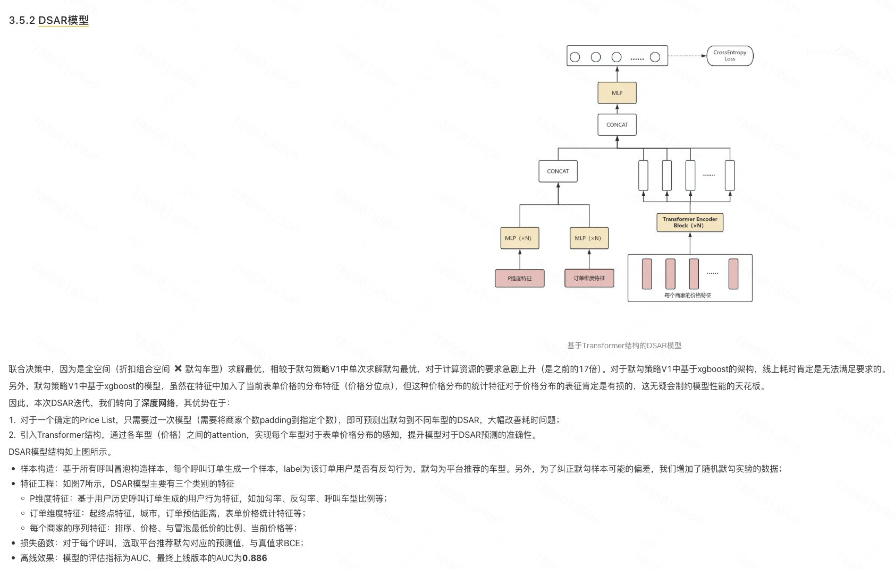
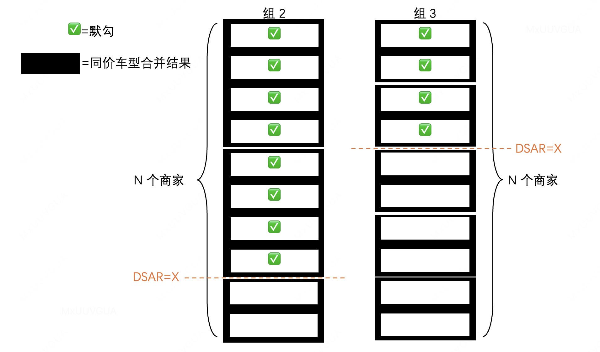
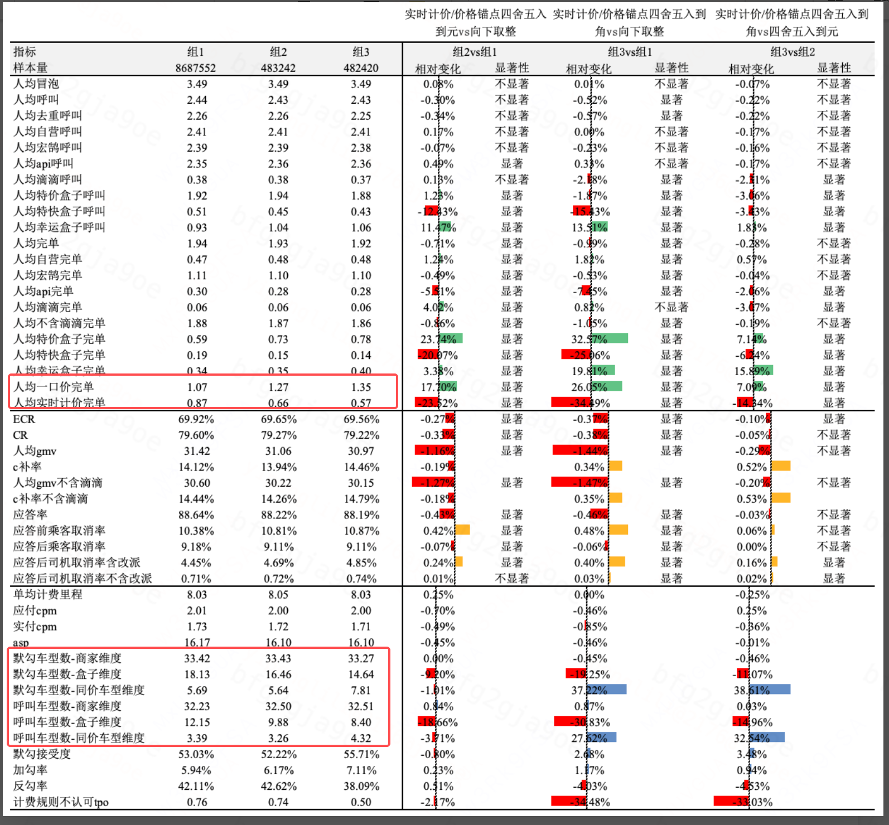

# 【LR26-019】乘客与增长-表单策略-表单价格取整能力补齐-V1.0

[Cooper 原文](https://cooper.didichuxing.com/knowledge/2199610335356/2208435863848)

## 基本信息

| 项目 <br> | 内容 <br> |
| --- | --- |
| BRD 文档链接 <br> | [【BRD】表单价格取整能力补齐](https://cooper.didichuxing.com/knowledge/2199610335356/2207382174451) <br> |
| 最后通过的策略方案链接 <br> | [【策略方案】表单价格取整能力补齐](https://cooper.didichuxing.com/knowledge/2199610335356/2207427700302) <br> |
| 实验链接 <br> | [车型数多 39 城](https://x.intra.hongyibo.com.cn/exp/487121744101377?globalBusinessId=120000&globalProjectId=330331944058881&expFlowTab=design)；[车型数中 48 城](https://x.intra.hongyibo.com.cn/exp/487138582200321?globalBusinessId=120000&globalProjectId=330331944058881&expFlowTab=design)；[车型数少其他城市](https://x.intra.hongyibo.com.cn/exp/487139037282305?globalBusinessId=120000&globalProjectId=330331944058881&expFlowTab=design) <br> |
| 实验/放量结论 <br> | [【P0复盘】表单价格取整能力补齐](https://cooper.didichuxing.com/knowledge/2199610335356/2208277781753)；[表单取整实验全国指标汇总](https://cooper.didichuxing.com/knowledge/2199610335356/2208194192960)；[表单价格取整实验复盘](https://cooper.didichuxing.com/docs2/document/2208097678963) <br> |
| 核心贡献点 <br> | 补齐实时计价“四舍五入到元”的价格取整与实验配置能力 <br> |
| 第一贡献人 <br> | 李一鹏 <br> |
| 共同贡献人 <br> | 周之烁 <br> |
| 后续策略负责人 <br> | 李一鹏 <br> |

## 一、背景

历史上，平台围绕表单价格取整和同价车型合并做过两轮核心实验：

- 2023 年表单价格取整实验：在尚未上线同价车型合并的前提下，对比“实时计价四舍五入到角 / 四舍五入到元 / 向下取整到元”，结论是“向下取整到元”组人均完单显著提升。

- 2024 年同价车型合并 + 价格取整联动实验：结论是“一口价向上取整到角，实时计价向下取整到元，且同价车型合并”收益最高，该组已固化为当前线上主流量策略。

在同价车型合并已全量的当前供需环境下，平台原先缺少“实时计价四舍五入到元”的工程配置能力，导致两个问题：

- 无法在统一实验框架下复验“实时计价向下取整到元 / 四舍五入到元 / 四舍五入到角”的真实影响。

- 无法支撑后续在客诉、合规或展示一致性诉求下，灵活切换或保留多种实时计价取整方式。

因此，本次需求一方面补齐实时计价四舍五入到元的基础能力，另一方面基于当前供需环境重做一期实验，判断四舍五入方案相较当前主流量的规模折损和体验收益是否可接受。

## 二、目标 & 约束

- 目标：TPO（下降） 

- 约束：人均完单（不下降）

若同时满足目标与约束，则可扩量；若满足目标不满足约束，则作为基础能力，于特定场景切换；否则下线

### 2.1 策略目标

本次目标不是直接将四舍五入方案替换为主流量，而是完成两类决策：

1. 能力侧：补齐实时计价“四舍五入到元 / 四舍五入到角 / 向下取整到元”三类取整方式在同价车型合并框架下的实验与上线能力。

2. 策略侧：在同价车型合并前提一致的情况下，对比三种实时计价取整方式对平台规模、转化、收益和体验的影响，并判断是否可以推广四舍五入方案。

该目标属于基础能力建设 + 线上策略决策，不直接对应单一 DDO 指标；实验以人均完单、人均 GMV、ECR、CR、TPO 等指标综合判断。

### 2.2 约束与观察指标

核心约束：

- 若四舍五入方案带来明显规模或收益折损，不建议作为主流量替换方案。

- 若四舍五入方案在 TPO 或用户体验侧有稳定收益，可作为客诉/合规敏感场景的备选能力保留。

核心指标：

- 一级指标：TPO、人均完单。

- 观察指标：人均 GMV、ECR、CR、人均冒泡/呼叫、TR/毛利率、C 补率/人均 C 补、应答率、应答前/后取消率、默勾接受度、加勾率、反勾率、价格锚点水位、同价车型合并率、展示车型数量。

## 三、技术方案

本次方案在保持同价车型合并框架不变的前提下，补齐实时计价新的取整方式，并让实验配置贯穿预估、等应答和默勾/同价车型合并链路。

### 3.1 取整能力补齐

新增实时计价“四舍五入到元”取整类型：

```Go
const (
    InnerPriceRoundTypeNone      = 0 // 无取整
    InnerPriceRoundTypeRound     = 1 // 四舍五入到角
    InnerPriceRoundTypeCeil      = 2 // 向上取整到角
    InnerPriceRoundTypeFloor     = 3 // 向下取整到元
    InnerPriceRoundTypeRoundYuan = 4 // 四舍五入到元，本次新增
)
```

边界 case 统一处理：

- 四舍五入到角：非 0 价格若取整后为 0，则强制展示为 0.1 元。

- 四舍五入到元：非 0 价格若取整后为 0，则强制展示为 1 元。

- 向下取整到元：非 0 价格若取整后为 0，则强制展示为 1 元。

### 3.2 实验开关与分组映射

新增灰度主开关 `kf_new_price_handle_experiment_ab_toggle`，通过参数 `experiment_name` 动态选择具体实验名称；若主开关关闭或未命中实验，回退历史线上逻辑。

| 组别 <br> | 角色 <br> | 一口价 <br> | 实时计价 <br> | 价格锚点 <br> | 同价车型合并 <br> |
| --- | --- | --- | --- | --- | --- |
| 组 1 <br> | 对照组，当前主流量 <br> | 向上取整到角 <br> | 向下取整到元 <br> | 向下取整到元 <br> | 是 <br> |
| 组 2 <br> | 实验组 A，新能力验证 <br> | 向上取整到角 <br> | 四舍五入到元 <br> | 四舍五入到元 <br> | 是 <br> |
| 组 3 <br> | 实验组 B，历史组 E 复验 <br> | 向上取整到角 <br> | 四舍五入到角 <br> | 四舍五入到角 <br> | 是 <br> |

### 3.3 涉及模块

本次涉及多模块协作：

- API 侧：支持实时计价四舍五入到元的取整能力。

- dups 侧：构造价格列表时按 API 传入方式进行取整，并与同价车型合并逻辑联动，供平台联合决策策略使用。

- Athena 侧：适配取整逻辑，支撑预估表单和应答表单的默勾策略。

- pre-sale-go：在预估链路、等应答预估链路中传递和执行价格策略数据。

- transaction：在等应答轮询与加价快走相关价格展示中执行对应取整逻辑。

本次技术方案相较策略方案无实质目标变更，实际实现与 BRD/策略方案保持一致：补齐能力、上线实验、用实验结果决定是否切换主流量。

## 四、实验结果/评估结果

### 4.1 实验方案

| 项目 <br> | 内容 <br> |
| --- | --- |
| 实验方式 <br> | 冒泡页 pid 在线分流，乘客 AB <br> |
| 实验周期 <br> | 2026-05-16 至 2026-05-22，共 1 周 <br> |
| 覆盖场景 <br> | 花小猪端表单策略，覆盖预估表单和应答表单 <br> |
| 分流策略 <br> | 组 1 90%，组 2 5%，组 3 5% <br> |
| 城市范围 <br> | 按车型数分为三组城市框：车型数多 39 城、车型数中 48 城、车型数少其他城市 <br> |
| 是否联动实验 <br> | - API <br><br>- dups <br><br>- Athena <br><br> |
| 评估人/数据来源 <br> | DS 实验复盘、评估大师自动评估 <br> |

样本量：

| 城市框 <br> | 组 1 <br> | 组 2 <br> | 组 3 <br> |
| --- | ---: | ---: | ---: |
| 车型数多 39 城 <br> | 8,687,552 <br> | 483,242 <br> | 482,420 <br> |
| 车型数中 48 城 <br> | 3,394,669 <br> | 188,886 <br> | 188,830 <br> |
| 车型数少其他城 <br> | 2,491,772 <br> | 137,947 <br> | 138,383 <br> |
| 全国合计 <br> | 14,573,993 <br> | 810,075 <br> | 809,633 <br> |

### 4.2 全国核心结论

由于实验在三个城市框分别开启，以下全国结论为加权结果；全国显著性未重新合成，显著性判断以城市框实验结果为主。

| 指标 <br> | 组 1：向下取整到元 <br> | 组 2：四舍五入到元 <br> | 组 3：四舍五入到角 <br> | 组 2 vs 组 1 <br> | 组 3 vs 组 1 <br> |
| --- | ---: | ---: | ---: | ---: | ---: |
| 人均完单 <br> | 1.7286 <br> | 1.7139 <br> | 1.7114 <br> | -0.85% <br> | -0.99% <br> |
| 人均 GMV <br> | 27.5531 <br> | 27.1766 <br> | 27.1381 <br> | -1.37% <br> | -1.51% <br> |
| ECR <br> | 68.72% <br> | 68.39% <br> | 68.38% <br> | -0.33pp <br> | -0.34pp <br> |
| CR <br> | 77.45% <br> | 77.11% <br> | 76.96% <br> | -0.34pp <br> | -0.49pp <br> |
| 人均一口价完单 <br> | 0.9027 <br> | 1.0645 <br> | 1.1398 <br> | +17.92% <br> | +26.26% <br> |
| 人均实时计价完单 <br> | 0.8259 <br> | 0.6495 <br> | 0.5716 <br> | -21.36% <br> | -30.79% <br> |
| 默勾接受度 <br> | 53.07% <br> | 52.32% <br> | 55.32% <br> | -0.75pp <br> | +2.25pp <br> |
| 加勾率 <br> | 5.67% <br> | 5.92% <br> | 6.73% <br> | +0.25pp <br> | +1.06pp <br> |
| 反勾率 <br> | 42.26% <br> | 42.72% <br> | 38.83% <br> | +0.46pp <br> | -3.44pp <br> |
| 计费规则不认可 TPO（万单） <br> | 0.7546 <br> | 0.6482 <br> | 0.5413 <br> | -14.10% <br> | -28.27% <br> |

结论：

- 组 2“四舍五入到元”相较当前主流量，整体规模下降：==计费规则不认可 TPO 下降 **14.10%****，**人均完单 **-0.85%**==；人均 GMV -1.37%、ECR -0.33pp、CR -0.34pp。

- 组 3“四舍五入到角”相较当前主流量，规模折损更大：==计费规则不认可 TPO 下降 **28.27%****，**====体验侧改善更明显，人均完单 **-0.99%**==；人均 GMV -1.51%、ECR -0.34pp、CR -0.49pp。

- 组 3 相较组 2，规模和转化进一步走弱，但 TPO 继续下降 16.50%，说明取整粒度越细，计费规则不认可类投诉越少。

### 4.3 城市框显著性与一致性

车型数多 39 城：

- 组 2 vs 组 1：人均完单显著 -0.71%，GMV 显著 -1.16%，ECR 显著 -0.27pp，CR 显著 -0.33pp。

- 组 3 vs 组 1：人均呼叫显著 -0.52%，人均完单显著 -0.99%，GMV 显著 -1.44%，ECR 显著 -0.37pp，CR 显著 -0.38pp。

车型数中 48 城：

- 组 2 vs 组 1：人均呼叫显著 -0.58%，人均完单显著 -1.06%，GMV 显著 -1.76%，ECR 显著 -0.43pp，CR 显著 -0.37pp。

- 组 3 vs 组 1：人均完单显著 -0.94%，GMV 显著 -1.41%，ECR 显著 -0.22pp，CR 显著 -0.57pp。bu

车型数少其他城市：

- 组 2 vs 组 1：人均呼叫显著 -0.83%，人均完单显著 -1.48%，GMV 显著 -2.23%，ECR 显著 -0.47pp，CR 显著 -0.45pp。

- 组 3 vs 组 1：冒泡显著不平（+0.74%），人均完单显著 -1.08%，GMV 显著 -2.10%，ECR 显著 -0.37pp，CR 显著 -0.85pp。

整体看，三个城市框方向基本一致：当前主流量“实时计价向下取整到元”在 ECR、CR、完单和 GMV 上更优；四舍五入方案在 TPO/用户解释成本上更优。

### 4.4 收益链路归因

本次实验的核心 trade-off 是“规模收益”与“计费规则解释成本”之间的取舍。取整粒度变细降低解释成本。四舍五入到元/角相较向下取整，在计费规则不认可 TPO 上分别下降 14.10% 和 28.27%，说明用户对更贴近真实价格的展示方式接受度更高，价格解释成本更低。

### 4.5 与历史结论一致性

本次结论与 2023 年价格取整实验、2024 年同价车型合并 + 价格取整实验方向一致：

- 在规模和转化效率上，实时计价向下取整到元仍然最优。

- 在用户体验和计费规则解释成本上，取整粒度越细，TPO 越低。

- 在同价车型合并前提下，四舍五入方案不会直接带来主流量规模收益，适合作为可选能力沉淀，而不是全量替换当前策略。

## 五、放量决策

待 LR 通过后填写

|  <br> |  <br> | 预期扩量时间节奏 <br> | 实际扩量时间 <br> | 放量暂停点详情 <br> | 放量暂停点效果评估 <br> | 是否需要设置长期对照组（默认不需要，此列无需填写） <br> |
| --- | --- | --- | --- | --- | --- | --- |
|  <br> |  <br> |  <br> | LR通过后，根据实际情况，填写这3列 <br> |  <br> |
| 放量决策意见 <br> | 决策人 <br> | 周之烁 <br> | —— <br> | —— <br> | —— <br> | —— <br> |
| 决策意见： <br>- 通过 <br><br>- 不通过，给出原因 <br><br>- 扩大流量实验 <br><br> | 通过 <br> |  <br> |  <br> |  <br> |  <br> |
| 放量需要周知的利益相关方 <br> | 没有的话，无需填写 <br> | —— <br> | —— <br> | —— <br> | —— <br> | —— <br> |
| 放量策略 <br> | eg. 实验组1 <br>放量组收益 <br> | 「向下取整到元」组 <br> | —— <br> | —— <br> | —— <br> | —— <br> |

## 六、引用和鸣谢

引用：

- [【BRD】表单价格取整能力补齐](https://cooper.didichuxing.com/knowledge/2199610335356/2207382174451)

- [【策略方案】表单价格取整能力补齐](https://cooper.didichuxing.com/knowledge/2199610335356/2207427700302)

- [【P0复盘】表单价格取整能力补齐](https://cooper.didichuxing.com/knowledge/2199610335356/2208277781753)

- [表单取整实验全国指标汇总](https://cooper.didichuxing.com/knowledge/2199610335356/2208194192960)

- [表单价格取整实验复盘](https://cooper.didichuxing.com/docs2/document/2208097678963)

- [【聚合行前】价格取整能力补齐](https://cooper.didichuxing.com/knowledge/2199610335356/2207553902727)

- [表单价格取整长周期实验评估](https://cooper.didichuxing.com/docs2/document/2201320738393)

- [同价车型合并评估](https://cooper.didichuxing.com/docs2/document/2202721130948)

鸣谢：

- 感谢交易引擎、价格引擎、聚合行前、Athena 等工程同学支持能力开发、联调和上线。

- 感谢 DS 同学支持实验设计、城市框拆分、全国指标加权汇总和复盘分析。

- 感谢业务和产品同学对价格展示、同价车型合并、TPO 等指标口径的确认。

## 七、后续规划

1. 短期保持当前主流量不变，不全量切换四舍五入到元/角。

2. 保留新取整能力和实验开关，作为后续客诉/合规敏感场景的可选策略能力。

## 八、补充分析

**Q：**补充“组 2 四舍五入到元”vs. "组 3 四舍五入到角"的效果差异分析

**A：**

组 3 相比组 2 人均完单和人均 GMV 均有折损，推测原因为：

1. **展示车型数增加**

组 3 是「实时计价/价格锚点四舍五入到角」，价格粒度比组 「四舍五入到元」更细。价格粒度变细后，同价合并的结果会变化：同一盒子/同一商家下，价格被拆得更细，同价车型维度的展示数量上升。组 3 vs 组 2：`默勾车型数-同价车型维度 +38.61%` ；组 3 vs 组 2：`呼叫车型数-同价车型维度 +32.54%` 。所以这里的“展示车型数增加”，更准确地说是：**同价车型维度被拆得更细，用户看到/可选择的同价车型粒度增加**。

2. **DSAR/价格锚点：车型粒度增加时，DSAR 下降 -> 平台联合决策会给出较低的价格锚点**



联合决策策略中，DSAR 作为“默勾接受度”参与价格锚点决策。策略会枚举不同 `price_list` 和默勾锚点，分别预测 DSAR 与累计完单能力，并基于目标函数选择最优折扣组合和默勾锚点。根据联合决策文档，DSAR 特征中包含 `product_cnt`，即最终展示车型个数，盒子算一个，同价车型合并后也算一个；同时还包含展示价格序列等特征。

本次组 3 展示粒度变细后，在商家数量、供给规模相近的情况下，同样的需求承接能力被分摊到更多展示车型上，导致 `product_cnt` 和价格序列形态相对 DSAR 训练时的组 1 线上展示形态发生偏移。模型可能会把“展示车型更多、单个展示项承载更少”的形态识别为用户对较小默勾集合接受度更高，从而在较小价格锚点上给出相对偏乐观的 DSAR 预测。

因此，联合决策在求解时更容易选择偏小的价格锚点 。



3. **盒子维度默勾车型数减少**

价格锚点偏低后，能被有效默勾上的盒子维度车型减少。

- 组 3 vs 组 2：`默勾车型数-盒子维度 -11.07%` 。

这说明组 3 虽然同价车型维度展示更多，但落到盒子维度，实际被默勾的有效车型反而减少了。

4. **盒子维度呼叫车型数减少**

组 3 留下来的默勾更容易被接受，但默勾覆盖的盒子维度变少，整体可转化的呼叫车型数下降。

- 组 3 vs 组 2：`呼叫车型数-盒子维度 -14.96%` 

- 组 3 vs 组 2：`默勾接受度 +3.48pp` 

6. **成交率下降**

由于盒子维度呼叫车型数减少，导致完单能力下降，进而导致组 3 相对于组 2 成交率下降。

7. **实时计价完单下降**

盒子维度有效呼叫减少后，实时计价完单下降。一部分实时计价能力被削弱后，完单向一口价迁移，但一口价的完单增长没有补回实时计价的损失。

8. **人均完单、人均 GMV 下滑**

最后传导到总完单和 GMV：

- 组 3 vs 组 2：`人均完单 -0.28%`

- 组 3 vs 组 2：`人均 GMV -0.29%`

- `ASP -0.01%`，基本不变

所以 GMV 下滑主要不是单均价格变低，而是完单下降导致的。

最终组 3 相对于组 2 完单&GMV 负向链路可以表达为：

- DSAR 预测值偏大 -> 联合决策决策的价格锚点偏小 -> 默勾车型数较小 ->「默勾车型数-盒子维度」减少（**==勾选效率降低==**） -> 「呼叫车型数-盒子维度」减少 -> 成交率下降 -> 完单能力下降 -> 完单折损、GMV 折损

**Q**：如果组 3 的 DSAR 预测不存在偏移问题，平台联合决策可以给出正确的价格锚点，可以恢复组 3 的完单折损吗？

**A**：不能，因为组 3 的 ECR 本来就低于其他两组，在其他条件相同下仍然无法恢复完单折损

**Q**：请补充表单最低实付价 / 滴滴特惠价 和 默勾价格锚点 / 滴滴特惠价比值（**比值的平均，对于没有滴滴特惠的样本的不计入统计**）

**A**：

- 车型数多-39数（GMV占比67.8%）

| 组别 <br> | 最低实付价 / 滴滴特惠价 <br> | 默勾价格锚点 / 滴滴特惠价比值 <br> |
| --- | --- | --- |
| 组 1 <br> | 0.6563 <br> | 0.9078 <br> |
| 组 2 <br> | 0.6564 <br> | 0.9019 <br> |
| 组 3 <br> | 0.6569 <br> | 0.8929 <br> |

- 车型数中-48城（GMV占比21.7%）

| 组别 <br> | 最低实付价 / 滴滴特惠价 <br> | 默勾价格锚点 / 滴滴特惠价比值 <br> |
| --- | --- | --- |
| 组 1 <br> | 0.6556 <br> | 0.9469 <br> |
| 组 2 <br> | 0.6545 <br> | 0.9416 <br> |
| 组 3 <br> | 0.6639 <br> | 0.9465 <br> |

- 车型数少-其他城市（GMV占比10.5%）

| 组别 <br> | 最低实付价 / 滴滴特惠价 <br> | 默勾价格锚点 / 滴滴特惠价比值 <br> |
| --- | --- | --- |
| 组 1 <br> | 0.6930 <br> | 1.0186 <br> |
| 组 2 <br> | 0.6925 <br> | 1.0155 <br> |
| 组 3 <br> | 0.6934 <br> | 0.9999 <br> |

附完整分析指标：


