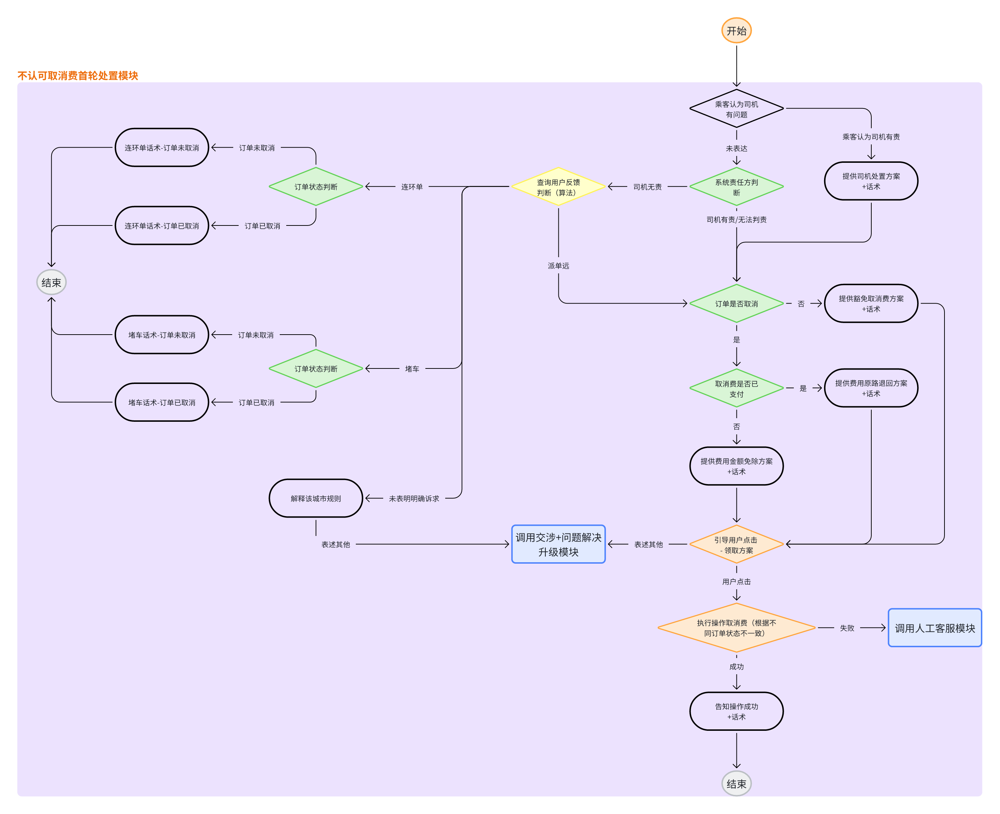
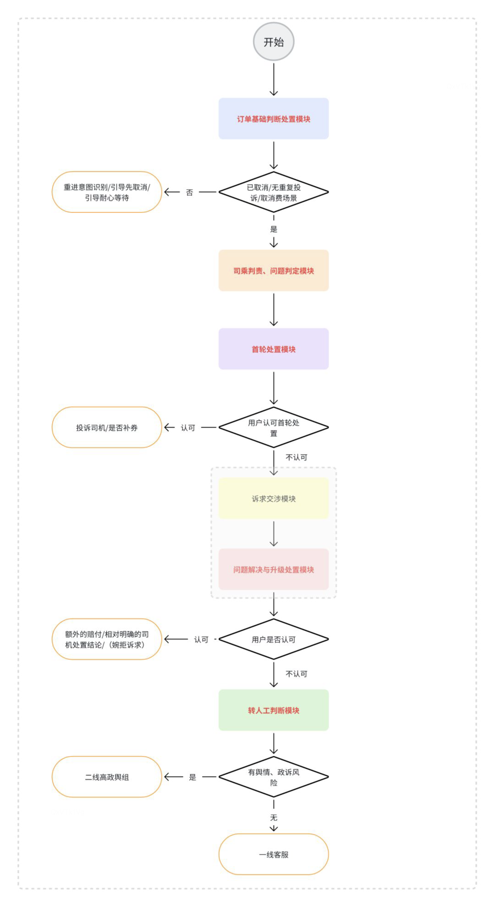
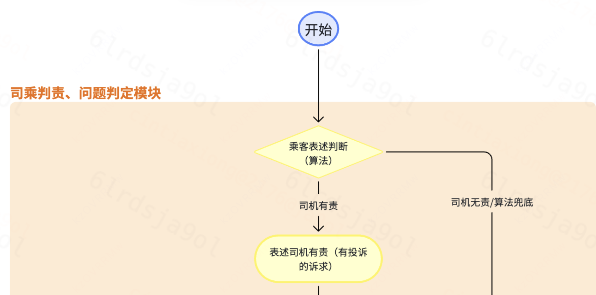
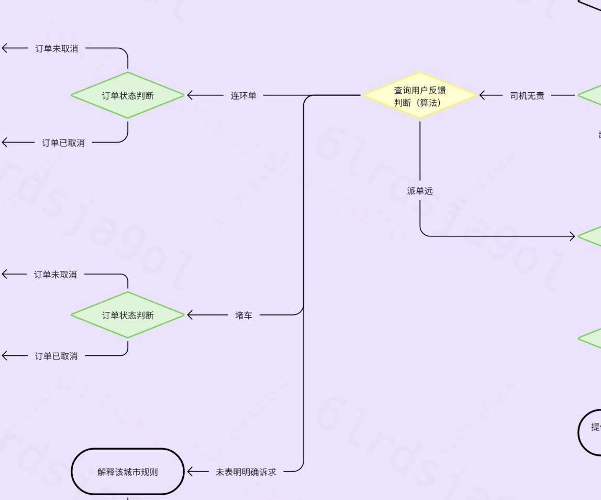
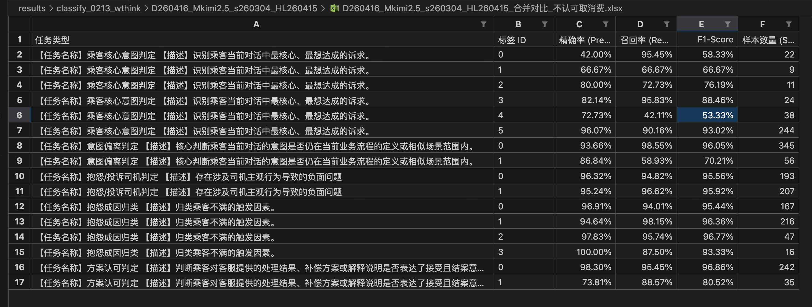
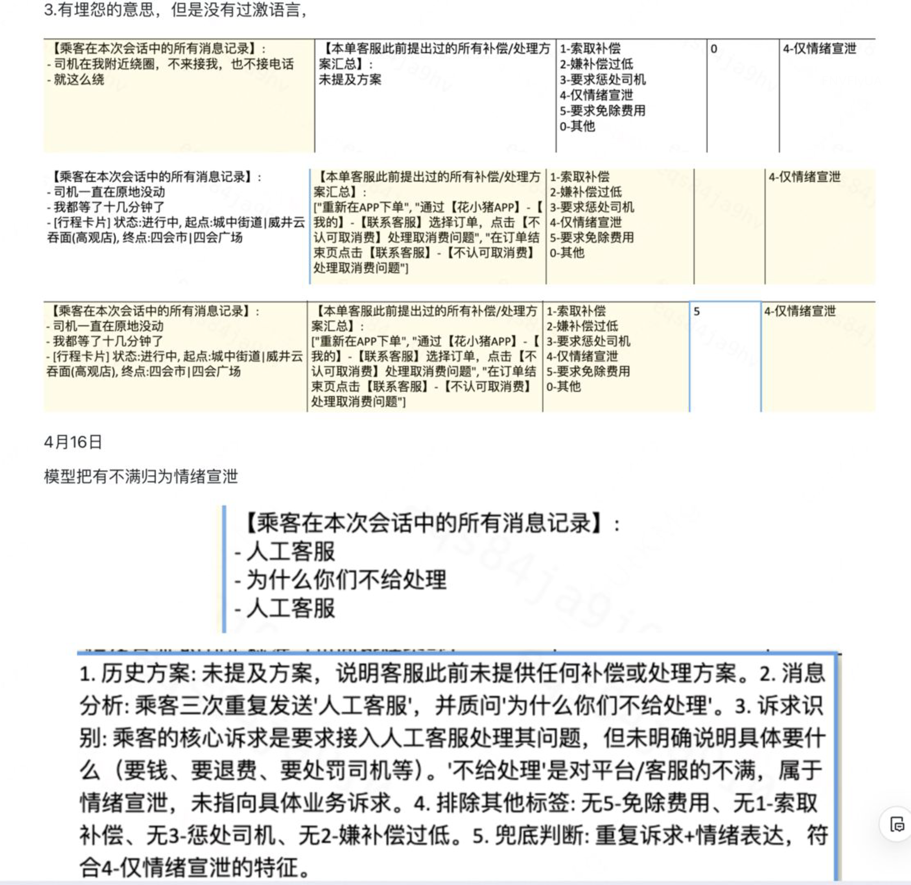

# 【LR26-021】创新策略-智能客服-取消场景大模型节点-V1.0

[Cooper 原文](https://cooper.didichuxing.com/knowledge/2199610335356/2207805562793)

# 基础信息

| brd文档链接 <br> | [【BRD】不认可取消费+司机不来接大智能解决方案](https://cooper.didichuxing.com/docs2/document/2206473751294) <br> |
| --- | --- |
| 最后通过的策略方案链接 <br> | [不认可取消费&司机不来接我--大模型节点--策略方案评审](https://cooper.didichuxing.com/knowledge/2199610335356/2206732413470) <br> |
| 实验链接 <br> | [https://ab.intra.hongyibo.com.cn/launch/1397/normal/76401](https://ab.intra.hongyibo.com.cn/launch/1397/normal/76401) <br> |
| 核心贡献点 <br> | SFT 蒸馏显著减少线上耗时； <br> |
| 第一贡献人 <br> | 熊薪叶 <br> |
| 共同贡献人 <br> | 门畅、方舟、叶舟、翔宇、新杰、荣纯、鑫然以及其他业务老师、赵辉 <br> |
| 后续策略负责人 <br> | 熊薪叶 <br> |

# 1. 背景与挑战

## 1.1 背景

- **背景：**当前hxz智能客服机器人核心识别逻辑基于“正则表达式”。虽然能覆盖固定表达，但在处理真实复杂的乘客对话时：

	- **语义理解能力弱：** 难以应对跳跃式表达、多诉求混说及情绪化文本。

	- **上下文缺失：** 缺乏对会话历史的序列建模，导致确实对话上下文。

	- **业务影响：** 识别准确率低、泛化能力弱，直接导致用户满意度低，转人工率高，客服人力成本高。

- **目标**：通过大语言模型迭代识别能力

	- **落地场景**：智能客服一期聚焦“不认可取消费”、“司机不来接我”两个高频进线场景。

	- **分类节点**：为了安全性，不直接生成回复，而是作为“判断型节点”嵌入到SOP流程中：识别乘客当前处于哪个业务意图、是否仍在当前 SOP、是否接受方案、是否在抱怨司机，以及不满成因和核心诉求，驱动解释、赔付、处罚、转人工等动作。

- **任务**：微调大模型做理解乘客意图的分类任务。

> 如下图中的==查询用户反馈判断==节点（浅黄色菱形框），就是根据大模型的输出（**派单远、堵车、连环单、其他**）作为条件节点决定下一个步骤是什么。



> 链接：[司机不来接我+不认可取消费 - 智能客服流程](https://cooper.didichuxing.com/docs2/document/2206543104714)密码：964902

> 文件名称：不认可取消费话术库 链接：https://cooper.didichuxing.com/docs2/sheet/2206100437903 密码：552860

> ==文件名称：04 扩展话术库-不认可取消费 链接：==[04 扩展话术库-不认可取消费](https://cooper.didichuxing.com/knowledge/2199610335356/2206201759263) ==密码：127433==

## 1.2  技术挑战

- **乘客输入复杂**：乘客表达顺序极不稳定，同一句里经常同时包含退费、抱怨、投诉、催促等多种信号

- **分类标准**：标签体系要同时支撑人工标注、teacher 打标和 student 微调。从已有方案文档和代码实现来看，真正困难的不是“能不能输出一个标签”，而是**复杂边界定义是否稳定**，例如“仅情绪宣泄”和“其他”的区分、“费用异议”和“补偿诉求”的区分、“投诉司机”和“只是描述司机状态”的区分，以及“偏离当前 SOP”和“仍在当前问题延展”之间的判断。

- **输出稳定**：输出要可解析、在线延迟要可控、离在线特征要一致

# 2 目标 & 约束<!--评论:[{"u":"zhuzhengdan","c":"本篇和【LR26017】创新策略-智能客服-意图识别-V1.0 的关系是？"},{"u":"cintiaxiong","c":"是意图识别路由到的下游场景"}] -->

- **落地场景转人工率：20%**

	- **目标口径：**命中知识点转人工量/指定知识点咨询量

	- **测算逻辑：**调研目前高德取消费场景转人工率15%，~~当前小猪侧不认可取消费场景转人工率60%~~<!--评论:[{"u":"zhuzhengdan","c":"这和下面的数据似乎对不上？"},{"u":"cintiaxiong","c":"BRD里面业务方写的是当前小猪侧不认可取消费场景转人工率60%，但根据后面的AB实验来看，全场景对照组的转人工率39.4%，取消场景对照组转人工率为21.8%"},{"u":"cintiaxiong","c":"1、因为当时立项的时候我们拆分了平台场景和商家场景，平台场景已经全量开量，转人工率62%。商家场景还没开量，拿不到Xbot的准确数据，不知道转人工率多少。当时大概拿了一下客服中心进商家电话的数据测算，算出来也是60%左右。就定的60%预估。 2、立项的时候是年初。实际上这个20%多（6月份数据），是在我们在Xbot智能客服上做了一些优化；例如：知识点的识别、客服中心推荐问题的改版、Xbot智能客服中解决方案的优化。"}] -->，一期目标设定中间值。

	- **注**：BRD里面业务方写的是~~当前小猪侧不认可取消费场景转人工率60%~~<!--评论:[{"u":"arkshifangzhou","c":"这个60%是业务的估算值，因为项目初期的时候，还没有全部宏鹄商家接入（只有30%接入）"}] -->，但根据后面的AB实验来看，全场景对照组的转人工率39.4%，取消场景对照组转人工率为**21.8%**

- **落地场景用户调研解决率：40%**

	- **目标口径：**用户基于取消费+司机不来接场景评价满意量/用户在取消费费+司机不来接场景的评价量

	- **注**：智能邀评的功能仍在开发中，还没有上线，预计6.29上线，6.30放量

- **节点准确率<!--评论:[{"u":"menchang","c":"除了节点准确率，没有时长的要求吗"}] -->：**

	- **二分类：90%**

	- **多分类：80%**

# 3. 技术方案

## 3.1 方案设计 

> [工程侧：智能客服技术方案](https://cooper.didichuxing.com/knowledge/2200004056890/2206370974397)

### 3.1.1 节点定位与总体架构

在线链路上，大模型节点被设计成流程中的语义分类节点。

- 上游输入当前 SOP 定义、乘客消息、客服最新方案和场景知识；

- 节点输出结构化标签；

- 下游 SOP 再根据标签决定走解释、赔付、处罚司机、转人工或继续追问的分支。这样既保留了业务流程的可控性，又把复杂语义理解从正则规则里抽离出来。

### 3.1.2 任务拆解

这五类任务覆盖了当前两个 SOP 中最关键的方向判断节点<!--评论:[{"u":"menchang","c":"这5个任务在当前sop中的哪个节点调用的，需要明确指出"},{"u":"cintiaxiong","c":"已加"}] -->。相比过去每新增一种分支就要继续堆规则和连线的做法，当前方案把语义判断收敛成统一的多任务节点框架，更适合后续扩展到新 SOP。

| **任务** <br> | **解决问题** <br> | **主要输入** <br> | **标签示例** <br> | **调用时刻** <br> |
| --- | --- | --- | --- | --- |
| 意图偏离判定 <br> | 判断乘客最新回复是否仍在当前 SOP 及其相似场景范围内。 <br> | 当前 SOP、最新乘客回复、相似/偏离场景、特殊规则 <br> | 0-有关 <br>1-偏离   <br> | 每一轮 <br> |
| 抱怨/投诉司机判定 <br> | 判断乘客矛头是否明确落到司机对象。 <br> | 乘客全量消息 <br> | 0-仅抱怨系统或外部原因 <br>1-抱怨投诉司机  <br> |  <br> |
| 方案认可判定 <br> | 判断乘客是否接受客服最后给出的处理结果或处理路径。 <br> | 客服最后一句、乘客最后一句 <br> | 0-未接受 <br>1-接受方案 <br> | 每一轮 <br> |
| 抱怨成因归类 <br> | 在派单远、堵车、连环单等原因中锁定最直接触发因素。 <br> | 乘客全量消息 <br> | 0-其他 <br>1-派单远 <br>2-堵车  <br>3-连环单 <br> |  <br> |
| 乘客核心意图判定 <br> | 识别当前最核心诉求：退费、补偿、处理司机、情绪宣泄等。 <br> | 历史客服方案、乘客全量消息 <br> | 0-其他 <br>1-索取补偿  <br>2-嫌补偿过低 <br>3-要求惩处司机 <br>4-仅情绪宣泄 <br>5-要求免除费用 <br> |  <br> |

### 3.1.3 输入与输出

- **输入：** 不输入整段对话，仅提取“高信号密度”字段（乘客最新消息、客服方案、场景知识）

	- 研究表明，输入质量远比长度重要。冗余客服安抚话术会稀释有效信号

	- 尽量不用客服的对话：一期客服对话会做大量改造，且拿不到乘客对大模型客服的反应，纯用乘客消息更能保持**离在线特征一致**。

	- 减少推理耗时

> 意图偏离判定从乘客最近5轮消息，变为“最新乘客回复”

- **输出（数字-标签制）：** 采用“数字-标签名称”（如 1-认可）而非纯数字。**JSON-only**

	- 相比纯数字/随机符号，语意标签显著降低了模型在微调与推理阶段的语义映射成本，利用模型预训练时对标签词的先验知识提升了分类准确度。

	- “数字+标签”而不是“纯语意标签”。**为了工程解析稳健**

> 大量研究和实践（[FLAN](https://arxiv.org/pdf/2109.01652) from Google etc.）支撑**语意标签（Semantic Lables）优于纯数字/随机符号**。1. **语义对齐**：小模型对语义的理解强于对抽象代号的记忆。在微调阶段，让模型输出 1-认可，它会利用预训练中对“认可”这个词的理解来辅助推理。如果只输出 1，模型必须硬生生记住这个 1 在这个任务里代表什么。且标签天然有分布偏差（Label Bias）, 语料库中的“1”出现频率可能天然比“2”高。2. **推理链（CoT）的顺承：** 当模型在 analysis 字段里推理出“乘客最后说了谢谢”，接着输出“认可”是一个语言学上的自然延续，在概率分布上自然对齐；而输出“1”是一个逻辑上的跨越，需要在Latent Space中做一次额外的映射转化。3. 提供 **Descriptive Labels（描述性标签）** 能显著降低微调时的 Loss 收敛难度。纯语义标签存在“一词多义”风险

```PlainText
Prompt Learning的开山之作
结论：将分类任务转换为填空任务时，选择具有明确语意的单词，效果远好于用无意义的符号。 
Automatic Verbalizer Search的步骤
1. 把分类任务转化为填空题
2. 候选词生成 (Candidate Generation)
利用一小部分已标注数据，让预训练模型在 [MASK] 位置预测概率最高的词。
比如在“司机不来接我”这个场景下，模型在 [MASK] 位置可能会输出“过失”、“责任”、“差劲”等词。这些词都会进入候选池。
3. 显著性评分 (Scoring / Likelihood Ratio)
AVS 不仅仅看某个词在特定标签下的频率，还要看它的区分度。
如果“问题”这个词在“司机有责”里出现很多，在“司机无责”里也出现很多，那么它就不是一个好的 Verbalizer。
AVS 会计算一个比率只有在 Label A 中概率远高于其他标签的词，才会被选中。
4. 自动构建映射 (Mapping)
最终，AVS 会选出一组最能代表标签语义的 Token。例如，它可能会发现对于“认可方案”这个标签，模型对单词 "OK" 或 "Sure" 的敏感度远高于 "Accepted"。
https://arxiv.org/pdf/2001.07676
Schick, Timo, and Hinrich Schütze. "Exploiting cloze-questions for few-shot text classification and natural language inference." Proceedings of the 16th conference of the European chapter of the association for computational linguistics: main volume. 2021.
```

## 3.2. 离线迭代

Prompt Engineering + 人工标注

离线模型迭代优化的大致流程包括：“真实会话抽样 -> teacher 批量打标 -> 上/下标签均衡采样 -> 规则回溯与人工对齐 -> student SFT-> student分类效果评测 -> 上线前延时等压测。

### 3.2.1 数据预处理

#### 3.2.1.1 数据集

数据源于历史人工客服真实会话，共有三个数据集，彼此没有数据交叉

| 数据集 <br> | 线上场景 <br> | 线上收集周期 <br> |
| --- | --- | --- |
| ALLSOP <br> | 全场景 <br> | 20260201-20260212 <br> |
| s260325_HL260417 <br> | ==客服记录标题为==“不认可取消费”、“司机不来接我”==的用户与客服交互的记录== <br> | 202603月 <br> |
| s260304_HL260512 <br> | 20260101-20260112 <br> |

#### **3.2.1.2 样本极不均衡**

根据“不认可取消费”和“司机不来接我”两个sop的线上真实对话，产出标注集。人工随机标注和大模型初判交叉验证说明样本类别分布极不均衡。

| 任务名称 <br> | **标签** <br> | **截止0226人工随机标注的部分，样本数量** <br> | **s260304_HL260512，样本数量** <br> |
| :---: | :---: | :---: | :---: |
| **不认可取消费** <br> | **司机不来接我** <br> | **不认可取消费** <br> | **司机不来接我** <br> |
| **人工** <br> | **llmv0224** <br> | **人工** <br> | **llmv0224** <br> | **llmv0224** <br> |
| 抱怨/投诉司机判定  <br> | 0 <br> | 31 <br> | 32 <br> | 0 <br> | 0 <br> | 993 <br> | 90 <br> |
| 1 <br> | 28 <br> | 27 <br> | 19 <br> | 19 <br> | 1129 <br> | 1124 <br> |
| 抱怨成因归类  <br> | 0 <br> | 49 <br> | 49 <br> | 19 <br> | 19 <br> | 1839 <br> | 1186 <br> |
| 1 <br> | 8 <br> | 8 <br> | 0 <br> | 0 <br> | 209 <br> | 10 <br> |
| 2 <br> | 0 <br> | 0 <br> | 0 <br> | 0 <br> | 51 <br> | 3 <br> |
| 3 <br> | 2 <br> | 2 <br> | 0 <br> | 0 <br> | 23 <br> | 15 <br> |
| 乘客核心意图判定  <br> | 0 <br> | 9 <br> | 10 <br> | 16 <br> | 11 <br> | 181 <br> | 560 <br> |
| 1 <br> | 0 <br> | 0 <br> | 0 <br> | 0 <br> | 40 <br> | 40 <br> |
| 2 <br> | 0 <br> | 0 <br> | 0 <br> | 0 <br> | 16 <br> | 27 <br> |
| 3 <br> | 0 <br> | 0 <br> | 3 <br> | 2 <br> | 27 <br> | 209 <br> |
| 4 <br> | 2 <br> | 4 <br> | 0 <br> | 3 <br> | 37 <br> | 291 <br> |
| 5 <br> | 48 <br> | 45 <br> | 0 <br> | 3 <br> | 1821 <br> | 87 <br> |
| 方案认可判定  <br> | 0 <br> | 58 <br> | 55 <br> | 19 <br> | 19 <br> | 2045 <br> | 1186 <br> |
| 1 <br> | 1 <br> | 4 <br> | 0 <br> | 0 <br> | 77 <br> | 28 <br> |
| 意图偏离判定  <br> | 0 <br> | 60 <br> | 59 <br> | 18 <br> | 22 <br> | 2535 <br> | 1186 <br> |
| 1 <br> | 58 <br> | 59 <br> | 20 <br> | 16 <br> | 1708 <br> | 1242 <br> |

所以综合当时的标注人力，和标签数量，用大模型初筛的结果，每个任务的每个标签下采样了200个case。因为意图偏离任务后面重构过，此时标注人力充足，所以下采样了约3000个case.

值得注意的是，这里的“意图偏离判定”的分布，指导业务方把相关/偏离的标准定得更宽松，避免不停打断乘客的对话流。

在产出微调数据的时候进行重采样，将少于2000个case的Label**上采样到2000个，下采样到8000个**

```PlainText
{
  "input": "finetune/data/compact_labelOnly_s0325AndAllSOP_0513/all_teacher_label_only_sft.jsonl",
  "output_dir": "finetune/data/compact_labelOnly_s0325AndAllSOP_0513_balanced",
  "output": "finetune/data/compact_labelOnly_s0325AndAllSOP_0513_balanced/all_teacher_label_only_sft.jsonl",
  "dropped_unparsed": 0,
  "target_per_group": null,
  "min_per_group": 2000,
  "max_per_group": 8000,
  "before": {
    "乘客核心意图判定::0-其他": 4877,
    "乘客核心意图判定::1-索取补偿": 420,
    "乘客核心意图判定::2-嫌补偿过低": 371,
    "乘客核心意图判定::3-要求惩处司机": 979,
    "乘客核心意图判定::4-仅情绪宣泄": 5052,
    "乘客核心意图判定::5-要求免除费用": 6304,
    "意图偏离判定::0-有关": 31050,
    "意图偏离判定::1-偏离": 4964,
    "抱怨/投诉司机判定::0-仅抱怨系统/外部原因/未抱怨": 10954,
    "抱怨/投诉司机判定::1-抱怨投诉司机": 7050,
    "抱怨成因归类::0-其他": 17262,
    "抱怨成因归类::1-派单远": 287,
    "抱怨成因归类::2-堵车": 161,
    "抱怨成因归类::3-连环单": 294,
    "方案认可判定::0-未接受": 17779,
    "方案认可判定::1-接受方案": 228
  },
  "after": {
    "乘客核心意图判定::0-其他": 4877,
    "乘客核心意图判定::1-索取补偿": 2000,
    "乘客核心意图判定::2-嫌补偿过低": 2000,
    "乘客核心意图判定::3-要求惩处司机": 2000,
    "乘客核心意图判定::4-仅情绪宣泄": 5052,
    "乘客核心意图判定::5-要求免除费用": 6304,
    "意图偏离判定::0-有关": 8000,
    "意图偏离判定::1-偏离": 4964,
    "抱怨/投诉司机判定::0-仅抱怨系统/外部原因/未抱怨": 8000,
    "抱怨/投诉司机判定::1-抱怨投诉司机": 7050,
    "抱怨成因归类::0-其他": 8000,
    "抱怨成因归类::1-派单远": 2000,
    "抱怨成因归类::2-堵车": 2000,
    "抱怨成因归类::3-连环单": 2000,
    "方案认可判定::0-未接受": 8000,
    "方案认可判定::1-接受方案": 2000
  }
}
```

### 3.2.2 Prompt工程与人工标注标准迭代

Prompt工程与人工标注是双向驱动的关系：最初通过和产品沟通任务节点在流程中的作用，定义标注规则。再通过标注反馈，迭代定义标准。针对反复无法对齐的结果，思考方案和标准是否合理，是否改方案。不只是提高单次评测分数，而是把业务语义从口头经验沉淀成可以复用的任务规则。

#### 3.2.2.1 标注对齐与标准进化

- **标注偏差攻坚：** 初始阶段发现不同标注人员对同一对话的感知识别存在程度差异（如情感判断的强弱）。为此，会反复进行“交叉比对-反馈-修正”：定期对比标注结果与标准文档，找出反复无法对齐的模糊地带，倒逼标注方案的合理性升级。

- **动态修正机制：** 标注标准并非一成不变，而是根据模型在线下评测中的误判点持续回收与修正：

	- **优先级确立：** 在多因场景下，明确逻辑优先级（如：派单远 > 堵车 > 连环单），确保标签唯一性。

	- **边界清晰化：** 针对 `is_currentSOP`（意图偏离）。1. 补充构建相似场景、偏离场景及交叉场景的负样本与边界样本。2. 从上车前/后，拆分/合并二级场景到相似场景、偏离场景。取消交叉场景

- 为了帮助标注人员快速对比模型和人工的差距，找出模型/人工标注不合理的地方，在这个阶段，模型在输出Lable以外，还会输出“analysis"，总结输出该Lable的原因

#### 3.2.2.2 高频混淆点

针对标注与识别中的高频混淆点：

- **情感判定模糊（“仅情绪宣泄” vs “其他”）：**

	- **问题**：情感判断主观性强，模型随机性导致准确率有 5%-7% 的波动。

	- **方案：** 在标准中明确罗列“激烈情感词”和“严重Case”的判定准则，将主观感知转化为客观词汇匹配与程度限定，提高判断的确定性。



- **意图偏离幻觉：**

	- **问题：** 模型在对照场景定义判断乘客消息时，容易产生逻辑幻觉。

	- **方案：** **优化思维链（CoT）**。通过改变模型的推理顺序和逻辑步，引导模型先分析事实再输出结论，降低幻觉率。人工也按照这个思维链来标注。

```Python
        "is_currentSOP": {
        "name": "意图偏离判定",
        "desc": "判断乘客最新一轮回复是否仍在处理当前SOP；若已超出当前SOP，且能稳定归到偏离场景，则判偏离。",
        "options": "1-偏离, 0-有关",
        "logic": f"""
判定目标：
判断乘客最新回复是否仍在处理当前SOP，不是判断它是否和订单泛泛相关。

判定顺序：
1. 先看是否属于无效切换：
- 转人工、催回复、问号、行程卡片、简短确认、辱骂闲聊，判 0。

2. 再看是否仍属于当前SOP或相似场景：
- 当前SOP=司机不来接我：只认接驾前/接驾时问题，以及失败接驾直接导致的取消费、未乘车收费、扣钱争议。
- 当前SOP=不认可取消费：只认为什么这笔取消费不该收，以及怎么处理这笔取消费。

3. 如果不属于当前SOP/相似场景，再看能否稳定归到偏离场景：
- 能明确归到 deviation_scenarios 或其同义表达，判 1。
- 在当前两个SOP下，优惠券、免单、红包、优惠活动问题，默认归到“优惠卷问题/平台活动问题”，判 1。
- 但“拒绝用券补偿”仍判 0。

4. 如果既不属于当前SOP/相似场景，又不能稳定归到偏离场景，判 0。
- 不要因为像新问题就机械判 1。
- 只有能找到更合适的偏离场景，才判 1。

补充要求：
- 多意图里只要有一个子意图能稳定归到偏离场景，整体判 1。
- 如果乘客复制了客服的话，也按这段话本身的业务内容来解析，不直接因为是客服话术就判 0。
- 不要只因为出现“费用/优惠券/目的地/微信”等词就机械判。
- 对明显错字按最自然业务含义理解。
""",}
```

#### 3.2.2.3 Prompt 模式

根据业务需求，设计了三套（Standard, Compact, Fast) 标准化的 Prompt 模式，以兼顾效果分析与在线性能. 但因为Compact模式已经能达到很快的速度，就不考虑牺牲准确率的Fast模式了。

在做Prompt工程的主要工作量都是在Standard上做的，一开始是人工在调。后面由于工作量太大就交给了模型。为了提高耗时缩短Prompt长度，从Standard中抽象出了主要规则成为Compact.

| 模式 <br> | 特点 <br> | 适用场景 <br> |
| --- | --- | --- |
| **Standard** <br> | 规则最完整，包含详尽定义与复杂推理。 <br> | 离线最好效果、Teacher打标、辅助人工回溯。 <br> |
| **Compact ** <br> | 保留核心规则与关键 Few-shot，平衡效果与长度。由Standard模式压缩。 <br> | **训练与线上调用的主选方案**。 <br> |

```Python
    
def generate_classification_prompt(config, context_dict):

    # 2. 组装当前输入数据 (Current Task Input)
    input_data_str = ""
    # 注意：此时 config["task_input"] 是 {key: desc} 结构
    for field_key, field_desc in config["task_input"].items():
        raw_val = context_dict.get(field_key, "N/A")
        val_str = format_value(raw_val)
        input_data_str += f"- {field_desc}: {val_str}\n"
        
    # 3. 组装 Few-shot 示例 (将输出转为 JSON)
    few_shot_str = ""
    if "few_shot_examples" in config:
        for ex in config["few_shot_examples"]:
            # 处理 Input 部分
            input_parts = []
            for k, v in ex['input'].items():
                desc = config["task_input"].get(k, k)
                input_parts.append(f"- {desc}: {format_value(v)}")
            input_val_str = "\n".join(input_parts)
            
            # --- 核心修改：将 Analysis 和 Label 包装成 JSON 字符串 ---
            example_output = {
                "analysis": ex["analysis"],
                "label": ex["label"]
            }
            # ensure_ascii=False 保证中文不被转码
            json_output_str = json.dumps(example_output, ensure_ascii=False, indent=2)
            
            few_shot_str += f"Input:\n{input_val_str}\n"
            few_shot_str += f"Output:\n{json_output_str}\n\n"
            
    # 3. 构造完整 Prompt
    prompt = f"""
# Role
你是一名资深的网约车客服专家，擅长从乘客和客服的对话中总结并提取关键信息。

# Task Context
- 任务名称：{config['name']}
- 任务描述：{config['desc']}
- 可选标签：{config['options']}
- 判定逻辑：{config['logic']}

# Examples
{few_shot_str}

# Current Task Input
{input_data_str}

# 附属信息
{config.get("append_info", "无")}

# Requirement
1. 推理分析 (analysis)：请对照【判定逻辑】，逐步分析对话内容，提取关键证据；内容应简洁，只保留判定所需的关键证据，控制在500字以内。
2. 最终结论 (label)：必须从【可选标签】中选择唯一的“数字-名称”。
3. 输出限制：严禁输出任何 JSON 以外的文字。禁止使用 markdown 代码块包裹（即禁止出现 json 或）。
4. 格式：严格按照以下 JSON 格式返回：
{{
  "analysis": "500字以内的推理分析",
  "label": "数字-标签名称"
}}

请严格分析并仅返回纯 JSON。禁止包含 markdown 代码块标识（如 ` ` `json），结果必须以 '{{' 开头，不要有任何前缀文字。
"""
    # print(prompt)
    return prompt


def generate_label_only_classification_prompt(
    config,
    context_dict,
    label_only: bool = True,
    include_few_shot: bool = True,
):
    input_data_str = ""
    for field_key, field_desc in config["task_input"].items():
        raw_val = context_dict.get(field_key, "N/A")
        val_str = format_value(raw_val)
        input_data_str += f"- {field_desc}: {val_str}\n"

    few_shot_str = ""
    examples_section = ""
    if label_only and include_few_shot and "few_shot_examples" in config:
        for ex in config["few_shot_examples"]:
            input_parts = []
            for k, v in ex["input"].items():
                desc = config["task_input"].get(k, k)
                input_parts.append(f"- {desc}: {format_value(v)}")
            input_val_str = "\n".join(input_parts)
            json_output_str = json.dumps({"label": ex["label"]}, ensure_ascii=False)
            few_shot_str += f"Input:\n{input_val_str}\n"
            few_shot_str += f"Output:\n{json_output_str}\n\n"
        examples_section = f"""
# Examples
{few_shot_str}
"""

    prompt = f"""
# Role
你是一名资深的网约车客服专家，擅长从乘客和客服的对话中总结并提取关键信息。

# Task Context
- 任务名称：{config['name']}
- 任务描述：{config['desc']}
- 可选标签：{config['options']}
- 判定逻辑：{config['logic']}
{examples_section}

# Current Task Input
{input_data_str}

# 附属信息
{config.get("append_info", "无")}

# Requirement
1. 请严格对照【判定逻辑】和示例，在内部完成必要判断。
2. 最终结论 (label)：必须从【可选标签】中选择唯一的“数字-名称”。
3. 输出限制：只返回一行纯 JSON，禁止输出 analysis、解释、markdown、代码块或任何额外文字。
4. 格式：严格按照以下 JSON 格式返回：
{{"label":"数字-标签名称"}}

请仅返回纯 JSON，结果必须以 '{{' 开头并以 '}}' 结尾。
"""
    return prompt

```

```Python
input2descp = {
    "sop_descp": "当前业务场景(SOP)的定义和处理范围",
    "customer_messages_last5turns": "乘客最近5轮的消息记录",
    "customer_messages_all": "乘客在本次会话中的所有消息记录",
    "service_proposal_all": "本单客服此前提出过的所有补偿/处理方案汇总",
    "customer_messages_last": "乘客的最新回复",
    "service_messages_last": "客服的最新消息",
    "similar_scenarios": "相似场景",
    "deviation_scenarios": "偏离场景",
    "special_scenarios_rules": "特殊场景规则",
}

task_configs = {
        "is_currentSOP": {
        "name": "意图偏离判定",
        "desc": "判断乘客最新一轮回复是否仍在处理当前SOP；若已超出当前SOP，且能稳定归到偏离场景，则判偏离。",
        "options": "1-偏离, 0-有关",
        "logic": f"""
判定目标：
判断乘客最新回复是否仍在处理当前SOP，不是判断它是否和订单泛泛相关。

判定顺序：
1. 先看是否属于无效切换：
- 转人工、催回复、问号、行程卡片、简短确认、辱骂闲聊，判 0。

2. 再看是否仍属于当前SOP或相似场景：
- 当前SOP=司机不来接我：只认接驾前/接驾时问题，以及失败接驾直接导致的取消费、未乘车收费、扣钱争议。
- 当前SOP=不认可取消费：只认为什么这笔取消费不该收，以及怎么处理这笔取消费。

3. 如果不属于当前SOP/相似场景，再看能否稳定归到偏离场景：
- 能明确归到 deviation_scenarios 或其同义表达，判 1。
- 在当前两个SOP下，优惠券、免单、红包、优惠活动问题，默认归到“优惠卷问题/平台活动问题”，判 1。
- 但“拒绝用券补偿”仍判 0。

4. 如果既不属于当前SOP/相似场景，又不能稳定归到偏离场景，判 0。
- 不要因为像新问题就机械判 1。
- 只有能找到更合适的偏离场景，才判 1。

补充要求：
- 多意图里只要有一个子意图能稳定归到偏离场景，整体判 1。
- 如果乘客复制了客服的话，也按这段话本身的业务内容来解析，不直接因为是客服话术就判 0。
- 不要只因为出现“费用/优惠券/目的地/微信”等词就机械判。
- 对明显错字按最自然业务含义理解。
""",
        "task_input": [
            "sop_descp",
            "customer_messages_last",
            "similar_scenarios",
            "deviation_scenarios",
            "special_scenarios_rules",
        ],
        "few_shot_examples": [
            {
                "input": {
                    "sop_descp": "场景名: 司机不来接我。定义: 乘客反馈司机以各种理由不来接驾、司机一动不动、拒绝接驾导致取消等。",
                    "special_scenarios_rules": "无",
                    "similar_scenarios": ["联系不上司机", "如何取消订单", "平台派单太远", "开车前要求额外费用"],
                    "deviation_scenarios": ["如何修改目的地", "什么是里程费", "什么是时长费", "优惠卷问题"],
                    "customer_messages_last": "司机电话一直打不通"
                },
                "analysis": "这是接驾阶段联系不上司机，仍属于当前SOP或相似场景，判 0。",
                "label": "0-有关"
            },
            {
                "input": {
                    "sop_descp": "场景名: 司机不来接我。定义: 乘客反馈司机以各种理由不来接驾、司机一动不动、拒绝接驾导致取消等。",
                    "special_scenarios_rules": "无",
                    "similar_scenarios": ["联系不上司机", "如何取消订单", "平台派单太远", "开车前要求额外费用"],
                    "deviation_scenarios": ["如何修改目的地", "如何修改起点", "什么是里程费", "什么是时长费"],
                    "customer_messages_last": "改地址可以吗"
                },
                "analysis": "这已经是修改目的地问题，能稳定归到偏离场景，判 1。",
                "label": "1-偏离"
            },
            {
                "input": {
                    "sop_descp": "场景名: 司机不来接我。定义: 乘客反馈司机以各种理由不来接驾、司机一动不动、拒绝接驾导致取消等。",
                    "special_scenarios_rules": "无",
                    "similar_scenarios": ["联系不上司机", "如何取消订单", "平台派单太远", "开车前要求额外费用"],
                    "deviation_scenarios": ["什么是里程费", "什么是时长费", "费用超出预估", "如何修改目的地"],
                    "customer_messages_last": "我没有坐车产生费用"
                },
                "analysis": "这是在追问失败接驾后未乘车却收费，仍在处理当前SOP，判 0。",
                "label": "0-有关"
            },
            {
                "input": {
                    "sop_descp": "场景名: 司机不来接我。定义: 乘客反馈司机以各种理由不来接驾、司机一动不动、拒绝接驾导致取消等。",
                    "special_scenarios_rules": "无",
                    "similar_scenarios": ["联系不上司机", "如何取消订单", "平台派单太远", "开车前要求额外费用"],
                    "deviation_scenarios": ["什么是里程费", "什么是时长费", "费用超出预估", "如何修改目的地"],
                    "customer_messages_last": "扣钱"
                },
                "analysis": "短句“扣钱”在这里优先理解为失败接驾后的收费争议，仍在处理当前SOP，判 0。",
                "label": "0-有关"
            },
            {
                "input": {
                    "sop_descp": "场景名: 司机不来接我。定义: 乘客反馈司机以各种理由不来接驾、司机一动不动、拒绝接驾导致取消等。",
                    "special_scenarios_rules": "无",
                    "similar_scenarios": ["联系不上司机", "如何取消订单", "平台派单太远", "开车前要求额外费用"],
                    "deviation_scenarios": ["优惠卷问题", "平台活动问题（贵包赔/签到/砍车费等）", "如何修改目的地", "如何修改起点"],
                    "customer_messages_last": "现在付款没有优惠了吗"
                },
                "analysis": "这是优惠券/优惠活动问题，在当前两个SOP下默认归到偏离场景，判 1。",
                "label": "1-偏离"
            },
            {
                "input": {
                    "sop_descp": "场景名: 司机不来接我。定义: 乘客反馈司机以各种理由不来接驾、司机一动不动、拒绝接驾导致取消等。",
                    "special_scenarios_rules": "无",
                    "similar_scenarios": ["联系不上司机", "如何取消订单", "平台派单太远", "开车前要求额外费用"],
                    "deviation_scenarios": ["优惠卷问题", "平台活动问题（贵包赔/签到/砍车费等）", "如何修改目的地", "如何修改起点"],
                    "customer_messages_last": "客服查看您的优惠券是在支付宝中进行领取的"
                },
                "analysis": "虽然这是复制客服话术，但仍要按话术内容解析。这里的业务内容是优惠券领取/使用问题，在当前两个SOP下默认归到偏离场景，判 1。",
                "label": "1-偏离"
            },
            {
                "input": {
                    "sop_descp": "场景名: 不认可取消费。定义: 乘客反馈对取消订单后系统收取的取消费用表示不认可，认为取消理由合理或系统误判。",
                    "special_scenarios_rules": "无",
                    "similar_scenarios": ["司机不来接我", "我没上车需要支付车费", "联系不上司机", "开车前要求额外费用"],
                    "deviation_scenarios": ["优惠卷问题", "平台活动问题（贵包赔/签到/砍车费等）", "无法叫车", "如何修改目的地"],
                    "customer_messages_last": "我有免单券怎么还付费呢"
                },
                "analysis": "乘客真实在问免单券/付费问题，默认归到优惠券问题，判 1。",
                "label": "1-偏离"
            },
            {
                "input": {
                    "sop_descp": "场景名: 不认可取消费。定义: 乘客反馈对取消订单后系统收取的取消费用表示不认可，认为取消理由合理或系统误判。",
                    "special_scenarios_rules": "无",
                    "similar_scenarios": ["司机不来接我", "我没上车需要支付车费", "联系不上司机", "开车前要求额外费用"],
                    "deviation_scenarios": ["优惠卷问题", "平台活动问题（贵包赔/签到/砍车费等）", "无法叫车", "如何修改目的地"],
                    "customer_messages_last": "我不要优惠劵"
                },
                "analysis": "这是在拒绝用券补偿当前问题，不按优惠券新问题处理，判 0。",
                "label": "0-有关"
            },
            {
                "input": {
                    "sop_descp": "场景名: 不认可取消费。定义: 乘客反馈对取消订单后系统收取的取消费用表示不认可，认为取消理由合理或系统误判。",
                    "special_scenarios_rules": "无",
                    "similar_scenarios": ["司机不来接我", "我没上车需要支付车费", "联系不上司机", "开车前要求额外费用"],
                    "deviation_scenarios": ["优惠卷问题", "平台活动问题（贵包赔/签到/砍车费等）", "无法叫车", "如何修改目的地"],
                    "customer_messages_last": "前几天客服说补偿我周天打车免单，这也没免单啊"
                },
                "analysis": "这是免单补偿未兑现的问题，能稳定归到优惠券/活动问题，判 1。",
                "label": "1-偏离"
            },
            {
                "input": {
                    "sop_descp": "场景名: 不认可取消费。定义: 乘客反馈对取消订单后系统收取的取消费用表示不认可，认为取消理由合理或系统误判。",
                    "special_scenarios_rules": "无",
                    "similar_scenarios": ["司机不来接我", "我没上车需要支付车费", "联系不上司机", "开车前要求额外费用"],
                    "deviation_scenarios": ["优惠卷问题", "平台活动问题（贵包赔/签到/砍车费等）", "无法叫车", "如何修改目的地"],
                    "customer_messages_last": "帮客服评价一下可以吗，是仅针对客服本人的"
                },
                "analysis": "这已经超出当前SOP，但也不能稳定归到现有偏离场景，按兜底规则判 0。",
                "label": "0-有关"
            }
        ],
        "append_info": "",
    },
    "is_blames_driver": {
        "name": "抱怨/投诉司机判定",
        "desc": "判断乘客是否在把问题归咎于司机这个对象。",
        "options": "1-抱怨投诉司机, 0-仅抱怨系统/外部原因/未抱怨",
        "logic": """
【判定核心】
本任务只看一件事：乘客有没有把责任或问题落到“司机这个对象”身上。
不是看乘客最后想要退费、补偿还是投诉平台；只要他明确在说“是司机导致了这个问题”，就算抱怨司机。

【先判断抱怨矛头指向谁】
1. 指向司机：司机不来接、司机不动、司机联系不上、司机到错地方、司机取消、司机让我取消、司机要求加价、司机辱骂、司机拒载、司机线下收钱、司机车开走了。
2. 指向平台/系统/规则：派单远、定位错、取消费规则、优惠券、平台不处理、人工客服不回。
3. 指向客观外部原因：堵车、天气、修路、交通事故、车辆故障。

【1-抱怨投诉司机】
满足任一即可：
1. 明确怪司机、骂司机、质疑司机行为或状态。
2. 即使措辞客观，只要乘客在陈述“具体司机导致接驾失败或体验变差”的事实，也判 1。
3. 即使乘客最终诉求是退取消费、要补偿、要投诉平台，只要同时明确说“司机让我取消/司机取消/司机没来/司机加价/司机辱骂”，仍判 1。

【0-仅抱怨系统/外部原因/未抱怨】
满足任一即可：
1. 只在怪平台/系统/规则，没有把责任落到司机。
2. 主要在说客观外部原因，如堵车、天气、修路、车辆故障，且没有明确怪司机。
3. 只是提到司机作为背景信息，不是在怪司机本人的行为。
4. 没有具体司机，只是在说“没人接单/一直没人接/快点让司机接单”。
5. 正常确认、感谢、转人工、结束语，不包含抱怨。

【边界提醒】
1. “司机也离我没多远”“司机只走了几百米”这类，如果只是用来论证取消费不该收，而不是在怪司机行为，判 0。
2. “司机堵在路上不动”要区分是在怪司机，还是在解释客观堵车；如果根因是堵车本身，判 0。
3. “司机车胎扎了/车辆故障”这类，默认按客观原因理解；只有乘客明确在怪司机处置不当时，才判 1。
4. 只发“司机”“给我取消”“怎么取消”，不直接判 1。
""",
        "task_input": ["customer_messages_all"],
        "few_shot_examples": [
            {
                "input": {
                    "customer_messages_all": ["司机一直不动", "打电话也不接", "还让我取消", "取消订单还扣我钱"]
                },
                "analysis": "这组话里虽然也提到了扣费，但乘客的主要矛头首先是具体司机：司机不动、不接电话、还让乘客取消。也就是说，乘客明确在怪司机的接驾行为；即使同时抱怨平台扣费，只要司机也是明确抱怨对象，仍判 1。",
                "label": "1-抱怨投诉司机"
            },
            {
                "input": {
                    "customer_messages_all": ["平台派的单太远了", "司机堵在路上过不来", "我取消订单还要收我费用，我不认可"]
                },
                "analysis": "这里虽然出现了“司机”，但司机不是被责怪的核心对象。乘客主要是在怪平台派单太远、以及客观堵车导致司机过不来，同时附带抱怨取消费规则，因此应判 0，而不是抱怨司机。",
                "label": "0-仅抱怨系统/外部原因/未抱怨"
            },
            {
                "input": {
                    "customer_messages_all": ["司机并未到达指定地点", "显示已经到达", "打电话也不接"]
                },
                "analysis": "这类话术表面上比较客观，但问题主体仍然是具体司机接驾失败：显示已到却没到指定地点，而且联系不上。乘客是在描述司机没有按应有方式完成接驾，因此仍属于把问题归咎于司机，判 1。",
                "label": "1-抱怨投诉司机"
            },
            {
                "input": {
                    "customer_messages_all": ["司机车坏了", "我在别的平台打到车了", "帮我取消一下吧"]
                },
                "analysis": "这里更像是在陈述客观故障和后续操作诉求：车坏了、自己已换平台、希望平台协助取消。乘客并没有明显责怪司机本人，也没有把矛头指向司机主观行为，因此判 0。",
                "label": "0-仅抱怨系统/外部原因/未抱怨"
            },
            {
                "input": {
                    "customer_messages_all": ["能不能快点让司机接单呀", "我等了很长时间了"]
                },
                "analysis": "这类话术连具体司机都还没有，只是在催平台派单或催接单。没有明确司机对象时，不算抱怨司机，判 0。",
                "label": "0-仅抱怨系统/外部原因/未抱怨"
            },
            {
                "input": {
                    "customer_messages_all": ["司机让我取消订单", "为什么还扣我钱", "这个取消费我不认可"]
                },
                "analysis": "虽然乘客最终在争取消费，但同时明确说“司机让我取消订单”，责任已经落到司机身上，因此仍判抱怨司机。",
                "label": "1-抱怨投诉司机"
            },
            {
                "input": {
                    "customer_messages_all": ["司机也离我没多远", "这个取消费为什么还扣", "计费规则不合理"]
                },
                "analysis": "这里提到司机距离，只是在论证平台收费不合理，并没有在怪司机本人，矛头仍指向平台规则，判 0。",
                "label": "0-仅抱怨系统/外部原因/未抱怨"
            }
        ],
        "append_info": "重点看抱怨矛头是否指向司机，而不是机械地看司机是否一定主观有责。",
    },
    "is_accepted": {
        "name": "方案认可判定",
        "desc": "判断乘客是否对客服最后提供的处理方案表达了接受，并有明显结案意愿。",
        "options": "1-接受方案, 0-未接受",
        "logic": """
【判定核心】
先看客服最后一句是不是“真正的处理动作/处理结果/处理路径”；
再看乘客最后一句是不是“接受并准备结束”，而不是继续推进诉求。

【先做两步判断】
1. 客服最后一句若只是开场白、订单确认、身份核实、要证据、要录音、要描述问题，直接判 0。
2. 只有客服最后一句已经给出处理结果、处理方式、解释说明、申请动作、审核路径、提交投诉、或明确结案引导时，才继续判断乘客是否接受。

【1-接受方案】
满足任一即可：
1. 客服已给出处理结果/处理路径/代为申请动作，乘客明确回复“好、好的、可以、行、谢谢、我理解、方案挺好、那就这样吧、我退出了”。
2. 乘客明确表示当前问题已解决、无需继续处理，如“没事了”“不用了”“没有了”“问题解决了”。
3. 即使客服给的不是最终补偿，而是“我帮您申请/您按这个路径处理/我为您提交投诉/稍后审核”，只要乘客明确说可以并没有继续提新诉求，也判 1。

【0-未接受】
满足任一即可：
1. 明确拒绝、不满意、嫌少、要求加码。
2. 只是配合确认订单、身份、事实、录音等信息采集动作，如“是/对/同意”。
3. 只是继续执行流程反馈，如“我已经点了不认可取消费”“我去试试”“我再看看”。
4. 虽然说了“好/可以”，但后面继续要求赔偿、反馈、处罚司机或提出新实体诉求。
5. 继续追问、继续抱怨、继续问为什么，明显未结案。

【边界提醒】
1. “谢谢/好/可以/我理解”只有在前一句已经是实际处理结果或处理路径时，才判 1。
2. “是/对”如果只是确认订单、确认事实，不算接受方案。
3. “行，那怎么弄”“好的，那我怎么操作”如果前文已经给了明确处理路径，通常判 1。
4. “无需补偿/不用补偿”不自动等于接受方案，除非同时明确表示不需要继续处理。
""",
        "task_input": ["service_messages_last", "customer_messages_last"],
        "few_shot_examples": [
            {
                "input": {
                    "service_messages_last": "您好，后续专员为了核实处理司机问题，本次行程如有录音，我们需要调取您的录音还原当时情况，请问您是否同意",
                    "customer_messages_last": "同意"
                },
                "analysis": "同意调录音只是同意流程，不代表接受处理结果。",
                "label": "0-未接受"
            },
            {
                "input": {
                    "service_messages_last": "稍后您可以重新进入智能客服，点击【不认可取消费】，填写信息后为您审核处理。",
                    "customer_messages_last": "好的"
                },
                "analysis": "客服给出申请方法流程或解释说明，乘客回复“好的”可视为接受该处理方式。",
                "label": "1-接受方案"
            },
            {
                "input": {
                    "service_messages_last": "为了不耽误您的行程，建议您再下一单。关于本次行程给您带来不好的体验，我向领导申请了3元优惠券，1-3个工作日内到账，您看可以吗？",
                    "customer_messages_last": "我可以接受这个优惠券，但是这个投诉必须给我反馈"
                },
                "analysis": "口头接受后仍继续推进投诉反馈，说明未结案。",
                "label": "0-未接受"
            },
            {
                "input": {
                    "service_messages_last": "您的情况目前客服无权限帮您申请补偿。",
                    "customer_messages_last": "无需补偿"
                },
                "analysis": "“无需补偿”只表示不要补偿，不能直接推出接受当前处理结果。",
                "label": "0-未接受"
            },
            {
                "input": {
                    "service_messages_last": "稍后您可以重新进入智能客服，点击【不认可取消费】，填写信息后为您审核处理。",
                    "customer_messages_last": "我已经点了不认可取消费"
                },
                "analysis": "这是在反馈自己继续执行流程，不是接受处理结果或结案。",
                "label": "0-未接受"
            },
            {
                "input": {
                    "service_messages_last": "如果您同意，我这边继续帮您申请。",
                    "customer_messages_last": "可以"
                },
                "analysis": "同意客服继续代为申请，属于接受当前处理路径。",
                "label": "1-接受方案"
            },
            {
                "input": {
                    "service_messages_last": "现在为您提交司机投诉。",
                    "customer_messages_last": "好"
                },
                "analysis": "客服已经给出明确处理动作，乘客回复“好”可视为接受该处理方式。",
                "label": "1-接受方案"
            },
            {
                "input": {
                    "service_messages_last": "您是如何将尾号告知司机的呢",
                    "customer_messages_last": "没事了她说她要送了"
                },
                "analysis": "乘客明确表示当前问题已自行解决，属于结案信号。",
                "label": "1-接受方案"
            },
            {
                "input": {
                    "service_messages_last": "感谢您的耐心等待，为了弥补您的出行体验，客服这边帮您申请到 3元优惠券作为补偿，后续可以抵扣车费使用。",
                    "customer_messages_last": "好的，太气人了，早高峰突然取消订单，搞得我都迟到了"
                },
                "analysis": "虽然后面仍带一句情绪抱怨，但没有继续提出新诉求，整体仍是接受当前方案。",
                "label": "1-接受方案"
            },
            {
                "input": {
                    "service_messages_last": "您好，请问是这笔订单吗？",
                    "customer_messages_last": "是"
                },
                "analysis": "这只是订单确认，不是处理方案；乘客回复“是”只是配合核实，判未接受。",
                "label": "0-未接受"
            },
            {
                "input": {
                    "service_messages_last": "您好，我是人工客服花火，很荣幸为您服务~",
                    "customer_messages_last": "人工服务"
                },
                "analysis": "客服还在开场，乘客是在继续要求人工处理，不是接受方案。",
                "label": "0-未接受"
            }
        ],
        "append_info": "",
    },
    "complain_reasons": {
        "name": "抱怨成因归类",
        "desc": "归类乘客不满的触发因素。",
        "options": "1-派单远, 2-堵车, 3-连环单, 0-其他",
        "logic": """
【判定核心】
本任务判的是“乘客这次不满最直接的触发原因”，不是他最后在争退费还是在骂平台。
即使乘客最后在说取消费，只要他已经明确说出“为什么会不满/为什么会取消”，仍按那个触发原因归类。

【总原则】
1. 只有在文本里出现了足够明确的触发原因，才标 1/2/3；否则判 0。
2. 若同时出现多个原因，按唯一优先级标注：1-派单远 > 2-堵车 > 3-连环单。

【1-派单远】
- 核心：初始派单距离远、派单不合理，导致乘客等待过久或放弃。
- 典型表达：派单太远、派车太远、司机离我太远、几公里外、十分钟才能到、附近有车却派这么远。
- 只说“等了很久/车一直不来”，不自动判 1；需要有“远、几公里、十分钟、派单太远”这类明确证据。
- 即使最后诉求是“不认可取消费”，只要原因明确是派单远，仍判 1。
- “越走越远/反方向走”本身不直接判 1，除非能看出是在说初始派单就远。

【2-堵车】
- 核心：明确提到客观交通原因导致司机来不了、来得慢。
- 典型表达：堵车、封路、修路、交通事故、追尾、剐蹭、红绿灯太久。
- 只说“车不动”，没说客观交通原因，不判 2。
- 司机车辆因交通事故无法接驾，通常判 2。
- 如果同时也明确是“派单太远”，优先判 1。

【3-连环单】
- 核心：明确提到司机当时在处理别的订单/别的乘客，导致当前乘客被延后、被放弃或被取消。
- 典型表达：还在送上一单、车上还有人、先送完别人再来、接了两个单、去送别的乘客了、上一单没结束。
- 即使最终表现为“司机取消了我的订单”，只要根因是司机在处理别的单，仍判 3。

【0-其他】
- 没有明确落到以上三种原因时，判 0。
- 例如：司机故意不来、拒载、诱导取消、取消费规则争议、纯情绪抱怨、派单系统异常、定位错误、车辆故障、看不到位置、单纯操作问题。
""",
        "task_input": ["customer_messages_all"],
        "few_shot_examples": [
            {
                "input": {
                    "customer_messages_all": ["网络没刷新出来", "给我派了个几公里外的车", "等了十多分钟还没到"]
                },
                "analysis": "出现几公里外、等待十多分钟等初始派单不合理证据，判派单远。",
                "label": "1-派单远"
            },
            {
                "input": {
                    "customer_messages_all": ["等了十多分钟车还没来", "车还越开越远", "我没有坐车产生费用"]
                },
                "analysis": "这里只体现了等待久和后续越开越远，没有明确证据说明初始就是平台派单太远，因此不标派单远，判其他。",
                "label": "0-其他"
            },
            {
                "input": {
                    "customer_messages_all": ["司机离我太远，我取消重新约也要收费？", "约第一台车也是司机让我取消"]
                },
                "analysis": "核心是在说接驾距离太远，即使夹杂司机让取消，也属于派单远。",
                "label": "1-派单远"
            },
            {
                "input": {
                    "customer_messages_all": ["距离太远了，来不及", "堵车堵了5分钟还在那", "我不认可取消费"]
                },
                "analysis": "同时提到距离太远和堵车时，按优先级先标派单远。",
                "label": "1-派单远"
            },
            {
                "input": {
                    "customer_messages_all": ["平台派的单，司机堵在路上不动没办法过来", "我取消订单还要收我费用，我不认可"]
                },
                "analysis": "明确提到堵在路上，属于客观拥堵原因。",
                "label": "2-堵车"
            },
            {
                "input": {
                    "customer_messages_all": ["司机还在送上一单", "车上还有其他乘客", "他说先送完别人再来接我"]
                },
                "analysis": "明确提到车上有其他乘客、正在送上一单，判连环单。",
                "label": "3-连环单"
            },
            {
                "input": {
                    "customer_messages_all": ["司机接了其他的单子", "然后取消了我的订单", "去送别的乘客了"]
                },
                "analysis": "明确是因为司机去处理别的单/别的乘客导致当前单受影响，判连环单。",
                "label": "3-连环单"
            },
            {
                "input": {
                    "customer_messages_all": ["司机说他的车遇到交通事故了", "让我取消订单", "我白等了很久"]
                },
                "analysis": "司机因交通事故无法接驾，属于客观交通原因，判堵车类。",
                "label": "2-堵车"
            },
            {
                "input": {
                    "customer_messages_all": ["你们这个派单系统是怎么回事", "司机说他都没开派单", "害我等了半个小时多"]
                },
                "analysis": "核心在派单系统异常，不是在说派单远、堵车或连环单，判其他。",
                "label": "0-其他"
            },
            {
                "input": {
                    "customer_messages_all": ["派单太远，等了好久车都不到", "所以我取消了", "为什么还要扣我钱"]
                },
                "analysis": "虽然最后在争取消费，但触发不满的直接原因已经明确是派单太远，因此判派单远。",
                "label": "1-派单远"
            },
            {
                "input": {
                    "customer_messages_all": ["司机堵在路上过不来", "我等了半天", "取消了还要收费"]
                },
                "analysis": "虽然最后在争取消费，但已经明确说明司机过不来的原因是堵车，判堵车。",
                "label": "2-堵车"
            },
            {
                "input": {
                    "customer_messages_all": ["司机上一单还没送完", "车上还有其他乘客", "我不想继续等了"]
                },
                "analysis": "明确是司机在处理别的订单/别的乘客，判连环单。",
                "label": "3-连环单"
            },
            {
                "input": {
                    "customer_messages_all": ["司机车胎扎了没有来接我", "我白等了很久"]
                },
                "analysis": "这是车辆故障，不属于派单远、堵车或连环单，判其他。",
                "label": "0-其他"
            }
        ]
    },
    "passenger_intent": {
        "name": "乘客核心意图判定",
        "desc": "识别乘客当前最核心、最想推动客服处理的诉求。",
        "options": "1-索取补偿, 2-嫌补偿过低, 3-要求惩处司机, 4-仅情绪宣泄, 5-要求免除费用, 0-其他",
        "logic": """
【先做输入清洗】
1. customer_messages_all 里可能混有乘客、客服、系统和行程卡片。只判断乘客自己说的话；明显客服/系统模板、行程卡片、自动结束话术，不算乘客意图。
2. 先从后往前找“最后一次由乘客说出的、稳定且可执行的诉求”。如果最后几句只是客服话术、卡片、转人工、问号催促、简单确认、重复抱怨，不算诉求切换。

【判定主线】
按下面顺序判断：
1. 乘客是不是在要求平台处理本单的钱。
2. 如果不是，是不是在要额外补偿。
3. 如果不是，是不是在要求平台处理司机。
4. 如果还不是，再判断是否只是情绪宣泄。
5. 其余规则咨询、流程咨询、信息确认，判 0。

【标签定义】
5-要求免除费用：
- 核心是让平台取消、退还、免除、减免本单费用，或确认这笔钱不该由自己承担。
- 典型表达：不认可取消费、为什么还收费、我没坐车为什么扣钱、这笔钱我不付、把这单钱退了、取消还收费吗、凭什么收我钱。
- 关键不是句式是问句还是陈述句，而是是否在推动“把这单钱处理掉”。
- 若同时出现“司机不来接/司机让我取消/没上车”和“还收费/扣费/产生费用/不认可取消费”，通常判 5。
- 只说“想取消订单/帮我取消/订单取消吧”，不直接判 5。
- 只问规则、归因、费用去向，而没有要求平台改钱，判 0：如“这个取消费是给司机的吗”“平台现在有这个要求吗”“收费标准怎么算”“这是什么费”。
- 若同一最新清晰表达里同时出现“退本单费用”和“额外补偿”两类诉求，优先判 5。
- 如果前文已明确在说本单费用异议，后面只是“转人工/你是人工吗/回话啊”，不算切换诉求，仍判 5。

1-索取补偿：
- 核心是要求平台额外弥补损失，不是退本单费用。
- 典型表达：赔偿我、补我一张券、给我补一下、补偿我的损失、承担我重新打车的钱、赔我迟到损失。
- 主动追要此前承诺但没给到的补偿、优惠券、补发，也判 1。
- 如果乘客要的是“把本单钱退掉/直接返现/不要券要现金”这类直接动钱诉求，不判 1，优先判 5。
- 只陈述“我迟到了/耽误我时间了/冻着了/多花钱了”，但没有明确要求补偿，不直接判 1。

2-嫌补偿过低：
- 前提是客服已经给出具体补偿方案。
- 乘客嫌金额少、限制多、有效期短、想换形式，或追问这轮已给方案怎么用、何时到账、是否无门槛，判 2。
- 若核心仍是“退取消费/取消本单费用”，仍判 5，不判 2。
- 若前面是费用异议，但后面最新清晰表达已经转为追问本轮补偿方案的金额、使用限制、到账时间，按最新诉求判 2。

3-要求惩处司机：
- 核心是要求平台对司机采取处理动作。
- 明确词：投诉司机、处罚、严惩、拉黑、封号、监管、必须处理他、给个说法、怎么处理他。
- 前文已连续描述司机负面行为，后文出现“我要投诉”“怎么处理”“为什么不给处理”“监管措施吗”等要求平台动作的话，也判 3。
- 索要投诉电话、单独说“投诉”，只有在上下文明确对象是司机时才判 3；如果是在投诉平台/客服，或对象不明，判 4。
- 只描述司机不来接、甩客、态度差、辱骂、取消订单，但没有要求平台处理动作，通常判 4，不判 3。

4-仅情绪宣泄：
- 核心是没有明确业务动作目标，主要在骂平台、骂司机、埋怨、催促、威胁投诉平台，或重复描述负面经历。
- 常见情况：投诉平台、索要投诉电话但对象不明、单独说“投诉”、反复转人工/问号催促、司机不见人、联系不上、原地不动、越来越远。
- 带明显抱怨语气的追问或催促，通常判 4，例如“太慢了”“客服呢”“为什么不给处理”“我都取消了为什么还有司机接单”。
- 如果乘客抱怨司机/平台并要求取消订单，但没有费用、扣费、退钱等表达，通常判 4，不推断为 5。

0-其他：
- 不满足 5/1/2/3/4 时，判 0。
- 典型情况：纯规则咨询、纯操作咨询、纯信息确认、仅转人工、仅发卡片、内容极简、诉求已结束。
- 典型表达：这个取消费是给司机的吗、收费标准怎么算、点错了取消了怎么办、帮我取消订单、找不到取消入口。
- “怎么取消/怎么办/转人工”如果只是流程问题，判 0；如果仍在围绕司机/平台持续抱怨，才判 4。
- 要求平台补偿司机、给司机补偿，或澄清“为什么处罚司机”这类反对错误处罚，也判 0。
""",
        "task_input": [
            "service_proposal_all",
            "customer_messages_all"
        ],
        "few_shot_examples": [
            {
                "input": {
                    "service_proposal_all": ["补偿3元优惠券"],
                    "customer_messages_all": ["我重新叫车的费用你们平台承担", "你们直接支付"]
                },
                "analysis": "要求平台承担重新叫车费用是额外损失补偿，不是退本单费用。",
                "label": "1-索取补偿"
            },
            {
                "input": {
                    "service_proposal_all": ["补偿5元优惠券"],
                    "customer_messages_all": ["我没有坐车产生费用", "不认可取消费", "这个券有效期多久", "怎么还要限制呀"]
                },
                "analysis": "前面虽然有费用异议，但最新清晰表达已转为追问补偿方案的有效期和限制，按最新诉求判嫌补偿过低，不再一律判要求免除费用。",
                "label": "2-嫌补偿过低"
            },
            {
                "input": {
                    "service_proposal_all": [],
                    "customer_messages_all": ["司机一直不来接", "电话也不接", "我要投诉"]
                },
                "analysis": "前文描述司机负面行为，最后单说“投诉”可串联为投诉司机。",
                "label": "3-要求惩处司机"
            },
            {
                "input": {
                    "service_proposal_all": ["3元优惠券"],
                    "customer_messages_all": ["不要券，要现金"]
                },
                "analysis": "客服给券后乘客要求现金/返钱，按业务口径视为现金处理诉求；平台不会直接赔给乘客现金，判要求免除费用。",
                "label": "5-要求免除费用"
            },
            {
                "input": {
                    "service_proposal_all": [],
                    "customer_messages_all": ["司机不来接我", "我现在还没付取消费", "你是人工吗"]
                },
                "analysis": "虽然最后一句是在确认人工，但核心仍是当前取消费/扣费担忧，不算切换诉求，判要求免除费用。",
                "label": "5-要求免除费用"
            },
            {
                "input": {
                    "service_proposal_all": ["取消费4元已豁免，无需支付"],
                    "customer_messages_all": ["司机直接走了，我只能自己取消", "啥意思，故意让我交取消费？"]
                },
                "analysis": "即使客服曾说明豁免，只要乘客仍质疑交取消费，当前仍是费用诉求。",
                "label": "5-要求免除费用"
            },
            {
                "input": {
                    "service_proposal_all": [],
                    "customer_messages_all": ["车子一直都不动", "打电话也不接", "帮我取消了"]
                },
                "analysis": "要求取消订单但没有费用/扣费/退钱表达，不直接推断为免除费用。",
                "label": "4-仅情绪宣泄"
            },
            {
                "input": {
                    "service_proposal_all": [],
                    "customer_messages_all": ["司机让我取消订单", "原地不动/反方向行驶"]
                },
                "analysis": "虽然司机行为很差，但没有明确提到费用、补偿或处罚司机，当前更像是在抱怨发泄。",
                "label": "4-仅情绪宣泄"
            },
            {
                "input": {
                    "service_proposal_all": [],
                    "customer_messages_all": ["司机中途甩客", "车都开走了", "态度还特别差"]
                },
                "analysis": "虽然司机行为恶劣，但没有明确提出投诉、处罚或处理司机，只是描述和发泄，判仅情绪宣泄。",
                "label": "4-仅情绪宣泄"
            },
            {
                "input": {
                    "service_proposal_all": [],
                    "customer_messages_all": ["这个司机接单后不接电话", "给我投诉电话", "我要投诉这个司机"]
                },
                "analysis": "已经明确指向投诉这个司机，属于要求平台处理司机。",
                "label": "3-要求惩处司机"
            },
            {
                "input": {
                    "service_proposal_all": [],
                    "customer_messages_all": ["上次承诺我的五元券没给我啊", "五元无门槛优惠券给我", "可以现在给我吗"]
                },
                "analysis": "这里说的是上一次/此前另一轮进线时承诺过的补偿一直没给到，当前是在主动追要这笔补偿，判索取补偿。",
                "label": "1-索取补偿"
            },
            {
                "input": {
                    "service_proposal_all": ["客服已承诺补发5元无门槛优惠券"],
                    "customer_messages_all": ["这个券有效期多久", "无门槛吗", "能不能换大一点"]
                },
                "analysis": "围绕已经给出的补偿方案嫌少、嫌限制多、想加码，判嫌补偿过低。",
                "label": "2-嫌补偿过低"
            },
            {
                "input": {
                    "service_proposal_all": [],
                    "customer_messages_all": ["取消规则不理解", "我不坐了", "帮我取消订单", "订单取消吧"]
                },
                "analysis": "只有取消规则不理解和操作性取消请求，没有费用异议、补偿或投诉司机诉求，判其他。",
                "label": "0-其他"
            },
            {
                "input": {
                    "service_proposal_all": [],
                    "customer_messages_all": ["这个取消费是给司机的吗", "不知道是不是系统的问题", "如果不是的话"]
                },
                "analysis": "这是对费用去向/规则的咨询，没有明确反对或免除诉求，判其他。",
                "label": "0-其他"
            },
            {
                "input": {
                    "service_proposal_all": [],
                    "customer_messages_all": ["司机中途甩客", "怎么取消", "取消不了啊"]
                },
                "analysis": "虽然夹带“怎么取消/取消不了”这样的操作词，但整体仍在围绕司机问题持续抱怨，不是纯中性操作咨询，判仅情绪宣泄。",
                "label": "4-仅情绪宣泄"
            },
            {
                "input": {
                    "service_proposal_all": [],
                    "customer_messages_all": ["处罚司机干嘛", "司机和我都没错，为什么处罚司机呢", "自动取消的"]
                },
                "analysis": "这是在澄清事实、反对错误处罚，不属于退费、补偿、处罚司机或情绪宣泄主导，判其他。",
                "label": "0-其他"
            },
            {
                "input": {
                    "service_proposal_all": [],
                    "customer_messages_all": ["我想取消", "超时取消不了", "你帮我取消下"]
                },
                "analysis": "这里是纯操作性取消请求，没有持续抱怨司机/平台，也没有费用、补偿或处罚司机诉求，判其他。",
                "label": "0-其他"
            },
            {
                "input": {
                    "service_proposal_all": [],
                    "customer_messages_all": ["正在为您转接人工，请您稍等......", "您好，我是人工客服花甲，很荣幸为您服务", "我没有坐车产生费用", "为什么还收费"]
                },
                "analysis": "前两句是客服/系统话术，不算乘客意图。乘客自己的核心表达是“我没有坐车产生费用”“为什么还收费”，本质是在要求平台免除本单费用。",
                "label": "5-要求免除费用"
            },
            {
                "input": {
                    "service_proposal_all": [],
                    "customer_messages_all": ["正在为您转接人工，请您稍等......", "您好，我是人工客服花甲，很荣幸为您服务", "这个取消费是给司机的吗", "平台现在有这个要求吗"]
                },
                "analysis": "前两句是客服/系统话术。乘客是在问费用去向和规则，并没有要求平台取消这笔钱，属于规则咨询，判其他。",
                "label": "0-其他"
            },
            {
                "input": {
                    "service_proposal_all": [],
                    "customer_messages_all": ["我到消协去投诉你们公司，乱收费", "人工", "什么叫咨询哦，我是投诉"]
                },
                "analysis": "对象是平台，核心是威胁投诉和情绪发泄，不是在要求平台退钱到账，也不是要求处理司机，判仅情绪宣泄。",
                "label": "4-仅情绪宣泄"
            },
            {
                "input": {
                    "service_proposal_all": [],
                    "customer_messages_all": ["司机取消订单", "这个收费吗"]
                },
                "analysis": "虽然是疑问句，但核心是在确认这次取消是否要由自己承担费用，属于费用诉求，判要求免除费用。",
                "label": "5-要求免除费用"
            }
        ],
        "append_info": "",
    },
}

for key in task_configs:
    task_input_new = dict()
    for input_key in task_configs[key]["task_input"]:
        task_input_new[input_key] = input2descp[input_key]
    task_configs[key]["task_input"] = task_input_new
```

```Python
from src.prompts.task_configs import input2descp


task_configs = {
    "is_currentSOP": {
        "name": "意图偏离判定",
        "desc": "判断乘客最新一轮回复是否仍在处理当前SOP；若已超出当前SOP，且能稳定归到偏离场景，则判偏离。",
        "options": "1-偏离, 0-有关",
        "logic": """
判定目标：判断乘客最新回复是否仍在处理当前SOP，不是看它是否和订单泛泛相关。

判定顺序：
1. 转人工、催回复、问号、行程卡片、简短确认、辱骂闲聊，判 0。
2. 若内容仍属于当前SOP或 similar_scenarios，判 0。
   - 当前SOP=司机不来接我：接驾前/接驾时问题，以及失败接驾直接导致的取消费、未乘车收费、扣钱争议，仍判 0。
   - 当前SOP=不认可取消费：只要还在说这笔取消费为什么不该收、是否该退、怎么处理，仍判 0。
3. 若已脱离当前SOP，再看能否稳定归到 deviation_scenarios 或其同义表达；只有能稳定归类时才判 1。
4. 在当前两个SOP下，优惠券、免单、红包、平台活动问题默认判 1；但“拒绝用券补偿当前问题”仍判 0。
5. 像新问题但找不到更合适的偏离场景时，判 0；不要只因出现“费用/优惠券/目的地/微信”等词机械判 1。

补充：多意图里只要有一个子意图能稳定归到偏离场景，整体判 1；复制客服话术也按业务内容本身解析；明显错字按最自然业务含义理解。
""",
        "task_input": [
            "sop_descp",
            "customer_messages_last",
            "similar_scenarios",
            "deviation_scenarios",
            "special_scenarios_rules",
        ],
        "few_shot_examples": [
            {
                "input": {
                    "sop_descp": "场景名: 司机不来接我。定义: 乘客反馈司机以各种理由不来接驾、司机一动不动、拒绝接驾导致取消等。",
                    "customer_messages_last": "司机电话一直打不通",
                    "similar_scenarios": ["联系不上司机", "如何取消订单", "平台派单太远", "开车前要求额外费用"],
                    "deviation_scenarios": ["如何修改目的地", "什么是里程费", "什么是时长费", "优惠卷问题"],
                    "special_scenarios_rules": "无",
                },
                "analysis": "这是接驾阶段联系不上司机，仍属于当前SOP或相似场景，判 0。",
                "label": "0-有关",
            },
            {
                "input": {
                    "sop_descp": "场景名: 司机不来接我。定义: 乘客反馈司机以各种理由不来接驾、司机一动不动、拒绝接驾导致取消等。",
                    "customer_messages_last": "改地址可以吗",
                    "similar_scenarios": ["联系不上司机", "如何取消订单", "平台派单太远", "开车前要求额外费用"],
                    "deviation_scenarios": ["如何修改目的地", "如何修改起点", "什么是里程费", "什么是时长费"],
                    "special_scenarios_rules": "无",
                },
                "analysis": "这已经切到修改目的地问题，能稳定归到偏离场景，判 1。",
                "label": "1-偏离",
            },
            {
                "input": {
                    "sop_descp": "场景名: 不认可取消费。定义: 乘客反馈对取消订单后系统收取的取消费用表示不认可，认为取消理由合理或系统误判。",
                    "customer_messages_last": "我有免单券怎么还付费呢",
                    "similar_scenarios": ["司机不来接我", "我没上车需要支付车费", "联系不上司机", "开车前要求额外费用"],
                    "deviation_scenarios": ["优惠卷问题", "平台活动问题（贵包赔/签到/砍车费等）", "无法叫车", "如何修改目的地"],
                    "special_scenarios_rules": "无",
                },
                "analysis": "这是真正在问免单券/付费问题，在当前两个SOP下默认归到优惠券问题，判 1。",
                "label": "1-偏离",
            },
            {
                "input": {
                    "sop_descp": "场景名: 不认可取消费。定义: 乘客反馈对取消订单后系统收取的取消费用表示不认可，认为取消理由合理或系统误判。",
                    "customer_messages_last": "我不要优惠劵",
                    "similar_scenarios": ["司机不来接我", "我没上车需要支付车费", "联系不上司机", "开车前要求额外费用"],
                    "deviation_scenarios": ["优惠卷问题", "平台活动问题（贵包赔/签到/砍车费等）", "无法叫车", "如何修改目的地"],
                    "special_scenarios_rules": "无",
                },
                "analysis": "这是在拒绝用券补偿当前取消费问题，不按新的优惠券问题处理，判 0。",
                "label": "0-有关",
            },
        ],
        "append_info": "",
    },
    "is_blames_driver": {
        "name": "抱怨/投诉司机判定",
        "desc": "判断乘客是否在把问题归咎于司机这个对象。",
        "options": "1-抱怨投诉司机, 0-仅抱怨系统/外部原因/未抱怨",
        "logic": """
判定核心：只看抱怨矛头是否落到具体司机/车辆，不看乘客最后是在退费、要补偿还是投诉平台。

1. 司机是明确对象时判 1：怪司机不来接、原地不动、联系不上、显示已到但没到、拒载、绕路、诱导取消、接单后取消、让我取消、加价、辱骂、线下交易；即使同时抱怨平台，只要司机也是明确对象，仍判 1。
2. 只怪平台/系统/规则时判 0：如派单远、定位错、取消费规则、优惠券、平台不处理。
3. 客观外部原因且未明确怪司机时判 0：如堵车、天气、修路、事故、车辆故障。
4. 只是催接单、问取消入口、确认订单、说明上一个司机或别的平台背景，或只发“司机”“给我取消”“怎么取消”，都不直接判 1。

边界：像“司机离我没多远”“司机堵在路上不动”要区分是在怪司机，还是在论证收费/堵车等客观原因；若没有把责任落到司机，仍判 0。
""",
        "task_input": ["customer_messages_all"],
        "few_shot_examples": [
            {
                "input": {
                    "customer_messages_all": ["司机一直不动", "打电话也不接", "还让我取消", "取消订单还扣我钱"],
                },
                "analysis": "乘客明确在怪具体司机的不接驾行为，即使同时抱怨扣费，仍判 1。",
                "label": "1-抱怨投诉司机",
            },
            {
                "input": {
                    "customer_messages_all": ["司机取消了订单", "我在那等着，他也没来接我", "主要也没给我打电话呀", "这个取消费我也不认可"],
                },
                "analysis": "虽然乘客后面也在争取消费，但前提已经明确把接驾失败归到具体司机：司机取消订单、没来接、也没联系。这类看似客观的简短陈述，只要是在说“司机取消了订单/司机没来接/司机没联系”，本身就算在怪司机，判 1。",
                "label": "1-抱怨投诉司机",
            },
            {
                "input": {
                    "customer_messages_all": ["平台派的单太远了", "司机堵在路上过不来", "我取消订单还要收我费用，我不认可"],
                },
                "analysis": "核心是在怪平台派单远和客观堵车，不是在怪司机，判 0。",
                "label": "0-仅抱怨系统/外部原因/未抱怨",
            },
            {
                "input": {
                    "customer_messages_all": ["司机车坏了", "我在别的平台打到车了", "帮我取消一下吧"],
                },
                "analysis": "更像客观故障加后续操作诉求，没有明显怪司机，判 0。",
                "label": "0-仅抱怨系统/外部原因/未抱怨",
            },
        ],
        "append_info": "重点看抱怨矛头是否指向司机，而不是机械地看司机是否一定主观有责。",
    },
    "is_accepted": {
        "name": "方案认可判定",
        "desc": "判断乘客是否对客服最后提供的处理方案表达了接受，并有明显结案意愿。",
        "options": "1-接受方案, 0-未接受",
        "logic": """
判定顺序：
1. 先看客服最后一句是不是实际处理结果、处理路径、解释说明或代为申请/提交动作；若只是开场、订单确认、身份核实、索证、调录音等信息采集流程，直接判 0。
2. 在前一句已给出方案的前提下，乘客明确回复“好/好的/可以/行/谢谢/我理解/那就这样/没有了/不用了/问题解决了/没事了”，或表示接受当前处理路径，判 1。
3. 明确拒绝、嫌少、要求加码、继续追问、继续抱怨、继续提新诉求，判 0。
4. 只是配合流程或反馈自己继续操作，如“同意调录音”“我已经点了不认可取消费”“我去试试”，判 0。

边界：“行，那怎么弄”“好的，那我怎么操作”如果前文已经给了明确处理路径，通常判 1；“无需补偿”不自动等于接受方案，除非同时明确表示不需要继续处理。
""",
        "task_input": ["service_messages_last", "customer_messages_last"],
        "few_shot_examples": [
            {
                "input": {
                    "service_messages_last": "您好，后续专员为了核实处理司机问题，本次行程如有录音，我们需要调取您的录音还原当时情况，请问您是否同意",
                    "customer_messages_last": "同意",
                },
                "analysis": "这里只是同意调录音流程，不是接受处理结果，判 0。",
                "label": "0-未接受",
            },
            {
                "input": {
                    "service_messages_last": "稍后您可以重新进入智能客服，点击【不认可取消费】，填写信息后为您审核处理。",
                    "customer_messages_last": "好的",
                },
                "analysis": "客服已给出明确处理路径，乘客回复“好的”表示接受该方案，判 1。",
                "label": "1-接受方案",
            },
            {
                "input": {
                    "service_messages_last": "为了不耽误您的行程，建议您再下一单。关于本次行程给您带来不好的体验，我向领导申请了3元优惠券，1-3个工作日内到账，您看可以吗？",
                    "customer_messages_last": "我可以接受这个优惠券，但是这个投诉必须给我反馈",
                },
                "analysis": "虽然口头接受了优惠券，但后面仍继续推进新诉求，未结案，判 0。",
                "label": "0-未接受",
            },
            {
                "input": {
                    "service_messages_last": "现在为您提交司机投诉。",
                    "customer_messages_last": "那投诉司机",
                },
                "analysis": "客服已给出明确处理动作，乘客回复“投诉司机”的动作和客服提出的内容一致，判 1。",
                "label": "1-接受方案",
            },
        ],
        "append_info": "",
    },
    "complain_reasons": {
        "name": "抱怨成因归类",
        "desc": "归类乘客不满的触发因素。",
        "options": "1-派单远, 2-堵车, 3-连环单, 0-其他",
        "logic": """
判定核心：找“乘客这次不满最直接的触发原因”，不是看他最后在争取消费还是在骂平台。

唯一优先级：1-派单远 > 2-堵车 > 3-连环单。
1. 派单远：初始派单远、派单不合理，如司机离我太远、几公里外、附近有车却派远、十分钟才能到。只说“等很久/车一直不来”不自动判 1；“越开越远/反方向走”也不自动判 1，除非能看出是在抱怨初始派单远。
2. 堵车：明确是客观交通原因导致司机来不了或来得慢，如堵车、封路、修路、事故、追尾、剐蹭、红绿灯太久。只说“车不动”不判 2。
3. 连环单：明确提到司机当时在处理别的订单/别的乘客，如还在送上一单、车上有人、先送完别人再来、接了其他单。
4. 其余判 0：如故意不来、拒载、诱导取消、取消费争议、系统异常、定位错误、车辆故障、纯情绪抱怨。
""",
        "task_input": ["customer_messages_all"],
        "few_shot_examples": [
            {
                "input": {
                    "customer_messages_all": ["网络没刷新出来", "给我派了个几公里外的车", "等了十多分钟还没到"],
                },
                "analysis": "有明确初始距离远证据，触发原因是派单远，判 1。",
                "label": "1-派单远",
            },
            {
                "input": {
                    "customer_messages_all": ["等了十多分钟车还没来", "车还越开越远", "我没有坐车产生费用"],
                },
                "analysis": "只有等待久和后续越开越远，没有初始派单远证据，不标派单远，判 0。",
                "label": "0-其他",
            },
            {
                "input": {
                    "customer_messages_all": ["平台派的单，司机堵在路上不动没办法过来", "我取消订单还要收我费用，我不认可"],
                },
                "analysis": "明确提到堵在路上，属于客观拥堵原因，判 2。",
                "label": "2-堵车",
            },
            {
                "input": {
                    "customer_messages_all": ["司机接了其他的单子", "然后取消了我的订单", "去送别的乘客了"],
                },
                "analysis": "明确是司机去处理别的单/别的乘客导致当前单受影响，判 3。",
                "label": "3-连环单",
            },
        ],
        "append_info": "",
    },
    "passenger_intent": {
        "name": "乘客核心意图判定",
        "desc": "识别乘客当前最核心、最想推动客服处理的诉求。",
        "options": "1-索取补偿, 2-嫌补偿过低, 3-要求惩处司机, 4-仅情绪宣泄, 5-要求免除费用, 0-其他",
        "logic": """
判定顺序：
1. 只看乘客自己说的话；客服/系统话术、卡片、转人工、问号催促、简单确认，不算新的诉求切换。
2. 从后往前找最后一次清晰、可执行的诉求；有明确业务诉求时，优先在 5/1/2/3 里判，只有没有明确业务诉求、主要在抱怨司机/平台时才判 4。

5-要求免除费用：
- 核心是退、免、取消、减免本单费用，或确认这笔钱不该由自己承担。
- 只要在推动“把这单钱处理掉”，即使是问句也判 5，如“这个收费吗”“为什么还收费”“我没坐车为什么扣钱”。
- 同一最新清晰表达里若同时出现退本单费用和额外补偿，优先判 5。
- 纯规则/费用去向咨询，如“这个取消费是给司机的吗”“收费标准怎么算”，判 0。

1-索取补偿：
- 客服未给具体补偿方案前，主动要赔偿、优惠券、权益、承担重新打车/迟到/额外车费，判 1。
- 主动追要此前承诺但没到账的补偿、优惠券、补发，也判 1。

2-嫌补偿过低：
- 客服已给具体补偿方案后，嫌少、嫌限制多、想加码或换形式，判 2。
- 最新清晰表达若已转为追问本轮补偿方案到账、使用、门槛、有效期，也判 2；若核心仍是退本单费用，仍判 5。

3-要求惩处司机：
- 明确要求投诉司机、处罚、严惩、拉黑、封号、给投诉电话，且对象明确落在司机，判 3。
- 前文已连续描述司机负面行为，后文说“我要投诉”“怎么处理他”“给个说法”，对象仍明确是司机，也判 3。

4-仅情绪宣泄：
- 没有明确退费、补偿或处理司机诉求，主要是在抱怨平台/司机、催回复、反复转人工、描述司机负面行为，判 4。
- 即使夹带“怎么取消”“取消不了”等操作词，只要整体仍在持续抱怨，也判 4。

0-其他：
- 纯转人工、纯确认、纯操作咨询、纯规则/费用去向咨询、内容极简、诉求已解决，判 0。
""",
        "task_input": ["service_proposal_all", "customer_messages_all"],
        "few_shot_examples": [
            {
                "input": {
                    "service_proposal_all": ["补偿5元优惠券"],
                    "customer_messages_all": ["我没有坐车产生费用", "不认可取消费", "这个券有效期多久", "怎么还要限制呀"],
                },
                "analysis": "前面虽有费用异议，但最新清晰表达已转为追问补偿方案的有效期和限制，按最新诉求判 2。",
                "label": "2-嫌补偿过低",
            },
            {
                "input": {
                    "service_proposal_all": [],
                    "customer_messages_all": ["司机取消订单", "这个收费吗"],
                },
                "analysis": "虽然是疑问句，但核心是在确认这次取消是否要由自己承担费用，判 5。",
                "label": "5-要求免除费用",
            },
            {
                "input": {
                    "service_proposal_all": [],
                    "customer_messages_all": ["上次承诺我的10元优惠券一直没到", "不是3元，是之前说的10元", "可以现在给我吗"],
                },
                "analysis": "这是在主动追要上一次承诺但未到账的补偿，判 1。",
                "label": "1-索取补偿",
            },
            {
                "input": {
                    "service_proposal_all": [],
                    "customer_messages_all": ["司机中途甩客", "怎么取消", "取消不了啊"],
                },
                "analysis": "虽然有操作词，但整体仍在围绕司机问题持续抱怨，不是纯中性操作咨询，判 4。",
                "label": "4-仅情绪宣泄",
            },
            {
                "input": {
                    "service_proposal_all": [],
                    "customer_messages_all": ["司机一直不来接", "电话也不接", "我要投诉这个司机", "给我投诉电话"],
                },
                "analysis": "对象明确是司机，且要求平台采取投诉处理动作，判 3。",
                "label": "3-要求惩处司机",
            },
        ],
        "append_info": "",
    },
}


for key in task_configs:
    task_input_new = {}
    for input_key in task_configs[key]["task_input"]:
        task_input_new[input_key] = input2descp[input_key]
    task_configs[key]["task_input"] = task_input_new
```

###  3.2.3 蒸馏方案：多任务学习训练框架

#### 3.2.3.1 Teacher-Student 蒸馏架构

为兼顾语义理解的高上限与线上推理的低时延，项目采用 Teacher-Student 蒸馏架构，并采用多任务训练框架。

| 模型角色 <br> | 定位 <br> | 作用 <br> |
| --- | --- | --- |
| Teacher 模型 <br> | 高上限判定模型 <br> | 侧重判定能力上限与推理解释，负责对历史真实会话进行高质量批量重标，为小模型提供逻辑支撑。 <br> |
| Student 模型 <br> | 线上可部署模型 <br> | 聚焦 Qwen3-8B 等轻量化模型，通过 SFT 继承 Teacher 的判定逻辑，目标是在业务可接受时延内完成节点判定。 <br> |

在传统 NLP 中，通常为每个任务训练一个独立模型。但在 LLM 场景下，多任务训练更适合本项目：

| 设计点 <br> | 说明 <br> |
| --- | --- |
| 资源效率 <br> | 只需部署一套学生模型即可支撑五个节点任务，降低 GPU 显存占用和运维成本。 <br> |
| 知识迁移与泛化 <br> | 五个任务存在语义重叠，例如“抱怨/投诉司机”和“乘客核心意图”都涉及投诉司机相关表达，任务间可以共享语义特征。 <br> |
| 一致性保障 <br> | 统一 Prompt 结构和 JSON 输出协议，降低工程链路解析复杂度。 <br> |
| 任务切换方式 <br> | 通过输入中的 `task_type` 指令切换逻辑空间，使同一模型可以完成不同分类任务。 <br> |

**Teacher 选型与小模型原始基线**

Teacher 选型不是只看模型参数量，而是同时看标签准确率、输出稳定性、解释能力和是否适合生成蒸馏数据。小模型原始版本用于建立 baseline，最终不直接作为线上节点使用。

| 模型 / 方案 <br> | 角色 <br> | 不认可取消费 Acc（核心 / 偏离 / 认可 / 投诉 / 成因） <br> | 司机不来接我 Acc（核心 / 偏离 / 认可 / 投诉 / 成因） <br> | 耗时 / 部署判断 <br> | 选型结论 <br> |
| --- | --- | --- | --- | --- | --- |
| Qwen3-8B Zero-shot（未经微调） <br> | 小模型原始基线 <br> | 74.14 / 81.55 / 93.50 / 93.25 / 94.84 <br> | 73.84 / 89.00 / 98.81 / 94.96 / 92.93 <br> | 具备小模型部署优势，但核心意图、意图偏离仍不稳定 <br> | 不直接上线，作为 Student 微调前 baseline。 <br> |
| Qwen3.5-35B-A3B Zero-shot <br> | Teacher 候选 <br> | 52.59 / 59.85 / 70.40 / 59.75 / 63.00 <br> | 47.82 / 60.25 / 71.03 / 61.34 / 72.83 <br> | 当前 zero-shot 配置下效果不足 <br> | 不作为最终 Teacher。 <br> |
| Kimi2.5 Compact / label-only / free-think <br> | 最终 Teacher <br> | 93.10 / 92.80 / 96.39 / 93.25 / 95.74 <br> | 88.24 / 95.95 / 97.22 / 94.12 / 94.57 <br> | 模型请求耗时取 `llm_latency_ms`，不含本地数据处理；均值 16.1s，P50 12.3s，P95 38.6s，P99 74.4s <br> | 选为离线 Teacher，用于打标和蒸馏，不承担线上实时推理。 <br> |

#### 3.2.3.2 蒸馏版本迭代与准确率追踪

这一部分保留各迭代版本的准确率，并按“早期标准 / 数据迭代”和“Teacher-Student 定型迭代”拆开看。

缩写说明：核心 = 乘客核心意图判定，偏离 = 意图偏离判定，认可 = 方案认可判定，投诉 = 抱怨/投诉司机判定，成因 = 抱怨成因归类。

**早期迭代版本准确率追踪**

| 版本 <br> | 阶段说明 <br> | 不认可取消费 Acc（核心 / 偏离 / 认可 / 投诉 / 成因） <br> | 司机不来接我 Acc（核心 / 偏离 / 认可 / 投诉 / 成因） <br> | 关键变化 <br> |
| --- | --- | --- | --- | --- |
| 260302 <br> | 初筛后准确率 <br> | 78.20 / 85.32 / 91.91 / 94.65 / 95.82 <br> | 71.43 / 94.74 / 92.00 / 90.62 / 100.00 <br> | 暴露标注分布偏移，确认仅靠大模型初筛不够。 <br> |
| 260305 <br> | 标注标准讨论中 <br> | 78.33 / 51.59 / 90.72 / 93.99 / 93.26 <br> | 75.42 / 52.78 / 97.12 / 95.35 / 92.75 <br> | 意图偏离准确率明显偏低，推动相似 / 偏离场景重定义。 <br> |
| 260306 <br> | 同一批人工标注数据复跑 <br> | 74.00 / 52.46 / 92.83 / 94.59 / 91.45 <br> | 73.06 / 56.94 / 95.19 / 96.90 / 97.10 <br> | 验证 Prompt / 输入调整后，意图偏离仍是主要短板。 <br> |
| 260312 <br> | 三类任务标准确认，人工回溯中 <br> | 64.66 / 84.79 / 94.58 / 93.00 / 88.79 <br> | 65.52 / 87.57 / 95.20 / 91.60 / 92.36 <br> | 意图偏离改善，核心意图因标准调整出现回落。 <br> |
| 260319 <br> | 五个任务标准确认，student 训练中 <br> | 72.41 / 85.79 / 98.19 / 93.00 / 94.39 <br> | 68.73 / 88.99 / 96.35 / 96.30 / 88.89 <br> | 整体开始回升，司机场景结果当时尚未完全跑完。 <br> |
| 260326 <br> | 二次检查前版本 <br> | 86.49 / 87.28 / 97.83 / 94.25 / 90.81 <br> | 76.49 / 87.25 / 98.41 / 98.04 / 97.83 <br> | 五任务进入相对稳定状态，核心意图和意图偏离仍需重点优化。 <br> |

**后期 Teacher-Student 迭代版本准确率追踪**

| 版本 <br> | 模型 / 方案 <br> | 不认可取消费 Acc（核心 / 偏离 / 认可 / 投诉 / 成因） <br> | 司机不来接我 Acc（核心 / 偏离 / 认可 / 投诉 / 成因） <br> | 耗时 / 部署判断 <br> | 关键变化 <br> |
| --- | --- | --- | --- | --- | --- |
| 260402 <br> | Teacher <br> | 89.08 / 85.54 / 95.31 / 96.50 / 95.74 <br> | 81.90 / 88.00 / 99.60 / 96.36 / 98.91 <br> | 离线 Teacher，未作为线上耗时口径 <br> | Teacher 效果可用，但 Student 输出稳定性问题开始暴露。 <br> |
| 260402 <br> | Student <br> | 64.66 / 65.84 / 86.64 / 86.00 / 76.68 <br> | 45.05 / 63.00 / 88.49 / 94.12 / 74.46 <br> | 线上候选小模型 <br> | analysis 过长、超 2k token、循环输出导致准确率明显下降。 <br> |
| 260409 <br> | Qwen3-8B Zero-shot（未经微调） <br> | 74.14 / 81.55 / 93.50 / 93.25 / 94.84 <br> | 73.84 / 89.00 / 98.81 / 94.96 / 92.93 <br> | 小模型原始基线，具备部署优势但效果不足 <br> | 补充未经微调的小模型原始版本，用于衡量蒸馏收益。 <br> |
| 260409 <br> | Teacher <br> | 89.08 / 85.54 / 95.31 / 96.50 / 95.74 <br> | 88.38 / 98.25 / 98.41 / 96.92 / 98.91 <br> | 离线 Teacher，未作为线上耗时口径 <br> | 补充测试和大小模型思维方式对比。 <br> |
| 260409 <br> | Student <br> | 84.20 / 82.04 / 93.25 / 95.29 / 95.31 <br> | 76.49 / 89.25 / 97.22 / 94.96 / 92.93 <br> | 线上候选小模型 <br> | Student 相比 260402 大幅恢复，但核心意图仍是短板。 <br> |
| 260415 <br> | Teacher <br> | 92.53 / 95.26 / 96.03 / 96.75 / 96.41 <br> | 88.38 / 98.25 / 98.41 / 96.92 / 98.91 <br> | 离线 Teacher，未作为线上耗时口径 <br> | 强定义“激烈情感词 / 严重 case”，并调整意图偏离 CoT。 <br> |
| 260415 <br> | Student <br> | 88.22 / 90.02 / 95.31 / 93.25 / 95.29 <br> | 76.49 / 89.25 / 97.22 / 94.96 / 92.93 <br> | 线上候选小模型 <br> | Student 进入可用区间，但司机场景核心意图仍有回撤。 <br> |
| 260428 <br> | Compact / label-only 评估 <br> | 92.24 / 74.06 / 93.86 / 95.00 / 94.84 <br> | 89.43 / 87.75 / 98.81 / 96.08 / 94.02 <br> | 开始压缩 Prompt / 输出格式 <br> | 开始同时看准确率和 6KD performance；意图偏离改为最新乘客回复。 <br> |
| 260527 <br> | Teacher（Kimi2.5） <br> | 93.10 / 92.80 / 96.39 / 93.25 / 95.74 <br> | 88.24 / 95.95 / 97.22 / 94.12 / 94.57 <br> | 模型请求耗时均值 16.1s，P50 12.3s，P95 38.6s，P99 74.4s；只用于离线蒸馏 <br> | Teacher 侧完成多任务效果验证，保留 Macro-F1 等指标用于评审。 <br> |
| 260527 <br> | Student <br> | 83.91 / 82.27 / 92.78 / 93.00 / 91.70 <br> | 65.79 / 85.14 / 92.46 / 93.84 / 89.67 <br> | 线上可部署模型，时延见 4.5 压测 <br> | Student 侧效果低于 Teacher，但具备线上时延优势，需要结合线上标注继续回流。 <br> |
| 最终离线 <br> | Teacher（Kimi2.5） <br> | 87.64 / 92.49 / 97.11 / 92.50 / 95.29 <br> | 87.85 / 96.90 / 97.62 / 92.44 / 94.57 <br> | 模型请求耗时均值 16.1s，P50 12.3s，P95 38.6s <br> | 复制自 4.4 的最终离线 Acc，用于和迭代版本直接对比。 <br> |
| 最终离线 <br> | Student <br> | 87.36 / 92.49 / 94.95 / 92.75 / 91.48 <br> | 84.54 / 96.64 / 93.65 / 94.96 / 91.30 <br> | 线上可部署模型，时延见 4.5 压测 <br> | 复制自 4.4 的最终离线 Acc，保留线上可部署模型的最终效果。 <br> |

从数据看，早期最大问题不是某个模型版本不够强，而是任务标准和样本分布没有稳定；260402 之后的主要矛盾转为 Student 如何在不牺牲线上时延的前提下继承 Teacher 判定能力。未经微调的 Qwen3-8B 原始版本已经具备部分任务能力，但核心意图和偏离任务仍明显弱于 Kimi Teacher；Kimi Teacher 准确率更高，但模型请求耗时仍明显高于小模型，因此只用于离线打标和蒸馏，不适合直接承接线上实时链路。

注：这里的 teacher 耗时使用 raw 结果中的 `llm_latency_ms` 字段，统计的是从发起 LLM 请求到拿到响应的时间，不包含本地数据读取、Prompt 批量构建、结果写盘等数据处理时间。但它仍可能包含 LLM proxy 网络、排队和服务端调度时间；当前日志没有服务端纯 GPU 推理耗时字段。

ngram 方案不采用的原因
项目中曾对比 `wongram` 与 `wngram` 两类方案，但最终没有把 ngram 作为主判定链路。核心原因是，本项目的关键判断不是词面匹配，而是需要理解“乘客当前诉求是否仍在当前 SOP 内”“是否存在相似场景或偏离场景”“用户是否接受方案”“投诉对象是否真的指向司机”等上下文语义。

| 问题 <br> | ngram 局限 <br> | 对项目的影响 <br> |
| --- | --- | --- |
| 无法理解上下文 <br> | ngram 只能捕捉局部词面组合，无法判断一句话在当前 SOP 下的语义角色。 <br> | 容易把同一句话在不同上下文中判成同一类。 <br> |
| 无法处理相似 / 偏离场景 <br> | is_currentSOP 依赖当前 SOP、相似场景、偏离场景和特殊规则共同判断。 <br> | 单纯词面命中容易误判偏离或误保留。 <br> |
| 无法识别隐含诉求 <br> | 乘客经常通过抱怨、反问、情绪表达隐含“免除费用”“投诉司机”“要求补偿”等诉求。 <br> | 对核心意图识别帮助有限。 <br> |
| 无法处理情绪强度 <br> | “仅情绪宣泄”和“明确业务诉求”需要结合表达强度和诉求动作判断。 <br> | 容易在核心意图任务中产生系统性混淆。 <br> |
| 泛化能力弱 <br> | 新表达、新话术、新组合需要重新积累词表。 <br> | 维护成本高，难以支撑持续扩场景。 <br> |
| 与多任务目标不匹配 <br> | 本项目需要统一支撑五个任务，而 ngram 更适合单点规则或辅助特征。 <br> | 无法替代 Teacher-Student 多任务模型。 <br> |

因此，ngram 更适合作为辅助分析工具，例如发现高频词、辅助构造规则、观察线上标签漂移，而不适合作为取消场景大模型节点的主判定方案。

# 4. 离在线效果<!--评论:[{"u":"zhuzhengdan","c":"这里和目标那里对应不上啊"},{"u":"cintiaxiong","c":"上方已解释"}] -->

> 监控和标注看版: <http://10.191.160.34/customer-service/sop-v1/>

> ODIN监控: <https://odin.xiaojukeji.com/#/monitor/screen/195501?name=llm-kefu%E3%80%90hbg-v%E3%80%91&ns=llm-kefu.dups.gs.engine.kflower.didi.com>

## 4.1 离线效果

**教师模型 离线准确率**

| 任务类型 <br> | column_name <br> | 样本总数 <br> | Acc <br> | 宏平均精确率 (Macro-P) <br> | 宏平均召回率 (Macro-R) <br> | 宏平均 F1 (Macro-F1) <br> | 调整宏平均精确率 (Excl.0) <br> | 调整宏平均召回率 (Excl.0) <br> | 调整宏平均 F1 (Excl.0) <br> |
| --- | --- | --- | --- | --- | --- | --- | --- | --- | --- |
| 乘客核心意图判定 <br> | 不认可取消费 <br> | 348 <br> | 87.64% <br> | 71.56% <br> | 81.14% <br> | 75.41% <br> | 73.87% <br> | 87.37% <br> | 79.59% <br> |
| 乘客核心意图判定 <br> | 不认可取消费\_wothink <br> | 5 <br> | 60.00% <br> | 50.00% <br> | 41.67% <br> | 44.44% <br> | 60.00% <br> | 50.00% <br> | 53.33% <br> |
| 乘客核心意图判定 <br> | 司机不来接我 <br> | 757 <br> | 87.85% <br> | 81.21% <br> | 79.76% <br> | 79.11% <br> | 84.95% <br> | 89.47% <br> | 86.60% <br> |
| 乘客核心意图判定 <br> | 司机不来接我\_wothink <br> | 5 <br> | 100.00% <br> | 100.00% <br> | 100.00% <br> | 100.00% <br> | 100.00% <br> | 100.00% <br> | 100.00% <br> |
| 抱怨/投诉司机判定 <br> | 不认可取消费 <br> | 400 <br> | 92.50% <br> | 62.18% <br> | 61.97% <br> | 61.74% <br> | 50.00% <br> | 42.96% <br> | 46.21% <br> |
| 抱怨/投诉司机判定 <br> | 不认可取消费\_wothink <br> | 1 <br> | 100.00% <br> | 100.00% <br> | 100.00% <br> | 100.00% <br> | 0.00% <br> | 0.00% <br> | 0.00% <br> |
| 抱怨/投诉司机判定 <br> | 司机不来接我 <br> | 357 <br> | 92.44% <br> | 90.85% <br> | 93.88% <br> | 91.90% <br> | 99.06% <br> | 89.41% <br> | 93.99% <br> |
| 抱怨/投诉司机判定 <br> | 司机不来接我\_wothink <br> | 3 <br> | 100.00% <br> | 100.00% <br> | 100.00% <br> | 100.00% <br> | 0.00% <br> | 0.00% <br> | 0.00% <br> |
| 抱怨成因归类  <br> | 不认可取消费 <br> | 446 <br> | 95.29% <br> | 92.84% <br> | 97.00% <br> | 94.74% <br> | 92.63% <br> | 97.03% <br> | 94.60% <br> |
| 抱怨成因归类  <br> | 不认可取消费\_wothink <br> | 1 <br> | 100.00% <br> | 100.00% <br> | 100.00% <br> | 100.00% <br> | 100.00% <br> | 100.00% <br> | 100.00% <br> |
| 抱怨成因归类  <br> | 司机不来接我 <br> | 184 <br> | 94.57% <br> | 83.85% <br> | 86.64% <br> | 84.87% <br> | 79.17% <br> | 83.33% <br> | 80.74% <br> |
| 抱怨成因归类  <br> | 司机不来接我\_wothink <br> | 2 <br> | 100.00% <br> | 100.00% <br> | 100.00% <br> | 100.00% <br> | 0.00% <br> | 0.00% <br> | 0.00% <br> |
| 方案认可判定 <br> | 不认可取消费 <br> | 277 <br> | 97.11% <br> | 96.86% <br> | 89.79% <br> | 92.93% <br> | 96.55% <br> | 80.00% <br> | 87.50% <br> |
| 方案认可判定 <br> | 不认可取消费\_wothink <br> | 1 <br> | 100.00% <br> | 100.00% <br> | 100.00% <br> | 100.00% <br> | 0.00% <br> | 0.00% <br> | 0.00% <br> |
| 方案认可判定 <br> | 司机不来接我 <br> | 252 <br> | 97.62% <br> | 98.65% <br> | 91.67% <br> | 94.77% <br> | 100.00% <br> | 83.33% <br> | 90.91% <br> |
| 方案认可判定 <br> | 司机不来接我\_wothink <br> | 2 <br> | 100.00% <br> | 100.00% <br> | 100.00% <br> | 100.00% <br> | 0.00% <br> | 0.00% <br> | 0.00% <br> |
| 意图偏离判定  <br> | Overall <br> | 3263 <br> | 89.24% <br> | 87.71% <br> | 89.14% <br> | 88.32% <br> | 81.60% <br> | 88.79% <br> | 85.04% <br> |
| 意图偏离判定  <br> | 不认可取消费 <br> | 386 <br> | 92.49% <br> | 67.98% <br> | 78.08% <br> | 71.61% <br> | 38.24% <br> | 61.90% <br> | 47.27% <br> |
| 意图偏离判定  <br> | 不认可取消费\_wothink <br> | 7 <br> | 71.43% <br> | 41.67% <br> | 41.67% <br> | 41.67% <br> | 0.00% <br> | 0.00% <br> | 0.00% <br> |
| 意图偏离判定  <br> | 全场景 <br> | 2625 <br> | 87.92% <br> | 87.36% <br> | 88.16% <br> | 87.65% <br> | 82.44% <br> | 89.45% <br> | 85.80% <br> |
| 意图偏离判定  <br> | 全场景\_woThink <br> | 61 <br> | 81.97% <br> | 81.71% <br> | 81.92% <br> | 81.79% <br> | 78.57% <br> | 81.48% <br> | 80.00% <br> |
| 意图偏离判定  <br> | 司机不来接我 <br> | 387 <br> | 96.90% <br> | 90.81% <br> | 90.81% <br> | 90.81% <br> | 83.33% <br> | 83.33% <br> | 83.33% <br> |

**学生模型 离线准确率**

| 任务类型 <br> | 场景 <br> | 样本总数 <br> | 准确率 (Acc) <br> | 宏平均精确率 (Macro-P) <br> | 宏平均召回率 (Macro-R) <br> | 宏平均 F1 (Macro-F1) <br> | 调整宏平均精确率 (Excl.0) <br> | 调整宏平均召回率 (Excl.0) <br> | 调整宏平均 F1 (Excl.0) <br> |
| --- | --- | --- | --- | --- | --- | --- | --- | --- | --- |
| 乘客核心意图判定 <br> | 不认可取消费 <br> | 348 <br> | 87.36% <br> | 72.59% <br> | 81.25% <br> | 75.98% <br> | 75.34% <br> | 86.39% <br> | 79.75% <br> |
| 乘客核心意图判定 <br> | 司机不来接我 <br> | 757 <br> | 84.54% <br> | 73.57% <br> | 80.36% <br> | 76.25% <br> | 80.66% <br> | 86.43% <br> | 82.85% <br> |
| 抱怨/投诉司机判定  <br> | 不认可取消费 <br> | 400 <br> | 92.75% <br> | 62.01% <br> | 62.08% <br> | 61.91% <br> | 48.67% <br> | 44.42% <br> | 46.45% <br> |
| 抱怨/投诉司机判定  <br> | 司机不来接我 <br> | 357 <br> | 94.96% <br> | 93.77% <br> | 95.38% <br> | 94.48% <br> | 98.23% <br> | 94.07% <br> | 96.10% <br> |
| 抱怨成因归类 <br> | 不认可取消费 <br> | 446 <br> | 91.48% <br> | 83.98% <br> | 94.53% <br> | 88.12% <br> | 82.13% <br> | 94.35% <br> | 86.76% <br> |
| 抱怨成因归类 <br> | 司机不来接我 <br> | 184 <br> | 91.30% <br> | 75.37% <br> | 80.96% <br> | 77.95% <br> | 68.33% <br> | 76.67% <br> | 72.22% <br> |
| 方案认可判定 <br> | 不认可取消费 <br> | 277 <br> | 94.95% <br> | 87.41% <br> | 91.00% <br> | 89.08% <br> | 76.92% <br> | 85.71% <br> | 81.08% <br> |
| 方案认可判定 <br> | 司机不来接我 <br> | 252 <br> | 93.65% <br> | 89.19% <br> | 83.56% <br> | 86.05% <br> | 83.33% <br> | 69.44% <br> | 75.76% <br> |
| 意图偏离判定  <br> | 不认可取消费 <br> | 386 <br> | 92.49% <br> | 67.98% <br> | 78.08% <br> | 71.61% <br> | 38.24% <br> | 61.90% <br> | 47.27% <br> |
| 意图偏离判定  <br> | 全场景 <br> | 2625 <br> | 88.69% <br> | 88.18% <br> | 89.23% <br> | 88.48% <br> | 82.25% <br> | 92.16% <br> | 86.92% <br> |
| 意图偏离判定  <br> | 司机不来接我 <br> | 387 <br> | 96.64% <br> | 89.03% <br> | 91.92% <br> | 90.40% <br> | 79.49% <br> | 86.11% <br> | 82.67% <br> |

## 4.2 压测结果

**压测结果**

| concurrency <br> | max_length <br> | wall_time_seconds <br> | llm_wall_time_seconds <br> | qps <br> | llm_qps <br> | failure_rate <br> | p95_latency_ms <br> | p99_latency_ms <br> | runtime_gate_pass <br> |
| --- | --- | --- | --- | --- | --- | --- | --- | --- | --- |
| 1 <br> | 1024 <br> | 419.56 <br> | 400.42 <br> | 4.8813 <br> | 5.1146 <br> | 0 <br> | 252.42 <br> | 282.64 <br> | TRUE <br> |
| 4 <br> | 1024 <br> | 210.84 <br> | 192.2 <br> | 9.7133 <br> | 10.6555 <br> | 0 <br> | 550.33 <br> | 658.57 <br> | TRUE <br> |
| 16 <br> | 1024 <br> | 139.56 <br> | 120.99 <br> | 14.6751 <br> | 16.9264 <br> | 0 <br> | 1395.59 <br> | 1779.97 <br> | TRUE <br> |
| 64 <br> | 1024 <br> | 112.86 <br> | 94.58 <br> | 18.1468 <br> | 21.6537 <br> | 0 <br> | 4664.07 <br> | 5706.38 <br> | TRUE <br> |

**llm_latency_ms**

| group <br> | count <br> | mean <br> | p50 <br> | p90 <br> | p95 <br> | p99 <br> | max <br> |
| --- | --- | --- | --- | --- | --- | --- | --- |
| overall <br> | 2048 <br> | 197.9 <br> | 195.66 <br> | 237.23 <br> | 252.29 <br> | 286.88 <br> | 3472.88 <br> |
| complain_reasons <br> | 277 <br> | 171.33 <br> | 170.71 <br> | 198.54 <br> | 208.62 <br> | 240.05 <br> | 270.48 <br> |
| is_accepted <br> | 230 <br> | 159.93 <br> | 160.18 <br> | 161.78 <br> | 162.25 <br> | 182.23 <br> | 217.23 <br> |
| is_blames_driver <br> | 349 <br> | 218.5 <br> | 199.71 <br> | 273.69 <br> | 277.44 <br> | 308.6 <br> | 337.33 <br> |
| is_currentSOP <br> | 696 <br> | 213.18 <br> | 212.85 <br> | 236.69 <br> | 237.06 <br> | 238.11 <br> | 3472.88 <br> |
| passenger_intent <br> | 496 <br> | 194.4 <br> | 189.16 <br> | 222.83 <br> | 228.04 <br> | 276.24 <br> | 321.61 <br> |

**Token数**

| group <br> | metric <br> | count <br> | mean <br> | p50 <br> | p90 <br> | p95 <br> | p99 <br> | max <br> |
| --- | --- | --- | --- | --- | --- | --- | --- | --- |
| overall <br> | input_chars <br> | 2048 <br> | 367.85 <br> | 189 <br> | 862 <br> | 866 <br> | 911.53 <br> | 1687 <br> |
| complain_reasons <br> | input_chars <br> | 277 <br> | 176.15 <br> | 121 <br> | 390.2 <br> | 508.8 <br> | 1002.16 <br> | 1251 <br> |
| is_accepted <br> | input_chars <br> | 230 <br> | 53.45 <br> | 39 <br> | 97 <br> | 124.55 <br> | 169.71 <br> | 444 <br> |
| is_blames_driver <br> | input_chars <br> | 349 <br> | 129.43 <br> | 82 <br> | 296.8 <br> | 417.4 <br> | 621.68 <br> | 810 <br> |
| is_currentSOP <br> | input_chars <br> | 696 <br> | 796.54 <br> | 776 <br> | 870 <br> | 885 <br> | 915 <br> | 938 <br> |
| passenger_intent <br> | input_chars <br> | 496 <br> | 186.9 <br> | 137.5 <br> | 373.5 <br> | 475.75 <br> | 776.15 <br> | 1687 <br> |
| overall <br> | prompt_chars <br> | 2048 <br> | 2168.96 <br> | 2053.5 <br> | 3208 <br> | 3212 <br> | 3253 <br> | 3898 <br> |
| complain_reasons <br> | prompt_chars <br> | 277 <br> | 1405.04 <br> | 1338 <br> | 1659.6 <br> | 1794.2 <br> | 2414.56 <br> | 2749 <br> |
| is_accepted <br> | prompt_chars <br> | 230 <br> | 1252.45 <br> | 1238 <br> | 1296 <br> | 1323.55 <br> | 1368.71 <br> | 1643 <br> |
| is_blames_driver <br> | prompt_chars <br> | 349 <br> | 1468.1 <br> | 1411 <br> | 1657.6 <br> | 1831.6 <br> | 2055.08 <br> | 2308 <br> |
| is_currentSOP <br> | prompt_chars <br> | 696 <br> | 3139.44 <br> | 3116 <br> | 3216 <br> | 3231 <br> | 3261 <br> | 3284 <br> |
| passenger_intent <br> | prompt_chars <br> | 496 <br> | 2151.91 <br> | 2092 <br> | 2385.5 <br> | 2497 <br> | 2825.65 <br> | 3898 <br> |
| overall <br> | output_chars <br> | 2048 <br> | 19.28 <br> | 18 <br> | 21 <br> | 29 <br> | 29 <br> | 29 <br> |
| complain_reasons <br> | output_chars <br> | 277 <br> | 17.39 <br> | 17 <br> | 18 <br> | 18 <br> | 18 <br> | 18 <br> |
| is_accepted <br> | output_chars <br> | 230 <br> | 18.13 <br> | 18 <br> | 19 <br> | 19 <br> | 19 <br> | 19 <br> |
| is_blames_driver <br> | output_chars <br> | 349 <br> | 24.53 <br> | 21 <br> | 29 <br> | 29 <br> | 29 <br> | 29 <br> |
| is_currentSOP <br> | output_chars <br> | 696 <br> | 17 <br> | 17 <br> | 17 <br> | 17 <br> | 17 <br> | 17 <br> |
| passenger_intent <br> | output_chars <br> | 496 <br> | 20.36 <br> | 21 <br> | 21 <br> | 21 <br> | 21 <br> | 21 <br> |
| overall <br> | input_tokens_est <br> | 2048 <br> | 245.57 <br> | 126 <br> | 575 <br> | 578 <br> | 608 <br> | 1125 <br> |
| complain_reasons <br> | input_tokens_est <br> | 277 <br> | 117.74 <br> | 81 <br> | 260.4 <br> | 339.8 <br> | 668.52 <br> | 834 <br> |
| is_accepted <br> | input_tokens_est <br> | 230 <br> | 35.97 <br> | 26 <br> | 65 <br> | 83.55 <br> | 113.71 <br> | 296 <br> |
| is_blames_driver <br> | input_tokens_est <br> | 349 <br> | 86.64 <br> | 55 <br> | 198.4 <br> | 278.4 <br> | 414.96 <br> | 540 <br> |
| is_currentSOP <br> | input_tokens_est <br> | 696 <br> | 531.38 <br> | 518 <br> | 580 <br> | 590 <br> | 610 <br> | 626 <br> |
| passenger_intent <br> | input_tokens_est <br> | 496 <br> | 124.93 <br> | 92 <br> | 249.5 <br> | 317.75 <br> | 518.1 <br> | 1125 <br> |
| overall <br> | prompt_tokens_est <br> | 2048 <br> | 1446.3 <br> | 1369.5 <br> | 2139 <br> | 2142 <br> | 2169 <br> | 2599 <br> |
| complain_reasons <br> | prompt_tokens_est <br> | 277 <br> | 937.03 <br> | 892 <br> | 1106.8 <br> | 1196.4 <br> | 1610.12 <br> | 1833 <br> |
| is_accepted <br> | prompt_tokens_est <br> | 230 <br> | 835.27 <br> | 826 <br> | 864 <br> | 882.55 <br> | 912.71 <br> | 1096 <br> |
| is_blames_driver <br> | prompt_tokens_est <br> | 349 <br> | 979.07 <br> | 941 <br> | 1105.2 <br> | 1221.6 <br> | 1370.4 <br> | 1539 <br> |
| is_currentSOP <br> | prompt_tokens_est <br> | 696 <br> | 2093.31 <br> | 2078 <br> | 2144 <br> | 2154 <br> | 2174 <br> | 2190 <br> |
| passenger_intent <br> | prompt_tokens_est <br> | 496 <br> | 1434.9 <br> | 1395 <br> | 1590.5 <br> | 1665 <br> | 1884.4 <br> | 2599 <br> |
| overall <br> | output_tokens_est <br> | 2048 <br> | 13.26 <br> | 12 <br> | 14 <br> | 20 <br> | 20 <br> | 20 <br> |
| complain_reasons <br> | output_tokens_est <br> | 277 <br> | 12 <br> | 12 <br> | 12 <br> | 12 <br> | 12 <br> | 12 <br> |
| is_accepted <br> | output_tokens_est <br> | 230 <br> | 12.13 <br> | 12 <br> | 13 <br> | 13 <br> | 13 <br> | 13 <br> |
| is_blames_driver <br> | output_tokens_est <br> | 349 <br> | 16.65 <br> | 14 <br> | 20 <br> | 20 <br> | 20 <br> | 20 <br> |
| is_currentSOP <br> | output_tokens_est <br> | 696 <br> | 12 <br> | 12 <br> | 12 <br> | 12 <br> | 12 <br> | 12 <br> |
| passenger_intent <br> | output_tokens_est <br> | 496 <br> | 13.85 <br> | 14 <br> | 14 <br> | 14 <br> | 14 <br> | 14 <br> |
| overall <br> | total_tokens_est <br> | 2048 <br> | 258.83 <br> | 140 <br> | 587 <br> | 590 <br> | 620 <br> | 1139 <br> |
| complain_reasons <br> | total_tokens_est <br> | 277 <br> | 129.74 <br> | 93 <br> | 272.4 <br> | 351.8 <br> | 680.52 <br> | 846 <br> |
| is_accepted <br> | total_tokens_est <br> | 230 <br> | 48.1 <br> | 38 <br> | 77.1 <br> | 95.55 <br> | 125.71 <br> | 308 <br> |
| is_blames_driver <br> | total_tokens_est <br> | 349 <br> | 103.28 <br> | 73 <br> | 212.4 <br> | 294.8 <br> | 431.84 <br> | 560 <br> |
| is_currentSOP <br> | total_tokens_est <br> | 696 <br> | 543.38 <br> | 530 <br> | 592 <br> | 602 <br> | 622 <br> | 638 <br> |
| passenger_intent <br> | total_tokens_est <br> | 496 <br> | 138.78 <br> | 106 <br> | 263.5 <br> | 331.75 <br> | 532.1 <br> | 1139 <br> |

## 4.3 线上收益

### 4.3.1 线上表现监控

SOP V1 看板用于观测大模型节点上线后的真实运行状态，数据对齐 `kflower_marketplace.dwi_kflower_llmkefu_model_call_hi` 中 `model_key=llm-analysis` 的模型调用日志。看板把线上表现拆成“调用规模、时延成本、标签结构、错误明细”四层，支持按时间、任务、标签和“只看错误”筛选，便于定位异常发生在哪个时间段、哪个任务、哪个标签上。

| 监控层级 <br> | 指标 / 视图 <br> | 作用 <br> |
| --- | --- | --- |
| 调用规模 <br> | 总调用次数、独立 Trace 数、任务调用占比 <br> | 判断模型节点是否稳定承接线上流量。 <br> |
| 时延成本 <br> | 平均耗时、P95、P99、最大耗时 <br> | 判断是否满足智能客服链路时延要求。 <br> |
| Token 成本 <br> | 平均 Prompt Token、平均 Completion Token <br> | 评估 Prompt 压缩和 label-only 输出收益。 <br> |
| 错误监控 <br> | 错误数、错误率、只看错误筛选 <br> | 定位调用失败、解析失败或服务异常。 <br> |
| 标签结构 <br> | 各任务标签分布、标签占比 <br> | 发现线上标签漂移和任务分布变化。 <br> |
| 时间分布 <br> | 日期 × 小时热力图、每日趋势 <br> | 定位高峰时段和异常波动。 <br> |

截至 `2026-06-26 15:36`，后台累计拉取 `92510` 条线上明细；当前聚合区间覆盖 `2026-05-25` 至 `2026-06-26`，共统计 `121009` 次节点调用、`65000` 个独立 trace，平均耗时 `204.1ms`，P95 耗时 `289ms`，平均 Prompt Token `1532.5`，平均 Completion Token `10.9`，错误率 `0%`。

| 指标 <br> | 数值 <br> |
| --- | ---: |
| 总调用次数 <br> | `121009` <br> |
| 独立 Trace 数 <br> | `65000` <br> |
| 平均耗时 <br> | `204.1ms` <br> |
| P95 耗时 <br> | `289ms` <br> |
| 平均 Prompt Token <br> | `1532.5` <br> |
| 平均 Completion Token <br> | `10.9` <br> |
| 错误率 <br> | `0%` <br> |
| 刷新状态 <br> | 成功 <br> |

这套监控设计兼顾日常观测和异常排查：后台每 `30min` 随 Hive 拉取触发增量更新，同时保留手动刷新入口。当时间范围扩大到 `90` 天以上时，热力图会自动从小时级降级为周/月级，避免大图渲染卡顿。

### 4.3.2 线上标注设计

在线标注模块目标是“定时提取前一天数据 -> 人工标注 -> 准确率监控”。

入口支持按批次 `dt`、任务、未标/待复核/已标状态筛选。

| 环节 <br> | 设计 <br> | 目的 <br> |
| --- | --- | --- |
| 样本进入 <br> | 从线上模型调用流水中抽取 case，按批次 `dt` 管理 <br> | 保证标注样本来自真实线上分布。 <br> |
| 任务筛选 <br> | 支持五个任务分别筛选 <br> | 降低标注员任务切换成本。 <br> |
| 状态筛选 <br> | 支持未标、待复核、已标 <br> | 支撑日常标注、争议复核和结果回看。 <br> |
| 上下文展示 <br> | 展示 SOP、方案、规则、乘客消息等字段 <br> | 对齐模型输入和人工判断依据。 <br> |
| 反锚定设计 <br> | LLM 标签默认隐藏，仅白名单标注员可见 <br> | 降低人工被模型预测结果影响的风险。 <br> |
| 双标机制 <br> | 对部分样本设置多人独立标注 <br> | 支撑人工一致性 IAA 评估。 <br> |
| 复核机制 <br> | 支持复核标记、备注、待我仲裁、全局复核积压 <br> | 让高歧义样本持续收敛。 <br> |
| 数据导出 <br> | 支持按批次导出 Excel <br> | 方便错例分析和训练数据回流。 <br> |

截至 `2026-06-26`，线上抽样池已完成 `4001/4001` 条人工标注，整体准确率 `96.25%`，跨任务 Macro-F1 为 `87.91%`，复核覆盖 `3.5%`；双标样本 `600` 条，观察一致率 `81.21%`，Cohen's κ 为 `0.781`。

| 任务 <br> | 样本数 <br> | 准确率 <br> | Macro-F1 <br> | 不一致数 <br> |
| --- | ---: | ---: | ---: | ---: |
| 意图偏离判定 <br> | `813` <br> | `96.92%` <br> | `73.69%` <br> | `25` <br> |
| 乘客核心意图判定 <br> | `814` <br> | `87.59%` <br> | `72.71%` <br> | `101` <br> |
| 抱怨/投诉司机判定 <br> | `813` <br> | `97.54%` <br> | `97.13%` <br> | `20` <br> |
| 抱怨成因归类 <br> | `813` <br> | `99.88%` <br> | `96.41%` <br> | `1` <br> |
| 方案认可判定 <br> | `748` <br> | `99.60%` <br> | `99.60%` <br> | `3` <br> |

### 4.3.3 一期业务效果复盘<!--评论:[{"u":"menchang","c":"目标中"}] -->

> [容联大模型客服想项目一期-效果复盘](https://cooper.didichuxing.com/docs2/document/2208393539070)

> 密码：496168

取消场景是本期重点场景，覆盖“司机不来接我”和“不认可取消费”。从结果看，取消场景转人工率由<!--评论:[{"u":"zhuzhengdan","c":"目标里显示原转人工率 60%  和这里数据的关系是？"}] --> `21.8%<!--评论:[{"u":"zhuzhengdan","c":"目标里显示原转人工率 60%  和这里数据的关系是？"}] -->` 降至<!--评论:[{"u":"zhuzhengdan","c":"目标里显示原转人工率 60%  和这里数据的关系是？"}] --> `12.25%<!--评论:[{"u":"zhuzhengdan","c":"目标里显示原转人工率 60%  和这里数据的关系是？"}] -->`，下降<!--评论:[{"u":"zhuzhengdan","c":"目标里显示原转人工率 60%  和这里数据的关系是？"}] --> `9.55pp<!--评论:[{"u":"zhuzhengdan","c":"目标里显示原转人工率 60%  和这里数据的关系是？"}] -->`，相对降幅约<!--评论:[{"u":"zhuzhengdan","c":"目标里显示原转人工率 60%  和这里数据的关系是？"}] --> `43.8%<!--评论:[{"u":"zhuzhengdan","c":"目标里显示原转人工率 60%  和这里数据的关系是？"}] -->`。其中，“司机不来接我”转人工率下降<!--评论:[{"u":"zhuzhengdan","c":"目标里显示原转人工率 60%  和这里数据的关系是？"}] --> `57.89%<!--评论:[{"u":"zhuzhengdan","c":"目标里显示原转人工率 60%  和这里数据的关系是？"}] -->`，“不认可取消费”转人工率下降<!--评论:[{"u":"zhuzhengdan","c":"目标里显示原转人工率 60%  和这里数据的关系是？"}] --> `52.23%<!--评论:[{"u":"zhuzhengdan","c":"目标里显示原转人工率 60%  和这里数据的关系是？"}] -->`。<!--评论:[{"u":"zhuzhengdan","c":"目标里显示原转人工率 60%  和这里数据的关系是？"}] -->

| 指标 <br> | 对照组 <br> | 实验组 <br> | 变化 <br> |
| --- | ---: | ---: | ---: |
| 取消场景转人工率 <br> | `21.8%` <br> | `12.25%` <br> | - `9.55pp` <br><br> |
| 取消场景相对降幅 <br> | - <br> | - <br> | `43.8%` <br> |
| 司机不来接我转人工率降幅 <br> | - <br> | - <br> | `57.89%` <br> |
| 不认可取消费转人工率降幅 <br> | - <br> | - <br> | `52.23%` <br> |

成本侧按当前智能进线量估算：

```PlainText
减少人工工单量 = 智能进线量 × (对照组转人工率 - 实验组转人工率)
              = 32902 × (0.394 - 0.244)
              ≈ 4769 单/日
```

赔券成本相对人工客服节约<!--评论:[{"u":"cintiaxiong","c":"成本"}] -->成本较低。实验组 `44%` 流量下，7 日赔券金额为 `1275` 元，赔券张数为 `255` 张；折算全量后，预计智能赔券量约 `80` 张/日，金额约<!--评论:[{"u":"zhuzhengdan","c":"人工组赔券是多少？"},{"u":"cintiaxiong","c":"产品的报告中没有产出这个部分"}] --> `400` 元/日。

```PlainText
赔券 ROI = 减少的转人工成本 / 赔券总额
        = 智能进线量 × 转人工降幅 × 工单成本 / 赔券总额
        = (7754 + 3275) × 9.55% × 5.45 / 1275
        ≈ 4.50
```

整体看，大模型客服一期验证了两个价值：一是大模型可以明显提升智能客服阶段的意图识别和问题处置能力，降低用户转人工需求；二是在取消场景这种强业务规则、强用户情绪、强处置诉求的场景中，大模型智能体能够承接原本高度依赖人工客服的复杂任务。

## 4.4 服务器成本

Token服务天均成本测算

| 智能客服 - 不认可取消费SOP（学生模型） <br> | qwen3-8B 市场价 <br>（tokenservice不提供） <br> | 12M <br> | 0.088143M <br> | 0.487 <br> | 1.943 <br> | **6.02 元/天** <br> | 学生模型无法直接调用服务，必须经过训练+私有部署，否则效果会很差，这里费用只供参考 <br> |
| --- | --- | --- | --- | --- | --- | --- | --- |
| 智能客服 - 不认可取消费SOP（教师模型） <br> | aliyun / kimi-k2.5 <br> | 12M <br> | 0.088143M <br> | 3 <br> | 15.75 <br> | **37.39 元/天** <br> | - <br> |

私有部署成本天均测算

| 智能客服 - 不认可取消费SOP <br> | 学生模型 qwen3-8B <br> | 4 张 6000D × 108 <br> | **432 元/天** <br> | 6.02 元/天 <br> | +425.98 <br> |
| --- | --- | --- | --- | --- | --- |
| 智能客服 - 不认可取消费SOP <br> | 教师模型 kimi-k2.5 <br> | 32 张 H20-3e × 114 <br> | **3648 元/天** <br> | 37.39 元/天 <br> | +3610.61 <br> |

# **5. 放量决策**

[智能客服x大模型开量节奏](https://cooper.didichuxing.com/docs2/sheet/2207966412985)

| **步骤** <br> | **预期扩量时间节奏** <br> | **实际扩量时间** <br> | **实际放量暂停点** <br> | **暂停点效果评估** <br> | **决策人** <br> |
| --- | --- | --- | --- | --- | --- |
| 1 <br> | 2026-05-26 放量 1%(仅小程序) <br> | 2026-05-26 1% <br> | — <br> | — <br> | 饶锦宏、李志诚 <br> |
| 2 <br> | 2026-05-27 放量 5%(仅小程序) <br> | 2026-05-27 5% <br> | — <br> | — <br> | 饶锦宏、李志诚 <br> |
| 3 <br> | 2026-05-29 放量 10% <br> | 2026-05-29 10% <br> | — <br> | — <br> | 饶锦宏、李志诚 <br> |
| 4 <br> | 2026-06-01 放量 15% <br> | 2026-06-01 15% <br> | — <br> | — <br> | 饶锦宏、李志诚 <br> |
| 5 <br> | 2026-06-03 放量 20% <br> | 2026-06-03 20% <br> | — <br> | — <br> | 饶锦宏、李志诚 <br> |
| 6 <br> | 2026-06-04 放量 30% <br> | 2026-06-04 30% <br> | — <br> | — <br> | 饶锦宏、李志诚 <br> |
| 7 <br> | 2026-06-08 放量 50% <br> | 2026-06-08 50% <br> | 暂停点时间:2026-06-09 \~ 06-15(持续 1 周,50% 评估实验) <br> | 评估数据:核心指标 + 核心约束<!--评论:[{"u":"rongbohui","c":"4.3.1？"}] --> <br> | 饶锦宏、李志诚 <br> |
| 8 <br> | 2026-06-17 放量 100% 全量 <br> | 2026-06-17 100%  <br> | — <br> | — <br> | 饶锦宏、李志诚 <br> |
