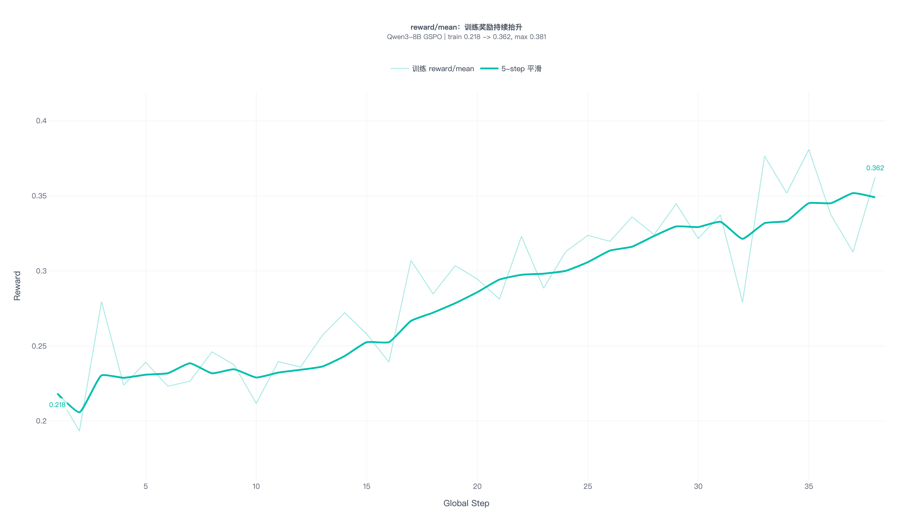
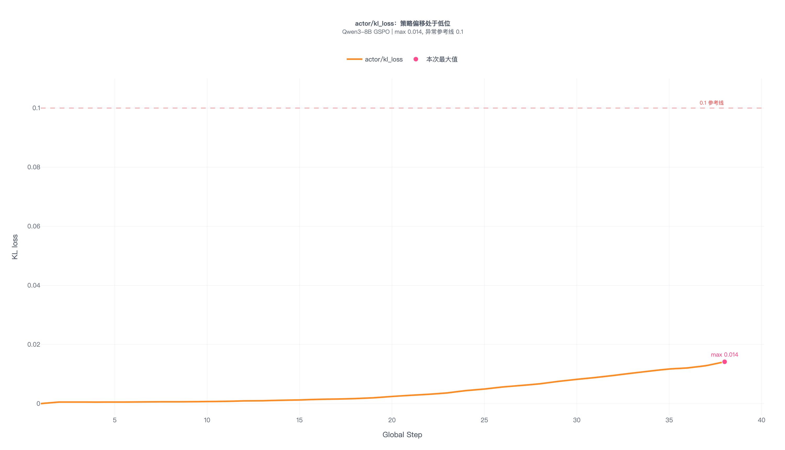
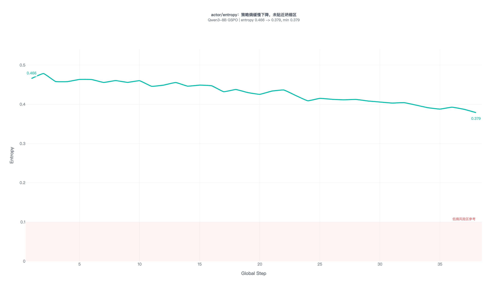
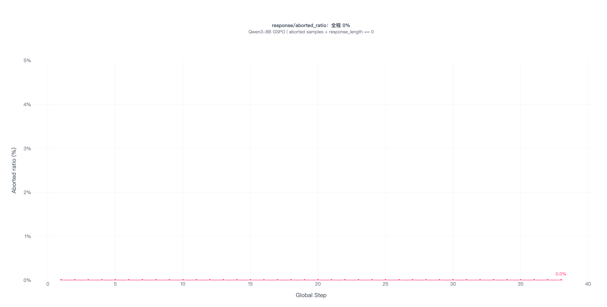

# 【LR26-022】创新策略-智能客服-意图识别强化学习方案-V1.0

[Cooper 原文](https://cooper.didichuxing.com/knowledge/2199610335356/2208536528160)

| brd文档链接 <br> | [【BRD】客服大模型-智能客服意图识别](https://cooper.didichuxing.com/docs2/document/2206473324996) <br> |
| --- | --- |
| 最后通过的策略方案链接 <br> | [智能客服-意图识别 RL 策略方案](https://cooper.didichuxing.com/knowledge/2199610335356/2207779514305) <br> |
| 实验链接 <br> | 本期为离线探索，无在线 A/B 实验链接 <br> |
| 核心贡献点 <br> | ==1) 结构化 JSON 上的分支化可验证奖励（branch_score + 5 类 penalty）== <br>==2) GSPO sequence-level 优化对齐意图识别 sequence-level 评估口径== <br>==3) "majority-voting → 人工交叉质检 → 高难度样本 RL"数据范式== <br> |
| 第一贡献人 <br> | 黄翔宇 <br> |
| 共同贡献人 <br> | 方舟、叶舟 <br> |
| 后续策略负责人 <br> | - <br> |

# **一、背景**

## **1.1 业务背景**

延续 [【LR26-017】](https://cooper.didichuxing.com/knowledge/2199610335356/2208205078151) 中智能客服意图识别项目的业务定位：为**小猪端三方运力（非小猪自营）乘客在线客服**实现用户问题的快速定位识别，并逐步覆盖打车业务投诉全场景，**从而提高用户体验、降低客服成本（降低转人工率）**。

意图识别模块当前线上采用 **Embedding 召回 + SFT 大模型（Qwen3-8B + LoRA）判断** 的两阶段架构，SFT 阶段已通过 LR26-017 完成上线。本 LR 聚焦在 SFT 模型基础上引入 RL（GSPO）做进一步策略迭代，属于**离线探索阶段**。

## **1.2 现状**

在当前意图识别链路中，模型输出分为三类决策类型：

| 决策类型 <br> | 中文名称 <br> | 含义 <br> | 评估重点 <br> |
| --- | --- | --- | --- |
| DIRECT_SOP <br> | 直达决策 <br> | 模型判断用户问题可直接匹配到具体 SOP 节点，并返回目标节点 <br> | 目标节点是否精确命中 <br> |
| SHOW_LEAF <br> | 候选展示决策 <br> | 模型无法唯一确定目标节点，但可给出 2-4 个候选叶子节点供用户选择 <br> | 候选集合是否覆盖真实目标，前 2 个候选是否准确 <br> |
| SHOW_L1 <br> | 反问决策 <br> | 模型无法可靠匹配具体 SOP 或候选节点，触发澄清/反问 <br> | 是否在确需澄清时触发反问，避免误反问 <br> |

以下以当前线上 SFT 版本（LR26-017上线版本）<!--评论:[{"u":"menchang","c":"LR26-017文档中的版本号并没有V7"},{"u":"yezhou","c":"这里指SFT最终上线版本"}] --> 在 999 条人工标注 benchmark 上的表现作为基线：

| **指标** <br> | **SFT 基线值** <br> |
| --- | --- |
| 总体准确率 <br> | **86.09%** <br> |
| 直达决策（DIRECT_SOP）<!--评论:[{"u":"zhuzhengdan","c":"DIRECT_SOP、SHOW_LEAF、SHOW_L1的场景分别是什么？"},{"u":"yezhou","c":"DIRECT_SOP 是直达，模型确信用户问的是哪个 SOP；SHOW_LEAF 是出 2~4 个候选让用户选；SHOW_L1 是兜底反问"}] --> <br> | 88.16% <br> |
| 候选展示决策（SHOW_LEAF） <br> | 72.00% <br> |
| 反问决策（SHOW_L1） <br> | 84.91% <br> |

SFT 模型已具备较好的意图理解能力，但在短文本和高不确定性样本上，仍存在反问决策和候选展示决策质量相对不足的问题。考虑到候选展示决策样本占比较低，且业务方向是减少不必要的候选展示，本轮优化以反问决策质量提升为重点，主要解决部分本可直达具体 SOP 的样本被模型判为反问，从而拉低反问决策分桶准确率的问题。

## **1.3 根因分析**

上述反问决策质量不足的问题，本质上来自 SFT 训练目标与业务评估目标之间的错位。SFT 阶段采用 teacher-forcing 的逐 token 交叉熵，优化的是标准答案序列的生成概率：

$$\mathcal{L}_{\mathrm{SFT}}(\theta) = -\mathbb{E}_{(x,y)\sim \mathcal{D}}\left[ \sum_{t=1}^{T} \log P(y_t \mid x, y_{<t}; \theta) \right]$$ 

但业务评估目标关注的是结构化 JSON 中的 `decision`、`target_node_name`、`options` 等关键字段是否满足业务判定规则，而不是逐 token 的序列一致性，两者差异主要体现在三个方面：

- **结构化反馈不足**：SFT 损失函数仅从 token 级序列一致性角度进行优化，无法区分“选对决策类型但目标节点错误”与“完全选错决策”的业务代价差异。

- **业务约束不可显式编码**：SFT 训练只能学习标注输出本身，难以对误反问、候选越界等问题施加额外约束。

- **难例覆盖不足**：SFT 阶段主要使用置信度为 9/10、10/10 的高一致性样本。该类样本标签可靠性较高，但样本难度相对较低，对模糊表达、候选边界接近、直达与反问切换等难例覆盖不足。

## **1.4 引入 RL 的动机**

基于上述问题，RL 阶段采用 GSPO 与自定义奖励函数进行策略优化，核心目标是：

第一，将模型优化目标从 token 级生成概率转向完整结构化输出的业务判定结果。

第二，奖励函数显式编码业务约束，对于真实结果不应触发反问、但模型输出反问的样本，通过显式惩罚降低模型的过度反问倾向。

# **二、目标 & 约束**

## **2.1 策略目标<!--评论:[{"u":"zhuzhengdan","c":"目标里应该要包含解决的问题？SHOW_L1 决策精准度？"}] -->**

| **指标** <br> | 目标提升（相对于SFT版本） <br> | **说明** <br> |
| --- | --- | --- |
| **离线反问决策（SHOW_L1）准确率** <br> | **5pp** <br> | 当前SFT版本离线反问决策准确率84.91% <br> |
| **离线总体准确率** <br> | **3pp** <br> | 当前SFT版本离线准确率86.09% <br> |

## **2.2 约束指标**

| **约束** <br> | **阈值** <br> | **兜底机制** <br> |
| --- | --- | --- |
| collapse_flag（模式坍缩） <br> | false <br> | 训练侧实时监控 KL、entropy；触发则回退 checkpoint <br> |
| KL 散度 `actor/kl_loss` <br> | &lt; 0.1 <br> | 超过即视为偏离 SFT 起点过远 <br> |

> 响应时延、安全召回、转人工率等业务目标由前置 LR26-017（SFT 上线版本）保证；本期仅完成离线 benchmark 评估，线上指标将在后续小流量 A/B 阶段验证。

# **三、技术方案**

## **3.1 数据来源与筛选**

训练数据来自前置的多数投票（majority voting）：每个问题用教师模型采样 10 次，按 winner 得票数（vote_bucket）形成标签。整个数据池可以分三档：

| **vote_bucket** <br> | **含义** <br> | **决策** <br> | **数量** <br> |
| --- | --- | --- | --- |
| 9/10, 10/10 <br> | 高一致性 <br> | 弃用（SFT 已充分学习，RL 边际收益低） <br> | 49,336 <br> |
| 6/10, 7/10, 8/10 <br> | 中等一致性 <br> | 有难度且标签相对可靠<!--评论:[{"u":"caiyeliurong","c":"是不是都要保证 label是正确的"},{"u":"yezhou","c":"已补充中等一致性数据的采样标注结果"}] --> <br> | 13,398 <br> |
| ≤ 5/10 <br> | 低一致性 <br> | 样本难度高，但标签可靠性不足，需要人工标注 <br> | — <br> |

高一致性/中等一致性数据**验证**：

在[12 意图识别模块-蒸馏记录](https://cooper.didichuxing.com/knowledge/2199610335356/2206798718492)中已经对多数投票的置信度分层做过人工验证：在 5 次 voting 口径下，`5/5` 的高一致性数据共 734 条，准确率达到**95.78%**（703/734）。这一结果说明，高得票样本整体具备较高标签可信度。

在当前 10 次多数投票口径下，对高一致性与中等一致性数据进行采样标注验证，结论如下：

| **数据分层** <br> | **本次采样标注结果** <br> | **准确率** <br> | **结论** <br> |
| --- | --- | --- | --- |
| 高一致性 <br> | 379/400 <br> | 94.75% <br> | 标签置信度高，验证结果与前置置信度分层人工验证结论一致 <br> |
| 中等一致性 <br> | 418/460 <br> | 90.87% <br> | 准确率仍超过 90%，同时样本难度高于高一致性数据；满足“有难度且标签相对可靠”的筛选条件 <br> |

前序实验曾使用全部中等一致性样本进行 RL 训练，离线总体准确率约为 78.48%，低于 SFT 基线 86.09%。该结果说明中等一致性样本未能带来稳定收益，因此，本轮方案将训练数据重点转向低一致性高分歧样本。

低一致性数据**处理方案**：

- 将多数投票后产生的**低一致性样本**纳入候选池，不再仅依据投票数低直接剔除；

- 通过人工交叉质检标注剥离标签噪声，保留其中高难度且标签可靠的样本；

- 最终精选 **2504 条**高质量、高难度数据用于 GSPO 训练。

## **3.2 奖励函数设计**

本轮 RL 的奖励函数目标是将训练优化方向从 token 级生成概率对齐到完整结构化输出的业务判定结果。奖励函数设计采用“分支主奖励 + 跨分支约束惩罚”的两层结构：分支主奖励用于对齐不同决策类型下的业务判定口径；跨分支惩罚项中，误反问惩罚直接对应本轮反问触发偏多的问题，其余惩罚项主要作为输出合法性与候选边界约束，避免模型通过非法字段组合、候选越界或候选形态异常获得不合理收益。

### **3.2.1 业务判定口径**

奖励函数判定首先对齐离线 benchmark 的业务评估规则。不同真实决策类型对应不同的判正规则：

| **真实决策类型** <br> | **模型输出类型** <br> | **判正规则** <br> | **说明** <br> |
| --- | --- | --- | --- |
| 直达决策（DIRECT_SOP） <br> | 直达决策 <br> | `target_node_name` 与标注目标节点完全一致 <br> | 目标节点精确命中是直达决策的核心目标。 <br> |
| 直达决策（DIRECT_SOP） <br> | 候选展示决策 <br> | 标注目标节点出现在模型前 2 个候选中 <br> | 视为次优结果，不等同于直达命中。 <br> |
| 候选展示决策（SHOW_LEAF） <br> | 候选展示决策 <br> | 模型前 2 个候选与标注前 2 个候选集合一致，顺序不要求一致 <br> | 重点约束候选集合质量。 <br> |
| 反问决策（SHOW_L1） <br> | 反问决策 <br> | 模型与标注均为反问 <br> | 重点约束是否应触发反问。 <br> |

该口径与业务评估目标一致：直达决策优先保证目标节点精确命中，候选展示决策优先保证前 2 个候选质量，反问决策优先判断是否确需澄清。

### **3.2.2 奖励总体结构与跨分支惩罚项**

奖励值由分支主奖励 `branch_score` 和跨分支惩罚项共同组成：

```PlainText
if output is invalid JSON:
    R = 0
else:
    R = branch_score(gold_decision, pred)
        + penalty_illegal_combo
        + penalty_candidate_boundary
        + penalty_false_show_l1
        + penalty_top2_pollution
        + penalty_leaf_shape
```

其中，`branch_score` 决定主要优化方向，按照真实决策类型分别计算；`penalty\_\*` 用于约束各分支共享的异常行为，避免模型通过非法字段组合、候选越界、误反问或候选污染获得不合理收益。无效 JSON 输出不参与业务字段判定，并通过训练侧 `format_valid` 指标同步监控格式合法率。

跨分支惩罚项分为两类：一类是与本轮核心问题直接相关的误反问惩罚，另一类是保障结构合法性、候选边界和候选形态稳定性的通用约束。具体定义如下：

| **惩罚项** <br> | **触发条件** <br> | **分值** <br> |
| --- | --- | --- |
| **`penalty_false_show_l1`** <br> | **真实结果不是反问，但模型输出反问** <br> | **−0.25** <br> |
| `penalty_illegal_combo` <br> | 直达决策缺少目标节点、填充非空候选项，或反问中填充目标节点/候选项等非法字段组合 <br> | −0.20 <br> |
| `penalty_candidate_boundary` <br> | 预测目标节点或候选项不在当前候选集合中 <br> | −0.20 / −0.10 <br> |
| `penalty_top2_pollution` <br> | 候选展示前 2 个候选中存在明显错误候选，或真实为直达决策时目标节点未进入模型前 2 个候选 <br> | −0.12 / −0.08 <br> |
| `penalty_leaf_shape` <br> | 候选展示输出超过 4 个候选或少于 2 个候选 <br> | −0.08 / −0.10 <br> |

### **3.2.3 分支主奖励**

**真实决策类型 = 直达决策（DIRECT_SOP）**

直达决策的核心目标是目标节点精确命中。当模型输出直达决策且目标节点完全一致时给予主要奖励；当模型退化为候选展示决策时，若前 2 个候选覆盖真实目标节点，仅给予次优正向奖励。

```PlainText
branch_score = 0.80 * target_exact_match
             + 0.15 * direct_to_leaf_top2_hit
             + 0.05 * decision_match
```

**真实决策类型 = 候选展示决策（SHOW_LEAF）**

候选展示决策的核心目标是提升前 2 个候选的集合质量。奖励函数将 `leaf_top2_exact_match` 作为主奖励，同时保留候选覆盖、单候选命中和 top-2 精度等辅助项，以降低“只要包含真实目标即可”的宽松奖励倾向。

```PlainText
branch_score = 0.60 * leaf_top2_exact_match
             + 0.20 * contains_all_gold_top2
             + 0.10 * one_of_gold_top2_hit
             + 0.05 * top2_precision
             + 0.05 * decision_match
```

**真实决策类型 = 反问决策（SHOW_L1）**

反问决策的核心目标是使模型仅在确需澄清时触发反问，并避免在反问分支中生成无关目标节点或候选项。

```PlainText
branch_score = 0.70 * decision_match
             + 0.20 * empty_structure
             + 0.10 * no_hallucination
```

## **3.3 训练算法**

在上述奖励函数定义完成后，本轮 RL 训练采用 GSPO（Group Sequence Policy Optimization）对模型策略进行优化。意图识别模型的输出是完整结构化 JSON，业务评估也以整条输出是否满足判定规则为准，因此训练算法需要更关注序列级（sequence-level）的整体策略更新，而不是逐 token 的局部概率变化。

相较于 token-level 的 GRPO/PPO 类优化，GSPO 在序列级别计算重要性比率并进行裁剪，可降低长序列场景下 token 级比率累积带来的方差和训练不稳定风险，更适合本任务中“完整 JSON 输出是否对齐业务评估口径”的优化目标。

GSPO 的损失函数如下：

$$\mathcal{L}_{\text{GSPO}}(\theta) = -\mathbb{E}_{x \sim \mathcal{D},\; \{y_i\}_{i=1}^{n} \sim \pi_{\theta_{\text{old}}}(\cdot|x)} \left[ \frac{1}{n} \sum_{i=1}^{n} \min\!\left( \rho_i(\theta) \cdot \hat{A}_i,\; \text{clip}(\rho_i(\theta), 1-\epsilon_{\text{low}}, 1+\epsilon_{\text{high}}) \cdot \hat{A}_i \right) - \beta \cdot D_{\text{KL}}(\pi_\theta \parallel \pi_{\text{ref}}) \right]$$ 

其中，序列级裁剪用于限制单次策略更新幅度，KL 项用于约束当前策略不要过度偏离 SFT 参考模型，从而兼顾业务奖励优化和训练稳定性。

## **3.4 训练配置**

| **参数** <br> | **实验值** <br> | **说明** <br> |
| --- | --- | --- |
| 基座模型 <br> | 当前线上 SFT 模型 <br> | SFT LoRA merge 后的全量模型 <br> |
| 训练框架 <br> | verl + vLLM <br> | `adv_estimator=grpo, loss_mode=gspo` <br> |
| 节点数 <br> | 4 × 8 = 32 H200 <br> | — <br> |
| ROLLOUT_N <br> | **16** <br> | — <br> |
| GPU_MEMORY_UTILIZATION <br> | **0.65** <br> | vLLM KV cache 占比 <br> |
| TRAIN_BATCH_SIZE <br> | 128 <br> | 总训练 batch <br> |
| PPO_MICRO_BATCH_PER_GPU <br> | 2 <br> | 单卡 micro batch <br> |
| LOGPROB_MICRO_BATCH_PER_GPU <br> | 8 <br> | ref log-prob 计算 <br> |
| ACTOR_LR <br> | 5e-7 <br> | — <br> |
| KL_LOSS_COEF <br> | 0.001 <br> | KL 散度惩罚系数 <br> |
| CLIP_RATIO_LOW / HIGH <br> | 0.0003 / 0.0004 <br> | GSPO 上下界裁剪 <br> |
| MAX_PROMPT / RESPONSE LENGTH <br> | 2048 / 1024 <br> | — <br> |
| SAVE_FREQ / TEST_FREQ <br> | 10 / 100 <br> | checkpoint 与验证频率 <br> |

## **3.5 训练侧监控指标**

| **指标** <br> | **用途** <br> | **异常阈值** <br> |
| --- | --- | --- |
| `reward/mean` <br> | 每个训练 batch 的平均奖励，反映策略是否在朝奖励函数定义的业务目标优化 <br> | ==持续下降、长期停滞、剧烈震荡，或 reward 上升但业务验证指标不升。== <br> |
| `actor/kl_loss` <br> | 约束当前策略不要过度偏离参考/SFT 策略，保证策略的稳定性 <br> | 突然尖峰、持续上升，尤其超过 0.1 后 reward/格式指标同时变差。 <br> |
| `actor/entropy` <br> | 表示策略输出分布的随机性/多样性；下降代表模型更确定 <br> | ==断崖式下降、接近 0，且 reward 停滞或输出变单一，说明可能策略坍缩。== <br> |
| `response/aborted_ratio` <br> |  `response_length == 0` 的样本占比，用来发现 rollout 生成失败或被中止的样本 <br> | 大于 0 或持续升高，说明有样本没有生成有效 response，会污染 reward/长度统计。 <br> |





训练侧监控主要用于判断训练稳定性、奖励函数有效性以及生成过程是否存在异常，本轮训练未观察到明显的策略坍缩或生成失败风险。

# **四、实验结果 / 评估结果**

> 本期结果基于离线 benchmark 评估，线上效果将在后续小流量 A/B 实验中验证。

## **4.1 离线 Benchmark 评估**

**评估口径**：本次离线 benchmark 为独立评估集，未参与 SFT/RL 训练、奖励函数设计调参及样本筛选；SFT 与 RL 均在同一批 benchmark 样本上评估，模型输出分别进行交叉标注，并以汇总后的标注结果作为最终判定。下表按模型输出后经人工标注确认的决策类型进行分桶统计，因此各分桶分母会随模型输出变化。

**按模型输出决策类型分桶：**

| 决策类型 <br> | **SFT 正确/总数** <br> | **SFT 准确率** <br> | **RL 正确/总数** <br> | **RL 准确率** <br> | **绝对变化** <br> |
| --- | --- | --- | --- | --- | --- |
| **总体准确率**<!--评论:[{"u":"zhuzhengdan","c":"测试集似乎不一致？能对比吗"},{"u":"yezhou","c":"已在同一标注集下重新标注"}] --> <br> | 860 / 999 <br> | **86.09%** <br> | 886 / 999 <br> | 88.69% <br> | +2.60pp <br> |
| 直达决策（DIRECT_SOP） <br> | 581 / 659 <br> | 88.16% <br> | 645 / 734 <br> | 87.87% <br> | -0.29pp <br> |
| 候选展示决策（SHOW_LEAF） <br> | 54 / 75 <br> | 72.00% <br> | 35 / 44 <br> | 79.55% <br> | +7.55pp <br> |
| 反问决策（SHOW_L1） <br> | 225 / 265 <br> | 84.91% <br> | 206 / 221 <br> | 93.21% <br> | +8.30pp <br> |

**正向收益**：

- **总体准确率**：离线总体准确率 86.09% → 88.69%，相对 SFT 版本提升 +2.60pp，接近但未完全达到 +3pp 策略目标。

- **反问决策：**准确率 84.91% → 93.21%，相对 SFT 版本提升 +8.30pp；同时，反问决策输出占比从 26.5% 下降到 22.1%，可作为模型过度反问倾向下降的辅助观察。

## **4.2 结论与后续计划**

本轮离线实验验证了 RL 奖励函数对决策类型优化的有效性，在降低过度反问、提升反问决策质量方面收益较明确；训练侧监控也未观察到明显的策略坍缩或生成失败风险。待工程人力释放后，计划在 8 月启动小流量 A/B 实验。

# **五、引用和鸣谢**

- [【LR26-017】创新策略-智能客服-意图识别-V1.0](https://cooper.didichuxing.com/knowledge/2199610335356/2208205078151)

- [12 意图识别模块-蒸馏记录](https://cooper.didichuxing.com/knowledge/2199610335356/2206798718492)

- [智能客服-意图识别 RL 策略方案](https://cooper.didichuxing.com/knowledge/2199610335356/2207779514305)

- [意图识别模块-RL 训练记录](https://cooper.didichuxing.com/knowledge/2199610335356/2207118418180)

- [Group Sequence Policy Optimization (GSPO)](https://arxiv.org/pdf/2507.18071)

感谢翔宇同学对意图识别RL项目的全程参与与支持
