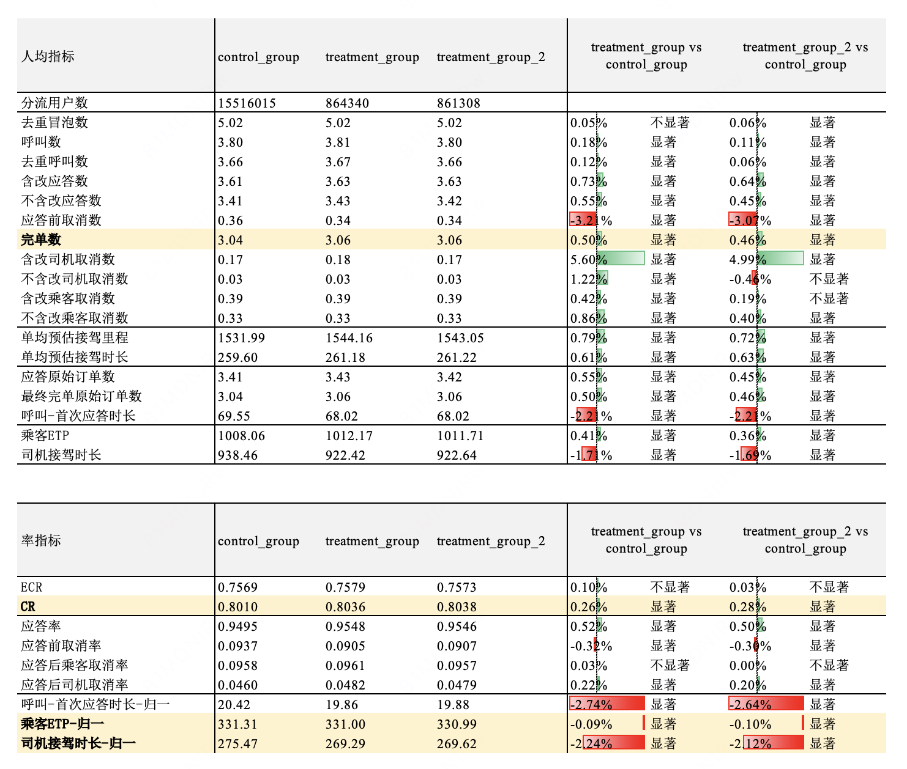
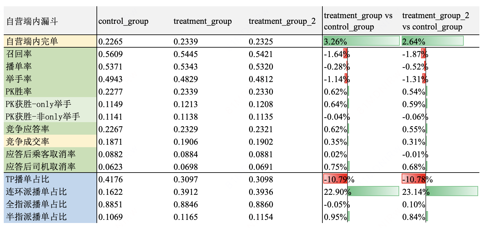
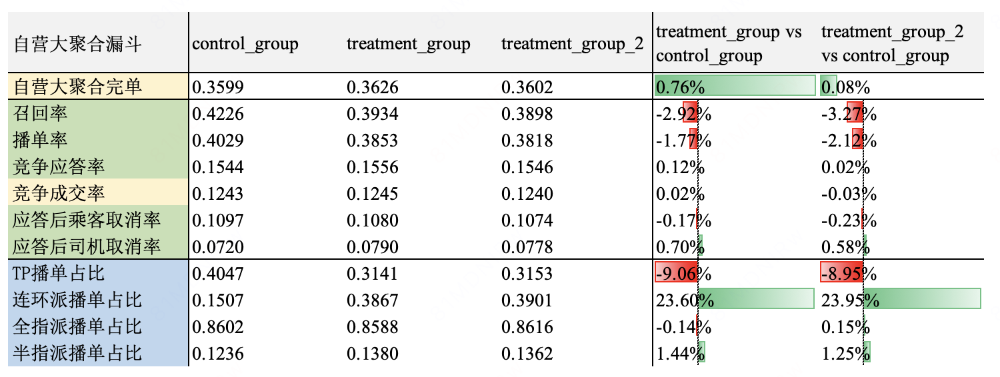

# 【LR26-025】交易效率-商家分单-商家召回策略-V2.1

[Cooper 原文](https://cooper.didichuxing.com/knowledge/2199610335356/2208300736227)

## 

# 基础信息

| brd文档链接 <br> | [商家召回策略优化V2.1](https://cooper.didichuxing.com/docs2/document/2206384493386) <br> |
| --- | --- |
| 最后通过的策略方案链接 <br> | [商家分单召回策略优化V2.1策略方案](https://cooper.didichuxing.com/docs2/document/2206468861549) <br> |
| 实验链接（评估大师） <br> | [https://x.intra.hongyibo.com.cn/exp/476932504616961?globalBusinessId=120000&globalProjectId=330331944058881&expFlowTab=dashboard&dashboardTab=metricDetail&windowTab=481822020796418](https://x.intra.hongyibo.com.cn/exp/476932504616961?globalBusinessId=120000&globalProjectId=330331944058881&expFlowTab=dashboard&dashboardTab=metricDetail&windowTab=481822020796418) <br> |
| 核心贡献点（创新点，可供其他算法同学借鉴的点） <br> |  <br> |
| 第一贡献人 <br> | 秦嘉彤 <br> |
| 共同贡献人（没有的话，可以置空） <br> | 吴健 <br> |
| 后续策略负责人 <br> | 秦嘉彤 <br> |

# 一、背景

- **现状：**目前商家分单召回阶段<!--评论:[{"u":"zhuzhengdan","c":"‘召回策略是所有流量渠道通用的？"},{"u":"qinjiatong","c":"是的"}] -->，**非连环派**和**连环派**两条策略链路均采用「**固定召回半径(接驾时长)** + **应答后司乘取消率模型过滤**」机制。

- **问题**：由于历史原因，两套策略各自维护独立的 Apollo 配置参数和模型，存在如下问题：

	- **运维成本高、迭代不便**：两套 Apollo 配置 + 两套模型并行维护，参数分散、口径不一致，后续策略更新和模型迭代成本较高；

	- **Apollo 参数缺失、灵活性不足**：

		- 非连环派场景仅能通过半径召回，**缺少接驾时间(ETA)的限制**，与连环派场景能力不对齐；

		- 连环派场景**缺少模型过滤不生效的接驾时间/距离配置**，对接驾近的运力仍会走模型过滤，存在不必要的漏斗损失；

- **根因分析：**

	- 历史上连环派和非连环派分单链路独立演进，导致配置体系、模型体系均分裂；

	- 同时 Apollo 参数项是按需求逐步累加的，未做统一抽象，导致两个场景能力不对齐。

- **问题严重程度：**

	- 当前商家召回是商家完单链路的关键节点，配置/模型的分裂直接影响后续召回策略和模型迭代的速度；

	- 若不做收拢，后续每一次策略迭代都需要在两套体系中各自维护，长期看维护成本不可控；

# 二、目标 & 约束

- **核心目标（运维收益）：**

	- 将商家召回策略 Apollo 参数和召回阶段相关过滤模型**收拢为统一体系**，便于后续迭代运维；

	- 召回阶段模型由5个精简为 **3 个**（应答后司乘取消统一建模 + 应答前流失率模型复用）；

- **<u>业务目标</u>****<u>（策略收益）：平台ETP+司机接驾时长 -1%</u>**

- **<u>约束：平台完单不负</u>**

# 三、技术方案

与策略方案一致：[商家分单召回策略优化V2.1策略方案](https://cooper.didichuxing.com/docs2/document/2206468861549)

- **Apollo 参数对齐与收拢：**

	- **非连环派**：新增接驾时间(ETA)参数（包括召回限制和模型生效限制），与连环派场景拉齐；**召回时取 ETA & 召回半径的交集**；

	- **连环派**：新增「模型过滤不生效」的接驾时间及距离配置，对接驾近的运力**跳过模型访问和过滤**，减少不必要的漏斗损失；

```JSON
"城市名": {
  "订单侧配置": {
    "非连环派订单初始召回ETA": 480,
    "非连环订单初始召回半径": 4500,
    "连环派AB段ETA": 660,
    "连环派BC段ETA": 660,
    "连环派AC段ETA": 660,
    "连环派AB段距离": 5000,
    "连环派BC段距离": 3000,
    "连环派AC段距离": 5000
  },
  "司机侧配置": {
    "非连环派扩播起始时间": 20,
    "非连环派扩播终止时间": 30,
    "非连环派初始听单ETA": 360,
    "非连环派初始听单半径": 3000
  },
  "模型配置": {
    "非连环派模型生效ETA": 120,
    "非连环派模型生效半径": 2350,
    "非连环派司机过滤阈值偏置项": 0.513,
    "非连环派乘客过滤阈值偏置项": 0.596,
    "非连环派全指派阈值": 0.438,
    "非连环派半指派阈值": 0.475,
    "连环派司机过滤阈值偏置项": 0.453,
    "连环派乘客过滤阈值偏置项": 0.524,
    "连环派全指派阈值": 0.358,
    "连环派半指派阈值": 0.325
  }
}
```

- **模型统一与漏斗平衡：**

	- **应答后司乘取消统一建模**：对全场景**统一建模应答后司乘取消**，连环派和非连环派场景访问同一模型；

	- **过滤阈值统一形式**：两个场景仅过滤阈值的**常数偏置项不同**，每轮次过滤阈值 = **订单流失率模型输出 + Apollo 配置的各自偏置项**。

- 通过上述两点改造，最终可实现：

	- 整个商家分单召回策略参数收拢至**统一 Apollo 体系**<!--评论:[{"u":"rongbohui","c":"链接给一下？"},{"u":"qinjiatong","c":"已补充。"}] -->，方便后续运维；

> 配置收拢前后具体参数对比详见：[商家召回策略V2.1参数配置](https://cooper.didichuxing.com/knowledge/2199610335356/2207164149659)，具体的apollo配置链接如下：

```PlainText
半径 Apollo配置 
非连环派 https://ab.intra.hongyibo.com.cn/conf/37/5876/8118/302077 
连环派https://ab.intra.hongyibo.com.cn/conf/37/5876/8118/224146
半径 运筹配置 https://yunchou.intra.hongyibo.com.cn/experimentManage?layerId=248
乘客非连环派应答后取消率模型 https://yunchou.intra.hongyibo.com.cn/experimentManage?layerId=282 
司机非连环派应答后取消率模型 https://yunchou.intra.hongyibo.com.cn/experimentManage?layerId=284 
乘客连环派取消率模型 https://yunchou.intra.hongyibo.com.cn/experimentManage?layerId=250 
司机连环派取消率模型 https://yunchou.intra.hongyibo.com.cn/experimentManage?layerId=252  
非连环、连环派共用的乘客派应答前流失率模型 https://yunchou.intra.hongyibo.com.cn/experimentManage?layerId=280
```

	- 召回阶段模型精简为 **3 个**（应答后司乘取消模型 + 应答前流失率模型），便于后续模型迭代升级；

	- 连环派 / 非连环派两套 Apollo 配置先保留，**待全场景统一建模收益确认后再合并 Apollo**，控制变更节奏与风险。

- **在具体策略层面，完善了参数配置，调整了阈值参数：**

	- 非连环派新增接驾时间（eta）参数(包括召回限制和模型生效限制)，具体召回时取eta & eda的交集；

	- 连环派新增模型不生效过滤：由于历史原因连环派和非连环派分别迭代，仅非连环派具有eta、eda低于阈值则无需模型过滤的能力，本次迭代对连环派也补齐该能力。

	- 连环派和非连环派的司乘取消率模型合并，访问同一个模型<!--评论:[{"u":"rongbohui","c":"离线指标变化情况"},{"u":"qinjiatong","c":"已补充。"}] -->

模型离线效果
合并前连环派和非连环派为单独的XGB模型，本次实验将连环派和非连环派合并为一个XGB模型。

| 模型离线auc <br> | 合并前 <br> | 合并后 <br> |
| --- | --- | --- |
| 司机取消率-整体 <br> | / <br> | 0.767 <br> |
| 司机取消率-非连环派 <br> | 0.804 <br> | 0.772 <br> |
| 司机取消率-连环派 <br> | 0.779 <br> | 0.747 <br> |
| 乘客取消率-整体 <br> | / <br> | 0.743 <br> |
| 乘客取消率-非连环派 <br> | 0.752 <br> | 0.748 <br> |
| 乘客取消率-连环派 <br> | 0.706 <br> | 0.723 <br> |

- 最终策略配置和参数调整方向：相比V2.0，V2.1新策略 对连环派的过滤放松了、对非连环派的过滤更紧了。

# 四、实验评估

## 4.1 核心结论

**【交易效率】平台乘客ETP显著-0.09%，司机接驾时长显著-2.24%<!--评论:[{"u":"zhuzhengdan","c":"这个平台是指小猪端视角？"},{"u":"qinjiatong","c":"是的"}] -->**

**【平台完单】平台完单显著+0.5%，CR显著+0.26pp<!--评论:[{"u":"zhuzhengdan","c":"这个平台是指小猪端视角？"},{"u":"qinjiatong","c":"是的"}] -->** 

## 4.2 实验设置

|  <br> | 内容 <br> | 备注 <br> |
| --- | --- | --- |
| 实验方式 <br> | 乘客PID分流 <br> |  <br> |
| 分流方式 <br> | 全国PID随机分流实验 <br> |  <br> |
| 分流策略内容 <br> | 对照组 90% <br>实验组a：5% <br>实验组b：5% <br> | 对照组策略：线上主策略 <br>实验组a和b策略： <br>1、非连环派新增接驾时间（eta）参数(包括召回限制和模型生效限制)，具体召回时取ETA&召回半径的交集； <br>2、连环派新增模型不生效过滤：原来是所有都需要模型过滤，现在改成eta和eda低于某个阈值（已经较近的）就不需要走模型过滤了 <br>3、连环派司乘取消率模型和非连环派的合并，访问同一个模型 <br>实验组a和b的差异在于阈值参数不同，具体参数配置见[商家召回策略V2.1策略方案](https://cooper.didichuxing.com/knowledge/2199610335356/2207164149659)，以下实验结果均为组a（更优） <br> |
| 实验周期 <br> | 实验周期，单位为天 <br> | 2026.04.11～2026.04.24<!--评论:[{"u":"zhuzhengdan","c":"实验和 LR 间隔 2 个多月？原因是？"},{"u":"zhuzhengdan","c":"实验只涉及自营？SAAS呢？"},{"u":"qinjiatong","c":"本次实验只对自营生效，后续会补充对自营宏鹄一起实验。"}] --> <br> |
| 流量范围 <br> | 来自哪个流量端 <br> | 流量端：小猪端，滴滴端，pbd <br> |
| 实验生效品类 <br> | 品类：特价盒子，特快盒子，实时计价盒子，小猪一口价，小猪打车，小猪特价，小猪特快 <br> |
| 分单场景 <br> | 自营轮次分单+tp分单 <br> |
| 分城市 or 全国 <br> | 全国 <br> |
| 实验生效商家 <br> | 自营 <br> |
| 是否联动实验 <br> | 否 <br> |  <br> |
| 评估人 <br> | 算法评估 <br> |   <br> |
| 实验链接 <br> |  <br> | [https://x.intra.hongyibo.com.cn/exp/476932504616961?globalBusinessId=120000&globalProjectId=330331944058881&expFlowTab=dashboard&dashboardTab=metricDetail](https://x.intra.hongyibo.com.cn/exp/476932504616961?globalBusinessId=120000&globalProjectId=330331944058881&expFlowTab=dashboard&dashboardTab=metricDetail) <br> |

## 4.3 实验数据<!--评论:[{"u":"rongbohui","c":"后续需要和其他实验打包评估吗？  需要的话，还要保留旧链路"}] -->

### 4.3.1 平台整体

> 以下「平台」均指小猪端端内。

**【交易效率】平台乘客ETP显著-0.09%，司机接驾时长显著-2.24%**

**【平台完单】平台完单显著+0.5%，CR显著+0.26pp** 

【**收益链路**】<!--评论:[{"u":"tommywujian","c":"learning是：连环派的增加既能带来应答速度提升，又能降低司机接驾时长？"},{"u":"qinjiatong","c":"是的，召回阶段部分原本会被过滤的连环派被召回，提升了整体的应答率和应答速度；由于连环派从司机视角消耗更少的司机接驾时长（参见下表口径说明），因此连环派份额的提升降低了整体的司机接驾时长。"}] -->

- **平台交易效率提升收益链路**：

	- **应答前等待时长缩短**（呼叫-首次应答时长-2.7%）**置换应答后等待时长上涨**（单均接驾距离+0.8%，单均接驾时长+0.6%）➡️ **最终乘客ETP<!--评论:[{"u":"rileywu","c":"归一的逻辑是？乘客ETP的原始数据和归一后的数据为啥方向还不一样？"},{"u":"qinjiatong","c":"归一的逻辑是：乘客ETP-归一=乘客ETP/最终完单原始订单数；司机接驾时长-归一=司机接驾时长/应答原始订单数。原始数据和归一后数据方向不一致的原始是应答原始订单数和归一完单数也在上涨，最终关注的指标是归一后的乘客ETP和归一后的司机接驾时长。具体口径说明和SQL已补充。"}] -->**（总等待时长，乘客ETP=乘客等应答时长+等接驾时长）**降低**（乘客ETP-归一 -0.1%）；<!--评论:[{"u":"rileywu","c":"归一的逻辑是？乘客ETP的原始数据和归一后的数据为啥方向还不一样？"},{"u":"qinjiatong","c":"归一的逻辑是：乘客ETP-归一=乘客ETP/最终完单原始订单数；司机接驾时长-归一=司机接驾时长/应答原始订单数。原始数据和归一后数据方向不一致的原始是应答原始订单数和归一完单数也在上涨，最终关注的指标是归一后的乘客ETP和归一后的司机接驾时长。具体口径说明和SQL已补充。"}] -->

	- **连环派比例提升（平台整体应答单中连环派订单占比从15.9%提升至21.2%）➡️ 司机接驾时长-归一 -2.24%**

- **平台完单提升收益链路**：

	- **应答速度提升**（应答率+0.52pp，应答前取消率-0.32pp，呼叫-首次应答时长-2.7%）**置换应答后等接驾质量下降**（单均接驾距离+0.8%，单均接驾时长+0.6%，应答后司机取消+0.2pp）➡️ **最终完单正向**（平台完单+0.5%，CR+0.26pp）

<!--评论:[{"u":"rileywu","c":"呼叫显著涨的原因是？"}] -->

> 乘客ETP：乘客总等待时长（包括应答时长+接驾时长，具体计算口径：订单最终开始计费时间-订单最早呼叫时间，包含了改派和换车（如有）的总等待时长）。

> 司机接驾时长：司机总接驾时长（对于完单订单的计算口径：开始计费时间 - 呼叫时间；对于取消订单的计算口径：取消时间 - 呼叫时间）；如果是连环派则刨除ab段送上一单的时间。<!--评论:[{"u":"rileywu","c":"这个为啥要去掉ab段时间呢？如果这样来算，连环派换成非连环派，整体司机接驾时间大概率是降低的，那就一直增加连环派的比例就好，和乘客etp相比，这俩目标哪个更重要？"},{"u":"qinjiatong","c":"去掉ab段的时间是因为从司机视角来看，这段时间仍是上一单的送驾时长，并没有增加司机的额外接驾时长，因此不计入总的司机接驾时长统计。"},{"u":"qinjiatong","c":"一直增加连环派的比例会导致应答后取消上涨、完单负向，需要在满足完单不负的约束下实现降低ETP和司机接驾时长的目标。"}] -->

> 乘客ETP-归一：乘客ETP/最终完单原始订单数。

> 司机接驾时长-归一：司机接驾时长/应答原始订单数。

```SQL


-- 2.2 乘客呼叫-首次应答时长、乘客呼叫-计费时长。算单均都直接除以完单

with
----- 实验用户分组 ----
exp_group as (
    select
        distinct concat_ws('-', year, month, day) dt,
        apollo_key as pid,
        group_name as exp_group,
        dims ['city'] city_id --建议不使用，可能和实际发生城市不一致
    from
        apollo.pre_flow_data_etl
    where
        concat_ws('-', year, month, day) between '${exp_start_dt}'
        and '${exp_end_dt}' --年前一期评估人群在后续的指标
        and exp = 'dups_exp_change_car_exp_2_20251127153314_0'
),
exp_group_clean as ---剔除窜组用户
(
    select
        distinct a.dt,
        a.pid,
        a.exp_group,
        city_id
    from
        exp_group a
        left join (
            select
                pid,
                count(distinct exp_group) group_cnt
            from
                exp_group
            group by
                pid
        ) b on a.pid = b.pid
    where
        group_cnt = 1 --剔除窜组用户
)


,unity_order_base as  
(
    select 
        a.*
        --label表状态
        ,is_td_answer
        ,is_td_finish
        ,gmv
        ,order_charge_dis
        ,charge_dur / 3600 as charge_dur
        ,is_grab_after_dri_cancel
        ,is_grab_after_pas_cancel
        ,is_grab_after_srvc_cancel
        ,is_td_answer_without_reassign
        ,is_grab_after_dri_cancel_without_reassign
        ,is_grab_after_pas_cancel_without_reassign
        ,is_grab_after_srvc_cancel_without_reassign   
        ---funnel表取预估接驾信息
        ,est_arrive_dis_funnel
        ,est_arrive_dur_funnel
        ,driver_to_last_dest_eta
        ,last_dest_to_start_eta
    from 
    (
        select distinct 
            start_city_id city_id
            ,dt
            ,order_id
            ,estimate_id
            ,driver_id
            ,passenger_id
            ,source_id
            ,is_td_call
            --,is_td_cancel --不含改派口径，如果订单被司机取消导致改派了不会记is_cancel = 1
            ,is_pbd
            ,is_hxz
            ,is_thlm
            ,product_id
            ,product_type
            ,platform_name
            ,answer_time
            ,cancel_time
            ,call_time
            ,answer_reassign_order_id --平台侧改派发单原始订单id
            ,call_reassign_order_id
            ,channel_name
            ,driver_phone_md5 --手机号
            ,tripcloud_open_oid
            ,is_reassign --是否改派单
            ,is_td_reassign --是否被改派
            ,begin_charge_time --开始计费时间
            ,arrive_time --加：到达时间
            ,end_charge_time --结束计费时间
            ,is_grab_before_cannel
            ,coalesce(call_reassign_order_id,answer_reassign_order_id,order_id) as origin_order_id --原始改派订单
            ,answer_dur
            ,arrive_dur
            ---新增
            ,call_car_level_id
            ,coalesce(combo_type,0) as combo_type --场景类型
            ,coalesce(level_type,0) as level_type --运力类型
            ,is_serial_assign --流量侧是否连环派
        from
            kflower_dw.dwd_kf_trd_unity_order_di
        where 
            dt between '${start_dt}' and '${end_dt}'
            and is_hxz = 1
    )a 
    left join 
    (
        select distinct 
            dt dt2,
            source_id,
            order_id as order_id2,    
            is_td_answer,
            is_td_finish,  
            gmv_amt as gmv,
            order_charge_dis, --计入计费订单里程，米
            charge_dur, --计费时长
            --被司机取消or当日被改派，被乘客取消，被客服关单
            is_grab_after_dri_cancel,
            is_grab_after_pas_cancel,           
            is_grab_after_srvc_cancel,
            --按照原始订单呼叫时间排序取最后一单（订单最终状态），被司机取消，被乘客取消，被客服关单
            is_td_answer_without_reassign,
            is_grab_after_dri_cancel_without_reassign,
            is_grab_after_pas_cancel_without_reassign,
            is_grab_after_srvc_cancel_without_reassign
        from 
            kflower_dw.dim_kf_trd_unity_order_label_di 
        where 
            dt between '${start_dt}' and '${end_dt}'
    )b 
    on a.source_id = b.source_id and a.order_id = b.order_id2 and a.dt = b.dt2
    left join 
    (
        select  
            order_id
            ,product_id
            ,call_car_level_id
            ,coalesce(combo_type,0) as combo_type
            ,coalesce(level_type,0) as level_type
            ,driver_start_eda as est_arrive_dis_funnel --预估接驾距离
            ,driver_start_eta as est_arrive_dur_funnel --预估接驾时长
            -- 连环派订单ab + bc距离
            ,driver_to_last_dest_eta --ab段
            ,last_dest_to_start_eta --bc段
        from   
            kflower_dw.dwm_kf_trd_unity_trade_funnel_order_anycar_di --聚合看板呼单漏斗表，预估接驾时长&距离和连环派信息从这张表取比较准（from算法）
        where   
            dt between '${start_dt}' and '${end_dt}'
    )c
    on a.order_id = c.order_id and a.product_id = c.product_id and a.call_car_level_id = c.call_car_level_id and a.combo_type = c.combo_type and a.level_type = c.level_type
),

order_rank_max as  
(
    select 
        a.* 
        ,case 
            when is_td_answer = 0 and is_grab_before_cannel = 1 then '应答前乘客取消'
            when is_td_answer = 1 and is_td_finish = 1 then '完单' --改派单当日无应答算司机取消，跨天应答完单的单可能会有司机取消记录。完单优先级最高
            when is_td_answer = 1 and is_grab_after_dri_cancel = 1 and is_grab_after_dri_cancel_without_reassign = 1 then '司机取消无改派'
            when is_td_answer = 1 and is_grab_after_dri_cancel = 1 and is_grab_after_dri_cancel_without_reassign <> 1 then '司机取消改派'
            when is_td_answer = 1 and is_grab_after_pas_cancel = 1 and is_grab_after_pas_cancel_without_reassign = 1 then '乘客取消无改派'
            when is_td_answer = 1 and is_grab_after_pas_cancel = 1 and is_grab_after_pas_cancel_without_reassign <> 1 then '乘客取消改派'
            when is_td_answer <> 1 and is_grab_after_pas_cancel_without_reassign = 1 then '有过应答且最后一单应答前乘客取消'
            when is_td_answer = 1 and is_grab_after_srvc_cancel = 1 then '客服取消无改派'            
        end as order_status
        ,case when b.order_id is not null then 1 else 0 end as is_callmoredri_sub_ord --是否换车子单
    from 
        (
            select 
                order_id --订单粒度
                ,max(origin_order_id) as origin_order_id
                ,max(city_id) as city_id
                ,max(driver_id) as driver_id
                ,max(product_id) as product_id
                ,max(passenger_id) as passenger_id
                ,max(is_td_call) as is_td_call
                ,max(is_td_answer) as is_td_answer
                ,max(is_td_finish) as is_td_finish
                ,max(gmv) as gmv
                ,max(is_grab_before_cannel) as is_grab_before_cannel

                ,max(is_grab_after_dri_cancel) as is_grab_after_dri_cancel
                ,max(is_grab_after_pas_cancel) as is_grab_after_pas_cancel
                ,max(is_grab_after_srvc_cancel) as is_grab_after_srvc_cancel

                ,max(is_td_answer_without_reassign) as is_td_answer_without_reassign
                ,max(is_grab_after_dri_cancel_without_reassign) as is_grab_after_dri_cancel_without_reassign
                ,max(is_grab_after_pas_cancel_without_reassign) as is_grab_after_pas_cancel_without_reassign
                ,max(is_grab_after_srvc_cancel_without_reassign) as is_grab_after_srvc_cancel_without_reassign

                ,max(call_time) as call_time
                ,max(answer_time) as answer_time
                ,max(begin_charge_time) as begin_charge_time
                ,max(arrive_time) as arrive_time
                ,max(end_charge_time) as end_charge_time
                ,max(cancel_time) as cancel_time
                ,max(answer_dur) as answer_dur
                ,max(arrive_dur) as arrive_dur
                ,max(charge_dur) as charge_dur

                ,max(order_charge_dis) as order_charge_dis
                ,max(est_arrive_dis_funnel) as est_arrive_dis_funnel --预估接驾距离
                ,max(est_arrive_dur_funnel) as est_arrive_dur_funnel--预估接驾时长
                ,max(is_serial_assign) as is_serial_assign --是否连环派(播单会播多个司机，只要有一个司机连环派就算)
                ,max(driver_to_last_dest_eta) as driver_to_last_dest_eta
                ,max(last_dest_to_start_eta) as last_dest_to_start_eta
                ,max(case when is_td_answer=1 and is_serial_assign=1 then 1 else 0 end) as is_answer_serial_assign --是否连环派被应答(只看最终应答的订单是否为连环派)
            from 
                unity_order_base   
            where 
                1=1
                and substr(call_time,1,10) between '${start_dt}' and '${end_dt}' --小猪端呼叫订单
            group by order_id
        )a
    left join 
    (
        select 
            distinct order_id --换车子单
        from 
        (
            select 
                distinct order_id
                ,get_json_object(call_more_driver, '$.change_car_type') change_car_type --=2接驾久真换车，=1诱导真换车
                ,get_json_object(call_more_driver, '$.type') fz_type --区分真换车父单+子单
            from
            (
                select 
                    * 
                    ,get_json_object(extend_feature, '$.call_more_driver') as call_more_driver
                from 
                    kflower_dw.dwm_kf_trd_hxz_order_base_view_di 
                where 
                    dt between '${start_dt}' and '${end_dt}'
            )t
        )t
        where 
            change_car_type in (1,2) --换车场景 
            and fz_type = 2 --子单
    )b  
    on a.order_id = b.order_id
),

origin_order_detail as --原始订单id粒度统计
(
    select 
        *
        ,to_date(call_time_min) as dt
        ,unix_timestamp(cancel_time_all_min) - unix_timestamp(call_time_min) as call_to_firstcancel_dur
        ,unix_timestamp(answer_time_min) - unix_timestamp(call_time_min) as call_to_firstans_dur -- 发单到首次应答时间（秒），除以不含改应答量就是单均应答时长
        ,unix_timestamp(begin_charge_time_min) - unix_timestamp(call_time_min) as call_to_firstcharge_dur -- 发单到首次开始计费时间，除以完单数就是单均呼叫-计费时长
        ,unix_timestamp(arrive_time_min) - unix_timestamp(call_time_min) as call_to_firstarrive_dur -- 发单到首次到达时间，除以完单数就是单均呼叫-计费时长
    from   
    (
        select 
            origin_order_id
            ,max(passenger_id) passenger_id 
            --本次发单首次发单时间
            ,min(case when is_td_call=1 then call_time end) call_time_min
            --本次发单首次和末次被应答时间
            ,min(case when is_td_answer=1 then answer_time end) answer_time_min
            ,max(case when is_td_answer=1 then answer_time end) answer_time_max
            --本次发单首次和末次被取消时间
            ,min(case when is_td_answer=1 and is_td_finish<>1 then cancel_time end) cancel_time_min
            ,max(case when is_td_answer=1 and is_td_finish<>1 then cancel_time end) cancel_time_max         
            --上车时间
            ,min(case when is_td_answer=1 and is_td_finish=1 then begin_charge_time end) begin_charge_time_min
            ,max(case when is_td_answer=1 and is_td_finish=1 then begin_charge_time end) begin_charge_time_max  

            ,min(case when is_td_answer=1 and is_td_finish=1 then arrive_time end) arrive_time_min
            ,max(case when is_td_answer=1 and is_td_finish=1 then arrive_time end) arrive_time_max  

            --本次发单首次和末次被取消时间(不应答也算)
            ,min(case when is_td_finish<>1 and cancel_time not in ('0000-00-00 00:00:00') then cancel_time end) cancel_time_all_min
            ,max(case when is_td_finish<>1 and cancel_time not in ('0000-00-00 00:00:00') then cancel_time end) cancel_time_all_max  

            --本次归一发单最终状态
            ,count(distinct order_id) as origin_ord_cnt --订单数（是否改派）
            ,max(is_td_answer) as is_td_answer
            ,max(is_grab_before_cannel) as is_grab_before_cannel
            ,max(case when order_status in ('完单') then 1 else 0 end) as is_last_finish --本次发单是否完单 
            ,max(case when reassign_rank_desc = 1 then order_status end) as order_status_reassign_rank_desc --按最后一个发单状态
            ,count(distinct case when is_grab_after_dri_cancel=1 then order_id end) as o_dri_cancel_cnt
            ,count(distinct case when is_grab_after_pas_cancel_without_reassign=1 then order_id end) as o_pas_cancel_cnt
            ,count(distinct case when is_td_finish=1 then order_id end) as o_finish_cnt

            --特定场景订单数
            ,count(distinct case when est_arrive_dis_funnel >= 3500 then order_id end) as o_est_arrive_dis_far --本单应答预估接驾距离超过3.5km
        from 
        (
            select 
                a.* 
                ----订单状态
                ,row_number()over(partition by origin_order_id order by call_time) as reassign_rank --看订单按时间顺序排序
                ,row_number()over(partition by origin_order_id order by call_time desc) as reassign_rank_desc --看订单按时间倒序排序
                ,row_number()over(partition by origin_order_id,is_td_answer order by call_time) as ans_reassign_rank --看订单按时间顺序排序,按应答状态分开排
                ,row_number()over(partition by origin_order_id,is_td_answer order by call_time desc) as ans_reassign_rank_desc --看订单按时间倒序排序,按应答状态分开排
            from
                order_rank_max a   
            left join 
            (
                select distinct 
                    order_id 
                from 
                    order_rank_max
                where is_callmoredri_sub_ord = 1 and is_td_answer <> 1 --未应答换车子单
            )b
            on a.order_id = b.order_id
            where 
                b.order_id is null --过滤掉换车未应答子单
        )t
        group by 
            origin_order_id
    )t  
    where 
        1=1
        and is_td_answer = 1 --本次发单至少被应答过
)

-- select 
--     dt,
--     count(distinct case when is_last_finish=1 then origin_order_id end) as `归一完单数`,
--     sum(call_to_firstans_dur)/count(distinct case when is_last_finish=1 then origin_order_id end)  as `每个归一完单 呼叫-首次应答时长`,
--     sum(call_to_firstcharge_dur)/count(distinct case when is_last_finish=1 then origin_order_id end)  as `每个归一完单 呼叫-计费时长`,
--     sum(call_to_firstarrive_dur)/count(distinct case when is_last_finish=1 then origin_order_id end)  as `每个归一完单 呼叫-到达时长`

-- from 
--     origin_order_detail
-- group by 
--     dt
-- order by dt asc

,raw_pack_ab as --不采用dt关联，而是分流样本出现过的人打包，去看另一个时间整体的总体指标，不dt关联，用于AA期评估，离线AB评估和部分特殊在线分流场景（额外限制只统计用户首次进组后的数据）
(
    select
        a.exp_group --,a.city_id
        ,count(distinct a.pid) as `分流乘客数`
        ,count(distinct origin_order_id)/count(distinct a.pid) as `人均归一呼单数`
        ,count(distinct case when is_last_finish=1 then origin_order_id end)/count(distinct a.pid) as `人均归一完单数`
        -- ,sum(call_to_firstans_dur)/count(distinct case when is_last_finish=1 then origin_order_id end)  as `每个归一完单 呼叫-首次应答时长`
        ,sum(call_to_firstcharge_dur)/count(distinct case when is_last_finish=1 then origin_order_id end)  as `每个归一完单 呼叫-计费时长`
        -- ,sum(call_to_firstarrive_dur)/count(distinct case when is_last_finish=1 then origin_order_id end)  as `每个归一完单 呼叫-到达时长`

        -- ,sum(call_to_firstcharge_dur)/count(distinct a.pid)  as `人均 呼叫-计费时长`
        -- ,sum(call_to_firstarrive_dur)/count(distinct a.pid)  as `人均 呼叫-到达时长`
    from 
        (
            select
                pid,
                exp_group,
                min(dt) earliest_group_dt --最早进组时间
            from
                exp_group_clean
            group by
                pid,
                exp_group
        ) a
    left join origin_order_detail b
        on a.pid = b.passenger_id 
    where a.earliest_group_dt <= b.dt --只看最早进组后的数据
    group by
        a.exp_group
)

select * from raw_pack_ab
```

```SQL
-- 2.3 小猪端司机送驾时长/(接驾+送驾时长)


-- 送驾时长：实际的begin_charge - end_charge即可
-- 接驾时长：
-- 1. 可控运力：用hh侧的表卡出实际的连环派上下单，用实际时间算接驾时长，去掉ab段送上一单的时间
-- 2. api：用ab段预估eta去算，算出负数就取0
-- 3. dd：正常算无连环派

-- dups_exp_kf_athena_order_hold_conf_no_hold_20251027195548_0

with
----- 实验用户分组 ----
exp_group as (
    select
        distinct concat_ws('-', year, month, day) dt,
        apollo_key as pid,
        group_name as exp_group,
        dims ['city'] city_id --建议不使用，可能和实际发生城市不一致
    from
        apollo.pre_flow_data_etl
    where
        concat_ws('-', year, month, day) between '${exp_start_dt}'
        and '${exp_end_dt}' --年前一期评估人群在后续的指标
        -- and exp = 'dups_exp_change_car_exp_2_20251127153314_0'
        and exp = 'dups_exp_kf_athena_order_hold_conf_no_hold_20251027195548_0' 
),
exp_group_clean as ---剔除窜组用户
(
    select
        distinct a.dt,
        a.pid,
        a.exp_group,
        city_id
    from
        exp_group a
        left join (
            select
                pid,
                count(distinct exp_group) group_cnt
            from
                exp_group
            group by
                pid
        ) b on a.pid = b.pid
    where
        group_cnt = 1 --剔除窜组用户
)


-- zyhh连环派单独取,用运力侧数据算准确数

,hh_order_base as 
(
    select 
        a.*
        ,b.is_serial_order
    from 
    (
        select 
            order_id
            ,driver_id
            ,is_td_answer
            ,is_td_finish
            ,is_td_cancel
            ,channel_id
            ,call_time
            ,answer_time
            ,cancel_time
            ,arrive_time
            ,charge_time
            ,finish_time
            ,start_lng
            ,start_lat
            ,answer_lng
            ,answer_lat
            ,dest_lng
            ,dest_lat
            ,open_oid
            ,start_city_id
        from 
            kflower_dw.dwm_hh_trd_order_merge_base_ext_view_di
        where  
            dt between '${start_dt}' and '${end_dt}'
    ) a 
    left join 
    (
        select 
            driver_id_hh
            ,order_id_hh
            ,order_origin
            ,case 
                when dispatch_type = 1 then '抢单'
                when dispatch_type = 2 then '半指派'
                when dispatch_type = 3 then '全指派'
                when dispatch_type in (4,5,6,7,8,9) then '其他' 
            end dispatch_type
            ,product_id_hh
            ,is_serial_order
        from 
            kflower_dw.dwd_hh_trd_duse_orderbroadcast_di
        where 
            dt between '${start_dt}' and '${end_dt}'
        group by 
            driver_id_hh
            ,order_id_hh
            ,order_origin
            ,case 
            when dispatch_type = 1 then '抢单'
            when dispatch_type = 2 then '半指派'
            when dispatch_type = 3 then '全指派'
            when dispatch_type in (4,5,6,7,8,9) then '其他' 
            end
            ,product_id_hh
            ,is_serial_order
    ) b
    on a.driver_id = b.driver_id_hh and a.order_id = b.order_id_hh
),

zyhh_order as 
(
    select 
        a.order_id
        ,max(a.driver_id) as driver_id
        ,max(a.is_td_answer) as is_td_answer
        ,max(a.is_td_finish) as is_td_finish -- 取max防跨天完单
        ,max(a.channel_id) as channel_id
        ,max(a.is_serial_order) as is_serial_order
        ,max(a.call_time) as serial_call_time
        ,max(to_date(a.call_time)) as dt
        ,max(a.answer_time) as serial_answer_time
        ,max(a.cancel_time) as serial_cancel_time
        ,max(a.charge_time) as serial_charge_time
        ,max(a.finish_time) as serial_finish_time
        ,max(a.open_oid) as serial_open_oid
        ,max(a.start_city_id) as serial_city_id
        ,max(b.order_id) as parent_order_id
        ,max(b.answer_time) as parent_answer_time
        ,max(b.finish_time) as parent_finish_time
    from 
    (
        select
            *
        from 
            hh_order_base
        where  
            is_td_answer = 1
            and is_serial_order = 1
    ) a 
    left join 
    (
        select
            *
        from 
            hh_order_base
        where  
            is_td_finish = 1 --用来找连环派的上一单,限定完单
    ) b on a.driver_id = b.driver_id
    where 
        a.channel_id in (1100300001) -- 限定小猪端
        and a.answer_time > b.answer_time 
        and a.answer_time < b.finish_time -- 用时间卡出连环派上一单
        and to_date(a.call_time) between '${start_dt}' and '${end_dt}'
    group by 
        a.order_id
),

zyhh_serial_pickup_dur as 
(
    select 
        dt,
        passenger_id,
        '可控运力' as type,
        '连环派' as is_serial,
        sum(case 
                when is_td_finish = 1 then finish_pickup_dur
                when is_td_finish <> 1 and is_ab_cancel = 1 then 0
                when is_td_finish <> 1 and is_ab_cancel = 0 then cancel_pick_dur
            end) as pickup_dur,
        0 as charge_dur
    from 
    (
        select 
            a.*,
            if(is_td_finish <> 1 and serial_cancel_time <= parent_finish_time,1,0) as is_ab_cancel,
            unix_timestamp(serial_charge_time) - unix_timestamp(parent_finish_time) as finish_pickup_dur,
            unix_timestamp(serial_cancel_time) - unix_timestamp(parent_finish_time) as cancel_pick_dur
        from 
            zyhh_order a 
    ) a 
    left join 
    (
        select 
            tripcloud_open_oid,
            max(passenger_id) as passenger_id -- 找到流量侧pidfor实验评估
        from 
            kflower_dw.dwd_kf_trd_unity_order_di
        where 
            dt between '${start_dt}' and '${end_dt}'
            and is_hxz = 1
        group by 
            tripcloud_open_oid
    ) b on a.serial_open_oid = b.tripcloud_open_oid
    group by 
        dt,
        passenger_id
),

unity_order_base as    
(
    select 
        a.*
        --label表状态
        ,is_td_answer
        ,is_td_finish
        ,gmv
        ,order_charge_dis
        ,charge_dur / 3600 as charge_dur
        ,is_grab_after_dri_cancel
        ,is_grab_after_pas_cancel
        ,is_grab_after_srvc_cancel
        ,is_td_answer_without_reassign
        ,is_grab_after_dri_cancel_without_reassign
        ,is_grab_after_pas_cancel_without_reassign
        ,is_grab_after_srvc_cancel_without_reassign   
        ---funnel表取预估接驾信息
        ,est_arrive_dis_funnel
        ,est_arrive_dur_funnel
        ,driver_to_last_dest_eta
        ,last_dest_to_start_eta
    from 
    (
        select distinct 
            start_city_id city_id
            ,dt
            ,order_id
            ,estimate_id
            ,driver_id
            ,passenger_id
            ,source_id
            ,is_td_call
            --,is_td_cancel --不含改派口径，如果订单被司机取消导致改派了不会记is_cancel = 1
            ,is_pbd
            ,is_hxz
            ,is_thlm
            ,product_id
            ,product_type
            ,platform_name
            ,answer_time
            ,cancel_time
            ,call_time
            ,answer_reassign_order_id --平台侧改派发单原始订单id
            ,call_reassign_order_id
            ,channel_name
            ,driver_phone_md5 --手机号
            ,tripcloud_open_oid
            ,is_reassign --是否改派单
            ,is_td_reassign --是否被改派
            ,begin_charge_time --开始计费时间
            ,end_charge_time --结束计费时间
            ,is_grab_before_cannel
            ,coalesce(call_reassign_order_id,answer_reassign_order_id,order_id) as origin_order_id --原始改派订单
            ,answer_dur
            ,arrive_dur
            ---新增
            ,call_car_level_id
            ,coalesce(combo_type,0) as combo_type --场景类型
            ,coalesce(level_type,0) as level_type --运力类型
            ,is_serial_assign --流量侧是否连环派
            ,platform_mode_name
        from
            kflower_dw.dwd_kf_trd_unity_order_di
        where 
            dt between '${start_dt}' and '${end_dt}'
            and is_hxz = 1
    )a 
    left join 
    (
        select distinct 
            dt dt2,
            source_id,
            order_id as order_id2,    
            is_td_answer,
            is_td_finish,  
            gmv_amt as gmv,
            order_charge_dis, --计入计费订单里程，米
            charge_dur, --计费时长
            --被司机取消or当日被改派，被乘客取消，被客服关单
            is_grab_after_dri_cancel,
            is_grab_after_pas_cancel,           
            is_grab_after_srvc_cancel,
            --按照原始订单呼叫时间排序取最后一单（订单最终状态），被司机取消，被乘客取消，被客服关单
            is_td_answer_without_reassign,
            is_grab_after_dri_cancel_without_reassign,
            is_grab_after_pas_cancel_without_reassign,
            is_grab_after_srvc_cancel_without_reassign
        from 
            kflower_dw.dim_kf_trd_unity_order_label_di 
        where 
            dt between '${start_dt}' and '${end_dt}'
    )b 
    on a.source_id = b.source_id and a.order_id = b.order_id2 and a.dt = b.dt2
    left join 
    (
        select  
            order_id
            ,product_id
            ,call_car_level_id
            ,coalesce(combo_type,0) as combo_type
            ,coalesce(level_type,0) as level_type
            ,driver_start_eda as est_arrive_dis_funnel --预估接驾距离
            ,driver_start_eta as est_arrive_dur_funnel --预估接驾时长
            -- 连环派订单ab + bc距离
            ,driver_to_last_dest_eta --ab段
            ,last_dest_to_start_eta --bc段
        from   
            kflower_dw.dwm_kf_trd_unity_trade_funnel_order_anycar_di --聚合看板呼单漏斗表，预估接驾时长&距离和连环派信息从这张表取比较准（from算法）
        where   
            dt between '${start_dt}' and '${end_dt}'
    )c
    on a.order_id = c.order_id and a.product_id = c.product_id and a.call_car_level_id = c.call_car_level_id and a.combo_type = c.combo_type and a.level_type = c.level_type
),


order_rank_max as  
(
    select 
        a.* 
        ,to_date(call_time) as dt
        ,case 
            when is_td_answer = 0 and is_grab_before_cannel = 1 then '应答前乘客取消'
            when is_td_answer = 1 and is_td_finish = 1 then '完单' --改派单当日无应答算司机取消，跨天应答完单的单可能会有司机取消记录。完单优先级最高
            when is_td_answer = 1 and is_grab_after_dri_cancel = 1 and is_grab_after_dri_cancel_without_reassign = 1 then '司机取消无改派'
            when is_td_answer = 1 and is_grab_after_dri_cancel = 1 and is_grab_after_dri_cancel_without_reassign <> 1 then '司机取消改派'
            when is_td_answer = 1 and is_grab_after_pas_cancel = 1 and is_grab_after_pas_cancel_without_reassign = 1 then '乘客取消无改派'
            when is_td_answer = 1 and is_grab_after_pas_cancel = 1 and is_grab_after_pas_cancel_without_reassign <> 1 then '乘客取消改派'
            when is_td_answer <> 1 and is_grab_after_pas_cancel_without_reassign = 1 then '有过应答且最后一单应答前乘客取消'
            when is_td_answer = 1 and is_grab_after_srvc_cancel = 1 then '客服取消无改派'            
        end as order_status
        ,case when b.order_id is not null then 1 else 0 end as is_callmoredri_sub_ord --是否换车子单
    from 
        (
            select 
                order_id --订单粒度
                ,max(origin_order_id) as origin_order_id
                ,max(city_id) as city_id
                ,max(driver_id) as driver_id
                ,max(product_id) as product_id
                ,max(passenger_id) as passenger_id
                ,max(is_td_call) as is_td_call
                ,max(is_td_answer) as is_td_answer
                ,max(is_td_finish) as is_td_finish
                ,max(gmv) as gmv
                ,max(is_grab_before_cannel) as is_grab_before_cannel

                ,max(is_grab_after_dri_cancel) as is_grab_after_dri_cancel
                ,max(is_grab_after_pas_cancel) as is_grab_after_pas_cancel
                ,max(is_grab_after_srvc_cancel) as is_grab_after_srvc_cancel

                ,max(is_td_answer_without_reassign) as is_td_answer_without_reassign
                ,max(is_grab_after_dri_cancel_without_reassign) as is_grab_after_dri_cancel_without_reassign
                ,max(is_grab_after_pas_cancel_without_reassign) as is_grab_after_pas_cancel_without_reassign
                ,max(is_grab_after_srvc_cancel_without_reassign) as is_grab_after_srvc_cancel_without_reassign

                ,max(call_time) as call_time
                ,max(answer_time) as answer_time
                ,max(begin_charge_time) as begin_charge_time
                ,max(end_charge_time) as end_charge_time
                ,max(cancel_time) as cancel_time
                ,max(answer_dur) as answer_dur
                ,max(arrive_dur) as arrive_dur
                ,max(charge_dur) as charge_dur

                ,max(order_charge_dis) as order_charge_dis
                ,max(est_arrive_dis_funnel) as est_arrive_dis_funnel --预估接驾距离
                ,max(est_arrive_dur_funnel) as est_arrive_dur_funnel--预估接驾时长
                ,max(is_serial_assign) as is_serial_assign --是否连环派(播单会播多个司机，只要有一个司机连环派就算)
                ,max(nvl(driver_to_last_dest_eta,0)) as driver_to_last_dest_eta
                ,max(nvl(last_dest_to_start_eta,0)) as last_dest_to_start_eta
                ,max(case when is_td_answer=1 and is_serial_assign=1 then 1 else 0 end) as is_answer_serial_assign --是否连环派被应答(只看最终应答的订单是否为连环派)
                ,max(platform_mode_name) as platform_mode_name
            from 
                unity_order_base   
            where 
                1=1
                and substr(call_time,1,10) between '${start_dt}' and '${end_dt}' --小猪端呼叫订单
            group by order_id
        )a
    left join 
    (
        select 
            distinct order_id --换车子单
        from 
        (
            select 
                distinct order_id
                ,get_json_object(call_more_driver, '$.change_car_type') change_car_type --=2接驾久真换车，=1诱导真换车
                ,get_json_object(call_more_driver, '$.type') fz_type --区分真换车父单+子单
            from
            (
                select 
                    * 
                    ,get_json_object(extend_feature, '$.call_more_driver') as call_more_driver
                from 
                    kflower_dw.dwm_kf_trd_hxz_order_base_view_di 
                where 
                    dt between '${start_dt}' and '${end_dt}'
            )t
        )t
        where 
            change_car_type in (1,2) --换车场景 
            and fz_type = 2 --子单
    )b  
    on a.order_id = b.order_id
),

order_dur as 
(
    select 
        dt,
        passenger_id,
        '可控运力' as type,
        '连环派' as is_serial,
        0 as pickup_dur,
        sum(unix_timestamp(end_charge_time) - unix_timestamp(begin_charge_time)) as charge_dur
    from 
        order_rank_max
    where   
        platform_mode_name in ('花小猪自营','宏鹄')
        and is_answer_serial_assign = 1
        and order_status in ('完单')
    group by 
        dt,
        passenger_id
    
    union all 

    select 
        dt,
        passenger_id,
        '可控运力' as type,
        '非连环派' as is_serial,
        sum(case
                when order_status in ('完单') then unix_timestamp(begin_charge_time) - unix_timestamp(answer_time)
                when order_status not in ('完单') then unix_timestamp(cancel_time) - unix_timestamp(answer_time)
            end) as pickup_dur,
        sum(case when order_status in ('完单') then unix_timestamp(end_charge_time) - unix_timestamp(begin_charge_time) end) as charge_dur
    from 
        order_rank_max
    where   
        platform_mode_name in ('花小猪自营','宏鹄')
        and is_td_answer = 1
        and is_answer_serial_assign = 0
    group by 
        dt,
        passenger_id
    
    union all 

    select 
        dt,
        passenger_id,
        '非可控运力' as type,
        '连环派' as is_serial,
        sum(case
                when order_status in ('完单') then unix_timestamp(begin_charge_time) - unix_timestamp(answer_time) - driver_to_last_dest_eta
                when order_status not in ('完单') and (unix_timestamp(cancel_time) - unix_timestamp(answer_time)) > driver_to_last_dest_eta then (unix_timestamp(cancel_time) - unix_timestamp(answer_time) - driver_to_last_dest_eta)
                when order_status not in ('完单') and (unix_timestamp(cancel_time) - unix_timestamp(answer_time)) <= driver_to_last_dest_eta then 0
            end) as pickup_dur,
        sum(case when order_status in ('完单') then unix_timestamp(end_charge_time) - unix_timestamp(begin_charge_time) end) as charge_dur
    from 
        order_rank_max
    where   
        platform_mode_name not in ('花小猪自营','宏鹄')
        and is_answer_serial_assign = 1
    group by 
        dt,
        passenger_id
    
    union all 

    select 
        dt,
        passenger_id,
        '非可控运力' as type,
        '非连环派' as is_serial,
        sum(case
                when order_status in ('完单') then unix_timestamp(begin_charge_time) - unix_timestamp(answer_time)
                when order_status not in ('完单') then unix_timestamp(cancel_time) - unix_timestamp(answer_time)
            end) as pickup_dur,
        sum(case when order_status in ('完单') then unix_timestamp(end_charge_time) - unix_timestamp(begin_charge_time) end) as charge_dur
    from 
        order_rank_max
    where   
        platform_mode_name not in ('花小猪自营','宏鹄')
        and is_td_answer = 1
        and is_answer_serial_assign = 0
    group by 
        dt,
        passenger_id
),

all_order_dur as 
(
    select 
        dt,
        passenger_id,
        type,
        is_serial,
        sum(pickup_dur)/3600 as pickup_dur,
        sum(charge_dur)/3600 as charge_dur
    from 
    (
        select 
            *
        from 
            zyhh_serial_pickup_dur 
        
        union all 
        
        select 
            *
        from 
            order_dur
    ) a 
    group by 
        dt,
        passenger_id,
        type,
        is_serial
)


,origin_order_detail as( --原始订单id粒度统计
        select 
            origin_order_id
            ,max(passenger_id) passenger_id 
            --本次发单首次发单时间
            ,min(case when is_td_call=1 then call_time end) call_time_min
            --本次发单首次和末次被应答时间
            ,min(case when is_td_answer=1 then answer_time end) answer_time_min
            ,max(case when is_td_answer=1 then answer_time end) answer_time_max
            --本次发单首次和末次被取消时间
            ,min(case when is_td_answer=1 and is_td_finish<>1 then cancel_time end) cancel_time_min
            ,max(case when is_td_answer=1 and is_td_finish<>1 then cancel_time end) cancel_time_max         
            --上车时间
            ,min(case when is_td_answer=1 and is_td_finish=1 then begin_charge_time end) begin_charge_time_min
            ,max(case when is_td_answer=1 and is_td_finish=1 then begin_charge_time end) begin_charge_time_max  

            -- ,min(case when is_td_answer=1 and is_td_finish=1 then arrive_time end) arrive_time_min
            -- ,max(case when is_td_answer=1 and is_td_finish=1 then arrive_time end) arrive_time_max  

            --本次发单首次和末次被取消时间(不应答也算)
            ,min(case when is_td_finish<>1 and cancel_time not in ('0000-00-00 00:00:00') then cancel_time end) cancel_time_all_min
            ,max(case when is_td_finish<>1 and cancel_time not in ('0000-00-00 00:00:00') then cancel_time end) cancel_time_all_max  

            --本次归一发单最终状态
            ,count(distinct order_id) as origin_ord_cnt --订单数（是否改派）
            ,max(is_td_answer) as is_td_answer
            ,max(is_td_finish) as is_td_finish
            ,max(is_grab_before_cannel) as is_grab_before_cannel
            ,max(case when order_status in ('完单') then 1 else 0 end) as is_last_finish --本次发单是否完单 
            ,max(case when reassign_rank_desc = 1 then order_status end) as order_status_reassign_rank_desc --按最后一个发单状态
            ,count(distinct case when is_grab_after_dri_cancel=1 then order_id end) as o_dri_cancel_cnt
            ,count(distinct case when is_grab_after_pas_cancel_without_reassign=1 then order_id end) as o_pas_cancel_cnt
            ,count(distinct case when is_td_finish=1 then order_id end) as o_finish_cnt

            --特定场景订单数
            ,count(distinct case when est_arrive_dis_funnel >= 3500 then order_id end) as o_est_arrive_dis_far --本单应答预估接驾距离超过3.5km
        from 
        (
            select 
                a.* 
                ----订单状态
                ,row_number()over(partition by origin_order_id order by call_time) as reassign_rank --看订单按时间顺序排序
                ,row_number()over(partition by origin_order_id order by call_time desc) as reassign_rank_desc --看订单按时间倒序排序
                ,row_number()over(partition by origin_order_id,is_td_answer order by call_time) as ans_reassign_rank --看订单按时间顺序排序,按应答状态分开排
                ,row_number()over(partition by origin_order_id,is_td_answer order by call_time desc) as ans_reassign_rank_desc --看订单按时间倒序排序,按应答状态分开排
            from
                order_rank_max a   
            left join 
            (
                select distinct 
                    order_id 
                from 
                    order_rank_max
                where is_callmoredri_sub_ord = 1 and is_td_answer <> 1 --未应答换车子单
            )b
            on a.order_id = b.order_id
            where 
                b.order_id is null --过滤掉换车未应答子单
        )t
        group by 
            origin_order_id
)


,raw1 as(
select 
    dt,
    passenger_id,
    sum(pickup_dur) as `接驾时间`, --只要应答，产生的接驾时间就会被算进去
    sum(charge_dur) as `送驾时间` --实际的begin_charge - end_charge，只有完单订单的送驾时长才会被统计进去
from 
    all_order_dur
group by 
    dt,
    passenger_id
)

,raw3 as(

    select 
        to_date(call_time_min) as dt,
        passenger_id,
        count(distinct origin_order_id) as `归一订单数`,
        count(distinct case when is_td_answer=1 then origin_order_id end) as `归一应答订单数`,
        count(distinct case when is_td_finish=1 then origin_order_id end) as `归一完单订单数`

    from origin_order_detail
    group by 1,2
)

,raw_pack_ab as --不采用dt关联，而是分流样本出现过的人打包，去看另一个时间整体的总体指标，不dt关联，用于AA期评估，离线AB评估和部分特殊在线分流场景（额外限制只统计用户首次进组后的数据）
(
    select
        a.exp_group --,a.city_id
        ,count(distinct a.pid) as `分流乘客数`
        ,sum(`接驾时间`)/sum(`归一订单数`)  as `归一订单接驾时长`
        ,sum(`接驾时间`)/sum(`归一应答订单数`)  as `归一应答订单接驾时长`
        ,sum(`接驾时间`)/sum(`归一完单订单数`)  as `归一完单订单接驾时长`
        ,sum(`接驾时间`)/sum(`送驾时间`) as `接驾/送驾`
    from 
        (
            select
                pid,
                exp_group,
                min(dt) earliest_group_dt --最早进组时间
            from
                exp_group_clean
            group by
                pid,
                exp_group
        ) a
    left join raw1 b on a.pid = b.passenger_id 
    left join raw3 c on a.pid = c.passenger_id
    where a.earliest_group_dt <= b.dt --只看最早进组后的数据
        and a.earliest_group_dt <= c.dt
    group by
        a.exp_group
)


select * from raw_pack_ab


```

### 4.3.2 自营端内<!--评论:[{"u":"rongbohui","c":"只对自营生效？"},{"u":"qinjiatong","c":"是的，本次实验只对自营生效。"}] -->

**【商家完单收益】自营端内完单+3.26%，竞争成交率+0.35%**

**【收益链路】**

- 召回率、播单率、举手率均下降，**但是PK胜率+0.62pp，主要来自于only举手获胜的提升** ➡️ 最终竞争应答率+0.62pp，竞争成交率+0.35pp。

- 自营端内的连环派播单占比由16%扩大至39%，解释了平台整体的连环派占比由15.9% 扩大至 21.2%



### 4.3.3 自营大聚合

**【商家完单收益】自营大聚合完单+0.76%，竞争成交率+0.02%<!--评论:[{"u":"zhuzhengdan","c":"收益似乎都来源于大聚合？"}] -->**



司乘取消率更正说明
原乘客取消率错误原因：sql口径错误，误使用is_grab_after_pas_cancel（含改乘客取消），应使用is_grab_after_pas_cancel_without_reassign（不含改乘客取消），已更正数据结果如上。

原司机取消率错误原因：sql取数笔误，channel_name = '花小猪' and (answer.is_grab_after_dri_cancel = 1 or is_td_reassign = 1) 在同时约束端内和含改司机取消时未加()导致取数结果错误，已更正数据结果如上。

# 五、放量决策

|  <br> |  <br> | 预期扩量时间节奏 <br> | 实际扩量时间 <br> | 放量暂停点详情 <br> | 放量暂停点效果评估 <br> | 是否需要设置长期对照组（默认不需要，此列无需填写） <br> |
| --- | --- | --- | --- | --- | --- | --- |
|  <br> |  <br> |  <br> | LR通过后，根据实际情况，填写这3列 <br> |  <br> |
| 放量决策意见 <br> | 决策人 <br> | —— <br> | —— <br> | —— <br> | —— <br> | —— <br> |
| 决策意见： <br> |  <br> |  <br> |  <br> |  <br> |  <br> |
| 放量需要周知的利益相关方 <br> | 自营宏鹄商家同学 <br> | —— <br> | —— <br> | —— <br> | —— <br> | —— <br> |
| 放量策略 <br> | 实验组a <br>放量组收益：平台乘客ETP显著-0.09%，司机接驾时长显著-2.24%，平台完单显著+0.5%，CR显著+0.26pp  <br> | —— <br> | —— <br> | —— <br> | —— <br> | —— <br> |
| 放量节奏 <br> | 分批放量 <br> | 2026.7.8 放量30%流量 <br> |  <br> | 暂停并评估 <br> | 评估数据：核心指标、核心约束 <br> | —— <br> |
| 2026.7.15 放量80%流量 <br> |  <br> | 暂停并评估 <br> | 评估数据：核心指标、核心约束 <br> | —— <br> |
| 2026.7.22 放量100%流量 <br> |  <br> | 暂停并评估 <br> | 评估数据：核心指标、核心约束 <br> | —— <br> |

# 六、引用和鸣谢

[【LR25040】商家召回策略优化V2.0](https://cooper.didichuxing.com/knowledge/2199610335356/2205438753806)

感谢工程栋元、张恒的支持，感谢吴健在实验分析过程中的指导和帮助。

# 七、后续规划

计划通过LR后放量本次实验组a。商家召回策略的后续规划：将定义统一的优化问题，将GS/TP收拢至同一个优化问题的框架并纳入考虑竞争胜率和订单维度的流失率，后续策略方案[【交易效率-商家分单-商家召回重构-V1.0-V1】](https://cooper.didichuxing.com/knowledge/2199610335356/2208246237476)
