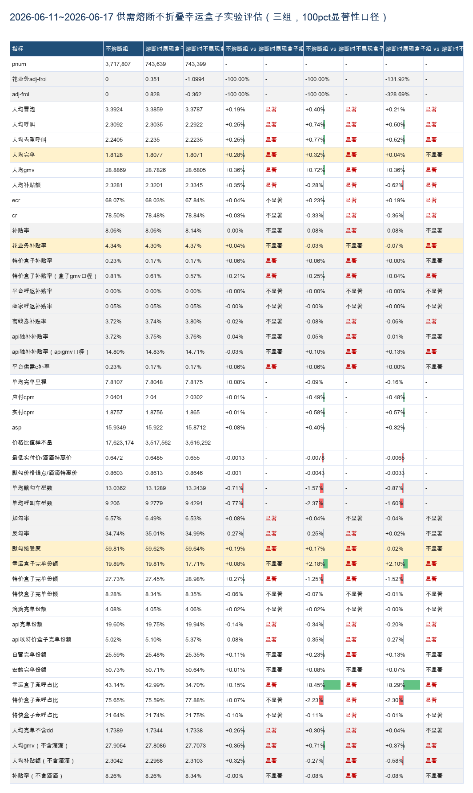
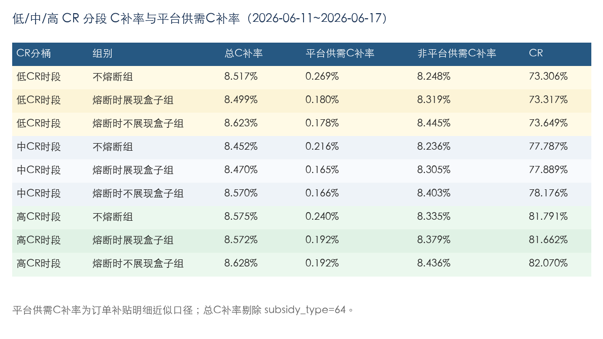

# 【LR26-026】乘客与增长-表单策略-供需熔断不屏蔽幸运盒子-V1.0

[Cooper 原文](https://cooper.didichuxing.com/knowledge/2199610335356/2208653613658)

## 基础信息

| brd文档链接    | [260423 供需熔断不屏蔽幸运盒子](https://cooper.didichuxing.com/docs2/document/2207578804587)   |
| --- | --- |
| 最后通过的策略方案链接    | [260423 供需熔断不屏蔽幸运盒子](https://cooper.didichuxing.com/docs2/document/2207578804587)   |
| 实验链接（评估大师）    | 无   |
| 核心贡献点   | 将供需熔断从幸运盒子的一票否决逻辑，调整为候选决策空间生成阶段的分组控制；实验上同时拆分“不熔断组“、“熔断时展现盒子”、“熔断时不展现盒子”，可单独评估幸运盒子展现修复收益和供需熔断本身收益。    |
| 第一贡献人    | 李一鹏   |
| 共同贡献人   | 周之烁，陈嘉曦   |
| 后续策略负责人    | 李一鹏    |

## 1 背景

- 熔断策略背景：供需熔断本质上是在差供需场景下用于控制呼返 C 补投入的止损策略，以 trace 为粒度执行。

	- 系统分别按城市和格子统计当前发单量（order_count）和应答率（AR）。当 `order_count > order_count_threshold` 且 `AR < AR_threshold` 时，认为对应城市或格子处于差供需状态，并触发熔断。

	- 城市和格子独立判断，最终熔断条件为 `hit_fuse = hit_city_fuse OR hit_grid_fuse`。即城市或格子任一命中都会触发熔断；若两者同时命中，则记录为「城市+格子」熔断。

	- 触发熔断后，将平台呼返、盒子呼返、自营/鸿鹄等实时 C 补统一调整至 100 折，以减少差供需场景下的低钱效补贴和无效呼叫。

- 幸运盒子此前在命中平台供需熔断时会被屏蔽，导致用户侧无法看到幸运盒子候选。当前业务目标下，希望验证“供需熔断不屏蔽幸运盒子”的策略收益。详见 BRD [260423 供需熔断不屏蔽幸运盒子](https://cooper.didichuxing.com/docs2/document/2207578804587)。

## 2 目标 & 约束

- 策略目标

	- 提升幸运盒子完单份额

	- 平台人均完单显著正向

- 约束指标项

	- CR 不显著负向

	- 低 CR 时段 供需C 补率（相对于不熔断组的）节省幅度下降 50% 以内

## 3 技术方案

- 策略方案与 BRD&策略方案一致，参考：[260423 供需熔断不屏蔽幸运盒子](https://cooper.didichuxing.com/docs2/document/2207578804587)

- 工程实现方案参考：[供需熔断不屏蔽盒子-策略说明](https://cooper.didichuxing.com/knowledge/2199610335356/2208140775093)

- 三组策略内容：

| 组别   | 描述   | 实验组名   | 策略含义   | 候选空间处理   |
| --- | --- | --- | --- | --- |
| 熔断时不展现盒子   | 主流量   | `union_stg_v3_max_order_v1_only_box_thre_best_4_fuse_noshow`   | 有供需熔断，且熔断后不展现幸运盒子   | 幸运盒子在命中供需熔断时被屏蔽；特价/呼返等熔断相关空间按方案收缩；默勾不因供需熔断裁剪   |
| 熔断时展现盒子   | 本次优化   | `union_stg_v3_max_order_v1_only_box_thre_best_4_fuse_show`   | 有供需熔断，但熔断后仍展现幸运盒子   | 幸运盒子不因供需熔断被裁剪；特价/呼返等熔断相关空间按方案收缩；默勾不因供需熔断裁剪   |
| 不熔断组   |    | `union_stg_v3_max_order_v1_only_box_thre_best_4`   | 不启用供需熔断策略   | 幸运盒子、特价/呼返、默勾等决策空间不因供需熔断被裁剪   |

## 4 实验结果/评估结果

### 核心实验结果

本次 2026-06-11 \~ 2026-06-17 完整 7 天实验结果看

- **「熔断时展现盒子组」vs「熔断时不展现幸运盒子组」**

	- 目标

		- *幸运盒子完单份额* **+2.10pp（显著）**

		- *人均完单 *+0.04%（不显著）

	- 约束

		- *CR* **-0.36%（显著）**

		- *低 CR 时段 C 补率*节省幅度 **-2.20%**

			- 低 CR 时段 C 补率基本不变，0.180% vs 0.178%

- **「不熔断组」vs「熔断时不展现盒子组」**

	- 目标

		- *幸运盒子完单份额* **+2.18pp（显著）**

		- *人均完单* **+0.32%（显著）****，***FROI* **0.89（钱效极高）**

	- 约束

		- *CR* **-0.33pp（显著）**

		- *低 CR 时段 C 补率*节省幅度 **-100%**

			- 低 CR 时段 C 补率多花 0.09pp，0.269% vs 0.178%

#### 实验主指标

#### C 补率指标

#### 熔断 badcase 指标

| exp_group   | 熔断触发面   | 非全城动调时段 badcase 率   | badcase1（高 CR 但熔断率）   | badcase2（低 CR 但不熔断率）   | 包含全城动调时段 badcase 率   | 全城动调时段占比   | 去重冒泡数   |
| --- | --- | --- | --- | --- | --- | --- | --- |
| 熔断不展现盒子组   | 23.7161%   | 5.6466%   | 3.0786%   | 2.5681%   | 7.4823%   | 18.4992%   | 136,853,370   |
| 熔断展现盒子组   | 25.7497%   | 5.3636%   | 2.8413%   | 2.5224%   | 7.1284%   | 18.8381%   | 136,625,007   |
| 不熔断组   | 0.0000%   | --   | --   | --   | --   | 18.8272%   | 688,123,398   |

「熔断展现盒子组」比「熔断不展现盒子组」熔断比例高 +2.0336pp，但 badcase 更低：5.3636% vs 5.6466%。

- 「熔断展现盒子组」 7 天 AR 是 80.5061%，低于「熔断不展现盒子组」的 80.8127%，低 0.3066pp；由于目前熔断主要根据 AR 判断，所以它的熔断触发面也更高，25.75% vs 23.72%。

- 「熔断展现盒子组」相较于「熔断不展现盒子组」CR 低 0.36pp，因此满足“高 CR 时间片”条件的时间片更少，导致「高 CR + 高熔断」对应的 badcase1 下降；同时 badcase2 也小幅下降，最终整体 badcase 率下降

| 实验组   | call_cnt   | answer_cnt   | AR   | 相对不熔断组   |
| --- | --- | --- | --- | --- |
| 不熔断组   | 10,016,817   | 8,066,588   | 80.5305%   | baseline   |
| 熔断时展现盒子组   | 1,999,837   | 1,609,990   | 80.5061%   | -0.0244pp   |
| 熔断时不展现盒子组   | 1,990,171   | 1,608,311   | 80.8127%   | +0.2823pp   |

### 实验方案

|    | 内容    | 备注    |
| --- | --- | --- |
| 实验方式    | 乘客 pid 随机分流    | 参考实验文档：[联合决策熔断实验260610](https://cooper.didichuxing.com/knowledge/2199610335356/2208282136885)   |
| 分流方式    | pid 随机分流    | - 实验层：联合决策层；   - 切 seed 方式：不 by 天切 seed，但要重新分流     |
| 每天翻转（默认形式），时间片大小    | 非时间片实验，不 by 天切 seed    | ——    |
| 分流策略内容    | - **不熔断组**：   	- *流量 25%*   	- 默勾 CR 系数 by 城市最优，幸运盒子 CR 系数 0.4，CR 模型版本 `group_cr_v27`，熔断配置 `no_fuse`，幸运盒子配置 `v3_luck_cr_ratio_4`，默勾策略配置 `acc_cr_threshold_for_v3_ratio_best`。   - **熔断时不展现盒子组**：   	- *流量 5%*   	- 默勾 CR 系数 by 城市最优，幸运盒子 CR 系数 0.4，CR 模型版本 `group_cr_v27`，熔断配置 `fuse_no_show`，幸运盒子配置 `v3_luck_cr_ratio_4`，默勾策略配置 `acc_cr_threshold_for_v3_ratio_best`。   - **熔断时展现盒子组**：   	- *流量 5%*   	- 默勾 CR 系数 by 城市最优，幸运盒子 CR 系数 0.4，CR 模型版本 `group_cr_v27`，熔断配置 `fuse_always_show`，幸运盒子配置 `v3_luck_cr_ratio_4`，默勾策略配置 `acc_cr_threshold_for_v3_ratio_best`。     | 本次 LR 只评估这三组；三组的流量分别为 25%、5%、5%    |
| 实验周期    | 2026-06-11 \~ 2026-06-17，7 天    | 完整一周    |
| 流量范围              | 流量端：小猪端    | 全国    |
| 实验生效品类：幸运盒子    | 其他受影响候选空间以 BRD 和工程实现方案为准    |
| 分单场景：默认全部   | ——   |
| 分城市 or 全国：全国    | ——    |
| 实验生效商家：全部商家   |    |
| 是否联动实验    | 联合决策层实验    | 不涉及其他实验联动   |
| 评估人    | 算法：李一鹏   | - 评估方式：直接评估；   - 评估周期：2026-06-11 \~ 2026-06-17；   - 城市范围：全国；    |

### 收益链路归因分析

- **熔断时展现盒子组 vs 熔断时不展现盒子组**：

	- ==幸运盒子完单份额恢复链路==：命中供需熔断 -> 熔断时展现盒子组保留幸运盒子候选空间 -> 幸运盒子作为低价品类的展现修复 -> *幸运盒子竞呼占比 ***+8.29pp（显著）** -> *幸运盒子完单份额* **+2.10pp（显著）**

	- ==完单不显著提升链路==：熔断时展现幸运盒子，幸运盒子低价品类恢复 -> *人均冒泡* **+0.12%（显著）**-> 由于幸运盒子的恢复，乘客发单意愿提升，但司机侧接驾意愿下降 -> *CR* **-0.36pp（显著）****、** *ECR* 正向**（+0.19pp 显著）**-> CR 的折损被 ECR 和 人均冒泡的提升部分抵消，人均完单**不显著** **+0.04%** 

	- ==CR 负向链路==：幸运盒子展现面提升 -> 低价品类带来司机接驾或成交质量压力 -> CR **-0.36pp（显著）**

	- ==低 CR 时段 C 补率节省幅度变化链路==：

		- 熔断时无呼返，展现幸运盒子与否不影响该单cost，平台供需 C 补率几乎不变

	- 平台C补率微降：幸运盒子低价品类恢复 -> *幸运盒子竞呼占比* **+8.29%（显著）**-> 幸运盒子通过定价而非补贴实现低价，份额提升使平台C补率下降 -> 平台C补率-0.08pp

- **不熔断组 vs 熔断时不展现盒子组**：

	- ==幸运盒子完单份额恢复链路==：无供需熔断，幸运盒子正常展现 -> *幸运盒子竞呼占比 ***+8.45pp（显著）** -> *幸运盒子完单份额* **+2.18pp（显著）**

	- ==完单显著提升链路==：不熔断 -> 不再因为供需熔断屏蔽幸运盒子，完整保留低价品类候选空间 -> 幸运盒子作为最低价品类重新进入用户可见空间，**默勾水位**下降 **-0.0043** ；**幸运盒子竞呼占比** **+8.45pp（显著）**、**幸运盒子完单份额** **+2.18pp（显著）**-> 低价吸引力增强，用户**默勾接受度** **+0.17pp**（显著）、**人均冒泡** **+0.40%**（显著） 、**ECR** **+0.23pp（显著）**、**人均去重呼叫** **+0.77%（显著）** -> 虽然 **CR** **-0.33pp（显著）**，但 冒泡、ECR提升覆盖了 CR 折损 -> **平台人均完单** **+0.32%（显著）**

	- ==CR 负向链路==：幸运盒子展现面提升 -> 低价品类带来司机接驾或成交质量压力 -> CR **-0.33pp（显著）**

	- ==低 CR 时段 C 补率不再节省==：多花 0.09pp（0.269% vs 0.178%）

	- 平台C补率微降：幸运盒子低价品类恢复 -> *幸运盒子竞呼占比* **+8.45%（显著）**-> 幸运盒子通过定价而非补贴实现低价，份额提升使平台C补率下降 -> 平台C补率-0.08pp

### 备注

- **两个 C 补率口径的差异**：

	- 总 C 补率对应评估结果中的整体 C 端补贴率，覆盖所有 C 端补贴成本；

	- 平台供需 C 补率只统计平台供需相关 C 补（特价盒子相关 C 补 + 平台呼返相关 C 补），是总 C 补中的一个子口径。

- **业务方反馈**：

	- **供需C（相关方 - 叶磊、马昕昕）**：

		- 供需 C 关注点主要是供需熔断带来的 C 补节省 & CR 风险，以及节省成本与完单收益之间是否划算，但也认可当前增长目标下需要评估幸运盒子恢复展现对乘客增长和完单的收益。

		- 对于供需 C 而言，候选放量主要是「熔断时展现盒子组」和「不熔断组」，倾向于**「熔断时展现盒子组」**

		- **已与叶磊完成沟通，可扩「不熔断组」**

	- **品类（相关方 - 孙霁虹）**：

		- 品类核心关注的是幸运盒子作为低价品类的展现面、完单份额等，以及这些指标能否最终转化为平台完单收益。

		- 对于品类而言，候选放量主要是「熔断时展现盒子组」和「不熔断组」，倾向于**「不熔断组」**

	- **表单（相关方 - 周之烁）**

		- 表单核心关注的是默勾接受度和人均完单等指标

		- 对于表单而言，候选放量主要是「熔断时展现盒子组」和「不熔断组」，倾向于**「不熔断组」**

## 5 放量决策

|    |    | 预期扩量时间节奏   | 实际扩量时间   | 放量暂停点详情   | 放量暂停点效果评估   | 是否需要设置长期对照组（默认不需要，此列无需填写）   |
| --- | --- | --- | --- | --- | --- | --- |
|    |    |    | LR通过后，根据实际情况，填写这3列   |    |
| 放量决策意见   | 决策人   | 周之烁   | ——   | ——   | ——   | ——   |
| 决策意见：  - 通过   - 不通过，给出原因   - 扩大流量实验    | 通过   |    |    |    |    |
| 放量需要周知的利益相关方   | - 平台供需：马昕昕   - 行业策略：孙霁虹    | ——   | ——   | ——   | ——   | ——   |
| 放量策略   | eg. 实验组1  放量组收益   | 全量「不熔断组」   | ——   | ——   | ——   | ——   |

## 6 引用和鸣谢

感谢工程、运营和算法同学的技术支持和方案讨论。

## 7 后续规划
