# 【LR26-027】乘客与增长-技术建设-平台联合决策ECR模型架构升级-V1.0

[Cooper 原文](https://cooper.didichuxing.com/knowledge/2199610335356/2208910130893)

| brd文档链接 <br> | -- <br> |
| --- | --- |
| 最后通过的策略方案链接 <br> | 组内分享文档：[ECR 多折扣模型架构升级：从 Prediction Loss 到可信排序](https://cooper.didichuxing.com/didocs/2208560385385) <br> |
| 实验链接 <br> | 本文为离线探索，无在线 A/B 实验链接 <br> |
| 核心贡献点 <br> | 1. **提出基于相关性因果排序目标的 ARCR 方法**：本文***首次***将**模型预测增量**与**因果排序伪标签**之间的批内 Pearson 相关性作为可微排序目标（据当前有限调研，我们尚未发现完全相同的公开实现）。我们提出了 **ARCR（Assignment-Robust Causal Ranking，实验分组鲁棒/treatment ratio 鲁棒的因果排序**）架构范式，重点解决排序损失可能诱导模型利用实验分组信息“走捷径”、造成离线指标虚高的问题。 <br><br>2. **建立因果评估指标的可信程度量化方法**：对于 trt_ratio 的合理性判断，本文将人工经验判断转化为若干量化指标，同时检查排序曲线上实验组/对照组比例的 **90 分位偏离（p90(ratio_dev) ）、最大偏离（max(ratio_dev)）**，并结合多个随机种子评估结果稳定性，形成“因果效果指标提升，且未发现明显实验分组偏移”的双重验收标准。<!--评论:[{"u":"menchang","c":"需要在方案设计中明确写明这一部分的工作"}] --> <br><br> |
| 第一贡献人 <br> | 李一鹏 <br> |
| 共同贡献人 <br> | 缪可可、周之烁、陈嘉曦 <br> |
| 后续策略负责人 <br> | -- <br> |

# **一、背景**

## **1.1 业务背景**

平台联合决策的补贴策略需要同时回答两个问题：给哪些乘客补贴，以及分别提供多大折扣。在补贴预算有限的情况下，策略目标不是简单选择更深的折扣，而是从所有可选的“乘客—折扣档位”动作中，优先投放那些相较于不补贴能够带来更多新增呼叫、且每单位补贴成本收益更高的动作。

ECR 模型为上述决策提供效果预估与排序依据。模型首先估计同一乘客在不同折扣档位下的呼叫概率及其增量效果；在离线评估阶段，再结合相邻折扣档位的呼叫增量与补贴成本，构造边际 ROI，并据此衡量模型对补贴动作的排序准确性。排序越准确，有限的补贴预算就越能集中投向高价值动作。因此，补贴动作排序能力是本轮模型迭代的重点。

本 LR 在 CFR / DRCFR 的基础上，离线探索了兼顾**实验分组鲁棒性与因果排序能力的方法 ARCR**：

- **实验分组鲁棒性**：要求按模型分数排序后，实验组与对照组的累计样本比例曲线保持相对平稳，避免排序结果对实验分组产生明显的系统性偏移。

- **因果排序能力**：基于 MTAUCC 的评估思想，多 treatment 营销场景的决策核心是准确排序不同“乘客—相邻折扣边”动作的边际 ROI。本次工作围绕这一决策目标，探索了多种因果排序信号，包括 treatment 相对 control 的 OOF-DR uplift 排序、分边排序归一化，以及相邻折扣边际 ROI 约束等。

## **1.2 现状**

本 LR 以 CFR 和 DRCFR 作为两个基线模型。[CFR 是当前 ECR 线上模型，也是本轮迭代的效果基线](https://cooper.didichuxing.com/knowledge/2199610335356/2206140619069)；DRCFR 是尚未上线的离线对照模型，也是实现 DRCFR-ARCR 的基础模型。两个基线使用相同的数据划分和多折扣评估口径，以下为其在按乘客隔离的离线评估集上的结果：

| **指标** <br> | **CFR 基线值** <br> | **DRCFR 基线值** <br> |
| --- | ---: | ---: |
| aucc <br> | 0.3432 <br> | 0.2724 <br> |
| qini <br> | 0.1927 <br> | 0.1733 <br> |
| dini <br> | 0.2086 <br> | 0.1954 <br> |
| ate_error <br> | 0.0072 <br> | 0.0053 <br> |
| **call_algo_mtaucc** <br> | **0.5866** <br> | **0.5862** <br> |
| call_random_mtaucc <br> | 0.4295 <br> | 0.4295 <br> |

离线结果显示，CFR 与 DRCFR 的 call_algo_mtaucc 分别为 0.5866 和 0.5862，差异仅为 0.0004，补贴动作排序能力基本一致。两个模型都能较稳定地刻画折扣变化与呼叫概率之间的关系，但现有训练目标仍以各折扣档位的效果预测为主，*尚未直接优化补贴动作的优先级*。

| 模型 <br> | call mtaucc <br> | qini by T <br> |
| --- | --- | --- |
| CFR baseline <br> | 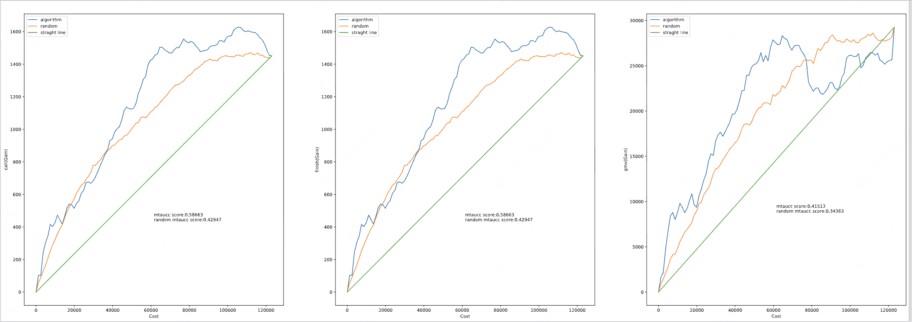 <br> | 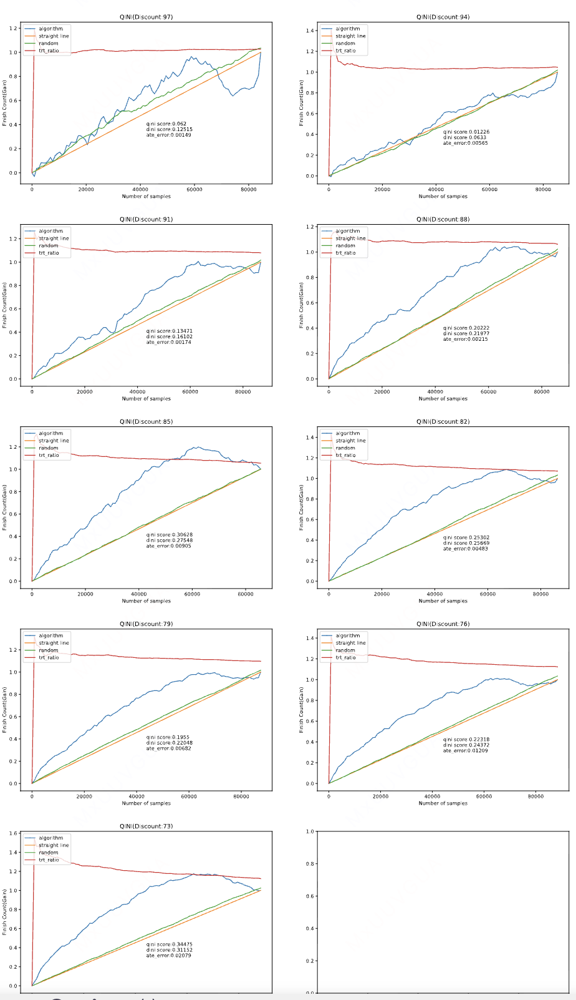 <br> |
| DRCFR baseline <br> | 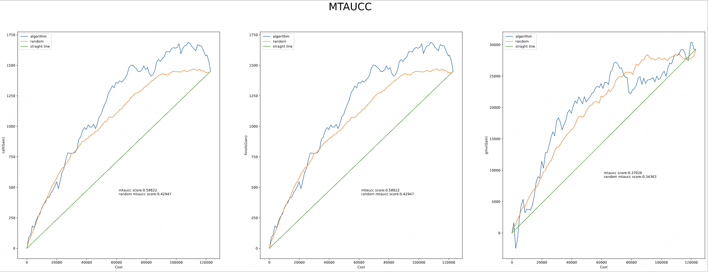 <br> | 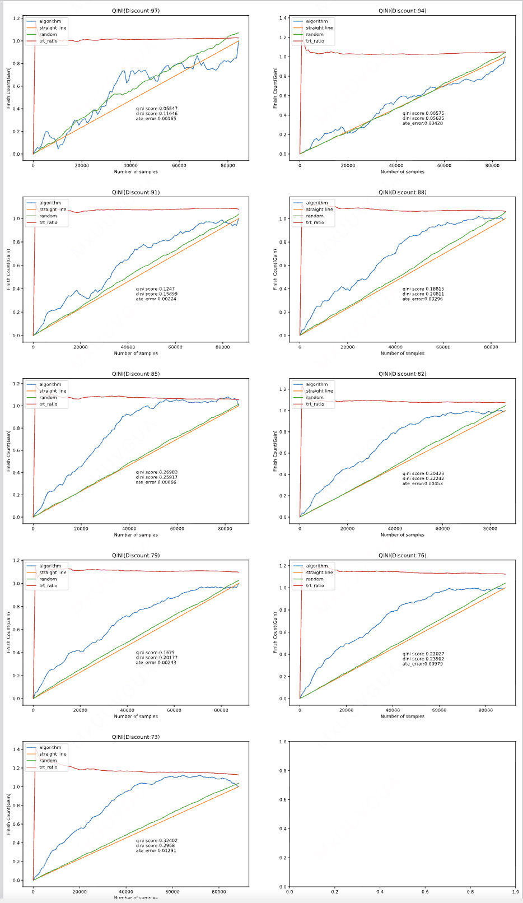 <br> |

## **1.3 前序实验&分析**

CFR / DRCFR 的基础损失主要用于拟合观测结果、平均处理效应、组间平衡和折扣响应单调性：

$$\mathcal{L}_{\mathrm{base}}  =  \mathcal{L}_{\mathrm{factual}}  +  \lambda_{\mathrm{imb}}\mathcal{L}_{\mathrm{imbalance}}  +  \lambda_T\mathcal{L}_T  +  \lambda_{\mathrm{ATE}}\mathcal{L}_{\mathrm{ATE}}  +  \lambda_{\mathrm{mono}}\mathcal{L}_{\mathrm{mono}}$$

但核心业务指标 call_algo_mtaucc 关注的不是单个折扣档位的预测是否准确，而是模型能否按照预测边际 ROI，将更值得补贴的“乘客—折扣档位”组合排在前面。因此，基础模型预测得更准确，并不必然带来更好的补贴动作排序。

为了让训练过程直接学习合理的 treatment 排序，我们约束模型预测增益与因果收益伪标签保持一致的排序方向。具体而言，对于折扣档位$$k$$ 和对照档位$$c$$，模型预测的呼叫增量为：

$$s_{i,k}=\hat p_k(x_i)-\hat p_c(x_i)$$

同时，为每个样本构造**因果收益伪标签**$$g_{i,k}$$。为了保持排序方向一致，我们引入了 CorrRank loss。**CorrRank（Correlation-based Ranking Loss）**是一种通过**相关性**直接学习补贴动作优先级的排序损失。CorrRank 在每个训练批次内计算模型预测增量与因果伪标签之间的 Pearson 相关性，并将其转化为损失：

$$\mathcal{L}_{\mathrm{CorrRank}} = 1- \frac{1}{|\mathcal K|} \sum_{k\in\mathcal K} \operatorname{corr} \left( s_{:,k},g_{:,k} \right)$$

**相关性越高，表示伪标签较高的样本也获得了较高的模型预测增量**。与直接拟合伪标签数值不同，CorrRank 不要求拟合伪标签的绝对尺度，而是通过提高预测增量与伪标签之间的批内 Pearson 相关性，鼓励两者保持一致的整体变化方向；与两两比较的 pairwise 排序损失相比，它不需要构造样本对，计算复杂度更低，也更容易扩展到多个折扣档位。

最开始我们尝试用 IPW 的方式构造伪标签：

$$g_{i,k} = A_{i,k} =Y_i\cdot (\frac{\mathbf{1}(T_i=k)}{p_k}-\frac{\mathbf{1}(T_i=c)}{p_c})$$

该方案曾将 call_mtaucc 提升至 1.1267，但 QINI 曲线中的实验组/对照组比例明显前高后低，说明模型可能**利用了实验分组信息，而非真正识别出高价值补贴动作**。

| 样本类型 <br> | 伪标签$$g_{i,k}$$ <br> | 伪标签方向 <br> |
| ---: | ---: | --- |
| $$T_i=k, Y_i=1$$ <br> | $$+\frac{1}{p_k}$$ <br> | 大正值 <br> |
| $$T_i=c, Y_i=1$$ <br> | $$-\frac{1}{p_c}$$ <br> | 大负值 <br> |
| $$Y_i=0$$ <br> | 0 <br> | 弱/无信号 <br> |

这些证据说明，CorrRank 本身只负责让模型学习伪标签给出的顺序：如果伪标签携带实验分组信息或受到极端残差影响，模型也可能把这些偏差放大为排序结果。

| 模型 <br> | call mtaucc <br> | qini by T <br> |
| --- | --- | --- |
|  IPW CorrRank 排序损失 <br> | 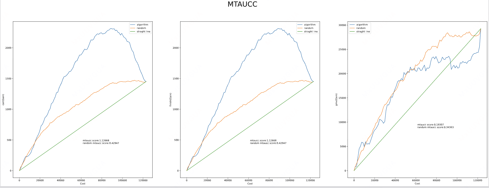 <br> | 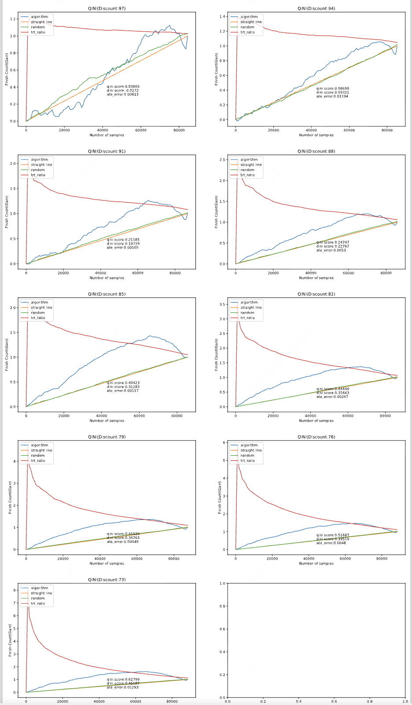 <br> |

结合上述实验现象，问题主要来自以下三个方面：

- **训练目标与排序指标错配**：基础预测损失负责预测不同折扣下的呼叫概率，不能直接约束高边际 ROI 动作排在前面。

- **排序伪标签携带实验分组信息**：原始 IPW 伪标签需要使用样本实际所属的实验组或对照组。在有限样本和小批次训练中，模型可能利用与分组偶然相关的特征完成排序，使高分样本中的实验组/对照组比例发生偏斜。

# **二、目标 & 约束**

## **2.1 策略目标**

新模型的 call_mtaucc 相对 CFR 基线提升不低于 10%。CFR 基线为 0.5866，因此目标值应不低于 0.6453。

## **2.2 约束指标**

排序收益必须通过 QINI 实验组/对照组比例检查：p90(ratio_dev) <= 1.20 且 max(ratio_dev) <= 1.50

> 最终使用时，建议人工再次校验完整曲线形态，不能明显劣于基线。

其中，ratio_dev 表示某个排序前缀中的实验组/对照组比例相对全量样本比例的偏离倍数：1.00 表示没有偏离，1.20 和 1.50 分别表示偏离 20% 和 50%。沿排序曲线会检查多个前缀截点，p90(ratio_dev) 是这些截点偏离值的第 90 分位数，该值不超过 1.20，表示至少 90% 的前缀截点偏离不超过 20%。max(ratio_dev) 用于约束最坏的前缀截点，要求其偏离不超过 50%。

# **三、技术方案<!--评论:[{"u":"menchang","c":"技术方案中的各章节与核心贡献点的对应关系是什么"}] -->**

> 本节数字来自探索阶段的单因素对照，配置与第 4.2 节最终版本消融不同，因此仅用于说明模块演进过程；正式贡献判断以第 4.2 节为准。

## **3.0 评估指标计算方式**

- **call mtaucc**

> [RAS-AUCC：智能营销场景Uplift模型多Treatment评估指标改进](https://cooper.didichuxing.com/knowledge/share/page/XjpdgbO97Ltk#页面《RAS-AUCC：智能营销场景Uplift模型多Treatment评估指标改进》)

call mtaucc用于衡量模型按预测边际 ROI 排序后，相对线性 baseline 的 call uplift 曲线面积提升。discount arm 集合为：

$$D = \{100, 97, 94, 91, 88, 85, 82, 79, 76, 73\}$$

其中 100 是 control。模型对样本$$i$$ 和 discount$$d$$ 输出预测：

$$\hat y_{i,d}$$

对相邻 discount 动作$$d_{k-1} -> d_k$$，预测边际收益为：

$$\Delta \hat y_{i,k} = \hat y_{i,d_k} - \hat y_{i,d_{k-1}}$$

预测边际成本为：

$$\Delta c_{i,k} = \hat y_{i,d_k}\cdot price_i\cdot(1-d_k/100) - \hat y_{i,d_{k-1}}\cdot price_i\cdot(1-d_{k-1}/100)$$

边际 ROI 为：

$$r_{i,k} = \frac{\Delta \hat y_{i,k}}{\Delta c_{i,k}}$$

实现中会把所有有效的样本-边际动作展开为集合$$A={(i,k)}$$，按$$r$$ 降序排序。对排序前$$m$$ 个动作，记$$T_a$$ 表示该动作是否来自 treatment 组，$$Y_a$$ 是 call label，$$\alpha_a$$ 是展开样本的边际权重，$$w_a$$ 是 balance weight：

$$N_1(m)=\sum_{j=1}^{m}\alpha_{a_j}w_{a_j}T_{a_j}$$

$$N_0(m)=\sum_{j=1}^{m}\alpha_{a_j}w_{a_j}(1-T_{a_j})$$

$$S_1(m)=\sum_{j=1}^{m}\alpha_{a_j}w_{a_j}Y_{a_j}T_{a_j}$$

$$S_0(m)=\sum_{j=1}^{m}\alpha_{a_j}w_{a_j}Y_{a_j}(1-T_{a_j})$$

累计 call gain 为：

$$G(m)=S_1(m)\cdot \frac{N_0(m)}{N_1(m)}-S_0(m)$$

其中$$N0/N1$$ 是 treatment/control 样本量校正项。累计成本同样按排序前缀计算：

$$C(m)=C_1(m)\cdot \frac{N_0(m)}{N_1(m)}-C_0(m)$$

最终得到算法曲线$${(C(m),G(m))}$$。用梯形法近似面积：

$$A_{\text{algo}}\approx \sum_m \frac{G(m)+G(m-1)}{2}\cdot(C(m)-C(m-1))$$

baseline 是连接算法曲线首尾点的一条直线，面积为$$A_{base}$$：

$$call\_algo\_mtaucc=\frac{A_{\text{algo}}-A_{\text{base}}}{A_{\text{base}}}$$

直观解释：模型是否能把“单位补贴成本带来更多 call uplift”的动作排到前面。

- **qini treatmet ratio**

QINI 是单 treatment 相对 control 的 uplift 排序指标。它按 ITE 降序扫描样本，累计 treatment-control outcome gain，并和线性 baseline 比面积。本文更关注它的 QINI treatment ratio 部分。

QINI treatment-ratio curve 的计算方式是：对每个 edge k vs control，按模型 uplift score 降序排列：

$$u_k(x)=pred_k(x)-pred_{control}(x)$$

对每条 treatment-control 边，在每个有效排序前缀$$k$$ 上：

$$\text{treatment ratio}_k = \frac{\text{前缀内累计 treatment 数}}{\text{前缀内累计 control 数}}$$

整条边的最终比例为：

$$\text{treatment ratio}_{\mathrm{final}} = \frac{\text{全样本 treatment 数}}{\text{全样本 control 数}}$$

然后计算对称倍数偏离：

$$\text{ratio dev}_k =  \max\left(   \frac{\text{treatment ratio}_k}{\text{treatment ratio}_{\mathrm{final}}},   \frac{\text{treatment ratio}_{\mathrm{final}}}{\text{treatment ratio}_k}   \right)$$

最终，对 100 个检查点的 ratio dev 计算 p90 和 max，再取九条边中的最差值作为模型汇总指标。在我们的任务中，约束 p90(ratio_dev) <= 1.20，max(ratio_dev) <= 1.50。

## **3.1 数据来源与划分**

数据来自联合决策随机对照实验（RCT），折扣字段为 `uabox_discount`，其中 100 档为对照组。数据按照 `passenger_id` 划分，确保训练集与评估集中的乘客完全隔离：

| **数据项** <br> | **口径** <br> | **说明** <br> | **规模** <br> |
| --- | --- | --- | ---: |
| 训练集 <br> | 2025-08-25 至 2025-09-08 <br> | 用于训练 DRCFR-ARCR，包括 OOF-DR target 和 DRCFR 模型 <br> | 1,026,019 条样本 / 248,734 名乘客 <br> |
| 评估集 <br> | 按 `passenger_id` 与训练集完全隔离 <br> | 仅用于离线指标评估和实验组/对照组比例检查 <br> | 445,460 条样本 / 107,698 名乘客 <br> |
| 折扣档位 <br> | 73、76、79、82、85、88、91、94、97、100 <br> | 100 档为对照组，其余 9 档为实验组 <br> | 10 档 <br> |
| 特征 <br> | 10 个类别特征、304 个数值特征 <br> | 用于模型训练 <br> | 共 314 个 <br> |

## **3.2 FiLM 轻量校准**

DRCFR 的不同折扣预测头共享同一套乘客特征表示，但不同相邻折扣组合对特征的关注可能存在差异。音视频领域中的 [FiLM（Feature-wise Linear Modulation）](https://arxiv.org/abs/1709.07871)方法在共享表示与各折扣预测头之间增加一层轻量校准，使每个预测头可以对共享表示做小幅调整：

$$h_j^{\mathrm{FiLM}}  =  h\odot\left(1+\lambda_{\mathrm{FiLM}}\gamma_j\right)  +  \lambda_{\mathrm{FiLM}}\beta_j$$

其中，$$h$$ 是模型学习到的共享乘客表示，$$j$$ 表示不同的相邻折扣预测头，$$\gamma_j$$ 和$$\beta_j$$ 是对应预测头的可学习参数，$$\lambda_{\mathrm{FiLM}}=0.25$$ 用于控制调整幅度。该模块不会针对每条样本动态生成参数，只为*不同预测头*提供固定的轻量校准。

在同一组消融实验中，保留 FiLM 时 call_mtaucc 为 0.6991，移除 FiLM 后为 0.6853，说明 FiLM 能带来小幅收益。但实际学习到的调整幅度较小，因此最终版本保留 FiLM，同时将其定位为低成本的辅助校准组件，而不是 ARCR 的核心因果排序贡献。

## **3.3 ARCR 排序监督设计**

ARCR 的目标是让模型在准确预测不同折扣档位呼叫概率的基础上，进一步学会可靠地排列补贴动作的优先级。整体方案分为两层：

- 第一层从伪标签构造、排序归一化和相邻折扣筛选三个方面提高排序监督信号的可靠性；

- 第二层约束高分样本中的实验组/对照组比例，防止模型利用实验分组差异获得虚高的排序收益。

此外，再通过约束相邻折扣的边际 ROI 变化趋势，提高不同随机种子下的结果稳定性。

### **3.3.1 排序监督总体结构**

DRCFR-ARCR 的训练结构如图所示

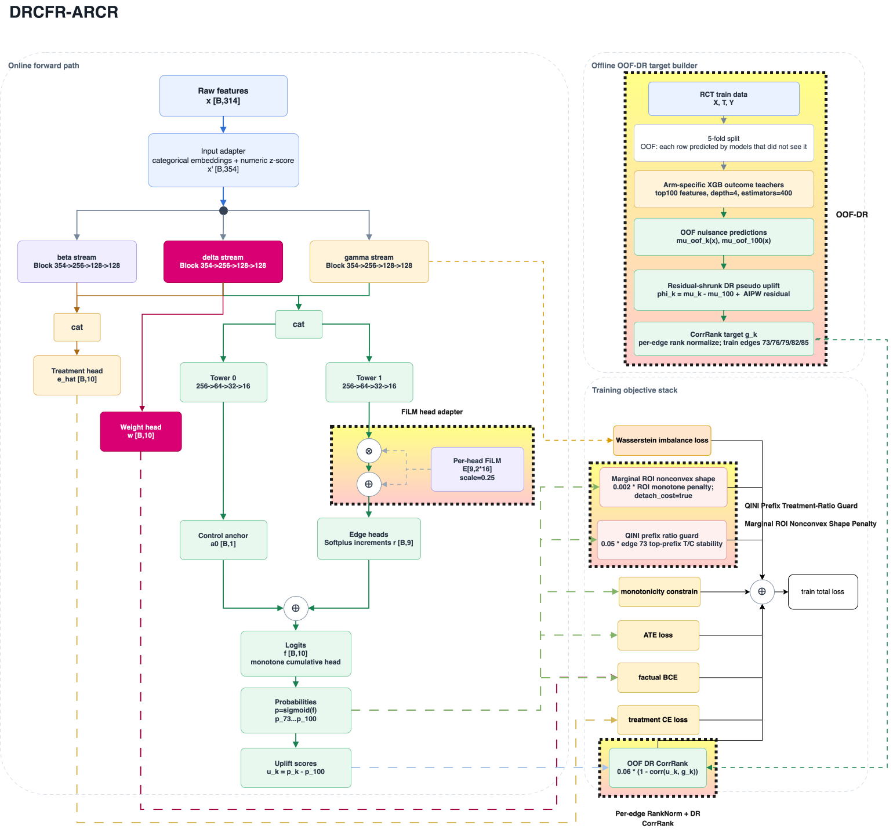

五个 ARCR 核心模块的作用如下：

| **模块** <br> | **中文说明** <br> | **解决的问题** <br> | **关键配置** <br> |
| --- | --- | --- | --- |
| OOF-DR，Out-of-Fold Doubly Robust <br> | 样本外双重鲁棒估计 <br> | 通过样本外交叉拟合避免辅助预测使用当前样本结果；结合结果模型与倾向概率校正，构造每个折扣边的因果收益伪标签 <br> | 五折交叉拟合 + 标准 DR 估计构造伪标签  <br> <br> |
| Per-edge RankNorm <br> | 相邻折扣内排序归一化 <br> | 消除不同相邻折扣组合之间的数值尺度差异，防止极端值支配排序损失 <br> | 各折扣边分别进行 rank norm 映射至近似 \[-1,1\] <br> |
| High-SNR Edge Mask <br> | 高信噪比折扣组合筛选 <br> | 避免增量信号较弱的折扣组合将噪声顺序带入训练 <br> | 仅使用 73、76、79、82、85 档 <br> |
| QINI Prefix Treatment-Ratio Guard <br> | 高分区间实验组/对照组比例约束 <br> | 防止模型利用实验分组差异获得虚高的排序收益 <br> | 权重 0.05；允许偏离 10%；检查排序前 3%～20% <br> |
| mROI Shape Penalty <br> | 相邻折扣边际 ROI 递减约束 <br> | 约束相邻折扣的预测边际 ROI 呈合理的递减形态，减少非凸或局部反常的折扣响应 <br> | 损失权重 0.002；非凸惩罚权重1.0；ROI 截断至 10；成本项停止梯度 <br> |

### **3.3.2 五个核心模块**

**模块一：样本外双重鲁棒估计（OOF-DR，Out-of-Fold Doubly Robust）**

排序训练首先需要为每条样本构造一个可比较的因果收益伪标签。**如果辅助模型曾使用当前样本进行训练，伪标签可能携带模型对该样本的记忆，造成信息泄漏**。为此，训练集内部采用五折交叉拟合：每次使用其中四折训练各折扣档位的 XGBoost 辅助模型，再对剩余一折生成预测。辅助模型从 314 个特征中选取前 100 个，参数为 `max_depth=4`、`n_estimators=400`。这样，每条样本的辅助预测都来自一个未使用该样本训练的模型。

由此得到样本$$i$$ 在折扣档位$$k$$ 下的样本外呼叫概率预测：

$$\hat\mu^{\mathrm{oof}}_k(x_i)$$

在此基础上，采用标准双重稳健方法构造因果收益伪标签。伪标签由两部分组成：第一部分是辅助模型预测的实验档位与对照档位呼叫概率之差；第二部分利用样本的实际呼叫结果进行逆倾向加权残差修正：

$$\phi^{\mathrm{DR}}_{i,k}=  \hat\mu^{\mathrm{oof}}_k(x_i) -  \hat\mu^{\mathrm{oof}}_c(x_i)  +  \frac{\mathbb{1}[T_i=k]}{\hat p_k}  \left(Y_i-\hat\mu^{\mathrm{oof}}_k(x_i)\right) +  \frac{\mathbb{1}[T_i=c]}{\hat p_c}  \left(Y_i-\hat\mu^{\mathrm{oof}}_c(x_i)\right).$$

其中，$$c$$ 表示 100 档对照组，$$T_i$$ 和$$Y_i$$ 分别表示样本实际所属组别和实际呼叫结果，$$\hat p_k$$ 表示折扣档位$$k$$ 在训练集中的样本占比。

**模块二：相邻折扣内排序归一化（Per-edge RankNorm）**

排序损失关注的是样本之间的先后顺序，而不是伪标签的绝对数值。由于不同相邻折扣组合的伪标签尺度不同，模型可能优先拟合数值波动较大的组合。为消除这一影响，方案在每个相邻折扣组合内分别排序，并将排序结果映射到近似 `[-1,1]`： 

$$g_{i,k}  =  2\cdot  \frac{\operatorname{rank}_k(\phi^{(\alpha)}_{i,k})}{n_k}  -1$$

> 代码实现用的是 np.linspace(-1.0, 1.0, num=n)

其中，$$\operatorname{rank}_k$$ 表示样本在第 $$k$$ 个相邻折扣组合内的排序位置，$$n_k$$ 表示该组合的样本数。归一化后，不同组合处于相同尺度，同时仍保留各自内部的样本顺序。在同样只使用高信噪比相邻折扣组合的条件下，未经归一化时 call_mtaucc 为 0.5712，加入排序归一化后提升至 0.7302。

**模块三：高信噪比相邻折扣筛选（High-SNR Edge Mask）**

并非所有相邻折扣组合都能提供可靠的排序信号。方案使用“平均增量相对于样本波动的大小”衡量每个相邻折扣组合的信噪比：

$$SNR_e  =  \frac{|\operatorname{mean}(\phi_{i,e})|}  {\operatorname{std}(\phi_{i,e})+\epsilon}$$

其中，$$\phi_{i,e}$$ 表示样本$$i$$ 在相邻折扣组合$$e$$ 上的伪增量。分子越大，说明平均增量信号越明显；分母越大，说明样本之间的波动越强。

根据该指标，73、76、79、82、85 档对应的相邻折扣组合参与排序损失训练，88、91、94、97 档对应的组合不参与。使用全部相邻折扣组合时，call_mtaucc 为 0.7040；仅保留高信噪比组合后提升至 0.7302。这说明弱信号组合的问题不只是训练权重过大，其样本排序方向本身也不够稳定。

**模块四：高分区间实验组/对照组比例约束（QINI Prefix Treatment-Ratio Guard）**

前三个模块提高了排序伪标签的质量，但仍不能完全消除实际实验分组信息的影响。该问题在 73 档最明显，因此训练时针对 73 档与 100 档样本，按照模型预测增益从高到低排序，并检查排序前 3%、5%、8%、10%、12%、15% 和 20% 样本中的实验组/对照组比例。

全量样本与高分区间的实验组/对照组比例分别为：

$$R_{\mathrm{full}}  =  \frac{\sum_i \mathbb{1}[T_i=73]}  {\sum_i \mathbb{1}[T_i=100]}$$

$$R_{\mathrm{top},q}  =  \frac{\sum_i a_{i,q}\mathbb{1}[T_i=73]}  {\sum_i a_{i,q}\mathbb{1}[T_i=100]}$$

其中，$$a_{i,q}$$ 表示样本$$i$$ 是否位于预测分数最高的前$$q$$ 比例内，训练时使用平滑权重近似这一筛选过程。该约束不要求实验组与对照组数量相等，而是要求高分区间的两组比例接近全量样本比例；只有偏离超过 10% 时才施加惩罚。loss 设计如下：

$$\mathcal{L}_{\text{prefix}} = \frac{1}{|Q|}\sum_{q \in Q}\left[\max\left(0,\left|\log\frac{R_{\text{top},k,q}}{R_{\text{full},k}}\right|-\log(1.10)\right)\right]^2$$

加入足够强的比例约束后，call_mtaucc 从 0.7302 回落至 0.6871，但实验组/对照组比例由未通过检查变为通过检查，即以部分指标收益换取排序结果的可信度。

**模块五：边际投入产出比递减约束（mROI Shape Penalty）**

在四个核心模块之外，方案还增加了边际投入产出比递减约束。其含义是：随着折扣逐步加深，每增加一档补贴所带来的边际 ROI 不应反而升高：

$$\operatorname{ROI}_{100\rightarrow97}  \ge  \operatorname{ROI}_{97\rightarrow94}  \ge  \cdots  \ge  \operatorname{ROI}_{76\rightarrow73}$$ 

loss 为：

$$\mathcal{L}_{\text{mROI}} = \mathbb{E}_{i,j}\left[\max\left(0,\text{ROI}_{i,j+1}-\text{ROI}_{i,j}+m\right)\right]^2$$

加入该约束后，三个随机种子的 call_mtaucc 平均值从 0.6628 提升至 0.6663，最大差距从 0.0750 缩小至 0.0647。它的主要作用不是抬高单次最好结果，而是改善较弱结果并降低不同随机种子之间的波动。

## **3.4 训练算法**

DRCFR-ARCR 以 DRCFR 为基础，训练目标由两部分组成：

- 第一部分沿用 DRCFR 的基础损失，负责观测结果预测、处理组预测、组间表征平衡、平均处理效应一致性和折扣响应单调性；

- 第二部分加入 ARCR 的排序与可信性约束，使模型在学准呼叫概率的同时，也能可靠地排列补贴动作优先级。

最终训练目标如下：

$$\mathcal{L}  =  \mathcal{L}_{\mathrm{factual}}  +  0.0002\mathcal{L}_{\mathrm{imbalance}}  +  0.01\mathcal{L}_T  +  0.001\mathcal{L}_{\mathrm{ATE}}  +  0.5\mathcal{L}_{\mathrm{mono}}  +  0.06\mathcal{L}_{\mathrm{DR-CovRank}}  +  0.05\mathcal{L}_{\mathrm{prefix}}  +  0.002\mathcal{L}_{\mathrm{mROI}}$$

公式中的前五项为 DRCFR 基础损失，后三项为本轮新增目标：

- $$\mathcal{L}_{DR-CovRank}$$：对应模块一～三， 权重为 0.06，用于提高每个训练批次内“模型预测增量”与“ARCR 排序伪标签”的 Pearson 相关性，使模型直接学习样本的先后顺序。

- $$\mathcal{L}_{\mathrm{prefix}}$$：对应模块四，权重为 0.05，用于防止模型利用实验分组差异获得虚高的排序收益。

- $$\mathcal{L}_{\mathrm{mROI}}$$：对应模块五，权重为 0.002，用于稳定相邻折扣动作的边际收益顺序，降低不同随机种子之间的结果波动。

## **3.5 训练配置**

| **配置项** <br> | **配置值** <br> | **说明** <br> |
| --- | --- | --- |
| 模型实例 <br> | DRCFR-ARCR <br> | ARCR 架构在 DRCFR 基座上的实现 <br> |
| 代码与实验标识 <br> | `drcfr_arcr` <br> | 用于训练任务、日志和实验记录 <br> |
| Epoch / Batch size <br> | 20 / 2048 <br> | 三组随机种子使用相同配置 <br> |
| Learning rate <br> | `1e-4` <br> | — <br> |
| City embedding <br> | 400 <br> | — <br> |
| FiLM scale <br> | 0.25 <br> | 对不同相邻折扣预测头进行轻量校准 <br> |
| 样本外辅助模型 <br> | 各折扣档位独立训练的 XGBoost × 五折 <br> | 使用前 100 个特征；树深为 4；共 400 棵树 <br> |
| 排序伪标签转换 <br> | 相邻折扣内排序归一化 <br> | 各相邻折扣组合分别映射至近似 `\[-1,1\]` <br> |
| 参与排序训练的折扣档位 <br> | 73 / 76 / 79 / 82 / 85 <br> | 对应高信噪比相邻折扣组合 <br> |
| 高分区间分组比例约束 <br> | 权重 0.05 / 允许偏离 10% <br> | 仅约束 73 档与 100 档 <br> |
| 边际投入产出比递减约束 <br> | 权重 0.002 / 训练时固定成本项 <br> | 稳定相邻折扣动作的边际收益顺序 <br> |
| Seed <br> | 1111 / 2222 / 3665535874 <br> | 以三组结果的平均值汇总结论 <br> |

# **四、实验结果 / 评估结果**

## **4.1 离线 Benchmark 评估**

**评估方式**：训练集与评估集按照 `passenger_id` 完全隔离，所有模型使用相同的评估数据和指标实现。DRCFR-ARCR 固定使用 1111、2222、3665535874 三个 Seed，并以三组结果的平均值而非单次最好结果作为最终判定。每组结果还会按照第 2.2 节的标准，同步检查 QINI 实验组/对照组比例的 90 分位偏离、最大偏离和完整曲线形态。

| 模型 <br> | Seed <br> | call_mtaucc <br> | 相对 CFR 绝对变化 <br> | 相对 CFR 变化率 <br> | p90(ratio_dev) <br> | 相对 CFR 的绝对变化 <br> | max(ratio_dev) <br> | 相对 CFR 的绝对变化 <br> | QINI 实验组/对照组比例 <br> |
| --- | ---: | ---: | ---: | ---: | ---: | ---: | ---: | ---: | ---: |
| CFR baseline <br> | - <br> | 0.5866 <br> | - <br> | - <br> | 1.1653 <br> | - <br> | 1.2361 <br> | - <br> | 基线参考 <br> |
| DRCFR baseline <br> | - <br> | 0.5862 <br> | -0.0004 <br> | -0.07% <br> | 1.0960 <br> | -0.0693 <br> | 1.1584 <br> | -0.0777 <br> | 基线参考 <br> |
| DRCFR-ARCR <br> | 1111 <br> | 0.6284 <br> | +0.0418 <br> | +7.12% <br> | 1.1203 <br> | -0.0450 <br> | 1.1743 <br> | -0.0618 <br> | 曲线未见明显系统性偏斜 <br> |
| DRCFR-ARCR <br> | 2222 <br> | 0.6720 <br> | +0.0854 <br> | +14.55% <br> | 1.1587 <br> | -0.0066 <br> | 1.2047 <br> | -0.0314 <br> | 曲线未见明显系统性偏斜 <br> |
| DRCFR-ARCR <br> | 3665535874 <br> | 0.6989 <br> | +0.1123 <br> | +19.15% <br> | 1.1205 <br> | -0.0448 <br> | 1.1661 <br> | -0.0700 <br> | 曲线未见明显系统性偏斜 <br> |
| **DRCFR-ARCR 平均值** <br> | - <br> | **0.6664** <br> | +**0.0798** <br> | +**13.61%** <br> | **1.1331** <br> | -0.0322 <br> | **1.1817** <br> | -0.0544 <br> | **未见明显系统性偏斜** <br> |

| Seed <br> | mtaucc <br> | qini by T <br> |
| --- | --- | --- |
| 1111 <br> | 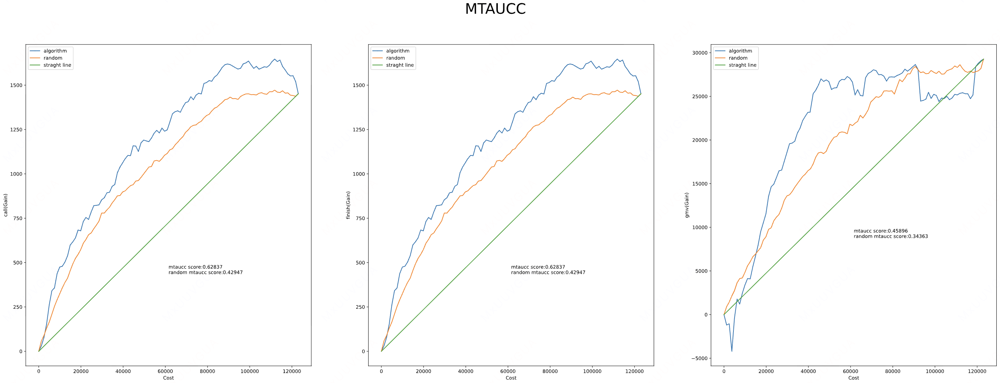 <br> | 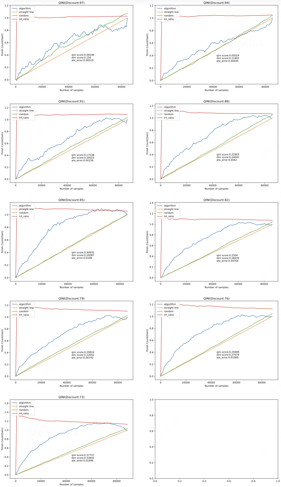 <br> |
| 2222 <br> | 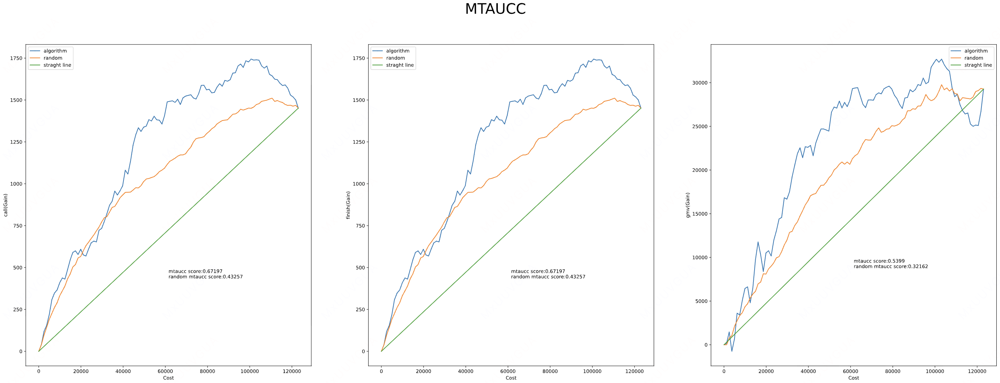 <br> | 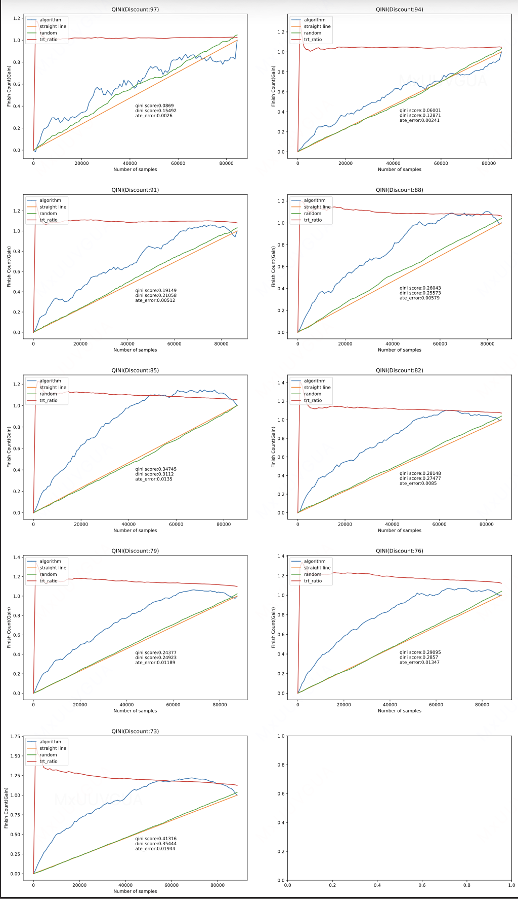 <br> |
| 3665535874 <br> | 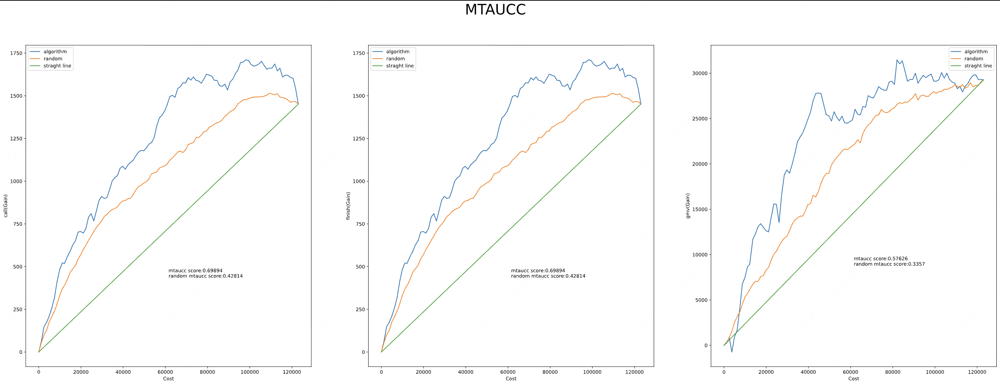 <br> | 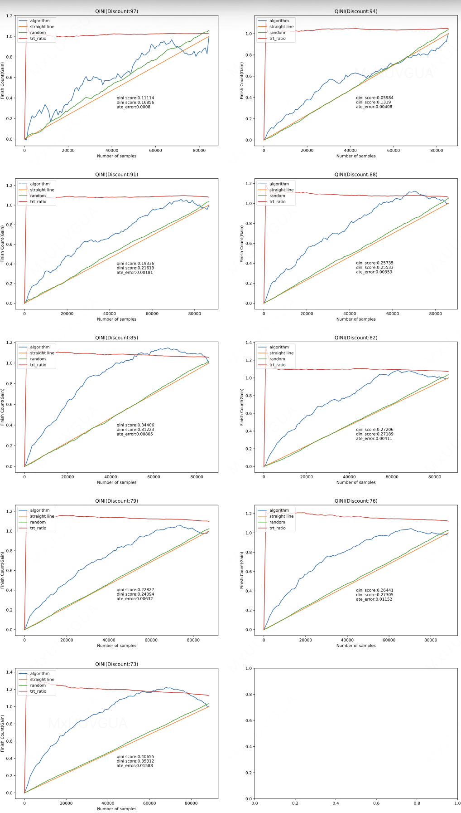 <br> |

**评估结论**：

- **排序目标达成**：三组结果均高于 CFR 和 DRCFR baseline；且三个 Seed 的平均 call_mtaucc 为 0.6664，相对 CFR baseline 绝对提升 0.0798、相对提升 13.61%，达到“相对提升不低于 10%”的离线目标。

- **实验分组比例未见明显异常**：三组结果的 QINI 实验组/对照组比例曲线均未出现明显的系统性前高后低现象，排序指标提升未伴随可见的分组比例恶化。三组结果的 worst-edge p90(ratio_dev) 和 max(ratio_dev) 均值分别为 1.1331 和 1.1817，相比 CFR baseline 的 1.1653 和 1.2361 分别降低 0.0322（2.8%）和 0.0544（4.4%），且三个 Seed 的相应指标均低于 1.2 和 1.5 的判定阈值。

## **4.2 消融实验**

| 实验版本 <br> | 移除/调整的组件 <br> | call_mtaucc <br> | 相对完整版变化 <br> | p90(ratio_dev) <br> | 相对完整版变化 <br> | max(ratio_dev) <br> | 相对完整版变化 <br> | 通过边数 <br> | 结论 <br> |
| --- | --- | ---: | ---: | ---: | --- | ---: | --- | ---: | --- |
| **完整标准 DR** <br> | 无 <br> | **0.6989** <br> | - <br> | 1.1205 <br> | - <br> | 1.1661 <br> | - <br> | 9/9 <br> | 参考组 <br> |
| wo OOF-DR <br> | OOF-DR 因果排序监督 <br> | 0.6303 <br> | **-0.0687** <br> | 1.0905 <br> | -0.0300 <br> | 1.1191 <br> | -0.0470 <br> | 9/9 <br> | 排序收益显著下降，说明 OOF-DR 是核心排序组件 <br> |
| wo RankNorm <br> | 分边排序归一化 <br> | 0.6183 <br> | **-0.0806** <br> | 1.0968 <br> | -0.0237 <br> | 1.1445 <br> | -0.0216 <br> | 9/9 <br> | 排序收益降幅最大，是贡献最大的排序组件 <br> |
| wo Edge Mask <br> | 高信噪比折扣边筛选 <br> | 0.6737 <br> | **-0.0252** <br> | 1.1093 <br> | -0.0112 <br> | 1.1313 <br> | -0.0348 <br> | 9/9 <br> | 提供中等排序收益，主要用于减少弱信号边的干扰 <br> |
| wo Prefix Guard <br> | 高分样本分组比例约束 <br> | 0.7313 <br> | **+0.0324** <br> | 1.1782 <br> | +0.0577 <br> | 1.2660 <br> | +0.0999 <br> | 9/9 <br> | 移除后排序指标提高但比例稳定性恶化，说明该组件以部分排序收益换取因果可信度 <br> |
| wo FiLM <br> | FiLM 轻量校准 <br> | 0.6704 <br> | **-0.0285** <br> | 1.1330 <br> | +0.0125 <br> | 1.2003 <br> | +0.0342 <br> | 9/9 <br> | 移除后排序与比例稳定性均变差，FiLM 提供稳定的辅助收益 <br> |
| wo mROI <br> | 边际投入产出比递减约束 <br> | 0.6969 <br> | **-0.0021** <br> | 1.1252 <br> | +0.0047 <br> | 1.1605 <br> | -0.0056 <br> | 9/9 <br> | 单 Seed 指标影响较小 <br> |

## **4.3 结论**

本轮离线实验表明，ARCR 能够在提升因果排序效果的同时，降低模型利用实验分组信息**“走捷径”**的风险。

# **五、引用和鸣谢**

- [ECR 多折扣模型架构升级：从 Prediction Loss 到可信排序](https://cooper.didichuxing.com/didocs/2208560385385)

- [ECR 模型迭代-因果模型向](https://cooper.didichuxing.com/knowledge/2199610335356/2206140619069)

- [从 AUCC 排序优化到 Selection Bias 诊断](https://cooper.didichuxing.com/didocs/2208612515200)

- [【CIFT-26】RERUM](https://cooper.didichuxing.com/knowledge/2199610335356/2206933203447)

- [【CIFT-26】Rethinking Causal Ranking: A Balanced Perspective on Uplift Model Evaluation](https://cooper.didichuxing.com/knowledge/2199610335356/2207015605502)

- [RAS-AUCC：智能营销场景 Uplift 模型多 Treatment 评估指标改进](https://cooper.didichuxing.com/knowledge/share/page/XjpdgbO97Ltk)

- [FiLM: Visual Reasoning with a General Conditioning Layer](https://arxiv.org/abs/1709.07871)

感谢缪可可贡献 Rank Loss 方法和其他有效尝试！

感谢周之烁、陈嘉曦和亓旻昊提供因果推断方面的理论指导！

感谢周之烁对文档修改提出建议！

# **六、QA**

**Q：看上去提升来源是让DRCFR学XGBoost构造的伪标签；如果base model不使用 DRCFR直接使用 XGBoost，效果如何？**

**A：** 从补充实验的离线结果看，XGBoost 同样具备较强的排序能力。与直接使用 XGBoost 分别预测各折扣档位呼叫概率的 T-Learner 相比，使用样本外 DR 排序伪标签训练 XGBRegressor 后，call_algo_mtaucc 由 0.5204 大幅提升至 0.9371。然而，该方案的实验组/对照组比例存在明显偏移，worst-edge p90(ratio_dev) 和 max(ratio_dev) 分别达到 1.3396 和 1.4539，仅有 6/9 条 treatment-control 边通过比例阈值，说明较高的排序指标尚未转化为同等可信的因果排序结果。在具备分组比例约束、响应形态约束和多随机种子验证的完整 XGBoost 方案得到验证前，本轮仍选择 DRCFR 作为基础模型。详细实验见 [XGBoost 直接优化 rank 指标](https://cooper.didichuxing.com/didocs/2208866841102)。

| 模型 <br> | call mtaucc <br> | qini by T <br> |
| --- | --- | --- |
| DR-XGBoost  <br> | 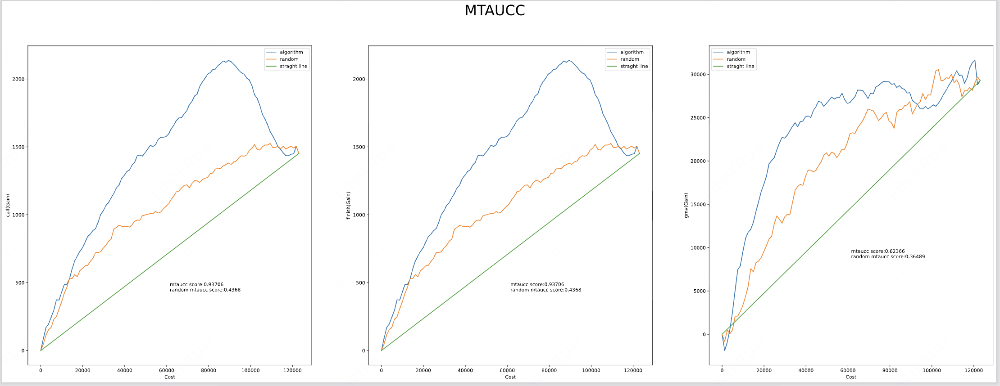 <br> | 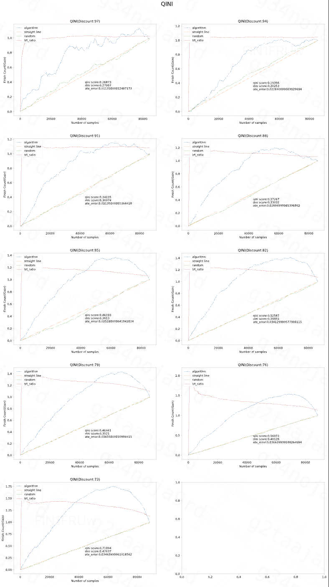 <br> |

# **七、AutoResearch 使用经验**

本轮迭代使用 AutoResearch 辅助完成批量调参、重复训练、实验记录整理和初步结果分析。实践中，以下经验较为重要：

- **自动化适合执行实验，不替代关键判断**：参数搜索、重复训练和结果汇总可以交给 AutoResearch；模型选型、因果解释以及某个版本是否可信，仍需要人工结合业务目标和实验设计判断。

- **每轮训练结束后必须基于真实结果复盘**：需要向模型提供训练日志、核心指标和可信性检查结果，并要求它先分析证据，再提出下一轮方案。否则，模型容易在没有核对实验结果的情况下给出缺乏依据的建议。

- **先补齐方法与工程上下文，再启动长链路迭代**：应提前说明代码结构、基线结果、指标定义和验收约束，并将调研结论、方法候选、代码修改和实验记录放在同一上下文中持续维护。对于完全由 Codex 推进的长周期实验，建议使用较高思考强度，并保留结构化的实验历史。

- **不要根据一次负向结果过早否定方法方向**：最初使用未经排序归一化的由 DR-CFR 训练出的 DR 伪标签和折扣组合筛选时，call_mtaucc 只有 0.5712，低于基线，AutoResearch 据此曾判断该方向无效。后续重新设计样本外训练方式，并加入相邻折扣内排序归一化后，call_mtaucc 提升至 0.7302。这说明实验失败既可能来自方法本身，也可能来自伪标签尺度、训练实现或配置问题，如果认定某个方向存在价值，需要坚持自己的判断，而不被 AutoResearch 的判断误导。

小插曲
在完成本篇文档之前，我们曾经分享过[**另一个版本**](https://cooper.didichuxing.com/didocs/2208560385385)，当时 DR target 的构造采用“残差收缩 + clip”的方式；后续消融实验显示，该处理带来的收益非常有限，在部分随机种子下甚至存在负向影响。回看这一决策，当时我们较多采信了 Codex 对该方案的理论解释，但没有优先通过标准 DR target 的对照实验验证其必要性。

进一步复盘发现，Codex 可能受到此前“DRCFR 版本中 DR target 效果不佳”这一上下文的影响，过早将原始 DR target 判断为无效，并跳过标准方案，给出了一种理论上看似合理、但缺少充分实验依据的改造方式。由于解释过程较为完整，这一建议在当时获得了超出其证据强度的信任。

这不禁让笔者想起了最近看到一篇[研究](https://36kr.com/p/3907583463576964)

> 面对自己不熟悉的问题时，一旦获得一个流畅、明确但错误的 AI 答案，人更可能放弃“我不知道”，转而给出答案，并出现准确率下降、自信上升。

这也提醒我们，AI 的确定性表达容易影响人的判断：即使使用者知道模型可能出错，仍可能因为答案表述完整、论证流畅而降低质疑和验证的意愿。因此，使用 AutoResearch 时，需要有意识地区分“模型生成的解释”与“实验已经支持的结论”。

以下是 AutoResearch 探索效率概览：

| 项目 <br> | 详情 <br> |
| --- | --- |
| 探索阶段 <br> | 3 周（6.16\~7.7）\*50%人力，约 1.5 周。未完整计入前期学习、上下文建设和纠错成本 <br> |
| 探索方向数 <br> | 20  <br>```Markdown<br>- 特征级线性调制（FiLM）<br>- 共享增量结构（Shared Increment）<br>- 低秩基结构（Low-rank Basis）<br>- 轻量级剂量反应网络（DRNet-lite）<br>- 变系数网络／径向基函数（VCNet/RBF）<br>- 处理组标记（Treatment Token）<br>- 增量多门控混合专家（Increment-MMoE）<br>- 残差适配器（Residual Adapter）<br>- 折扣边标记门控（Edge-token Gate）<br>- 预算约束单调结构（Budgeted Monotone）<br>- 双锚点结构（Dual-anchor）<br>- 排序适配器（Rank Adapter）``` |
| 实验数 <br> | 444，其中被autoresearch标记为失败/弱结果（graveyard）的实验有 120 个 <br> |
| 命中率 <br> | - 严格按照 call mtaucc 达标、treatment ratio 较平，方向命中率约 10%（2/20） <br><br>- 只关注 call mtaucc 达标，但存在其他稳定性或诊断性问题的，方向命中率大概 25%（5/20） <br><br> |
