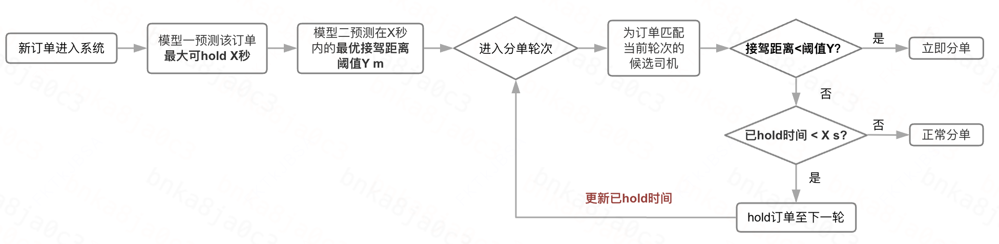
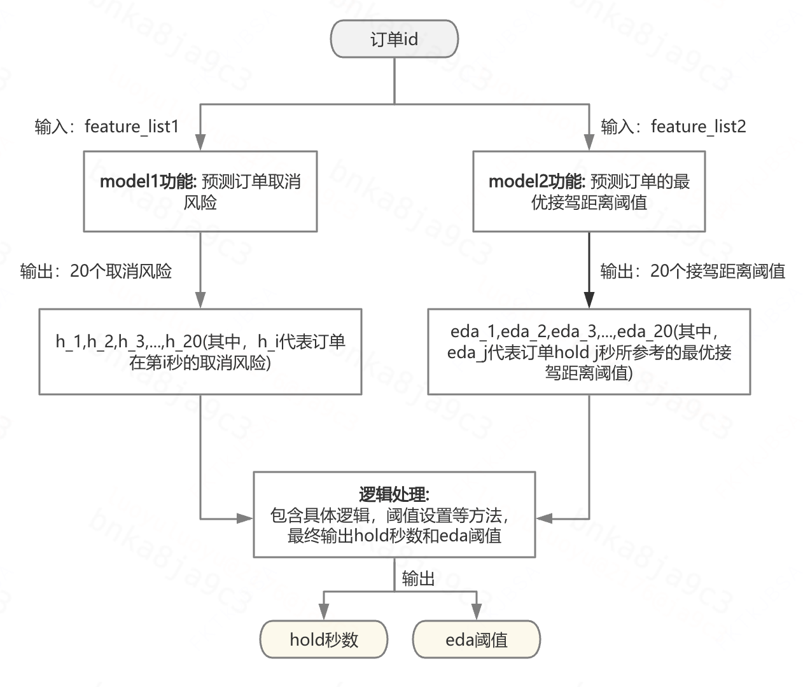
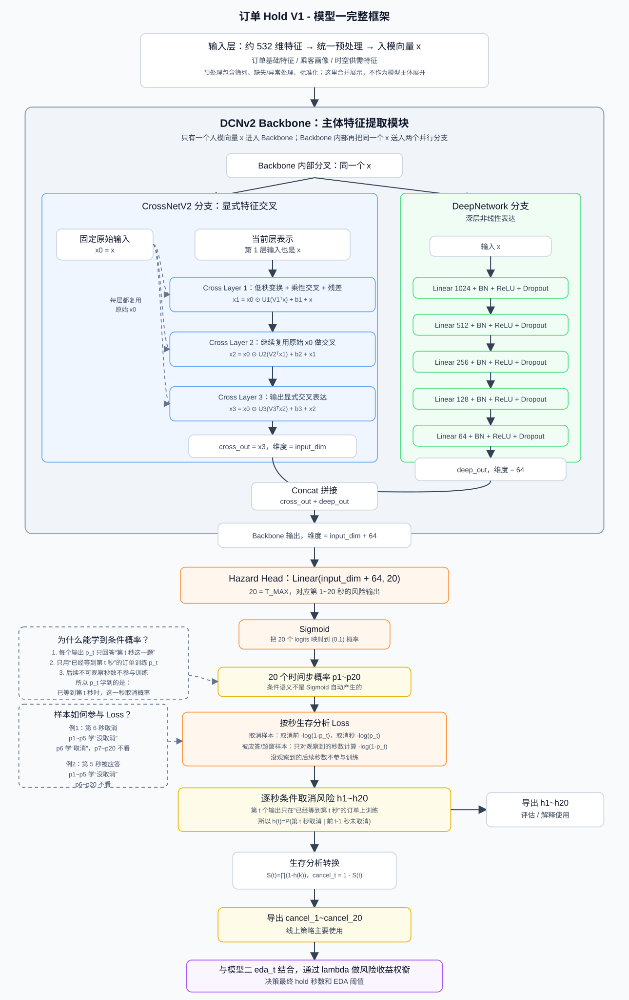
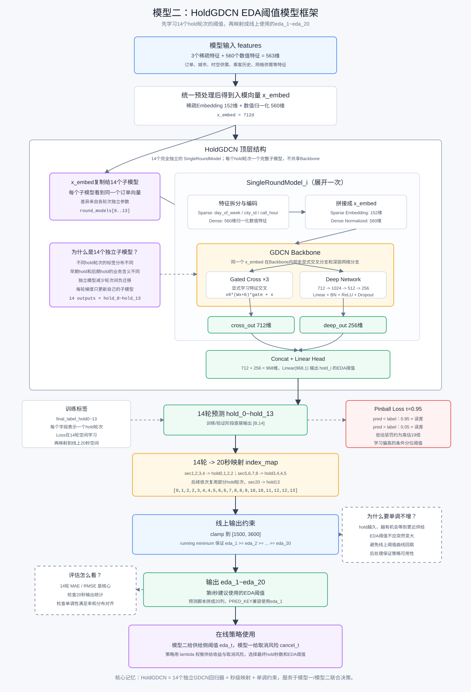
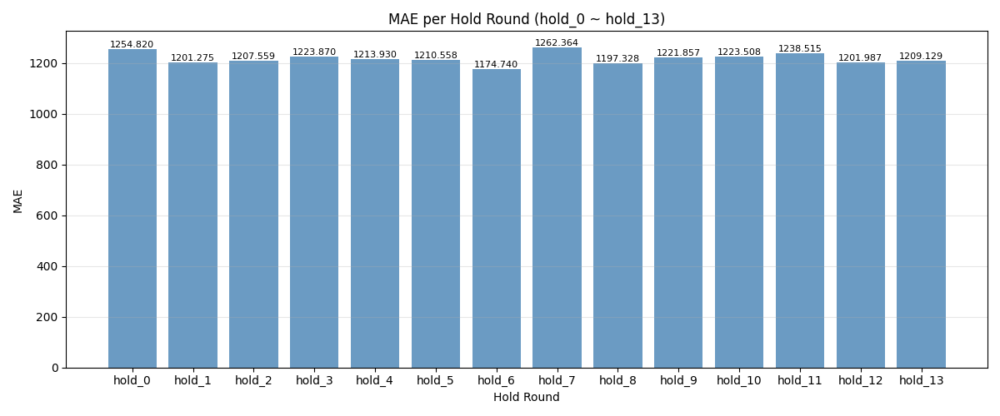
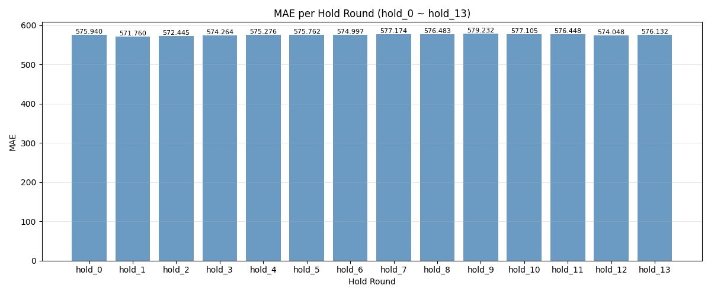
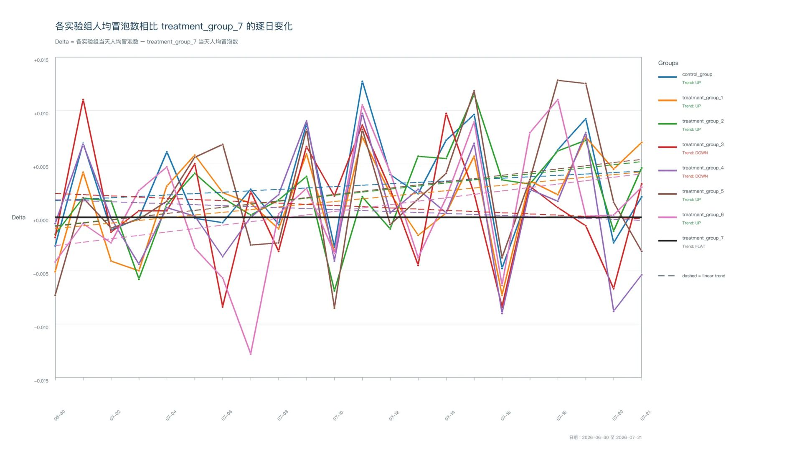
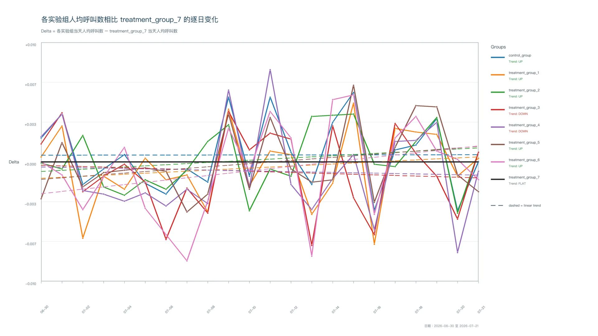

# 【LR26-028】交易生态-优化接驾体验-订单hold策略-V1

[Cooper 原文](https://cooper.didichuxing.com/knowledge/2199610335356/2208910632024)

# 0 基础信息

| brd文档链接  <br> | [以降接驾距离为目标的订单hold V1 BRD文档](https://cooper.didichuxing.com/docs2/document/2206708819192) <br> |
| --- | --- |
| 最后通过的策略方案链接  <br> | [以降接驾距离为目标的订单hold V1 策略方案](https://cooper.didichuxing.com/docs2/document/2206729293875) <br> |
| 实验链接（评估大师）  <br> | [https://x.intra.hongyibo.com.cn/exp/494534838845441?globalBusinessId=120000&globalProjectId=330331944058881&expFlowTab=dashboard&dashboardTab=metricDetail&windowTab=499075992846338](https://x.intra.hongyibo.com.cn/exp/494534838845441?globalBusinessId=120000&globalProjectId=330331944058881&expFlowTab=dashboard&dashboardTab=metricDetail&windowTab=499075992846338) <br> |
| 核心贡献点 <br> | 将订单 hold 决策从固定秒数/规则阈值升级为订单级「逐秒取消风险 + 逐秒 EDA 阈值」双模型联合决策：模型一基于离散时间生存分析，在 20s 观察窗口内处理应答、超窗等删失样本，刻画不同秒数下的应答前取消风险；模型二学习不同hold时长下的最优EDA阈值。同时建立线上决策链路，由于问题本质是一个带约束的优化问题，通过全局lambda将模型一的取消风险和模型二的距离收益整合到同一目标函数中，最终联合决策hold多久以及使用哪个EDA阈值，实现从全局统一hold秒数的hold策略到订单级精细化风险收益权衡的升级。 <br> |
| 第一贡献人  <br> | 罗玉 <br> |
| 共同贡献人 <br> | 武荣莉 <br> |
| 后续策略负责人  <br> | 罗玉 <br> |

# 1 背景

订单hold策略整体希望**延长应答时间，为乘客应答一个预估接驾距离更近的司机。**v0策略只对【预测订单最优接驾距离阈值】进行了开发建模，对【预测订单hold秒数】采用了所有订单统一hold X秒的方案（v0线上X=10s）。即v0策略视所有乘客等应答的容忍度相同，本质上没有做到精细化by订单维度的hold方案。但实际上，对不愿等的乘客少hold或不hold，对愿等乘客多hold，精准化hold策略作用空间，才能在约束完单的前提下，最大程度上优化接驾体验。因此，V1希望能够实现by订单预测hold秒数+eda阈值。

策略业务理解流程图&策略感知位置
<!--评论:[{"u":"tommywujian","c":"从这个图来看，PK是不生效的吗？"},{"u":"luoyuluoyu","c":"pk生效，已补充线上策略生效情况"}] -->

线上策略如何生效：

- v0：对于**由平台负责分单的自营&宏鹄商家，hold策略在分单环节生效**。不满足最优接驾距离阈值的司机将被直接拦截，无法进入PK环节；对于**自行负责分单的API商家，hold策略在PK环节生效**。API商家会正常完成内部运力的匹配的司机举手，平台会在PK环节校验API商家举手司机的接驾距离，如果不满足最优阈值，则PK失败，商家重新举手，直至举出满足要求的司机。

- v1: 对于自营&宏鹄&API商家，均会提前透传给商家“需要一个满足阈值的司机”，商家参考该阈值，举出司机进行pk；同时pk环节中会再次校验举手司机的接驾距离，如果不满足阈值要求，pk失败。

# 2 目标 & 约束

| 目标OR约束 <br> | 具体说明 <br> |
| --- | --- |
| 目标 <br> | badcase率显著-15% <br> |
| 约束 <br> | 完单不显著负0.1% <br> |

badcase率详细说明
badcase率<!--评论:[{"u":"chenjiaxi","c":"为什么这样定badcase率嘞？"},{"u":"luoyuluoyu","c":"主要关注乘客侧的极差体验。这些极差体验就涉及应答前等待时间长（应答时间长）；应答后接驾距离远、接驾时间长"}] -->=小猪端整体差体验占比不含改（在小猪端整体不含改派应答订单中，因接驾过远、接驾过久、实际接驾久，或乘客等太久后取消而被判为差体验的订单占比）

```PlainText
如果 answer_dur 在 0 到 60 秒内：
  只要满足以下任一条件，就算差体验：
  - 预估接驾时长 est_arrive_dur > 540 秒，即 9 分钟
  - 预估接驾距离 est_arrive_dis > 3500 米
  - 实际接驾时长 arrive_dur > 540 秒，即 9 分钟
  - 应答后乘客取消，且 cancel_arrive_dur > 660 秒，即 11 分钟

如果 answer_dur > 60 秒：
  只要满足以下任一条件，就算差体验：
  - 预估接驾时长 est_arrive_dur > 720 秒，即 12 分钟
  - 预估接驾距离 est_arrive_dis > 4900 米
  - 实际接驾时长 arrive_dur > 720 秒，即 12 分钟
  - 应答后乘客取消，且 cancel_arrive_dur > 780 秒，即 13 分钟
```

# 3 技术方案

方案部分与策略方案一致，这里只进行简要说明，细节见[以降接驾距离为目标的订单hold V1 策略方案](https://cooper.didichuxing.com/docs2/document/2206729293875)

## 3.1 整体思路

==V1 的核心变化是把 hold 变成按订单的精细化决策：==找到每个订单在其**可hold时间内**的**最优接驾距离。****挖掘乘客对等应答的容忍时长，以及在容忍时长下该订单的最优接驾距离阈值**（==取消风险高的订单少hold 或不hold；取消风险低的订单可以多hold），以在降低接驾badcase率和接驾距离的同时，压缩应答前取消的降幅，减少对完单的折损。==

V1策略开发两个模型：

- 模型一：预测订单在发单后 1\~20 秒内的应答前取消风险，也就是乘客等待容忍度；

- 模型二：预测订单在不同 hold 秒数（1\~20 秒）下的最优接驾距离阈值；

- 线上决策时，并不是模型一单独决定最终 hold 秒数。模型一输出20个by秒的应答前取消风险，模型二输出20个by秒的最优接驾距离阈值。策略逻辑再通过全局lambda做“接驾距离收益”和“取消风险增量”的权衡，最终得到一个订单hold多久、使用哪个EDA阈值。

v1版本形态


## 3.2 模型<!--评论:[{"u":"tommywujian","c":"模型的离线效果如何？"},{"u":"luoyuluoyu","c":"已补充离线评估内容"}] -->

### 3.2.1 模型一：固定时间窗口内的逐秒取消风险预测模型

> **前置总结：**

> 将固定 hold 秒数升级为按订单预测等待容忍度，支持精细化 hold；

> 用生存分析正确处理应答、超窗等删失样本，订单hold场景窗口设置为20s，超出20s不再观察；

> 输出逐秒取消风险，可直接参与线上lambda决策；

> 结合DCNv2学习500+特征下的复杂交叉关系，增强风险识别能力；

> 为策略提供可解释的风险约束，使“多等带来的距离收益”和“应答前取消上涨风险”可以统一权衡。

#### 模型一训练数据（特征&标签）<!--评论:[{"u":"dongtingdong","c":"模型离线评估时会看值准嘛？"},{"u":"luoyuluoyu","c":"没有关注值准，关注的是逐秒的auc，主要看的序准，已补充离线评估部分"}] -->

**特征：**

==共传入约532维特征，包含订单基础信息、乘客历史应答/取消行为特征、时空供需特征等。==

全部特征见[模型一的特征总结](https://cooper.didichuxing.com/docs2/sheet/2207014611005?sheetId=CyMzt)

**训练标签：**

- event_type: 1=观察窗口内发生应答前取消，0=删失 

- event_step: 事件或观测截止发生的秒数，范围 1\~20s

标签含义说明：

| **场景** <br> | **event_type** <br> | **event_step** <br> |
| --- | --- | --- |
| 第 5 秒被应答 <br> | 0 <br> | 5 <br> |
| 第 6 秒应答前取消 <br> | 1 <br> | 6 <br> |
| 第 20 秒被应答 <br> | 0 <br> | 20 <br> |
| 第 20 秒应答前取消 <br> | 1 <br> | 20 <br> |
| 第 22 秒被应答 <br> | 0 <br> | 20 <br> |
| 第 23 秒取消 <br> | 0 <br> | 20 <br> |

这里容易误解的是超出 20 秒窗口的取消。因为模型只观察前 20 秒，所以第 23 秒取消在模型一的训练窗口内并不是事件样本，而是“前 20 秒未取消”的删失样本。

#### 模型一框架结构

采用离散时间生存分析建模==乘客应答前取消风险模型，用于预测订单发单后1\~20秒内的逐秒取消风险。模型采用离散时间生存分析框架，将应答前取消视为事件，将被应答或 20 秒窗口内未取消视为删失样本，从而正确处理“时间-事件”问题（==订单发单是观察起点，应答前取消是事件，被应答或观察窗口结束但未取消是删失样本==）==

为什么在该业务场景下使用生存分析？
乘客等待应答是一个典型的“时间-事件”问题：

| **生存分析概念** <br> | **订单 Hold 场景** <br> |
| --- | --- |
| 观察起点 <br> | 订单发单，开始等待应答 <br> |
| 事件 <br> | 乘客应答前取消 <br> |
| 事件时间 <br> | 第几秒取消 <br> |
| 删失样本 <br> | 订单被应答，或 20 秒内未观察到取消 <br> |
| 关注对象 <br> | 每一秒的取消风险 <br> |

如果把问题做成普通二分类，只能粗略预测“这个订单会不会取消”，很难正确处理“第几秒取消”和“样本提前被应答后无法继续观察”的问题。

生存分析的优势在于，它可以把问题拆成逐秒条件风险：乘客前面没有取消时，当前这一秒取消的概率是多少。这样既能利用取消样本，也能合理利用被应答或窗口结束的删失样本。

==模型结构采用 DCNv2，包含CrossNetV2和DeepNetwor 两个并行分支：CrossNetV2通过 3 层Cross Layer显式学习高阶特征交叉，DeepNetwork 通过 1024->512->256->128->64的 MLP 学习深层非线性表达。两路输出拼接后进入 Hazard Head，输出 20 个时间步的条件取消风险 h1\~h20，再通过生存分析公式转换为by秒的取消风险 cancel_1\~cancel_20。（取消风险不由单一特征决定，希望通过特征交叉，挖掘取消风险对城市、时段、供需、乘客历史取消偏好等特征之间的组合关系，因此利用DCNv2同时建模显式特征交叉和深层非线性模式）==

【模型预测什么】逐秒条件取消风险hazard：$$h(t)=P(第 t 秒取消 | 前 t-1 秒未取消)，t = 1, 2, ..., 20$$。

最终产出：

| **输出字段** <br> | **含义** <br> | **线上用途** <br> |
| --- | --- | --- |
| $$h1 ,... ,h20$$ <br> | 第 1\~20 秒的条件取消风险 $$h(t)$$ <br> | 主要用于评估、解释 <br> |
| $$F_1 ,... ,F_{20}$$ <br> | 截至第 1\~20 秒的累计取消风险 $$F(t)$$ <br>订单存活到第 t 秒仍未取消的概率$$S(t)=\varPi(1 - h(k)) , k=1...t$$ <br>截至第 t 秒已经取消的累计概率$$F(t)=1-S(t)$$ <br> | 线上策略主要使用 <br> |

具体框架图如下：

模型一框架图


#### 模型一离线评估

评估指标：by秒AUC(主要衡量模型在每个时间步上的风险排序能力，即，能否把更可能取消的订单排在更高风险位置)

对于每一秒而言，评估这一秒下的auc，会观察存活至该秒的样本。其中，恰好在该秒取消的样本为正样本，其他为负样本。比较模型输出的h_t能不能把正样本排在负样本前

评估结果list
| auc_t1 <br> | 没有订单在第一秒取消 <br> |
| --- | --- |
| auc_t2 <br> | 0.644 <br> |
| auc_t3 <br> | 0.684 <br> |
| auc_t4 <br> | 0.634 <br> |
| auc_t5 <br> | 0.630 <br> |
| auc_t6 <br> | 0.623 <br> |
| auc_t7 <br> | 0.606 <br> |
| auc_t8 <br> | 0.583 <br> |
| auc_t9 <br> | 0.593 <br> |
| auc_t10 <br> | 0.594 <br> |
| auc_t11 <br> | 0.590 <br> |
| auc_t12 <br> | 0.582 <br> |
| auc_t13 <br> | 0.597 <br> |
| auc_t14 <br> | 0.604 <br> |
| auc_t15 <br> | 0.621 <br> |
| auc_t16 <br> | 0.622 <br> |
| auc_t17 <br> | 0.616 <br> |
| auc_t18 <br> | 0.627 <br> |
| auc_t19 <br> | 0.626 <br> |
| auc_t20 <br> | 0.625 <br> |

### 3.2.2 模型二：不同hold秒数下的最优接驾距离阈值预测模型

> **前置总结：**

> 按订单、按不同hold秒数预测eda阈值，支持更精细的供给侧控制；

> 模型学习hold不同秒数下的eda阈值eda_1\~eda_20，与线上最大hold20s的hold窗口对齐；

> 通过GDCN学习城市、时段、供需、乘客历史特征等500+特征下的复杂交叉关系，提升阈值预测能力；

> 使用Pinball Loss学习95分位点的阈值，贴合策略目标（真实badcase订单是接驾距离远的订单，同时不误伤接驾距离本就近的订单，降badcase率的同时，满足完单约束）；

> 通过 \[1500,3600\] 范围约束和单调不增推理后处理，保证逐秒EDA曲线稳定、符合“hold越久阈值越小”的业务逻辑；

> 为策略提供可执行的收益估计，使模型一的取消风险 cancel_t 和模型二的距离阈值 eda_t 可以在 lambda 决策中统一权衡

#### 模型二训练数据（特征&标签）

**特征：**

==共传入约563维特征，包含订单基础信息、格子/城市/乘客维度的历史接驾距离相关特征、时空供需特征等。==

全部特征见[模型二的特征总结](https://cooper.didichuxing.com/docs2/sheet/2207011033644?sheetId=1pp0L)

**训练标签：**

对同一个订单，离线样本会构造出“**如果 hold 到第0秒、第1秒、...、第20秒时，最优EDA阈值是多少**”，作为订单按秒hold的标签（整体离线打标逻辑与V0版本一致[【LR26-003】交易生态-优化接驾体验-订单hold策略-V0](https://cooper.didichuxing.com/knowledge/2199610335356/2206992617058)，V1在离线打标上的优化是计算DO对之间的距离时，改用调用公司内部地图接口计算真实路面导航距离，代替V0中的曼哈顿距离）

打标任务优化详细说明
打标核心逻辑是模拟订单的多轮hold逻辑，经过gs分单得到的接驾距离，在不同hold轮次下的接驾距离的最小值就是该订单在hold X 轮下的最小接驾距离。由于在订单hold v0版本中打标任务已经使用该部分逻辑，在此不再赘述，具体逻辑见[【LR26-003】交易生态-优化接驾体验-订单hold策略-V0](https://cooper.didichuxing.com/knowledge/2199610335356/2206992617058)（文档的2.2.2 数据集构建）

- 打标任务中，涉及到两个DO对之间的距离计算。v0版本中，我们使用曼哈顿距离进行计算，而真实分单中对订单和司机之间位置信息的计算是通过调用公司内部地图接口而来；

- 我们分析了距离计算方式的误差，发现曼哈顿计算距离的方式mae为450，而调用公司内部接口后，mae降至144，误差范围在400m之内的占比为88.56%；

- 因此，**为了减少因距离计算方式带来的label误差**，我们决定在v1版本中优化这一功能，在打标任务中调用地图接口来计算DO对的距离。

 

在V1版本中，完成了离线打标全流程走通。

> 调用地图接口参考的地图侧**使用规范**：

> [https://cooper.didichuxing.com/knowledge/share/page/GpQJr0ti7jDW#](https://cooper.didichuxing.com/knowledge/share/page/GpQJr0ti7jDW#)

> [https://cooper.didichuxing.com/knowledge/share/page/KO6fIyRG8sD9#](https://cooper.didichuxing.com/knowledge/share/page/KO6fIyRG8sD9#)

>  

> **同一对经纬度对，为什么调用地图接口和分单时调地图接口计算仍然存在mae=144的误差：**

> 地图对于一个经纬度对在时间最短原则下的导航距离考虑了当下时空的情况（比如平高峰的差异、堵车与否的差异等）。因此，当我们离线统一测算一天的分单数据时，**无法复现每一对经纬度对当下的时空特点**，即便同样使用了最短时间原则，仍有误差。

>  

> 误差分析文档：

> [https://cooper.didichuxing.com/docs2/document/2207079965664](https://cooper.didichuxing.com/docs2/document/2207079965664)

#### 模型二框架结构

相比v0版本，v1版本核心迭代【精准化hold】思路。为了让不愿等乘客少hold或不hold，让愿等乘客多hold，模型1by订单预测可hold秒数时，模型2也需要同时突破【固定hold秒数】的限制，预测一定hold秒数内，by秒的接驾距离阈值list，进而实现和模型1配合决策的目的。

在线策略会把模型二输出的 eda_t和模型一输出的cancel_t放在一起，用 lambda 权衡“多 hold 带来的供给收益”和“乘客取消风险”，最后决定每个订单是否 hold、hold 多久、以及对应的 EDA 阈值。

【模型预测什么】==预测订单如果hold到第t秒，需要使用的EDA阈值。==

模型二的核心结构是GDCN，但并非==共享一个 backbone + 多个head，而是若干个完全独立的子模型（离线发现共享backbone效果不如独立子模型，独立子模型效果mae相比共享backbone降低6.04%）==

每个子模型都有完整的 Embedding、GDCN Backbone 和输出头，不共享参数。单个子模型内部，稀疏特征经过Embedding，数值特征经过归一化后完成拼接；GDCN Backbone再通过Gated Cross Network显式学习高阶特征交叉，通过 Deep Network 学习深层非线性表达，两路结果拼接后回归当前hold秒数下的EDA阈值。

训练目标使用tau=0.95的 Pinball Loss，使模型学习偏高分位的稳健阈值，贴合线上策略需要降低badcase订单的目标及完单约束。推理阶段还会对秒级eda阈值的输出最后做\[1500,3600\]范围约束，并在推理阶段保证单调性约束<!--评论:[{"u":"dongtingdong","c":"这个是怎么做的呀"},{"u":"luoyuluoyu","c":"对 eda_1~eda_20 从前往后扫一遍，每一秒的最终EDA阈值，都取“当前原始预测值”和“前一秒最终阈值”里的较小者，保证阈值曲线单调不增。已补充至正文【推理单调性约束实现方式】"}] --> $$eda_1 >= eda_2 >= ... >= eda_{20}$$，使阈值曲线符合“hold 越久，阈值越小”的业务逻辑。

推理单调性约束实现方式
从第 1 秒开始维护一个当前最小值：

out_1 = eda_1 

out_2 = min(out_1, eda_2) 

out_3 = min(out_2, eda_3) 

... 

out_t = min(out\_{t-1}, eda_t

所以如果原始输出是：eda_raw = \[3200, 3000, 3100, 2800\]

第 3 秒出现了反向变大，后处理后会变成：eda_out = \[3200, 3000, 3000, 2800\]

由此，保证后面的阈值不会比前面更大。

业务含义是：

> hold 时间越长，理论上越有机会等到更近或更合适的司机。推理阶段用 running minimum 做后处理，保证线上使用的 `eda_1~eda_20` 稳定、单调。

具体框架图如下：

模型二框架图


#### 模型二离线评估

评估指标：MAE(衡量值准，观察预测EDA与离线构造的最优EDA label的平均偏差)

评估结果list
由于分单1轮约为1.5s，以下离线评估展示的是按轮维度的mae

另外，由于预测95分位点，模型本质会高估，mae表现较高。



如果不预测95分位点，模型表现：



### 3.2.3 最终线上决策方式

> 本质是一个带约束的优化问题

**目标：**最小化全体订单的平均接驾距离<!--评论:[{"u":"caiyeliurong","c":"这个目标可以换成 badcase率吗？这样和业务目标一致了？"},{"u":"luoyuluoyu","c":"理论上可以更换，因为badcase率最贴近最终的业务目标。但较难建模。方案中选择“最小化接驾距离”作为一个更可建模的业务代理目标，并通过其他方式实现降badcase率（模型二预测95分位点）"}] -->

**约束：**订单hold策略下，全体订单的应答前取消率相比不hold下的全局应答前取消率的涨幅不超过可接受的上限C0（本质是完单约束，这里转化成了应答前取消的约束，因为降了接驾距离和badcase率，应答后取消一定降）

由此，可以表示为：$$\min_t \quad \frac 1 N \sum_i^N d(t_i)  \\ s.t. \quad \frac 1 N \sum_i^N F(t_i)- \={F}(0)\le C0$$

引入拉格朗日乘子lambda >=0，构造拉格朗日函数：$$L(t,\lambda)=\frac 1 N \sum_i^N d(t_i)+\lambda*[\frac 1 N \sum_i^N F(t_i) - \={F}(0)-C0]$$

其中，$$\={F}(0)=0$$，$$C0$$为常数。因此，在给定一个lambda的情况下，拉格朗日松弛目标关于 t 的求解可化简为：$$t^*(\lambda)=\arg\min_t \frac 1 N \sum_i^N [d(t_i)+\lambda\cdot F(t_i)]$$

这里，lambda不是随意给定的值，而是通过离线仿真确定，使得最终全局满足：$$\frac 1 N \sum_i^N F(t_i^*(\lambda))-\bar{F}(0)\le C0$$

F(0)和C0是否会影响lambda的取值&lambda如何初始化
二者影响lambda的离线选取，因为在离线初始化lambda时，需要满足$$\frac 1 N \sum_i^N F(t_i^*(\lambda))-\bar{F}(0)\le C0$$

如果允许的取消涨幅C0更大，lambda可以更小，策略更激进；如果C0更小，lambda需要更大，策略更保守。

离线参数选择时，可将lambda作为风险惩罚系数，通过二分法搜索。

```PlainText
设置 lambda_low = 0
设置 lambda_high = 一个足够大的值，例如 50000

重复若干轮：
    lambda_mid = (lambda_low + lambda_high) / 2

    计算整体取消涨幅 G(lambda_mid)

    如果 G(lambda_mid) > C0：
        说明策略太激进，取消涨幅超约束
        需要增大 lambda
        lambda_low = lambda_mid

    如果 G(lambda_mid) <= C0：
        说明策略满足约束，可能还可以更激进一点
        尝试减小 lambda
        lambda_high = lambda_mid

最终取 lambda_high 作为满足约束的 lambda 初始值
```

最终，离线得到的lambda的初始解为160。根据该解，我们设置了lambda=100，200，300，400，500的实验组做了第一次线上实验，发现这几组的完单折损大，应答前取消高。而后又设置了lambda=500，1000，2000，3000，4000，5000做了第二次线上实验。线上实验效果中，lambda=500组符合预期。

lambda=160是离线仿真口径下的较优解，lambda=500是线上真实环境下的落地解。由于离线仿真无法完全还原线上供需动态、司机应答变化、乘客实时取消行为和模型校准误差，我们最终以上线 A/B 的约束满足情况和收益表现为准，选择lambda=500。

符号说明
| 符号 <br> | 含义 <br> | 来源 <br> |
| --- | --- | --- |
| i=1,2,...,N <br> | 订单索引，N为订单总数 <br> |   <br> |
| ti <br> | 订单i的hold秒数 <br> |   <br> |
| h(ti)<!--评论:[{"u":"menchang","c":"不同订单i的模型1函数是否相同，如果相同的话，是不是写做h(t_i)更合理"},{"u":"luoyuluoyu","c":"符号已更改"}] --> <br> | 订单i第t秒的条件取消风险（hazard） <br> | 模型1的输出 <br> |
| d(ti) <br> | 订单i hold t秒对应的接驾距离阈值 <br> | 模型2的输出 <br> |
| S(ti) <br> | 订单i存活到第t秒仍未取消的概率 <br> | 由hi(t)推导计算 <br> |
| F(ti) = 1-S(ti) <br> | 截至第t秒的累积取消概率 <br> | 由Si(t)推导计算 <br> |
| F(0) <br> | 不使用hold策略时的全局应答前取消率 <br> |   <br> |
| C0 <br> | 我们能接受的策略带来的应答前取消率增量 <br> |   <br> |

- **模型1输出：**一个订单i在第1s、第2s、...、第20s下的应答前累计取消风险F(ti)，在第1s、第2s、...、第20s下的瞬时取消风险h(ti)<!--评论:[{"u":"menchang","c":"是否支持对单个订单i做出不hold的决策，即t_i=0"},{"u":"luoyuluoyu","c":"现在不支持t_i=0,策略决策后订单的hold秒数属于[1,20]"}] -->

- **模型2输出：**一个订单i在hold 1s、hold2s、...、hold20s下对应要参考的接驾距离阈值d(ti)

我们需要给出对两个模型输出值的处理方案，**做好距离收益与取消风险的trade off，敲定一个订单最终要hold的秒数和要参考的接驾距离阈值。**

 **线上决策：**

上述全局优化推导出了统一的lambda<!--评论:[{"u":"menchang","c":"这个统一的lambda是如何得到的？前面没有体现"},{"u":"luoyuluoyu","c":"已补充【F(0)和C0是否会影响lambda的取值&amp;lambda如何初始化】"}] -->和决策准则。在线上，对每一个具体订单，使用该订单的d(t)和F(t)执行决策，步骤如下：

- step1：遍历t=1, 2, ... , 20，计算$$J(t) = d(t)+\lambda*F(t)$$

- step2：计算每一个t下对应的J(t), 选择最优$$t^*=arg \min_{t \in \{1,20\}}(d(t)+\lambda F(t))$$

- step3：输出：hold秒数就是t\*，接驾距离阈值就是d(t\*)<!--评论:[{"u":"menchang","c":"每个订单都hold至少1s？"},{"u":"luoyuluoyu","c":"是的。现有决策没有hold0s的候选"}] -->

 

目前，线上没有t=0的候选，所有订单候选的hold秒数属于\[1,20\]s。

乘客端登机牌情况说明
为降低乘客应答前取消，乘客端上有一个【登机牌功能】。乘客在端上发单后，登机牌功能约持续**4.5s～5s**，这个时间窗口内，取消按钮不明显（该功能主要是为了降低乘客应答前取消）

## 3.3 v1 vs. v0方案对比总结

| **迭代点** <br> | **v0策略** <br> | **v1策略** <br> |
| --- | --- | --- |
| hold秒数产出方式 <br> | 离线测算后选择固定hold秒数 <br> | 开发模型一预测by订单的容忍程度(生存分析视角) <br> |
| eda阈值产出方式 <br> | 固定hold秒数下的接驾距离阈值模型 <br> | 开发模型二：不同hold秒数下的接驾距离阈值模型 <br> |
| 策略和模型形态 <br> | 产出一个最优接驾距离阈值模型 <br> | 产出两个模型+业务逻辑处理输出 <br> |
| 特征工程 <br> | 共计128维特征，乘客维度特征少 <br> | 创建更多乘客应答前取消和应答后取消特征，最终使用特征500+ <br> |
| 模型标签产出 <br> | 最优接驾距离阈值模型打标时，使用曼哈顿距离计算两个经纬度对之间的距离 <br> | 本次迭代，调用公司内部地图接口计算两个经纬度对之间的真实路面导航距离 <br> |

# 4 实验结果/评估结果

> 评估大师链接：[https://x.intra.hongyibo.com.cn/exp/494534838845441?globalBusinessId=120000&globalProjectId=330331944058881&expFlowTab=dashboard&dashboardTab=metricDetail&windowTab=499075992846338](https://x.intra.hongyibo.com.cn/exp/494534838845441?globalBusinessId=120000&globalProjectId=330331944058881&expFlowTab=dashboard&dashboardTab=metricDetail&windowTab=499075992846338)

> control_group：对照组，使用订单hold v0策略

> treatment_group_1～treatment_group_6：实验组，使用订单hold v1策略，lambda依次为5000，4000，3000，2000，1000，500

> treatment_group_7：空白组，没有订单hold策略干扰的大盘现状

## 4.1 PID分流核心实验结果（周期0713-0719）

- **和空白组（无任何策略）相比<!--评论:[{"u":"zhuzhengdan","c":"当初 hold 对比的应该是 平台举手规范？"},{"u":"luoyuluoyu","c":"v0做实验时和平台规范策略做了对比，v1这次对比的只有空白和v0"}] -->：**

| 实验组 <br> | 差体验占比相对变化 <br> | 单均接驾距离绝对变化 <br> | 完单相对变化 <br> |
| --- | --- | --- | --- |
| control_group(V0) <br> | **显著-8.5%** <br> | **显著-29.07** <br> | 不显著-0.15% <br> |
| treatment_group_1, lambda=5000(V1) <br> | **显著-6.62%** <br> | **显著-22.25** <br> | 不显著-0.07% <br> |
| treatment_group_2, lambda=4000(V1) <br> | **显著-7.06%** <br> | **显著-24.23** <br> | 不显著+0.05% <br> |
| treatment_group_3, lambda=3000(V1) <br> | **显著-7.74%** <br> | **显著-28.20** <br> | 不显著-0.24% <br> |
| treatment_group_4, lambda=2000(V1) <br> | **显著-8.36%** <br> | **显著-28.62** <br> | 不显著+6.23e-5% <br> |
| treatment_group_5, lambda=1000(V1) <br> | **显著-9.61%** <br> | **显著-30.74** <br> | 不显著-0.04% <br> |
| **treatment_group_6, lambda=500(V1)** <br> | **显著-9.51%** <br> | **显著-30.97** <br> | 不显著+0.16% <br> |

- **和control组（v0策略）比：**

| **实验组** <br> | **差体验占比相对变化** <br> | **单均接驾距离绝对变化** <br> | **完单相对变化** <br> |
| --- | --- | --- | --- |
| treatment_group_1, lambda=5000(V1) <br> | **显著+2.05%** <br> | **显著+6.82** <br> | 显著+0.08% <br> |
| treatment_group_2, lambda=4000(V1) <br> | **显著+1.57%** <br> | **显著+4.85** <br> | 显著+0.2% <br> |
| treatment_group_3, lambda=3000(V1) <br> | **显著+0.82%** <br> | 不显著+0.87 <br> | 不显著-0.09% <br> |
| treatment_group_4, lambda=2000(V1) <br> | 不显著+0.15% <br> | 不显著+0.45 <br> | 不显著+0.15% <br> |
| treatment_group_5, lambda=1000(V1) <br> | **显著-1.22%** <br> | 不显著-1.67 <br> | 不显著+0.11% <br> |
| **treatment_group_6, lambda=500(V1,未来放量组)** <br> | **显著-1.11%** <br> | 不显著-1.89 <br> | **显著+0.31%** <br> |

## 4.2 PID实验方案

|  <br> | **内容** <br> | **备注** <br> |
| --- | --- | --- |
| 实验方式 <br> | 乘客分流 <br> |  <br> |
| 分流方式 <br> | 随机分流 <br> | 实验平台：评估大师 <br> |
| 分流策略内容 <br> | 全国流量 <br>实验组1流量5%，实验组2流量5%，实验组3流量5%，实验组4流量5%，实验组5流量5%，实验组6流量5%，空白组流量5%，对照组65% <br> | 实验组1：订单holdv1，lambda=5000 <br>实验组2：订单holdv1，lambda=4000 <br>实验组3：订单holdv1，lambda=3000 <br>实验组4：订单holdv1，lambda=2000 <br>实验组5：订单holdv1，lambda=1000 <br>实验组6：订单holdv1，lambda=500 <br>空白组：无任何策略干扰 <br>对照组：推全的订单hold v0策略 <br> |
| 实验周期 <br> | 7天 <br> | —— <br> |
| 流量范围 <br> | 小猪端 <br> |  <br> |
| 实验生效品类：全品类 <br> | 品类： <br>- 特价盒子 <br><br>- 特快盒子 <br><br>- 实时计价盒子 <br><br>- 宏鹄 <br><br>- 小猪一口价 <br><br>- 小猪打车 <br><br>- 小猪特价 <br><br>- 小猪特快 <br><br> |
| 分单场景：全部 <br> | 默认全部 <br>- 小猪轮次分单 <br><br>- 宏鹄轮次分单 <br><br>- 小猪选单 <br><br>- 宏鹄选单 <br><br> |
| 全国 <br> | —— <br> |
| 实验生效商家 <br> | 自营、宏鹄、API <br> |
| 是否联动实验 <br> | 否 <br> | 多业务间联动，可能产生跨机房实验，多个机房的apollo分流无法保持一致，需要业务确认实验范围，技术确认是否支持 <br> |
| 评估人 <br> | 算法、评估大师/Apollo自动评估 <br> |   <br> |

## 4.3 PID收益链路归因分析

实验组6（lambda=500）组，收益链路归因<!--评论:[{"u":"zhouzhishuo","c":"收益链路中包含乘客体验提升带来的长期留存提升吗？"},{"u":"luoyuluoyu","c":"现在的收益链路中没有把乘客体验提升带来的长期留存提升计入收益。本次实验的冒泡和呼叫补充至【其他中间过程分析】"}] -->：

- **和v0相比（验证v1优于v0）**

v1策略产出精细化到订单级别的hold秒数+eda阈值，对长接驾订单做治理

➡️应答前乘客取消率**显著-0.86%（-0.14pp），**by订单产出hold秒数的正向作用，应答前乘客取消率的涨幅被压制

➡️v1平均hold秒数高于v0，差体验占比进一步下降，和v0相比**显著-1.11%**<!--评论:[{"u":"rongbohui","c":"pp？"},{"u":"luoyuluoyu","c":"重新补充pp值变化，v1相比v0，badcase率显著-0.07pp（-1.11%）"}] -->**（-0.07pp）**

➡️应答后乘客取消率不显著-0.47%（-0.04pp）（虽然接驾距离相比v0不显著-1.89m，但由于badcase订单的应答后乘客取消本就高，应答后乘客取消率因为badcase率降而进一步降低）

➡️最终满足约束完单**显著 +0.31%**

- **和空白组无任何策略相比（验证策略本身有效）**

v1策略在hold秒数内约束DO对连边的接驾距离符合eda阈值，对长接驾订单做治理

➡️单均接驾距离**显著-30.97m**，差体验占比**显著-9.51%**(差体验应答明显降低)

➡️应答后的体验被改善（应答后乘客取消率**显著-2.33%（-0.22pp）**，应答后司机取消率不显著-0.89%（-0.04pp））

➡️满足完单约束，完单不显著+0.16%（策略带来应答前取消率**显著+1.74%（+0.27pp）**）

这里完单微正向的原因：完单的相对变化约等于应答量的相对变化+履约率的相对变化。相比空白组，实验组6的应答量相对变化-0.39%；实验组6的履约率0.836，空白组履约率0.8314，实验组6的履约率相对变化+0.55%，带来完单+0.16%

  

## 4.3 PID其他中间过程分析

实验中人均冒泡情况：

实验期人均冒泡一周数据表现&人均呼叫数逐日变化趋势

各组人均冒泡数绝对值，及和空白组相比（0713～0719一周数据）的增幅表现：

|  <br> | 人均冒泡数绝对值 <br> | 增幅（vs空白组） <br> |
| --- | --- | --- |
| 空白组 <br> | 3.9042 <br> | - <br> |
| 对照组（v0） <br> | 3.9139 <br> | 显著+0.25% <br> |
| 实验组1 <br> | 3.9101 <br> | 不显著+0.15% <br> |
| 实验组2 <br> | 3.9203 <br> | 显著+0.41% <br> |
| 实验组3 <br> | 3.901 <br> | 不显著-0.08% <br> |
| 实验组4 <br> | 3.9114 <br> | 不显著+0.18% <br> |
| 实验组5 <br> | 3.9179 <br> | 显著+0.35% <br> |
| 实验组6 <br> | 3.916 <br> | 不显著+0.3% <br> |

实验期间，v0对照组和v1实验组（除实验组3外）人均冒泡数均有所增加，其中对照组v0和v1的实验组2、实验组5的人均冒泡数均显著正向。

下图为各实验组和空白组相比，人均冒泡数相对变化delta的趋势，组六有上涨趋势



下图为各实验组和空白组相比，人均呼叫数相对变化delta的趋势图，组六有上涨趋势



实验中 应答时长、hold秒数、eda阈值情况：

0713～0719应答时长、hold秒数、eda阈值情况

| **分组名** <br> | **对照组\_V0策略** <br> | **空白组\_无策略** <br> | **V1实验组1(lambda=5000)** <br> | **V1实验组2(lambda=4000)** <br> | **V1实验组3(lambda=3000)** <br> | **V1实验组4(lambda=2000)** <br> | **V1实验组5(lambda=1000)** <br> | **V1实验组6(lambda=500)** <br> |
| --- | --- | --- | --- | --- | --- | --- | --- | --- |
| 应答时长均值 <br> | 33.19 <br> | 32.16 <br> | 32.97 <br> | 32.93 <br> | 33 <br> | 33.03 <br> | 33.12 <br> | 33.07 <br> |
| 线上决策后hold秒数均值(s) <br> | 10.00 <br> | 无 <br> | 7.18 <br> | 7.79 <br> | 8.47 <br> | 9.228 <br> | 10.01 <br> | 10.42 <br> |
| 线上决策后eda阈值均值(m) <br> | 2708.88 <br> | 无 <br> | 2681.13 <br> | 2676.84 <br> | 2671.72 <br> | 2670.28 <br> | 2667.27 <br> | 2667.42 <br> |

[0710后V1二期实验更换lambda后表现](https://cooper.didichuxing.com/docs2/sheet/2208771485401)

## 4.4 两个时间片实验效果

[V1 vs 空白 时间片实验效果](https://x.intra.hongyibo.com.cn/exp/500847700344833?globalBusinessId=120000&globalProjectId=261878894821377&expFlowTab=dashboard&dashboardTab=metricDetail&windowTab=504153229099010)（26.08.02-26.08.15）：

[实验选城](https://cooper.didichuxing.com/docs2/sheet/2209008335130?sheetId=E0HfN)(完单占比21.737%，呼叫占比21.525%，CR78.317%)：广州市；青岛市；石家庄市；苏州市；厦门市；福州市；徐州市；岳阳市；邯郸市；保定市；潍坊市；嘉兴市；赣州市；菏泽市；柳州市；丽江市；梅州市；清远市；肇庆市；日照市；临汾市；吕梁市；三明市；永州市；河源市

| 指标 <br> | 绝对提升 <br> | 相对提升 <br> | p值 <br> | 是否显著 <br> |
| --- | --- | --- | --- | --- |
| 核心目标和约束 <br> | 差体验占比 <br> | **-0.6798pp** <br> | **-9.5％** <br> | &lt;0.0001 <br> | 是 <br> |
| 小猪端完单 <br> | -1324.096941 <br> | -0.02％ <br> | 0.813 <br> | 否 <br> |
| 其他指标 <br> | 大聚合完单 <br> | 2081.065214 <br> | +0.03％ <br> | 0.8255 <br> | 否 <br> |
| 小猪端CR <br> | +0.0041pp <br> | +0.01％ <br> | 0.9768 <br> | 否 <br> |
| 小猪端冒泡 <br> | +4335.690308 <br> | +0.03％ <br> | 0.8489 <br> | 否 <br> |
| 小猪端竞争呼叫 <br> | +987.929434 <br> | +0.01％ <br> | 0.9243 <br> | 否 <br> |
| 小猪端应答前c取消率 <br> | **+0.2129pp** <br> | **1.54％** <br> | 0.0391 <br> | 是 <br> |

[V1 vs V0 时间片实验效果](https://x.intra.hongyibo.com.cn/exp/501205992472577?globalBusinessId=120000&globalProjectId=261878894821377&expFlowTab=dashboard&dashboardTab=metricDetail&windowTab=504153375834114)（26.08.02-26.08.15）：

[实验选城](https://cooper.didichuxing.com/docs2/sheet/2209008335130?sheetId=cCkYT)(完单占比21.752%，呼叫占比21.462%，CR78.597%)：杭州市；郑州市；南京市；大连市；成都市；宁波市；长沙市；太原市；烟台市；南宁市；无锡市；临沂市；秦皇岛市；鞍山市；齐齐哈尔市；吉林市；济宁市；贵阳市；金华市；郴州市；莆田市；滨州市；龙岩市；怀化市；红河哈尼族彝族自治州

| 指标 <br> | 绝对提升 <br> | 相对提升 <br> | p值 <br> | 是否显著 <br> |
| --- | --- | --- | --- | --- |
| 核心目标和约束 <br> | 差体验占比 <br> | -0.0322pp <br> | -0.46％ <br> | ==0.4001== <br> | 否 <br> |
| 小猪端完单 <br> | +6125.809908 <br> | 0.11％ <br> | ==0.4022== <br> | 否 <br> |
| 其他指标 <br> | 大聚合完单 <br> | +10167.309345 <br> | 0.12％ <br> | ==0.4927== <br> | 否 <br> |
| 小猪端CR <br> | +0.098pp <br> | 0.13% <br> | 0.4871 <br> | 否 <br> |
| 小猪端冒泡 <br> | -48907.506607 <br> | ==-0.34％== <br> | ==0.0542== <br> | 否 <br> |
| 小猪端竞争呼叫 <br> | +1409.880864 <br> | +0.02% <br> | 0.8259 <br> | 否 <br> |
| 小猪端应答前c取消率 <br> | -0.002917 <br> | ==-1.92％== <br> | ==0.0932== <br> | 否 <br> |

# 5 放量决策

|  <br> |  <br> | 预期扩量时间节奏 <br> | 实际扩量时间 <br> | 放量暂停点详情 <br> | 放量暂停点效果评估 <br> | 是否需要设置长期对照组（默认不需要，此列无需填写） <br> |
| --- | --- | --- | --- | --- | --- | --- |
|  <br> |  <br> |  <br> | LR通过后，根据实际情况，填写这3列 <br> |  <br> |
| 放量决策意见 <br> | 决策人 <br> | 武荣莉 <br> | —— <br> | —— <br> | —— <br> | —— <br> |
| 决策意见： <br>通过 <br> |  <br> |  <br> |  <br> |  <br> |  <br> |
| 放量需要周知的利益相关方 <br> |  <br> | —— <br> | —— <br> | —— <br> | —— <br> | —— <br> |
| 放量策略 <br> | **实验组6** <br>badcase率显著-9.51%，接驾距离显著-30m，完单不显著+0.16% <br> | —— <br> | —— <br> | —— <br> | —— <br> | —— <br> |
| 放量节奏 <br> | 直接推全-时间片实验（和放量同步） <br> <br> <br> | 2026.7.28开一次时间片实验 <br>本次时间片实验并行开两组，一组是v1和空白轮转，一组是v0和v1轮转，两组实验城市不重叠 <br>**时间片实验已回收数据，见4.4** <br> | —— <br> <br> | —— <br> | —— <br> | —— <br> |
| 直接推全-随机分流（避开时间片占用的城市） <br> | 待时间片实验产出结果后决策放量 <br>2026.08.20，V1放量20%，留20%空白，剩余60%为线上V0现状。 <br>2026.09.18，V1推全 <br> <br> |  <br> <br> | 暂停点时间 ：0820 <br>暂停点持续时长：预计四个自然周，积累数据，评估留存 <br>流量比例：20% <br>实验链接：[https://x.intra.hongyibo.com.cn/exp/505196281200641?globalBusinessId=120000&globalProjectId=406437792776193&expFlowTab=dashboard&windowTab=undefined&dashboardTab=metricDetail](https://x.intra.hongyibo.com.cn/exp/505196281200641?globalBusinessId=120000&globalProjectId=406437792776193&expFlowTab=dashboard&windowTab=undefined&dashboardTab=metricDetail) <br> | 评估数据：核心指标（评留存）、核心约束（完单） <br> | 需要保留长期对照组：不需要 <br>对照组流量比例： <br>定期review人：罗玉 <br>定期review频率： <br>定期review结果： <br> |

# 6 引用和鸣谢<!--评论:[{"u":"zhuzhengdan","c":"补一个时间片 vs  空白？"},{"u":"luoyuluoyu","c":"已开启时间片实验，细节见【后续规划】"}] -->

- 【LaunchReview】[【LR26-003】交易生态-优化接驾体验-订单hold策略-V0](https://cooper.didichuxing.com/knowledge/2199610335356/2206992617058)

- 感谢：荣莉在策略迭代全流程的指导，辉哥在方案上的把关、林佳对打标任务优化的开发；工程团队要飞、超宇的支持。

# 7 后续规划

- pid分流中lambda=500组（实验组6），在一批城市上做一次V1的时间片实验（已于2026.07.29开启）。同期，v1 VS v0也会开启一次时间片实验。以上两组时间片实验在城市上不重叠，具体可见[订单hold V1时间片实验配置](https://cooper.didichuxing.com/docs2/document/2209025566795)

- v1-lambda=500待时间片完成后 后续放量。

LR todo完成情况：
todo1：补充两个模型离线评估的指标、实验细节、实验结果

已补充至3.2 节，每个模型下的离线评估部分

todo2: 补充是否可以hold=0s

情况说明补充至【3.2.3 最终线上决策方式】

todo3: 补充乘客侧登机牌的现状介绍，对策略的影响

已补充至【3.2.3 最终线上决策方式】

todo4: 补充：是否存在长期放大效应

实验期间，人均冒泡数有所提升，逐日冒泡、逐日呼叫有上涨趋势，数据补充在【4.3 其他中间过程分析】

todo5:补充：时间片实验结果（V1 vs 空白）

已开启时间片实验（V1 vs 空白），实验细节[订单hold V1时间片实验配置](https://cooper.didichuxing.com/docs2/document/2209025566795)

todo6：思考：是否可以启动时间片实验结果（V1 vs V0）；怎么看留存

已开启时间片实验（V1 vs V0），实验细节[订单hold V1时间片实验配置](https://cooper.didichuxing.com/docs2/document/2209025566795)

留存需要后续开分流实验观察

todo7：修改：优化问题表述，约束的合理性与必要性、当前lambda的合理性

已修改【3.2.3 最终线上决策方式】

todo8：补充：评论区以文字形式回复

已完成文字回复补充
