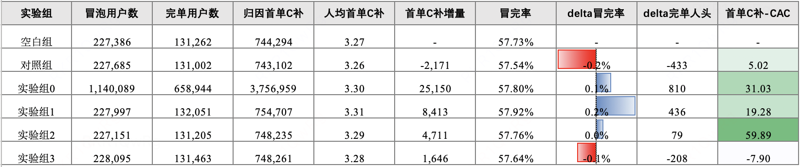
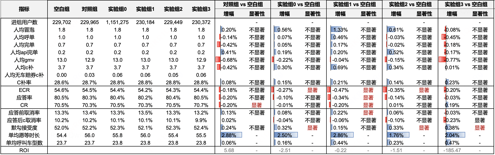
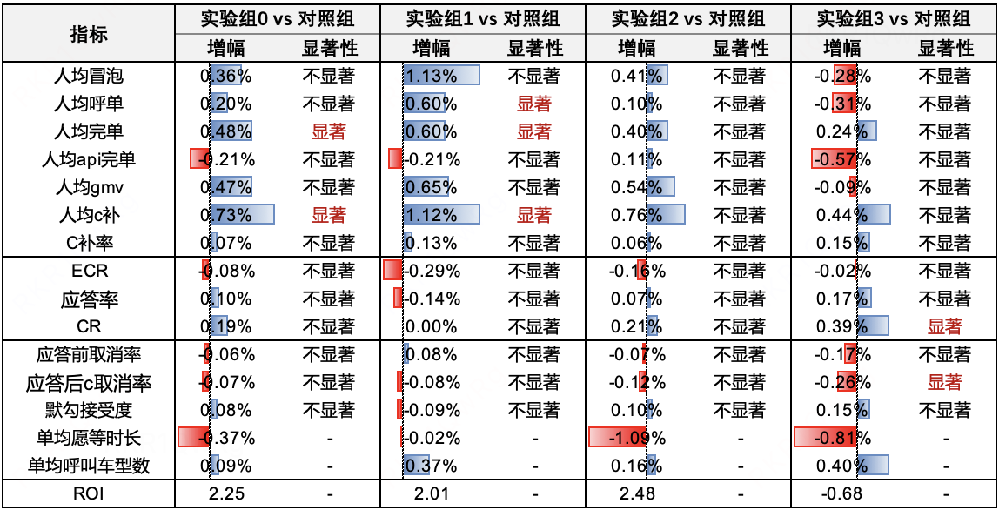
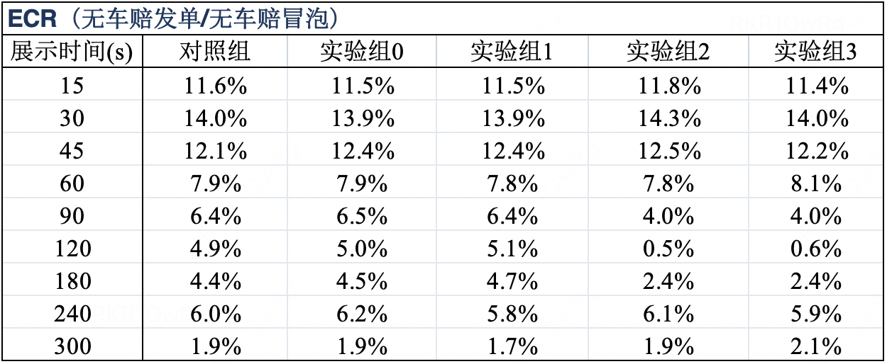

# 【LR26-029】乘客与增长-表单策略-无车赔策略优化-V1.0

[Cooper 原文](https://cooper.didichuxing.com/knowledge/2199610335356/2209079075592)

| 字段   | 内容   |
| --- | --- |
| brd文档链接   | [冒泡页改版 BRD](https://cooper.didichuxing.com/knowledge/2204598041545/2206158666253)   |
| 最后通过的策略方案链接   | [冒泡页改版-确定性预期优化-无车赔策略优化](https://cooper.didichuxing.com/knowledge/2199610335356/2206652808582)   |
| 实验链接（评估大师）   | [无车赔策略优化实验](https://x.intra.hongyibo.com.cn/exp/494899575521281?globalBusinessId=120000&globalProjectId=406437792776193&expFlowTab=dashboard&dashboardTab=metricDetail)   |
| 核心贡献点（创新点，可供其他算法同学借鉴的点）   | 将无车赔的赔付金额、要求勾选车型数和展示/赔付门槛拆为按供需状态配置的策略参数，并通过空白组、线上对照组、bug修复隔离组及组合策略组区分整体价值与相对现状无车赔的增量效果。   |
| 第一贡献人   | 李一鹏   |
| 共同贡献人（没有可以置空）   | 周之烁   |
| 后续策略负责人   | 李一鹏   |

# 1 背景

本策略「无车赔策略优化」是“冒泡页改版-确定性预期优化”的一部分。

无车赔通过“等待承诺＋超时赔付”管理乘客的确定性预期。现有策略长期未更新，主要按照预估应答时长分档，并遵循“等待越久、赔付越高”的规则，未根据不同供需状态（预估应答时长）采取差异化动作。同时，用于区分用户是否可能反勾的阈值生成任务已经停用，原任务使用的 DSAR 模型存在版本问题，当前阈值统一为 0，实际赔付逻辑已退化为单一路径（即完全走「模型预估不会反勾」的链路）。

本次策略希望针对不同供需状态分别验证三条收益链路：

- ***好供需***提高赔付金额，尝试提升 ECR、呼叫和完单。

- ***较差供***需要求乘客多勾选一个车型，尝试提升应答、CR和完单。

- ***极差供需***缩短展示/赔付门槛，尝试提升获得赔付的确定性和后续呼叫意愿。

# 2 目标 & 约束

- **新流人群**

	- **策略目标**

		- 增量完单人头

			- 增量完单人头：在相同冒泡用户规模下，相比基准组多产生的“至少完成一单”的用户数

	- **约束**

		- 抓手CAC <= 业务经营诉求（20）

			- 抓手CAC：指1个新流完单人头提升需要多少元无车赔补贴

- **摇摆人群**

	- **策略目标**

		- 人均完单数

		- 完单roi

	- **约束**

		- C补率拉齐

		- roi > 2

# 3 技术方案

本次采用已通过策略方案中的 MVP 人工参数方案，保持现有触发逻辑和应答时长分档框架不变，对三个供需区间实施可配置调整：

- **好供需**：模型预估应答时长 0～10s，对应档位 1/2、展示时长 15s/30s。赔付金额膨胀至原值的 1.2 倍，膨胀后的最低、最高赔付金额仍为 1元/5元。

- **较差供需**：模型预估应答时长 35～55s，对应档位 6/7、展示时长 120s/180s。要求勾选车型数由默勾数调整为“默勾数＋1”。

- **极差供需**：模型预估应答时长 >80s，对应档位9/10。展示/赔付门槛由 300s 缩短至 240s。

- **新流 bug 修复**：新流赔付金额补充叠加首单券，修复此前未按预期叠加的问题。

具体两类人群在本次实验中的展示逻辑&赔付逻辑如下两表所示

- 新流

| 档位   | 展示时长   | 模型预估应答时长  左开右闭   | 供需情况   | 份额   | 要求勾选车型数   | 赔付折扣（基于冒泡最低价）   |
| --- | --- | --- | --- | --- | --- | --- |
| ~~模型预估会反勾~~   | **模型预估不会反勾**   | ~~模型预估会反勾~~   | **模型预估不会反勾**   |
| 1   | 15s   | 0\~**8s**   | 好供需   | 20.6%   | ~~默勾数~~   | 默勾数   | ~~(默勾最高价 - 冒泡最低价) \*50% \*1.2~~   | 15% \*1.2   |
| 2   | 30s   | 8\~**10s**   | 19.7%   | ~~默勾数~~   | 默勾数   | ~~(默勾最高价 - 冒泡最低价) \*50% \*1.2~~   | 15% \*1.2   |
| 3   | 45s   | 10\~**17s**   | 中等供需   | 24.1%   | ~~默勾数~~   | 默勾数   | ~~(默勾最高价 - 冒泡最低价) \*50%~~   | 15%   |
| 4   | 60s   | 17\~**25s**   | 12.0%   | ~~默勾数~~   | 默勾数   | ~~(默勾最高价 - 冒泡最低价) \*50%~~   | 15%   |
| 5   | 90s   | 25\~**35s**   | 8.8%   | ~~默勾数~~   | 默勾数   | ~~(默勾最高价 - 冒泡最低价) \*50%~~   | 22%   |
| 6   | 120s   | 35\~**45s**   | 较差供需   | 5.6%   | ~~默勾数~~   | 默勾数 + 1   | ~~(默勾最高价 - 冒泡最低价) \*50%~~   | 22%   |
| 7   | 180s   | 45\~**55s**   | 3.6%   | ~~默勾数~~   | 默勾数 + 1   | ~~(默勾最高价 - 冒泡最低价) \*50%~~   | 22%   |
| 8   | 240s   | 55\~**80s**   | 极差供需     | 4.4%   | ~~默勾数~~   | 默勾数   | ~~(默勾最高价 - 冒泡最低价) \*50%~~   | 22%   |
| 9   | ~~300s ~~240s   | 80\~**150s**   | 1.3%   | ~~默勾数~~   | 默勾数   | ~~(默勾最高价 - 冒泡最低价) \*50%~~   | 22%   |
| 10   | ~~300s ~~240s   | 150\~**99999s**   | 0.1%   | ~~默勾数~~   | 默勾数   | ~~(默勾最高价 - 冒泡最低价) \*50%~~   | 22%   |

- 非新流

| 档位   | 展示时长   | 模型预估应答时长  左开右闭   | 供需情况   | 份额   | 要求勾选车型数   | 赔付折扣（基于冒泡最低价）   |
| --- | --- | --- | --- | --- | --- | --- |
| ~~模型预估会反勾~~   | **模型预估不会反勾**   | ~~模型预估会反勾~~   | **模型预估不会反勾**   |
| 1   | 15s   | 0\~**8s**   | 好供需   | 20.6%   | ~~默勾数~~   | 默勾数   | ~~(默勾最高价 - 冒泡最低价) \*50% \*1.2~~   | 10% \*1.2   |
| 2   | 30s   | 8\~**10s**   | 19.7%   | ~~默勾数~~   | 默勾数   | ~~(默勾最高价 - 冒泡最低价) \*50% \*1.2~~   | 10% \*1.2   |
| 3   | 45s   | 10\~**17s**   | 中等供需   | 24.1%   | ~~默勾数~~   | 默勾数   | ~~(默勾最高价 - 冒泡最低价) \*50%~~   | 10%   |
| 4   | 60s   | 17\~**25s**   | 12.0%   | ~~默勾数~~   | 默勾数   | ~~(默勾最高价 - 冒泡最低价) \*50%~~   | 10%   |
| 5   | 90s   | 25\~**35s**   | 8.8%   | ~~默勾数~~   | 默勾数   | ~~(默勾最高价 - 冒泡最低价) \*50%~~   | 10%   |
| 6   | 120s   | 35\~**45s**   | 较差供需   | 5.6%   | ~~默勾数~~   | 默勾数 + 1   | ~~(默勾最高价 - 冒泡最低价) \*50%~~   | 15%   |
| 7   | 180s   | 45\~**55s**   | 3.6%   | ~~默勾数~~   | 默勾数 + 1   | ~~(默勾最高价 - 冒泡最低价) \*50%~~   | 15%   |
| 8   | 240s   | 55\~**80s**   | 极差供需     | 4.4%   | ~~默勾数~~   | 默勾数   | ~~(默勾最高价 - 冒泡最低价) \*50%~~   | 15%   |
| 9   | ~~300s ~~240s   | 80\~**150s**   | 1.3%   | ~~默勾数~~   | 默勾数   | ~~(默勾最高价 - 冒泡最低价) \*50%~~   | 15%   |
| 10   | ~~300s ~~240s   | 150\~**99999s**   | 0.1%   | ~~默勾数~~   | 默勾数   | ~~(默勾最高价 - 冒泡最低价) \*50%~~   | 15%   |

本次实验分组如下：

| 分组   | 描述   | 流量   |
| --- | --- | ---: |
| 空白组   | 无无车赔   | 10%   |
| 对照组   | 全部线上逻辑   | 10%   |
| 实验组0   | 全部线上逻辑＋bug修复   | 50%   |
| 实验组1   | 好供需提赔付金额＋极差供需缩短展示时长＋bug修复   | 10%   |
| 实验组2   | 较差供需提勾选车型数＋极差供需缩短展示时长＋bug修复   | 10%   |
| 实验组3   | 好供需提赔付金额＋较差供需提勾选车型数＋极差供需缩短展示时长＋bug修复   | 10%   |

# 4 实验结果/评估结果

## 4.0 前置说明

实验对象与预期不一致：

- 在实验周期内，ACTI预计投入的预算和运营城市不稳定，==本期摇摆人群暂不参与实验==

- **摇摆人群扩量标准调整**：基于新流无车赔优化实验，补充完单、froi、roi结果，确定是否满足目标与约束；若满足，则摇摆人群follow扩量

新流抓手可放量的CAC标准

- 抓手CAC <= 20

## 4.1 核心实验结果及显著程度

策略团队***更认可***以**空白组**作为无车赔整体价值的评价基准；产品复盘采用当前线上**对照组**作为基准进行方案选型和放量决策，最终选择放量**「实验组 1」**。

**基于新流人群实验，**实验组 1 的核心实验结果如下：

- **「实验组 1」vs 「空白组」**

	- 新流人群业务方关心指标

		- 目标：增量完单人头   **+436人**

		- 约束：抓手CAC   **19.3**

	- 摇摆人群业务方关心指标（不支持摇摆人群放量）

		- 人均完单   **+0.17%（不显著）**

		- 完单roi   **0.0348**

		- roi   **-0.22**

- **「实验组 1」vs「对照组」**

	- 新流人群业务方关心指标（支持新流人群放量）

		- 目标：增量完单人头   **+869人**

		- 约束：抓手边际CAC   **12.1**

	- 摇摆人群业务方关心指标

		- 人均完单   **+0.60%（显著）**

		- 完单roi   **不可比**。实验组1的增量人均C补为正、对照组的增量人均C补为负。

		- roi   **不可比**。实验组1的增量人均C补为正、对照组的增量人均C补为负。

下面详细说明一下各指标的变化：

- **CAC&增量完单人头**

从 CAC 看，组0/1/2实验冒泡完单率提升，其中组1冒完率提升最大+0.2pp，对应新流完单人头增量436，首单C补折算的抓手CAC为19.3元。

和目前线上策略（对照组）相比，实验组1的冒完率提升+0.4pp，对应新流完单人头增量869，首单C补折算的抓手CAC为12.18元。

- **人均完单、ROI、FROI**

*人均完单*方面，相对空白组，各实验组均无显著变化<!--评论:[{"u":"rileywu","c":"人均完单，对照组（大盘）现在看起来相比空白是负向的？（原来放量的时候大概率应该是显著正向的？），现在再看负向的可能的原因是？"},{"u":"yipenglili","c":"1. 有「新流赔付金额未叠加首单券」的 bug，修复后完单不显著正；2. 对照组冒泡不显著正，对照组无车赔提高了用户的等待意愿，但没有同步改善司机供给和应答承接；实验期供需又相对较差，部分用户最终等不到车或在应答前取消，因此冒泡没有转化为完单。"}] -->，其中实验组0 **+0.05%**、实验组1 **+0.17%**、实验组2 **-0.02%**、实验组3 **-0.18%**；相对当前线上对照组，各实验组均有所提升，其中实验组0 **显著 +0.48%**、实验组1 **显著 +0.60%**，实验组2和实验组3分别不显著 **+0.40%**、**+0.24%**，实验组1提升最为明确。

*ROI*方面，相对空白组，实验组0至实验组3分别为 **-2.51、-0.22、-1.51、-185.47**，均为负值；其中实验组1最接近零。实验组3由于增量C补接近零，ROI被放大至 **-185.47**，参考意义较弱。对照组ROI为 **5.68**，但属于减补同时GMV下降形成的正值，不能解释为正向增投收益。

*FROI*方面，相对空白组，实验组0和实验组1分别为 **0.0173、0.0348**，均为正向点估计，且实验组1相对更优；实验组2和实验组3分别为 **-0.0083、-0.0542**，均为负向。对照组FROI为 **0.4948**，同样属于减补同时掉单形成的正值，不能按正向增投收益解读。

综合来看，实验组1在人均完单、ROI和FROI三项指标上的综合表现为实验组中相对最优：相对对照组人均完单显著提升，相对空白组FROI为正且ROI最接近零；但其人均完单相对空白组不显著、ROI仍为负。

| 组别   | 人均完单 vs 对照组（↑）   | 显著性   | 人均完单 vs 空白组（↑）   | 显著性   | ROI（GMV / 元）   | FROI（单/元，↑）   |
| --- | --- | --- | ---: | --- | ---: | ---: |
| 对照组   | --   | --   | **-0.42%**   | 不显著   | **5.68**   | **0.4948**   |
| 实验组0   | **+0.48%**   | **显著**   | **+0.05%**   | 不显著   | **-2.51**   | **0.0173**   |
| 实验组1   | **+0.60%**   | **显著**   | **+0.17%**   | 不显著   | **-0.22**   | **0.0348**   |
| 实验组2   | **+0.40%**   | 不显著   | **-0.02%**   | 不显著   | **-1.51**   | **-0.0083**   |
| 实验组3   | **+0.24%**   | 不显著   | **-0.18%**   | 不显著   | **-185.47**   | **-0.0542**   |

附：完整实验数据
- **versus 空白组**

- **versus 对照组**

## 4.2 实验方案

| 项目   | 内容   | 备注   |
| --- | --- | --- |
| 实验方式   | 在线A/B实验   | --   |
| 分流方式   | 乘客 pid 随机分流   | --   |
| 分流策略内容   | - **空白组**：无无车赔，10%   - **对照组**：全部线上逻辑，10%   - **实验组 0**：全部线上逻辑＋bug修复，50%   - **实验组 1**：好供需提赔付金额＋极差供需缩短展示时长＋bug修复，10%   - **实验组 2**：较差供需提勾选车型数＋极差供需缩短展示时长＋bug修复，10%   - **实验组 3**：好供需提赔付金额＋较差供需提勾选车型数＋极差供需缩短展示时长＋bug修复，10%    | --   |
| 实验周期   | AB期：2026-06-25～2026-07-01，共7个自然日   | --   |
| 流量范围   | - 人群：新流＋摇摆，仅命中上述人群的乘客进入实验   - 生效品类：全部   - 分单场景：全部   - 城市范围：新流开城城市    | --   |
| 评估人   | - DS：孙卉儒   - [评估大师](https://x.intra.hongyibo.com.cn/exp/494899575521281?globalBusinessId=120000&globalProjectId=406437792776193&expFlowTab=dashboard&dashboardTab=metricDetail)    | --   |

## 4.3 收益链路归因分析

**立项时假设的收益链路为**：

- **好供需**：提高赔付金额 → 提升ECR与呼叫 → 提升完单。

- **较差供需**：增加要求勾选车型数 → 提升应答与CR → 提升完单。

- **极差供需**：将展示/赔付门槛由300s缩短至240s → 提升赔付确定性与赔付率 → 提升后续呼叫。

**新流：支持实验组1扩量，但实际收益链路与预期不完全一致**

- **目标与约束：** 实验组1相对当前线上对照组，增量完单人头 **+869人**、人均完单 **+0.60%（显著）**；抓手CAC为 **12.1****，满足≤20要求**。因此，支持新流扩量实验组1。

- **完单显著提升链路：** 

好供需提高赔付金额＋极差供需缩短展示时长＋新流bug修复 

→ 15s/30s档位单均赔付金额高于实验组0，说明提赔付金额动作已生效；新流无车赔展示金额未计入首单券的问题同步修复 

→ *人均C补* **+1.12%（显著）** 

→ 可能通过影响用户后续留存产生间接影响，*人均冒泡* **+1.13%（不显著）** 

→ *ECR* **-0.29pp（不显著）**，可能来自策略影响与组间波动 

→ 人均冒泡的正向点估计覆盖ECR的负向点估计，*人均呼单* **+0.60%（显著）** 

→ 应答端未见明显改善，*应答前取消率* **+0.08pp（不显著）**、*CR* **0.00pp（不显著）** 

→ *人均完单* **+0.60%（显著）**、*人均GMV* **+0.65%（不显著）**。

- 相对现状无车赔，==本次完单提升主要来自冒泡提升、ECR下降，最终两者叠加使得呼叫上涨且CR未出现折损，并非来自原定的ECR改善==。

- ==实验组1的收益中还包含bug修复贡献==。仅修复首单券叠加bug的实验组0，相对对照组人均完单已 **显著 +0.48%**；实验组1为 **显著 +0.60%**。

**实验组1相对空白组的整体价值链路：**

改版前的线上无车赔策略相对空白组，ECR已经呈 **-0.18pp（不显著）**的轻微负向点估计。一种可能解释是，无车赔的等待承诺也会向部分用户传递“当前可能较难叫到车”的信号。

本次实验中，*人均冒泡* **+1.33%（不显著）**

→ 叠加原有无车赔链路、bug修复及组间波动后，*ECR* **-0.47pp（显著）** 

→ 人均冒泡的正向点估计部分覆盖ECR负向，*人均呼单* **+0.46%（不显著）**

→ 虽然*单均愿等时长* **+2.86%**，但司机侧应答承接没有同步改善。产品复盘指出，实验期15～60s档位占比较BRD测算期下降 **8.59pp**，可作为实验期供需较差的背景解释；同时，部分用户也可能在等待过程中耐心耗尽并提前取消。最终表现为*应答前取消率* **+0.22pp（显著）**、*应答率* **-0.34pp（显著）**

→ bug修复组相对空白组的CR已改善至 **-0.01pp（不显著）**；实验组1加入提高赔付金额和缩短展示时长后，CR点估计回落至 **-0.20pp（显著）**

→ 最终，*人均呼单*的正向点估计部分覆盖了CR负向，*人均完单* **+0.17%（不显著）**。

**实验组2和实验组3未验证扩量收益：**

- **实验组2：** 

	- 原定收益链路为“增加要求勾选车型数 → 提升应答率与 CR → 提升完单”。相对当前线上对照组，*单均呼叫车型数* **+0.16%**、*应答率*  **+0.07pp**、*CR* **+0.21pp（不显著）**、*人均完单* **+0.40%（不显著）**，中后链路呈正向点估计，但未形成显著的应答、CR 或完单收益；同时，*ECR* **-0.16pp（不显著）**。

	- 相对空白组，*应答率* **-0.14pp（不显著）**、*CR* **+0.01pp（不显著）**、*人均完单* **-0.02%（不显著）**，且 *ECR* **-0.35pp（显著）**。

	- DS 报告同时观察到，120s/180s 档位增加要求勾选车型数后，==乘客发单意愿下降==。最终，增量完单人头仅 **+79人**、完单 ROI（FROI）为 **-0.0083单/元**、抓手 CAC 为 **59.9元/人**；虽然相对对照组的 ROI 为 **2.48**，但相对空白组 ROI 为 **-1.51**，且核心完单收益与 CAC 均未满足扩量要求。因此，目前证据不支持实验组2扩量。

- **实验组3：** 相对对照组，虽然CR **+0.39pp（显著）**，但人均呼单 **-0.31%（不显著）**，最终人均完单仅 **+0.24%（不显著）**；相对空白组，增量完单人头 **-208人**、人均完单 **-0.18%（不显著）**、完单ROI（FROI）**-0.0542**，不形成有效CAC。组合策略未形成叠加收益，不支持扩量。

综合来看，新流侧仅实验组1相对当前线上对照组满足完单目标方向及CAC、ROI经营约束，支持扩量；但实际收益更多表现为==人均冒泡正向点估计带来的呼单规模增长，原定的ECR提升链路没有得到验证==。

**摇摆：不支持扩量**

实验组1相对空白组，人均完单 **+0.17%（不显著）**、完单ROI（FROI）**0.0348单**；ROI为 **-0.22，不满足>2要求**，因此摇摆人群本次不follow扩量。

# 5 放量决策

<u>注：由于新流业务方认可收益，本需求整体owner（产品-苏慧妍）与新流业务方沟通后，目前已于新流人群放量</u>

|    |    | 预期扩量时间节奏   | 实际扩量时间   | 放量暂停点详情   | 放量暂停点效果评估   | 是否需要设置长期对照组（默认不需要，此列无需填写）   |
| --- | --- | --- | --- | --- | --- | --- |
|    |    |    | LR通过后，根据实际情况，填写这3列   |    |
| 放量决策意见   | 决策人：平台流量-冯艺凡   | ——   | ——   | ——   | ——   | ——   |
| 决策意见：通过   |    |    |    |    |    |
| 放量需要周知的利益相关方   | 无   | ——   | ——   | ——   | ——   | ——   |
| 放量策略   | 实验组1：好供需档位提高赔付金额至原值的 1.2倍，极差供需档位将展示/赔付门槛由 300s 缩短至 240s，同时包含新流首单券叠加bug修复。   | ——   | ——   | ——   | ——   | ——   |
| 放量节奏   | 优先推进实验组1放量，目前已经放量至  - **实验组 1** 90%   - **空白组** 10%    |    |    |    |    |    |

# 6 引用和鸣谢

- [冒泡页改版 BRD](https://cooper.didichuxing.com/knowledge/2204598041545/2206158666253)

- [冒泡页改版 PRD](https://cooper.didichuxing.com/knowledge/2204598041545/2206407835050)

- [冒泡页改版-确定性预期优化-无车赔策略优化](https://cooper.didichuxing.com/knowledge/2199610335356/2206652808582)

- [P0需求复盘——冒泡页改版](https://cooper.didichuxing.com/knowledge/2204598041545/2208858300760)

- [无车赔策略优化实验DS报告](https://cooper.didichuxing.com/docs2/document/2208683639486)

- [评估大师实验](https://x.intra.hongyibo.com.cn/exp/494899575521281?globalBusinessId=120000&globalProjectId=406437792776193&expFlowTab=dashboard&dashboardTab=metricDetail)

# 7 后续规划

- 新流人群已经放量至组 1 90%，空白组流量 10%

- 摇摆人群暂不放量

- 算法暂无后续介入改进计划
