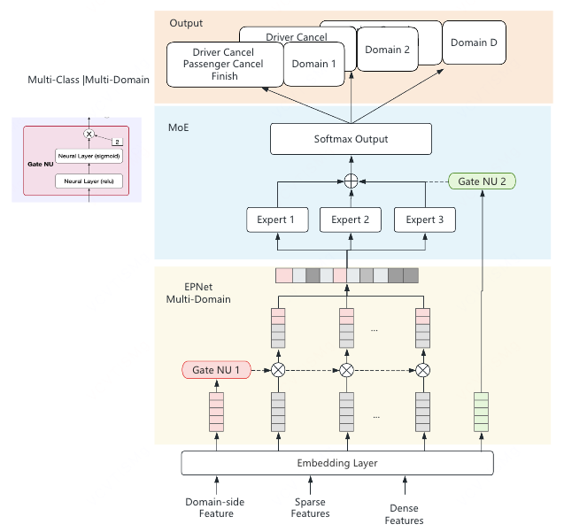

# 【LR26-032】交易效率- PK策略-约束履约率并最小化接驾距离的PK策略- V1.0

[Cooper 原文](https://cooper.didichuxing.com/knowledge/2199610335356/2208936812656)

# 基础信息

| brd文档链接 <br> |  [约束履约率并最小化接驾距离的PK策略BRD](https://cooper.didichuxing.com/docs2/document/2207845057791) <br> |
| --- | --- |
| 最后通过的策略方案链接 <br> | [约束履约率并最小化接驾距离的PK策略方案v1.1](https://cooper.didichuxing.com/knowledge/2199610335356/2207928276868) <br> |
| 实验链接（评估大师） <br> | [https://x.intra.hongyibo.com.cn/exp/498333116530689?globalBusinessId=120000&globalProjectId=394841194299393&expFlowTab=dashboard&dashboardTab=metricDetail](https://x.intra.hongyibo.com.cn/exp/498333116530689?globalBusinessId=120000&globalProjectId=394841194299393&expFlowTab=dashboard&dashboardTab=metricDetail) <br>[https://x.intra.hongyibo.com.cn/exp/501086066966529?globalBusinessId=120000&globalProjectId=261878894821377&expFlowTab=dashboard&dashboardTab=metricDetail](https://x.intra.hongyibo.com.cn/exp/501086066966529?globalBusinessId=120000&globalProjectId=261878894821377&expFlowTab=dashboard&dashboardTab=metricDetail) <br> |
| 核心贡献点（创新点，可供其他算法同学借鉴的点） <br> | **PK目标创新**：将“最大化履约率”改为“约束履约率、最小化接驾距离”，通过拉格朗日松弛和离线求解 \\(\\lambda\\)，形成可在线部署且兼容倾斜的PK分。 <br>**履约建模创新**：将存在样本选择偏差的司乘双模型改为“司机取消、乘客取消、完单”全样本三分类模型，结合PEPNet门控提升履约率预测精度。 <br> |
| 第一贡献人 <br> | 董听 <br> |
| 共同贡献人（没有的话，可以置空） <br> | 吴健 <br> |
| 后续策略负责人 <br> | 董听 <br> |

# 1 背景

当前平台CR已达到较高水平，如何在保持完单和CR不降的同时，通过优化PK环节，来优化交易效率(乘客ETP +司机接驾时长)，是PK的核心挑战。 （乘客ETP： 乘客视角 应答时长+接驾时长）

- 首先，当前PK打分依据是模型预估的履约率（司机履约率和乘客履约率的加权），没有直接优化ETP和司机接驾时长的抓手，因此需要**转变PK环节的优化目标，在PK打分中加入接驾距离的考量**。

- 其次，当前的履约率模型存在样本选择性偏差问题，且模型为可解释性强但结构简单的Deep&Wide，AUC存在较大提升空间（3pp）。因此，将预测乘客履约率和司机履约率的多任务建模优化为**预测（司机取消、乘客取消、完单）的三分类问题****；**同时，**优化模型结构为基于PEPNet的三分类模型**，提升履约率预测AUC；对于模型的可解释性，通过用完全可解释的LR模型蒸馏深度模型，得到部分的可解释性（80%以上）。

- 分单中的O选D需要与PK阶段的PK分保持一致，因此本策略上述两个优化会在<u>分单阶段的O选D</u>和<u>PK环节</u>生效。

# 2 目标 & 约束

目标：（线上）降低ETP+司机接驾时长0.5%，（离线）履约率模型 AUC+3pp

约束：平台完单和CR不显著负，商家份额变动（API打包）不超过5%

# 3 技术方案

## 3.1 优化问题求解

考虑交易的目标：约束完单不负，降低乘客ETP+司机接驾时长

由于PK打分环节（O选D）无法改变应答时长，能直接优化接驾时长（即接驾距离），因此将PK打分的优化目标修改为 **约束履约率不显著负，最小化司机接驾距离**

先定义以下符号

|  <br> | 含义 <br> |
| --- | --- |
| $$i$$ <br> | 订单下标 <br> |
| $$j$$ <br> | 司机下标 <br> |
| $$x_{ij}$$ <br> | 订单$$i$$是否选司机$$j$$,$$x_{ij} \in \{0,1\}$$ <br>$$x_{ij} = 1$$ 代表该订单$$i$$选司机$$j$$ <br> |
| $$f$$ <br> | 模型预估履约率$$f = \alpha * f_p + (1-\alpha)*f_d$$ <br> |
| $$f_p$$ <br> | 模型预估乘客履约率 <br> |
| $$f_d$$ <br> | 模型预估司机履约率 <br> |
| $$d=dist$$ <br> | 司机接驾距离 <br> |
| $$N$$ <br> | 订单数 <br> |
| D <br> | 现状下司机接驾距离最大值 <br> |

### **3.1.1 优化问题推导**

原来的优化目标：最大化履约率  $$max \ E[f]$$

新的优化目标：约束整体履约率不显著负，最小化接驾距离。

这里<u>履约率基线设定为订单的所有举手司机的最高履约率，「不显著负」设定为「相对降幅不超过0.2%」</u>

 $$min \  E[d], \ s.t. \ E[f] \geq C * E[\max_j f_j], \ C =0.998$$

也就是

$$\begin{aligned} &\min \frac{1}{N} \sum_{i=1}^N \sum_j d_{ij} x_{ij} \\ s.t. \quad   & \frac{1}{N}\sum_{i=1}^N\sum_j f_{ij}x_{ij} \geq C * \frac{1}{N}\sum_{i=1}^N\max_j f_{ij} =: F_{target}, \\ &\sum_j x_{ij} = 1,\quad  \forall i = 1,\cdots , N  \end{aligned}$$

将约束1用拉格朗日松弛，约束2通过工程实现，拉格朗日函数为

$$\begin{aligned} \mathcal{L} (\{x_{ij}\},\lambda) &= \frac{1}{N} \sum_{ij} d_{ij} x_{ij}+\lambda (F_{target} - \frac{1}{N} \sum_{ij} f_{ij}x_{ij}), \quad \lambda \geq 0 \\ &= \lambda F_{target} + \frac{1}{N} \sum_{i,j}(d_{ij} -\lambda f_{ij} )x_{ij} \end{aligned}$$

固定一个$$\lambda$$后，拉格朗日函数关于订单可分解，因此每个订单能够独立选择司机：

$$j_i^*(\lambda) \in \argmin_j (d_{ij}-\lambda f_{ij}) = \argmax_j(\lambda f_{ij} - d_{ij})$$

即

$$\begin{aligned} x_{ij}^*(\lambda)= \begin{cases} 1, & j=j_i^{*}(\lambda),\\ 0, & \text{otherwise}. \end{cases} \end{aligned}$$

因此，给定$$\lambda$$ 后，线上PK分可以写成 $$\boxed{ score_{ij}(\lambda) = \lambda f_{ij} - d_{ij} }$$, 其中$$\lambda$$代表履约率相对于接驾距离的全局置换权重。

由于并不希望完全只看距离，约束$$\lambda >0$$， 因此可以设置 $$\boxed{ score_{ij}(\lambda) = f_{ij} - \frac{1}{\lambda}d_{ij} }$$ （下面PID分流实验中的PK分形式）

后续为了兼容倾斜，将PK分归一化至$$[0,1]$$之间，$$\boxed{ score_{ij}(\lambda) =(1-w)* f_{ij} + w*r_{d_{ij}} }$$（下面时间片实验中的PK分形式，也是本策略最终PK分形式）

其中，$$\begin{aligned} & \lambda >1\\ &\beta = \frac{1}{\lambda} \in (0,1]\\  &r_d = 1 - \frac{\min(d, D)}{D} \in [0,1] \\ &w = \frac{\beta D}{1+\beta D} \in [0,1]\\  &PK分 =(1-w)*f + w* r_d \in [0,1]\\ &D = 5000  \end{aligned}$$

当司机接驾距离$$d<5000$$时，两个PK分排序等价。 当前司机接驾距离不会超过D=5000m（召回距离为4.5km）。

### 3.1.2 $$\lambda$$求解

离线回放历史数据，通过二分法求解$$\lambda$$。 对于每一个给定的$$\lambda$$，能够求解出获胜司机以及整体的模型预估履约率满足程度和接驾距离降幅；当整体履约率约束不满足时，增加$$\lambda$$;求满足整体履约率约束的最小$$\lambda$$。

（由于下述硬约束只在PK环节生效，在分单环节不生效，因此$$\lambda$$测算时未加硬约束进行测算）

### 3.1.3 硬约束

为了防止履约率过低的司机胜出，对胜出司机做履约率的硬约束： 胜出司机履约率 >= 0.9\*举手司机最高履约率

【理想状态】分单的O选D环节和PK环节， 要求胜出司机满足 ：

- 筛选满足履约率约束的司机：$$f_j \geq 0.9 \max f$$ (履约率不小于 该订单的所有举手司机的最大履约率 $$\max f$$ 的0.9倍）

- 在筛选的司机中选倾斜后的PK分最好的

【工程实现】

**分单**

- 不做硬约束。原因：当前分单系统的O对D打分只支持对一个分数的排序，若要支持上述功能修改很大，工程不支持。

**PK** 

当前PK为在一个PK窗口时段中收集举手司机，当举手司机与当前胜者PK后，败者会直接释放，而非等待窗口结束。**由于需要兼容当前<u>败者提前释放</u>的逻辑，用启发式的方式求最终胜者：**

- 始终维护一个 已举手司机的履约率最高分$$\max f$$ 和 一个当前胜者司机A

- 每当有新的司机B举手时，更新当前的已举手司机履约率最高分$$\max f$$ 。在满足履约率约束的司机中PK分最高者成为当前胜者

（这个方法不能保证胜出司机是满足履约率最高的司机中的PK分最高者，但是一定是满足履约率约束的）

## 3.2 履约率模型优化 

### 3.2.1 模型特征

保持不变

| 特征维度 <br> | 特征 <br> | 是否需要建设 <br> |
| --- | --- | --- |
| 订单特征 <br> | 城市、呼叫时间、订单里程等 <br> | 已建设 <br> |
| 司乘特征 <br> | 是否连环派、指派模式、接驾距离、预估价等 <br> | 已建设 <br> |
| 供需特征 <br> | 格子和周围格子近X分钟发单数、空车司机数等 <br> | 已建设 <br> |
| 司机特征 <br> | 司机近X天（分场景）的拒单率、取消率、完单数等 <br> | 已建设 <br> |
| 乘客特征 <br> | 乘客近X天应答后取消率、完单数、平均订单里程等 <br> | 已建设 <br> |

### 3.2.2 模型建模

原PK履约率模型存在问题：在司机履约的样本上训练乘客履约率，存在偏差（司机履约同理）

| 模型版本 <br> | 建模目标 <br> | 所有样本 <br> | 正样本 <br> | 负样本 <br> | PK分 <br> |
| --- | --- | --- | --- | --- | --- |
| 原PK履约率模型（V4) <br> | is_d_finish <br> | PK获胜且乘客未取消 <br> | 完单 <br> | 司机取消/拒单 <br> | $$\alpha$$\*P(is_o_finish) +$$(1-\alpha)$$\*P(is_d_finish) <br> |
| is_o_finish <br> | PK获胜且司机未取消/拒单 <br> | 完单 <br> | 乘客取消 <br> |

以乘客履约率为例

- 训练空间：P(Y = 1｜司机未取消/拒单, X）Y=1表示乘客履约

- 推理空间：P(Y = 1 | X)  

在训练时，特征X的分布被“司机未取消/拒单”这个事件过滤了，发生协变量偏移：训练集的X与测试集的X分布不一致

> 例如

> 恶劣天气+远距离订单 -> 司机取消概率高 -> 这类样本很少出现在乘客履约的训练集中

> 线上推理时遇到此类订单，模型缺少对此类特征的拟合能力，预测不准

**解决方法：**

将多任务建模优化为**预测订单状态是（司机取消，乘客取消，完单）的多分类模型**

- 训练空间：P1 = P(Y1 = 司机取消 | X) , P2 = P(Y2 = 乘客取消 | X), P3 = P(Y3 = 完单 | X)

- 推理空间：P1 = P(Y1 = 司机取消 | X) , P2 = P(Y2 = 乘客取消 | X), P3 = P(Y3 = 完单 | X)

- 乘客履约率 = P(乘客履约｜司机履约）= P(完单) / (P(乘客取消 )+P(完单)) =  P3/(P2+P3), 司机履约率 = P3/(P1+P3)

	- 我们想要在PK中预估的乘客履约率就是 假设司机不取消时 乘客的履约率，因此就是要预测P(乘客履约 | 司机履约）

- 履约率 =$$\alpha$$\*乘客履约率 +$$(1-\alpha)$$\* 司机履约率（与原来保持一致，站在乘客的视角增加乘客履约在O对D打分中的权重）

### 3.2.3 模型结构

使用基于PEPNet的三分类模型，预测订单最终状态为司机取消、乘客取消或完单。模型由特征向量化、EPNet 场景门控、双线性交互、PPNet 个性化门控和三个类别独立塔组成。

- EPNet 场景门控：场景感知的输入特征重标定。

	- 门控 Gate NU 输入：连环派类型，派单类型，发单星期和时间段，订单距离，供需 共10个特征

- PPNet 个性化门控： 个性化隐藏层门控。

	- 门控Gate NU 输入：司机和乘客画像（个性化特征）

           

### 3.2.4 离线评估

可行的模型离线效果评估方式有如下两种：

1. **三分类的 macro_auc**

即$$macro \ auc = \frac{1}{3}(auc_{1} +auc_2 + auc_3 )$$,  $$auc_1 , auc_2, auc_3$$分别是is_d_cancel, is_o_cancel, is_finish的 OvR的auc

2. **乘客履约和司机履约的AUC**（和Deep&Wide的评估方式一致）

即在司机未取消的样本上，评估乘客是否履约的auc；在乘客未取消的样本上，评估司机是否履约的auc

对本次多分类模型来说，(P(乘客履约), P(乘客取消)) =  $$(\frac{P_3}{P_2+P_3},  1- \frac{P_3}{P_2+ P_3})$$, 司机履约同理

结论：由于线上最终使用的PK分是条件概率，**因此采用方式2**，同时能够与Deep&Wide模型评估拉齐，最终乘客履约率AUC=0.7290（+2.5pp），司机履约率AUC=0.8921（+4.5pp)

模型离线效果
| 序号 <br> | 建模 <br> | 模型 <br> | auc_o（乘客履约率） <br>f/(f+pc) <br> | auc_d（司机履约率） <br>f/(f+dc) <br> |
| --- | --- | --- | --- | --- |
| 1 <br> | 多任务 <br> | Deep&Wide <br> | 0.7047 <br> | 0.8468 <br> |
| 2 <br> | PLE_simplegate（jiuxin) <br> | 0.6746 <br> | 0.8789 <br> |
| 3 <br> | 三分类 <br> | MoE <br> | 0.7280 <br> | 0.8892 <br> |
| 4 <br> | SE <br> | 0.7277 <br> | 0.8893 <br> |
| 5 <br> | MoE+ bilinear （大参数量版） <br> | 0.7283 <br> | 0.8898 <br> |
| 6 <br> | PLE （多塔负责多个分类）+ bilinear** **（大参数量版） <br> | 0.7294 <br> | 0.8907 <br> |
| 7 <br> | PLE + bilinear （大参数量版）+ gateEntropyWeight +classWeight 2.5,2.0,1.0 <br> | 0.7283 <br> | 0.8906 <br> |
| 8 <br> | PEP <br> | 0.7283 <br> | 0.8914 <br> |
| 9 <br> | PEP + bilinear（大参数量版） <br> | 0.7295 <br> | 0.8916 <br> |
| 10 ✅ <br> | PEP +bilinear (简化版） <br> | 0.7290 <br> | 0.8921 <br> |
| 11 <br> | LR（ 由10蒸馏得到） <br> | 0.6594 <br> | 0.8257 <br> |

区分派单模式

区分派单模式 模型AUC
| 派单模式 <br> | auc_o（乘客履约率） <br>f/(f+pc) <br> | auc_d（司机履约率） <br>f/(f+dc) <br> |
| --- | --- | --- |
| 1（抢单） <br> | 0.7113 <br> | 0.7935 <br> |
| 2（半指派） <br> | 0.7235 <br> | 0.8643 <br> |
| 3（全指派） <br> | 0.7279 <br> | 0.8444 <br> |

**值准ECE**

由于在PK打分中会使用模型预估履约率的最高分作为基线，模型的值准会直接影响履约率降幅约束的计算，这里增加模型值准ECE结果。

|  <br> | 验证样本空间 <br> | 平均模型预测值 <br> | 真实发生率 <br> | 两者绝对差值 <br> | ECE（10分桶加权求和） <br> |
| --- | --- | --- | --- | --- | --- |
| 乘客履约率 <br> | 司机未取消 <br> | 0.8886 <br> | 0.8830 <br> | 0.0056 <br> | 0.0056 <br> |
| 司机履约率 <br> | 乘客未取消 <br> | 0.9181 <br> | 0.9168 <br> | 0.0013 <br> | 0.0048 <br> |
| 整体履约率 <br> | 所有 <br> | 0.8233 <br> | 0.8175 <br> | 0.0057 <br> | 0.0074 <br> |

### 3.2.5 模型可解释性

为说明当前模型中哪些特征对PK排序重要，需要给出模型的部分可解释性

方法：用上述深度模型PEP（版本10） 作为Teacher模型，Student模型LR 学习PEP的probability

LR模型的特征：与Deep&Wide模型特征一致，只选用与司机排序相关的特征，共9维

特征
|  <br> | 特征名 <br> | 特征含义 <br> | 特征处理和计算公式 <br> | EVE通用算子配置 <br> |
| --- | --- | --- | --- | --- |
| 1 <br> | ==serial_detour_ratio== <br> | 连环派绕路比 <br> | ==truncate====(====detour_ratio, true,1,true,10====)== <br> | ```PlainText<br>- new_column: is_half_assign<br>  operate: feature_mapping<br>  selected:<br>    feature: dispatch_type<br>    type: int<br>    fromAdd: false<br>  returnType: int<br>  mapping: '2:1,elseValue:0'<br>  mappingObj: <br>    '2': '1'<br>    'elseValue': '0'<br>- new_column: is_serial<br>  operate: binaryzation<br>  selected:<br>    feature: serial_type<br>    type: int<br>    fromAdd: false<br>  returnType: int<br>  threshold: '0.5'<br>- new_column: order_time<br>  operate: truncate<br>  selected:<br>    feature: order_waiting_period<br>    type: double<br>    fromAdd: false<br>  returnType: double<br>  with_min: true<br>  truncate_min: 0<br>  with_max: true<br>  truncate_max: 1200<br>- new_column: serial_detour_ratio<br>  operate: truncate<br>  selected:<br>    feature: detour_ratio<br>    type: double<br>    fromAdd: false<br>  returnType: double<br>  with_min: true<br>  truncate_min: 1<br>  with_max: true<br>  truncate_max: 10<br>- new_column: d_lumian_dis<br>  operate: calc<br>  selected:<br>    feature: lumian_dis<br>    type: double<br>    fromAdd: false<br>  returnType: double<br>  calc_str: 'is_serial*dropoff_order_distance+(1-is_serial)*lumian_dis'<br>- new_column: fee_per_p_dis<br>  operate: calc<br>  selected:<br>    feature: pre_total_fee<br>    type: double<br>    fromAdd: false<br>  returnType: double<br>  calc_str: 'pre_total_fee/(start_dest_distance+0.00001)'<br>- new_column: fee_per_p_distance<br>  operate: truncate<br>  selected:<br>    feature: fee_per_p_dis<br>    type: double<br>    fromAdd: false<br>  returnType: double<br>  with_min: true<br>  truncate_min: 0<br>  with_max: true<br>  truncate_max: 1<br>- new_column: fee_per_d_dis<br>  operate: calc<br>  selected:<br>    feature: pre_total_fee<br>    type: double<br>    fromAdd: false<br>  returnType: double<br>  calc_str: 'pre_total_fee/(d_lumian_dis+start_dest_distance+0.00001)'<br>- new_column: fee_per_d_distance<br>  operate: truncate<br>  selected:<br>    feature: fee_per_d_dis<br>    type: double<br>    fromAdd: true<br>  returnType: double<br>  with_min: true<br>  truncate_min: 0<br>  with_max: true<br>  truncate_max: 1<br>- new_column: d_refuse_cnt<br>  operate: calc<br>  selected:<br>    feature: d_half_serial_refuse_cnt_14d<br>    type: double<br>    fromAdd: false<br>  returnType: double<br>  calc_str: 'is_half_assign*is_serial*d_half_serial_refuse_cnt_14d+is_half_assign*(1-is_serial)*d_half_nonserial_refuse_cnt_14d'<br>- new_column: d_answer_cnt<br>  operate: calc<br>  selected:<br>    feature: d_half_serial_answer_cnt_14d<br>    type: double<br>    fromAdd: false<br>  returnType: double<br>  calc_str: 'is_half_assign*is_serial*d_half_serial_answer_cnt_14d+is_half_assign*(1-is_serial)*d_half_nonserial_answer_cnt_14d+(1-is_half_assign)*is_serial*d_full_serial_answer_cnt_14d+(1-is_half_assign)*(1-is_serial)*d_full_nonserial_answer_cnt_14d'<br>- new_column: d_d_cancel_cnt<br>  operate: calc<br>  selected:<br>    feature: d_half_serial_d_cancel_cnt_14d<br>    type: double<br>    fromAdd: false<br>  returnType: double<br>  calc_str: 'is_half_assign*is_serial*d_half_serial_d_cancel_cnt_14d+is_half_assign*(1-is_serial)*d_half_nonserial_d_cancel_cnt_14d+(1-is_half_assign)*is_serial*d_full_serial_d_cancel_cnt_14d+(1-is_half_assign)*(1-is_serial)*d_full_nonserial_d_cancel_cnt_14d'<br>- new_column: d_p_cancel_cnt<br>  operate: calc<br>  selected:<br>    feature: d_half_serial_p_cancel_cnt_14d<br>    type: double<br>    fromAdd: false<br>  returnType: double<br>  calc_str: 'is_half_assign*is_serial*d_half_serial_p_cancel_cnt_14d+is_half_assign*(1-is_serial)*d_half_nonserial_p_cancel_cnt_14d+(1-is_half_assign)*is_serial*d_full_serial_p_cancel_cnt_14d+(1-is_half_assign)*(1-is_serial)*d_full_nonserial_p_cancel_cnt_14d'<br>- new_column: d_finish_cnt<br>  operate: calc<br>  selected:<br>    feature: d_half_serial_finish_cnt_14d<br>    type: double<br>    fromAdd: false<br>  returnType: double<br>  calc_str: 'is_half_assign*is_serial*d_half_serial_finish_cnt_14d+is_half_assign*(1-is_serial)*d_half_nonserial_finish_cnt_14d+(1-is_half_assign)*is_serial*d_full_serial_finish_cnt_14d+(1-is_half_assign)*(1-is_serial)*d_full_nonserial_finish_cnt_14d'<br>- new_column: d_refuse_rate<br>  operate: calc<br>  selected:<br>    feature: d_refuse_cnt<br>    type: double<br>    fromAdd: true<br>  returnType: double<br>  calc_str: 'd_refuse_cnt/(d_refuse_cnt+d_answer_cnt+0.00001)'<br>- new_column: driver_refuse_rate<br>  operate: truncate<br>  selected:<br>    feature: d_refuse_rate<br>    type: double<br>    fromAdd: true<br>  returnType: double<br>  with_min: true<br>  truncate_min: 0<br>  with_max: true<br>  truncate_max: 1<br>- new_column: d_d_cancel_rate<br>  operate: calc<br>  selected:<br>    feature: d_d_cancel_cnt<br>    type: double<br>    fromAdd: true<br>  returnType: double<br>  calc_str: 'd_d_cancel_cnt/(d_answer_cnt+0.00001)'<br>- new_column: d_p_cancel_rate<br>  operate: calc<br>  selected:<br>    feature: d_p_cancel_cnt<br>    type: double<br>    fromAdd: true<br>  returnType: double<br>  calc_str: 'd_p_cancel_cnt/(d_answer_cnt+0.00001)'<br>- new_column: driver_d_cancel_rate<br>  operate: truncate<br>  selected:<br>    feature: d_d_cancel_rate<br>    type: double<br>    fromAdd: false<br>  returnType: double<br>  with_min: true<br>  truncate_min: 0<br>  with_max: true<br>  truncate_max: 1<br>- new_column: driver_p_cancel_rate<br>  operate: truncate<br>  selected:<br>    feature: d_p_cancel_rate<br>    type: double<br>    fromAdd: false<br>  returnType: double<br>  with_min: true<br>  truncate_min: 0<br>  with_max: true<br>  truncate_max: 1<br>- new_column: d_induce_rate<br>  operate: calc<br>  selected:<br>    feature: d_duty_induce_cnt_14d<br>    type: double<br>    fromAdd: false<br>  returnType: double<br>  calc_str: 'd_duty_induce_cnt_14d/(d_half_serial_answer_cnt_14d+d_half_nonserial_answer_cnt_14d+d_full_serial_answer_cnt_14d+d_full_nonserial_answer_cnt_14d+0.00001)'<br>- new_column: driver_induce_rate<br>  operate: truncate<br>  selected:<br>    feature: d_induce_rate<br>    type: double<br>    fromAdd: true<br>  returnType: double<br>  with_min: true<br>  truncate_min: 0<br>  with_max: true<br>  truncate_max: 1<br>- new_column: d_p_weight_cancel_rate<br>  operate: calc<br>  selected:<br>    feature: driver_induce_rate<br>    type: double<br>    fromAdd: true<br>  returnType: double<br>  calc_str: 'driver_p_cancel_rate+5*driver_induce_rate'<br>- new_column: driver_p_weight_cancel_rate<br>  operate: truncate<br>  selected:<br>    feature: d_p_weight_cancel_rate<br>    type: double<br>    fromAdd: true<br>  returnType: double<br>  with_min: true<br>  truncate_min: 0<br>  with_max: true<br>  truncate_max: 1<br>- new_column: driver_finish_cnt<br>  operate: truncate<br>  selected:<br>    feature: d_finish_cnt<br>    type: double<br>    fromAdd: true<br>  returnType: double<br>  with_min: true<br>  truncate_min: 0<br>  with_max: true<br>  truncate_max: 1400<br>``` |
| 2 <br> | ==lumian_dis== <br> | 司机接驾距离（连环派AB+BC） <br> | lumian_dis <br> |
| 3 <br> | ==d_lumian_dis== <br> | 司机接驾距离（连环派BC） <br> | ==calc====(====is_serial\*dropoff_order_distance+(1-is_serial)\*lumian_dis====)== <br> |
| 4 <br> | ==fee_per_p_distance== <br> | 单公里（送驾距离）价格 <br> | ==fee_per_p_dis(double)==== = ====calc====(====pre_total_fee/(start_dest_distance+0.00001)====)== <br> |
| 5 <br> | ==fee_per_d_distance== <br> | 单公里（接驾+送驾距离）价格 <br> | ==fee_per_d_dis(double)==== = ====calc====(====pre_total_fee/(d_lumian_dis+start_dest_distance+0.00001)====)== <br> |
| 6 <br> | ==driver_refuse_rate== <br> | 近14天司机拒单率 <br> | ==d_refuse_rate(double)==== = ====calc====(====d_refuse_cnt/(d_refuse_cnt+d_answer_cnt+0.00001)====)== <br> |
| 7 <br> | ==driver_p_weight_cancel_rate== <br> | 近14天司机判责加权的被乘客取消率 <br> | ==d_p_weight_cancel_rate(double)==== = ====calc====(====driver_p_cancel_rate+5\*driver_induce_rate====)== <br> |
| 8 <br> | ==driver_d_cancel_rate== <br> | 近14天司机取消率 <br> | ==driver_p_weight_cancel_rate(double)==== = ====truncate====(====d_p_weight_cancel_rate, true,0,true,1====)== <br> |
| 9 <br> | ==driver_finish_cnt== <br> | 近14天司机完单数 <br> | ==driver_finish_cnt(double)==== = ====truncate====(====d_finish_cnt, true,0,true,1400====)== <br> |

**LR模型效果** 

auc_o: 0.6594, auc_d: 0.8257, auc_finish: 0.7149

**排序一致性**

**「排序一致」的定义：**

- 对于同一个订单举手的两个司机$$i,j$$，模型1的预测两个司机的PK分为$$v_{i1},  v_{j1}$$，模型2的预测PK分为$$v_{i2},v_{j2}$$

- 如果对两个司机的打分排序，两个模型是一致的，即$$(v_{i1}-v_{j1})*(v_{i2}-v_{j2})\geq 0$$，则认为模型1对这两个司机的排序可以用模型2的排序来解释

这里的PK打分只考虑模型输出$$0.9*P(乘客履约)+0.1*P(司机履约)$$,  未计算$$f -\frac{1}{\lambda}d$$（因为是为了对履约率模型进行可解释）

**结果**

- 一致的司机对 / 所有（同一订单举手的）司机对 = 277979799 / (277979799 + 35474040) = 88.68%

- 城市维度，自营、宏鹄共同举手的订单，自营、宏鹄的平均分，有192 / 230 = 83.4% 城市两个模型的排序一致

[LR一致性_商家城市_zyhh.xlsx](附件/LR26-032/002.xlsx)

# 4 实验结果

## 4.1 PID分流实验

### 4.1.1 实验设置

- 实验方式：乘客随机分流

- 实验时间：2026.07.15～2026.07.21

- 实验城市：（36个城市，hxz端内完单20%）7,15,23,24,29,33,36,37,40,51,52,57,59,61,71,81,89,102,133,237,9,11,17,21,35,44,46,60,79,138,142,143,153,157,160,167  

- 实验分组

| 组名 <br> | 流量 <br> | 模型 <br> | $$\lambda$$策略 <br> |
| --- | --- | --- | --- |
| control_group <br> | 60% <br> | 原版履约率模型 <br>（pk_deep_explained_model (v2)） <br> | 无 <br> |
| treatment_group1 <br> | 10% <br> | 本次新模型 <br>（pk_multi_cls_model_1(v3)) <br> <br> | 无 <br> |
| treatment_group2 <br> | 10% <br> | hard_constraint： 0.8 <br> |
| treatment_group3 <br> | 10% <br> | hard_constraint： 0.85 <br> |
| treatment_group4 <br> | 10% <br> | hard_constraint： 0.9 <br> |

### 4.1.2 实验结果

- 评估大师：<https://x.intra.hongyibo.com.cn/exp/498333116530689?globalBusinessId=120000&globalProjectId=394841194299393&expFlowTab=dashboard&dashboardTab=metricDetail>

**结论：实验组3效果最好**

- 约束

	- 人均完单 不显著+0.43%，CR 不显著+0.02pp

	- 商家份额变化 自营不显著-0.44%，宏鹄显著**-1.24%，**API不显著-0.47% （未超过5%）

- 目标：司机接驾时长 -0.87%，乘客ETP -0.62%

> 说明：策略作用在分单和PK，本身不影响冒泡发单。由于冒泡、呼单存在AA期不平的问题，对冒泡、呼单、冒泡发单率根据AA期进行了DID处理，因此这三个指标 实验组 vs 对照组 是DID后的结果

| 指标 <br> | 对照组 <br> | 实验组1 <br> | 实验组2 <br> | 实验组3 <br> | 实验组4 <br> | 实验组1 vs 对照组 <br> | 实验组2 vs 对照组 <br> | ==**实验组3 vs 对照组**== <br> | 实验组4 vs 对照组 <br> |
| --- | --- | --- | --- | --- | --- | --- | --- | --- | --- |
| 人均冒泡数 <br> | 3.3611 <br> | 3.3673 <br> | 3.3723 <br> | 3.3698 <br> | 3.3675 <br> | 0.08% <br> | 不显著 <br> | -0.62% <br> | 不显著 <br> | 0.28% <br> | 不显著 <br> | 0.29% <br> | 不显著 <br> |
| 人均（去重）呼单数 <br> | 2.5012 <br> | 2.5075 <br> | 2.5142 <br> | 2.5113 <br> | 2.5049 <br> | 0.19% <br> | 不显著 <br> | -0.79% <br> | 不显著 <br> | 0.18% <br> | 不显著 <br> | -0.03% <br> | 不显著 <br> |
| 人均完单数 <br> | 1.9387 <br> | 1.9433 <br> | 1.9495 <br> | 1.9470 <br> | 1.9405 <br> | 0.24% <br> | 不显著 <br> | **0.56%** <br> | **显著** <br> | 0.43% <br> | 不显著 <br> | 0.10% <br> | 不显著 <br> |
| 人均自营完单数 <br> | 0.4073 <br> | 0.4161 <br> | 0.4095 <br> | 0.4055 <br> | 0.4071 <br> | **2.15%** <br> | **显著** <br> | 0.52% <br> | 不显著 <br> | -0.44% <br> | 不显著 <br> | -0.05% <br> | 不显著 <br> |
| 人均宏鹄完单数 <br> | 0.7955 <br> | 0.8106 <br> | 0.7869 <br> | 0.7856 <br> | 0.7832 <br> | **1.91%** <br> | **显著** <br> | **-1.07%** <br> | **显著** <br> | **-1.24%** <br> | **显著** <br> | **-1.54%** <br> | **显著** <br> |
| 人均API完单数 <br> | 0.6168 <br> | 0.5980 <br> | 0.6116 <br> | 0.6139 <br> | 0.6082 <br> | **-3.05%** <br> | **显著** <br> | **-0.84%** <br> | **显著** <br> | -0.47% <br> | 不显著 <br> | **-1.39%** <br> | **显著** <br> |
| 人均滴滴完单数 <br> | 0.1190 <br> | 0.1186 <br> | 0.1414 <br> | 0.1419 <br> | 0.1419 <br> | -0.34% <br> | 不显著 <br> | **18.88%** <br> | **显著** <br> | **19.25%** <br> | **显著** <br> | **19.27%** <br> | **显著** <br> |
| 单均预估接驾时长 <br> | 248.7926 <br> | 258.1908 <br> | 245.7638 <br> | 245.3666 <br> | 246.0513 <br> | **3.78%** <br> | **显著** <br> | -1.22% <br> | 不显著 <br> | **-1.38%** <br> | **显著** <br> | -1.10% <br> | 不显著 <br> |
| 单均预估接驾距离 <br> | 1521.8707 <br> | 1581.3140 <br> | 1503.6783 <br> | 1500.9392 <br> | 1504.4563 <br> | **3.91%** <br> | **显著** <br> | -1.20% <br> | 不显著 <br> | **-1.38%** <br> | **显著** <br> | -1.14% <br> | 不显著 <br> |
| 冒泡（去重）发单率 <br> | 74.42% <br> | 74.47% <br> | 74.56% <br> | 74.53% <br> | 74.39% <br> | 0.07 pp <br> | 不显著 <br> | 0.00 pp <br> | 不显著 <br> | 0.00 pp <br> | 不显著 <br> | **-0.15 pp** <br> | **显著** <br> |
| 应答率 <br> | 86.93% <br> | 86.87% <br> | 86.87% <br> | 86.96% <br> | 86.85% <br> | -0.06 pp <br> | 不显著 <br> | -0.06 pp <br> | 不显著 <br> | 0.02 pp <br> | 不显著 <br> | -0.08 pp <br> | 不显著 <br> |
| 成交率 <br> | 77.51% <br> | 77.50% <br> | 77.54% <br> | 77.53% <br> | 77.47% <br> | -0.01 pp <br> | 不显著 <br> | 0.03 pp <br> | 不显著 <br> | 0.02 pp <br> | 不显著 <br> | -0.04 pp <br> | 不显著 <br> |
| 应答前取消率 <br> | 14.77% <br> | 14.82% <br> | 14.75% <br> | 14.73% <br> | 14.86% <br> | 0.04 pp <br> | 不显著 <br> | -0.02 pp <br> | 不显著 <br> | -0.04 pp <br> | 不显著 <br> | 0.09 pp <br> | 不显著 <br> |
| 应答后乘客取消率 <br> | 9.34% <br> | 9.35% <br> | 9.24% <br> | 9.34% <br> | 9.30% <br> | 0.01 pp <br> | 不显著 <br> | **-0.10 pp** <br> | **显著** <br> | 0.00 pp <br> | 不显著 <br> | -0.04 pp <br> | 不显著 <br> |
| 应答后司机取消率-含改派 <br> | 4.53% <br> | 4.20% <br> | 4.54% <br> | 4.51% <br> | 4.51% <br> | **-0.33 pp** <br> | **显著** <br> | 0.01 pp <br> | 不显著 <br> | -0.02 pp <br> | 不显著 <br> | -0.02 pp <br> | 不显著 <br> |
| 应答后司机取消率-不含改派 <br> | 1.13% <br> | 1.08% <br> | 1.14% <br> | 1.13% <br> | 1.15% <br> | **-0.05 pp** <br> | **显著** <br> | 0.01 pp <br> | 不显著 <br> | 0.00 pp <br> | 不显著 <br> | 0.01 pp <br> | 不显著 <br> |
| 司机接驾时长 <br> | 262.35 <br> | 266.06 <br> | 260.32 <br> | 260.06 <br> | 260.24 <br> | **1.42%** <br> | **显著** <br> | **-0.77%** <br> | **显著** <br> | **-0.87%** <br> | **显著** <br> | **-0.80%** <br> | **显著** <br> |
| 乘客ETP <br> | 359.08 <br> | 365.22 <br> | 357.46 <br> | 356.85 <br> | 357.13 <br> | **1.71%** <br> | **显著** <br> | **-0.45%** <br> | **显著** <br> | **-0.62%** <br> | **显著** <br> | **-0.54%** <br> | **显著** <br> |

在分析商家份额变化时发现，新旧PK分量纲会改变倾斜的实际作用，导致滴滴完单份额上涨很大，因此通过对倾斜前PK分做归一化的修复，再进行了时间片实验。

分析新旧PK分量纲对倾斜的影响
以PK阶段的倾斜为例。PK胜出司机倾斜前后分数相对变化如下

实验组1倾斜前后的相对变化为：

| 运力 <br> | 倾斜前 <br> | 倾斜后 <br> | 相对变化 <br> |
| --- | --- | --- | --- |
| API <br> | 0.8944 <br> | 0.8286 <br> | -7.36% <br> |
| 滴滴 <br> | 0.8862 <br> | 0.5362 <br> | -39.49% <br> |
| 宏鹄 <br> | 0.8962 <br> | 0.9847 <br> | 9.88% <br> |
| 自营 <br> | 0.8818 <br> | 0.9842 <br> | 11.61% <br> |

实验组2～4（为了保证PK分为正数，会加上一个固定常数 600，让PK分保持在400～600的量级），以实验组3为例

| 运力 <br> | 倾斜前 <br> | 倾斜后 <br> | 相对变化 <br> |
| --- | --- | --- | --- |
| API <br> | 484.5656 <br> | 445.3982 <br> | -8.08% <br> |
| 滴滴 <br> | 496.9072 <br> | 498.4806 <br> | 0.32% <br> |
| 宏鹄 <br> | 521.9265 <br> | 534.1804 <br> | 2.35% <br> |
| 自营 <br> | 529.9818 <br> | 571.6932 <br> | 7.87% <br> |

说明PK分量纲变化后，倾斜的相对作用强度也发生了明显变化，尤其是滴滴。这改变了倾斜的初衷。

将倾斜前PK分做归一化修复
目标：不改变当前司机排序，将PK分归一化至\[0,1\]之间

方法：将$$PK分= f - \frac{1}{\lambda}d$$ 修改为 $$PK分= (1-w)*f + w* r_d$$， 

其中，$$\begin{aligned} & \lambda >1\\ &\beta = \frac{1}{\lambda} \in (0,1]\\  &r_d = 1 - \frac{\min(d, D)}{D} \in [0,1] \\ &w = \frac{\beta D}{1+\beta D} \in [0,1]\\  &PK分 =(1-w)*f + w* r_d \in [0,1]\\ &D = 5000  \end{aligned}$$

当司机接驾距离$$d<5000$$时，两个PK分排序等价。 当前司机接驾距离不会超过5000m。

## 4.2 时间片实验

### 4.2.1 实验设置

- 实验方式：时间片实验

- 实验时间：2026.08.05～2026.08.18

- 实验城市：（完单份额25%，具有全国代表性）25, 42, 76, 308, 16, 50, 53, 59, 54,71, 72, 105, 126, 136, 168, 256, 300, 301, 2, 6, 12, 15, 21, 87, 135, 153, 253

- 实验分组：PID分流中的对照组和实验组3，1h轮转

- 评估大师：<https://x.intra.hongyibo.com.cn/exp/501086066966529?globalBusinessId=120000&globalProjectId=261878894821377&expFlowTab=dashboard&dashboardTab=metricDetail>

### 4.2.2 实验结果

- 约束：

	- 完单数不显著+0.03%，CR不显著+0.04pp

	- 商家份额变化：自营不显著+0.12%，宏鹄不显著-0.29%，API显著**+0.86%**

- 目标：乘客ETP不显著-0.26%，司机接驾时长显著**-0.5%**

| 指标 <br> | 对照组 <br> | 实验组 <br> | 实验组 vs 对照组 <br> | 显著性 <br> | P值 <br> |
| --- | --- | --- | --- | --- | --- |
| 冒泡数 <br> | 1534198.1 <br> | 1535901.1 <br> | 0.11% <br> | 不显著 <br> | 0.38070153 <br> |
| 竞争呼叫数 <br> | 1039124.9 <br> | 1039961.5 <br> | 0.08% <br> | 不显著 <br> | 0.62803187 <br> |
| 完单数 <br> | 793774.4 <br> | 794025.7 <br> | 0.03% <br> | 不显著 <br> | 0.73507886 <br> |
| 应答率 <br> | 84.40% <br> | 84.42% <br> | 0.02pp <br> | 不显著 <br> | 0.70301938 <br> |
| 成交率 <br> | 76.39% <br> | 76.42% <br> | 0.04pp <br> | 不显著 <br> | 0.64505426 <br> |
| 应答后司机取消率-不含改 <br> | 0.80% <br> | 0.80% <br> | 0.00pp <br> | 不显著 <br> | 0.61250101 <br> |
| 应答后司机取消率-含改 <br> | 4.22% <br> | 4.24% <br> | 0.02pp <br> | 不显著 <br> | 0.16427095 <br> |
| 应答后乘客取消率-不含改 <br> | 11.59% <br> | 11.57% <br> | -0.03pp <br> | 不显著 <br> | 0.57165605 <br> |
| 应答后乘客取消率-含改 <br> | 10.85% <br> | 10.82% <br> | -0.03pp <br> | 不显著 <br> | 0.51077085 <br> |
| 小猪端-自营-完单量 <br> | 183641.2 <br> | 183855.3 <br> | 0.12% <br> | 不显著 <br> | 0.68262613 <br> |
| 小猪端-宏鹄-完单量 <br> | 446828.9 <br> | 445536.7 <br> | -0.29% <br> | 不显著 <br> | 0.08345494 <br> |
| 小猪端-API-完单量 <br> | 137017.2 <br> | 138197.6 <br> | **0.86%** <br> | **显著** <br> | 3.42E-14 <br> |
| 小猪端-滴滴-完单量 <br> | 26286.9 <br> | 26697.3 <br> | 1.56% <br> | 不显著 <br> | 0.01262609 <br> |
| 有效TSH <br> | 360289.5 <br> | 360224.0 <br> | -0.02% <br> | 不显著 <br> | 0.80455303 <br> |
| 单均预估接驾距离（应答单） <br> | 1578.72 <br> | 1568.88 <br> | **-0.62%** <br> | **显著** <br> | 0.00967227 <br> |
| 单均预估接驾时长（应答单） <br> | 268.09 <br> | 266.49 <br> | **-0.60%** <br> | **显著** <br> | 0.00768617 <br> |
| 单均预估接驾距离（完单） <br> | 1498.13 <br> | 1486.83 <br> | **-0.75%** <br> | **显著** <br> | 0.00128012 <br> |
| 单均应答-到达时长（完单） <br> | 268.87 <br> | 267.55 <br> | **-0.49%** <br> | **显著** <br> | 0.0424684 <br> |
| 单均应答-计费时长（完单） <br> | 311.84 <br> | 310.89 <br> | -0.31% <br> | 不显著 <br> | 0.17915156 <br> |
| 归一完单的呼叫-到达时长 <br> | 307.37 <br> | 306.08 <br> | **-0.42%** <br> | **显著** <br> | 0.02045869 <br> |
| 归一订单的应答-到达/取消时长 <br> | 179.97 <br> | 178.69 <br> | **-0.71%** <br> | **显著** <br> | 0.00351437 <br> |
| 归一完单的呼叫-计费时长（乘客ETP） <br> | 350.75 <br> | 349.83 <br> | -0.26% <br> | 不显著 <br> | 0.07909464 <br> |
| 归一订单的应答-计费/取消时长（司机接驾时长） <br> | 208.08 <br> | 207.04 <br> | **-0.50%** <br> | **显著** <br> | 0.03483407 <br> |

# 5 收益下钻

## 5.1 新旧模型分析

对比PID分流实验中的实验组1和对照组，看新旧模型对接驾距离的影响

|  <br> | 举手司机  接驾距离 <br> | 胜出司机  接驾距离 <br> | （倾斜前）按照模型打分的胜者 商家份额 <br> | （倾斜后）真实胜者 商家份额 <br> |
| --- | --- | --- | --- | --- |
|  <br> | 对照组 <br> | 实验组1 <br> | 变化 <br> | 对照组 <br> | 实验组1 <br> | 变化 <br> | 对照组 <br> | 实验组1 <br> | 变化 <br> | 对照组 <br> | 实验组1 <br> | 变化 <br> |
| 整体 <br> | 1617.03 <br> | 1641.40 <br> | 24.37 <br> | 1586.99 <br> | 1646.86 <br> | **59.86** <br> | / <br> | / <br> | / <br> |  <br> |  <br> |  <br> |
| API <br> | 1575.74 <br> | 1558.51 <br> | -17.23 <br> | 1520.96 <br> | 1556.02 <br> | 35.06 <br> | 29.553% <br> | 29.017% <br> | -0.54pp <br> | 30.092% <br> | 29.189% <br> | -0.90pp <br> |
| 滴滴 <br> | 1501.56 <br> | 1503.32 <br> | 1.76 <br> | 1680.81 <br> | 1692.84 <br> | 12.02 <br> | 7.310% <br> | 7.072% <br> | -0.24pp <br> | 5.762% <br> | 5.752% <br> | -0.01pp <br> |
| 宏鹄 <br> | 1610.55 <br> | 1665.32 <br> | 54.76 <br> | 1569.58 <br> | 1640.50 <br> | 70.92 <br> | 41.658% <br> | 41.903% <br> | +0.25pp <br> | 42.328% <br> | 42.774% <br> | +0.45pp <br> |
| 自营 <br> | 1709.23 <br> | 1749.31 <br> | 40.07 <br> | 1679.94 <br> | 1755.01 <br> | 75.07 <br> | 21.479% <br> | 22.007% <br> | +0.53pp <br> | 21.818% <br> | 22.285% <br> | +0.47pp <br> |

- 新模型没有显式距离惩罚，因此可能选择更远的司机。接驾距离虽然是模型特征，但只是用于预测履约，并不等于模型会主动最小化距离。

- 接驾距离涨的原因：**Deep&Wide模型（包括更早的LR模型）会对接驾距离的（负向）权重\*2，来降低接驾距离**从而降低乘客应答后取消率。本模型未如此处理。同时，乘客应答后取消率并未显著上涨，说明接驾距离和乘客应答后取消率并不是简单的线性关系。

- 新模型会让接驾距离较远的自营、宏鹄完单上涨。

## 5.2 分单/PK阶段接驾距离降幅

PID分流实验

| 实验分组 <br> | 分单 <br> | PK举手 <br> | PK胜出 <br> |  <br> |  <br> |  <br> |
| --- | --- | --- | --- | --- | --- | --- |
| 模型预估履约率 <br> | （倾斜前）PK分 <br> | 接驾距离 <br> | 模型预估履约率 <br> | （倾斜前）PK分 <br> | （倾斜后）PK分 <br> | 接驾距离 <br> | 模型预估履约率 <br> | （倾斜前）PK分 <br> | （倾斜后）PK分 <br> | 接驾距离 <br> |
| 对照组 <br> | 0.71579088 <br> | 0.71579088 <br> | 1732.59 <br> | 0.73733252 <br> | 0.73733252 <br> | 0.72843049 <br> | 1617.03 <br> | 0.74067785 <br> | 0.74067785 <br> | 0.73532563 <br> | 1586.99 <br> |
| 实验组3 <br> | 0.87228315 <br> | -75.385616 <br> | 1735.66 <br> | 0.88641772 <br> | 511.775318 <br> | 511.765082 <br> | 1600.86 <br> | 0.89050756 <br> | 512.283584 <br> | 512.272222 <br> | 1555.17 <br> |
| 实验组3 vs 对照组 <br> |  <br> |  <br> | 3.07 <br> |  <br> |  <br> |  <br> | -16.17 <br> |  <br> |  <br> |  <br> | -31.82 <br> |

**分单阶段，实验组VS 对照组 接驾距离 -16.17m； PK阶段，实验组 VS 对照组 接驾距离-15.64m，**一共降低31.82m。

时间片实验

| 实验分组 <br> | 分单 <br> | PK举手 <br> | PK胜出 <br> |  <br> |  <br> |  <br> |
| --- | --- | --- | --- | --- | --- | --- |
| 模型预估履约率 <br> | （倾斜前）PK分 <br> | 接驾距离 <br> | 模型预估履约率 <br> | （倾斜前）PK分 <br> | （倾斜后）PK分 <br> | 接驾距离 <br> | 模型预估履约率 <br> | （倾斜前）PK分 <br> | （倾斜后）PK分 <br> | 接驾距离 <br> |
| 对照组 <br> | 0.6782716 <br> | 0.67826434 <br> | 1769.06 <br> | 0.71351586 <br> | 0.71351321 <br> | 0.717519 <br> | 1601.89 <br> | 0.71760351 <br> | 0.717600804 <br> | 0.725457035 <br> | 1572.48 <br> |
| 实验组 <br> | 0.85817687 <br> | 0.69140575 <br> | 1771.57 <br> | 0.87567801 <br> | 0.71459912 <br> | 0.71891203 <br> | 1594.81 <br> | 0.88098894 <br> | 0.720582372 <br> | 0.728179571 <br> | 1558.57 <br> |
| 实验组 vs 对照组 <br> |  <br> |  <br> | 2.51 <br> |  <br> |  <br> |  <br> | -7.08 <br> |  <br> |  <br> |  <br> | -13.91 <br> |

**分单阶段，实验组VS 对照组 接驾距离 -7.08m； PK阶段，实验组 VS 对照组 接驾距离-6.83m，**一共降低13.91m。

（这里是分单和PK时的司机接驾距离，相比于实验评估中的应答时刻司机接驾距离，有时间不同导致的数据差异）

**结论：加入接驾距离的PK打分在分单和PK阶段均生效，各自降低接驾距离占整体降幅的一半，两个实验一致。**

## 5.3 商家份额变化

为了看清商家份额变化是由于模型迭代、PK打分策略、倾斜中的哪个部分导致的，按照模型打分最高者、倾斜前PK打分最高者**模拟** 和真实胜者（倾斜后PK打分最高者）对比各商家的份额变动。

PID分流实验

| 商家 <br> | 举手司机 接驾距离 <br> | 胜出司机 接驾距离 <br> | 按照模型打分的胜者 商家份额 <br> | 倾斜前PK打分的胜者 商家份额 <br> | 真实胜者  商家份额 <br> |
| --- | --- | --- | --- | --- | --- |
|  <br> | 实验组1 <br> | 实验组3 <br> | 变化 <br> | 实验组1 <br> | 实验组3 <br> | 变化 <br> | 实验组1 <br> | 实验组3 <br> | 变化 <br> | 实验组1 <br> | 实验组3 <br> | 变化 <br> | 实验组1 <br> | 实验组3 <br> | 变化 <br> |
| 整体 <br> | 1641.41 <br> | 1600.86 <br> | **-40.54** <br> | 1649.05 <br> | 1559.83 <br> | **-89.22** <br> | / <br> | / <br> | / <br> | / <br> | / <br> | / <br> | / <br> | / <br> | / <br> |
| API <br> | 1558.51 <br> | 1558.30 <br> | -0.22 <br> | 1550.82 <br> | 1474.31 <br> | **-76.52** <br> | 29.260% <br> | 29.175% <br> | -0.085pp <br> | 29.260% <br> | 29.842% <br> | **+0.582pp** <br> | 29.418% <br> | 29.966% <br> | **+0.548pp** <br> |
| 滴滴 <br> | 1503.32 <br> | 1502.28 <br> | -1.04 <br> | 1692.85 <br> | 1556.33 <br> | **-136.52** <br> | 7.180% <br> | 7.170% <br> | -0.010pp <br> | 7.180% <br> | 7.424% <br> | **+0.244pp** <br> | 5.901% <br> | 6.990% <br> | **+1.089pp** <br> |
| 宏鹄 <br> | 1665.32 <br> | 1590.07 <br> | **-75.25** <br> | 1646.75 <br> | 1557.04 <br> | **-89.70** <br> | 41.466% <br> | 41.477% <br> | +0.012pp <br> | 41.466% <br> | 41.210% <br> | **-0.255pp** <br> | 42.270% <br> | 41.227% <br> | **-1.043pp** <br> |
| 自营 <br> | 1749.31 <br> | 1698.70 <br> | **-50.61** <br> | 1763.07 <br> | 1674.21 <br> | **-88.85** <br> | 22.094% <br> | 22.177% <br> | +0.083pp <br> | 22.094% <br> | 21.523% <br> | **-0.571pp** <br> | 22.411% <br> | 21.817% <br> | **-0.594pp** <br> |

时间片实验

| 商家 <br> | 举手司机 接驾距离 <br> | 胜出司机 接驾距离 <br> | 按照模型打分的胜者 商家份额 <br> | 倾斜前PK打分的胜者 商家份额 <br> | 真实胜者  商家份额 <br> |
| --- | --- | --- | --- | --- | --- |
|  <br> | 对照组 <br> | 实验组 <br> | 变化 <br> | 对照组 <br> | 实验组 <br> | 变化 <br> | 对照组 <br> | 实验组 <br> | 变化 <br> | 对照组 <br> | 实验组 <br> | 变化 <br> | 对照组 <br> | 实验组 <br> | 变化 <br> |
| 整体 <br> | 1601.89 <br> | 1594.81 <br> | **-7.08** <br> | 1579.40 <br> | 1566.13 <br> | **-13.27** <br> | / <br> | / <br> | / <br> | / <br> | / <br> | / <br> | / <br> | / <br> | / <br> |
| API <br> | 1532.93 <br> | 1537.44 <br> | +4.51 <br> | 1475.26 <br> | 1467.48 <br> | **-7.78** <br> | 16.220% <br> | 15.633% <br> | **-0.588pp** <br> | 16.220% <br> | 16.258% <br> | +0.038pp <br> | 16.074% <br> | 16.188% <br> | **+0.113pp** <br> |
| 滴滴 <br> | 1500.75 <br> | 1497.99 <br> | -2.75 <br> | 1695.78 <br> | 1682.68 <br> | **-13.10** <br> | 4.020% <br> | 3.795% <br> | **-0.224pp** <br> | 4.020% <br> | 4.044% <br> | +0.025pp <br> | 3.199% <br> | 3.244% <br> | **+0.044pp** <br> |
| 宏鹄 <br> | 1606.74 <br> | 1594.56 <br> | **-12.18** <br> | 1583.47 <br> | 1569.28 <br> | **-14.19** <br> | 56.491% <br> | 56.931% <br> | **+0.439pp** <br> | 56.491% <br> | 56.377% <br> | -0.115pp <br> | 57.101% <br> | 56.908% <br> | **-0.193pp** <br> |
| 自营 <br> | 1648.79 <br> | 1643.53 <br> | -5.25 <br> | 1619.09 <br> | 1604.59 <br> | **-14.50** <br> | 23.269% <br> | 23.642% <br> | **+0.373pp** <br> | 23.269% <br> | 23.321% <br> | +0.052pp <br> | 23.625% <br> | 23.660% <br> | +0.035pp <br> |

- 由于API和滴滴的举手司机的接驾距离更近（vs 自营、宏鹄），模型迭代会降低API和滴滴的完单份额，提高宏鹄和自营的完单份额；

- 同样由于接驾距离的因素，加入了距离权重的PK打分策略会提高API和滴滴的完单份额，降低宏鹄和自营的完单份额；

- 相比于模型直接打分，加入了距离权重的PK打分会轻微稀释倾斜对自营、宏鹄完单份额的提升，因此加入了距离权重的PK打分会轻微提高API和滴滴的完单份额。

# 6 放量决策

在全国除了司乘双差城市放量本策略，在司乘双差城市不生效本策略（设置$$w = 0,PK 分 = f$$)  [召回策略城市分层](https://cooper.didichuxing.com/didocs/2209089567383)

|  <br> |  <br> | 预期扩量时间节奏 <br> | 实际扩量时间 <br> | 放量暂停点详情 <br> | 放量暂停点效果评估 <br> | 是否需要设置长期对照组（默认不需要，此列无需填写） <br> |
| --- | --- | --- | --- | --- | --- | --- |
|  <br> |  <br> |  <br> | LR通过后，根据实际情况，填写这3列 <br> |  <br> |
| 放量决策意见 <br> | 决策人：吴健 <br> | —— <br> | —— <br> | —— <br> | —— <br> | —— <br> |
| 决策意见： <br>- 通过 <br><br> |  <br> |  <br> |  <br> |  <br> |  <br> |
| 放量需要周知的利益相关方 <br> | 无 <br> | —— <br> | —— <br> | —— <br> | —— <br> | —— <br> |
| 放量策略 <br> | PID分流中的实验组3，即时间片实验中的实验组 <br>放量组收益: <br>- 乘客ETP不显著-0.26%，司机接驾时长显著**-0.5%** <br><br> | —— <br> | —— <br> | —— <br> | —— <br> | —— <br> |
| 放量节奏 <br> | 直接推全-时间片实验 <br> <br> <br> | 2026.8.25 放量30%流量 <br>2026.8.27 放量70%流量2026.8.31 放量100%流量 <br> |  <br> | —— <br> | —— <br> | —— <br> |

# 7 引用和鸣谢

[【LR26-010】交易效率- PK策略- PK可解释Deep&Wide模型-V1.0](https://cooper.didichuxing.com/knowledge/2199610335356/2207586429814/)

感谢辉哥和健哥的指导和帮助，感谢产品、DS、工程团队的支持，感谢交易策略组同学的帮助。
