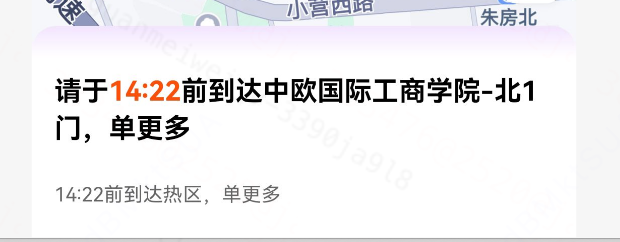
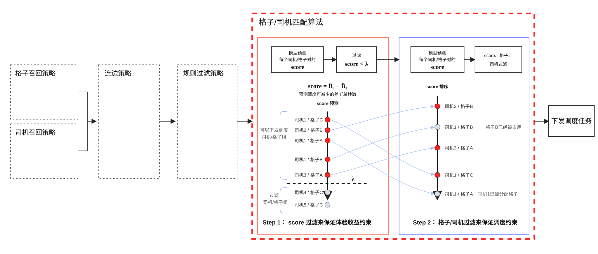
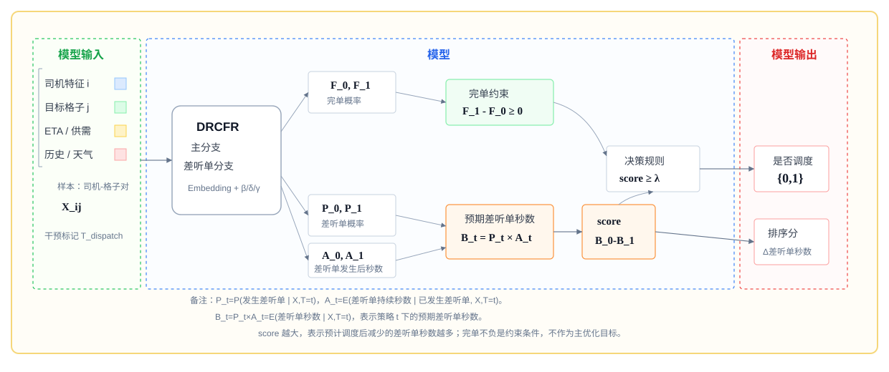
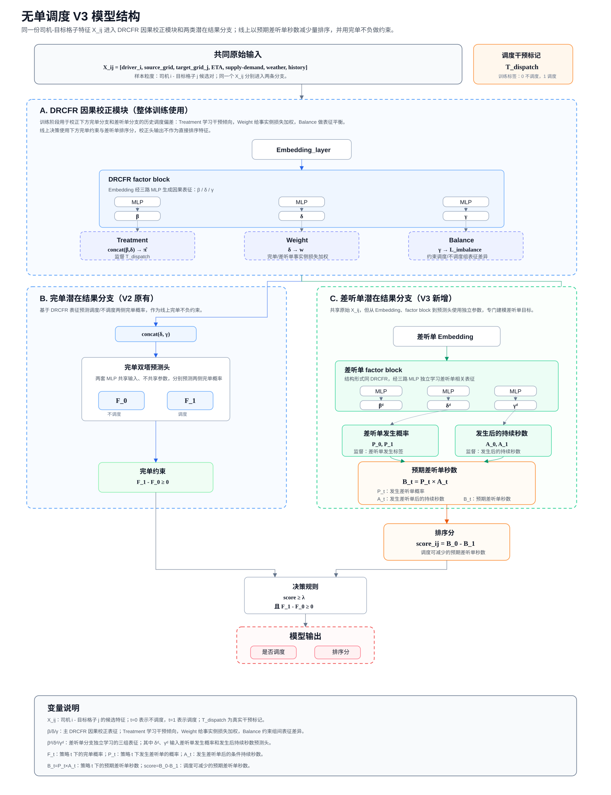
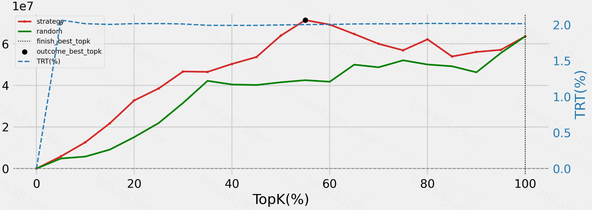
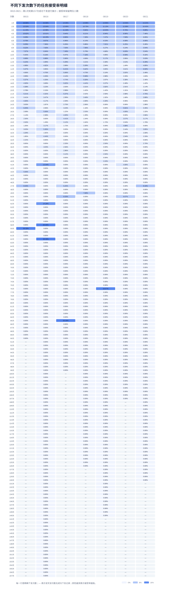
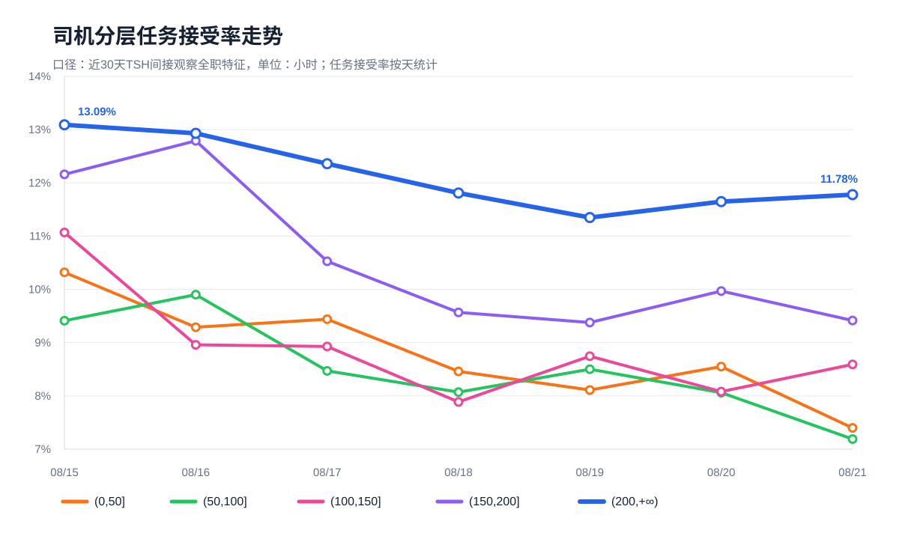

# 【LR26-034】交易生态-调度-无单调度-V3.0

[Cooper 原文](https://cooper.didichuxing.com/knowledge/2199610335356/2209438550271)

# 0 基础信息

| brd文档链接    | [【司机调度】支持无调度费产品能力](https://cooper.didichuxing.com/docs2/document/2206700262421)   |
| --- | --- |
| 最后通过的策略方案链接    | [https://cooper-vpn.xiaojukeji.com/knowledge/2199610335356/2204293157304](https://cooper-vpn.xiaojukeji.com/knowledge/2199610335356/2204293157304)   |
| 实验链接（评估大师）    | [https://x.intra.honghusaas.com/exp/504137703817217?globalBusinessId=121000&globalProjectId=406439936000001&expFlowTab=dashboard&dashboardTab=metricDetail&windowTab=504722737987586](https://x.intra.honghusaas.com/exp/504137703817217?globalBusinessId=121000&globalProjectId=406439936000001&expFlowTab=dashboard&dashboardTab=metricDetail&windowTab=504722737987586)   |
| 核心贡献点   | 将无单调度从GMV/ROI收益导向的策略，重构为面向司机体验的差听单治理策略：在原DRCFR框架下，V3将优化目标重构为差听单间隔占比显著下降，约束完单不显著负。并将排序分定义为调度带来的差听单时长减少量。模型新增差听单标签体系，对差听单时长进行建模。   |
| 第一贡献人    | 罗玉   |
| 共同贡献人   | 武荣莉   |
| 后续策略负责人    | 罗玉   |

# 1 背景

- 司机长时间在线但迟迟未听到单，是交易生态在司机侧需要解决的体验问题之一。无单调度希望通过将司机引导至未来更可能产生需求、且距离合理的区域，改善司机后续听到单的机会，降低整体长时间无单带来的听单差体验。

- 项目自24年启动以来，通过下发里程费和无单补贴的方式牵引司机参与调度任务，25年无单调度V2版本人均gmv显著+3.56%，人均完单显著+3.53%。该模式司机接受意愿较高，但却强依赖平台的补贴投入。当前平台司机侧B补预算有限，同时推动商家参与调度共补存在一定困难，难以支持调度能力在全国范围内大规模推广；

- 因此，为推动无单调度全国放量，2026年项目推进V3版本，即**无补贴的无单调度**：在不向司机支付额外费用补贴的前提下，**以降低整体差听单间隔时长为目的**，筛选值得下发的调度任务，同时提升无单调度的可推广性。

无任何补贴下的无单调度V3产品形态
[司机调度文案](https://cooper.didichuxing.com/docs2/sheet/2207948615817)

| 任务下发弹窗+前往热区弹窗   | 空单等待请求弹窗+前往热区弹窗   | 前往途中-详情副标题   | 空单等待-详情标题+文案   | 任务结束弹窗   | 设置顺路单   | 收车   |
| --- | --- | --- | --- | --- | --- | --- |
|    |    |    |    |    |    |    |

- V3版本核心改造：

	- **目标函数&调度决策的重构**：将调度决策目标从GMV收益转向司机体验侧的差听单间隔治理，**使用【差听单时长减少量】作为司机-格子对的排序标准，使模型排序目标与线上“差听单间隔占比下降”的验收指标保持一致**；

	- **差听单标签体系与建模目标重构**：丰富调度任务的标签体系，在原有标签基础上，新增是否为差听单、差听单间隔时长的标签；进一步建模调度对司机后续听单体验的影响，刻画“调度是否能降低差听单发生概率，以及在发生差听单时是否能缩短差听单持续时长”；

	- **带完单约束的选模逻辑**：在离线Dispatch-AUUC评估中，将收益口径从 GMV/完单更改为差听单时长减少量，并在选择模型时加入完单不负的约束，保证策略优先优化差听单体验的同时，不带来完单折损。

# 2 目标&约束

| 目标&约束   | 具体说明   |
| --- | --- |
| 目标   | 差听单间隔占比显著-15%，司机人均tsh显著+1.2%   |
| 约束   | 完单不显著负   |

差听单间隔占比指标详细说明
司机在线期间，单次连续空闲听单超过20分钟的区间，其全部空闲时长定义为听单差体验时长；

统计听单间隔会包括的场景：首次上线到听到第一单、首次上线/中途上线后没听到单下线、中途上线到听到单、上一单结束到听到下一单、上一单结束后中途下线、最后一单结束后到收车

差听单间隔占比 = 所有司机听单差体验时长之和/所有司机在线时长之和。

$$差听单间隔占比=\sum badcase\_minutes / \sum online\_minutes$$

- online_minutes：司机当天所有is_online = 1的分钟数，也就是司机的总在线时长。例如一个司机当天在线300分钟，那么分母贡献300分钟；

- badcase_minutes：先从在线分钟里筛出is_busy = 0，也就是司机在线但非忙碌/空闲听单的分钟，然后识别连续的空闲区间。只要某一段连续空闲时长严格大于20分钟，这一整段的分钟数都会计入badcase。

# 3 技术方案

## 3.1 问题定义

从线上调度流程到单轮问题（该部分同无单调度V2版本的2.1问题定义，V3.0中无更改）
**从线上调度流程到单轮问题**（同[【LR25031】司机无单调度v2](https://cooper.didichuxing.com/knowledge/2199610335356/2205431323794)**）**

无单调度存在于多轮。每一轮调度开始时，系统会先召回一批候选司机和候选目标格子：候选司机通常是较长时间未听到单的司机，候选目标格子则来自当前或未来短时间窗口内更可能产生订单机会的位置。随后系统会构造司机-目标格子的候选对，并对每个候选对判断：是否应该把该司机调度到该目标格子。

因此，一条模型的样本是一个具体的司机-格子候选关系。样本中既包含司机自身和起点位置的信息，也包含目标格子的供需、天气、历史呼叫/应答/完单、ETA、历史调度接受等信息。模型需要对每个候选关系输出一个分数，表示“如果把司机调过去，相比不调度，预期会带来多少收益”。

从全局来看，当前轮的调度会影响司机下一轮的位置和状态，也会影响后续供需分布，因此严格的全局最优需要跨多轮联合建模。但在线上工程中，跨轮影响难以准确刻画，且每一轮都会重新获取实时供需和司机状态，因此本版本沿用V2单轮最优的建模方式：**每一轮只基于当前召回集合，选择当前最值得下发的一批司机-格子对；下一轮再根据新的状态重新打分和决策。**

数学建模上，单轮问题负责回答：在当前这一轮召回的司机-格子候选对中，应该优先下发哪些调度任务？

V2和V3在“单轮打分 + 排序过滤”的求解框架上是一致的，核心差异在于：**V2 的单轮收益主要定义为GMV/ROI，V3 的单轮收益定义为差听单时长降幅。**

**目标：**

在一轮调度中，将候选集合中每个个体定义为**司机-目标格子对 (i,j)**，其中i表示司机，j表示目标格子。对每个司机-格子对只存在两种策略：

- $$z_{ij}=1$$：对司机i下发调度，到目标格子j

- $$z_{ij}=0$$：不对该司机-格子对 (i,j)下发调度

为了比较“调度”和“不调度”两种动作的效果，定义两个结果：

- $$B_{ij1}$$：司机i下发调度到目标格子j，调度后的差听单时长

- $$B_{i0}$$：不对该司机-格子对 (i,j)下发调度对应的差听单时长

无单调度V3的核心目标是**降低差听单间隔占比**，指标的分子是差听单时长之和，因此离线建模中用差听单时长作为直接优化对象。那么，单轮目标可以写成最小化调度后的整体差听单时长。

在一轮调度中，对同一个司机 i，最终动作只有一种：要么不调度，要么调度到某一个目标格子j。在这里，记$$z_{i0}=1$$表示司机i本轮不调度，$$z_{ij}=1$$表示司机i被调度到目标格子j，则有：$$z_{i0}+\sum_j z_{ij}=1$$

定义$$B_{i0}$$为司机 i本轮不调度时的预期差听单时长，$$B_{ij1}$$为司机i被调度到目标格子j后的预期差听单时长，则单轮目标可以写成：

$$\min \sum_i \left[ B_{i0}z_{i0}+\sum_j B_{ij1}z_{ij} \right]$$

由于$$z_{i0}=1-\sum_j z_{ij}$$，上式等价于$$\min \sum_i \left[ B_{i0}+\sum_j \left(B_{ij1}-B_{i0}\right)z_{ij} \right]$$，其中$$\sum_i B_{i0}$$对当前调度决策是常数。

因此等价于最大化调度带来的差听单时长减少量：

$$\max \sum_i \sum_j \left(B_{i0}-B_{ij1}\right)z_{ij}$$

记$$\Delta B_{ij}=B_{i0}-B_{ij1}$$，$$\Delta B_{ij}$$越大，表示模型认为对于司机i-格子j而言，“下发调度”相比“不调度”能减少更多差听单时长，该司机-格子对越值得被优先调度。后续的模型打分、排序和阈值截断都围绕这个量展开。

符号定义见下表。

| 符号   | 含义   |
| --- | --- |
| i   | 司机   |
| j   | 目标格子   |
| (i,j)   | 一个司机-目标格子候选调度关系   |
| $$z_{ij}$$   | 决策变量，表示是否对司机i下发调度到目标格子j，1代表下发调度，0代表不下发调度   |
| $$B_{ij1}$$   | 对司机i调度到目标格子j后，预期产生的差听单时长   |
| $$B_{i0}$$   | 不对该司机-格子对下发调度时，预期产生的差听单时长   |
| $$\Delta B_{ij}$$   | 调度带来的预期差听单时长减少量，$$\Delta B_{ij} = B_{i0}-B_{ij1}$$   |
| $$score_{ij}$$   | V3 线上排序分，等于模型预测的预期差听单时长减少量   |
| $$\lambda$$   | 线上下发阈值   |
| $$C_j$$   | 目标格子j可接收的调入司机容量   |
| $$F_{ij1}$$   | 对司机i调度到目标格子j后，预期是否完单   |
| $$F_{i0}$$   | 不对该司机-格子对下发调度时，预期是否完单   |

**约束：**

- 完单不负约束，即，被选中的调度集合整体预测完单增量不为负：$$\sum_i \sum_j (F_{ij1}-F_{i0}) z_{ij} \ge 0$$；

- 司机唯一性约束，即，同一轮中一个司机最多只能被调度到一个目标格子：$$\sum_{j} z_{ij}\leq 1$$；

- 目标格子的容量约束，即，==同一个目标格子在当前轮次内不能被过量调入司机==：$$\sum_{i} z_{ij}\leq C_j$$。

其中$$C_j$$ 表示目标格子j当前轮次可接收的调入司机容量。与 V2 一致，$$C_j$$可以理解为目标格子的可承接能力，实际含义是未播订单数；目前设置为1。

**最终的优化问题：**

$$\begin{aligned} \max_{z}\quad & \sum_i \sum_j \left(B_{i0}-B_{ij1}\right) z_{ij} \\ \text{s.t.}\quad & z_{ij}\in\{0,1\}, \\ & \sum_j z_{ij}\leq 1, \\ & \sum_i z_{ij}\leq C_j,\\ & \sum_i \sum_j \left(F_{ij1}-F_{i0}\right)z_{ij}\geq 0. \end{aligned}$$

## 3.2 贪心求解&决策函数

与V2一样，在线上求解时我们希望把复杂的组合优化问题转化为“对每个司机-格子对统一打分、排序、截断、再过滤”的形式。这样做的原因是：如果直接求全局最优，需要同时考虑所有司机和所有目标格子的匹配关系，线上求解成本较高；而贪心排序可以先得到候选调度集合，再通过二次过滤满足司机唯一性和格子容量约束。

先暂时不考虑司机约束和格子约束，只看单个司机-格子对 (i,j)。对于这个候选对，只有两种动作：不调度（差听单时长$$B_{i0}$$），调度（差听单时长$$B_{ij1}$$）

因为 V3 的目标是降低差听单时长，所以当调度后的差听单时长小于不调度时，才说明该调度动作有正向收益：$$B_{ij1}<B_{i0}$$

等价地，可以写成：$$B_{i0}-B_{ij1}>0$$

因此，单个司机-格子对的增量收益可以定义为：$$\Delta B_{ij}=B_{i0}-B_{ij1}$$

**如果** $$ΔB_{ij}$$**越大，表示调度相比不调度能减少的差听单时长越多，该候选对越应该排在前面**。

通过 Dispatch-AUUC 选择合适的TopK/阈值。dispatch-AUUC曲线的最高点（且选择这一最高点时对应的完单uplift不负）对应的$$\Delta B_{ij}$$就是下发的阈值lambda。

后续线上下发的决策是$$\Delta B_{ij}\geq \lambda$$,

由此得到 V3 的阈值决策函数：

$$z_{ij}=\begin{cases} 1,  \Delta B_{ij}\geq \lambda\\ 0,  \Delta B_{ij}<\lambda \end{cases}$$

所以 V3 的最终排序分定义为：$$score_{ij}=\Delta B_{ij}=\hat{B}_{i0}-\hat{B}_{ij1}$$，即，表示模型预测的不调度预期差听单时长减去表示模型预测的调度预期差听单时长。

## 3.3 排序&过滤保证调度约束

线上生效流程如下：

- 每一轮召回候选司机-目标格子对，构造司机、起点格子、目标格子、ETA、供需、天气、历史调度行为等特征。

- 模型预测每个司机-格子对在“调度/不调度”两种状态下的潜在结果。

- 计算核心排序分：$$score_{ij}=\hat{B}_{i0}-\hat{B}_{ij1}$$

- 按score降序排序，并根据阈值lambda截断候选集合

- 对候选集合执行调度过滤，保证：$$\sum_j z_{ij}\leq 1$$，$$\sum_i z_{ij}\leq C_j$$

- 过滤后的司机-格子对作为最终调度结果下发。

整体流程如下图所示。（线上链路同V2，只有模型预测的值变更为差听单时长减少量）

## 3.4 模型

V3 模型部分的核心改造有三点：

- **调度价值定义变化**：线上排序分从 GMV/ROI 变为预期差听单时长减少量，即优先下发预计能减少更多差听单时间的司机-格子对；

- **差听单标签显式建模**：将差听单拆成“是否发生差听单”和“发生后的持续时长”，再组合成预期差听单时长；

- **预测差听单分支表征解耦**：在DRCFR中为差听单目标增加独立 embedding、独立factor block和独立 tower，减少完单与差听单目标共享表征带来的相互干扰。

### 3.4.1 模型结构

**整体模型框架图：**

**DRCFR模型部分：**

DRCFR 模型用于学习同一个司机-目标格子候选对在“不调度”和“调度”两种状态下的潜在结果差异。对每条样本，输入为司机特征、当前格子/目标格子特征、ETA、供需、天气、历史行为等组成的$$X_{ij}$$，其中i表示司机，j表示目标格子；真实干预标记$$T_{ij} \in \{0,1\}$$ ,1表示该候选对真实下发调度，0表示未下发调度。

- 模型主分支延续 V2 的 DRCFR 结构：输入特征先经过 Embedding 层，再通过 factor block 拆成 $$\beta,\delta,\gamma$$三组表征。其中 $$\beta,\delta$$用于学习调度干预概率，$$\delta$$用于学习样本权重，$$\delta,\gamma$$输入outcome tower，分别预测不调度侧和调度侧的潜在结果。DRCFR 通过 treatment loss 和 imbalance loss 约束 treatment/control 两组样本的表征分布，降低历史调度选择偏差对 uplift 估计的影响。

- V3 在主 DRCFR 分支上保留完单这一基础结果预测任务：完单结果用于后续选模时约束 finish uplift 不负。

- 针对 V3 的核心目标，模型新增差听单独立分支。由于差听单样本更稀疏，且目标与完单提升不完全一致，V3中不让差听单目标复用主分支embedding，而是单独引入Bad Embedding、bad factor block 和 bad tower/head。bad 分支分别预测调度/不调度两侧的差听单发生概率 $$P_0,P_1$$($$P_t = P(\text{发生差听单} \mid X,T=t)$$)、调度/不调度在“已经发生差听单”条件下的持续时长预测发$$A_0,A_1$$($$A_t = E(\text{差听单持续时长} \mid \text{发生差听单},X,T=t)$$,  $$E(\cdot)$$表示期望值，可以理解为模型预测的平均持续时长)，因此，两者相乘得到策略t下的预期差听单时长：$$B_t = P_t \cdot A_t = E(\text{差听单时长} \mid X,T=t),\quad t\in\{0,1\}$$

- 最终线上排序分定义：不调度预期差听单时长与调度后预期差听单时长的差值：$$B_0-B_1$$

因此，差值越大，表示模型认为该司机-格子候选对在调度后能够减少的差听单时长越多，越应该优先下发。最终，V3.0模型相当于在原 DRCFR因果框架下，将主分支继续用于完单约束学习，同时让差听单目标拥有独立表征与独立预测链路。详细模型结构如下图所示。

DRCFR结构

离线探索过程
V3.0 的离线开发暂时不更换DRCFR因果框架，而是在这一框架下验证三个问题：差听单目标应该怎么建模、bad 目标是否需要独立表征、以及选模时如何同时保证差听单收益和完单不负。

==我们先开发了基线版本跑通V3.0的基本改造：在原DRCFR框架上补充听单间隔、差听单二分类、差听单时长标签；目标为“预计能减少多少差听单时长”的排序问题==

在基线版本之后，开发了以下版本：

第一轮：

- A：改选模逻辑，说明差听单目标必须引入“相对 random 更优、选中点 finish 不负”的约束；

- B：加大差听单的样本权重，但单纯提高bad loss权重没有带来最优收益；

- C：为差听单目标增加独立表征因子，差听单排序能力提升，说明差听单目标与 finish/listen 共享表征时存在一定干扰；

- D：将 bad 时长拆成“差听单概率”和“发生后的条件时长”，方向更贴近线上 badcase 分子，但单独使用时收益没有超过 A/C。

第二轮：

- E1：合并了 A 的约束选模、C 的 bad 独立 factor、D 的概率与条件时长分开建模；

- E2：关闭听单间隔的辅助 loss，用于验证听单间隔任务是否拖累 bad 目标；

- E3：关闭预期 bad 时长直接监督，用于验证 `P_bad \* A_bad` 是否需要直接贴近 bad 时长标签；

- E4： E1基础上进一步把 bad 分支的 embedding 也独立出来，使 bad 目标从底层特征编码开始与 finish/listen 主分支解耦。

核心离线结果如下：

> 计算口径：策略Dispatch-AUUC的最高点对应的delta值 / 总的听单间隔时长

| **版本**   | **策略 差听单间隔 总降幅**   | **random 差听单总降幅**   | **策略相对 random 额外多降**   | **bad 面积相对 random**   |
| --- | --- | --- | --- | --- |
| A   | 2.9908%   | 2.0762%   | +0.9146pct   | +25.79%   |
| B   | 2.8622%   | 2.3449%   | +0.5173pct   | +26.48%   |
| C   | 2.8962%   | 1.9532%   | +0.9430pct   | +22.24%   |
| D   | 2.9065%   | 2.3449%   | +0.5617pct   | +20.27%   |
| E1   | 2.5452%   | 1.7931%   | +0.7520pct   | +17.28%   |
| E2   | 2.7210%   | 1.9532%   | +0.7678pct   | +10.40%   |
| E3   | 2.7789%   | 1.9532%   | +0.8257pct   | +10.72%   |
| **E4**   | **3.0130%**   | **1.7931%**   | **+1.2199pct**   | **+32.66%**   |

最终选择 E4 的原因是：它在当前 V3 主目标上最强，并且满足完单不负约束。E4 的策略 bad 总降幅为 3.0130%，是所有已记录版本中最高；相对 random 额外多降 +1.2199pct，也明显高于 A/C 等备选；bad Dispatch-AUUC 面积相对 random 提升 +32.66%，说明不是只在单个TopK点偶然变好，而是在不同截断规模下整体排序更优。同时，E4 选中点的 finish uplift 为 +3,996.46，满足本版“完单不显著负”的离线约束。

### 3.4.2 标签设计

> [如何定义并关联得到调度训练数据的听单间隔](https://cooper.didichuxing.com/didocs/2208749220796)

> **差听单标签口径：**  
> 每条样本是一个司机-目标格子候选对，以调度触发时间 `timestamp` 为起点，向后观察 2 小时。观察期间，如果司机先应答下一单，就以应答时间作为终点；如果司机先下线，就以下线时间作为终点；如果 2 小时内既没有应答也没有下线，就按 7200 秒截断。

| 标签   | **含义**   |
| --- | --- |
| is_bad_listen_order_interval   | 差听单二分类标签  表示司机在调度触发后，到下一次应答或下线前的听单间隔是否大于15分钟   |
| bad_listen_order_interval_sec   | 差听单间隔时长标签  仅当听单间隔大于15分钟时，记录完整听单间隔时长，否则记为0   |

> **为什么线上差听单看20分钟，这里的标签看15分钟？**

> 司机在进入调度链路前，已经经历了一段5分钟的等待，所以如果从调度触发后再等20分钟才记为 bad，会把一部分已经体验较差、但触发后未满 20 分钟的样本漏掉。

### 3.4.3 评估

评估指标使用DISPATCH AUUC评估模型排序能力

DISPATCH AUUC和AUUC和核心区别

| 指标   | 关注点   | 是否考虑调度约束   |
| --- | --- | --- |
| AUUC   | 模型排序能力：预测 uplift 越高的样本，真实收益是否也越高   | 不考虑，通常直接按样本分数排序   |
| DISPATCH AUUC   | 线上可执行收益：排序后经过司机唯一性、目标格子容量等过滤后，真实累计收益是否更高   | 考虑，更贴近线上调度场景   |

在无单调度里，一条样本是司机格子对。普通AUUC可能会把同一个司机的多个目标格子都排进 TopK。但线上一个司机同一轮只能调度一次；也可能某个目标格子被过多司机选中，但线上格子容量有限。所以普通 AUUC 会高估模型的可执行收益。Dispatch-AUUC 就是在排序后加上调度线上真实会出现的过滤环节。

下图为模型离线DISPATCH AUUC效果图。其中，红线是模型策略排序的累计收益，绿线是 random 排序的累计收益。蓝色虚线是对应 TopK下的实际调度占比。

我们没有只考虑Dispatch-AUUC 面积最大的模型，而是继续加入了收益和约束方面的考量：差听单降幅收益优于 random、策略差听单的Dispatch-AUUC下面积优于 random、**且选择的TopK点的finish uplift不负**。

| **指标**   | **图/数值**   |
| --- | --- |
| DISPATCH AUUC   | 对应TOP K点为55%，该点的delta值作为线上下发阈值**lambda=373.62s**   |
| 策略DISPATCH AUUC下面积   | 4778512110   |
| 策略DISPATCH AUUC下面积相比random的提升   | +32.7%   |
| 验证集差听单时长总量   | 2369444525秒   |
| 策略选中点K=55%对应差听单时长减少量   | 71390758秒   |
| random曲线同TopK点的差听单时长减少量   | 42487048秒   |
| 策略离线估计差听单间隔总降幅（和不调度相比，减少量/差听单时长）   | 3.0130%（根据这个值粗算线上收益：在线时长约为差听单时长的6倍，RCT开启的是5%的流量，推算线上收益10%（1/6\*3%\*20=10%）由于接受度减半，线上收益约5%）   |
| 策略相对random的差听单间隔降幅提升   | +1.2199pp   |
| 选中点对应的完单finish uplift（是否满足完单不负）   | +3996.46   |

# 4 实验结果/评估结果

## 4.1 司机分流核心实验结果

[司机分流实验(2026.08.15\~2026.08.21)](https://x.intra.honghusaas.com/exp/504137703817217?globalBusinessId=121000&globalProjectId=406439936000001&expFlowTab=dashboard&dashboardTab=metricDetail)

| 是否区分自营宏鹄   | 指标   | 对照组   | 实验组   | 绝对提升   | 相对提升   | 显著性   |
| --- | --- | --- | --- | --- | --- | --- |
| 自营&宏鹄   | 差听单间隔占比   | 0.1644   | 0.1566   | **-0.7743pp**   | **-4.71％**   | **显著**   |
| 差听单时长   | 158.5735   | 149.6643   | **-8.9092**   | **-5.62％**   | **显著**   |
| 在线时长   | 964.7887   | ==955.6==   | ==-9.1887==   | ==-0.95％==   | 不显著   |
| 人均完单   | 31.8753   | 31.8973   | ==+0.02198==   | ==+0.07%==   | 不显著   |
| 人均GMV   | ==460.1448==   | ==460.0439==   | ==-0.1009==   | ==-0.02％==   | 不显著   |
| 服务时长   | 669.8001   | 669.5354   | -0.2647   | -0.04%   | 不显著   |
| 服占比   | 0.6942   | 0.7006   | **+0.6399pp**   | **0.92％**   | **显著**   |
| 差听单间隔占比(剔除顺路单)   | 0.0931   | 0.0895   | **-0.3576pp**   | **-3.84%**   | **显著**   |
| 差听单时长(剔除顺路单)   | 89.7971   | 85.525   | **-4.2721**   | **-4.76%**   | **显著**   |
| only自营   | 差听单间隔占比   | ==0.1685==   | 0.1607   | ==**-0.7761pp**==   | **-4.61%**   | **显著**   |
| 差听单时长   | 71.3952   | 68.2348   | ==**-3.1603**==   | **-4.43％**   | **显著**   |
| 在线时长   | 423.8008   | 424.602   | ==+0.8012==   | +==0.19％==   | 不显著   |
| 人均完单   | 13.8828   | ==13.9796==   | +==0.0968==   | +==0.7％==   | 不显著   |
| 人均GMV   | 208.5766   | 210.1879   | +1.6113   | +0.77％   | 不显著   |
| 差听单间隔占比(剔除顺路单)   | 0.1093   | 0.1058   | **-0.354pp**   | **-3.24％**   | **显著**   |
| 差听单时长(剔除顺路单)   | 46.5296   | 45.1082   | -1.4214   | -3.05％   | 不显著   |
| only宏鹄   | 差听单间隔占比   | ==0.1621==   | ==0.1542==   | **-0.784pp**   | ==**-4.84％**==   | **显著**   |
| 差听单时长   | 87.1783   | ==81.4295==   | ==**-5.7488**==   | ==**-6.59％**==   | **显著**   |
| 在线时长   | ==539.1952==   | 529.2026   | ==-9.9926==   | ==-1.85％==   | 不显著   |
| 人均完单   | 17.9925   | 17.9177   | -0.0748   | -0.42％   | 不显著   |
| 人均GMV   | 251.5682   | 249.856   | -1.7122   | -0.68％   | 不显著   |
| 差听单间隔占比(剔除顺路单)   | ==0.0802==   | ==0.0764==   | **-**==**0.3872pp**==   | ==**-4.82％**==   | **显著**   |
| 差听单时长(剔除顺路单)   | ==43.2675==   | ==40.4168==   | ==**-2.8507**==   | **-6.59％**   | **显著**   |

## 4.2 收益链路归因分析

**和对照组相比：**

调度策略针对前5分钟听不到单的司机，将司机引导至模型预估调度后更能减少差听单时长的目标格子，治理司机差听单问题  
➡️ 调度后的司机差听单时长显著下降，自营&宏鹄口径下，差听单时长含顺路单**显著 -5.02%（-7.96）**，策略直接减少了司机处于差听单状态的时间，差听单时长的下降进一步传导到差听单间隔占比下降，自营&宏鹄口径下，差听单间隔占比含顺路单**显著-4.71%（-0.77pp）**，剔除顺路单后**显著-3.17%（-0.30pp）**

人均在线时长下降主要来自听单时长下降，而不是服务时长下降。（服务时长不显著-0.04%）。在线时长可以拆成服务时长+听单时长

实验中差听单时长显著下降，说明司机处于差听单状态下的空闲等待时间被压缩；在服务时长和完单不负的情况下，听单时长下降会自然带来总在线时长下降。

## 4.3 司机分流方案

|    | **内容**   | **备注**   |
| --- | --- | --- |
| 实验方式   | 司机分流   |    |
| 分流方式   | 随机分流   | 实验平台：评估大师   |
| 分流策略内容   | 全国流量  实验组流量5%，对照组95%   | 实验组：调度功能开启  对照组：无调度功能   |
| 实验周期   | 7天   | ——   |
| 流量范围   | 全部自营 宏鹄司机   |    |
| 实验生效品类：全品类   | 品类：  - 特价盒子   - 特快盒子   - 实时计价盒子   - 宏鹄   - 小猪一口价   - 小猪打车   - 小猪特价   - 小猪特快    |
| 分单场景：全部   | 默认全部  - 小猪轮次分单   - 宏鹄轮次分单   - 小猪选单   - 宏鹄选单    |
| 全国   | ——   |
| 实验生效商家   | 自营、宏鹄   |
| 是否联动实验   | 否   | 多业务间联动，可能产生跨机房实验，多个机房的apollo分流无法保持一致，需要业务确认实验范围，技术确认是否支持   |
| 评估人   | 算法、评估大师/Apollo自动评估   |     |

## 4.4 其他中间过程分析

### 4.4.1 by天接受度逐步下降至9%左右下钻分析

实验期间发现0815～0821by天的司机接受度有逐渐下降趋势，最后几天降至9%左右：

| 日期   | 0815   | 0816   | 0817   | 0818   | 0819   | 0820   | 0821   |
| --- | --- | --- | --- | --- | --- | --- | --- |
| 接受度   | 11.06%   | 10.67%   | 10.06%   | 9.28%   | 9.24%   | 9.29%   | 8.81%   |

对这一现象进行下钻分析后，发现：

- 由于**现有调度链路上只限制一天内司机接受调度的次数，不限制对司机下发调度的次数**，导致一天内有部分司机被下发高达100余次，随着下发调度次数的增加，司机接受率变低；

- 横向观察逐天的第N次下发的司机接受度，随着时间推移，by天司机第N次下发的接受度也有明显下降走势

by天不同下发次数下的接受率

  于是进行下一步分析（思路是区分前一天的司机体验，看司机在第二天的接受度），以0801～0811滚动相邻日数据看：前一天首次接受后的体验，对后一天首次接受率的影响，发现：前一天拿到正反馈的（到达目的地接单或中途接单）司机第二天的接受率高于前一天没有拿到正反馈的司机。

以0815～0821滚动相邻日数据看：前一天首次接受后的体验，对后一天首次接受率的影响
为进一步解释跨天接受度下降，拆解前一天首次接受后的体验，可以看到：

| 前一天首次接受后的体验   | 司机数   | 占比   | 次日首次接受率   |
| --- | --- | --- | --- |
| **首次到达后接单**   | 1034   | 11.29%   | **41.39%**   |
| **首次途中接单**   | 3684   | 40.24%   | **37.40%**   |
| 首次到达但未接单   | 1091   | 11.92%   | 30.06%   |
| 首次接受但无后续   | 2417   | 26.40%   | 27.22%   |
| 首次靠近但未到达   | 930   | 10.16%   | 26.45%   |

### 4.4.2 多次连续下发的时间间隔对应接受度分析

- 连续未接受次数越多，下一次接受率越低

当前下发前，连续下发但未接受X次后，看当前这次下发的接受率
举例解释：连续未接受2次，下一次下发的所有任务中，接受率为6.849%（分母是所有“当前这次成功下发之前，司机已经连续 2 次成功下发都没有接受”的当前成功下发任务数；分子是这些当前成功下发任务里被接受的数量。）

| 当前下发前连续未接受次数分段   | 当前接受率   |
| --- | --- |
| 0   | 19.732%   |
| 1   | 9.611%   |
| 2   | 6.849%   |
| 3   | 4.998%   |
| 4   | 4.358%   |
| 5   | 3.304%   |
| 6   | 3.047%   |
| 7   | 2.752%   |
| 8   | 2.473%   |
| 9   | 2.500%   |
| 10   | 1.974%   |
| 11-20   | 1.625%   |
| 21-30   | 0.716%   |
| 31-50   | 0.573%   |
| 50+   | 0.262%   |

- **在连续未接受后，短间隔继续下发的接受率更低；间隔拉长后接受率有所回升**

在相同连续未接受分段下，不同间隔再次下发的接受率情况
在第一段“连续未接受次数”的基础上，又加了一个维度：司机已经连续 N 次成功下发没接受了，那么当前这次成功下发，如果距离上一次成功下发很近，接受率是多少；如果隔得久一点，接受率又是多少。

| 连续未接受次数   | 5-10min 内再次下发接受率   | 30-60min 再次下发接受率   | 120min+ 再次下发接受率   |
| --- | --- | --- | --- |
| 1～2   | 7.23%   | 9.52%   | 9.85%   |
| 3～5   | 3.40%   | 5.28%   | 6.76%   |
| 6～10   | 2.01%   | 3.58%   | 4.26%   |
| 11～20   | 1.21%   | 1.86%   | 3.60%   |
| 21～30   | 0.38%   | 1.15%   | 3.49%   |

### 4.4.3无单调度对【开启顺路单司机】做功空间小

开启顺路单的司机，调度任务接受率（接受/成功下发）只有**1.36%**，远低于实验中未开顺路单的司机调度任务的接受率**16.12%**

是否开顺路的接受率对比
| 下发时顺路单状态   | 人均工程下发次数   | 人均成功下发次数   | 人均接受次数   | 成功下发率   | 接受率（接受/成功下发）   |
| --- | --- | --- | --- | --- | --- |
| 下发时开顺路单的调度任务   | 5.6634   | 2.7109   | **0.0368**   | 47.87%   | **1.36%**   |
| 下发时未开顺路单的调度任务   | 4.0153   | 3.0812   | **0.4967**   | 76.74%   | **16.12%**   |

### 4.4.4 是否全职司机，无单调度任务接受度不同

通过tsh分层间接刻画全职司机特征，可以发现：

- tsh高的司机，任务接受度高于tsh低的司机；

- 这说明调度功能在tsh高的司机身上做功空间大。（非全职司机，可以听其他端的订单，调度功能对他们的吸引力天然小）

司机tsh分层下观察任务接受率
| 司机分层（口径：近30天的tsh间接观察全职特征，单位：小时）   | 任务接受率(接受量/成功下发量)   |
| --- | --- |
| 0815   | 0816   | 0817   | 0818   | 0819   | 0820   | 0821   |
| (0,50\]   | 10.32%   | 9.29%   | 9.44%   | 8.46%   | 8.11%   | 8.55%   | 7.40%   |
| (50,100\]   | 9.41%   | 9.90%   | 8.47%   | 8.07%   | 8.50%   | 8.06%   | 7.19%   |
| (100,150\]   | 11.07%   | 8.96%   | 8.93%   | 7.90%   | 8.77%   | 8.08%   | 8.59%   |
| (150,200\]   | 12.16%   | 12.79%   | 10.53%   | 9.57%   | 9.38%   | 9.97%   | 9.42%   |
| **(200,+∞）**   | 13.09%   | 12.93%   | 12.36%   | 11.81%   | 11.35%   | 11.65%   | 11.78%   |

# 5 放量决策

|    |    | 预期扩量时间节奏   | 实际扩量时间   | 放量暂停点详情   | 放量暂停点效果评估   | 是否需要设置长期对照组（默认不需要，此列无需填写）   |
| --- | --- | --- | --- | --- | --- | --- |
|    |    |    | LR通过后，根据实际情况，填写这3列   |    |
| 放量决策意见   | 决策人   | 荣莉   | ——   | ——   | ——   | ——   |
| 决策意见：  - 通过   - 不通过，给出原因   - 扩大流量实验    |    |    |    |    |    |
| 放量需要周知的利益相关方   | 没有的话，无需填写   | ——   | ——   | ——   | ——   | ——   |
| 放量策略   | eg. 实验组1  放量组收益   | ——   | ——   | ——   | ——   | ——   |
| 放量节奏   | 直接推全-随机分流   | **目前，实验期间发现司机的接受度从12%下滑至9%，下钻分析后发现是司机的体验影响下一日的留存。因此考虑优化线上调度下发链路，稳长期留存体验，待链路优化上线后，再开一次实验后放量**   |    | 暂停点时间 ：  暂停点持续时长  流量比例：  实验链接：   | 评估数据：核心指标、核心约束   | 需要保留长期对照组  对照组流量比例：  定期review人：  定期review频率：  定期review结果：   |
| 直接推全-时间片实验  （无需全国时间片实验，但是需证明实验城市有全国代表性）     |    |    | ——   | ——   | ——   |
| 分批放量   |    |    | 是否需要暂停并评估  eg. 不需要评估，只需观测无异常   | 评估数据：核心指标、核心约束   | ——   |
|    |    | 是否需要暂停并评估  eg. 需要评估  暂停点时间 ：2026.5.5  暂停点持续时长：1周  流量比例：80%实验组  实验链接：xxx   | 评估数据：核心指标、核心约束   | ——   |
|    |    | 是否需要暂停并评估   | 评估数据：核心指标、核心约束   | 需要保留长期对照组  对照组流量比例：   |

# 6 引用与鸣谢

- 引用：[【LR25031】司机无单调度v2](https://cooper.didichuxing.com/knowledge/2199610335356/2205431323794)

- 鸣谢：感谢荣莉、辉哥在策略上的指导，浩伟在调度工作接手的帮助、工程同学志远、要飞在V3版本上的开发支持。

# 7 后续规划

- 本次实验发现司机对调度任务的接受度下滑至9%左右，为稳住长期留存，需要优化线上工程链路，后续加入频控策略；

- 将调度下发次数、司机全职兼职的tsh特征、司机是否开启顺路的实时特征等加入模型，提高模型排序能力；

- 尝试其他因果推断模型在调度场景的应用；

- V3.0版本中是在选模型时考虑是否满足完单约束，后续需要考虑直接将完单约束融入决策公式；

- 目前，线上下发阈值lambda是固定的，后续需要思考更合理的方式实现lambda线上动态更新。
