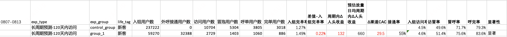
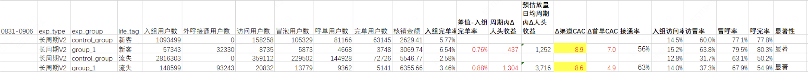

# 【LR26-037】乘客与增长-增长策略-用户长期需求预测-V1.0&V2.0

[Cooper 原文](https://cooper.didichuxing.com/knowledge/2199610335356/2209688984790)

# 0. 基础信息

| 字段 <br> | 内容 <br> |
| --- | --- |
| BRD文档链接 <br> | [BRD-基于需求预测对用户精准触达](https://cooper.didichuxing.com/docs2/document/2207346447147) <br> |
| PRD文档链接 <br> | [prd-基于需求预测对用户精准触达](https://cooper.didichuxing.com/knowledge/2204598041545/2208097032786) <br> |
| 最后通过的策略方案链接 <br> | 无 <br> |
| 实验链接（评估大师） <br> | 无（ab实验是Pope直接在apollo生成的，不是用的评估大师） <br> |
| 核心贡献点 <br> | 产出用户长期行为预测表，支撑外呼精准触达，带来更多新流人群增量 <br> |
| 第一贡献人 <br> | 韩一玮 <br> |
| 共同贡献人 <br> | 周之烁，张志茹 <br> |
| 后续策略负责人 <br> | 韩一玮 <br> |

# 一、背景

## 1.1 需求预测能力的必要性

花小猪现有触达策略以承接用户已有需求为主，缺乏对潜在需求的主动识别能力。历史上通过人工方式对学生、通勤等特定场景做过粗粒度需求预测，并在触达渠道上验证了商业价值。但人工分析方式存在三个核心瓶颈：效率低、成本高，难以规模化延伸至全量用户和全场景；分析粒度粗，缺乏用户个体维度的需求概率量化，触达效率有较大提升空间。

同时，仅依赖花小猪主端的冒泡和行为数据，无法完整还原用户真实的出行需求全貌。端外冒泡用户数约为花小猪呼叫用户的 5 倍，大量用户在花小猪侧没有任何行为信号，但实际上具有强烈的出行需求，需求在其他端被满足或流失。若模型仅基于花小猪单端数据构建，对在滴滴主端/PBD 高频使用的用户，历史行为特征极度稀疏，预测能力不高。

## 1.2 MVP 版本的结果与优化空间

MVP 版本已验证方向成立，放量后 Δ入组完单率 +0.53%、渠道 CAC ¥11，完成新客 +300 人目标。但新流人头数未达整体新流人头数+1.5k/d的预期。

MVP 要求用户在某个 2 小时时段内同OD冒泡次数达标，只能筛出出行时间和路线高度集中的人群，大量需求分散型用户被排除；同时仅看 90天累计行为，出差、旅游这类短期高频需求会被稀释。

本次 V2 从放宽时段限制与引入短周期时效信号两个方向切入，将日均可触达规模提升一个量级。

# 二、目标&约束

## 2.1 策略目标

### 2.1.1 离线目标

需求预测覆盖新流用户数：

	- 原：覆盖2600万新流人群

	- 现：覆盖1625万新流人群

> 覆盖面由入组完单率决定，入组完单率 0.5% 时覆盖 2,600 万，0.8% 时覆盖 1,625 万。

需求预测日维度准确率：

	- 原：呼叫准确率by day 30%

	- 现：呼叫准确率by day 35%

> **冒泡准确率**：策略预测某用户在目标日有出行需求，实际观察该用户在目标日是否产生了冒泡行为（在花小猪、滴滴主端或 PBD 任一端发起过打车询价）。这是策略本身的预测能力，衡量的是"需求判断准不准"。

> **呼叫准确率**：同样的预测人群，观察其在目标日是否实际发起了呼单。

呼叫&冒泡准确率折算&对比逻辑
***<u>呼叫准确率与冒泡准确率之间存在约 60% 的转化关系（即冒泡用户中约六成会实际呼叫），因此冒泡准确率 = 呼叫准确率 ÷ 60%。</u>***

**一、MVP 版本基线准确率**

MVP 版本上线后的实际外呼准确率如下：

| 日类型 <br> | 呼叫准确率 <br> | 折算冒泡准确率 <br> |
| --- | --- | --- |
| WD（周一至周四） <br> | 47% <br> | 78% <br> |
| FRI（周五） <br> | 36% <br> | 60% <br> |
| WE（周六日） <br> | 39% <br> | 65% <br> |

**二、运营侧准确率要求（by day 口径）**

运营对天级别准确率的要求以**呼叫准确率**表述：

| 档位 <br> | 呼叫准确率 <br> | 对应冒泡准确率 <br> |
| --- | --- | --- |
| 可接受 <br> | 30% <br> | 50% <br> |
| 优秀 <br> | 35% <br> | 58% <br> |

**三、by day 要求折算到 WD/FRI/WE 口径**

by day 是单天口径，而 WD/FRI/WE 是日类型口径——WD 包含四天、WE 包含两天，命中概率天然更高。因此同样的 by day 要求，折算到日类型口径后阈值会相应上调：

| 日类型 <br> | 呼叫准确率 <br>可接受（by day 30%） <br> | 呼叫准确率 <br>优秀（by day 35%） <br> | 冒泡准确率 <br>可接受（by day 50%） <br> | 冒泡准确率 <br>优秀（by day 58%） <br> |
| --- | --- | --- | --- | --- |
| WD <br> | 39% <br> | 46% <br> | 65% <br> | 76% <br> |
| FRI <br> | 30% <br> | 35% <br> | 50% <br> | 58% <br> |
| WE <br> | 32% <br> | 38% <br> | 53% <br> | 63% <br> |

FRI 因为只有一天，日类型口径与 by day 口径完全一致，所以两组数字相同；WD 跨四天、WE 跨两天，折算后的门槛依次抬高。

### 2.1.2 线上目标

需求预测日均周期内Δ人头收益：整体新流人头数+1.5k/d

## 2.2 策略约束

### 2.2.1 离线约束

无

### 2.2.2 线上约束

原：新客CAC<¥20

       流失CAC<¥15

现：新客CAC<¥15

       流失CAC<¥10

# 三、技术方案

## 3.1 V1

为判断用户历史冒泡是否落在某个外呼时点的有效触达窗口内，我们将每个外呼小时映射到一个2小时的冒泡观察窗口，逻辑为：N点外呼对应观察该用户历史上N:00:00至(N+1):59:59之间的冒泡记录。相邻时段之间存在1小时重叠（如10点时段与11点时段均包含10:00–10:59的冒泡），在用户冒泡前2小时内进行外呼，时间上是合理且有效的——用户出行需求尚未释放，对外呼的感知度和响应意愿更高，因此每个外呼时点向后覆盖2小时的冒泡观察窗口，相邻时点之间自然产生1小时重叠。h23例外，由于已到达一天结束，观察窗口仅为23:00:00至23:59:59（1小时）。

具体时间&映射
| 外呼时点 <br> | 观察冒泡时间窗口 <br> | 说明 <br> |
| --- | --- | --- |
| 0点 <br> | 0:00:00 – 1:59:59 <br> | 全日类型 <br> |
| 1点 <br> | 1:00:00 – 2:59:59 <br> | 全日类型 <br> |
| 2点 <br> | 2:00:00 – 3:59:59 <br> | 全日类型 <br> |
| 3点 <br> | 3:00:00 – 4:59:59 <br> | 全日类型 <br> |
| 4点 <br> | 4:00:00 – 5:59:59 <br> | 全日类型 <br> |
| 5点 <br> | 5:00:00 – 6:59:59 <br> | 全日类型 <br> |
| 6点 <br> | 6:00:00 – 7:59:59 <br> | 全日类型 <br> |
| 7点 <br> | 7:00:00 – 8:59:59 <br> | 全日类型 <br> |
| 8点 <br> | 8:00:00 – 9:59:59 <br> | 全日类型 <br> |
| **9点** <br> | **9:00:00 – 10:59:59** <br> | **周中/周五（外呼时间内）** <br> |
| **10点** <br> | **10:00:00 – 11:59:59** <br> | **周中/周五/周末（外呼时间内）** <br> |
| **11点** <br> | **11:00:00 – 12:59:59** <br> | **周中/周五/周末（外呼时间内）** <br> |
| **12点** <br> | **12:00:00 – 13:59:59** <br> | **周中/周五/周末（外呼时间内）** <br> |
| 13点 <br> | 13:00:00 – 14:59:59 <br> | 全日类型 <br> |
| **14点** <br> | **14:00:00 – 15:59:59** <br> | **周中/周五/周末（外呼时间内）** <br> |
| **15点** <br> | **15:00:00 – 16:59:59** <br> | **周中/周五/周末（外呼时间内）** <br> |
| **16点** <br> | **16:00:00 – 17:59:59** <br> | **周中/周五/周末（外呼时间内）** <br> |
| **17点** <br> | **17:00:00 – 18:59:59** <br> | **周中/周五/周末（外呼时间内）** <br> |
| **18点** <br> | **18:00:00 – 19:59:59** <br> | **周中/周五/周末（外呼时间内）** <br> |
| **19点** <br> | **19:00:00 – 20:59:59** <br> | **周中/周五/周末（外呼时间内）** <br> |
| 20点 <br> | 20:00:00 – 21:59:59 <br> | 全日类型 <br> |
| 21点 <br> | 21:00:00 – 22:59:59 <br> | 全日类型 <br> |
| 22点 <br> | 22:00:00 – 23:59:59 <br> | 全日类型 <br> |
| 23点 <br> | 23:00:00 – 23:59:59 <br> | 全日类型（仅1小时） <br> |

**阈值与准确率**

| 窗口 <br> | WD <br> | FRI <br> | WE <br> |
| --- | --- | --- | --- |
| dt 往前 60 天 <br> | 任意 2 小时窗口冒泡次数 ≥ 5 <br>（冒泡准确率 61.27%） <br>（呼叫准确率 36.6%） <br> | ≥ 4 <br>（38.73%）（23.24%） <br> | ≥ 4 <br>（46.16%） <br>（27.70%） <br> |

对每个用户，分别在 WD、FRI、WE 三个日类型下，遍历所有外呼时段（h0-h23）的 2 小时观察窗口，只要任意一个时段的窗口内历史冒泡次数达到对应阈值，即判定该日型命中。

三个日型之间为 OR 关系，命中任意一个即纳入外呼候选人群，被识别为具有规律性出行需求的用户。

**推荐日型决策**

一个用户可能同时命中多个日型，但外呼只能选一天，决策顺序如下：

1. 只命中一个日型 → 直接选那个

2. 命中多个 → 上周有**<u>复冒</u>**的优先

3. 都有复冒 或 都没复冒 → 选冒泡占比最高的日型

4. 占比也相同 → 按 WD > FRI > WE 的固定顺序

复冒的定义&判断
**复冒的作用**：当一个用户同时命中多个日型时，需要判断他在哪个日型上的规律最近仍然有效。复冒字段回答的就是这个问题——这个人上个周期在该日型上，是不是也冒泡了。

举例说明：某用户 60 天内 WD 冒泡 25 次、WE 冒泡 18 次，两个日型都达标。但如果他上周周中完全没冒泡、周末却冒了，说明他近期的出行重心已经转向周末，应该推荐 WE 而不是 WD。冒泡占比只能反映历史累计，复冒能反映当下状态。

**判定需要同时满足两个条件**（以 60D、WD 为例）：

| 条件 <br> | 窗口 <br> | 判定内容 <br> |
| --- | --- | --- |
| 条件一 <br> | dt-67 \~ dt-8（上一个 60 天周期） <br> | 该用户在这个周期内 WD 是否达标（≥20 次） <br> |
| 条件二 <br> | dt-7 \~ dt-1（上一周） <br> | 该用户在这一周的周一至周四是否有冒泡 <br> |

两个都满足才记为复冒。

**推荐小时决策**

该日型下所有达到阈值的时段中，落在外呼时间内的取最早；全部不在外呼时间则取所有命中时段中最早的。

**产出表**

`kflower_strategy.route_b_call_recommend_detail_step3`

## 3.2 V2

V2 沿用 MVP 已建成的跨端冒泡序列作为数据底座，在预测逻辑上从两个方向迭代：长周期策略去掉时段维度只看日维度以扩大覆盖面，新增短周期置信度策略以补充时效性判断。最终由七个独立策略融合产出统一的外呼推荐表。

### 3.2.1 整体框架

```PlainText
跨端冒泡序列（MVP 已建成）
        ↓
  ┌─────────────┬──────────────────────┐
  │  长周期策略   │      短周期策略       │
  │  30D / 60D  │  T-1/T-3/T-7 单日     │
  │             │  T-3/T-7 窗口         │
  └─────────────┴──────────────────────┘
        ↓                    ↓
   命中即纳入          按置信度阈值筛选
        └────────┬───────────┘
                 ↓
          人群并集 + 优先级决策
                 ↓
        统一外呼推荐表（recommend_dow / recommend_hour）
```

**时间口径统一约定**：dt 为数据日期，T 日（外呼日）= dt + 1。所有策略的推荐日型均按 T 日的星期几归入 WD（周一至周四）/ FRI（周五）/ WE（周六日）。

### 3.2.2 长周期策略：去掉时段维度

**核心改动**：V2 改为统计日类型总冒泡次数，不再看时段分布，这样"每天都出行但时间分散"的用户能够被识别出来。

V2 同时有 60D 和 30D 两个长周期策略，各自独立产出明细表，一个用户可能同时命中两个。两者不做互斥，最终在融合层统一处理优先级。

**阈值与准确率**

| 策略 <br> | 窗口 <br> | WD <br> | FRI <br> | WE <br> |
| --- | --- | --- | --- | --- |
| **60D** <br> | dt 往前 60 天 <br> | 冒泡次数 ≥ 20 <br>（冒泡准确率 76.9%） <br> | ≥ 11 <br>（59.2%） <br> | ≥ 16 <br>（64.29%） <br> |
| **30D** <br> | dt 往前 30 天 <br> | 冒泡次数 ≥ 11 <br>（冒泡准确率 77.52%） <br> | ≥ 7 <br>（60%） <br> | ≥ 11 <br>（63.42%） <br> |

三个日型之间为 OR 关系，命中任意一个即纳入候选。阈值均按"冒泡复冒率达到运营侧优秀线"反推确定。

**推荐日型决策**

一个用户可能同时命中多个日型，但外呼只能选一天，决策顺序如下：

1. 只命中一个日型 → 直接选那个

2. 命中多个 → 上周有**<u>复冒</u>**的优先

3. 都有复冒 或 都没复冒 → 选冒泡占比最高的日型

4. 占比也相同 → 按 WD > FRI > WE 的固定顺序

复冒的定义&判断
**复冒的作用**：当一个用户同时命中多个日型时，需要判断他在哪个日型上的规律最近仍然有效。复冒字段回答的就是这个问题——这个人上个周期在该日型上，是不是也冒泡了。

举例说明：某用户 60 天内 WD 冒泡 25 次、WE 冒泡 18 次，两个日型都达标。但如果他上周周中完全没冒泡、周末却冒了，说明他近期的出行重心已经转向周末，应该推荐 WE 而不是 WD。冒泡占比只能反映历史累计，复冒能反映当下状态。

**判定需要同时满足两个条件**（以 60D、WD 为例）：

| 条件 <br> | 窗口 <br> | 判定内容 <br> |
| --- | --- | --- |
| 条件一 <br> | dt-67 \~ dt-8（上一个 60 天周期） <br> | 该用户在这个周期内 WD 是否达标（≥20 次） <br> |
| 条件二 <br> | dt-7 \~ dt-1（上一周） <br> | 该用户在这一周的周一至周四是否有冒泡 <br> |

两个都满足才记为复冒。

**推荐小时决策**

该日型下所有有冒泡的小时中，落在外呼时间内的取最早；全部不在外呼时间则取全天最早。

### 3.2.3 短周期策略

**方案背景**

长周期策略（30D/60D）回答的是"这个用户在某个日类型上是否有稳定出行规律"，覆盖面大、规律性强，但存在局限：

- 长周期规律无法捕捉用户当下的状态变化——出差、旅游、临时项目这类短期高频出行需求。

短周期策略只看近期行为，用源日的冒泡事实及其伴随特征，预测 T 日是否会再次冒泡。

本方案的人群基础是所有源日有冒泡的新流用户——不做任何阈值筛选，全量纳入。特征的作用不是圈人，而是给每个人打一个 T 日复冒的置信度分数用于排序，运营可根据规模与准确度灵活截断。

**五个策略的时间口径**

V2 共上线五个短周期策略，分别从不同时间跨度捕捉近期行为，独立产出：

- 源日 —— 用来观察用户行为的那一天（或那几天）。特征全部从源日的冒泡记录中提取，包括冒泡次数、场景、WYC 活跃度、城市等。

- 权重窗口 —— 用来计算各特征取值对应复冒率的历史样本。取一组"源日 → 目标日"的历史配对，因为目标日已经过去、复冒结果已知，可以直接统计出"某个特征取值的人群实际有多少比例复冒了"，作为当前打分的权重。

| 策略 <br> | 源日 <br> | 异地对照日 <br> | 权重窗口的源日 <br> | 权重窗口的目标日 <br> |
| --- | --- | --- | --- | --- |
| T-1 单日 <br> | 外呼日前 1 天 <br> | 外呼日前 2 天 <br> | 外呼日前 8 天 <br> | 外呼日前 7 天 <br> |
| T-3 单日 <br> | 外呼日前 3 天 <br> | 外呼日前 4 天 <br> | 外呼日前 10 天 <br> | 外呼日前 7 天 <br> |
| T-7 单日 <br> | 外呼日前 7 天 <br> | 外呼日前 8 天 <br> | 外呼日前 14 天 <br> | 外呼日前 7 天 <br> |
| T-3 窗口 <br> | 外呼日前 3 天至前 2 天 <br> | 窗口内最近两天 <br> | 外呼日前 10 天至前 9 天 <br> | 外呼日前 7 天 <br> |
| T-7 窗口 <br> | 外呼日前 7 天至前 2 天 <br> | 窗口内最近两天 <br> | 外呼日前 14 天至前 9 天 <br> | 外呼日前 7 天 <br> |

- 权重窗口：

	- 与目标配对的星期几组合必须完全一致，例如目标是"周一预测周四"，权重窗口也必须取"周一预测周四"；

	- 权重窗口的目标日必须早于当前数据日期，保证复冒结果已知，不存在未来数据泄漏。

- 异地对照日是判断用户是否处于跨城状态的参照——把源日的城市列表与对照日比较，不一致即判为异地；对照日没有冒泡记录则归为"无对照"。

**置信度体系**

初始选取的三个特征——WYC活跃度、出行场景、异地，来自运营侧此前外呼实验已经验证过的有效性：

- WYC活跃度： 前置分析显示，WYC 高活跃用户的 T-1→T 复冒率可达 63%，显著高于整体水平（30-42%）。

- 场景： 分场景的复冒率分析显示，酒店宾馆（36-40%）、旅游景点（34-36%）、夜生活（32-34%）等场景明显高于整体（23-26%），而教育场所、去汽车站等场景则显著偏低。

- 异地： 运营反馈跨城行为（如从北京到天津）伴随更高的后续出行概率，这类用户处于临时出行状态，需求密集且持续。

在实际分析过程中，我们额外补充了冒泡次数——当天冒泡越多，说明当下出行意愿越强。

单日策略共四个特征、32 个取值：

| 特征 <br> | 取值 <br> |
| --- | --- |
| 冒泡次数 <br> | 1 / 2 / 3-5 / 6+ <br> |
| WYC活跃度 <br> | -1 注册未首呼 / 0 首次呼叫新客 / 1 新手期 / 2 低活跃 / 3 中活跃 / 4 高活跃 / 5 沉默召回 / 6 沉默未召回 / 7 流失召回 / 8 流失未召回 / 9 其他 / 71 / 无标签 <br> |
| 异地 <br> | 异地 / 非异地 / 无对照 <br> |
| 场景 <br> | 通勤 / 酒店宾馆 / 商务 / 教育场所 / 休闲娱乐 / 访友探亲 / 交通枢纽 / 生活服务 / 医疗 / 大型枢纽 / 其他 <br> |

窗口策略（T-3窗口/T-7窗口）还新增了两个特征：

- recency：最近一次冒泡距 T 日几天

- 活跃天数：窗口内有几天冒泡

| 特征 <br> | 取值 <br> |
| --- | --- |
| recency <br> | T-3 窗口 1/2/3；T-7 窗口 1\~7 <br> |
| 冒泡次数 <br> | 窗口内累计，T-3 窗口 1-2/3-5/6-10/11+；T-7 窗口另加 11-20/21+ 档 <br> |
| 活跃天数 <br> | T-3 窗口 1/2/3；T-7 窗口 1\~7 <br> |

拿到各特征取值对应的复冒率之后，对每一个源日有冒泡的用户，把他命中的特征值对应的复冒率直接相加，得到置信度分数：

```PlainText
单日：score = rate(冒泡次数档) + rate(WYC活跃度) + rate(异地) + rate(场景)

窗口：score = rate(recency) + rate(冒泡次数档) + rate(活跃天数)
            + rate(WYC活跃度) + rate(异地) + rate(场景)
```

> 冒泡次数、WYC 活跃度、异地、recency、活跃天数每人只会命中一个取值，直接取对应的复冒率；

> 场景一个用户可能有多个，取其中复冒率最高的那个。

> 数值本身不代表概率，仅用于排序。

> 公式中的 rate 按「策略 × 预测星期几」分别取值——五个策略、七个预测日各自独立一套，共 35 组，每日由权重窗口自动算出。

**百分位截断阈值筛选人群**

按上面算出的置信度分数，每个策略在各自的全量人群内从低到高分 100 档（`conf_percentile`），五个策略相互独立。

截断位置即筛选出达到准确率标准的那部分人——在每个策略内部，从最高分往下累计，取到整体复冒率仍满足优秀线（冒泡准确率 58%、对应呼叫准确率 35%）的位置。因此每个策略、每个预测日各有一套独立阈值，共 35 组：

| T日 <br> | T-1单日 <br> | T-3单日 <br> | T-7单日 <br> | T-3窗口 <br> | T-7窗口 <br> |
| --- | --- | --- | --- | --- | --- |
| 预测周一 <br> | ≥73 <br> | ≥68 <br> | ≥70 <br> | ≥87 <br> | ≥88 <br> |
| 预测周二 <br> | ≥55 <br> | ≥78 <br> | ≥69 <br> | ≥82 <br> | ≥88 <br> |
| 预测周三 <br> | ≥50 <br> | ≥81 <br> | ≥69 <br> | ≥78 <br> | ≥87 <br> |
| 预测周四 <br> | ≥50 <br> | ≥66 <br> | ≥69 <br> | ≥75 <br> | ≥87 <br> |
| 预测周五 <br> | ≥48 <br> | ≥61 <br> | ≥69 <br> | ≥74 <br> | ≥86 <br> |
| 预测周六 <br> | ≥75 <br> | ≥86 <br> | ≥83 <br> | ≥88 <br> | ≥92 <br> |
| 预测周日 <br> | ≥75 <br> | ≥99 <br> | ≥90 <br> | ≥90 <br> | ≥94 <br> |

### 3.2.4 多策略融合

**人群纳入规则**

| 策略 <br> | 纳入方式 <br> |
| --- | --- |
| 30D / 60D <br> | 表内即为命中人群，全量纳入不做筛选 <br> |
| 五个短周期策略 <br> | 按 3.2.3 的阈值筛选后纳入 <br> |

最终人群 = 上述各份人群取并集去重，一人一行，一个用户可能同时命中多个策略。

**二次排名**

对每个短周期策略通过阈值筛选后命中的人群，在命中人群内部按置信度评分重新分 100 档，记为 `hit_percentile`——即该用户在这个策略命中人群中的相对位置，越高代表在该策略下越可靠。各策略独立排名，互不影响，用于后续在多个短期命中策略之间选出置信度最高的那个。

**推荐日型 / 小时决策**

优先级顺序：五个短周期策略 > 30D > 60D

1. 五个短周期策略中，取 `hit_percentile` 最高的那个，其推荐日型与推荐小时一并采用

2. `hit_percentile` 完全并列时，按 T-3 窗口 > T-3 单日 > T-7 窗口 > T-7 单日 的固定顺序

3. 五个短周期全部未命中 → 用 30D 的推荐结果

4. 30D 也未命中 → 用 60D 的推荐结果

**产出表**

`kflower_strategy.route_b_v2_all_stg_detail`

# 四、离线评估 & AB实验结果

## 4.1 V1

### 4.1.1 离线评估

**评估周期：**2026-07-05（dt），目标日 07-05 \~ 07-11（判断呼叫准确率日期）

**覆盖新流人群数：**～2200万人/天

**呼叫准确率：**

| 日型 <br> | 检验窗口 <br> | 呼叫准确率 <br> | 可接受线 <br> | 优秀线 <br> | MVP <br> | 提升 <br> |
| --- | --- | --- | --- | --- | --- | --- |
| **WD** <br> | 周一至周四 <br> | 36.6% <br> | 39% <br> | 46% <br> | 47% <br> | -10.40pp <br> |
| **FRI** <br> | 周五 <br> | 23.24% <br> | 30% <br> | 35% <br> | 36% <br> | -12.76pp <br> |
| **WE** <br> | 周六日 <br> | 27.70% <br> | 32% <br> | 38% <br> | 39% <br> | +11.30pp <br> |

*<u>此版本下探准确率下降&CAC上升的可接受幅度。</u>*

### 4.1.2 线上AB实验

**实验方案**：

|  <br> | **内容** <br> |
| --- | --- |
| **实验方式** <br> | 乘客分流 <br> |
| **分流方式** <br> | 随机分流 <br> |
| **分流策略内容** <br> | - 对照组（control_group）：长周期预测命中用户，不做外呼，仅做行为数据记录 <br><br>- 实验组（group_1）：相同人群口径，叠加外呼触达 <br><br> |
| **实验周期** <br> | 2026年8月7日～2026年8月12日  <br> |
| **流量范围** <br> | 流量端：小猪端 <br> |
| 实验生效品类：不限 <br> |
| 分单场景：不涉及 <br> |
| 全国 <br> |
| 实验生效商家：不涉及 <br> |
| **是否联动实验** <br> | 不涉及 <br> |
| **评估人** <br> | 业务自评（运营：张志茹） <br> |

**完整实验结果：**



**核心实验结果总结：**

| exp_group <br> | 入组用户数 <br> | Δ入组完单率 <br> | Δ渠道CAC <br> | 预估放量日均周期内Δ人头收益 <br> | 显著性 <br> |
| --- | --- | --- | --- | --- | --- |
| control_group（新客对照组） <br> | 237222 <br> | — <br> | — <br> | — <br> | — <br> |
| group_1（新客实验） <br> | 59270 <br> | +0.22% <br> | ¥29.5 <br> | 660 <br> | 显著 <br> |

## 4.2 V2

### 4.2.1 离线评估

**评估周期：**2026-08-16 \~ 08-22（dt），目标日 08-17 \~ 08-23（判断呼叫准确率日期）。

**覆盖新流人群数：**～1800万人/天

**呼叫准确率：**

| 日型 <br> | 检验窗口 <br> | 呼叫准确率 <br> | 可接受线 <br> | 优秀线 <br> | MVP <br> | 提升 <br> |
| --- | --- | --- | --- | --- | --- | --- |
| **WD** <br> | 周一至周四 <br> | **59.06%** <br> | 39% <br> | 46% <br> | 47% <br> | **+12.06pp** <br> |
| **FRI** <br> | 周五 <br> | **37.12%** <br> | 30% <br> | 35% <br> | 36% <br> | +1.12pp <br> |
| **WE** <br> | 周六日 <br> | **50.97%** <br> | 32% <br> | 38% <br> | 39% <br> | **+11.97pp** <br> |

### 4.2.2 线上AB实验

**实验方案**：

|  <br> | **内容** <br> |
| --- | --- |
| **实验方式** <br> | 乘客分流 <br> |
| **分流方式** <br> | 随机分流 <br> |
| **分流策略内容** <br> | - 对照组（control_group）：长周期预测命中用户，不做外呼，仅做行为数据记录 <br><br>- 实验组（group_1）：相同人群口径，叠加外呼触达 <br><br> |
| **实验周期** <br> | 2026年8月31日～2026年9月6日  <br> |
| **流量范围** <br> | 流量端：小猪端 <br> |
| 实验生效品类：不限 <br> |
| 分单场景：不涉及 <br> |
| 全国 <br> |
| 实验生效商家：不涉及 <br> |
| **是否联动实验** <br> | 不涉及 <br> |
| **评估人** <br> | 业务自评（运营：张志茹） <br> |

**完整实验结果：**



**核心实验结果总结：**

| exp_group <br> | 入组用户数 <br> | Δ入组完单率 <br> | Δ渠道CAC <br> | 放量日均周期内Δ人头收益 <br> | 显著性 <br> |
| --- | --- | --- | --- | --- | --- |
| group_1（新客实验组） <br> | 57343 <br> | +0.76% <br> | ¥8.9 <br> | 1252 <br> | 显著 <br> |
| control_group（新客对照组） <br> | 1093499 <br> | — <br> | — <br> | — <br> |  <br> |
| group_1（流失实验组） <br> | 148599 <br> | +0.88% <br> | ¥8.6 <br> | 3716 <br> | 显著 <br> |
| control_group（流失对照组） <br> | 2816303 <br> | — <br> | — <br> | — <br> |  <br> |

### 4.2.3 V2 vs MVP版本线上实验结果对比

V2 与 MVP 的线上实验分别在不同周期开展，以下对比仅供参考。更关键的依据是 V2 各项指标均已达到业务使用标准，业务侧已据此决策采用 V2 结果。V2 在准确率、覆盖面、CAC、人头收益四个维度上相比 MVP 均有明显改善。

**新客**

MVP实验时间：2026年6月22日～2026年6月28日 

V2实验时间：2026年8月31日～2026年9月6日 

| 指标 <br> | MVP <br> | V2 <br> | 变化 <br> |
| --- | --- | --- | --- |
| Δ入组完单率 <br> | +0.53% <br> | **+0.76%** <br> | +0.23pp（相对提升 43%） <br> |
| 渠道 CAC <br> | ¥11 <br> | **¥8.9** <br> | −¥2.1（下降 19%） <br> |
| 放量日均Δ人头收益 <br> | 约 0.1k <br> | **1,252** <br> | 约 12.5 倍 <br> |

**流失**

MVP实验时间：2026年7月10日～2026年7月16日 

V2实验时间：2026年8月31日～2026年9月6日 

| 指标 <br> | MVP <br> | V2 <br> | 变化 <br> |
| --- | --- | --- | --- |
| Δ入组完单率 <br> | +0.41% <br> | **+0.88%** <br> | +0.47pp（相对提升 115%） <br> |
| 渠道 CAC <br> | ¥17 <br> | **¥8.6** <br> | −¥8.4（下降 49%） <br> |
| 放量日均Δ人头收益 <br> | 约 0.2k <br> | **3,716** <br> | 约 18.6 倍 <br> |

# 五、放量决策

|  <br> |  <br> | 预期扩量时间节奏 <br> | 实际扩量时间 <br> | 放量暂停点详情 <br> | 放量暂停点效果评估 <br> | 是否需要设置长期对照组（默认不需要，此列无需填写） <br> |
| --- | --- | --- | --- | --- | --- | --- |
|  <br> |  <br> |  <br> | LR通过后，根据实际情况，填写这3列 <br> |  <br> |
| 放量决策意见 <br> | 决策人：张志茹 <br> | —— <br> | —— <br> | —— <br> | —— <br> | —— <br> |
| 决策意见： <br>- 通过 <br><br> |  <br> |  <br> |  <br> |  <br> |  <br> |
| 放量需要周知的利益相关方 <br> | 无 <br> | —— <br> | —— <br> | —— <br> | —— <br> | —— <br> |
| 放量策略 <br> | V2新客实验组 <br>V2流失实验组 <br> | —— <br> | —— <br> | —— <br> | —— <br> | —— <br> |
| 放量节奏 <br> | 直接推全-随机分流 <br> <br> <br> | - 待工程&POPE开发完成后放量 <br><br> |  <br> | —— <br> | —— <br> | —— <br> |

# 六、引用

[【LR26-016】乘客与增长-增长策略-用户长期需求预测-MVP](https://cooper.didichuxing.com/knowledge/2199610335356/2208199474275)

# 七、后续规划

V2 本质上仍是规则策略，V3 计划将用户的跨端冒泡序列（时间、场景、城市、端）建模为 token 序列，用 decoder-only 架构直接生成次日的出行需求分布，目标是在同等准确率下进一步扩大覆盖面。目前已完成初步的技术探索，验证了序列建模路径的可行性。后续一方面继续在准确率上打磨模型，另一方面同步推进工程化部署方案的探索，解决生产环境推理的时效性与资源成本问题。

[数据预处理](https://cooper.didichuxing.com/knowledge/2199610335356/2209207040590)

[模型&结果](https://cooper.didichuxing.com/knowledge/2199610335356/2209641167117)
