# 【LR26-041】创新策略-HHClaw-意图识别与能力选择优化-V1

[Cooper 原文](https://cooper.didichuxing.com/knowledge/2199610335356/2209750960161)

## 基础信息

| 项目 <br> | 内容 <br> |
| --- | --- |
| BRD 文档链接 <br> | 封闭开发项目，无brd <br> |
| 最后通过的策略方案链接 <br> | 项目内评审，后续补充策略方案文档 <br> |
| 实验链接 <br> | 无 <br> |
| 当前阶段 <br> | 已在hhclaw发版上线 <br> |
| 核心贡献点 <br> | 对意图识别模块进行能力召回方面优化，并进行充分的候选实验。最终方案大幅提升工具/数据集召回率，且显著降低上下文工具token。 <br> |
| 第一贡献人 <br> | 刘孙炎 <br> |
| 共同贡献人 <br> | 叶舟 <br> |
| 后续策略负责人 <br> | 刘孙炎、叶舟 <br> |

## 一、背景

### 1.1 HHClaw 是什么

HHClaw 是面向宏鹄商家运营的智能工作助手。商家可以用自然语言查询订单、司机、治理、营销活动和卡券等信息与规则，也可以获取、处理和分析经营、财务及司机数据。

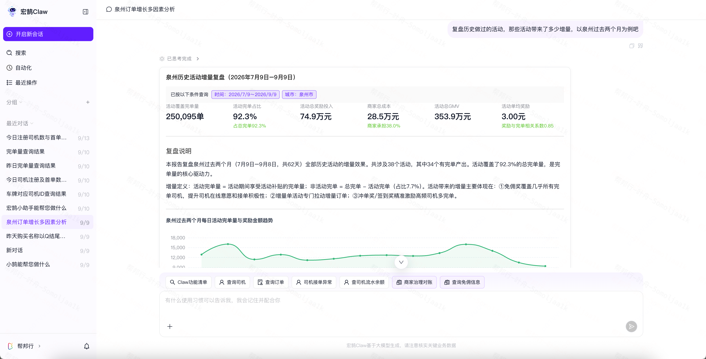

图 1：HHClaw 产品界面。商家通过对话发起查询和分析，结果以文字、图表等形式展示。

### 1.2 整体架构与本次工作的位置

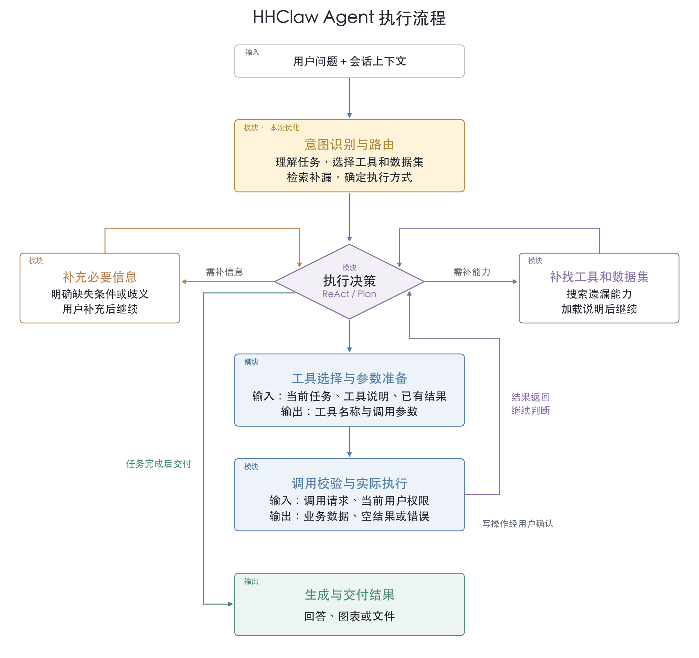

图 2：HHClaw Agent 整体执行流程。意图识别与路由合并展示。

用户问题进入系统后，分为两个阶段执行：

1. 意图识别理解目标、业务对象、时间及筛选条件，选择需要的工具和数据集

2. 执行环节再组织调用、读取结果，必要时补充信息或能力，最后生成回答。

其中工具负责执行具体操作，数据集提供数据查询的业务口径与数据来源。

**意图识别阶段是整个问题的入口，如果在意图识别阶段工具和数据集选择错误，将直接影响后续执行的效果。**

**本次LR主要优化意图识别阶段的能力召回，包括工具和数据集的选择、补漏。**

### 1.3 初版方案及存在的问题

初版方案按司机、订单、数据、通用四个域组织工具。意图识别先判断业务域，执行阶段再加载对应域的全部工具。

按业务域选工具有三个不足：

1、跨域请求容易漏掉其他域的必需工具；

2、即使业务域判断正确，也会带入域内与当前任务无关的工具；

3、全部数据集都直接加载到后续执行流程，造成上下文过长，token效率低下；

为解决跨域漏召回和全量工具加载的问题，本次改为按任务选择具体工具与数据集，再通过独立检索补漏。

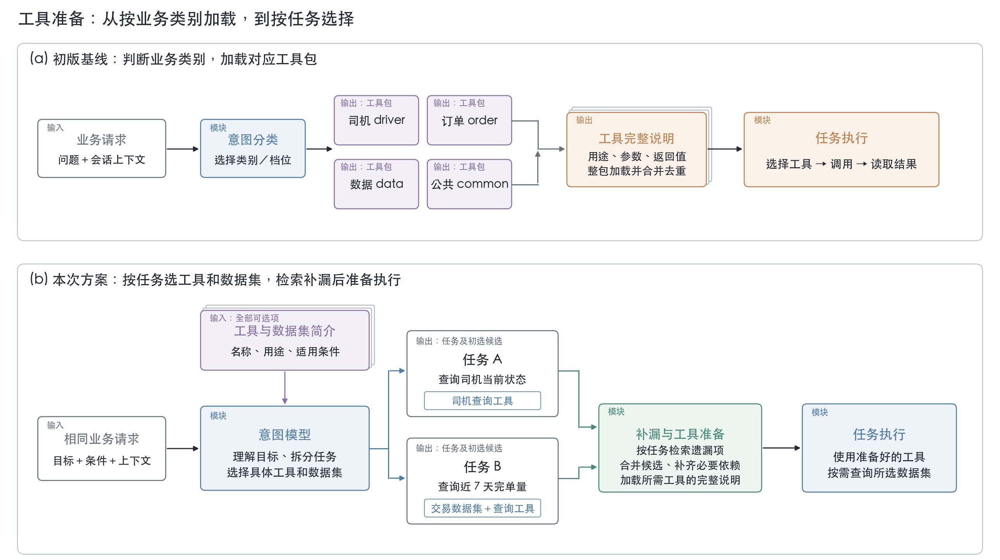

### 1.4 业务用语

| 名称 <br> | 含义 <br> |
| --- | --- |
| 工具 <br> | 可调用的业务能力，例如司机查询、订单查询、数据查询 <br> |
| 数据集 <br> |  <br>数据查询使用的业务数据定义，包括可查询的指标与维度等信息 <br> |
| 短目录 <br> | 给意图模型看的精简能力说明，不包含完整参数定义 <br> |
| 候选 <br> | 模型选择或检索补充的工具、Skill 和数据集；尚未全部展开为可调用工具 <br> |
| 工具召回率 <br> | 按标注的等价工具需求组统计，组内任一工具命中即满足该项要求 <br> |
| 平均加载工具数 <br> | 每条请求最终装载的业务工具数，不含每次固定加载的常驻工具；与初选候选数区分 <br> |
| 候选预算/工具预算 <br> | 指召回工具数量的限制 <br> |

## 二、目标与约束

### 2.1 策略目标

| 指标 <br> | 基线 <br> | 目标值 <br> | 统计口径 <br> |
| --- | --- | --- | --- |
| 工具召回率 <br> | 74.66% <br> | ≥95.00% <br> | 命中的工具数／全部标注工具数； <br> |
| 数据集召回率 <br> | 基线未在意图阶段选择数据集 <br> | ≥95.00% <br> | 命中的数据集数／全部标注数据集数 <br> |

### 2.2 约束指标

| 约束指标 <br> | 当前基线 <br> | 判断要求 <br> | 统计口径 <br> |
| --- | --- | --- | --- |
| 精确率 <br> | 5.66% <br> | 不低于基线 <br> | 选择的工具有多少 被实际调用 <br> |
| 平均加载工具 token <br> | 约 16,714 <br> | 不超过基线 <br> | 每条请求加载的业务工具定义字符数除以 3，再对全部请求求平均；不含常驻工具 <br> |

工具token是估算值，不是 API 计费 token。

## 三、技术方案

### 3.1 方案概览

本方案不再按四个业务域完整加载工具，而是以用户请求、工具短目录和数据集目录为输入，输出按 Task 组织的工具与数据集候选，交给后续执行阶段加载和调用。分为以下几个模块：

1. **任务分解与能力初筛**：系统先按独立交付结果拆分 Task。每个 Task 保留目标对象、业务实体、时间条件和其他筛选条件，再选择少量直接相关的工具或数据集。

2. **按任务检索补漏**：完成初选后，系统使用每个 Task 自己的检索文本独立执行 BM25 检索。

3. **按依赖补齐工具**：候选合并后，系统读取工具schema中的依赖，并在总候选预算内补齐能够共同执行的工具组合。补齐以“候选及其依赖能否完整放入预算”为单位；如果空间不足，则舍弃低排名候选，避免留下不可执行的半条链路。

下面是一次意图识别的返回样例，用户输入：

```PlainText
查询城市正在生效的营销活动和卡券，城市是福州市
```

返回：

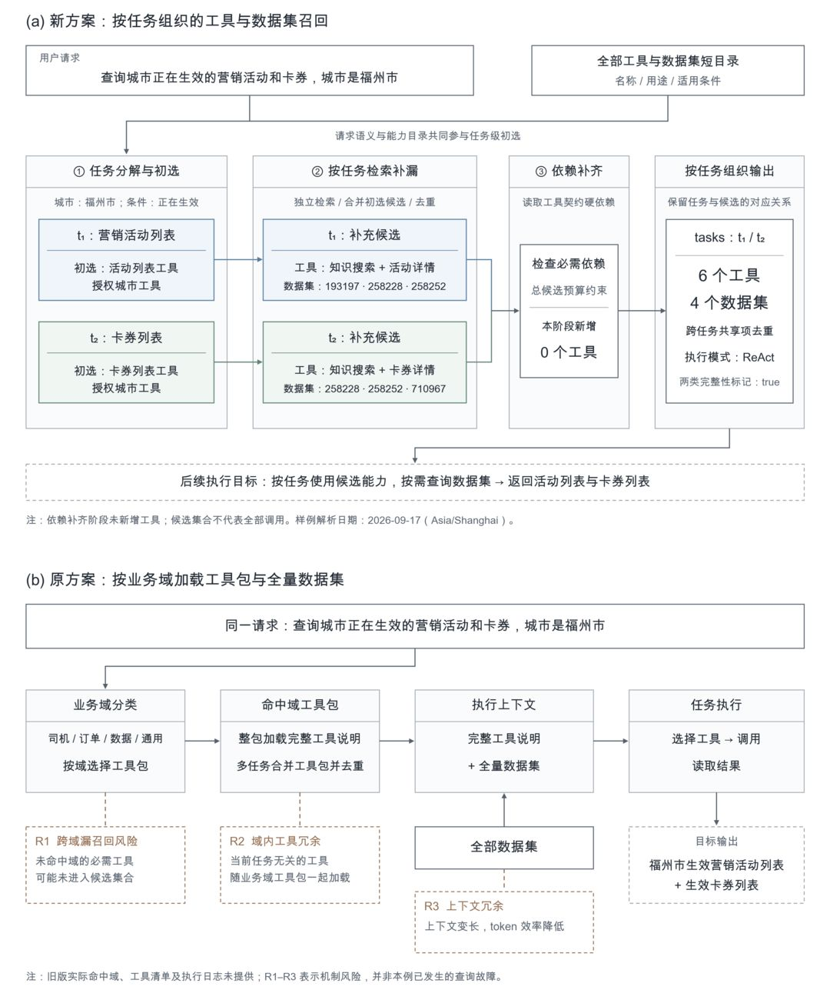

```json
{
  "refuse": "",
  "terminal": "",
  "tasks": [
    {
      "id": "t1",
      "source_text": "查询福州市正在生效的营销活动列表",
      "semantics": {
        "metrics": [],
        "dimensions": [
          "城市"
        ],
        "actions": [
          "查询"
        ],
        "time_constraints": [
          {
            "source_expression": "正在生效",
            "source": "current_query",
            "evidence_text": "正在生效",
            "start_date": "2026-09-17",
            "end_date": "2026-09-17",
            "timezone": "Asia/Shanghai",
            "status": "resolved"
          }
        ],
        "entities": [
          {
            "type": "city",
            "source_text": "福州市",
            "normalized_value": "福州市",
            "status": "resolved"
          }
        ]
      },
      "candidate_topk": [
        "marketing_activity_list",
        "marketing_auth_city_list"
      ],
      "added_tools": [
        "common_wiki_search",
        "marketing_activity_detail_get"
      ],
      "added_datasets": [
        "193197",
        "258228",
        "258252"
      ]
    },
    {
      "id": "t2",
      "source_text": "查询福州市正在生效的卡券列表",
      "semantics": {
        "metrics": [],
        "dimensions": [
          "城市"
        ],
        "actions": [
          "查询"
        ],
        "time_constraints": [
          {
            "source_expression": "正在生效",
            "source": "current_query",
            "evidence_text": "正在生效",
            "start_date": "2026-09-17",
            "end_date": "2026-09-17",
            "timezone": "Asia/Shanghai",
            "status": "resolved"
          }
        ],
        "entities": [
          {
            "type": "city",
            "source_text": "福州市",
            "normalized_value": "福州市",
            "status": "resolved"
          }
        ]
      },
      "candidate_topk": [
        "marketing_card_goods_list",
        "marketing_auth_city_list"
      ],
      "added_tools": [
        "common_wiki_search",
        "marketing_card_goods_detail_get"
      ],
      "added_datasets": [
        "258228",
        "258252",
        "710967"
      ]
    }
  ],
  "execution_mode": {
    "mode": "react",
    "reason": "两个查询目标明确，可分别获取活动列表和卡券列表"
  },
  "final_tool_union": [
    "common_wiki_search",
    "marketing_activity_detail_get",
    "marketing_activity_list",
    "marketing_auth_city_list",
    "marketing_card_goods_detail_get",
    "marketing_card_goods_list"
  ],
  "final_dataset_union": [
    "193197",
    "258228",
    "258252",
    "710967"
  ],
  "tool_complete": true,
  "dataset_complete": true,
  "tool_graph_added_tool_ids": []
}
```

### 3.2 模块一：**任务分解与能力初筛**

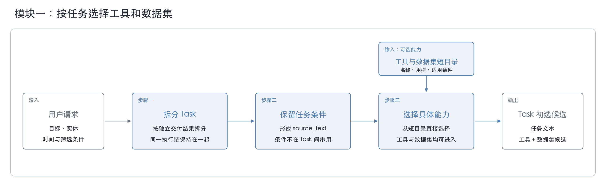

模块一的输入包括用户本轮请求、可选择的工具目录和数据集目录。模型先按拆分 Task。每个 Task 识别四类信息：目标对象、实体、时间条件和其他筛选条件。模型只从目录中选择与该 Task 相关的少量工具或数据集。

输出是带 Task 归属的初选候选和用于后续检索的任务文本。每个候选都能追溯到产生它的 Task，后续模块可以直接复用该 Task 的目标和条件继续补漏。

下面用真实请求举例，过一遍这条链路。输入 Query：

```text
查询城市正在生效的营销活动和卡券，城市是福州市
```

模型看到的是能力目录，不是完整工具定义。下面仅摘出与本 Case 相关的目录项，dataset也有描述，下面只列出id；

```json
{
  "tools": [
    {"id": "marketing_activity_list", "summary": "查询营销活动列表"},
    {"id": "marketing_card_goods_list", "summary": "查询卡券列表"},
    {"id": "marketing_auth_city_list", "summary": "查询营销授权城市"},
    {"id": "marketing_activity_detail_get", "summary": "查询营销活动详情"},
    {"id": "marketing_card_goods_detail_get", "summary": "查询卡券详情"},
    {"id": "common_wiki_search", "summary": "查询业务规则与说明"}
  ],
  "datasets": ["193197", "258228", "258252", "710967"]
}
```

该请求同时要求两个可分别交付的结果：正在生效的营销活动列表和卡券列表，因此拆成两个 Task。模块一输出的结构化结果如下，两个 Task 都保留了城市条件：

```json
{
  "tasks": [
    {
      "id": "t1",
      "source_text": "查询福州市正在生效的营销活动列表",
      "semantics": {
        "metrics": [],
        "dimensions": [
          "城市"
        ],
        "actions": [
          "查询"
        ],
        "time_constraints": [
          {
            "source_expression": "正在生效",
            "source": "current_query",
            "evidence_text": "正在生效",
            "start_date": "2026-09-17",
            "end_date": "2026-09-17",
            "timezone": "Asia/Shanghai",
            "status": "resolved"
          }
        ],
        "entities": [
          {
            "type": "city",
            "source_text": "福州市",
            "normalized_value": "福州市",
            "status": "resolved"
          }
        ]
      },
      "candidate_topk": [
        "marketing_activity_list",
        "marketing_auth_city_list"
      ],
      "added_tools": [
        "common_wiki_search",
        "marketing_activity_detail_get"
      ],
      "added_datasets": [
        "193197",
        "258228",
        "258252"
      ]
    },
    {
      "id": "t2",
      "source_text": "查询福州市正在生效的卡券列表",
      "semantics": {
        "metrics": [],
        "dimensions": [
          "城市"
        ],
        "actions": [
          "查询"
        ],
        "time_constraints": [
          {
            "source_expression": "正在生效",
            "source": "current_query",
            "evidence_text": "正在生效",
            "start_date": "2026-09-17",
            "end_date": "2026-09-17",
            "timezone": "Asia/Shanghai",
            "status": "resolved"
          }
        ],
        "entities": [
          {
            "type": "city",
            "source_text": "福州市",
            "normalized_value": "福州市",
            "status": "resolved"
          }
        ]
      },
      "candidate_topk": [
        "marketing_card_goods_list",
        "marketing_auth_city_list"
      ],
      "added_tools": [
        "common_wiki_search",
        "marketing_card_goods_detail_get"
      ],
      "added_datasets": [
        "258228",
        "258252",
        "710967"
      ]
    }
  ]
}
```

### 3.3 模块二：按任务检索补漏

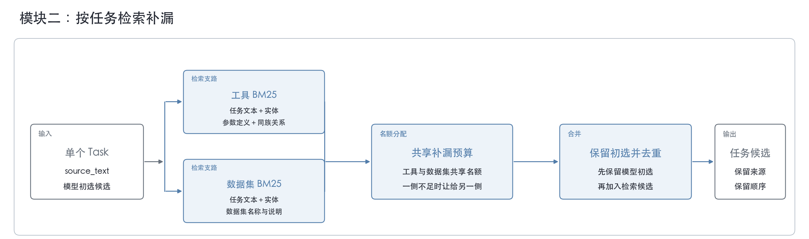

模块的输入为模块一输出的各 Task、模型初选候选和检索文本。系统对每个 Task 独立执行 BM25 检索，工具与数据集共享补漏预算共10个。

输出仍按 Task 保存，避免一个 Task 的补漏结果无条件灌给另一个 Task。每个 Task 的结果同时保留模型初选项、检索新增项和去重后的候选顺序，便于后续定位候选来自模型还是检索。

下面是模块二的输出样例：

```json
{
  "t1": {
    "added_tools": ["common_wiki_search", "marketing_activity_detail_get"],
    "added_datasets": ["193197", "258228", "258252"]
  },
  "t2": {
    "added_tools": ["common_wiki_search", "marketing_card_goods_detail_get"],
    "added_datasets": ["258228", "258252", "710967"]
  }
}
```

### 3.4 模块三：按依赖补齐工具

模块三的输入为模块一和模块二合并后的工具候选。系统读取工具schema中的依赖，判断候选工具是否需要依赖工具才能执行，并在总候选预算内补齐依赖。

输出是预算内依赖完整的工具集合。该模块只处理工具schema中的依赖。供执行阶段按任务加载。

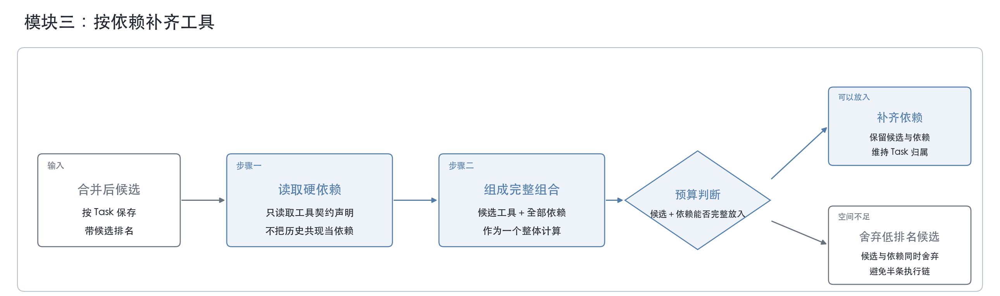

下面是一个工具的schema (depends_on字段是该工具的依赖)：

```PlainText
{
  "name": "order_detail_query",
  "description": "查询订单详情",
  "depends_on": [
    {
      "tool": "order_search",
      "required": true,
      "reason": "必须先通过用户提供的条件定位唯一订单"
    }
  ],
  "input_schema": {
    "type": "object",
    "required": ["order_id"],
    "properties": {
      "order_id": {
        "type": "string",
        "description": "由 order_search 返回的订单 ID",
        "source": {
          "tool": "order_search",
          "path": "$.data.orders[0].order_id"
        }
      }
    },
    "additionalProperties": false
  },
  "execution_contract": {
    "requires_confirmation": false,
    "permission_check": "order_detail_owner",
    "execute_when": "order_search.data.orders.length == 1"
  },
  "output_schema": {
    "type": "object",
    "required": ["order_id", "status", "amount"],
    "properties": {
      "order_id": {
        "type": "string"
      },
      "status": {
        "type": "string"
      },
      "amount": {
        "type": "number"
      }
    }
  },
  "failure_contract": {
    "zero_matches": "请补充订单号或其他筛选条件",
    "multiple_matches": "请从候选订单中选择一个",
    "permission_denied": "无权查看该订单详情"
  }
}
```

两个 Task 的候选合并、去重后的工具并集如下：

```json
{
  "final_tool_union": [
    "common_wiki_search",
    "marketing_activity_detail_get",
    "marketing_activity_list",
    "marketing_auth_city_list",
    "marketing_card_goods_detail_get",
    "marketing_card_goods_list"
  ],
  "tool_complete": true,
  "tool_graph_added_tool_ids": []
}
```

## 四、实验评估

### 4.1 评估集与实验方法

本文有两类实验：

- **主对照****实验**：用于验证最终方案，在相同的 341 条 Golden Case 上比较基线与最终方案；工具召回率和数据集召回率以人工标注目标为准。

- **分****模块****探索实验**：用于确定各模块内部的取舍，使用 352 条历史工具调用case，将历史实际调用的工具作为目标。

HHClaw 当前目录包含 72 个 LLM 可见工具和 26 个数据集；341 条 Golden Case 的人工标注涉及 49 个不同工具。两者按工具类别的分布如下：

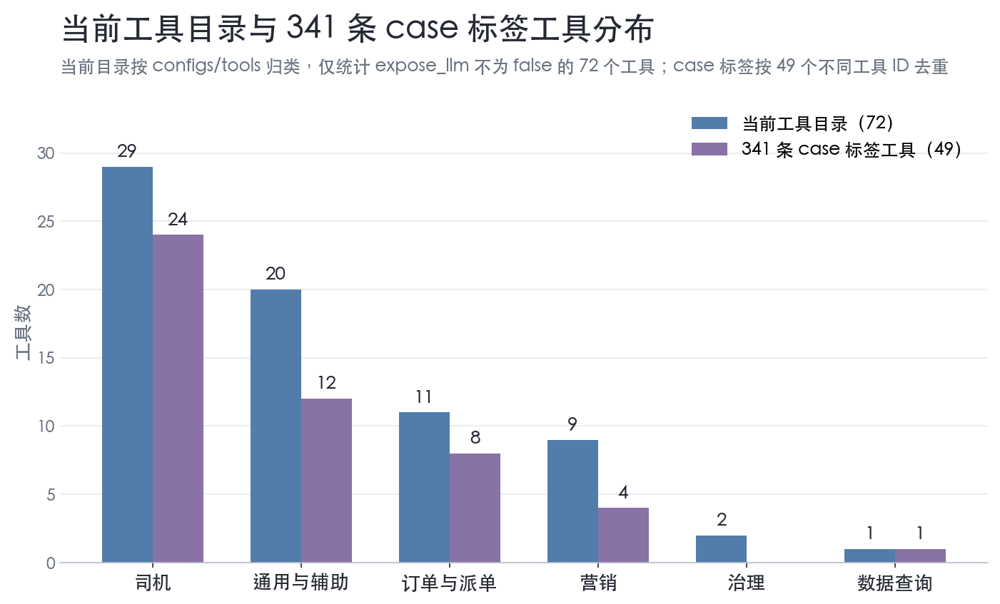

当前目录中的 26 个数据集按主要业务对象分为三类；341 条 Golden Case 的人工标注涉及其中 13 个不同数据集，分布如下：

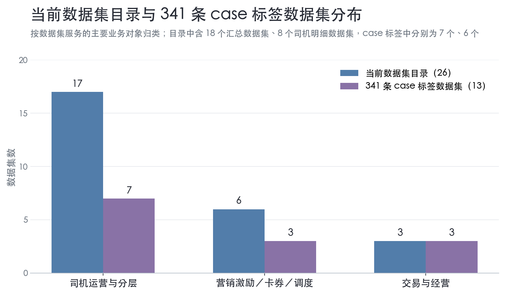

### 4.2 主对照实验

下表在同一批 341 条case、deepseek-v4-flash模型上对照基线与最终方案，右栏给出各指标的变化与是否达标的判断。

| 指标 <br> | 基线 <br> | 最终方案 <br> | 变化与判断 <br> |
| --- | --- | --- | --- |
| 工具召回率 <br> | 74.66% <br> | 96.12% <br> | **+****21.46pp**，达到 95.00% 目标 <br> |
| 工具精确率 <br> | 5.66% <br> | 18.98% <br> | **+13.32pp** <br> |
| 数据集召回率 <br> | 不适用 <br> | 98.46% <br> | 达到 95.00% 目标，高于门槛** 3.46pp** <br> |
| 平均加载工具数 <br> | 16.21 <br> | 5.67 <br> | **-****65.02%** <br> |
| 平均数据集数 <br> | - <br> | 5.12 <br> | 基线未选择数据集 <br> |
| 平均加载工具token <br> | 约 16,714  <br> | 约 9,103 <br> | **-****45.54%**，满足不高于基线的约束 <br> |
| 平均工具token占上下文比例 <br> | 39.2% <br> | 21.3% <br> | 按当前单任务平均总上下文均值42700 token计算 <br> |

### 4.3 模块一：**任务分解与能力初筛**

候选工具/数据集生成是整条链路的第一步。它根据用户问题识别其中包含的任务，并为每个任务选出一小组初始工具和数据集候选，后续模块的检索补漏和依赖补齐只在这组初始候选的基础上继续处理。

**本模块****的实验旨在****确定：****意图****模型****的上下文中被传入的工具目录****是否需要****先经过向量****检索****和****排名****、是否需要截断/删减。**

#### 4.3.1 针对工具目录输入形式的权衡

本实验验证向量相似度排序是否能帮助意图模型缩小选择范围，同时不漏掉任务所需工具。三种方案分别是：

- 模型直接查看完整工具目录；

- 直接使用向量对工具进行排序；

- 向模型提供完整目录，并附带向量排序前 20 名作为参考，观测向量模型的排序结果能否有参考作用。

| **方案** <br> | **工具召回率** <br> | **相对基线** <br> | **相对基线** <br> |
| --- | --- | --- | --- |
| **完整****工具****直接交给意图模型** <br> | **92.38%** <br> | **—** <br> | **—** <br> |
| 直接向量对工具进行排序 <br> | 70.64% <br> | −21.74pp <br> | −27.55pp <br> |
| 向量排序top20+完整目录作为意图模型参考 <br> | 91.83% <br> | −0.55pp <br> | −0.28pp <br> |

**最后选择：完整工具目录直接交给模型，不使用向量排序结果。**

#### 4.3.2 是否把前置 BM25 排名交给模型参考

**本实验验证：是否应在意图模型选择候选之前，先将目录按 BM25 排名截断并交给模型。**

开启前置 BM25 时，模型只看到排名前30的工具；关闭时，模型查看完整目录。

两种方案后续均不接入 BM25 补漏，以便单独判断“前置排名”对意图候选生成的影响。

| **方案** <br> | **工具召回率** <br> | **相对基线** <br> |
| --- | --- | --- |
| **关闭****前置 BM25** <br> | **87.7%** <br> | **—** <br> |
| 前置 BM25 <br> | 79.5% <br> | -8.2pp <br> |

**最后选择：**不保留前置BM25，对工具召回率的影响较大，会在开始就排除掉正确候选。

### 4.4 模块二：按任务检索补漏的探索实验

检索补漏位于意图候选生成之后。意图模型先给出初始候选，本模块再按任务分别检索工具和数据集，补上模型遗漏但与任务相关的能力；输出是与模型候选合并后的候选集合。

#### 4.4.1 关于是否需要后置补漏、名额如何分配、同族工具补偿的权衡

本实验验证检索补漏的三个取舍：

1. **模型初选后是否还需要独立补漏****（验证本模块存在的必要性）****；**

2. **工具和数据集的补漏名额是否应按任务类型动态分配；**

3. **模型或检索命中一个工具时，是否需要补充同一业务对象下能力相近的工具。**

固定 5＋5 指工具和数据集各返回 5 个候选。动态配额则按任务类型分配：数据查询任务优先补数据集，工具操作任务优先补工具。

同族补偿是利用业务对象和参数能力的对应关系提高相关工具进入候选集的机会。例如已选中订单详情工具时，订单列表工具会获得额外补偿。

粒度不匹配降权是BM25 在补一批候选时，避免把“粒度不对”的工具排得太高。例如用户要“订单列表”，把同一领域的“订单详情”工具降低权重。

| **对照** <br> | **工具召回率** <br> | **工具相对基线** <br> | **数据集召回率** <br> | **数据集相对基线** <br> | **结论** <br> |
| --- | --- | --- | --- | --- | --- |
| 仅模型选择，不做后置补漏 <br> | 79.45% <br> | −9.59pp <br> | 74.62% <br> | −18.46pp <br> | 明显不足 <br> |
| 后置补漏·固定 5＋5 名额 <br> | 89.04% <br> | — <br> | 93.08% <br> | — <br> | 工具 +9.59pp，数据集 +18.46pp，证明需要后置补漏 <br> |
| 后置补漏·粒度不匹配降权 <br> | 87.67% <br> | −1.37pp <br> | 93.08% <br> | 0.00pp <br> | 工具反降 1.37pp，放弃 <br> |
| 后置补漏·动态配额 <br> | 88.81% <br> | −0.23pp <br> | 97.69% <br> | +4.61pp <br> | 数据集提升，工具略降 <br> |
| 固定 5＋5＋同族补偿 <br> | 90.41% <br> | +1.37pp <br> | 93.08% <br> | 0.00pp <br> | 同族补偿单独效果 <br> |
| **动态配额＋同族补偿** <br> | **89.95%** <br> | **+0.91pp** <br> | **97.69%** <br> | **+4.61pp** <br> | **最终组合** <br> |

固定5+5名额是工具和数据集分别补充5个。

**最终保留独立检索补漏，并采用动态配额和同族补偿。**动态配额优先保障数据集召回；同族补偿用于弥补工具召回的损失。

#### 4.4.2 数据集是否需要补充向量相似度排序

数据集检索会先产出若干候选数据集，本子模块负责将它们排序，并向后续链路提供排名靠前的候选。规则、BM25 和中文字符相似度分别覆盖目录字段、关键词和名称匹配；向量排序用于补充语义相似度。

本实验比较“规则、BM25、中文字符相似度合并”和“在此基础上增加向量相似度”的排序效果。首位正确率衡量正确数据集是否排在第一位，前三位和前五位覆盖率衡量正确数据集是否仍在可用候选范围内。

| 方案 <br> | recall@1 <br> | recall@3 <br> | recall@5 <br> |
| --- | --- | --- | --- |
| **规则、BM25 和中文字符相似度合并** <br> | **71.43%** <br> | **100.00%** <br> | **100.00%** <br> |
| 增加向量排序 <br> | 75.00% <br> | 96.43% <br> | 100.00% <br> |

**最后选择：不增加向量排序，保留规则、BM25 和中文字符相似度合并**；加向量后首位多命中 1 条、前三位少覆盖 1 条，本地回放 P95 增加 23.18 毫秒。

首位正确率是正确数据集排在第一位的问法占比；前三位覆盖率是前三个候选包含正确数据集的问法占比，均越高越好。动态配额主要改善了数据集召回，工具召回需结合后续同族补漏结果判断。

#### 4.4.3 是否按历史共现追加工具

“按历史共现追加”指根据过去一次任务中经常一起调用的工具，在当前候选集合外追加少量可能相关的工具。

**本实验比较不使用共现信息与最多追加 3 个共现工具两种方案，判断额外候选带来的历史工具覆盖提升是否值得其上下文成本**。

| 方案 <br> | 历史工具覆盖 <br> | 相对基线 <br> | 相对基线 <br> | 平均工具数 <br> |
| --- | --- | --- | --- | --- |
| **不按历史共现追加** <br> | **95.98%** <br> | **—** <br> | **—** <br> | **17.00** <br> |
| 历史共现最多追加 3 个 <br> | 96.95% <br> | +0.97pp <br> | +0.85pp <br> | 18.74 <br> |

**最后未采用历史共现追加。它仅带来有限的历史工具覆盖提升，但平均候选工具数增加 1.74 个**。

#### 4.4.4 针对模块二输入的探索

模块二做后置 BM25 补漏时，接收的不是原始用户请求，而是模块一按任务输出的两类信息：

1. **任务文本**：**该任务的目标、业务对象、时间范围、状态和筛选条件**；BM25 以此作为检索依据。

2. **初选候选**：模块一已选出的工具和数据集；模块二在此基础上补充遗漏能力，并与初选结果合并。

因此，模块二的效果取决于输入是否保留了足够的任务条件。普通任务保留完整条件，便于检索定位正确工具和数据集；对于车牌、手机号、姓名等批量清单，只概括对象类型，避免逐项照抄造成模型输出过长或 JSON 截断。

**本实验比较“保留任务文本、按需多选”的组合与“进一步扩大候选预算”的组合，判断扩大候选数量是否值得其上下文成本。**

| 方案 <br> | 工具召回率 <br> | 数据集召回率 <br> | 平均加载工具数 <br> |
| --- | --- | --- | --- |
| 完整目录直接交给意图模型 <br> | 92.38% <br> | — <br> | — <br> |
| **任务文本保留条件、批量清单概括** <br> | **96.12%** <br> | **98.46%** <br> | **5.67** <br> |
| 完整目录直接交给 意图模型扩大候选预算 <br> | 95.89% <br> | 98.46% <br> | 10.05 <br> |

**最后选择：保留任务条件，只概括批量清单，不要求选满候选名额。**

### 4.5 模块三：按依赖补齐工具的优化实验

依赖补齐位于模型候选和检索补漏合并之后。部分工具可能需要搭配其他工具才能完成一次任务，本模块读取工具声明的明确依赖关系，将可保留候选补成可直接执行的工具包。

#### 4.5.1 固定预算还是预算外追加依赖

本实验验证明确依赖应如何补齐。模型和检索已经给出候选排序后，依赖补齐可以在既定候选预算内替换低排名候选，也可以在预算外额外增加依赖工具。

对照重点是：两种方式能否让保留下来的候选工具依赖齐全，以及预算外追加是否带来额外的工具召回率问题。

候选工具依赖齐全率指候选中的工具连同其声明的伴随依赖是否齐备，越高说明候选越可以直接执行。

| 方案 <br> | 工具召回率 <br> | 平均工具数 <br> | 最大工具数 <br> | 候选工具依赖齐全率 <br> |
| --- | --- | --- | --- | --- |
| 模型原始候选 <br> | 95.98% <br> | 17.00 <br> | 17 <br> | 89.74% <br> |
| **固定预算内补齐依赖** <br> | **95.98%** <br> | **16.95** <br> | **17** <br> | **100.00%** <br> |
| 在预算外追加全部依赖 <br> | 95.98% <br> | 17.22 <br> | 22 <br> | 100.00% <br> |

两种补齐策略的工具召回率相同：在这份数据中，固定预算淘汰的低排名工具包没有包含额外的历史目标；同时，两种策略都能将各自保留候选的依赖齐全率补至 100.00%。区别只在候选规模：预算外追加的平均工具数多 0.27 个，最大工具数多 5 个，但没有带来额外覆盖。

**最后选择：在预算内补齐明确依赖。**相较预算外追加，它保持相同的覆盖和问题完整率，同时限制候选规模；放不下工具及其依赖时舍弃低排名候选。

### 4.6 模型选型

整体链路最后验证模型选型：同一套意图提示词分别在两个模型上实测意图阶段时延。

Qwen3.8-27B-FP8是在鲁班L40s上部署的模型。DeepSeek-V4-flash是使用token service部署的模型。

| 模型 <br> | 工具召回率 <br> | 数据集目标召回 <br> | 时延结果 <br> | 结论 <br> |
| --- | --- | --- | --- | --- |
| Qwen3.8-27B-FP8 <br> | 94.23% <br> | 96.92% <br> | 24 秒 <br> | 不采用 <br> |
| DeepSeek V4 Flash <br> | 96.12% <br> | 98.46% <br> | 5.30 秒 <br> | 继续使用 <br> |

Qwen 平均约 24 秒的推理耗时远超秒级预期，且准确率稍低，因此未进入后续方案。

### 4.7 实验结论

**工具召回率为 96.12%，数据集召回率为 98.46%，均达到 95.00% 的目标，且平均上下文工具token数降低45.54%，精准率提升13.32pp，符合上线标准**。

## 五、放量决策

目前意图识别方面的策略已经于2026 年 8 月 25日预发环境上线，工程在 9 月 5 日进行发版，当前已开量拼哒、帮邦行、斑马、T1、径出行、任我打车六个商家。

## 六、引用及鸣谢

感谢方舟和叶舟两位老师的帮助和指导。感谢宏鹄SaaS工程团队对工作的支持。

- [基线方案与现方案对比](https://cooper.didichuxing.com/knowledge/2199610335356/2209676570513)

- [Golden Case 召回基线](https://cooper.didichuxing.com/knowledge/2199610335356/2209676656772)

- [组件消融](https://cooper.didichuxing.com/knowledge/2199610335356/2209676599360)

- [提示词定稿与实测勘误](https://cooper.didichuxing.com/knowledge/2199610335356/2209676665628)

- [意图预召回三方案复核报告-20260817](https://cooper.didichuxing.com/knowledge/2199610335356/2209676617045)

- [数据集候选召回最终实验-20260812](https://cooper.didichuxing.com/knowledge/2199610335356/2209676542644)

- [工具向量召回实验-20260811](https://cooper.didichuxing.com/knowledge/2199610335356/2209676605766)

- [任务级工具召回提示词基线](https://cooper.didichuxing.com/knowledge/2199610335356/2209676529727)

- [当前工具目录候选预算实验-20260812](https://cooper.didichuxing.com/knowledge/2199610335356/2209676542724)

- [工具目录截断方案实验-20260811](https://cooper.didichuxing.com/knowledge/2199610335356/2209676580788)

- [历史工具共现实验-20260811](https://cooper.didichuxing.com/knowledge/2199610335356/2209676626468)

- [常驻工具与依赖实验-20260811](https://cooper.didichuxing.com/knowledge/2199610335356/2209676532413)

- [意图 Tool BM25 与同族补偿消融-20260819](https://cooper.didichuxing.com/knowledge/2199610335356/2209676561316)

- [意图动态 BM25 配额消融-20260819](https://cooper.didichuxing.com/knowledge/2199610335356/2209676495513)

- [意图召回组件消融 baseline-20260820](https://cooper.didichuxing.com/knowledge/2199610335356/2209676495086)

- [意图多候选 Prompt 消融-20260820](https://cooper.didichuxing.com/knowledge/2199610335356/2209676597422)

- [意图识别模型对比 Qwen3-8-27B-FP8-20260826](https://cooper.didichuxing.com/knowledge/2199610335356/2209676552010)

## 七、其他

### 7.1 意图识别基建

为了更好地在不影响线上/预发环境的情况下，与hhclaw工程进行同步模块化开发，我们开发了optimize接口（统一入口：POST /inner/biz-api/v1/hhclaw/evals/agent-run-optimize），方便测试我们意图识别部分的离线优化效果。我们在本地负责准备测试问题、生成策略配置和评估结果；接口端负责应用配置，运行服务端 Agent，并返回回答与执行过程。

离线模块通过 Prompt、工具白名单、上下文开关或阶段产物接入；新增的算法方案可先在本地运行，再将符合接口契约的输出传入。

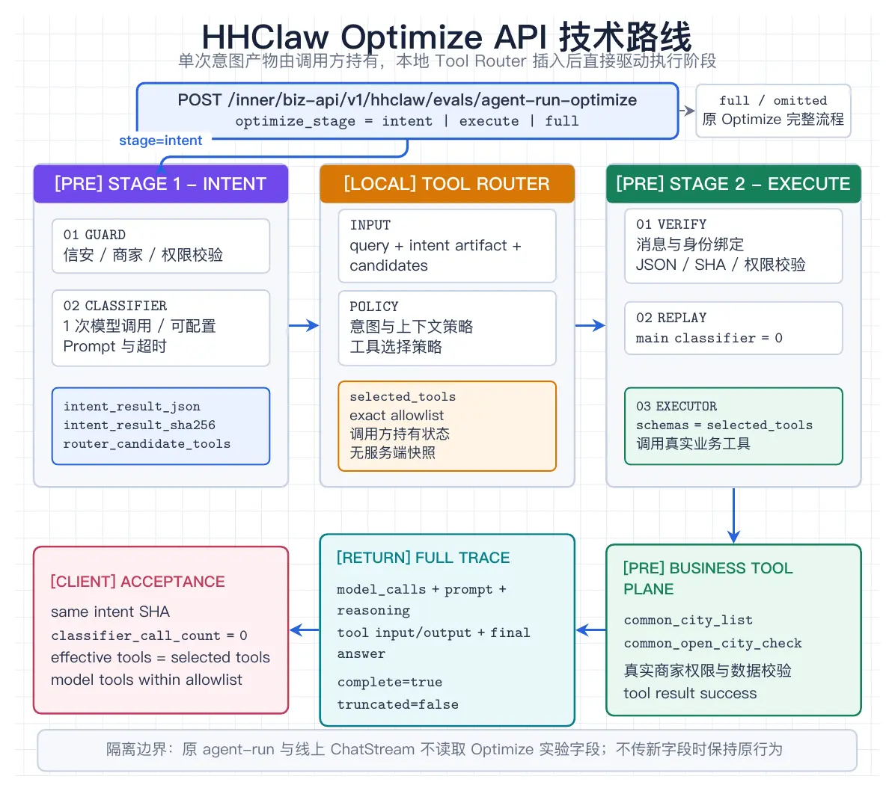

### 7.2 工具描述自动优化

本节补充执行阶段的工具描述自动优化：从历史调用中定位可由说明文字改善的问题，生成候选描述，再用同任务对照验证。它是后续能力建设。

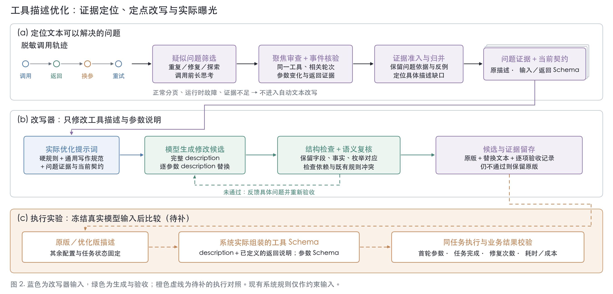

图：工具描述自动优化的证据、改写与验证流程。上半部分从脱敏调用轨迹中筛选可能由描述改善的问题，中间部分只改工具说明和参数说明，并进行结构与语义复核；橙色虚线部分是尚在推进的同任务执行对照。当前已具备候选发现、证据核验和文本验收能力，方案仍在根据执行结果持续改进，尚不能据此宣称任务完成率或线上收益提升。
