# 【LR26-042】乘客与增长-增长策略-新客首单分城市框调控补贴-V1.0

[Cooper 原文](https://cooper.didichuxing.com/knowledge/2199610335356/2209794347993)

## 基础信息

| 项目   | 内容   |
| --- | --- |
| BRD文档链接   | [https://cooper.didichuxing.com/docs2/document/2207946635401](https://cooper.didichuxing.com/docs2/document/2207946635401)   |
| 最后通过的策略方案   | [【策略方案】新客首单分城市框调控补贴策略方案（V1.0）](https://cooper.didichuxing.com/knowledge/2199610335356/2208023254476)   |
| 实验链接（评估大师）   | 无   |
| 核心贡献点   | 1. 预算分配精细化：把新客首单补贴从“全国统一调控”升级为“分城市框差异化调控”；   2. 建立预算调控决策链路：建立了“先看清、再调控”的实验决策链路，从而更准确地提升策略效果。    |
| 第一贡献人   | 曹艾瑜   |
| 共同贡献人   | 周之烁、张志茹、张顺瑶   |

## 一、背景

### 1.1  想要解决的问题

- 当前现状：当前新客首单天降算法策略为全国粒度的补贴率调控，城市仅作为弹性模型特征之一。**平台供需侧已制定新的增长城市分框体系（**[增长分框明细](https://cooper.didichuxing.com/docs2/sheet/2206549443831)**）**，分为**核心城市、行业增长-大、行业增长-小、战略收缩**四类，但新客首单策略目前未进行城市框粒度的差异化补贴调控和预算分配，当前现状为全国统一的CAC配置；

- 要解决的问题：分城市框对新客首单进行补贴调控和预算分配，主要是为了解决在全国统一的CAC配置下，全国粒度无法实现最优资源配置的问题。

### 1.2  问题产生的根本原因

- 根本原因：由于不同城市框的新客长期LTV、补贴弹性、边际ROI存在差异，对于高弹性/高LTV城市可能投入不足，低弹性/低LTV城市可能浪费预算；

- 如何看清：需要先基于随机实验看清不同城市框在不同CAC水位下的上述指标表现差异，再决定是否进行城市框粒度的补贴腾挪，以及如何进行预算分配。

### 1.3  问题严重程度

- **收益预估**：算法侧参考抓手形态相同的流失召回首单天降实验结果，对新人首单场景下采用分城市框进行预算分配的策略收益进行了初步分析（[算法评估文档](https://cooper.didichuxing.com/knowledge/2199610335356/2207962815543)）：

	1. 分桶求解：城市分框粒度控补贴率策略vs全国粒度控补贴率策略，ecr +0.26pp；

	2. 贪心求解：城市分框粒度控补贴率策略vs全国粒度控补贴率策略，ecr +0.07pp。

**无论使用哪种求解方式，城市分框粒度的补贴率控制的策略的ecr都会优于全国粒度补贴率控制**。<u>新客策略当前使用贪心求解，因此补贴率控制细化到城市分框粒度后带来的收益预估，可初步参考流失召回首单的贪心求解下城市分框粒度控补贴率策略vs全国粒度控补贴率策略</u><u>，预计访完率</u><u>相对+0.1</u><u>pp</u><u>。</u>

- 进行优化的必要性：新客首单策略作为用户增长核心抓手之一，若不推进城市框粒度优化，将持续在非最优预算分配下运行，无法进一步对用户完单牵引提效。

## 二、目标与约束

|    | 指标&计算口径   | 目标值   |
| :---: | --- | --- |
| 策略目标   | <u>*uv视角*</u><u>*访问完单率（VFR）*</u>= 完单用户数 ÷ 访问用户数   | 分城市框预算分配策略实验组**提升+0.1pp**   |
| 核心约束   | <u>*人均核销成本（核销CAC）*</u>= 新人首单券核销总金额 ÷ 新人首单券核销总人数   | ≈ 当前线上基线策略的核销CAC（**约5.6元**）   |

- 总结：分城市框补贴调控策略的目标是在**整体预算保持不变**的约束下，**提升新客的访问完单率**。

## 三、技术方案

- 针对以上目标，我们的策略将分为两个阶段：

	- 第一阶段（看清实验）：通过运筹平台进行小流量实验，按照不同步长设置不同实验组的CAC，看清不同CAC水位下不同城市发展分框的关键指标差异，对后续分城市框的策略调整提供基础；

	- 第二阶段（策略AB实验）：基于第一阶段看清实验的结论，对不同城市框内城市的CAC配置进行调整后，上线【分城市框预算分配策略 VS 原策略】AB实验，观测策略的实际线上效果。

### **第一阶段：看清实验**

- 实验方案：[新客首单边际成本实验](https://cooper.didichuxing.com/docs2/document/2207811972770)

- 实验平台：运筹实验平台

- 实验分组：

| 分组   | 流量占比   | 核销CAC   | 说明   |
| --- | --- | --- | --- |
| 主流量（对照组）   | 80%   | 5.6   | 当前线上策略   |
| 实验组1（降补）   | 5%   | 4   | 低CAC水位   |
| 实验组2（降补）   | 5%   | 5   | 中低CAC水位   |
| 实验组3（加补）   | 5%   | 6   | 中高CAC水位   |
| 实验组4（加补）   | 5%   | 6.5   | 高CAC水位   |

- 关注指标：

	- 短期：实花CAC、**边际CAC**、呼叫ROI、delta 呼叫ROI

	- 长期：7d/28d LTV(呼叫数)、7d/28d delta 呼叫ROI

- 实验结论（实验评估报告：[新客首单边际成本实验评估](https://cooper.didichuxing.com/docs2/document/2208170179553)）：

| **城市分框**   | **5-边际****CAC**   | **5.6****-边际CAC**   | **6-边际****CAC**   | **6.5-边际****CAC**   | **调整方案**   | **原因**   |
| :---: | :---: | :---: | :---: | :---: | :---: | :---: |
| 核心城市   | -129.99   | 27.58   | -44.84   | 12.43   | 保持5.6   | 当前边际CAC为27.6元，低于30   |
| 行业增长-大   | 41.35   | 41.58   | 20.66   | -101.10   | 增补到6   | 增到6时边际CAC为21元，低于30   |
| 行业增长-小   | 23.99   | 35.22   | -186.26   | 30.67   | 降补到5   | 4-5元时边际CAC为24元，低于30   |
| 战略收缩城市   | 33.74   | 50.26   | 36.04   | 72.82   | 降补到5   | 边际成本不占优，预算限制下优先降补   |
| 其他城市   | 49.36   | 48.64   | 11.29   | -10.99   | 增补到6   | 增到6时边际CAC为11元，低于30   |

	1. 由于上述实验结论基于26Q2的实验数据，并且<u>在26Q3时平台供需侧调整了新的城市分框标准</u>，去掉了【其他城市】分框；在新的城市分框下重新进行分析后，【战略收缩城市】分框增补到6元后的边际CAC为最优

	2. 结合城市分框的调整和业务侧的预算情况，第二阶段策略AB实验的分城市框预算分配基于上述实验分析结论进行了调整；**<u>最终确定的不同城市框的CAC配置为：【核心城市】5.6；【行业增长-大】6；【行业增长小】5；【战略收缩城市】5</u>**

### **第二阶段：策略AB实验**

- 实验方案：[新客首单边际成本实验](https://cooper.didichuxing.com/docs2/document/2207811972770)

- 实验平台：运筹实验平台

- 实验分组：

| ** **   | **核销CAC**   | **流量占比**   | **实验目的**   |
| :---: | :---: | :---: | :---: |
| 分框差异化   | **核心城市**：5.6；**行业增长-大**：6；**行业增长-小**：5；**战略收缩**：5   | 56%   |     |
| 原策略-组1   | 5.6   | 28%   | vs原策略   |
| 原策略-组2   | 6   | 8%   | vs全国最优边际成本   |
| 原策略-组3   | 暂定5.6（<u>实验期间动态拉齐</u><u>与</u><u>【分框差异化】</u><u>一致</u><u>的核销CAC</u>）   | 8%   | 拉齐CAC后vs原策略   |

- 实验评估指标：访问完单率（核心提升指标）、核销CAC（约束指标）

## 四、实验结果

### 4.1  核心结论

**【整体】**

- **综合考虑预算与访问完单率，分框差异化组效果最优：**

	- 访问完单率提升情况：分框差异化组(39.56%) >  拉齐分框差异化组(38.95%)，分城市框策略**<u>访</u>****<u>完</u>****<u>率 +0.61pp</u>**

	- ROI（$$\Delta GMV / \Delta Cost$$）提升情况：分框差异化组（2.91) >  拉齐分框差异化组（2.66），**<u>ROI +9.4%</u>**

	- 核销CAC拉齐情况：分框差异化组（5.65） ≈ 拉齐分框差异化组（5.64）

### 4.2  指标数据

【注】<u>核心需要关注**【分框差异化】**和**【拉齐分框差异化】**两组之间的对比</u>*（即大盘指标和拉新指标中用红色框圈出的列）*；其余组的CAC没有拉齐，因此无法直接对相关指标进行对比，仅作参考。

#### 4.2.1  pv指标

全国整体：

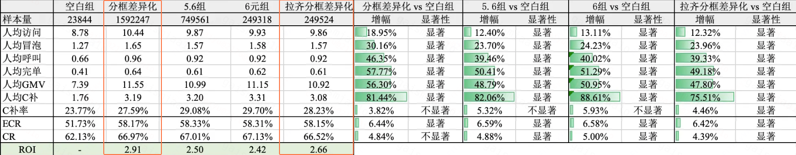

分城市框：

| 核心城市   | 行业增长-大   | 行业增长-小   | 战略收缩   |
| --- | --- | --- | --- |
| 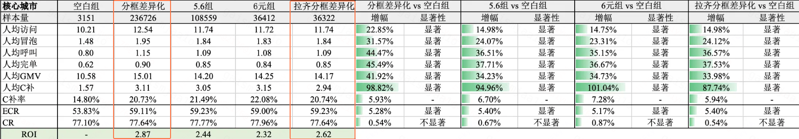   | 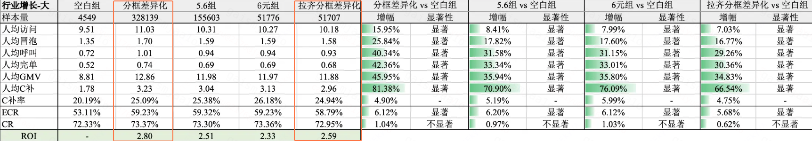   | 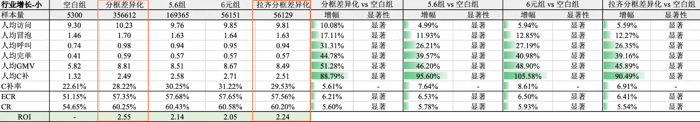   | 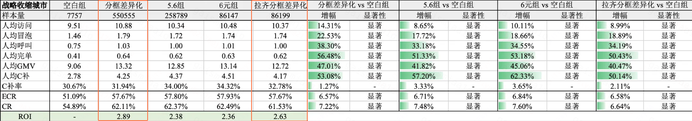   |

#### 4.2.2  uv指标

全国整体：

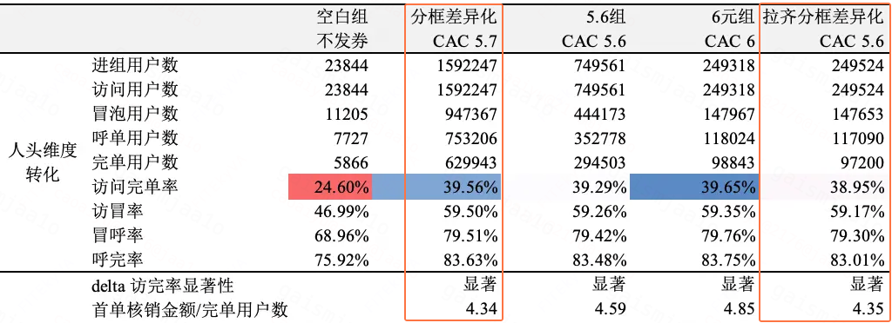

分城市框：

| 核心城市   | 行业增长-大   | 行业增长-小   | 战略收缩   |
| --- | --- | --- | --- |
| 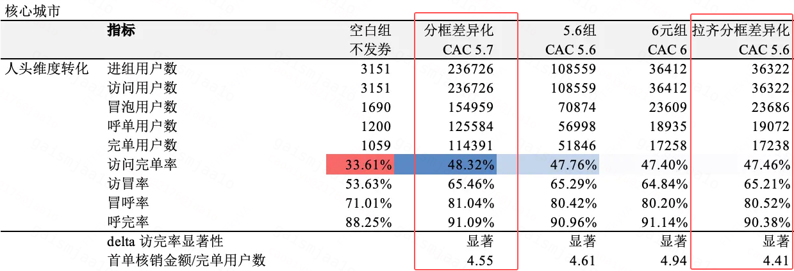   | 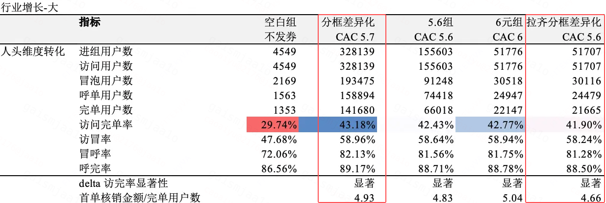   | 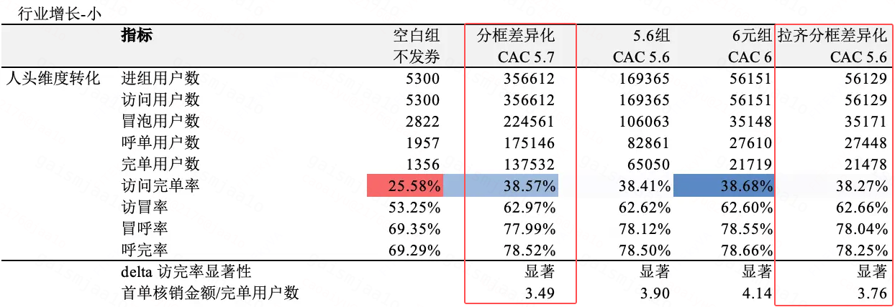   | 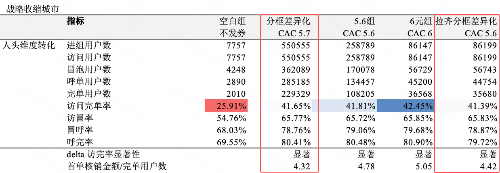   |

### 4.3  收益链路分析

- 基于4.2节的指标数据，对比分框差异化策略和线上基线策略发现：<u>对于【核心城市】和【行业增长-大】两个城市分框，**加补后**的访问完单率**上升**</u>；<u>对于【行业增长-小】和【战略收缩】两个城市分框，**降补后**的访问完单率**基本持平（略有上升）**</u>。

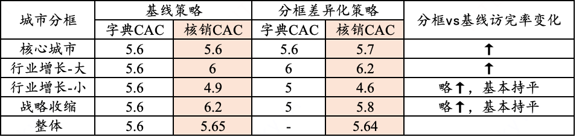

- 基于第一阶段看清实验的CAC=4/5/5.6/6的四组实验数据，各城市分框的访问完单率及ROI变化如下：

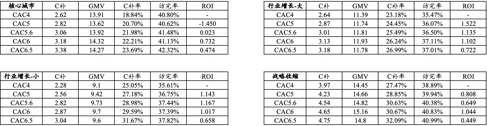

	1. 只有【行业增长-大】城市分框满足边际效用递减，其余三个城市分框均不满足；

	2. 【行业增长-小】分框在当前CAC配置下的ROI**与降补后的ROI基本持平**；

	3. 【战略收缩】分框当前CAC配置下的ROI**低于降补后的ROI**；

- 策略收益链路：采用分城市框调控补贴策略后，对【行业增长-小】和【战略收缩】分框进行降补后ROI基本持平或略有上升，能够**在降补的同时不折损访完率指标**；将这一部分预算腾挪至【核心城市】和【行业增长-大】城市分框后，可以进一步提升对应分框的ROI和访问完单率，从而实现预算分配策略的优化，提升业务指标。

## 五、放量决策

|    |    | 预期扩量时间节奏   | 实际扩量时间   | 放量暂停点详情   | 放量暂停点效果评估   | 是否需要设置长期对照组（默认不需要，此列无需填写）   |
| --- | --- | --- | --- | --- | --- | --- |
|    |    |    | LR通过后，根据实际情况，填写这3列   |    |
| 放量决策意见   | 决策人：张志茹   | ——   | ——   | ——   | ——   | ——   |
| 决策意见：  - 通过    |    |    |    |    |    |
| 放量需要周知的利益相关方   | 无   | ——   | ——   | ——   | ——   | ——   |
| 放量策略   | 分城市框策略组   | ——   | ——   | ——   | ——   | ——   |
| 放量节奏   | 直接推全-随机分流   | - 待节后新客&流失预算腾挪实验产出结论后    |    | ——   | ——   | ——   |

## 六、QA

### 1. 当前城市分框的划定逻辑是什么？

| 城市分类   | 一句话总结   | 竞争壁垒   | 行业变化   | 行业规模   | 整体导向   |
| --- | --- | --- | --- | --- | --- |
| 核心城市   | 高份额、有机会建立壁垒、收毛利   | 份额&gt;40% 30%&lt;份额&lt;40%&行业增长&lt;10%   | /   | 提毛利率，份额微涨   |
| 行业增长-大城市   | 行业渗透率低，市场空间大   | 份额&gt;5%   | 行业增长&gt;10%&自身增长&gt;0% 自身增长&gt;10%   | &gt;10w   | 投入资源，主抗增长   |
| 行业增长-小城市   | 行业渗透率低，市场空间小但持续增长   | 份额&gt;5%   | 行业增长&gt;10%&自身增长&gt;0% 自身增长&gt;10%   | &lt;10w   | 投入资源，增长其次   |
| 战略收缩城市   | 大城市居多，维持需要投入较多资源   | /   | 一线&新一线&wyc战区城市   | /   | 资源收缩，非价格抓手驱动   |
