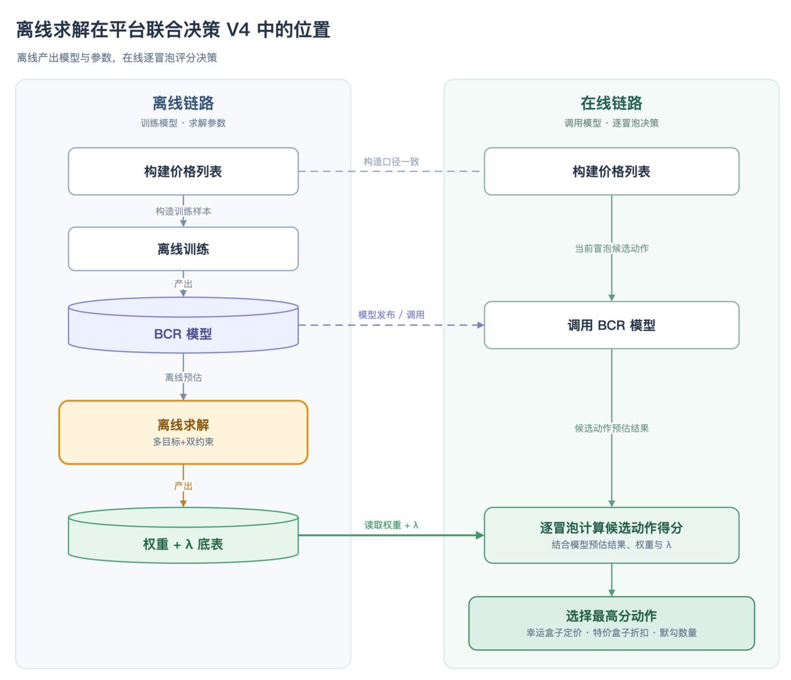
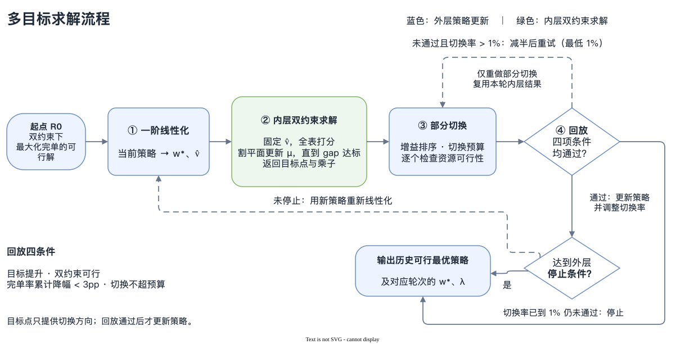
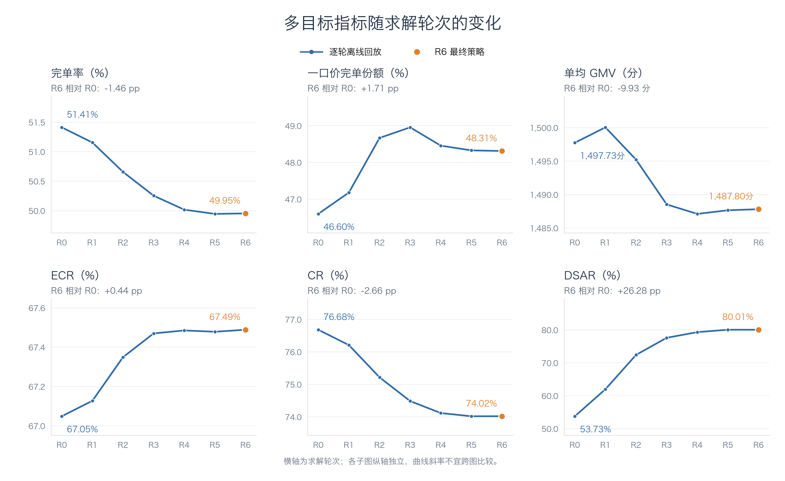
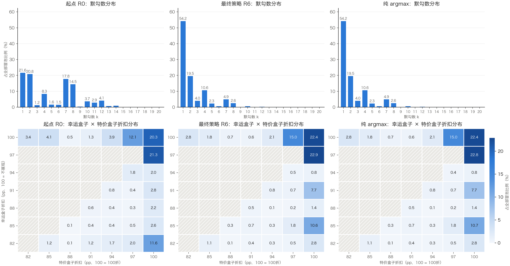

# 【LR26-043】乘客与增长-表单策略-平台联合决策V4离线规划求解-V1.0

[Cooper 原文](https://cooper.didichuxing.com/knowledge/2199610335356/2209798651511)

## 基础信息

| 项目   | 内容   |
| --- | --- |
| BRD 文档链接   | [【BRD】平台补贴与流量联合决策 V4](https://cooper.didichuxing.com/knowledge/2199610335356/2208200715557)   |
| 最后通过的策略方案链接   | [平台联合决策 V4.0](https://cooper.didichuxing.com/knowledge/2199610335356/2208338685656)   |
| 实验链接（评估大师）   | 无，离线类LR   |
| 核心贡献点   | - 策略部历史策略多为单目标线性问题，本文对**非线性多目标****双约束****问题**进行求解：将冒泡完单率、一口价份额、单均 GMV、ECR、CR、DSAR 六项比率目标求解转为“**外层一阶泰勒线性化** → **内层约束求解** → 限制切换比例 → 回放验证”的迭代流程（§3.2～3.3）；外层计算并输出边际权重；内层复用基于割平面法的双约束求解器，输出两个约束乘子；离线回放验证目标改善程度与约束满足程度（§4）。   - 离线回放表明，最终策略在严格满足特价盒子补贴率与幸运盒子水位下限约束下，综合目标 $$F$$ vs 起始策略提升 7.45%    |
| 第一贡献人   | 詹传赞   |
| 共同贡献人   | 陈嘉曦、周之烁   |
| 后续策略负责人   | 陈嘉曦   |

**一页速览**

- 求什么：为约 310 万个冒泡各选一个联合动作，在补贴率与幸运盒子水位下限约束下最大化六项比率加权的综合目标 $$F$$。

- 方法主线：在当前策略处线性化 $$F$$ → 内层求解带约束的线性目标 → 限制每轮动作切换量 → 回放 $$F$$，满足收益与约束条件才接受 → 输出边际权重与乘子。

- 前置工作：双约束提供多目标内层求解器及起始策略 R0。正文简述基础求解与多目标的关系（§3.1）。

- 产出与结果：输出边际权重 $$w_*$$、乘子 $$\lambda$$；最终策略 R6 综合目标 $$F$$ 提升 7.45%（1.49 → 1.60），冒泡完单率降幅 1.46pp，离线策略资源全部可行（§4）。

---

## 1 背景

### 1.1 现状与问题

[平台联合决策 V4.0](https://cooper.didichuxing.com/knowledge/2199610335356/2208338685656) 在冒泡粒度上联合决策「幸运盒子定价、特价盒子折扣、默勾数量」。

- **优化目标**：以提升长期完单为核心目标，将冒泡完单率、一口价份额、单均 GMV、冒泡呼叫率（ECR）、呼叫完单率（CR）和默勾接受度（DSAR）加权组合，构建**长期完单的代理目标**。同时，能够支持根据阶段性业务诉求调整代理指标的权重，例如在接受一定完单损失的前提下提升 CR。

- **约束条件**：同时满足特价盒子补贴率上限和幸运盒子水位下限的要求。

该问题可定义为如下。其中，N为冒泡数，X为预期完单数，Y为一口价完单数，G为真GMV，H为呼叫数，D为默勾接受呼叫数。

$$\begin{aligned} \max_Z\quad &F(Z)=\frac{X}{N}+a_0\frac{Y}{X}+a_1\frac{G}{X}+a_2\frac{H}{N}+a_3\frac{X}{H}+a_4\frac{D}{H}\\ \mathrm{s.t.}\quad &\sum_{j\in\mathcal J_i}z_{ij}=1,\quad z_{ij}\in\{0,1\},\quad\forall i,\\ &\Gamma^c_g(Z)\le0,\quad\Gamma^r_g(Z)\le0,\quad\forall g. \end{aligned}$$

**由于该问题是非线性多目标优化问题，无法直接沿用此前以最大化完单为目标的单目标优化方法。**

符号表（点击展开）
| 符号   | 含义   |
| --- | --- |
| $$i,N$$；$$j,\mathcal J_i$$   | 冒泡编号、总数；联合动作编号、冒泡 $$i$$ 的可行动作集合   |
| $$z_{ij},Z$$   | 是否选择动作 $$j$$ 的 0-1 变量；全体冒泡的决策策略   |
| $$X,Y,G,H,D$$   | 选中动作汇总的预期完单数、一口价完单数、真 GMV、呼叫数、默勾接受呼叫数   |
| $$F(Z)$$；$$a_0\sim a_4$$   | 六项比率加权目标；份额、单均 GMV、ECR、CR、DSAR 的权重，冒泡完单率权重为 1   |
| BCR、ECR、CR、DSAR   | 冒泡完单率 $$X/N$$、冒泡呼叫率 $$H/N$$、呼叫完单率 $$X/H$$、默勾接受度 $$D/H$$；小写 $$bcr,ecr,dsar$$ 表示动作级预测概率   |
| $$Z^0,Z^{\mathrm{final}},X_{R0}$$   | 起始策略 R0、最终策略、R0 的预期完单数   |
| $$g$$   | 约束分组，本次全国合并为一组   |
| $$\alpha,\beta$$   | 补贴率上限、幸运盒子水位下限，本次分别为 $$2.00\times10^{-3}$$（0.20pp）、$$0.94$$   |
| $$c_{ij},r_{ij}$$；$$\Gamma^c_g,\Gamma^r_g$$   | 逐动作补贴率、幸运盒子水位下限约束残差；组内选中动作残差之和，$$\le0$$ 表示可行   |
| $$S^c_g,S^r_g$$；$$\tilde\Gamma^c,\tilde\Gamma^r$$   | 冻结的残差归一化尺度；原始残差除以对应尺度   |
| $$\varepsilon$$   | 归一化残差的可行性容差，本次为 $$10^{-6}$$   |
| $$w_*,\hat v_{ij}$$   | $$F$$ 对各聚合量的边际权重、逐动作线性综合价值   |
| $$\lambda=(\lambda_c,\lambda_r)$$   | 补贴率、幸运盒子水位下限约束的乘子   |
| $$\arg\max$$   | 取使分数最大的动作   |
| $$D_{\mathrm{best}},LB$$   | 历史最低对偶值、割平面主问题给出的区间内对偶下界   |
| LP、MILP；pp   | 线性规划、混合整数线性规划；百分点   |

### 1.2 原因：多目标不能一次打分求解

综合目标 $$F$$ 是多项比率的非线性函数，直接求解面临约 4.25 亿个 0-1 变量的规模问题。固定乘子后，线性目标可以分解为逐冒泡打分取 $$\arg\max$$；但多目标还需要处理全局比率变化，且线性近似只在当前策略附近可信。

因此，本算法**以双约束求解器为内层，外层逐轮线性化** $$F$$**、限制动作切换量，并用目标回放决定是否接受。最终保留历史轮次中可行且** $$F$$ **最高的策略。**

### 1.3 本次定位

本次提出多目标求解框架，并对目标构造、迭代机制与参数输出、前置工作进行简述。本文验证离线环境下的目标改善、约束可行性、求解收敛与上界保证。

下图标出离线求解器在 V4 决策链路中的位置。离线求解器产出全局边际权重与乘子，线上按冒泡实时打分，选择幸运盒子定价、特价盒子折扣与默勾数量。

---

## 2 目标 & 约束

baseline：特价盒子补贴率上限为 0.20pp、幸运盒子水位下限为 94% 的双约束单目标问题（R0）最优解

本算法：双约束相同，目标为非线性加权目标 $$F$$ ；探索求解算法，评估 $$F$$ 相对 R0 的改善，同时验证约束满足程度

| 模块   | 指标   | 说明   | 备注   |
| --- | --- | --- | --- |
| 目标   | 非线性加权目标 $$F$$ 提升   | $$F(Z^{\mathrm{final}})>F(Z^0)$$  - 为避免过度偏离主目标，实现时对冒泡完单率降幅添加额外约束，如冒泡完单率降幅 $$(X_{R0}-X)/N<3$$**pp**    | $$F$$ 按选中动作回放真值，不用线性近似。   |
| 约束   | 策略可行性 / 约束满足程度   | $$\tilde\Gamma^c(Z^{\mathrm{final}})\le\varepsilon$$ 且 $$\tilde\Gamma^r(Z^{\mathrm{final}})\le\varepsilon$$（$$\varepsilon=10^{-6}$$）   | $$\tilde\Gamma^c\le\varepsilon$$ 表示补贴率不超过 0.20pp 上限，$$\tilde\Gamma^r\le\varepsilon$$ 表示幸运盒子实付水位不低于 94% 下限   |

本文所有指标均在离线回放环境下定义与评估；当前参数采用离线实验档位。$$\alpha$$ 为实验档位 0.20pp、$$\beta$$ 为统一固定幸运盒子水位下限 94% 口径。求解精度与可信性验收见 §4.4。

---

## 3 技术方案

**前置总结**

- 双约束提供基线与内层能力（§3.1）；多目标在相同约束下，将目标从预期完单 $$X$$ 扩展为综合目标 $$F$$（§3.2）。

- 外层按“线性化 → 内层求解 → 限制切换 → 回放”迭代（§3.3），最终保留历史上可行且 $$F$$ 最高的策略。

- 输出边际权重与两个约束乘子（§3.4）；$$F$$ 改善与内层对偶收敛分别评估。

### 3.1 基础求解与多目标的关系

| 阶段   | 目标与约束   | 求解方式   | 在多目标中的作用   |
| --- | --- | --- | --- |
| 单约束（1 目标 1 约束）   | 最大化完单 $$X$$；补贴率不超过 $$\alpha$$   | 残差随自身乘子单调不增，用一维二分找到可行侧乘子，逐冒泡取 $$\arg\max$$   | 提供最基础的求解与基线   |
| 双约束（1 目标 2 约束）   | 最大化完单 $$X$$；补贴率不超过 $$\alpha$$，幸运盒子水位下限不低于 $$\beta$$   | 归一化后用割平面（level bundle）搜索对偶低点   | 提供起始策略 R0 与内层求解器   |
| 多目标（6 目标 2 约束）   | 目标为六项比率加权 $$F$$；约束同双约束（补贴率上限 + 幸运盒子水位下限）   | 一阶线性化后复用内层，限制动作切换量并回放目标   | 本文重点：处理非线性目标与可执行参数之间的转换   |

前置工作共用“固定乘子 → 全表打分 → 逐冒泡 $$\arg\max$$ → 聚合目标与残差”的计算流程。

符号表（点击展开）
| 模块   | 符号   | 含义   |
| --- | --- | --- |
| **动作空间与策略迭代**   | $$a \in \{0,\ldots,27\}$$   | 折扣组合索引（幸运盒子折扣 $$\times$$ 特价盒子折扣，共 28 档组合）   |
| $$k \in \{1,\ldots,20\}$$ / $$m_j$$   | 默勾位编号 / 默勾数量（$$m_j = k$$）   |
| $$d^l_j, d^u_j$$   | 幸运盒子折扣实付比例、特价盒子折扣实付比例（$$0\sim 1$$ 比例；$$d^l_j=1$$ 即 100pp 表示幸运盒子不展现）   |
| $$j(i)$$   | 冒泡 $$i$$ 选中的联合动作   |
| $$Z^t, Z^{t+1}, Z^{\arg\max}$$   | 第 $$t$$ 轮策略 / 第 $$t+1$$ 轮候选策略 / 乘子打分取最优得到的全量目标点策略   |
| $$j^t(i), j^{\arg\max}(i)$$   | 第 $$t$$ 轮冒泡 $$i$$ 的选中动作 / 该轮内层求解目标点动作   |
| $$\mathcal S$$   | 外层单轮实际发生动作切换的冒泡集合（$$\mathcal S = \{i \mid j^{t+1}(i) \ne j^t(i)\}$$）   |
| **模型预测通道与价格量**   | $$f^{l,\mathrm{raw}}, f^{u,\mathrm{raw}}, f^{o,\mathrm{raw}}$$   | 模型预测通道：条件于完单的幸运盒子、特价盒子、其它品类原始份额（通道 3、4、5）   |
| $$\tilde f^l, \tilde f^u, \tilde f^o$$   | 生效品类份额（$$\tilde f^l = f^{l,\mathrm{raw}}\mathbf{1}(d^l < 1)$$，特价与其它不重归一）   |
| $$\phi$$   | 完单条件下幸运盒子 + 特价盒子一口价合计份额（$$\phi = \tilde f^l + \tilde f^u$$）   |
| $$g^{o,\mathrm{raw}}$$   | 模型预测其它品类 GMV（元，通道 6，乘 100 换算为分）   |
| $$p^{u'}_i, p^u_i, \hat p^l_i$$   | 特价盒子前置券后基价、特价盒子应付基价、幸运盒子假应付基价 GMV（分）   |
| $$P^u_{ij}, P^l_{ij}$$   | 动作级特价盒子实付、幸运盒子实付最终金额（分）   |
| $$cost_{ij}$$   | 完单条件下特价 C 补金额（分，$$cost_{ij} = \tilde f^u_{ij} p^{u'}_i (1 - d^u_j)$$）   |
| $$\widehat{gmv}_{ij}$$   | 完单条件下假 GMV（分，补贴率分母）   |
| $$\widetilde{gmv}_{ij}$$   | 完单条件下预期真 GMV（分，多目标 GMV 项）   |
| $$I_i$$   | 冒泡是否具备幸运盒子展现资格（布尔指示变量）   |
| **多目标权重与增量指标**   | $$\bar a_1, (G/X)_{R0}$$   | 业务未归一化 GMV 权重参数 / 起始点 R0 单均真 GMV（分，用于 $$a_1 = \bar a_1 / (G/X)_{R0}$$ 缩放）   |
| $$w_X, w_Y, w_G, w_H, w_D$$   | 综合目标 $$F$$ 对各聚合量 $$(X,Y,G,H,D)$$ 的偏导数（全局边际权重各分量，全国一套）   |
| $$\Delta F_{\mathrm{pred}}, \Delta F_{\mathrm{act}}$$   | 外层单轮综合目标一阶线性预测增量 / 回放增量   |
| $$\eta$$   | 线性近似可信度比值（$$\eta = \Delta F_{\mathrm{act}} / \Delta F_{\mathrm{pred}}$$，指导自适应调整步长）   |
| $$(X_{R0} - X)/N$$   | 相对起始策略 R0 的累计冒泡完单率降幅（业务约束 $$<3$$pp）   |
| **约束归一化与回放量**   | $$w_g$$   | 组 $$g$$（城市 $$\times$$ 日期类型）的历史实际加权幸运盒子基线水位（$$\sum p^{u'} d^l / \sum p^{u'} d^u$$）   |
| $$\tilde c_{ij}, \tilde r_{ij}$$   | 归一化逐动作残差（$$\tilde c = c / S^c, \tilde r = r / S^r$$）   |
| $$\rho$$ / $$w^{\mathrm{sel}}$$   | 业务意义实际补贴率回放值 / 选中动作加权幸运盒子实付水位回放值   |
| **内层求解、对偶与切换预算**   | $$\mu = (\mu_c, \mu_r)$$   | 归一化坐标对偶乘子向量（割平面求解变量）   |
| $$\mu^*, \hat\lambda$$   | 内层求解对偶最优解（归一化坐标 / 换算后的原始坐标）   |
| $$\mu_c^*, \mu_r^*, \hat\lambda_c, \hat\lambda_r$$   | 补贴率约束、幸运盒子水位下限约束的最优乘子分量（本次幸运盒子水位下限参与优化，$$\hat\lambda_r > 0$$）   |
| $$D(\mu)$$ / $$D_B, D_A$$   | 拉格朗日对偶函数 / 方案 B（割平面主流程）与方案 A（独立复核）对偶目标值   |
| $$B_k$$   | 内层割平面第 $$k$$ 维搜索区间范围（从第 2 轮起热启动继承并倍增更新）   |
| $$\mathrm{level}, \kappa$$   | level bundle 割平面投影水平集参数与步长比例系数（$$\kappa = 0.50$$）   |
| $$\Delta score_i$$   | 冒泡 $$i$$ 目标动作相对当前动作的拉格朗日分数增量（切换筛选与降序排序依据）   |
| $$\rho_{\mathrm{sw}}$$   | 外层单轮最大动作切换率上限比例（初值 10%，范围 $$[1\%, 20\%]$$）   |
| $$Q$$   | 外层单轮最大允许切换冒泡数预算（$$Q = \lfloor\rho_{\mathrm{sw}} N\rfloor$$）   |
| **其他**   | MCKP   | Multiple-Choice Knapsack Problem，多选择背包问题   |
| HiGHS   | 来自 scipy 的高性能数学规划求解器（用于小样本 LP / MILP 的 Ground truth 对照及割平面主问题求解）   |

### 3.2 多目标问题定义与权重

- 决策空间：每个冒泡 $$i$$ 在可行决策集 $$\mathcal J_i$$ 中恰选一个联合动作 $$j=(a,k)$$

	- $$a\in\{0,\ldots,27\}$$ 为折扣组合（幸运盒子折扣 × 特价盒子折扣，幸运盒子折扣 $$d^l_j=1$$ 表示不展现）

	- $$k\in\{1,\ldots,20\}$$ 为默勾位

	-  $$\mathcal J_i$$由前置业务剪枝确定有效候选集合，求解器直接在可行集上决策。

$$z_{ij}\in\{0,1\},\qquad\sum_{j\in\mathcal J_i}z_{ij}=1,\qquad\forall i\in\mathcal I$$

- 全局聚合量：给定全体决策 $$Z$$，选中动作记 $$j(i)$$，聚合量如下

| 量   | 定义   | 业务意义   |
| --- | --- | --- |
| $$X$$   | $$\sum_i bcr_{i,j(i)}$$   | 预期完单；$$X/N$$ 为冒泡完单率   |
| $$Y$$   | $$\sum_i bcr_{i,j(i)}\,\phi_{i,j(i)}$$，$$\phi=\tilde f^l+\tilde f^u$$   | 一口价完单；$$Y/X$$ 为份额   |
| $$G$$   | $$\sum_i bcr_{i,j(i)}\,\widetilde{gmv}_{i,j(i)}$$   | 真 GMV；$$G/X$$ 为单均 GMV   |
| $$H$$   | $$\sum_i ecr_{i,j(i)}$$   | 呼叫数；$$H/N$$ 为 ECR，$$X/H$$ 为 CR   |
| $$D$$   | $$\sum_i ecr_{i,j(i)}\,dsar_{i,j(i)}$$   | 默勾接受呼叫；$$D/H$$ 为 DSAR   |

- 约束：两条全局约束均可写成对 $$z$$ 线性的残差 $$\le0$$ 形式，系数逐动作预计算

	- 其中 $$cost_{ij}=\tilde f^u_{ij}p^{u'}_i(1-d^u_j)$$ 为完单条件下的特价 C 补，$$\widehat{gmv}_{ij}$$ 为完单条件下假 GMV，$$P^{u}_{ij},P^{l}_{ij}$$ 为动作级特价盒子 / 幸运盒子最终实付，$$I_i$$ 为冒泡是否具备幸运盒子展现能力。

| 约束   | 业务意义   | 残差系数   |
| --- | --- | --- |
| 补贴率   | 特价盒子补贴额 / 预期假 GMV $$\le\alpha$$   | $$c_{ij}=bcr_{ij}\bigl(cost_{ij}-\alpha\,\widehat{gmv}_{ij}\bigr)$$   |
| 幸运盒子水位下限   | 幸运盒子实付 $$\ge\beta\times$$ 特价盒子实付   | $$r_{ij}=I_i\bigl(\beta_i P^{u}_{ij}-P^{l}_{ij}\bigr)$$   |

- 完整问题： 目标为综合目标 $$F$$，约束为补贴率上限与幸运盒子水位下限。

$$\begin{aligned} \max_{Z}\quad&F(Z)=\frac{X}{N}+a_0\frac{Y}{X}+a_1\frac{G}{X}+a_2\frac{H}{N}+a_3\frac{X}{H}+a_4\frac{D}{H}\\ \mathrm{s.t.}\quad&\sum_{j\in\mathcal J_i}z_{ij}=1,\ \forall i;\qquad\Gamma^c_g(Z)\le0,\ \Gamma^r_g(Z)\le0,\ \forall g;\qquad z_{ij}\in\{0,1\} \end{aligned}$$

其中：

- $$\Gamma^c_g(Z)=\sum_{i\in g}\sum_{j\in\mathcal J_i}z_{ij}c_{ij}=\sum_{i\in g}c_{i,j(i)}$$ 为组 $$g$$ 补贴率累加残差，$$\le0$$ 表示满足约束；

- $$\Gamma^r_g(Z)=\sum_{i\in g}\sum_{j\in\mathcal J_i}z_{ij}r_{ij}=\sum_{i\in g}r_{i,j(i)}$$ 为组 $$g$$ 幸运盒子水位下限累加残差，$$\le0$$ 表示满足约束。

### 3.3 多目标求解流程

**比率目标的边际价值随策略变化，因此需以当前策略为基准做局部线性化。** 起始策略 R0 取前置双约束最大化完单得到的可行解（满足补贴率上限与幸运盒子水位下限）。从 R0 出发，每轮基于当前策略求局部改进方向，再用回放决定是否更新策略。

求解流程图
**外层负责改进真实目标，内层负责在本轮固定的线性目标下寻找切换方向。**

内层目标点 $$Z^{\arg\max}$$ 不直接成为下一轮策略；外层回放通过才接受更新。回放拒绝时复用本轮内层结果，只缩小切换量重试。接受与停止条件见 §3.3.4，内层失败处理见 §3.3.2。

外层求解可视化演示
[outer_explainer.html](附件/LR26-043/003.html)

#### 3.3.1 外层：一阶泰勒线性化：把全局比率转为逐动作价值

一阶泰勒近似：在当前策略 $$Z^t$$（其中 $$t$$ 为外层迭代轮次）附近，用“当前值 + 偏导数 × 变化量”近似 $$F$$，忽略二阶及更高阶项：

$$\begin{aligned}F(Z)\approx F(Z^t)&+w_X(X-X^t)+w_Y(Y-Y^t)\\&+w_G(G-G^t)+w_H(H-H^t)+w_D(D-D^t).\end{aligned}$$

先用当前策略确定各聚合量的边际价值，再据此计算每个候选动作的线性价值。在 $$Z^t$$ 处取聚合量 $$(X^t,Y^t,G^t,H^t,D^t)$$，对 $$F$$ 求偏导得五个全局边际权重：

$$w_X=\frac1N-\frac{a_0Y^t+a_1G^t}{(X^t)^2}+\frac{a_3}{H^t},\quad w_Y=\frac{a_0}{X^t},\quad w_G=\frac{a_1}{X^t},\quad w_H=\frac{a_2}{N}-\frac{a_3X^t+a_4D^t}{(H^t)^2},\quad w_D=\frac{a_4}{H^t}$$

本轮中，当前策略 $$Z^t$$ 与边际权重 $$w_*$$ 固定。忽略二阶及更高阶项，一阶泰勒展开可写为：

$$\begin{aligned}F(Z)\approx{}&F(Z^t)+w_X(X-X^t)+w_Y(Y-Y^t)\\&+w_G(G-G^t)+w_H(H-H^t)+w_D(D-D^t)\\={}&\bigl[F(Z^t)-w_XX^t-w_YY^t-w_GG^t-w_HH^t-w_DD^t\bigr]\\&+w_XX+w_YY+w_GG+w_HH+w_DD.\end{aligned}$$

其中，常数项

$$C_t=F(Z^t)-w_XX^t-w_YY^t-w_GG^t-w_HH^t-w_DD^t$$

与待优化的决策 $$Z$$ 无关，剔除它不影响本轮线性子问题的最优解。将 §3.2 的聚合量求和式代入剩余部分，得到：

$$\begin{aligned}&w_XX+w_YY+w_GG+w_HH+w_DD\\&=\sum_i\sum_{j\in\mathcal J_i}z_{ij}\Bigl(w_Xbcr_{ij}+w_Ybcr_{ij}\phi_{ij}+w_Gbcr_{ij}\widetilde{gmv}_{ij}\\&\qquad\qquad\qquad+w_Hecr_{ij}+w_Decr_{ij}dsar_{ij}\Bigr).\end{aligned}$$

括号内即为 $$z_{ij}$$ 的系数，记为逐动作线性价值 $$v_{ij}$$。由于 $$N>0$$，将目标整体乘 $$N$$ 不改变最优解，因此定义 $$\hat v_{ij}=Nv_{ij}$$，使其与 $$bcr$$ 同量级，作为内层目标系数：

$$\hat v_{ij}=N\bigl(w_X\,bcr_{ij}+w_Y\,bcr_{ij}\phi_{ij}+w_G\,bcr_{ij}\widetilde{gmv}_{ij}+w_H\,ecr_{ij}+w_D\,ecr_{ij}dsar_{ij}\bigr)$$

$$F(Z)-F(Z^t)\approx\frac1N\sum_i\bigl(\hat v_{i,j(i)}-\hat v_{i,j^t(i)}\bigr)$$

$$w_*$$ 每轮用 $$Z^t$$ 重算，全国一套。迭代中 $$w_H$$ 可以为负：呼叫增加会稀释 CR 与 DSAR，稀释效应超过 ECR 项收益时 $$w_H<0$$。

#### 3.3.2 内层：割平面法双约束求解：在约束下寻找切换方向

在此前的双约束求解下目标系数换成 $$\hat v_{ij}$$，两条约束 $$\Gamma^c,\Gamma^r\le0$$ 保持不变。求解以下对偶问题：

$$\min_{\mu\ge0}D(\mu),\qquad D(\mu)=\sum_i\max_{j\in\mathcal J_i}\bigl(\hat v_{ij}-\mu_c\tilde c_{ij}-\mu_r\tilde r_{ij}\bigr)$$

尺度归一化残差（点击展开）
用冻结参考尺度归一化残差：$$\tilde c=c/S^c$$、$$\tilde r=r/S^r$$，原始坐标乘子为 $$\lambda=\mu/S$$。

固定乘子后，每个冒泡独立取 $$\arg\max$$；一次全表扫描同时得到对偶值与资源残差，供割平面更新。割平面用区间内下界 $$LB$$ 与当前最低对偶值判断收敛，相对 gap 约束为 $$2\times10^{-5}$$。

相较于最大化完单的双约束内层，多目标有两处迭代处理：

- 热启动：从第 2 轮起继承上一轮的乘子 $$\mu^{t-1}$$ 与搜索区间 $$B_k\leftarrow\max(B_k,B_k^{t-1},2\mu_k^{t-1})$$，但**丢弃全部旧割**——$$\hat v_{ij}$$ 随 $$w_*$$ 变化，旧割描述的是另一个对偶函数。

- 内层失败处理：两次（45 + 90 轮）未收敛记为失败，本轮不产生切换；失败轮占比超 5% 整个外层停止。

用 $$\mu^*_B$$ 逐冒泡 $$\arg\max$$ 得本轮切换目标点 $$Z^{\arg\max}$$。

内层求解可视化演示
[explainer.html](附件/LR26-043/004.html)

#### 3.3.3 外层：限制切换：控制线性近似的使用范围

一阶近似只在 $$Z^t$$ 附近可信，一次只切换一部分冒泡。

1. 对 $$j^{\arg\max}(i)\ne j^t(i)$$ 的冒泡算拉格朗日分数增量 $$\Delta score_i=\Delta\hat v_i-\mu^*_c\Delta\tilde c_i-\mu^*_r\Delta\tilde r_i$$；

2. 切换上限 $$Q=\lfloor\rho_{\mathrm{sw}}N\rfloor$$，$$\rho_{\mathrm{sw}}$$ 初值 **10%**，范围 $$[1\%,20\%]$$；

3. 只保留 $$\Delta score_i>0$$ 的冒泡，按分数降序逐个尝试；每次接受前检查更新后的残差 $$\tilde\Gamma^c+\Delta\tilde c_i\le\varepsilon$$ 且 $$\tilde\Gamma^r+\Delta\tilde r_i\le\varepsilon$$（$$\varepsilon=10^{-6}$$），并直接检查全国幸运盒子实付水位 $$\ge94\%$$，不通过则跳过；切满 $$Q$$ 即停。

因超约束被跳过与因切换满额未切的冒泡分别计数。预测收益 $$\Delta F_{\mathrm{pred}}=\frac1N\sum_{i\in\mathcal S}\Delta\hat v_i$$。

#### 3.3.4 外层：回放：接受、调整步长与停止

回放候选 $$Z^{t+1}$$ 的 $$F$$，**四条同时成立才接受**：

| #   | 条件   | 说明   |
| --- | --- | --- |
| 1   | $$\Delta F_{\mathrm{act}}=F(Z^{t+1})-F(Z^t)>0$$   | 原始目标必须有提升   |
| 2   | $$\tilde\Gamma^c(Z^{t+1})\le\varepsilon$$ 且 $$\tilde\Gamma^r(Z^{t+1})\le\varepsilon$$；全国幸运盒子实付水位 $$\ge94\%$$   | 约束可行   |
| 3   | $$(X_{R0}-X(Z^{t+1}))/N<3$$pp   | 相对固定起始点 R0 的累计冒泡完单率降幅，恰好 3pp 不接受   |
| 4   | $$\lvert\mathcal S\rvert\le\rho_{\mathrm{sw}}N$$   | 切换量不超切换上限   |

步长自适应：$$\eta=\Delta F_{\mathrm{act}}/\Delta F_{\mathrm{pred}}$$ 衡量线性近似可信度，按下表调整单轮切换率上限。

| 回放情况   | 调整方式   |
| --- | --- |
| 接受，且 $$\eta>0.75$$、切换顶格（$$\lvert\mathcal S\rvert\ge0.95Q$$）   | $$\rho_{\mathrm{sw}}$$ 翻倍，上限 **20%**   |
| 接受，且 $$\eta<0.25$$   | $$\rho_{\mathrm{sw}}$$ 减半   |
| 被拒绝   | $$\rho_{\mathrm{sw}}$$ 减半，只重跑切换步，不重跑线性化与内层   |
| 减到 1% 仍被拒绝   | 停止，停因为“无可行改进”   |

其他停止条件：轮数上限 10、$$\Delta F_{\mathrm{act}}<10^{-8}$$、本轮实际切换率 $$<3\%$$、连续 3 轮无更优可行解。

最终策略取历史轮次中**可行且** $$F$$ **最高者**。

### 3.4 外层：输出参数与策略回放

求解输出生成最终策略那一轮的 5 个边际权重 $$w_*$$、冒泡数 $$N$$、2 个约束乘子 $$(\lambda_c,\lambda_r)$$，以及对应的 $$(\alpha,\beta)$$ 参数快照。乘子由归一化坐标换回原始坐标，$$\lambda=\mu/S$$。按冒泡打分的形式为：

$$j(i)=\arg\max_{j\in\mathcal J_i}\Bigl(\underbrace{N\bigl(w_X bcr+w_Y bcr\,\phi+w_G bcr\,\widetilde{gmv}+w_H ecr+w_D ecr\,dsar\bigr)_{ij}}_{\hat v_{ij}}-\lambda_c c_{ij}-\lambda_r r_{ij}\Bigr)$$

内层求解只针对**冻结线性化目标**，其收敛不证明非线性 $$F$$ 全局最优。参数来源与调整机制如下：

| 参数   | 来源   | 可变否   |
| --- | --- | --- |
| $$\alpha$$   | 业务给定补贴率上限（实验档位 0.20pp）   | 可变   |
| $$\beta_g$$   | 统一固定为 0.94，按全国汇总约束，不设幸运盒子水位上限   | 可变   |
| $$a_0\sim a_4$$   | 业务权重，$$a_1$$ 按起始点单均 GMV 归一化   | 可变   |
| $$\lambda,w_*$$   | 求解器输出   | 不可手调   |
| $$\varepsilon,\rho_{\mathrm{sw}}$$ 等   | 求解器数值参数   | 固定   |

### 3.5 多目标求解的时空复杂度

复杂度公式中的符号说明如下：

| 符号   | 含义   |
| --- | --- |
| $$N$$   | 冒泡样本总数；本次为 3,102,306   |
| $$M$$   | 每个冒泡的联合动作列数；本次为 $$28\times20=560$$，因此全表规模为 $$NM$$   |
| $$K$$   | 单轮外层中，内层对偶评估及主问题求解的次数上限；含失败后的重试，$$K\le45+90=135$$   |
| $$T$$   | 外层迭代轮数，$$T\le10$$；保留各轮策略需存储 $$TN$$ 个动作编号   |

| 阶段   | 时间复杂度   | 空间复杂度   | 说明   |
| --- | --- | --- | --- |
| 逐动作系数预计算（$$bcr,\phi,\widetilde{gmv},ecr,dsar,c_{ij},r_{ij}$$）   | $$O(NM)$$   | $$O(NM)$$   | $$N$$ 为冒泡数，$$M=560$$ 为联合动作列数；全流程只做一次   |
| 线性化（§3.3.1）：算 $$w_*$$ 与 $$\hat v_{ij}$$   | $$O(NM)$$   | $$O(NM)$$   | $$w_*$$ 由 5 个聚合量 $$O(1)$$ 得到；$$\hat v_{ij}$$ 全表重算   |
| 内层单次对偶评估：固定 $$\mu$$ 全表打分 + 逐冒泡 $$\arg\max$$ + 聚合   | $$O(NM)$$   | $$O(N)$$   | 一次扫描同时得到 $$D(\mu)$$、残差 $$\tilde\Gamma^c,\tilde\Gamma^r$$ 与选中动作   |
| 内层割平面（§3.3.2）：$$K$$ 次评估 + $$K$$ 次主问题 LP   | $$O(K\,NM+K\cdot\mathrm{LP}(K,2))$$   | $$O(N+K)$$   | $$K\le45+90$$；主问题仅 2 个变量、$$K$$ 条割，LP 开销可忽略   |
| 限制切换（§3.3.3）：算 $$\Delta score_i$$、排序、逐个残差检查   | $$O(NM+N\log N)$$   | $$O(N)$$   | 候选集为 $$j^{\arg\max}(i)\ne j^t(i)$$ 的冒泡；最多切 $$Q=\lfloor\rho_{\mathrm{sw}}N\rfloor$$   |
| 回放（§3.3.4）：按选中动作聚合 $$X,Y,G,H,D$$ 与两条约束   | $$O(N)$$   | $$O(1)$$   | 只读选中动作，不扫全表   |
| 外层单轮   | $$O(K\,NM+N\log N)$$   | $$O(NM)$$   | 内层割平面主导   |
| 全流程（$$T$$ 轮外层）   | $$O(T\,K\,NM+T\,N\log N)$$   | $$O(NM+TN)$$   | $$T\le10$$；$$TN$$ 为保留历史各轮策略以取“可行且 $$F$$ 最高者”。本次任务耗时  **100.10 分钟（约 1 小时 40 分钟）****，使用CUDA重写求解算子在GPU中运行耗时约 2.23 分钟（2 分 14 秒）**   |

### 3.6 技术选型：多目标方案的取舍

| 候选   | 优势   | 劣势   | 决策   |
| --- | --- | --- | --- |
| 多目标：直接对 $$F$$ 做非线性整数规划   | —   | 不可解   | ➡️ 一阶泰勒 + 外层迭代   |
| 多目标：一步切到 $$\arg\max$$ 点   | 快   | 线性近似在远处失效   | ➡️ 切换率限制 + 回放接受   |
| 内层：三分法求乘子   | 固定另一乘子后，一维对偶函数凸，实现简单   | 坐标三分可能停在非最优折点；仅按区间宽度停止，缺少联合对偶 gap 判据；且求解缓慢，三分约 **99～104 分钟/轮**，割平面约 **9 分钟/轮**，前者耗时约为后者的 **11～12 倍**   | ➡️ 割平面联合搜索，以区间内 gap 判断收敛   |

---

## 4 离线评估

### 4.1 核心结论与评估

**离线最终策略对目标改善与约束达成**。核心对照为双约束最大化完单的起始策略 R0 与多目标最终策略 R6：

- 综合目标 $$F$$ 提升 7.45%（1.49 → 1.60，$$\Delta F=0.11$$）；

	- 冒泡完单率累计降幅 1.46pp；

- 最终策略 R6 严格满足 0.2pp 特价盒子补贴率与 94% 幸运盒子水位下限约束。

### 4.2 评估方案

| 项   | 内容   |
| --- | --- |
| 数据窗口   | 2026-07-08 ～ 2026-07-21，14 天   |
| 规模   | 3,102,306 个冒泡、425,442,858 个有效动作、340 城   |
| 分组   | 全国统一约束（全国所有城市合并为 1 组，共用一套边际权重与约束乘子）   |
| 计算单位   | 折扣与 $$\alpha,\beta$$ 采用 $$0\sim1$$ 比例（配置 pp 除以 100），金额一律以“分”计   |
| 参数档   | $$\alpha = 0.20$$pp；$$\beta \equiv 0.94$$（统一固定幸运盒子水位下限 94%，不设上限）   |
| 多目标权重   | $$a_0=-0.10$$**，**$$a_1=0.20/(G/X)_{R0}$$**，**$$a_2=0.60$$**，**$$a_3=0.20$$**，**$$a_4=0.50$$；起始点为全国统一约束下、补贴率上限为 **0.20pp**、幸运盒子水位下限为 **94%** 的双约束最大化完单解  权重设置：冒泡完单率 $$X/N$$ 的权重固定为 1，其余五项通过 $$a_0\sim a_4$$ 折算到同一标量。$$a_1$$ 用**起始点单均 GMV 归一化**（$$a_1=\bar a_1/(G/X)_{R0}$$），使 GMV 项在起始点的量级与其他比率项相当，避免"分"计的 GMV 压过其他项、诱导求解器少接低价单抬均价。   |
| 基线   | 核心对照为起始点 R0；多目标 $$a_*=0$$ 退化回归   |
| Ground truth   | HiGHS LP / MILP 小样本对照（2026-07-21 × city 85 前 40 条 trace，10,040 有效动作）   |

评估以 R0 为基线，在相同补贴率与水位约束下比较多目标策略。

### 4.3 多目标核心结果

#### 4.3.1 业务比率与综合目标

- 下表为起点、外层最终策略与纯 $$\arg\max$$ 策略回放对照。R6 综合目标提升 7.45%，冒泡完单率下降 1.46pp，双约束均满足，长期目标F提升由DSAR提升所驱动。

| 类别   | 量   | 起点 R0   | 最终策略 (R6)   | 纯 $$\arg\max$$   | 图：百分比指标的变化以百分点（pp）表示，单均 GMV 单位为分。   |
| --- | --- | --- | --- | --- | --- |
| 目标项   | $$F$$   | 1.49   | 1.60 (+7.45%)   | 1.60   |    |
| 预期完单 $$X$$   | 1,594,949.66   | 1,549,653.17   | 1,549,640.58   |
| 完单降幅   | 0   | 1.46pp   | 1.46pp   |
| ECR   | 67.05%   | 67.49%   | 67.49%   |
| CR   | 76.68%   | 74.02%   | 74.01%   |
| DSAR   | 53.73%   | 80.01%   | 80.02%   |
| 份额 $$Y/X$$   | 46.60%   | 48.31%   | 48.31%   |
| 单均 GMV   | 1,497.73 分   | 1,487.80 分   | 1,487.75 分   |
| 约束项   | 特价盒子补贴率 $$\rho$$   | 0.20%   | 0.20%   | 0.20%   |
| 幸运盒子水位   | 94.00%   | 94.02%   | 94.00%   |
| 约束残差 $$(\tilde\Gamma^c, \tilde\Gamma^r)$$   | $$(-1.00\times10^{-7}, -1.18\times10^{-7})$$   | $$(-3.96\times10^{-5}, -2.06\times10^{-4})$$   | $$(-3.92\times10^{-5}, 4.53\times10^{-5})$$   |
| 不一致率   | 动作不一致率（vs R6）   | 80.53%   | /   | 0.13%（3,978 / 3,102,306）   |

#### 4.3.2 逐轮目标变化

各轮回放增量均为正且与预测接近，后期收益缩小，目标趋于稳定，求解收敛。

| 轮   | 接受   | $$F$$   | $$\Delta F_{\mathrm{pred}}$$   | $$\Delta F_{\mathrm{act}}$$   | $$\eta$$   |
| --- | --- | --- | --- | --- | --- |
| R0   | 起点   | 1.49   | —   | —   | —   |
| R1   | 是   | 1.53   | 0.04   | 0.04   | 1.00   |
| R2   | 是   | 1.57   | 0.04   | 0.04   | 1.00   |
| R3   | 是   | 1.59   | 0.02   | 0.02   | 1.00   |
| R4   | 是   | 1.60   | 5.86 × 10⁻³   | 5.86 × 10⁻³   | 1.00   |
| R5   | 是   | 1.60   | 2.93 × 10⁻³   | 2.93 × 10⁻³   | 1.00   |
| **R6**   | **是**   | **1.60**   | 1.57 × 10⁻⁴   | 1.57 × 10⁻⁴   | 1.00   |

#### 4.3.3 逐轮切换量与冒泡完单率约束

切换预算一直达到自适应最高值，代表了线性化的非常成功近似了原目标。R6 切换率降至 1.69%，触发低于 3% 的停止条件，外层求解停止；累计冒泡完单率降幅 1.46pp，未触及 3pp 上限。

| 轮   | $$\rho_{\mathrm{sw}}$$   | 预算 $$\lfloor\rho_{\mathrm{sw}}N\rfloor$$   | $$X$$   | 冒泡完单率降幅   | 本轮切换   | 累计切换   | 超约束跳过 / 满额未切   |
| --- | --- | --- | --- | --- | --- | --- | --- |
| R0   | —   | —   | 1,594,949.66   | 0   | 0   | 0   | —   |
| R1   | 10%   | 310,230   | 1,586,973.40   | 0.26pp   | 10.00%   | 10.00%   | 0 / 2,179,957   |
| R2   | 20%   | 620,461   | 1,571,495.85   | 0.76pp   | 20.00%   | 30.00%   | 30,833 / 1,543,215   |
| R3   | 20%   | 620,461   | 1,558,976.34   | 1.16pp   | 20.00%   | 50.00%   | 50,274 / 932,328   |
| R4   | 20%   | 620,461   | 1,551,610.57   | 1.40pp   | 20.00%   | 70.00%   | 49,463 / 347,589   |
| R5   | 20%   | 620,461   | 1,549,392.82   | 1.47pp   | 12.77%   | 80.31%   | 35,922 / 0   |
| **R6**   | **20%**   | **620,461**   | **1,549,653.17**   | **1.46pp**   | **1.69%**   | **80.53%**   | **3,978 / 0**   |

#### 4.3.4 逐轮交付权重与乘子变化

| 线性化起点 → 生成策略   | $$w_X$$（$$10^{-7}$$）   | $$w_Y$$（$$10^{-8}$$）   | $$w_G$$（$$10^{-11}$$）   | $$w_H$$（$$10^{-8}$$）   | $$w_D$$（$$10^{-7}$$）   | $$\hat\lambda_c$$（$$10^{-3}$$）   | $$\hat\lambda_r$$（$$10^{-5}$$）   |
| --- | --- | --- | --- | --- | --- | --- | --- |
| R0 → R1   | 3.22   | -6.27   | 8.37   | -0.95   | 2.40   | 4.24   | 1.16   |
| R1 → R2   | 3.22   | -6.30   | 8.41   | -2.85   | 2.40   | 4.00   | 1.39   |
| R2 → R3   | 3.22   | -6.36   | 8.50   | -5.18   | 2.39   | 3.69   | 0.94   |
| R3 → R4   | 3.22   | -6.41   | 8.57   | -6.31   | 2.39   | 3.69   | 0.94   |
| R4 → R5   | 3.21   | -6.44   | 8.61   | -6.67   | 2.39   | 3.68   | 0.21   |
| R5 → R6   | 3.21   | -6.45   | 8.62   | -6.84   | 2.39   | 3.61   | 0.53   |

表中边际权重表示：在其他聚合量不变时，该量增加对综合目标 $$F$$ 的影响。业务权重 $$a_0\sim a_4$$ 固定，边际权重 $$w_*$$ 随每轮策略重新计算。

**一口价完单量的负权重来自配置。**$$w_Y=a_0/X=-0.10/X<0$$，因此，在总完单量不变时，增加一口价完单量 $$Y$$ 会降低综合目标。负号直接来自当前 $$a_0=-0.10$$ 的配置；若希望正向奖励一口价份额，需要核对该符号与目标口径。

**呼叫量的负权重来自收益与稀释代价的权衡。**对呼叫量 $$H$$ 求偏导：

$$w_H=\underbrace{\frac{a_2}{N}}_{\text{ECR 收益}}-\underbrace{\frac{a_3X+a_4D}{H^2}}_{\text{CR、DSAR 稀释代价}}$$

单独增加 $$H$$ 而完单量 $$X$$、默勾接受呼叫量 $$D$$ 不变，会提高 ECR（$$H/N$$），却降低 CR（$$X/H$$）和 DSAR（$$D/H$$）。本次稀释代价超过 ECR 收益，因此 $$w_H<0$$。在其他条件相同时，已有 DSAR 越高，单独增加呼叫造成的稀释代价越大。

### 4.4 动作分布

起点 R0、最终策略 R6 与纯 $$\arg\max$$ 策略的逐冒泡动作分布并列对照。上排为默勾数分布，下排为幸运盒子 × 特价盒子折扣联合分布（动作空间共 28 个有效折扣组合，斜线格为动作空间外的组合）

| 分布   | 量   | 起点 R0   | 最终策略 (R6)   | 纯 $$\arg\max$$   |
| --- | --- | --- | --- | --- |
| 默勾数   | $$k=1$$   | 21.62%   | 54.15%   | 54.16%   |
| $$k\le 4$$   | 51.99%   | 88.35%   | 88.37%   |
| $$k\ge 7$$   | 44.95%   | 8.78%   | 8.77%   |
| 幸运盒子折扣   | 展现幸运盒子（折扣 $$<100$$pp）   | 54.47%   | 54.47%   | 54.47%   |
| 幸运 82pp、特价100折   | 11.63%   | 2.76%   | 2.77%   |
| 幸运 85pp、特价100折   | 2.59%   | 10.63%   | 10.69%   |
| 幸运 91pp、特价100折   | 2.82%   | 7.69%   | 7.73%   |
| 幸运 97pp、特价100折   | 21.26%   | 22.88%   | 22.78%   |
| 特价盒子折扣   | 特价打折（折扣 $$<100$$pp）   | 37.19%   | 31.35%   | 31.35%   |
| 特价 97pp、不展现幸运   | 12.06%   | 15.03%   | 15.03%   |
| 组合   | 幸运、特价均打折   | 11.93%   | 8.27%   | 8.27%   |
| 幸运不展现且特价100折   | 20.26%   | 22.45%   | 22.45%   |

在各项目标权重处于相同量级时，由于决策对默勾接受度的影响幅度最大，策略更偏向较低的默勾数量，4 勾及以下的占比升至 88.35%。同时，幸运盒子折扣变浅，特价打折比例降至 31.35%。

### 4.5 求解精度与可信性

除核心目标外，次要目标（求解精度）与约束（可信性）的离线验收结果如下：

| 类别   | 检查项   | 约束   | 结果   | 解释   |
| --- | --- | --- | --- | --- |
| 求解精度   | 对偶收敛   | 割平面相对 gap $$(D_{\mathrm{best}}-LB)/\max(1,\lvert D_{\mathrm{best}}\rvert)\le2\times10^{-5}$$   | 各轮内层 gap 均 $$\le1.78\times10^{-5}$$，最终轮 R6 为 $$9.26\times10^{-6}$$   | 区间内收敛   |
| 求解精度   | 小样本 Ground truth   | 对偶值与 HiGHS LP 相对差 $$\le5\times10^{-5}$$；可行解目标值不超过 HiGHS MILP 最优 + 数值容差   | 双约束 0.20pp 档：方案 B 与 HiGHS LP 相对差 $$2.55\times10^{-6}$$，HiGHS LP / MILP 均求得最优解   | 证明求解实现正确   |
| 约束检查   | 退化回归   | 多目标求解器 $$a_0..a_4=0$$ 时，退化为双约束最大化完单且不接受任何切换   | 零权重下 R0 即停，逐位一致且不接受任何切换   | 满足退化一致性   |
| 回放验证   | 最终策略可行性   | $$\tilde\Gamma^c(Z^{\mathrm{final}})\le\varepsilon$$ 且 $$\tilde\Gamma^r(Z^{\mathrm{final}})\le\varepsilon$$（$$\varepsilon=10^{-6}$$）   | 归一化残差 $$\tilde\Gamma^c=-3.96\times10^{-5}$$，$$\tilde\Gamma^r=-2.06\times10^{-4}$$   | 补贴率与水位约束均严格满足   |

内层对偶 gap 与小样本对照误差均达标，零权重回归一致，最终策略满足双约束。

---

## 5 引用和鸣谢

- [【BRD】平台补贴与流量联合决策 V4](https://cooper.didichuxing.com/knowledge/2199610335356/2208200715557)

- [平台联合决策 V4.0](https://cooper.didichuxing.com/knowledge/2199610335356/2208338685656)

- [平台联合决策 V4 规划求解链路-脑暴版](https://cooper.didichuxing.com/knowledge/2199610335356/2207744953684)

- [V4 主流程开发](https://cooper.didichuxing.com/knowledge/2199610335356/2209349658354)

- [最大化完单 · 补贴率 + 幸运盒子水位下限](https://cooper.didichuxing.com/knowledge/2199610335356/2209574319977)

- [最大化综合目标 F · 补贴率 + 幸运盒子水位下限](https://cooper.didichuxing.com/knowledge/2199610335356/2209714050739)

- Zhou, H., Li, S., Jiang, G., Zheng, J., & Wang, D. (2023). [Direct Heterogeneous Causal Learning for Resource Allocation Problems in Marketing](https://arxiv.org/abs/2211.15728). \*AAAI 2023\*.

- Lemaréchal, C., Nemirovskii, A., & Nesterov, Y. (1995). [New variants of bundle methods](https://doi.org/10.1007/BF01585555). \*Mathematical Programming\*, 69, 111–147.

- Palacios-Gomez, F., Lasdon, L., & Engquist, M. (1982). [Nonlinear Optimization by Successive Linear Programming](https://doi.org/10.1287/mnsc.28.10.1106). \*Management Science\*, 28(10), 1106–1120.

感谢嘉曦、之烁老师的全程指导和对文档修改提出的建议！

---

## 6 后续规划

| 方向   | 内容   | 预期收益   |
| --- | --- | --- |
| 平台联合决策V4上线   | 基于[乘客LTV代理指标](https://cooper.didichuxing.com/didocs/2209767036744)给出的目标权重，求解并上线实验   | 长期完单正向   |
| Pareto 前沿搜索   | 将前沿搜索分解为两类子问题：  1. **方向子问题**：在基础资源与冒泡完单率保护约束下，最大化不同目标方向以寻找前沿点；  2. **阈值子问题**：将指标要求线性化为阈值约束，最大化冒泡完单率以定向探索未覆盖区域寻找可行点。   | 业务在“冒泡完单率 vs 份额 / GMV / ECR / CR / DSAR”之间按前沿选点，而不是单点权重，提供完备的多目标离线权衡依据和参数   |

---

## 附录 A：最终策略与纯 $$\arg\max$$ 策略的差异

**差异来自部分切换。** 固定生成最终策略那一轮的权重与乘子，记切换前动作为 $$j_i^t$$、纯 $$\arg\max$$ 动作为 $$j_i^\star$$。候选切换集合为 $$\mathcal C=\{i:j_i^\star\ne j_i^t\}$$，实际接受的切换集合为 $$\mathcal S\subseteq\mathcal C$$，则：

$$j_i^{\mathrm{final}}= \begin{cases} j_i^\star,&i\in\mathcal S,\\ j_i^t,&i\notin\mathcal S, \end{cases} \qquad \text{动作不一致率}=\frac{|\mathcal C\setminus\mathcal S|}{N}.$$

资源检查、切换预算等会使部分候选未被接受，因而最终策略不一定等于纯 $$\arg\max$$。令 $$q_{c,ij}=\tilde c_{ij}$$、$$q_{r,ij}=\tilde r_{ij}$$，直接切换剩余动作后的资源残差为：

$$\tilde\Gamma^k(Z^{\arg\max}) =\tilde\Gamma^k(Z^{\mathrm{final}}) +\sum_{i\in\mathcal C\setminus\mathcal S}\bigl(q_{k,i,j_i^\star}-q_{k,i,j_i^t}\bigr), \qquad k\in\{c,r\}.$$

右侧增量可能耗尽剩余资源余量，因此最终策略可行并不保证纯 $$\arg\max$$ 可行。

**可行策略也不一定能由同一组乘子复现。** 固定 $$\hat v$$，若希望用一组 $$\lambda\ge0$$ 精确复现最终策略，必须同时满足所有冒泡、所有候选动作的得分比较：

$$\hat v_{i,j_i^{\mathrm{final}}}-\hat v_{ij} \ge\lambda_c\bigl(c_{i,j_i^{\mathrm{final}}}-c_{ij}\bigr) +\lambda_r\bigl(r_{i,j_i^{\mathrm{final}}}-r_{ij}\bigr), \qquad\forall i,\ j\in\mathcal J_i.$$

两条汇总约束成立，并不保证这组不等式有解；即使有解，平分时还须选中同一目标动作。因此，内层对偶收敛不能代替策略复现与资源可行性检查。
