# 【LR26-045】创新策略-HHClaw-Agent 质量飞轮体系建设-V1.0

[Cooper 原文](https://cooper.didichuxing.com/knowledge/2199610335356/2209644337487)

# 基础信息

| 项目 <br> | 内容 <br> |
| --- | --- |
| BRD 文档链接 <br> | 文件名称：HHClaw-Agent质量飞轮体系建设 <br>链接：[https://cooper.didichuxing.com/docs2/document/2209972943596](https://cooper.didichuxing.com/docs2/document/2209972943596) <br>密码：336540 <br> |
| 策略方案链接 <br> | 项目内评审 <br>[HHClaw-评估及数据飞轮体系建设-V1](https://cooper.didichuxing.com/knowledge/2199610335356/2209972373062) <br> |
| 实验 / 评估链接 <br> | 无 <br> |
| 核心贡献点 <br> | 1. 建立面向HHClaw真实业务任务的过程与结果评价口径，区分考核Metric、观测Metric <br>2. 形成从LLM初筛、Case（评测用例）生成、人工标注验收到回放复核的真实任务回流流程，持续维护输入、业务预期与评分规则 <br>3. 通过逐Case的执行证据定位共同问题，组织固定范围复验，并分别记录Agent行为变化与评分规则校准的效果 <br> |
| 第一贡献人 <br> | 叶舟 <br> |
| 共同贡献人 <br> | 史方舟、刘孙炎、韩亨昌 <br> |
| 后续策略负责人 <br> | 叶舟 <br> |

# **一、背景**

HHClaw是一个面向宏鹄商家运营使用的智能工作助手（将原宏鹄工作台的功能逐步收拢到这个HHClaw的对话框内），它目前主要支持的功能有两大类：

- 查询类：订单、司机、治理、营销活动、卡券等信息与规则查询

- 数据类：各类经营、财务及司机数据获取、处理、分析与交付

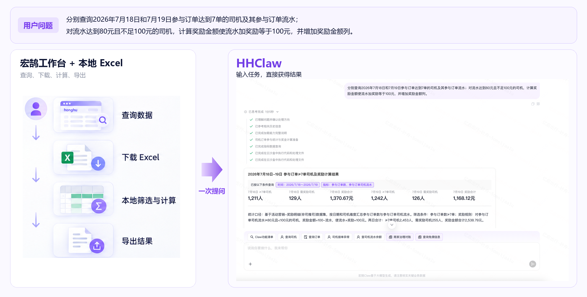

> 图 1：任务操作对比，以司机补奖任务为例，左侧为宏鹄工作台查询、下载、本地计算与导出，右侧为HHClaw在一次提问后的实际执行与结果交付。

由于问题开放、难以预测、任务多样性高，很难在开发阶段穷举构造所有可能的Query（用户输入），这导致早期HHClaw第一版上线内测前，仅能依靠局限的、LLM合成的回归集来进行测试，和用户的实际体感有较大偏差，且缺乏问题回流机制，难以定位具体的优化方向与优先级。因此，**HHClaw需要建设一套“可持续回流、真实可信、可复现、可定位问题、能指导优化”的评估体系，同时观察每次Agent迭代带来的能力增长与在旧任务上的回退，形成一套持续运转的质量飞轮**。

本次V1.0质量飞轮体系的建设，核心会围绕以下三部分内容来展开：

- **评测指标与标准：** 明确业务要求、取证范围和通过条件，维护对合法执行路径的识别。

- **数据筛选与回流：**对线上任务进行筛选、标注、验收与回放，形成可持续维护的评测集。

- **问题定位与分发：**结合分项评分与执行轨迹复核共同原因，明确修复范围和验收条件，持续跟踪受影响任务。

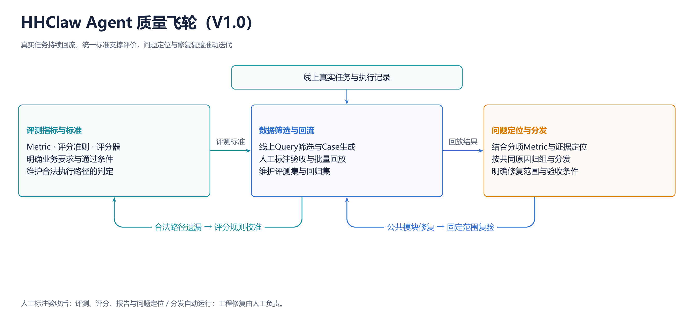

> 图 2：HHClaw-Agent质量飞轮。线上任务经筛选、标注和回放形成评测资产；统一标准支撑表现比较，问题定位、工程修复和固定复验推动下一轮改进。

# 二、目标&约束

### 目标

| 模块 <br> | 目标 <br> | 验收方式 <br> | 是否在DDO内 <br> |
| --- | --- | --- | --- |
| 评测指标与标准 <br> | **评分一致性：**提升人工与LLM评分的一致性，一致率≥70% <br> | - **按人工复核的LLM考核评分判定项，统计与人工一致的比例** <br><br> | 是 <br> |
| 数据筛选与回流 <br> | **能力区分度（定性）：**评测集能够识别历史版本评估中的改善与回退，并呈现分项变化 <br> | - 用共同Case及同输入、同评分配置子集展示改善与回退，并结合Metric与执行证据展示分项评分变化 <br><br> | 否 <br> |
| 问题定位与分发 <br> | **问题定位与修复指导（定性）：**利用Metric与执行证据，形成可定位、可分发、可复验的问题证据 <br> | - 具体问题能够说明偏差位置、直接原因、修复方向、受影响Case，并用固定范围复验报告恢复与剩余问题 <br><br> | 否 <br> |

### 约束

- **自动闭环运行（定性）：**首次筛选、标注和配置验收后，系统自动完成评测执行、评分、报告及问题定位与分发；工程修复由人工承担。

- **报告产出时长：**每轮评测完成后，小于1天生成包含结果汇总、问题聚类、定位结果和分发建议的评估报告。

# 三、技术方案

本章按评测资产的形成与使用顺序展开：3.1定义怎样评价任务，3.2依据这一标准生成并维护真实Case，3.3利用评测结果定位问题并组织修复复验。统一标准让结果可解释，真实Case提供稳定比较对象，问题复验将评测接回工程改进。

## 3.1 评测指标与标准

真实任务进入评测集前，需要先明确怎样判断其结果是否满足用户要求。本节建立统一的评价口径：以业务要求定义Metric和评分规则，用执行证据判断Case是否通过，并通过规则校准持续识别合法执行路径。评估平台按照这套口径展示每条Case的整体结论、分项评分与判定依据。下图展示平台中的Case评分界面，后文进一步介绍各项Metric、评分方式。[HHClaw评估平台](http://eval.intra.xiaojukeji.com/runs/report/2105?tab=phases)

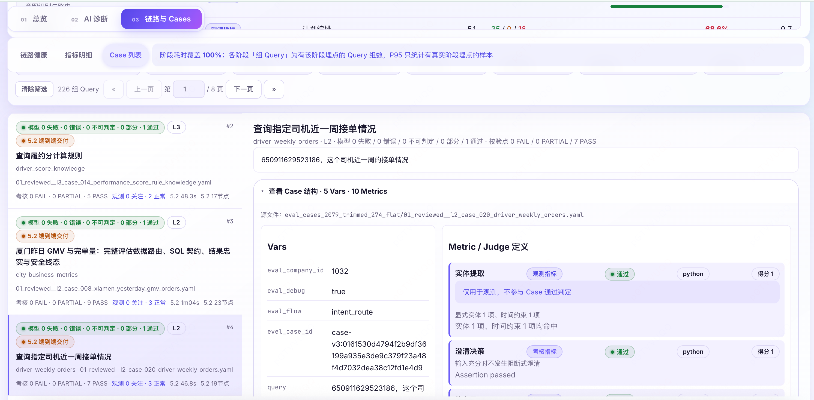

> 评估平台的Case评分界面。左侧展示Case及结果汇总，右侧展示Case配置、分项得分与判定依据。

### 3.1.1 指标与评分

HHClaw面向动态业务数据，Query中的人数、完单量、流水或毛利可能随时间和数据回补而变化。因此，评测不把一次历史数值作为永久答案，而是固定用户要求的对象、日期、数据口径、计算规则和交付目标，再依据本轮执行证据检查实际过程及最终回答。过程验证与结果验证共同支撑正确性判断，不能仅凭调用成功就认定任务完成。

**本期以可回放的真实商家任务集合构成评测基准（Benchmark），每条用例保存任务输入、运行条件和业务预期。在统一评价项下，按用例配置具体评分准则（Rubric），明确业务要求、可接受证据和通过条件。**

评价体系由Metric、Rubric和Grader共同组成。

- **Metric：评价项**，明确要检查的对象，如参数是否正确、结果是否完整。每项判断一个独立命题。

- **Rubric：评分准则**，说明适用条件、业务预期、可接受证据和各档得分要求，并配套配置通过阈值。

- **Grader：评分器**，按评分规则读取证据并执行判定，返回分数、判断依据及异常信息。

	- Python Grader：靠代码校验工具调用、参数和字段等可直接核实的证据

	- LLM Grader：通过LLM的语义理解能力进行判断需要理解语义的内容，如追问是否有效、交付是否完整、回答是否忠于证据

Rubric在统一Metric定义下落实每条Case的具体验收要求。例如，参数绑定检查任务指定的对象、时间和筛选条件，任务完成检查所需的数据、计算结果或文件是否交付。各Case据此明确业务判据、取证范围及通过阈值，供程序或模型评分器执行。

**Metric****分为11项考核和4项观测。考核Metric参与Case通过判定；观测 Metric 记录实体理解、能力召回和执行过程，供后续定位问题。**

为将Metric定义与实际配置对照，下表同时列出后文两个案例的评分方式：**案例一为“江门多口径经营分析”，案例二为“两日司机参与订单筛选与奖励计算”**。

表中配置统一写作“**评分器** **/ 通过阈值**”：Python 表示程序断言（代码规则判断）；LLM 表示模型语义评分， `1.0` 表示必须满分，`0.5` 表示半分和满分均可通过。

| 类型 <br> | Metric <br> | Rubric（简要） <br> | 案例一：评分器 / 通过阈值 <br> | 案例二：评分器 / 通过阈值 <br> |
| --- | --- | --- | --- | --- |
| 考核 <br> | 澄清决策 <br> | 信息是否足够；需要补充信息时，追问是否必要且有效 <br> | Python / 1.0 <br> | Python / 1.0 <br> |
| 观测 <br> | 能力召回 <br> | 首轮候选中是否覆盖任务所需工具/数据集 <br> | Python / 1.0 <br> | Python / 1.0 <br> |
| 考核 <br> | 能力纠偏 <br> | 首轮遗漏所需工具/数据集后，能否通过纠偏获得 <br> | Python / 1.0 <br> | Python / 1.0 <br> |
| 考核 <br> | 工具选择 <br> | 实际调用的工具能否支持用户目标 <br> | Python / 1.0 <br> | Python / 1.0 <br> |
| 考核 <br> | 数据源选择 <br> | 数据集、粒度和指标口径是否匹配目标 <br> | Python / 1.0 <br> | Python / 1.0 <br> |
| 考核 <br> | 参数绑定 <br> | 主体、时间、城市、状态等条件是否进入正确字段 <br> | LLM / 0.5 <br> | Python / 1.0 <br> |
| 考核 <br> | 数据查询契约 <br> | 字段、过滤、聚合、分组、排序、分页和计算是否符合要求 <br> | LLM / 0.5 <br> | Python / 1.0 <br> |
| 考核 <br> | 执行完成 <br> | 必要调用是否形成明确、可核验的执行终态 <br> | Python / 1.0 <br> | Python / 1.0 <br> |
| 考核 <br> | 任务完成 <br> | 用户要求的结果是否完整、可用地交付 <br> | LLM / 0.5 <br> | LLM / 0.5 <br> |
| 考核 <br> | 证据绑定 <br> | 最终陈述是否有本轮工具结果、知识原文或可核验的计算结果支撑 <br> | LLM / 0.5 <br> | LLM / 0.5 <br> |
| 考核 <br> | 安全边界 <br> | 是否符合授权、租户和写操作等安全约束 <br> | —（未配置） <br> | —（未配置） <br> |
| 考核 <br> | 前端渲染 <br> | 实际生成的结果卡片（Card）对象是否可解析；不重复判断业务结果 <br> | Python / 1.0 <br> | Python / 1.0 <br> |
| 观测 <br> | 实体提取 <br> | 对象、时间等信息是否被正确识别和归一化 <br> | Python / 1.0 <br> | Python / 1.0 <br> |
| 观测 <br> | 执行模式 <br> | 执行方式及工具范围是否满足受控执行要求 <br> | Python / 1.0 <br> | Python / 1.0 <br> |
| 观测 <br> | 步骤依赖 <br> | 上一步产生的动态值或结果引用是否正确传入下一步 <br> | —（未配置） <br> | Python / 1.0 <br> |

**不同Case，同一Metric的评价对象保持一致，判定方式可以不同。**生成Case时，可稳定按字段和值判断的条件优先使用程序断言，需要理解业务语义的内容使用模型语义评分。

**能力召回与能力纠偏关注能力获取的不同阶段。**将能力召回设为观测 Metric、能力纠偏设为考核 Metric 的主要原因是首轮候选遗漏不必然阻止任务完成：如果后续找到并实际调用了所需工具，就应记录“能力召回未通过、能力纠偏通过”。因此，能力召回用于观察初始覆盖情况，不单独决定 Case 未通过；能力纠偏则考核遗漏是否得到有效恢复。在纠偏成功且其余适用考核 Metric 均通过时，Case 可以通过。

**工具选择与数据源选择进一步评价能力是否被正确使用。**能力召回与能力纠偏检查所需工具/数据集的覆盖与恢复，工具选择和数据源选择用来判断是否使用了正确的工具/数据集，二者承接候选能力进入执行后的选择质量，设计这两个考核Metric的目的是发现工具描述、数据语义理解和ReAct决策中的问题；

**Case 考核通过标准**

| Case结论 <br> | 判定条件 <br> |
| --- | --- |
| 通过 <br> | 全部适用考核Metric均达到各自通过阈值 <br> |
| 未通过 <br> | 未满足上述通过条件，保留对应评分与执行记录 <br> |

观测Metric独立记录，用于问题定位，不参与Case通过判定。运行或评分异常记录原因，按问题类型补跑或重新评分后更新结果。

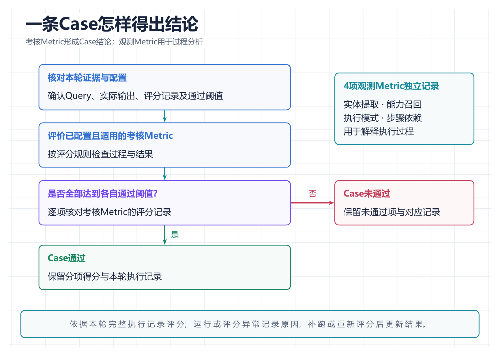

> 图 3：Case判定流程。依据全部适用考核Metric是否达到阈值形成通过或未通过的结论，四项观测Metric独立记录。

案例一：江门多口径经营分析

```PlainText
查询2026年6月江门市的GMV、平台抽成、实际毛利，并分别计算商家口径含返佣毛利率、不含返佣毛利率及平台抽成率，说明各自计算方式
```

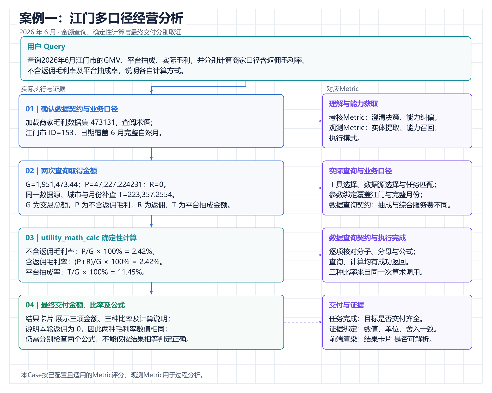

> 图 4：江门多口径经营分析的执行与评价位置。两次查询取得经营金额，由确定性算术计算三种比率，并分别核对业务口径、计算与最终交付。

本次执行加载商家毛利数据集 `473131`，并查阅业务术语。其中，“费用治理”页面为一次不相关探索，“宏鹄基础概念”页面提供了 TR 等术语说明。

第一次查询使用 `城市ID=153` 和 `2026-06-01～2026-06-30` 的完整月份，取得 GMV、不含返佣毛利、返佣及综合服务费。尽管 SQL 写有毛利率表达式，工具实际返回中只有金额字段。随后，Agent 在同数据源、同城市和同日期窗口补查商家 TR 金额，再调用 utility_math_calc 完成比率计算与金额舍入。

| 取证位置 <br> | 对应 Metric <br> | 本 Case 的具体判定 <br> |
| --- | --- | --- |
| 城市、时间解析及执行决策 <br> | 实体提取、能力召回、执行模式；澄清决策、能力纠偏 <br> | 检查江门市和 2026 年 6 月、核心能力候选及澄清决策；执行模式按任务需要判定 <br> |
| 两次查询的工具、数据源和条件 <br> | 工具选择、数据源选择、参数绑定 <br> | 确认实际调用 `data_dataset_query` 与 `utility_math_calc`；查询命中 `473131`，并使用同一城市和完整月份 <br> |
| 金额字段、聚合方式与算术表达式 <br> | 数据查询契约 <br> | 区分 TR 金额与综合服务费；三种比率采用正确分子与共同分母；不直接平均每日比例。 <br> |
| 查询及算术返回 <br> | 执行完成 <br> | 两次查询和六条算术表达式均成功，必要执行形成完整结果。 <br> |
| 最终金额、比率和解释 <br> | 任务完成、证据绑定 <br> | 金额、三种比率及公式均交付；数字、单位和正常四舍五入与本轮证据一致。 <br> |
| 最终响应结构 <br> | 前端渲染 <br> | 只检查结果卡片是否可解析，不将业务口径错误归为渲染错误。 <br> |

记本轮查询的 GMV 为 `G=1,951,473.44` 元，不含返佣毛利为 `P=47,227.224231` 元，返佣为 `R=0` 元，商家 TR 金额为 `T=223,357.2554` 元。三种比率分别为：

| 比率 <br> | 计算方式 <br> | 最终结果 <br> |
| --- | --- | --- |
| 商家口径不含返佣毛利率 <br> | `P/G×100%` <br> | 2.42% <br> |
| 商家口径含返佣毛利率 <br> | `(P+R)/G×100%` <br> | 2.42% <br> |
| 平台抽成率 <br> | `T/G×100%` <br> | 11.45% <br> |

含返佣与不含返佣毛利率本次相等，是因为返佣为 0，而不是两个公式可以互相替代。最终结果卡片分别给出了公式及这一解释；平台抽成按两位小数展示为 223,357.26 元，与原始金额的正常四舍五入一致。

### 3.1.2 等价路径校准

**为什么需要等价路径校准？**

同一任务可以通过不同的工具顺序或计算分工完成。等价路径校准针对评分规则尚未覆盖的合法执行路径，保持用户目标、业务口径和通过阈值不变，补充对实际执行证据的识别。下面以两日司机补奖任务说明这一过程。

案例二：两日司机参与订单筛选与奖励计算
```PlainText
分别查询2026年7月18日和7月19日参与订单达到7单的司机及其参与订单流水；对流水达到80元且不足100元的司机，计算奖励金额使流水加奖励等于100元，并增加奖励金额列。
```

在初版标注中，案例二已经支持“SQL 直接计算”和“原始明细进入沙箱后聚合计算”，但遗漏了另一种合法分工：**两条单日 SQL 分别完成司机聚合，再把完整结果交给沙箱筛选和计算奖励。**

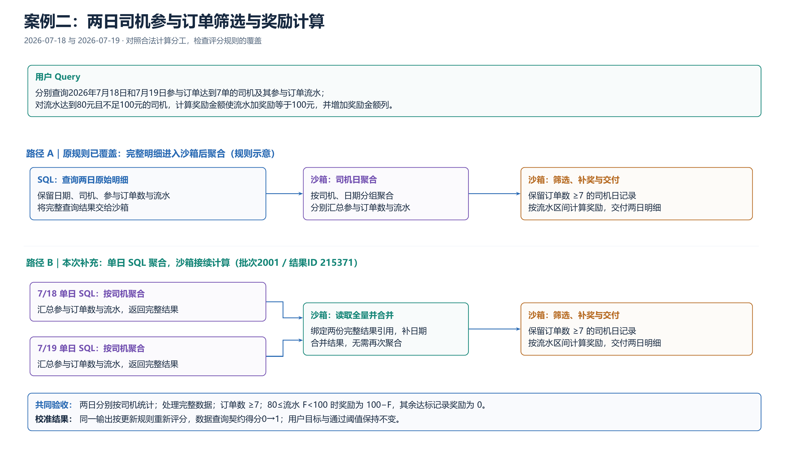

> 图 5：两日司机筛选与补奖任务的等价计算路径。原始明细进入沙箱聚合与单日SQL先聚合均按各自依赖执行，统一核验日期、司机日粒度、订单阈值、奖励公式及完整交付。

下列 SQL 摘自该次执行轨迹中按中文字段聚合的查询。7 月 19 日使用对应的单日条件。

```SQL
SELECT
    `司机id`,
    `司机姓名`,
    SUM(`参与订单数`) AS `参与订单数`,
    SUM(`参与订单司机流水`) AS `参与订单司机流水`,
    SUM(`获奖金额`) AS `获奖金额`
FROM datasourceId-193197
WHERE `日期` BETWEEN '2026-07-18' AND '2026-07-18'
GROUP BY `司机id`, `司机姓名`
```

每条查询已限定一个明确自然日，因此按司机聚合后就是司机日粒度；不要求额外把日期写入 SELECT。查询已有的“获奖金额”保留为原始字段，本任务所需奖励仍须重新计算。

下面是同次成功沙箱的关键代码节选，省略日志、列名清洗、排序、导出及结果汇总。两个输入名称由 `sandbox_execute.inputs` 分别绑定本轮成功查询的完整 `input_ref` 

```Python
import pandas as pd
from hhclaw_io import read_table

df_0718 = read_table("metrics_0718")
df_0719 = read_table("metrics_0719")
df_0718["日期"] = "2026-07-18"
df_0719["日期"] = "2026-07-19"
df_all = pd.concat([df_0718, df_0719], ignore_index=True)

# SQL 已完成司机日聚合，沙箱无需再次 groupby。
df_qualified = df_all[df_all["参与订单数"] >= 7].copy()
df_qualified["计算奖励金额"] = 0.0
mask = (
    (df_qualified["参与订单司机流水"] >= 80)
    & (df_qualified["参与订单司机流水"] < 100)
)
df_qualified.loc[mask, "计算奖励金额"] = (
    100 - df_qualified.loc[mask, "参与订单司机流水"]
)
df_qualified["计算奖励金额"] = (
    df_qualified["计算奖励金额"].round(2)
)
```

该路径仍满足数据集 `193197`、两个自然日、司机日粒度、订单数 ≥7、补奖区间 \[80,100)、奖励公式 100−流水，以及完整数据处理等要求，改变的只是 SQL 与沙箱之间的计算分工。

**当前的等价路径校准逻辑：**

当前采用GPT主导的自动校准流程（采用模型为**GPT 5.5 medium**）：自动发起评估 → 回收失败证据 → GPT 分析路径 → GPT 修订评分规则 → 对原输出重新评分，并使用更新后的Case回放。每轮将新发现的合法路径写入原Case，用户目标和通过阈值保持不变。

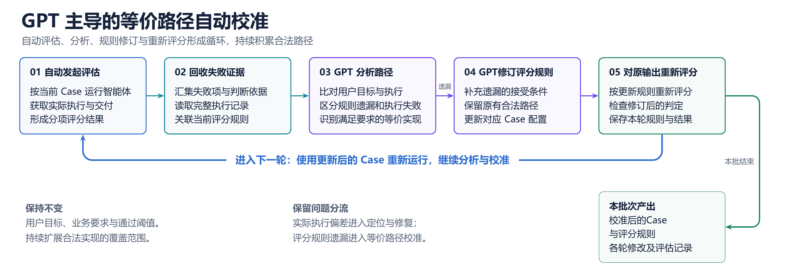

> 图 6: GPT主导的等价路径自动校准。自动评估后回收失败证据，分析实际执行并修订评分准则或程序断言，再复评分和回放，持续维护Case。

**发现等价路径后，GPT会修正对应Case的评分规则，并使用修订后的Case进行回放。**

```Diff
# 日期身份：除显式输出日期，也接受已固定单日的查询。
- 'date': bool(re.search(date_field, selected, re.I)),
+ 'date': bool(re.search(date_field, selected, re.I)) or single_day_filter,

 # 聚合位置：接受 SQL 已完成聚合，或后续沙箱完成聚合。
- bool(re.search(r'groupby|group_by', code, re.I)),
+ base_query_aggregated or bool(re.search(r'groupby|group_by', code, re.I)),
```

```Markdown
---
name: hhclaw-equivalent-path-calibration
description: 根据HHClaw评估结果、完整Trace与现有Case规则，区分真实执行错误和合法路径漏覆盖，识别等价工具或计算分工，最小修订评分规则并对固定输出复评。适用于等价路径分析、Metric误判校准及修订后的复验。
---
## 输入和范围

读取本次授权范围内的：

- Case YAML、用户Query、人工确认的业务要求、商户、日期基准及运行前提；
- Run/Result及选定Attempt、各项Metric的得分、阈值和判定理由；
- 完整Trace：工具名称与参数、返回结果、SQL、沙箱代码及输入、文件产物和最终回复；
- 与目标版本一致的Tool Registry、参数及返回Schema、数据集说明、Helper和工程Metric标准。

已有评估记录时直接从证据回收开始。需要新评估时使用项目现有入口，记录Case、规则和运行版本。执行范围沿用用户当前授权；本Skill不扩展为修改Agent实现、提交推送或部署。

## 1. 明确业务要求和原规则的失败条件

先从Query与人工确认内容提取必须满足的要求，例如对象、日期、统计粒度、筛选条件、计算公式、完整数据范围和交付内容。

随后读取失败Metric的完整断言或Rubric，找到具体失败条件，例如：

- 固定要求某个工具名；
- 固定要求日期出现在SELECT中；
- 固定要求沙箱代码出现groupby；
- 固定要求全部筛选或计算都在SQL中完成。

将这些条件与真正的业务要求逐项对照，判断它们是必要约束，还是某种实现方式的写法。保持各Metric的职责边界：数据源、参数、查询、任务交付和证据分别评价。

## 2. 还原实际成功路径

沿工具调用顺序追踪输入、处理和输出，确认：

- 使用了什么工具和数据源，Schema是否支持本次参数；
- 对象、日期、口径、粒度和筛选条件在哪一步得到满足；
- 聚合、去重、筛选、计算分别由SQL还是沙箱完成；
- 后续步骤是否消费本轮成功调用的完整结果或可信产物；
- 最终交付是否满足用户要求，陈述是否有执行证据支持。

优先检查最终完整路径，区分已恢复的早期尝试与仍然存在的错误。动态数据依据本轮证据核验；相对日期使用本轮参考时间。

用下表保留判断依据：

| 业务要求 | 原规则检查方式 | 实际执行证据 | 判断 |
| --- | --- | --- | --- |
| 逐项填写 | 定位到具体条件 | 工具、参数、返回、代码或产物位置 | 满足／不满足／证据不足 |

## 3. 区分规则遗漏与真实执行问题

| 发现 | 处理 |
| --- | --- |
| 实际执行满足业务要求，原规则因工具、顺序或计算位置不同而拒绝 | 进入等价路径校准 |
| 实际执行违反对象、日期、粒度、公式、完整性或交付要求 | 保留相应失败，记录工程问题 |
| Judge调用失败、输出解析或评分采集异常 | 单列评分或平台问题 |
| 缺少关键结果、Schema、产物或业务口径 | 记录缺失证据与待确认项，暂不改判 |

等价判断需要当前工具能力、Schema和本次成功执行共同支撑。最终数值碰巧相同、工具调用成功或回复声称完成，均不足以单独证明业务等价。

## 4. 判断哪些实现可以等价

在业务要求保持一致时，检查以下替代方式：

- 等价工具或工具组合：接口能力、参数及返回字段支持同一业务目标；
- 等价数据源：目标对象、粒度和指标口径一致，有可核验的映射与执行证据；
- 城市名称与城市ID：映射可靠且目标工具支持；
- SQL与确定性沙箱分工：聚合、筛选或计算可以位于不同步骤，但整条路径完整满足要求；
- 步骤顺序：仅约束业务必需的数据依赖，接受没有依赖冲突的其他顺序。

同时保留权限、租户、写操作确认及目标版本明确要求的产品协议。沙箱输入需覆盖任务要求的数据范围；预览截断、字段被静默忽略、错误粒度或不完整结果均需继续检查。

## 5. 最小修订同一Case

确认规则遗漏后：

1. 在对应Metric内补充接受条件，保留原有合法路径。
2. 保持Query、业务要求、商户、来源及通过阈值不变。
3. 确定性条件使用程序断言；语义规则写明取证范围、评分边界和相邻Metric职责。
4. 保留当前正式Metric及观测／考核角色，Case按适用考核项的score≥threshold判断。
5. 同步必要的元数据与索引，保存规则Diff和修改理由。

规则优先描述已完成的业务状态，例如“司机日聚合已正确完成”，并指明如何从SQL、输入结果或沙箱代码识别该状态。

### 两日补奖案例的判断示例

用户要求分别处理两个自然日的司机订单与流水，并按订单门槛和流水区间补奖。

若两条单日SQL已经按司机聚合，沙箱消费两个完整结果后补充各自日期，再筛选订单数并计算奖励：

- 单日查询限定与司机聚合共同证明司机日粒度；
- 沙箱输入证明处理范围；
- 筛选与补奖代码证明门槛、区间和公式；
- 最终产物证明交付内容。

证据齐全时，可以接受“SQL先聚合、沙箱接续筛选与补奖”的分工，在原断言中补充相应分支。错误日期、错误粒度、错误公式或仅处理预览仍应被识别。

## 6. 对固定输出复评

冻结原始执行记录，用校准前后两版规则分别评价同一输出，保存分项得分、理由和判定转换。

- Python断言执行实际回放，并做语法及Helper校验。
- LLM Rubric使用记录清楚的Judge模型与Prompt实际重新评分；尚未调用时标为预计影响。
- 使用原有合法路径、新等价路径和相邻真实错误检查判定边界。
- 记录旧FAIL→新PASS、旧FAIL→新FAIL、旧PASS→新PASS、旧PASS→新FAIL，并逐条解释新增翻转。

关注合法执行是否被正确接受，以及真实错误是否仍能检出。评分修正收益单独记录；Agent新执行的结果另行统计。

## 7. 后续回放与停止条件

固定输出验证通过后，可在已授权范围内使用更新后的Case进行下一轮真实执行。分别记录规则版本、执行条件、Attempt、分项评分和完整Case结果。

一次调用默认完成一轮“分析—修订—复评”。继续循环时沿用用户约定的轮数、预算和范围；没有新的证据支持规则遗漏，或出现关键证据不足、真实执行错误时，结束当前校准并记录后续事项。

## 输出

交付：

- 规则遗漏、真实执行问题、评分异常及待补证据的分类；
- 每条等价路径满足业务要求的证据映射；
- 对应Case/Metric的最小Diff；
- 固定输出复评、正反例检查和后续新执行的分别记录；
- 剩余问题，以及实际修改与验证范围。

## 现有规则来源

- [hhclaw-classic-case-yaml](/Users/didi/.codex/skills/hhclaw-classic-case-yaml/SKILL.md)：完整Trace取证、Metric边界、等价路径补全及反向回归。
- [V3工程Metric标准](/Users/didi/.codex/skills/hhclaw-classic-case-yaml/references/current-v3-metric-standard.md)：使用前读取其完整定义，并与本次目标版本核对。
- [hhclaw-golden-case-calibration](/Users/didi/Documents/HHClaw/hh-claw_feature_er_task_latest_20260821/.agents/skills/hhclaw-golden-case-calibration/SKILL.md)：业务要求到工具、字段与评分规则的映射方法；其中历史Metric名以当前标准为准。
```

等价路径识别技术考量
**为什么选择 GPT 辅助校准？**

**HHClaw V1优先采用GPT辅助分析与规则修订，主要考虑真实任务的结果真值获取成本，以及通用中间状态评价的建设成本。**当前先利用已有Query、执行轨迹和评分规则分析具体问题，将经复核的业务要求与合法路径沉淀为可复用判据。

- **难以为所有真实 Query 预先准备可持续使用的结果真值。**例如“昨天的完单量”“上周的完单量”，其日期窗口取决于本轮参考时间，数据还可能因回补、权限和业务口径变化而更新。相对日期可以归一化，但正确结果仍需在相同时间窗口、数据版本和统计口径下独立取得。结果涉及大批量司机、多个数据集、派生计算或文件明细时，预先制作和维护标准结果的工作量进一步增加。因此，有可靠真值的任务继续直接核验；其余任务先检查可确认的对象、日期、数据范围、计算规则和交付要求，不将一次历史数值永久写死为答案。

- **里程碑（Milestone）的主要难点在于定义并核验稳定的业务状态。**里程碑用关键状态及依赖评价任务进展，能够容纳多条执行路径。要在真实任务中稳定使用，仍需逐类明确哪些状态是必要的、从什么执行证据中识别、如何接受不同实现，以及状态之间有什么依赖。以两日补奖任务为例，司机日聚合可以由 SQL 完成，也可以由沙箱完成，还可以与筛选及奖励计算合并到一次查询中。如果将“沙箱出现 groupby”写成必经节点，就会误拒上游已完成聚合的路径；若改成“司机日聚合已正确完成”，则需要能够跨 SQL、沙箱和结果产物核验这一业务状态。

ToolSandbox已提供统一执行环境、对话记录与可观测环境状态，并为里程碑定义匹配方式和依赖，因此能够对不同轨迹进行评价。HHClaw 的输入则来自持续新增的线上任务，证据分散在工具参数、查询结果、沙箱代码和文件产物中。V1 若全面采用这一方式，需要先补齐状态抽取、业务判据、跨实现匹配和版本维护，建设负担主要来自这些前置能力。

**GPT 辅助分析适合作为这一阶段的增量建设方式。**它可以结合自然语言要求、SQL、沙箱代码、工具结果和既有评分规则，辅助解释本次执行如何完成业务要求，区分执行错误与规则遗漏，并提出候选修订。这样可先从实际出现的问题和合法路径中积累规则，再逐步提炼稳定的状态判据，而不必在每类新任务进入回流前完成专用状态匹配器。

| 方案 <br> | 规模化使用所需的主要前提 <br> | V1 的选择 <br> |
| --- | --- | --- |
| 独立结果核验 <br> | 同一条件下可取得的可信参考结果、计算器或目标状态 <br> | 能取得真值的任务优先使用；暂不要求所有开放任务预先具备完整标准结果 <br> |
| 里程碑评价 <br> | 稳定的状态定义、可观测证据、匹配器、依赖与维护机制 <br> | 在高频且口径稳定的任务中逐步试点，先复用现有确定性检查 <br> |
| GPT 辅助分析与规则修订 <br> | 可追溯的执行记录、已确认的业务要求和复核流程 <br> | 作为 V1 的规则维护机制，从实际执行中识别判据缺口并增量沉淀 <br> |

## 3.2 数据筛选与回流

本期评测集以首次出差期间收集的真实线上任务为基础，原始线上Query的发生时间为2026年**7月20日**至**7月26日**。为将这批任务转化为可复用的Case，我们结合对应的执行证据，依次完成线上Query筛选、Case配置生成、人工标注与验收、批量回放和集合管理。下图展示线上回流看板，后文介绍本期Case形成与维护流程。

<http://osim-hhclaw-ai-studio.intra.honghusaas.com/observability/reflow>

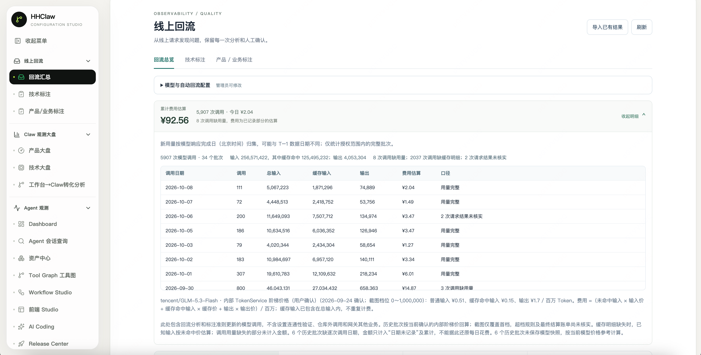

> 图 7: 线上回流看板，汇总线上任务的筛选、分析和技术标注结果，并展示模型调用量与费用，便于跟踪Case回流情况

### 3.2.1 线上Query筛选

**线上Query先由模型筛选一遍，再由人工完成标注与验收。****优先选择日常使用较多的业务任务，并覆盖有代表性的错误，例如遗漏筛选条件、查询结果不完整、最终回复缺少所需信息**。选出的样本依次完成以下检查：

| 检查问题 <br> | 具体要求与处理方式 <br> |
| --- | --- |
| 能否还原当时的任务？—— 可复现性 <br> | 保留原始问题、商户、补充条件、工具调用与最终回复，补齐缺失记录，**使回放能够还原任务条件**，并依据本轮数据重新核验结果。 <br> |
| 能否判断结果是否正确？—— 可验证性 <br> | **确认现有工具能否支持该任务**，**并****具有确定性的****应查询的数据范围、业务口径和交付内容**。能力缺口进入能力观察集；业务口径或预期结果存疑的样本交由相关负责人确认。 <br> |
| 是否与已有样本重复？—— 独特性 <br> | 主要去除开发人员为**复现问题**产生的**大量重复测试，**以及同一用户在不同日期发送、回放条件一致的**完全重复**请求**。不同问法的Query保留，用于检查意图识别与能力获取。** <br> |

### 3.2.2 Case配置生成

筛选后的真实任务需要将输入、业务预期和评分规则一起保存，才能在不同版本上复用。我们以YAML格式保存Case配置，通过Promptfoo接入HHClaw执行，并运行对应评分断言。

Case YAML需要承载的信息如下：

| 内容 <br> | 作用 <br> |
| --- | --- |
| 问题输入与运行前提 <br> | 明确用户请求、商户、上下文及执行条件 <br> |
| Metric与评分要求 <br> | 明确检查对象、适用条件、判定依据和通过要求 <br> |
| Assertion（评分断言） <br> | 执行程序校验或模型评分 <br> |
| 校准与回放关联信息 <br> | 追溯人工修订、自测结果及评估记录 <br> |

```YAML
- description: 案例一：江门多口径经营分析的评分配置节选
  vars:
    query: 查询2026年6月江门市的GMV、平台抽成、实际毛利，并分别计算商家口径含返佣毛利率、不含返佣毛利率及平台抽成率，说明各自计算方式
  # metadata沿用原示例。
  assert:
    - metric_key: engineering.tool_selection
      metric: 工具选择
      metric_subitem: 经营数据查询工具
      type: python
      threshold: 1.0
      value: |
        from asserts import assert_all_tools_called
        return assert_all_tools_called(output, 'data_dataset_query')

    - metric_key: engineering.task_completion
      metric: 任务完成
      metric_subitem: 经营金额、三种比率与计算说明的交付完整性
      type: llm-rubric
      threshold: 0.5
      value: |
        唯一评价问题：最终回复是否交付当前用户要求的核心内容。
        取证范围：本轮用户输入、最终回复及其明确引用的本轮工具结果或产物。
        不使用历史标准数值、未来对话，也不根据 thinking 中的计划推定已完成。

        核心交付：GMV、平台抽成、实际毛利；含返佣与不含返佣毛利率、
        平台抽成率；各项比率的计算说明。逐项检查是否交付。
        本轮返佣为0时两种毛利率可以相等，但仍须分别给出其计算方式。

        1.0：核心交付齐全，回复可直接用于理解本次经营情况。
        0.5：核心交付齐全且可用，仅缺不影响使用的次要展示说明。
        0.0：关键金额、比率或计算说明缺失，或只说“查询完成/稍后整理”
        而未交付实质结果，或将未完成冒充完成。

        工具成功返回真实空结果时，按是否清楚交代不可计算项及原因判断，
        不因空结果本身判失败；部分返回不得冒充完整经营分析。
        预览截断不自动失败，应核对本轮是否已有完整交付产物。
        不评价：首轮召回、特定工具顺序、SQL计算位置、Card结构和阶段耗时。
        数值溯源与具体计算正确性分别由证据绑定和查询契约检查。
        输出score与reason，reason引用实际已交付或缺失内容，score须与理由一致。
```

Promptfoo技术选型
**Promptfoo**是本体系采用的配置驱动评测框架。总配置指定输入模板、被测对象与测试集合，Case配置保存任务输入和评分要求；执行时通过Provider调用被测系统，再对返回输出运行断言并记录结果。

HHClaw V1的评估体系选择Promptfoo，主要基于三个需求：

| HHClaw 需求 <br> | 对应能力 <br> | 当前价值 <br> |
| --- | --- | --- |
| 对已有完整 Agent 进行评测 <br> | 自定义Python／JavaScript Provider可以接入应用接口 <br> | 沿用现有Agent与工具链，由适配器整理可供评分的输出 <br> |
| 同时检查结构化证据与业务语义 <br> | 同一Case可配置代码断言和LLM评分准则 <br> | 工具、参数等精确条件由程序检查，语义与交付要求由相应评分器评价 <br> |
| 持续增加和修订真实Case <br> | 配置化测试、组合执行及结果查看 <br> | 支持将Case初稿生成、人工审阅和项目版本管理接入统一评测流程 <br> |

这些能力详见官方配置说明，选型的价值是复用已有执行与评分能力，将项目建设集中在业务预期、Metric/Rubric 和证据质量上。

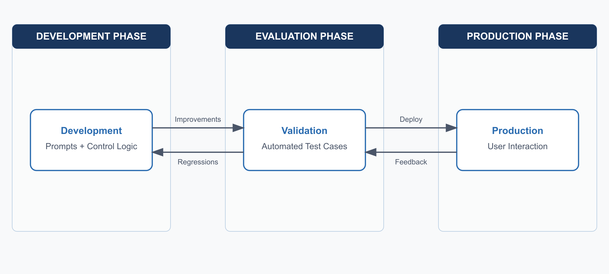

> 图 8：Promptfoo评估与迭代流程。开发、评估和生产反馈相互衔接，评估结果用于检查改动并推动后续迭代。来源：Promptfoo官方资料。

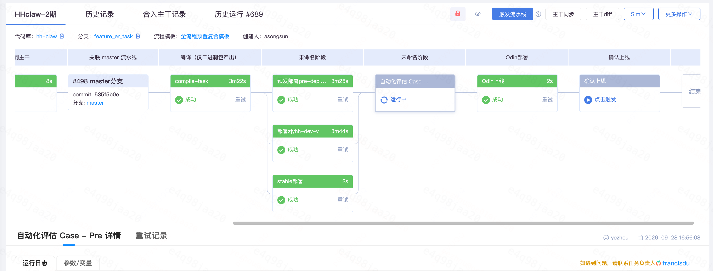

> 图 9：HHClaw部署与自动评估流水线。在稳定环境完成部署后执行自动评估，满足验收条件后进入上线流程。

### 3.2.3 人工标注与验收

LLM生成Case配置初稿后，**由标注人员结合原始用户任务、工作台操作、业务口径和数据说明确认预期结果，再由技术校验核对工具契约、参数与评分配置。验收形成明确的任务要求、可追溯的标注依据和经过验证的 Case 版本，供批量回放使用**。

| 验收内容 <br> | 核对依据 <br> | 形成的结果 <br> |
| --- | --- | --- |
| 输入与运行前提 <br> | 原始问题、商户、上下文、权限及运行配置 <br> | 确认 Query、商户身份和必要条件与原任务一致 <br> |
| 业务预期 <br> | 用户要求、工作台结果及业务口径说明 <br> | 明确对象、日期、统计粒度、计算规则、允许终态和交付要求 <br> |
| 工具与数据契约 <br> | 目标版本的工具定义、参数结构和数据集说明 <br> | 确认任务能够通过当前能力执行，字段、参数类型及筛选语义有据可查 <br> |
| Metric与评分断言 <br> | 已确认的业务预期、评分规范和正反例 <br> | 确认Metric适用、判断对象清楚，断言能够区分符合与不符合要求的执行 <br> |
| 来源与版本追溯 <br> | 原始Query、可取得的会话/对话轮次/执行轨迹、人工标注、Case修订和断言自测 <br> | 保存原任务→标注依据→Case 版本→校验结果的关联；回放后关联评估批次、结果ID及选中的执行尝试 <br> |

例如，案例二的人工标注固定日期、统计粒度、订单阈值、奖励公式。技术校验据此检查Case配置中的日期、聚合粒度、筛选与交付要求。具体计算由 SQL 或沙箱完成，按照 3.1.2的等价路径规则判定，不因实现路径不同改变准入标准。

### 3.2.4 回放与集合管理

完成人工验收的Case进入批量回放。每轮固定所选Case清单与配置，保存被测版本、分项得分、Case结论及执行证据；未通过Case进入3.3的问题分析，规则缺口返回3.1.2校准。三类评测资产按用途分别管理，当前建设情况如下。

| 评测资产 <br> | 用途 <br> | 建设规模 <br> |
| --- | --- | --- |
| 评测集 <br> | 保存当前能力可执行、业务预期明确并完成配置校验的真实任务，用于版本评估 <br> | 第四章实验对应的评测配置清单共318条，包含人工复核、候选回流、重写、回归和数据专项Case；最后一轮评估311条Case <br> |
| 回归集 <br> | 保存历史问题的检查任务，用于持续检查相关行为 <br> | 上述318条配置中，26条归在回归类别，已计入评测集总量；第四章沿用统一的Case统计口径 <br> |
| 能力观察集 <br> | 保存当前工具能力或契约尚不能支持的代表性任务，观察能力建设进展 <br> | 按独立登记清单记录28条任务，单独管理，不计入第四章的Case通过率 <br> |

## 3.3 问题定位与分发

在完成评测集建设并进行批量回放之后，我们利用未通过Case确定下一步优化方向。利用分项Metric提供排查入口，再对照用户要求、工具参数、工具返回和最终交付的执行轨迹，确认偏差产生的位置及后续执行是否恢复。评分规则遗漏的合法路径返回3.1.2校准，实际执行偏差进入工程分析。

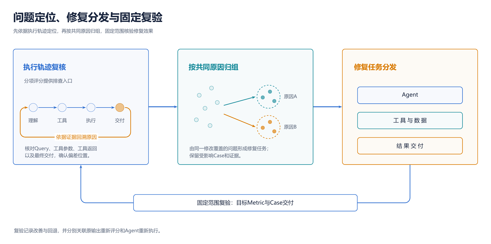

> 图 10：HHClaw问题定位与修复复验流程。执行轨迹复核确认原因，按共同原因归组并明确修复范围，固定回放核验目标环节及Case交付；诊断思路参考ERRORPROBE论文图2。

**先按证据定位，再按共同原因归组。**只有直接原因相同、能够由同一处修改覆盖的问题，才合并为一项修复任务；表现相近但原因不同的Case分别处理。记录保留原问题、Case、评估结果及失败证据，形成可持续跟踪的受影响范围。

**分发时明确修改位置和验收行为。**数据集语义、字段参数与SQL归入查询链路；必要条件识别归入意图与澄清；结果组织、完整文件和结果卡片呈现归入交付链路。每项建议同时给出受影响Case清单、目标行为和验收条件。

**修复后固定范围复验。**在目标环境回放问题组及相关历史通过Case，核对目标环节和Case交付，记录恢复与回退。对原输出重新评分和Agent新执行分别记录。4.3按查询路径、澄清决策和任务与证据交付三个环节，汇总固定问题的复验结果。

# 四、评估结果

本章结果支持三项结论：**LLM评分与人工判断的一致性达到目标；评测集能够识别历史评估中的任务改善与回退，并呈现分项变化；分项评分和执行证据能够为问题定位、分发和修复复验提供依据。**相关历史记录按**评估批次**组织：一次面向所选Case集合开展的批量评测记为一个批次，并使用平台编号关联评估报告与执行记录。验证范围涵盖2026年**8月18日**至**8月31日**的11个批次，其中2033为最后一轮。

## 4.1 模型评分与人工一致性

为验证LLM评分是否满足一致性目标，对末轮批次2033的现有结论进行复核统计，755项LLM考核评分判定中，715项与人工判定一致、40项不一致，模型评分与人工判定的一致率为**94.7%**，高于**70%**的评分一致性目标。

| 考核指标 <br> | 人工复核项数 <br> | 一致项数 <br> | 不一致项数 <br> | 一致率 <br> |
| --- | ---: | ---: | ---: | ---: |
| 澄清决策 <br> | 47 <br> | 46 <br> | 1 <br> | 97.9% <br> |
| 任务完成 <br> | 265 <br> | 246 <br> | 19 <br> | 92.8% <br> |
| 证据绑定 <br> | 249 <br> | 232 <br> | 17 <br> | 93.2% <br> |
| 参数绑定 <br> | 79 <br> | 77 <br> | 2 <br> | 97.5% <br> |
| 数据查询契约 <br> | 90 <br> | 89 <br> | 1 <br> | 98.9% <br> |
| 安全边界 <br> | 18 <br> | 18 <br> | 0 <br> | 100% <br> |
| 工具选择 <br> | 5 <br> | 5 <br> | 0 <br> | 100% <br> |
| 能力纠偏 <br> | 2 <br> | 2 <br> | 0 <br> | 100% <br> |
| **整体** <br> | **755** <br> | **715** <br> | **40** <br> | **94.7%** <br> |

## 4.2 评测集能力区分度

### 4.2.1 批次总览

本期按报告截止时间和交付版本，选取最后一轮2033报告最终任务表现，Case通过率为90.0%。该批次使用3.2所述完成筛选、验收与规则校准的最终评测集；样本按业务代表性、典型错误，以及可复现、可验证和去重要求形成，执行未通过的Case继续用于问题定位与复验。下表显示，本期原始633条任务中已识别的14个任务大类在最终评测集中全部保留，任务类型覆盖率为100%（14/14）

| 任务诉求大类 <br> | 原始线上任务（633条） <br> | 2033最终评测集（318条） <br> | 类型保留情况 <br> |
| --- | --- | --- | --- |
| A1 单点与定标识查询 <br> | 123 <br> | 60 <br> | 已保留 <br> |
| A2 维度与指标统计 <br> | 104 <br> | 58 <br> | 已保留 <br> |
| A3 条件筛选清单 <br> | 160 <br> | 95 <br> | 已保留 <br> |
| A4 跨对象与多口径组合查询 <br> | 40 <br> | 18 <br> | 已保留 <br> |
| A5 对比、趋势与排行 <br> | 53 <br> | 30 <br> | 已保留 <br> |
| B1 单体诊断分析 <br> | 45 <br> | 11 <br> | 已保留 <br> |
| B2 聚合归因分析 <br> | 8 <br> | 4 <br> | 已保留 <br> |
| B3 数据勾稽与事实核对 <br> | 6 <br> | 4 <br> | 已保留 <br> |
| B4 规则与知识问答 <br> | 28 <br> | 13 <br> | 已保留 <br> |
| B5 计算与加工 <br> | 26 <br> | 14 <br> | 已保留 <br> |
| B6 方案与策略生成 <br> | 9 <br> | 5 <br> | 已保留 <br> |
| B7 业务操作执行 <br> | 3 <br> | 1 <br> | 已保留 <br> |
| B8 产品能力与元问题 <br> | 11 <br> | 2 <br> | 已保留 <br> |
| B9 输出形式与交互诉求 <br> | 94 <br> | 49 <br> | 已保留 <br> |
| **已识别任务类型** <br> | **14类** <br> | **14类** <br> | **覆盖率100%（14/14）** <br> |

**本期Agent的工程修复没有针对评测集中的Case逐一进行，而是按共同原因对查询、澄清和交付等公共模块进行功能优化，并同时复验受影响任务与历史通过Case。**跨轮结果既有改善，也有部分指标回退，用于观察公共优化对不同任务的影响；后续计划建设与迭代过程分离的独立测试集，在冻结评分规则后，独立验证新任务上的泛化效果。

本期历轮评估记录如下，分别展示各批次按当轮标准得到的Case通过率、运行规模与成本。

| 批次 <br> | 执行起点／时间锚点 <br> | 统计Case <br> | Case通过率 <br> | Token（百万） <br> | Token Service价格 <br> | 本轮重点 <br> |
| --- | --- | --- | --- | --- | --- | --- |
| 1863 <br> | 08-18 15:00 <br> | 104 <br> | 29.8% <br> | 22.05 <br> | - <br> | 入口、规划与澄清调整 <br> |
| 1873 <br> | 08-19 01:12 <br> | 111 <br> | **40.5%** <br> | 38.72 <br> | - <br> | 补召回、分页和治理能力复验 <br> |
| 1911 <br> | 08-21 23:20 <br> | 142 <br> | 51.4% <br> | 34.16 <br> | 194.07 <br> | 沙箱、SQL语义、执行恢复 <br> |
| 1931 <br> | 08-23 00:29 <br> | 218 <br> | 47.7% <br> | 47.68 <br> | 284.54 <br> | 历史开城与查询准入 <br> |
| 1933 <br> | 08-23 11:35 <br> | 219 <br> | 58.4% <br> | 51.89 <br> | 303.93 <br> | Case评价标准校准 <br> |
| 1945 <br> | 08-24 00:44 <br> | 218 <br> | 63.3% <br> | 62.17 <br> | 356.27 <br> | 评分与评估采集调整 <br> |
| 1959 <br> | 08-25 01:53 <br> | 219 <br> | 71.2% <br> | 53.76 <br> | 308.62 <br> | 数据加载、上下文与结果引用 <br> |
| 1971 <br> | 08-25 23:39 <br> | 219 <br> | 64.8% <br> | 55.18 <br> | 308.09 <br> | 参数与查询改善，交付退化 <br> |
| 1989 <br> | 08-26 22:04 <br> | 217 <br> | 77.4% <br> | 56.96 <br> | 330.57 <br> | 执行与交付恢复复验 <br> |
| 2031 <br> | 08-29 12:35 <br> | 318 <br> | 74.8% <br> | 88.77 <br> | 515.66 <br> | 扩展重写与回归任务 <br> |
| 2033 <br> | 08-31 01:11 <br> | 311 <br> | **90.0%** <br> | 85.46 <br> | 492.37 <br> | 同集复跑与剩余问题复核 <br> |

> 批次1863、1873缺少缓存明细，其余9批次共计花费约3094元；Case回放与评估采用模型分别为Token Service上Baidu/Tencent提供的**GLM-5.2**

11轮评估可按用途读成三个阶段：1863—1945逐步完善Case、评价标准及评估采集；1959—1989在约219条任务上持续检查查询与交付；2031—2033将集合扩展至318条，并复跑核对新增与回归任务。

批次2033纳入统计的311条Case中，280条按当轮标准通过，Case通过率为90.0%。下文结合分项Metric评分和共同Case对照，进一步观察各评价项的变化及任务改善与回退。

### 4.2.2 分项结果

**下表列出各评估批次的分项Metric通过率，用于观察各评价项在历轮评估中的表现变化。表中每格展示该Metric的通过率****。** 每个 Metric 使用其原始score≥threshold判定；“—”表示该批没有配置。

| Metric <br> | 分组 <br> | 1863 <br> | 1873 <br> | 1911 <br> | 1931 <br> | 1933 <br> | 1945 <br> | 1959 <br> | 1971 <br> | 1989 <br> | 2031 <br> | 2033 <br> |
| --- | --- | --- | --- | --- | --- | --- | --- | --- | --- | --- | --- | --- |
| 澄清决策 <br> | 考核 <br> | 86.5% <br> | 90.1% <br> | 96.5% <br> | 87.6% <br> | 90.9% <br> | 93.6% <br> | 94.5% <br> | 95.9% <br> | 95.9% <br> | 96.2% <br> | 98.4% <br> |
| 能力纠偏 <br> | 考核 <br> | — <br> | — <br> | 93.0% <br> | 90.7% <br> | 93.5% <br> | 94.0% <br> | 92.4% <br> | 94.0% <br> | 97.3% <br> | 98.5% <br> | 98.4% <br> |
| 工具选择 <br> | 考核 <br> | 61.5% <br> | 62.1% <br> | 76.9% <br> | 86.7% <br> | 88.3% <br> | 89.3% <br> | 89.8% <br> | 93.4% <br> | 95.4% <br> | 96.2% <br> | 97.2% <br> |
| 数据源选择 <br> | 考核 <br> | 65.2% <br> | 62.0% <br> | 68.8% <br> | 81.6% <br> | 87.0% <br> | 88.6% <br> | 93.9% <br> | 98.3% <br> | 98.2% <br> | 97.6% <br> | 98.8% <br> |
| 参数绑定 <br> | 考核 <br> | 51.6% <br> | 53.1% <br> | 74.4% <br> | 79.6% <br> | 80.7% <br> | 83.9% <br> | 84.0% <br> | 88.8% <br> | 89.7% <br> | 90.1% <br> | 95.5% <br> |
| 数据查询契约 <br> | 考核 <br> | 62.2% <br> | 46.9% <br> | 59.5% <br> | 72.6% <br> | 74.6% <br> | 71.7% <br> | 81.6% <br> | 90.4% <br> | 92.9% <br> | 89.1% <br> | 95.7% <br> |
| 执行完成 <br> | 考核 <br> | 82.3% <br> | 80.6% <br> | 91.8% <br> | 93.4% <br> | 97.0% <br> | 98.0% <br> | 95.9% <br> | 97.0% <br> | 98.5% <br> | 99.7% <br> | 99.3% <br> |
| 任务完成 <br> | 考核 <br> | 61.5% <br> | 70.3% <br> | 76.8% <br> | 73.2% <br> | 82.9% <br> | 78.9% <br> | 86.2% <br> | 84.8% <br> | 89.9% <br> | 90.3% <br> | 95.4% <br> |
| 证据绑定 <br> | 考核 <br> | 52.1% <br> | 68.0% <br> | 82.1% <br> | 87.3% <br> | 90.4% <br> | 90.4% <br> | 88.4% <br> | 87.9% <br> | 90.8% <br> | 90.5% <br> | 96.6% <br> |
| 安全边界 <br> | 考核 <br> | 92.9% <br> | 87.5% <br> | 87.5% <br> | 85.7% <br> | 89.3% <br> | 92.9% <br> | 100.0% <br> | 96.4% <br> | 100.0% <br> | 95.6% <br> | 95.6% <br> |
| 前端渲染 <br> | 考核 <br> | 40.0% <br> | 83.3% <br> | 91.2% <br> | 90.0% <br> | 92.6% <br> | 95.0% <br> | 88.9% <br> | 80.2% <br> | 100.0% <br> | 100.0% <br> | 100.0% <br> |
| 实体提取 <br> | 观测 <br> | — <br> | — <br> | 74.8% <br> | 70.6% <br> | 78.7% <br> | 58.7% <br> | 75.2% <br> | 77.7% <br> | 77.5% <br> | 90.1% <br> | 93.3% <br> |
| 能力召回 <br> | 观测 <br> | 65.6% <br> | **88.3%****（能力召回优化）** <br> | 85.8% <br> | 83.0% <br> | 89.4% <br> | 87.2% <br> | 83.6% <br> | 88.4% <br> | 87.2% <br> | 91.5% <br> | 91.3% <br> |
| 执行模式 <br> | 观测 <br> | 97.9% <br> | 100.0% <br> | 100.0% <br> | 94.7% <br> | 98.9% <br> | 98.9% <br> | 95.3% <br> | 97.9% <br> | 98.4% <br> | 99.6% <br> | 100.0% <br> |
| 步骤依赖 <br> | 观测 <br> | 29.4% <br> | 44.4% <br> | 83.3% <br> | 81.2% <br> | 78.1% <br> | 90.6% <br> | 96.9% <br> | 93.8% <br> | 84.4% <br> | 87.9% <br> | 85.7% <br> |

批次2033的11项考核Metric通过率均高于95%，最低为任务完成的**95.4%**。四项观测Metric记录实体提取、能力召回、执行模式和步骤依赖的评分结果。

### 4.2.3 共同Case跨轮变化

为比较同一任务在相邻轮次中的变化，本节取两轮评估记录中共有的Case，分别对照Case通过状态和分项Metric评分。下表记录未通过转通过、通过转未通过、持续通过和持续未通过四种状态。

| 相邻批次 <br> | 共同Case <br> | 前轮通过 <br> | 后轮通过 <br> | 失败→通过 <br> | 通过→失败 <br> | 持续通过 <br> | 持续失败 <br> | 通过率变化 <br> |
| --- | --- | --- | --- | --- | --- | --- | --- | --- |
| 1863→1873 <br> | 104 <br> | 31/104（29.8%） <br> | 44/104（42.3%） <br> | 25 <br> | 12 <br> | 19 <br> | 48 <br> | +12.50pp <br> |
| 1873→1911 <br> | 111 <br> | 45/111（40.5%） <br> | 60/111（54.1%） <br> | 26 <br> | 11 <br> | 34 <br> | 40 <br> | +13.51pp <br> |
| 1911→1931 <br> | 141 <br> | 72/141（51.1%） <br> | 74/141（52.5%） <br> | 27 <br> | 25 <br> | 47 <br> | 42 <br> | +1.42pp <br> |
| 1931→1933 <br> | 218 <br> | 104/218（47.7%） <br> | 127/218（58.3%） <br> | 40 <br> | 17 <br> | 87 <br> | 74 <br> | +10.55pp <br> |
| 1933→1945 <br> | 218 <br> | 127/218（58.3%） <br> | 138/218（63.3%） <br> | 35 <br> | 24 <br> | 103 <br> | 56 <br> | +5.05pp <br> |
| 1945→1959 <br> | 218 <br> | 138/218（63.3%） <br> | 155/218（71.1%） <br> | 42 <br> | 25 <br> | 113 <br> | 38 <br> | +7.80pp <br> |
| 1959→1971 <br> | 219 <br> | 156/219（71.2%） <br> | 142/219（64.8%） <br> | 19 <br> | 33 <br> | 123 <br> | 44 <br> | -6.39pp <br> |
| 1971→1989 <br> | 217 <br> | 142/217（65.4%） <br> | 168/217（77.4%） <br> | 40 <br> | 14 <br> | 128 <br> | 35 <br> | +11.98pp <br> |
| 1989→2031 <br> | 217 <br> | 168/217（77.4%） <br> | 171/217（78.8%） <br> | 29 <br> | 26 <br> | 142 <br> | 20 <br> | +1.38pp <br> |
| 2031→2033 <br> | 311 <br> | 236/311（75.9%） <br> | 280/311（90.0%） <br> | 58 <br> | 14 <br> | 222 <br> | 17 <br> | +14.15pp <br> |

上表记录共同Case的整体通过状态，图11进一步对照分项Metric的通过率变化。

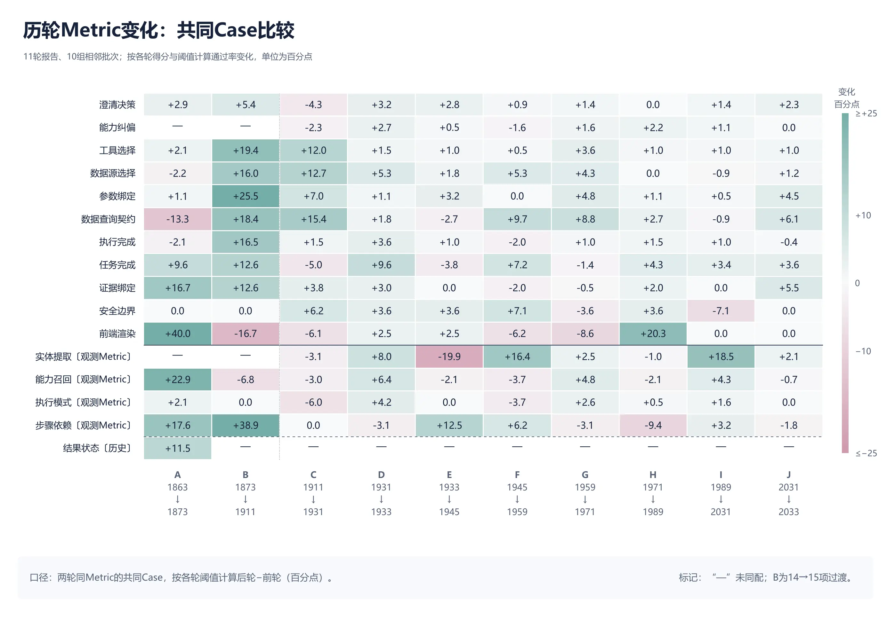

> 图 11：共同Case的分项Metric通过率变化，覆盖10组相邻批次对照。每格对照两轮均有该Metric评分记录的共同Case，按各轮得分与阈值计算后轮减前轮的变化，单位为百分点；观测Metric与历史结果状态单独标注。

在2031→2033的311条共同Case中，进一步保留Query和完整评分断言配置一致的271条。Case通过数由217条变为247条，包含41条未通过转通过、11条通过转未通过，通过率净提升11.07个百分点。

回退也能在共同Case中被观察到：1959→1971的整体考核Metric通过率从90.0%升至91.6%，同219条任务的Case通过数由156降至142，其中19条未通过转通过、33条通过转未通过。分项记录中，参数绑定和数据查询契约通过率上升，任务完成、证据绑定和前端渲染通过率下降。

上述对照同时记录了任务改善与回退，并呈现分项评分的变化，达到**本期“能力区分度”的定性目标。**

## 4.3 问题定位与修复复验

本节展示如何根据Metric评分和执行记录，确定需要修改的工程环节，并检查修复后的结果。我们沿用批次1945复核后确定的43条Case，在批次2033再次评估。这些Case涉及查询路径、澄清决策、任务与证据交付三类问题。

具体做法是先看各项Metric评分，缩小排查范围；再查看工具参数、返回结果和最终回复，确认问题发生在哪里；随后明确需要检查或修改的内容，交给对应Metric负责人处理；最后复验这些Case，同时检查原问题对应的Metric和整题通过情况。

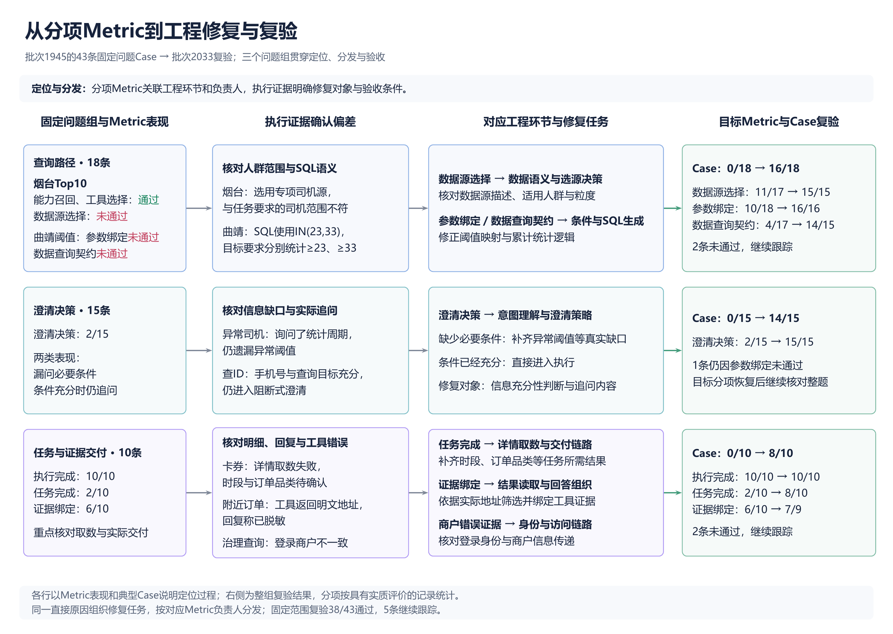

> 图 12: 分项Metric与工程修复的对应关系。三个固定问题组依次展示Metric表现、执行证据、对应工程环节与修复任务，以及目标Metric和完整Case的复验结果；

| 固定问题组 <br> | 成员数 <br> | 1945 Case通过 <br> | 2033 Case通过 <br> | 未通过 <br> |
| --- | --- | --- | --- | --- |
| 查询路径 <br> | 18 <br> | 0/18 <br> | 16/18（88.9%） <br> | 2 <br> |
| 澄清决策 <br> | 15 <br> | 0/15 <br> | 14/15（93.3%） <br> | 1 <br> |
| 任务与证据交付 <br> | 10 <br> | 0/10 <br> | 8/10（80.0%） <br> | 2 <br> |
| 合计 <br> | 43 <br> | 0/43 <br> | 38/43（88.4%） <br> | 5 <br> |

### 4.3.1 查询路径

这18条Case主要出现选错数据源、筛选条件使用错误或计算方式不符合要求的问题。数据源选择、参数绑定和数据查询契约的评分指出了需要排查的环节，执行记录进一步说明了具体偏差。

- **烟台Top10司机：**前轮使用专项司机数据源，与任务要求的司机范围不符；后轮改用适用目标人群的通用司机日明细。这里重点核对数据源描述中的适用人群和粒度，以及实际选源逻辑。

- **低完单司机名单：**用户要的是司机明细，前轮走了人数汇总；后轮转为查询司机明细。这里检查数据源粒度和最终查询内容是否符合“名单”的要求。

- **曲靖阈值统计：**用户要求统计达到阈值的人数，前轮按“恰好等于”计算；后轮调整为累计阈值统计。这里检查条件绑定和SQL计算逻辑。

### 4.3.2 澄清决策

这15条Case检查Agent是否在合适的时机追问，以及是否问到了真正缺少的条件。查看澄清决策评分和实际追问内容后，可以明确两种处理方式：缺少必要条件时补齐关键条件，条件充分时直接执行。

例如，异常司机任务需要补齐日期、异常阈值和应答条件；查ID任务已经给出足够条件，应直接查询；指定峰期任务需要先确认实际时段。这些问题对应信息是否充分的判断，以及追问内容的调整。

批次2033中，澄清决策15/15通过，整题14/15通过。剩余1条在执行时将供应商替换为代理商，参数绑定未通过。

### 4.3.3 任务与证据交付

这10条Case重点检查用户最终拿到了什么。前轮“任务完成”仅2/10，因此需要继续查看最终回复是否交付了要求的明细、字段和结果。

结合工具返回和最终回复，排查方向可以进一步具体到：

- **卡券信息缺失：**所需时段、订单品类等内容未取得或未交付，检查明细查询与结果组织。

- **回复与工具结果不一致：**例如工具返回明文地址，回复却称已脱敏，检查结果读取与证据引用。

- **商户身份影响取数：**工具报登录商户不一致，检查登录身份、商户信息传递与访问链路。

上述三类问题均由分项Metric提供排查入口，再通过执行证据确认偏差位置与原因，并明确受影响Case和验收条件；固定范围复验进一步记录目标行为与整体任务的恢复情况。因此**达到本期“问题定位与修复指导”的定性目标。**

当前评测与问题分析流程在首次标注验收后自动运行，每轮评测完成后会在**一天内**生成包含结果汇总、问题聚类、定位结果和分发建议的评估报告，**满足本期自动闭环运行及报告产出时长要求。**

# 五、放量决策

本期作为HHClaw质量飞轮体系的初步建设，不涉及线上策略放量

# 六、 引用和鸣谢

[【LR26-041】创新策略-HHClaw-意图识别与能力选择优化-V1](https://cooper.didichuxing.com/knowledge/2199610335356/2209750960161)

[Judging LLM-as-a-Judge with MT-Bench and Chatbot Arena](https://arxiv.org/html/2306.05685v4)

[ToolSandbox: A Stateful, Conversational, Interactive Evaluation Benchmark for LLM Tool Use Capabilities](https://arxiv.org/abs/2408.04682 "ToolSandbox: A Stateful, Conversational, Interactive Evaluation Benchmark for LLM Tool Use Capabilities")

[Towards Self-Improving Error Diagnosis in Multi-Agent System](https://aclanthology.org/2026.findings-acl.98/ "Towards Self-Improving Error Diagnosis in Multi-Agent Systems")

[美团Agent评测漫谈](https://tech.meituan.com/2026/08/07/Agent-Evaluation.html)

[HHClaw后端代码库](https://git.xiaojukeji.com/honghu-saas/biz-api/hh-claw/tree/feature_er_task)

[HHClaw评估平台代码库](https://git.xiaojukeji.com/hxz_qa/evel/commits/master)

[HHClaw可观测平台代码库](https://git.xiaojukeji.com/honghu-saas/fe/hh-ai-studio/tree/osim)

感谢方舟老师的帮助和指导，感谢晓江老师、亨昌、孙炎的协助以及宏鹄SaaS工程团队对工作的支持。

# 七、附录

[HHClaw智能助手](https://workbench.honghusaas.com/#/ai-assistant)

[HHClaw评估平台](http://eval.intra.xiaojukeji.com/?view=webhook&project_id=3)

[HHClaw可观测平台](http://osim-hhclaw-ai-studio.intra.honghusaas.com/observability/reflow)

[案例一对应YAML.md](附件/LR26-045/014.md)

[案例二对应YAML.md](附件/LR26-045/015.md)

[Case YAML Generator Skill.md](附件/LR26-045/016.md)

[批次2033报告.html](附件/LR26-045/017.html)

[评测工程-后续建设](https://cooper.didichuxing.com/knowledge/2207798829445/2209982609822)
