# 【LR26-047】乘客与增长-增长策略-流失用户召回算法迭代-V1.0

[Cooper 原文](https://cooper.didichuxing.com/knowledge/2199610335356/2209896035194)

## 基础信息

| **brd文档链接**   | [【BRD】流失首单算法策略迭代](https://cooper.didichuxing.com/didocs/2209902286021)   |
| --- | --- |
| **最后通过的策略方案链接**   | [【乘客与增长-增长策略-流失召回算法策略优化-V1.0-V1】](https://cooper.didichuxing.com/knowledge/2199610335356/2210021628911)   |
| **实验链接（评估大师）**   | 无（AB实验由Pope直接在Apollo生成，未使用评估大师）   |
| **核心贡献点**   | 1. **提出基于多域特征融合的****DomainExtractTrans****架构：****首次**采用“**域内独立编码—域间注意力交互—自适应聚合**”的分层建模思路，通过 Transformer 学习跨域交互，**提出DomainExtractTrans架构**；同时首次将 **Set Transformer **用于花小猪业务中的多域特征聚合，提升因果推断表征学习的特征表征**representation**能力**。**完成该方法在流失召回场景的适配与线上验证，增强对用户异质性及补贴响应差异的建模能力；   2. **构建融合单调性与边际ROI约束的联合损失函数：**相较于base 模型的损失设计，在factual loss基础上，结合业务特性，引入正负样本的**单调性辅助损失**与**边际ROI约束**，使模型训练同时兼顾转化拟合、跨券额响应一致性与边际投入效率，为完单 CAC 约束下的发券求解提供更符合业务规律的预估输入；    |
| **第一贡献人**   | 沈江湖   |
| **共同贡献人（没有的话，可以置空）**   | 曹艾瑜、周之烁   |
| **后续策略负责人**   | 曹艾瑜、沈江湖   |

# 一、背景

## 1.1 业务背景

**流失召回****天降红包**主要通过在首页下发“立减红包券”的形式来挽回流失用户，提升流失用户的访问完单率。流失召回算法策略V0版本（[【LR25027】流失召回算法策略v0](https://cooper.didichuxing.com/knowledge/2199610335356/2205121614750)）此前于2025-07上线，后续由于效果衰减，于2026-03重启流失召回算法迭代。

- **重启迭代后效果未达预期**。在2026-06开启算法策略AB实验，由于实验期间人工组效果优于算法组，因此最终未上线，目前线上回滚至人工策略；

- **由于预算控制，业务方调整了流失召回天降红包的红包集合**。可选红包从\[0, 2, 3, 4, 5, 6, 7, 8, 9, 10\]调整为\[0, 2, 3, 4, 5, 6\]。

## 1.2 现状 & 前置复盘

- **复盘：**现有“流失召回”工程链路下，弹性模型效果可能受到**“分布变化”**或**“弹性变化”**的影响。**“分布变化”**一般可通过使用最新RCT数据重训练模型来解决，但是2026-03的算法策略迭代基于这一思路并未取得收益；一方面，经过离线评估（[【流失天降红包】离线迭代总结](https://cooper.didichuxing.com/knowledge/2208612170863/2209688938871)），发现原有的模型在使用最新一期实验数据的情况下MTAUCC低于随机策略（random  vs baseline: **0.03962 vs** **0.02676**，具体可见4.1.1）；另一方面，base模型的ATE_error表现较差，远远高于exp（exp的ATE_error 平均降低50.55%，具体可见4.1.2）。因此推断问题产生的根本原因是由于**“弹性变化”**所带来的（如“平台联合决策迭代、幸运盒子完单份额提升”）；

- **现状：**有流失召回算法迭代的业务需求。分城市的人工流失用户召回策略的效率不足，有算法介入提高补贴效率、提升转化的空间；

本次迭代将通过<u>优化弹性模型结构、增加特征、修改决策函数</u>等，优化算法效果，从而提升业务指标；而对于“效果衰减”问题，后续将通过更新工程链路以及策略自进化落地探索来保证算法模型表现的稳定性；

# 二、目标 & 约束

|    | 指标&计算口径   | 目标值   |
| :---: | :---: | :---: |
| 策略目标   | <u>*uv视角访问完单率（VFR）*</u>= 完单用户数 ÷ 访问用户数   | 算法策略实验组相对于人工策略组**提升0.2pp**   |
| 核心约束   | <u>*人均完单成本（完单CAC）*</u>= 流失用户核销总金额 ÷ 流失用户**完单人头**数   | ≈ 当前线上人工策略的完单CAC（约1.6元）   |

- **总结：**在C补（完单CAC）<u>与人工策略组完单成本拉齐</u>的条件下的情况下，弹性模型优化（新增特征、修改损失函数、模型结构迭代）-> 模型预估更准确 -> **提升流失用户转化率大于0.2pp**；

# 三、技术方案

- baseline：线上主要为人工分城市红包策略，本次算法策略优化也直接以人工组为baseline；

- experiment：技术方案与“策略方案”一致。主要包括“特征工程”、“模型结构”、“损失函数”、“决策函数”等多方面的算法优化迭代；

## 3.1 弹性建模

- 本次迭代涉及“<u>优化弹性模型结构”、“增加特征”、“修改决策函数”</u>等算法调优，人为将涉及到的离线探索拆分为V1\~V4，可见如下**“模型迭代流程图”**所示：

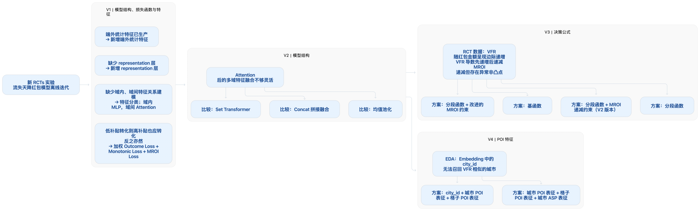

### 3.1.1 特征工程

- 新增多端统计特征，覆盖60天（60d）、90天（90d）、120天（120d），以此补充用户级特征，作为用户侧“长期需求”的刻画；

新增特征详情
- 'wyc_finish_subsidy_c_60d','hxz_bubble_cnt_peek_60d','wyc_recent_call_time_60d','wyc_bubble_cnt_60d','wyc_finish_cnt_60d','hxz_bubble_cnt_weekday_60d','hxz_recent_call_time_60d','hxz_bubble_cnt_60d','call_ratio_60d'

- 'wyc_call_cnt_weekday_90d','wyc_call_dis_weekday_90d','wyc_call_cnt_peek_90d','wyc_call_dis_flat_90d','wyc_call_cnt_flat_90d','wyc_bubble_cnt_flat_90d','wyc_recent_call_time_90d','wyc_bubble_cnt_weekday_90d','wyc_finish_subsidy_c_90d','hxz_recent_call_time_90d','wyc_bubble_cnt_90d','wyc_recent_call_gmv_90d','hxz_bubble_cnt_flat_90d','wyc_finish_cnt_90d','hxz_bubble_cnt_90d','call_ratio_90d','

- wyc_call_dis_peek_120d','hxz_recent_call_time_120d','hxz_call_dis_flat_120d','hxz_recent_call_gmv_120d','wyc_finish_gmv_weekday_120d','wyc_call_cnt_120d','call_ratio_120d','wyc_call_avg_dis_weekday_120d','hxz_bubble_cnt_flat_120d','hxz_bubble_cnt_weekday_120d','hxz_finish_total_gmv_120d','wyc_bubble_cnt_flat_120d','wyc_bubble_cnt_weekday_120d','hxz_call_cnt_120d','wyc_recent_call_time_120d','wyc_recent_call_gmv_120d','hxz_finish_cnt_120d','wyc_bubble_cnt_120d','wyc_call_dis_120d','hxz_finish_subsidy_c_120d','hxz_finish_actucal_gmv_120d','hxz_bubble_cnt_120d'

- recall_cnt

### 3.1.2 模型/损失/决策函数迭代

|    | **决策函数**   | **模型结构**   | **损失函数**   |
| :---: | :---: | :---: | :---: |
| base模型   | 分段函数   | 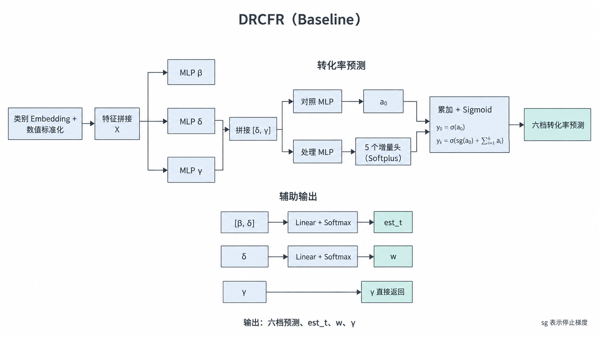   | 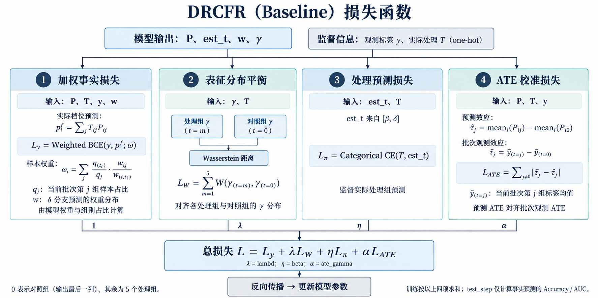   |
| experiment   | 分段函数/一次函数   | 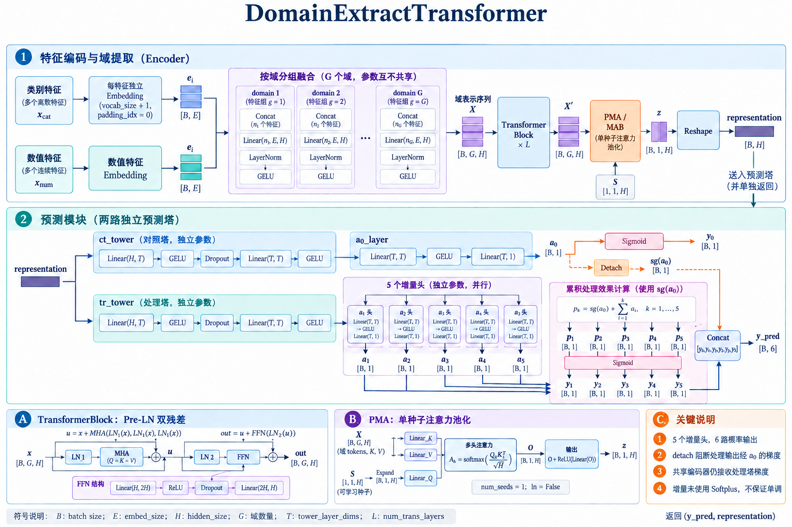   | 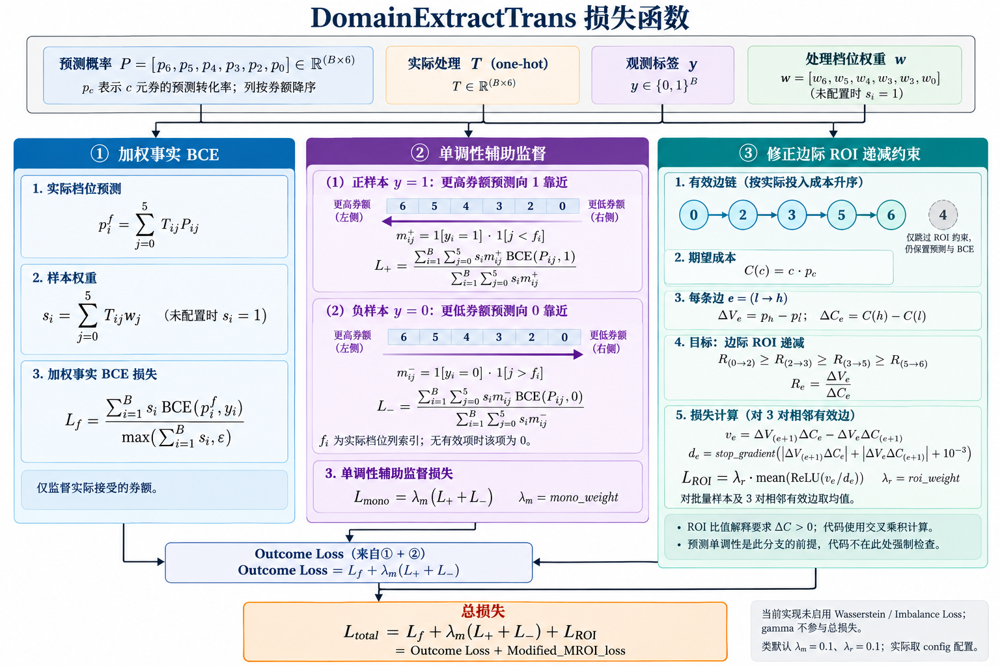   |

- **DomainExtractTrans****：****核心思想是将“特征”按“不同的子维度（本文称为domain域）”进行表征，再通过transformer做域间注意力交互，最后通过Set Transformer自适应聚合，做样本的表征学习representation，即**采用“**域内独立编码—域间注意力交互—自适应聚合**”的分层建模思路。本文将其必要性概括为如下几个方面：

	- （1）**“域内编码”**：由于模型的特征输入包括不同的范畴，而且各类范畴的特征数量存在较大差异。采用“特征分域”的形式，可以降低特征不均衡性，改善特征表征的能力；

	- （2）**“域内编码—域间注意力交互”**：可以优先学习各子空间的表征（如本文包括时间域、空间域、长期需求域、短期需求域等等），再统一规约到同一空间；

	- （3）“**域内独立编码—域间注意力交互—自适应聚合**”：使用 **Set Transformer** 将上述的表征做自适应聚合，以达到表征提取的目的；

- **融合单调性与边际ROI约束的联合损失函数：**

	- （1）单调性：低treatment组转化，那么高treatment组也应转化，反之亦然；

	- （2）边际ROI约束：是指模型预测值需要符合RCT的表现，本文对此做了“决策函数实验”，为下文中**V3实验版本**；

## 3.2 规划求解

> 规划求解主要复用之前的链路，本次不进行迭代更新；

- 问题定义：在<u>给定的完单CAC约束</u>下，如何通过发券**使得访问完单率最大化**？

$$\min\limits_Z\     \ f(Z)=-\begin{aligned}\sum_{i=1}^{n}\sum_{j=0}^{m}\tau_{ij}*z_{ij}\end{aligned}$$

$$s.t.\ \ \ g(Z)=\frac{\sum_{i=1}^{n}\sum_{j=0}^{m}(vfr_{0}+\tau_{ij})*coupon_j*z_{ij}}{\sum_{i=1}^{n}\sum_{j=0}^{m}(vfr_{0}+\tau_{ij})*z_{ij}} -finish\_cac\leq0$$

$$\forall i, \  \ \sum_{j=0}^{m}z_{ij} = 1$$

	- 符号说明：

$$n$$为进组访问总人数

$$vfr_{0}$$表示无优惠下的访问完单率，即访问后当天是否完单

$$\tau_{ij}$$表示第$$i$$个用户在第$$j$$种立减券下的vfr弹性，即受到第$$j$$种立减券获得的访问完单率的提升

决策变量$$z_{ij}\in \left \{ 0,1 \right \}$$，表示第$$i$$个用户是否要下发第$$j$$种立减券

	- 立减券范围：0元、2\~6元

	- CAC口径：$$完单CAC=\frac{核销总金额}{完单用户数}$$

- 由于分桶策略和贪心策略各有优劣，两版策略都曾作为流召求解策略上线，前人的工作并未证明哪者更优，本期实验将同时上线两种求解方案。

### 3.2.1 分桶求解

	1. 求解维度：本次策略优化的分桶求解**采用全国维度求解**，不对城市框和周中/周末进行区分；

	2. 分桶维度：根据 $$vfr_{0}$$（等频分桶）×  $$kid$$（不同treatment下的ITE聚类中心），对**访问用户**进行聚合分桶。

### 3.2.2 贪心求解

	1. 求解维度：本次策略优化的贪心求解同样**采用全国维度求解**，不对城市框和周中/周末进行区分；

	2. 求解流程：

		1. 通过用户历史数据和立减券面额数据用模型预测出每种立减金额下的访问完单率预估值$$vfr_0^i,…,vfr_{m}^i$$；

		2. 基于每个用户不同treatment下的预估值，去掉非凸点；

		3. 计算每个用户剩余面额的边际ROI和增量花费；

		4. 对数据集按照边际ROI降序排序，并且对增量成本进行累加；

		5. 再对数据集进行遍历，找到最接近预算的累计花费对应的样本，此样本之前的所有用户的最大立减金额即为分配结果

# 四、实验结果/评估结果

由于前置算法模型未能优于人工策略，同时考虑到本次AB实验只包含“人工策略”与“该算法模型（分桶策略/贪心策略）”，所以本部分主要通过**“离线消融实验”**来论证<u>算法模型</u>的有效性与合理性；同时结合**“AB实验”**的显著性分析来论述<u>总体策略方案</u>的有效性；

## 4.1 离线评估结果

### 4.1.1 模型迭代离线评测

为提升流失天降红包策略的补贴分配效率，本项目围绕**模型结构**、**损失函数**、**特征表征**及**决策函数**开展多轮优化，并以 MTAUCC 作为核心离线评测指标，对比各候选方案与基线策略的表现。下表汇总了 V1—V5 各版本的迭代方向、优化动机、具体方案及评测结果，用于梳理不同优化路径的效果，并为后续模型选择与线上 AB 实验提供依据。其中，在相同数据与评测设置下仅调整单一模块的对比，可作为消融分析；涉及多项改动的版本对比，主要用于评估整体方案的收益。

| **“**流失天降模型”优化实验表   |
| :---: |
| **实验版本**   | **迭代方向**   | **迭代出发点**   | **具体优化**   | **模型结构（简图）**   | **评测****^\[7\]^**   |
| V1   | 模型结构   | - drcfr缺少representation层，可能导致模型对单一特征过大依赖而过拟合；    | - 新增representation层    | [图表01 · 源文件](附件/LR26-047/图表01.json) · [在 Cooper 查看图形](https://cooper.didichuxing.com/knowledge/2199610335356/2209896035194) | - random MTAUCC: **0.03962**   - drcfr-arcr MTAUCC: **0.07549**   - baseline MTAUCC: **0.02676**   - exp1 MTAUCC: **0.08842**    |
| - drcfr缺少“域内特征”与“域间特征”的关系建模；    | - 将特征拆分为不同的类，先域内MLP，再域间attention    |
| 损失函数   | - 不需要treatment loss；   - 低补贴转化，那么高补贴也应转化，反之亦然；    | - Outcome Loss(with weight) + Monotonic Loss + MROI Loss    |
| 特征   | - 端外统计特征已生产，可放入模型；    | - 新增端外统计特征    |
| V2   | 模型结构^\[1\]^   | - Attention之后做多域特征融合不够灵活；    | - concat拼接融合    | [图表02 · 源文件](附件/LR26-047/图表02.json) · [在 Cooper 查看图形](https://cooper.didichuxing.com/knowledge/2199610335356/2209896035194) | - random MTAUCC: **0.03962**   - drcfr-arcr MTAUCC^\[9\]^: **0.07549**   - baseline MTAUCC: **0.02676**   - exp2 MTAUCC: **0.08842**    |
| - 均值池化    | - random MTAUCC: **0.03962**   - drcfr-arcr MTAUCC: **0.07549**   - exp2 MTAUCC: **0.08585**    |
| - set transformer^\[8\]^    | - random MTAUCC: **0.03962**   - drcfr-arcr MTAUCC: **0.07549**   - exp2 MTAUCC: **0.09656**    |
| V3   | 决策公式   | - RCT的数据vfr呈现边际递增，vfr导数先递增后递减，MROI递减但是有异常非凸点；    | - 分段函数+MROI递减约束（V2版本）    | [图表03 · 源文件](附件/LR26-047/图表03.json) · [在 Cooper 查看图形](https://cooper.didichuxing.com/knowledge/2199610335356/2209896035194) | - random MTAUCC^\[2\]^: **0.04086**   - exp3 MTAUCC: **0.08435**    |
| - 分段函数    | - random MTAUCC: **0.04086**   - exp3 MTAUCC: **0.09706**    |
| - 分段函数+改进的MROI约束^\[4\]^    | - random MTAUCC: **0.04086**   - exp3 MTAUCC^\[5\]^: **0.10515**    |
| - 基函数    | [图表04 · 源文件](附件/LR26-047/图表04.json) · [在 Cooper 查看图形](https://cooper.didichuxing.com/knowledge/2199610335356/2209896035194) | - random MTAUCC: **0.04086**   - exp3 MTAUCC: **0.09918**    |
| V4   | poi表征^\[3\]^   | - 经过EDA发现Embedding的city_id并不能召回vfr相似的城市，可添加poi表征进行实验；    | - city_id & 城市poi表征 & 格子poi表征    | [图表05 · 源文件](附件/LR26-047/图表05.json) · [在 Cooper 查看图形](https://cooper.didichuxing.com/knowledge/2199610335356/2209896035194) |   - random MTAUCC: **0.04086**   - exp4 MTAUCC:** 0.09047**    |
| - 城市poi表征 & 格子poi表征 & 城市asp表征    | - random MTAUCC: **0.04086**   - exp4 MTAUCC:** ****0.09626**    |
| V5   | 决策公式+poi表征   |    | - 对v3、v4进行融合    | [图表06 · 源文件](附件/LR26-047/图表06.json) · [在 Cooper 查看图形](https://cooper.didichuxing.com/knowledge/2199610335356/2209896035194) | - random MTAUCC: **0.04086**   - exp5 MTAUCC^\[6\]^:** ****0.10913**    |

- 离线收益总结

	- （1）模型结构：MTAUCC 0.07549 -> 0.08842（+17.12%）；

	- （2）特征融合方式：0.08842-> 0.09656（+9.21%）；

	- （3）决策公式：0.09656 -> 0.10515（+8.90%）；

	- （4）poi表征：0.10515 -> 0.10913（+3.79%）；

- 注:

	- \[1\]: 改处论证了**引入set transformer做多域表征自适应融合的合理性**；

	- \[2\]: 该处random MTAUCC与上文不一致，是因为剔除了异常数据。异常数据定义为日志中有city_id但无lng/lat的数据；

	- \[3\]: 该处的迭代是在V2的基础上展开的；

	- \[4\]: 此处的“MROI约束”是指约束<u>batch内</u>的表现（转化率/MROI）与RCT表现一致；

	- \[5\]: 该模型**为“不新增poi特征”****模型版本，**平均 MTAUCC为**0.10515****；**

	- \[6\]: 该模型**为“新增poi特征”****模型版本，**平均 MTAUCC为**0.10913****；**

	- \[7\]: 评测的random MTAUCC、exp MTAUCC均为**三个随机种子**的平均结果，增强评测的稳健性；

	- \[8\]: [https://github.com/juho-lee/set_transformer/tree/master](https://github.com/juho-lee/set_transformer/tree/master)

	- \[9\]: 现有组内最优drcfr模型，新增端外特征后的评测结果；[【LR26-027】乘客与增长-技术建设-平台联合决策ECR模型架构升级-V1.0](https://cooper.didichuxing.com/knowledge/2199610335356/2208910130893)

### 4.1.2 上线前评测

#### （1）人工策略

| 人工策略评测表   |
| :---: |
| **核销CAC****^\[5\]^**   | **samples_dict**   | **Control_sample**   | **Treatment_sample**   | **Control_Complete**   | **Treatment_Complete**   | **true_incre_cost**   | **true_incre_complete**   | **modified_incre_cost**   | **modified_incre_complete**   |
| 核销CAC2   | {0: 36713, 2: 35507, 3: 1081}   | 36713^\[7\]^   | 36588   | 10487   | 11058   | 22311   | 571   | 22387.223762   | 608.778780   |
| **核销CAC2.5****^\[6\]^**   | {0: 41010, 2: 26039, 3: 14738}   | 41010   | 40777   | 11464   | 12083   | 28971   | 619   | 29136.540452   | 688.042328   |
| 核销CAC3   | {0: 41010, 2: 18001, 3: 13141, 4: 9714}   | 41010   | 40856   | 11464   | 12275   | 35412   | 811   | 35545.479734   | 857.268602   |
| 核销CAC3.5   | {0: 41010, 2: 12768, 3: 13520, 4: 7912, 5: 6198}   | 41010   | 40398   | 11464   | 12287   | 40755   | 823   | 41372.408288   | 1009.139017   |
| 核销CAC4   | {0: 41010, 2: 6182, 3: 15697, 4: 9283, 5: 5849...   | 41010   | 40189   | 11464   | 12368   | 46499   | 904   | 47448.903680   | 1156.659384   |

- 注: 

	- \[5\]: 均为线上的实际人工策略；

	- \[6\]: **核销CAC2.5为线上人工策略主流量**；

	- \[7\]: 该评测只保留“人工策略”的所有发券城市集合（即剔除coupon=0的city）；

#### （2）模型评测

- **模型选择：**

	- **模型版本选择：**综合**4.1.1**的模型评测与上线成本，最终选择**上线模型版本**为**V3**（模型结构为DomainExtractTrans、143维特征）；

	- **模型实例选择：**经组内对齐，结合**“业务实际完单CAC”**背景，**选择seed=2222的模型实例**；

	- **模型域的划分：**

模型特征域划分
# 1.User_Profile

'User_Profile':\[

# 41维特征

'dm_user_vzt_pub_rfmpeat_kflw_a','dm_user_vzt_pub_rfmpeat_kflw_r','dm_user_vzt_pub_rfmpeat_r_score','dm_user_vzt_pub_rfmpeat_ut_a','dm_user_vzt_pub_rfmpeat_netcar_m','dm_user_vzt_pub_rfmpeat_btls_a','dm_user_vzt_pub_rfmpeat_btls_f','dm_user_vzt_pub_rfmpeat_kflw_t','dm_user_vzt_pub_rfmpeat_r_rank',

'dm_user_base_oneid_info_didi_silent_days','dm_user_vzt_pub_rfmpeat_netcar_a','dm_user_vzt_pub_rfmpeat_other_p','dm_user_vzt_pub_rfmpeat_netcar_f','dm_user_vzt_pub_rfmpeat_ut_synth','dm_user_deal_pub_rfm_btls_r',

'dm_user_base_oneid_info_oneid_record_num','dm_user_vzt_pub_rfmpeat_a_score','dm_user_mkt_biz_abst_netcar_call_qoq','dm_user_vzt_pub_rfmpeat_ut_f','dm_user_vzt_pub_rfmpeat_kflw_p','dm_user_vzt_pub_rfmpeat_a_rank','dm_user_behv_netcar_htpp_business_trip','dm_user_vzt_pub_rfmpeat_dj_m','dm_user_deal_pub_rfm_netcar_m',

'dm_user_base_oneid_info_age','dm_user_vzt_pub_rfmpeat_netcar_e','dm_user_deal_pub_rfm_netcar_f','dm_user_vzt_pub_rfmpeat_t_score','dm_user_vzt_pub_rfmpeat_dj_e','dm_user_vzt_pub_rfmpeat_netcar_r','dm_user_base_oneid_info_oneid_create_days','dm_user_vzt_pub_rfmpeat_other_a','dm_user_mkt_netcar_ordacc_jie_real_time_driver_wait_get_on_time_mean','dm_user_mkt_netcar_ordacc_jie_real_time_answer_dur_mean',

'dm_user_deal_pub_rfm_r_rank','dm_user_deal_pub_rfm_second_pref_score','dm_user_mkt_netcar_ordacc_gcsv2_zscore','dm_user_base_oneid_info_car_prob','recall_cnt','last_up_dt','dm_user_vzt_pub_rfmpeat_t_level'

\],

# 2.Spatial Context (空间域 - 含地理与场景)

'Spatial_Context':\[

'city_id',

# 'emb_vec_grid_poi',

# 'emb_vec_grid_asp',

'emb_vec_city_poi',

'emb_vec_city_asp'

\],

# 3.Temporal Context (时间域)

'Temporal_Context':\['hour_of_day','type_convert_day_of_week'\],

# 4.Short-Term Demand (短期/实时需求域)

'Demand_Short':\[

# 17维

'hxz_bubble_cnt_7d','hxz_recent_call_time_7d','hxz_bubble_cnt_28d','hxz_bubble_cnt_weekday_28d','call_ratio_28d','hurry_prob','wyc_bubble_cnt_7d',

'wyc_bubble_cnt_peek_7d','wyc_bubble_cnt_weekday_7d','wyc_bubble_cnt_flat_14d','wyc_bubble_cnt_weekday_14d','wyc_bubble_cnt_flat_28d','wyc_bubble_cnt_weekday_28d','dd_kf_sm_bubble_cnt_7d',

'first_sw_1d','first_sw_28d','other_sm_cnt_weekday_28d'

\],

# 5.Long-Term Demand (短期/实时需求域)

"Demand_Long": \[

# 48维

'wyc_finish_subsidy_c_60d','hxz_bubble_cnt_peek_60d','wyc_recent_call_time_60d','wyc_bubble_cnt_60d','wyc_finish_cnt_60d','hxz_bubble_cnt_weekday_60d','hxz_recent_call_time_60d',

'hxz_bubble_cnt_60d','call_ratio_60d','wyc_call_cnt_weekday_90d','wyc_call_dis_weekday_90d','wyc_call_cnt_peek_90d','wyc_call_dis_flat_90d','wyc_call_cnt_flat_90d',

'wyc_bubble_cnt_flat_90d','wyc_recent_call_time_90d','wyc_bubble_cnt_weekday_90d','wyc_finish_subsidy_c_90d','hxz_recent_call_time_90d','wyc_bubble_cnt_90d','wyc_recent_call_gmv_90d',

'hxz_bubble_cnt_flat_90d','wyc_finish_cnt_90d','hxz_bubble_cnt_90d','call_ratio_90d','wyc_call_dis_peek_120d','hxz_recent_call_time_120d','hxz_call_dis_flat_120d',

'hxz_recent_call_gmv_120d','wyc_finish_gmv_weekday_120d','wyc_call_cnt_120d','call_ratio_120d','wyc_call_avg_dis_weekday_120d','hxz_bubble_cnt_flat_120d','hxz_bubble_cnt_weekday_120d',

'hxz_finish_total_gmv_120d','wyc_bubble_cnt_flat_120d','wyc_bubble_cnt_weekday_120d','hxz_call_cnt_120d','wyc_recent_call_time_120d','wyc_recent_call_gmv_120d','hxz_finish_cnt_120d',

'wyc_bubble_cnt_120d','wyc_call_dis_120d','hxz_finish_subsidy_c_120d','hxz_finish_actucal_gmv_120d','hxz_bubble_cnt_120d','launch_cnt_30d'

\],

# 6.city_stat_domain

'city_stat_domain': \[

# 34维

'distinct_city_general_ecr','city_asp_28d','city_asp_7d','distinct_city_general_zy_create_ecr','distinct_city_general_avg_zy_finish','distinct_city_general_zy_compete_cr','distinct_city_general_send','distinct_city_general_avg_api_finish','distinct_city_general_hh_create_ecr','distinct_city_general_avg_select_pre_total_fee_amt','distinct_city_general_avg_min_pre_total_fee_amt','distinct_city_general_avg_min_estimate_fee_amt',

'distinct_city_hour_avg_select_pre_total_fee_amt','distinct_city_hour_avg_min_pre_total_fee_amt','distinct_city_hour_avg_select_estimate_fee_amt','distinct_city_hour_hh_compete_cr','distinct_city_hour_avg_zy_finish','distinct_city_hour_ecr','distinct_city_hour_finish','distinct_city_hour_avg_hh_finish','distinct_city_hour_hh_create_ecr','distinct_city_hour_zy_create_ecr','distinct_city_hour_zy_compete_cr','distinct_city_hour_avg_api_create_send','distinct_city_hour_avg_zy_send',

'distinct_city_time_avg_hh_finish','distinct_city_time_avg_api_finish','distinct_city_time_hh_compete_cr','distinct_city_time_avg_zy_finish','distinct_city_time_zy_compete_cr','distinct_city_time_finish','distinct_city_time_zy_create_ecr','distinct_city_time_ecr','distinct_city_time_avg_zy_send'

\],

- **评测结果：seed=2222，random vs exp MTAUCC +0.06409（0.04475->0.10884），详细评测可见下表：**

| **评测**   | **MTAUCC**   | **AUCC**   | **Qini**   | **ATE_error**   |
| :---: | :---: | :---: | :---: | :---: |
| **exp**  **(143维特征+exp模型)**   | 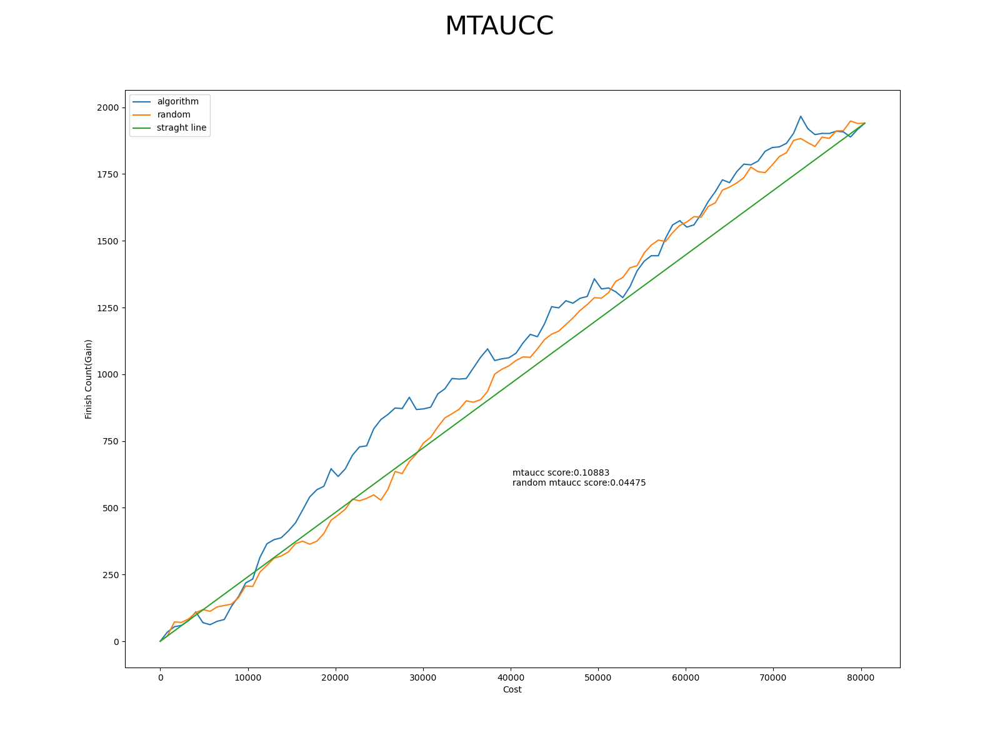   | 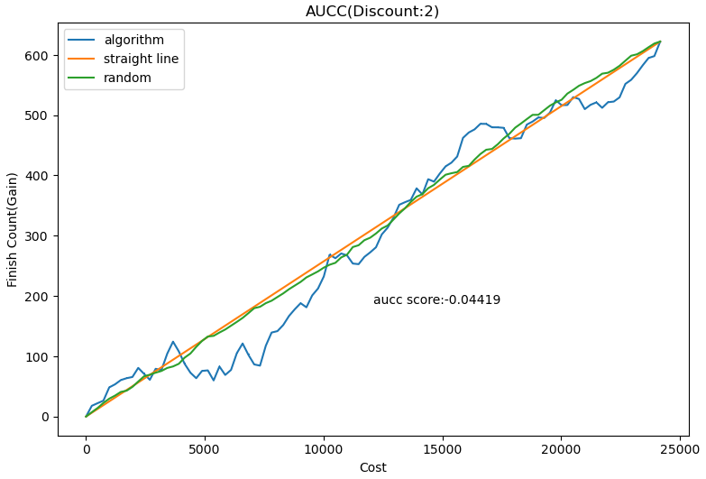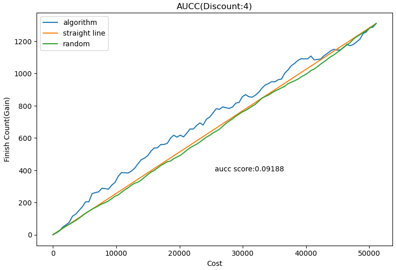   | 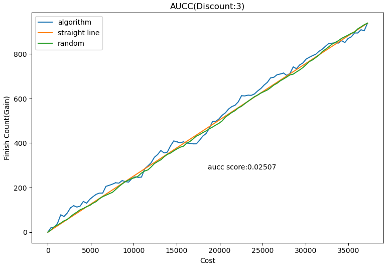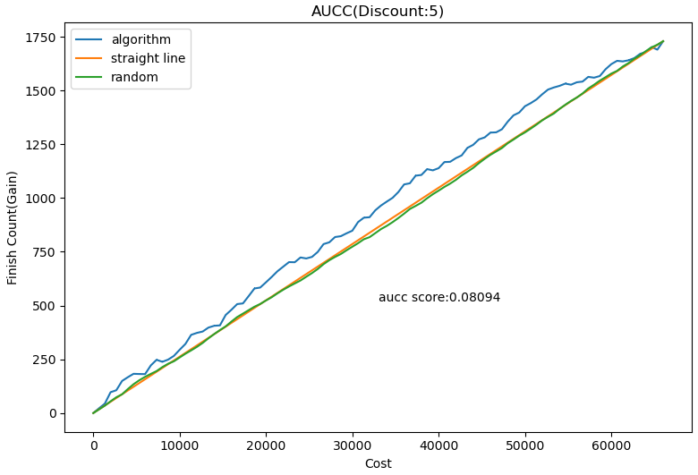  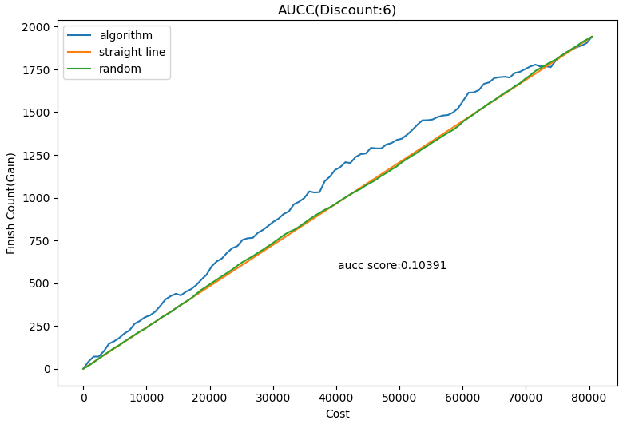   | 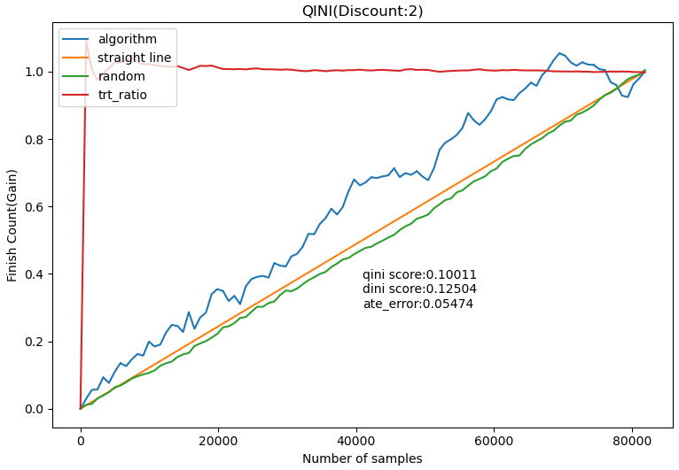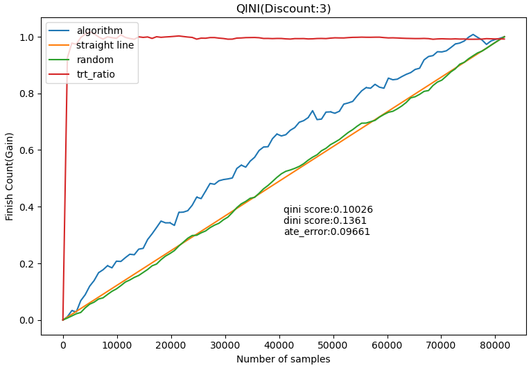   | 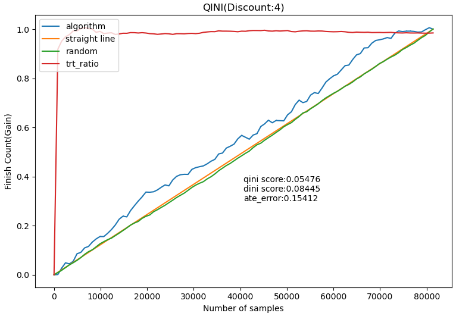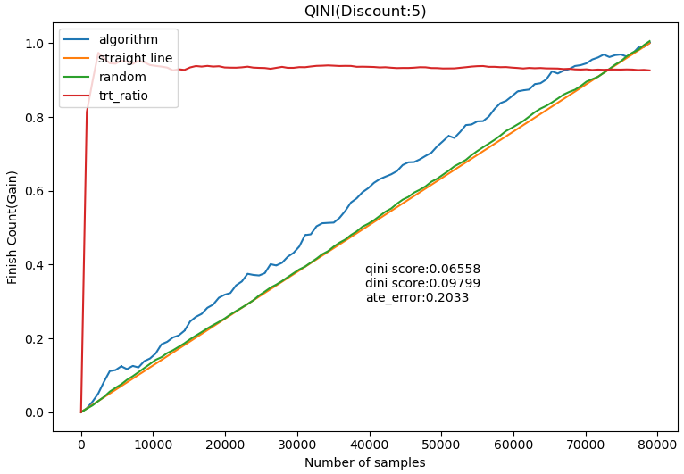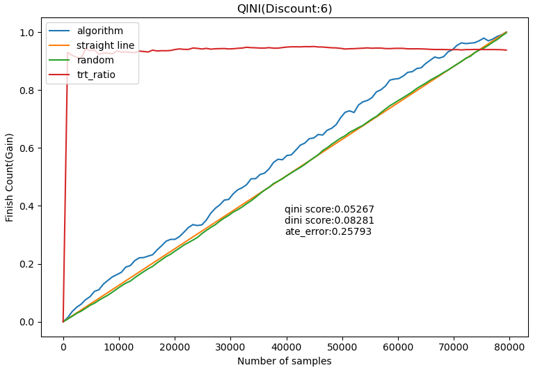   | - discount(2)：0.1306   - discount（3）：0.2434   - discount（4）：0.3247   - discount（5）：0.3727   - discount（6）：0.4055    |
| - discount(2)：0.05474**（-58.09%）**   - discount（3）：0.09661**（-60.31%）**   - discount（4）：0.15412**（-52.53%）**   - discount（5）：0.2033**（-0.4545%）**   - discount（6）：0.25793**（-36.39%）**    |

#### （3）人工策略 vs 模型

- <u>为了与“线上人工策略”拉齐</u>，在本节对**“人工策略”**与**“待上线策略”**进行评测对比。总的来说，在已有“核销CAC”下，算法模型的vfr转化率高于人工策略；

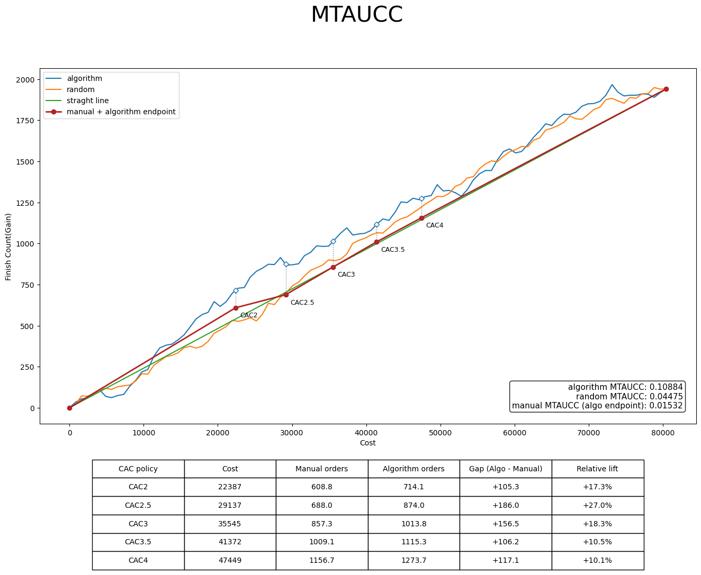

## 4.2 AB实验结果与分析

### 4.2.1 AB实验方案

| ** **   | **内容**   |
| --- | --- |
| 算法侧实验验证人   | 曹艾瑜   |
| 实验方式   | 乘客分流   |
| 实验平台   | 运筹实验平台   |
| 分流方式   | 运筹实验平台随机分流   |
| 分流细节^\[1\]^   | 人工组40%流量（当前线上主流量策略）：完单CAC = 1.6，采用人工策略，不接入算法；  实验组1，8.64%流量：完单CAC = 1.6，接入算法：DomainExtractTransformer + 贪心求解；  实验组2，8.64%流量：完单CAC = 1.6，接入算法：DomainExtractTransformer + 分桶求解；   |
| 实验周期   | 7天实验（2026-09-17\~2026-09-23）   |
| 流量范围   | 流量端：小猪端流量  实验生效品类：全部  分单场景：默认全部  城市范围：全国   |
| 评估指标   | 访问完单率、完单CAC   |
| 评估人   | DS&算法   |

分流细节如下：实验在Pope平台由业务侧进行配置，分为**人工组（40%）**、业务自留组（6%）、**算法组（54%）**

- 其中算法组分流至运筹实验平台，由算法侧进行实验流量比例分配，其中：

	- 算法-贪心求解组占比16%

	- 算法-分桶求解组占比16%

	- 其余差异化核销CAC组占比68%

- 实验评估对比的是人工组 vs 算法-贪心求解组 vs 算法-分桶求解组，最终比例为 —— 40%  ：54%\*16%=8.64%  ： 54%\*16%=8.64%，即 100：21.6：21.6

### 4.2.2 AB实验结果及其评估

拉齐完单CAC下的AB实验基本**用户登端访问、完单、访问完单率**等表现如下：

| **实验分组**   | **访问用户数**   | **冒泡用户数**   | **完单用户数**   | **访问完单率**   | **完单CAC**   | **人均访问**   | **人均冒泡**   | **人均完单**   | **人均GMV**   | **人均C补**   | **var\_访问**   | **var\_冒泡**   | **var\_完单**   | **var_GMV**   | **var_C补**   |
| :---: | :---: | :---: | :---: | :---: | :---: | :---: | :---: | :---: | :---: | :---: | :---: | :---: | :---: | :---: | :---: |
| 算法-贪心求解-核销2.5   | **143188**   | **86771**   | **46644**   | **32.58%**   | **1.604941**   | 8.12338324   | 1.30458558   | 0.46238512   | 7.719131   | 1.388626   | 0.00080219   | 2.44E-05   | 5.45E-06   | 0.00238402   | 7.44E-05   |
| 算法-分桶求解-核销2.5   | **142256**   | **85974**   | **46080**   | **32.39%****^\[2\]^**   | **1.585908**   | 8.086977   | 1.28729895   | 0.45715471   | 7.616206   | 1.370088   | 0.00080511   | 2.37E-05   | 5.25E-06   | 0.00218647   | 7.11E-05   |
| 人工组   | **649465**   | **385385**   | **208917**   | **32.17%**   | **1.619543**   | 8.07880024   | 1.2667688   | 0.4548821   | 7.574356   | 1.394735   | 0.00017758   | 5.30E-06   | 1.16E-06   | 0.00054544   | 1.61E-05   |

- 注：

	- \[1\]：对于流失场景，**核销CAC \* 0.6 ≈ 完单CAC**；

对于上述AB实验结果，算法组贪心求解的访问完单率增益为**+0.41pp**。对其进行显著性分析，详细分析可见[流失召回算法AB实验评估](https://cooper.didichuxing.com/didocs/2209909078623)

|    | **PV指标（****Page View****）**   | **UV指标（****Unique Visitor****）**   |
| :---: | :---: | :---: |
| 显著性分析   | 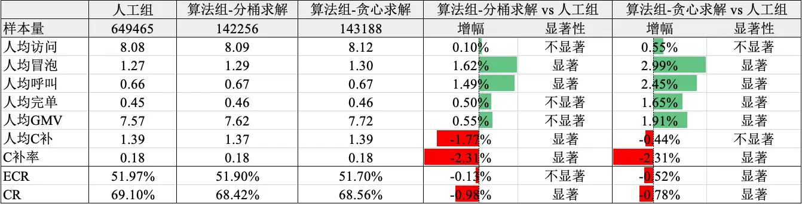   | 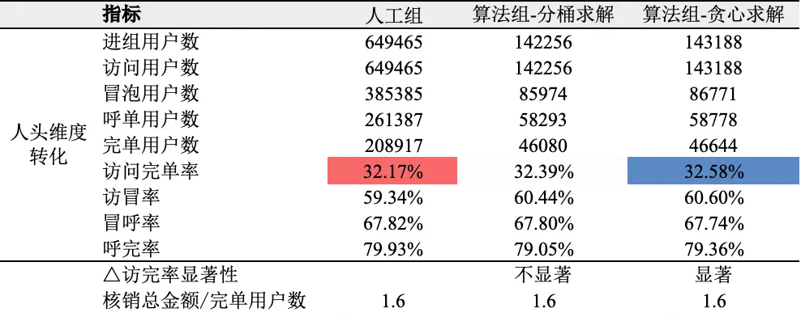   |

### 4.2.3 下钻分析

（1）**城市框下拆**

- “贪心策略”优于“分桶策略”，本文推测是由于贪心策略保留了用户级补贴响应差异，而分桶策略把用户进行聚合损失了部分精细分配能力。基于城市框的钱效见下：

| **C补率**   | **分桶**   | **贪心**   | **diff**   |
| :---: | :---: | :---: | :---: |
| 行业增长-大   | 17.70%   | 17.75%   | +0.05pp   |
| 行业增长-小   | 20.60%   | 20.20%   | -0.40pp   |
| 核心城市   | 13.90%   | 14.14%   | +0.24pp   |
| 战略收缩城市   | 19.37%   | 19.30%   | -0.07pp   |
|    |    |    |    |
| **vfr**   | **分桶**   | **贪心**   | **diff**   |
| 行业增长-大   | 36.69%   | 37.68%   | -0.01pp   |
| 行业增长-小   | 31.63%   | 31.88%   | +0.25pp   |
| 核心城市   | 42.06%   | 42.12%   | +0.06pp   |
| 战略收缩城市   | 30.88%   | 30.89%   | +0.01pp   |

- 贪心 vs 分桶：相较于分桶策略，贪心策略将“行业增长-小”的预算腾挪到“核心城市”，带来了核心城市的完单增长；且“行业增长-小”城市框的钱效提升，最终没有折损规模

（2）**折扣分布分析**

流失首单天降RCT：钱效曲线呈现非单调递减的趋势，在trt=4时最高：

| exp_group   | 访问用户数   | 冒泡用户数   | 呼叫用户数   | 完单用户数   | 访问完单率   | 核销总金额   | 核销CAC   | 完单CAC   | delta_vfr   | delta_cost   | vfr_ROI   |
| :---: | :---: | :---: | :---: | :---: | :---: | :---: | :---: | :---: | :---: | :---: | :---: |
| stg_price_exp_coupon0   | 67231   | 42518   | 29108   | 22578   | 35.846%   | 0   | 0.00000   | 0.00000   | -   | -   | -   |
| stg_price_exp_coupon2   | 66925   | 42673   | 30800   | 23878   | 38.059%   | 17193   | 2.00010   | 0.72000   | 0.02213   | 2.00010   | **0.01107**   |
| stg_price_exp_coupon3   | 66258   | 42426   | 31412   | 24369   | 39.189%   | 33882   | 3.00000   | 1.39040   | 0.03343   | 3.00000   | **0.01114**   |
| stg_price_exp_coupon4   | 66489   | 42539   | 32279   | 25337   | 40.705%   | 52203   | 3.99990   | 2.06030   | 0.04859   | 3.99990   | **0.01215**   |
| stg_price_exp_coupon5   | 62492   | 39912   | 30714   | 24290   | 41.434%   | 67978   | 4.99990   | 2.79860   | 0.05587   | 4.99990   | **0.01118**   |
| stg_price_exp_coupon6   | 63233   | 40567   | 31664   | 25086   | 42.319%   | 92412   | 6.00000   | 3.68380   | 0.06472   | 6.00000   | **0.01079**   |

表现最优的贪心算法组，treatment=4的折扣占比也最高：

| **exp_group**   | **resp_coupon_amount**   | **进组用户数**   | 占比   |
| :---: | :---: | :---: | :---: |
| 人工组   | 0   | 50164   | 7.7%   |
| 2   | 381683   | 58.8%   |
| 3   | 217618   | 33.5%   |
| 算法-分桶求解-核销2.5   | 0   | 27573   | 19.4%   |
| 2   | 39690   | 27.9%   |
| 3   | 17973   | 12.6%   |
| 4   | 50867   | 35.8%   |
| 5   | 6121   | 4.3%   |
| 6   | 32   | 0.0%   |
| 算法-贪心求解-核销2.5   | 0   | 28733   | 20.1%   |
| 2   | 34125   | 23.8%   |
| 3   | 21755   | 15.2%   |
| 4   | 53503   | **37.4%**   |
| 5   | 5056   | 3.5%   |
| 6   | 16   | 0.0%   |

# 五、放量决策

|    |    | 预期扩量时间节奏   | 实际扩量时间   | 放量暂停点详情   | 放量暂停点效果评估   | 是否需要设置长期对照组（默认不需要，此列无需填写）   |
| --- | --- | --- | --- | --- | --- | --- |
|    |    |    | LR通过后，根据实际情况，填写这3列   |    |
| 放量决策意见   | 决策人：张志茹   |    |    |    |    |    |
| 决策意见：  - 通过    |    |    |    |    |    |
| 放量需要周知的利益相关方   | 无   |    |    |    |    |    |
| 放量策略   | 实验组1（贪心求解组）   |    |    |    |    |    |
| 放量节奏   | 直接推全-随机分流   | - 在预算腾挪后的新CAC约束下进行一周实验后，算法组vs人工组仍显著正向则推全    |    |    |    |    |

# 六、后续规划

1. **增加实时特征**

        当前模型已引入60天、90天、120天多端统计特征，主要刻画用户长期表现。后续计划增加已完成开发的**用户访问渠道实时特征**和**进端到冒泡时间差异实时特征**，提升模型预估准确率（BRD文档：[新增实时特征用于算法模型提效](https://cooper.didichuxing.com/docs2/document/2206874892184)）

2. **无定位用户兜底策略优化**

针对登端未开启定位的用户，可推进天降红包兜底策略迭代。首先，该类用户占比较大；其次，当前兜底策略存在<u>完单 CAC 较高、转化率较低</u>的问题。对兜底策略的迭代，一方面可以**改善算法策略影响面**，另一方面，可提升整体召回效果与补贴效率。

3. **模型长期效果监控与持续自进化**

当前链路主要采用“单次 RCT 实验→单次模型迭代→AB 实验→推全”的模式，模型上线后缺少持续的数据更新与迭代机制，随着用户结构、市场环境及补贴响应的变化，长期效果可能逐步下降。需将“单次模型优化”升级为**以长期效果监控为反馈、持续数据供给为基础、策略自进化为核心的迭代闭环**。

- **建立长期效果监控机制，识别策略衰减。**保留一定比例的长期对照组，在相同时间窗口内持续比较策略收益；同时监控实验组的转化率、完单 CAC 等指标，结合连续多个周期的变化设置预警，减少短期波动带来的误判。重点关注拉齐完单 CAC 后的转化率提升，判断策略优势是否持续；

- **完善持续数据供给机制，为模型更新提供依据。**长期保留一定比例的 RCT 探索流量，持续获取各补贴档位的响应数据，使模型能够学习最新的用户补贴敏感度。同时开展观察性数据模型优化实验，在控制混杂偏差、验证评测可靠性的前提下利用日常线上数据，提升数据利用率，并探索降低对长期 RCT流量的依赖，兼顾模型更新需求与探索成本；

- **推动策略自进化落地，将监控反馈转化为优化行动。**结合周期性迭代与效果衰减预警，触发模型重训练及候选方案生成，围绕模型结构、损失函数、特征表征等开展优化。候选方案通过离线评测后进入线上 AB 实验，仅在验证收益后更新上线，并纳入长期监控，形成“持续采集→自动迭代→离线筛选→AB 验证→上线监控→反馈更新”的闭环；

- **以持续收益验证策略自进化的有效性。**自进化的价值不仅在于自动完成训练与部署，更在于持续发现并验证更优策略。通过如下”效果“与”效率“这两类指标，验证策略自进化能否缩短效果恢复周期、维持长期策略优势，并提升整体迭代效率；

	- 效果层面，评估同等完单 CAC 下的转化率收益及其持续性；

	- 效率层面，评估从效果衰减识别到策略更新的周期、人工投入与候选方案验证效率；

# 七、引用和鸣谢

- [【LR25027】流失召回算法策略v0](https://cooper.didichuxing.com/knowledge/2199610335356/2205121614750)

- [【LR26-027】乘客与增长-技术建设-平台联合决策ECR模型架构升级-V1.0](https://cooper.didichuxing.com/knowledge/2199610335356/2208910130893)

- [【流失天降红包】离线迭代总结](https://cooper.didichuxing.com/knowledge/2208612170863/2209688938871)

- [【BRD】流失首单算法策略迭代](https://cooper.didichuxing.com/didocs/2209902286021)

- [【乘客与增长-增长策略-流失召回算法策略优化-V1.0-V1】](https://cooper.didichuxing.com/knowledge/2199610335356/2210021628911)

- [流失召回算法AB实验评估](https://cooper.didichuxing.com/didocs/2209909078623)

- [https://github.com/juho-lee/set_transformer/tree/master](https://github.com/juho-lee/set_transformer/tree/master)

感谢曹艾瑜在“规划求解”以及“ab实验上线以及评估”方面提供的支持！

感谢夏雕对模型上线的支持与配合！

感谢门畅、周之烁提供的因果推断方面的理论指导！

感谢周之烁对文档修改提出建议！
