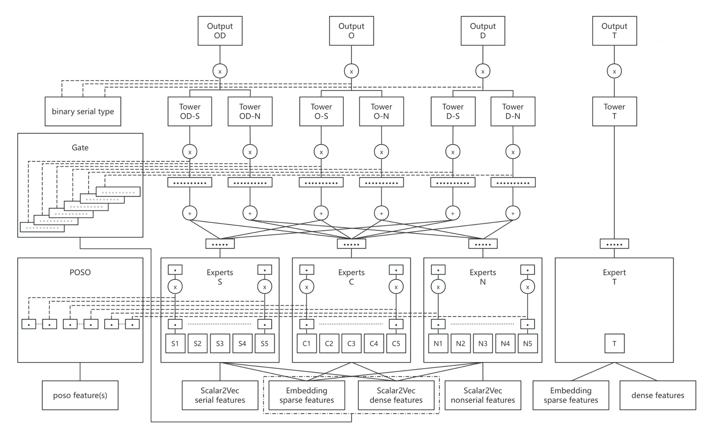
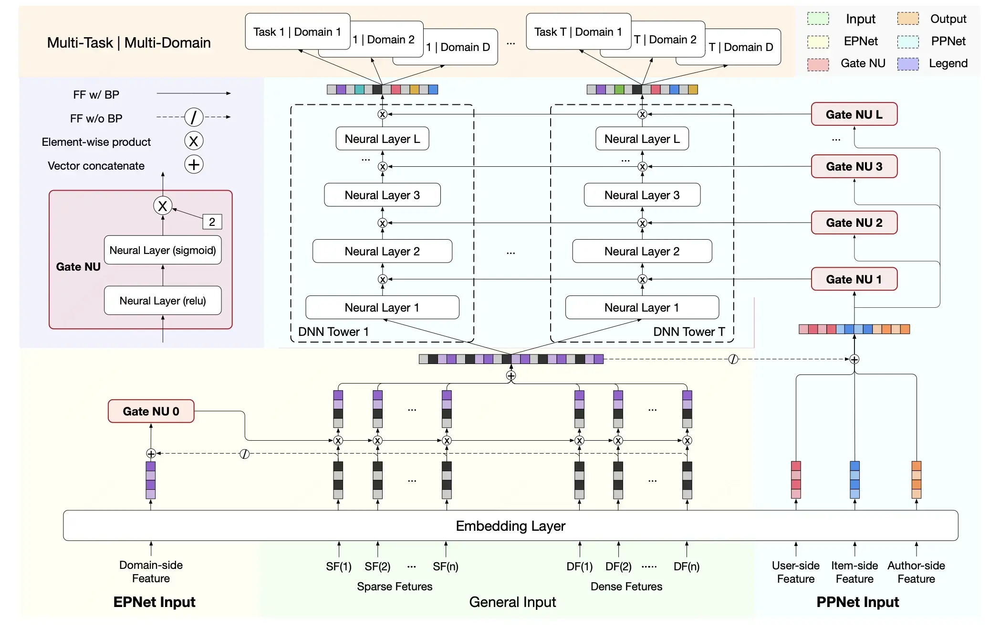
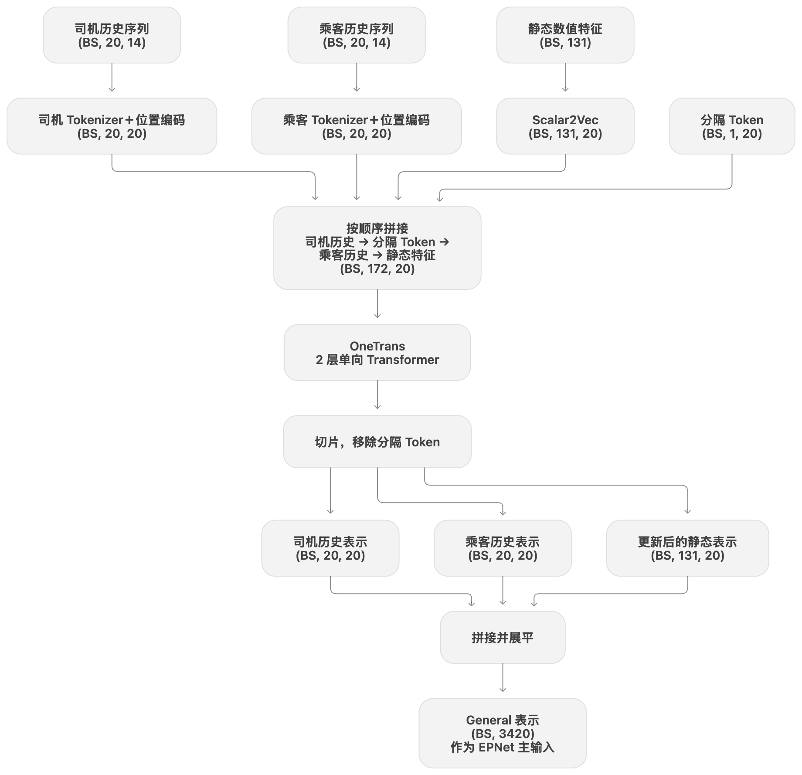
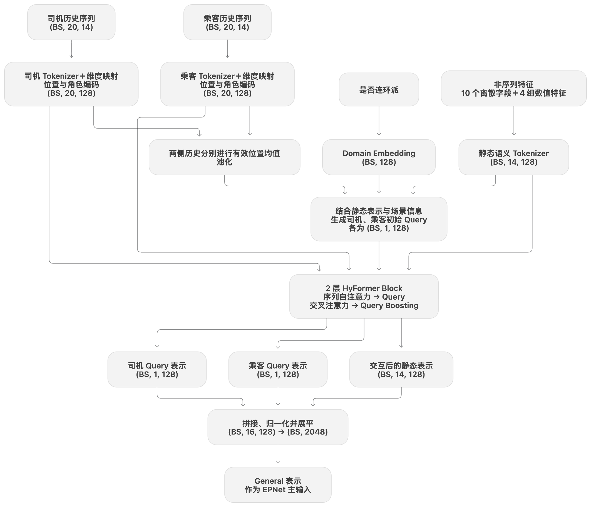

# 【LR26-048】交易效率-技术建设-DO价值建模离线探索-V1.0

[Cooper 原文](https://cooper.didichuxing.com/knowledge/2199610335356/2210021577089)

# 基础信息

| 项目   | 内容   |
| --- | --- |
| BRD 文档链接   | [[BRD]DO价值建模离线探索](https://cooper.didichuxing.com/knowledge/2199610335356/2210017050557)   |
| 最后通过的策略方案链接   | [交易效率-离线策略-DO价值建模离线探索-V1.0-V1](https://cooper.didichuxing.com/knowledge/2199610335356/2209987713967)   |
| 实验链接（评估大师）   | 无，离线类LR   |
| 核心贡献点   | - **搭建业务驱动的 AutoFE 工作流**：借助 LLM 的语义理解能力，结合履约任务与数据字段生成候选统计特征，串联特征初筛、边际收益评估和目标模型验证，形成可复用的特征建设流程。   - **引入司乘历史序列并完成联合建模**：构建司机、乘客历史订单序列，将 OneTrans、HyFormer 适配到履约预测场景。通过对照实验，分别验证序列特征本身的价值与交互建模带来的额外收益。   - **开展多场景、多任务网络优化**：针对现有 PLE 的专家权重集中与特征分布差异，优化门控输入和专家归一化；进一步引入 PEPNet 的场景与个性化调制机制，通过消融实验，验证该方法在司乘履约业务中的适用性。    |
| 第一贡献人   | 李昊远   |
| 共同贡献人   | 吴健、闫博   |
| 后续策略负责人   | 李昊远   |

## 1 背景

当前司乘履约模型采用多任务结构，联合预测司机履约、乘客履约和订单完单三个目标。三个任务具有业务关联，但其影响因素及在连环派、非连环派场景下的表现存在差异，现有线上模型预测 AUC 仍有提升空间，因此，本次从特征和网络结构优化开展离线探索。

| 方向   | 存在问题   | 改进方案   |
| --- | --- | --- |
| 特征：AutoFE   | 人工特征构建依赖经验，业务场景覆盖有限。   | 基于**LLM搭建工作流**完成候选特征生成、筛选、模型验证。   |
| 特征+网络结构：序列特征建模   | 聚合统计弱化单次订单细节和订单行为顺序。   | 将历史行为与订单特征统一编码为 **Token**，通过**注意力交互**或者**Token-Mixing**构建融合历史信息的订单表示。   |
| 网络结构：多任务模型结构优化   | 现有模型依赖通用信息，未充分利用场景差异。   | 优化现有模型网络结构并探索**PEPNet**的场景与用户个性化门控。   |

## 2 目标 & 约束

目前线上履约率模型baseline在离线数据集上的AUC表现如下：

| 模型   | od_auc（完单auc）   | o_auc（乘客履约auc）   | d_auc（司机履约auc）   |
| --- | --- | --- | --- |
| 线上模型   | 0.7199   | 0.7269   | 0.7640   |

策略优化目标：相比线上模型，订单完单，司机履约和乘客履约三个任务的AUC平均提高3.5PP。

## 3 技术方案

本方案从**特征建设与网络结构优化**两方面展开：通过 AutoFE 补充历史统计信息，通过序列建模提取与当前订单相关的历史行为信息，并优化多任务网络对场景及个性化差异的表达。各方向的具体方案如下：

| 方向   | 具体方案   |
| --- | --- |
| AutoFE   | 1. 利用**LLM的语义理解能力**，结合任务描述、数据生成候选统计特征。   2. 通过XGBoost**快速筛选**特征达到预设AUC增量，并按Gain重要性对候选特征排序。   3. 逐批增加特征，评估**边际收益**，权衡预测效果与计算成本。   4. 接入**最终多任务模型**验证增益。    |
| 序列特征建模   | 1. 通过订单表构建司机、乘客的**历史订单序列**。   2. 使用**OneTrans、Hyformer**建模历史行为与当前订单的关系，并接入多任务网络。    |
| 多任务模型优化   | 1. 利用场景信息调整专家分配，增强连环派与非连环派的**差异化建模**。   2. 引入 **PEPNet**，通过**EPNet**融入场景信息，通过**PPNet**融入用户个性化信息。    |

### 3.1 特征建设

现有模型使用订单、供需及司乘历史统计等特征，并包含连环派、非连环派的场景相关信息。主要特征分组如下：

| 原有特征   | 代表特征   | 特征数   |
| --- | --- | --- |
| 稀疏特征   | 派单类型，司机类型，城市id，商家id   | 10   |
| 稠密特征   | 订单特征，供需特征，乘客历史取消率特征   | 61   |
| 连环派特征   | 司机连环派历史拒单数、历史应答数、历史取消数、历史取消改派数、历史被乘客取消数等历史统计特征   | 35   |
| 非连环派特征   | 司机非连环派历史拒单数、历史应答数、历史取消数、历史取消改派数、历史被乘客取消数等历史统计特征   | 35   |

现有特征能够描述订单条件和司乘整体履约水平，但对细分场景下的历史表现及近期行为变化刻画不足。因此，引入基于**LLM的AutoFE**，补充更细粒度的历史统计特征；同时引入**司乘历史订单序列建模**，为识别近期行为变化趋势提供信息。

#### 3.1.1 新增历史统计特征：AutoFE

本方案基于**LLM**搭建**AutoFE 工作流**，结合任务描述与数据生成候选统计特征，依次开展初筛、边际收益评估和最终模型验证。整体流程如下：

[图表01 · 源文件](附件/LR26-048/图表01.json) · [在 Cooper 查看图形](https://cooper.didichuxing.com/knowledge/2199610335356/2210021577089)

**（1）结合业务任务与数据字段，生成候选特征**

人工特征设计容易受已有经验限制，难以充分覆盖不同订单场景。借助LLM对业务语义和字段含义的理解，围绕“哪些历史行为可能影响当前订单履约”，拓展候选统计特征。向LLM提供预测任务、可用数据表、字段含义及已有特征，主要从以下四个维度构造候选方案：

| 构造维度   | 设计内容   |
| --- | --- |
| 统计对象   | 司机、乘客、目的地格子等   |
| 场景粒度   | 与POI、发单时段、行程距离段、接驾距离段、派单类型等组合   |
| 时间窗口   | 近 7 天、近 28 天   |
| 统计方式   | 事件计数与比率、时长和距离的分布、活跃度、最近事件间隔等   |

例如，在司机整体取消率之外，进一步构造“司机在相同出发POI、相似行程距离下的历史取消率”，补充细粒度特征。

**（2）通过 XGBoost 初筛，缩小候选范围**

LLM 生成的候选特征需要通过数据验证。为降低直接接入多任务模型的实验成本，先利用XGBoost快速评估候选特征的预测价值。

- **整体评估**：分别针对三个预测任务训练，观察验证集AUC，判断候选集合是否具备进一步验证的价值。

- **特征筛选**：结合缺失情况和Gain重要性，剔除缺失严重或在三个任务中Gain均为零的特征，并对保留特征排序。

- **反馈调整**：若整体效果未达预设AUC增量，将各任务表现、低贡献特征及其所属类别反馈给LLM，调整候选方案。

**（3）评估边际收益，选择合适的特征规模**

Gain排序反映特征的相对贡献，但不能直接确定应保留多少特征。因此，通过逐批增加特征，比较预测收益的变化，权衡特征规模与计算成本。

- **构建递增集合**：按照 Gain 排序逐批增加特征，形成多个候选档位。

- **比较增量收益**：观察新增一批特征后的验证集 AUC 变化，识别收益趋缓的位置。

- **选择验证范围**：结合三个任务的收益与计算成本，选择具有代表性的候选集合进入目标模型验证。

**（4）接入目标模型，验证实际增益**

初筛模型与实际网络的特征利用方式不同，需要进一步确认候选特征在目标模型中的补充价值。对比新增特征前后三个任务的 AUC，结合预测收益与计算成本，确定最终使用的特征集合。

#### 3.1.2 序列特征建模

历史统计特征能够描述司乘的整体履约水平，但难以保留单次订单的具体条件和行为发生顺序。例如，相同的历史取消率，可能对应近期连续取消，也可能对应较早发生的零散取消。为补充这些差异，分别选取当前司机、乘客之前**最近20笔历史订单**，按时间顺序构成两组序列，主要包含以下信息：。

| 信息类别   | 主要内容   | 表达信息   |
| --- | --- | --- |
| **履约行为**   | 应答前乘客取消、应答后乘客／司机／客服取消   | 取消行为发生趋势   |
| **时间信息**   | 呼单时间、应答时间   | 取消行为发生时间   |
| **订单条件**   | 订单价格、预估行程距离   | 什么价格与行程会容易发生取消   |
| **空间与接驾信息**   | 起终点经纬度、接驾时长、预估接驾距离   | 什么供需情况下会容易发生取消   |
| **派单场景**   | 是否连环派   | 什么派单场景会容易发生取消   |

通过上述设计，模型不仅能够利用历史取消率等统计信息，还能进一步学习近期在什么订单条件下发生了取消，取消趋势如何，为三个履约预测任务提供上下文信息。历史不足 20 笔时进行补齐，并通过有效性掩码区分真实订单与补齐位置。在序列特征基础上，进一步引入OneTrans、HyFormer学习历史行为与当前订单的关联，具体结构见后续序列建模方案。

### 3.2 多任务模型结构优化

围绕场景差异与历史行为建模，分别开展 PLE 优化和 PEPNet 探索：在 PLE 中调整专家分配方式并归一化专家输入；在 PEPNet 中引入场景与个性化门控。同时，通过序列模块融合司乘历史与当前订单信息，增强多任务预测所使用的特征表示。

#### 3.2.1 PLENet

线上模型采用 PLE，同时预测订单完单（OD）、乘客履约（O）和司机履约（D）。模型设置连环派、共享和非连环派三组专家，各任务通过Gate对可访问的专家输出进行加权融合。结构如下：

OD对应task 0／1，O 对应 task 2／3，D 对应 task 4／5，各任务均设置连环派、非连环派两个分支。每组包含五个专家，分别处理原值、平方、开方、对数和高斯变换后的数值特征。如下表所示：

| 专家组   | 专家编号   | 使用范围   |
| --- | --- | --- |
| 连环派专家组 S   | 1–5   | 连环派任务场景预测   |
| 共享专家组 C   | 6–10   | 两类场景预测   |
| 非连环派专家组 N   | 11–15   | 非连环派场景预测   |

##### 3.2.1.1 gate场景化路由与专家归一化

现有 PLE 的专家权重集中于少数共享专家，连环派与非连环派专家的作用未得到充分体现；同时，不同数值变换带来的输入尺度差异可能影响专家训练。因此，本方案以场景标识引导 Gate 分配专家权重，并对各路专家输入分别进行 BatchNorm，优化专家表示与融合方式。具体分工如下：

| 模块   | 作用与优化方式   |
| --- | --- |
| 专家网络   | 对不同数值变换后的输入分别进行 BatchNorm，减轻尺度差异对训练的影响，利用订单、司乘等特征学习履约表示。   |
| Gate 网络   | 输入**简化**为是否连环派的**场景标识**，学习各预测任务分支对应的专家组合权重，增强场景差异建模。   |

##### 3.2.1.2 适配序列特征

为使三个任务共同利用司乘历史信息，在PLE的embeding层引入借鉴OneTrans思路的序列交互模块，将司乘历史序列与共享非序列特征（稀疏特征+稠密特征）联合建模，再将带有序列信息的embeding向量接入共享专家组C。

[图表02 · 源文件](附件/LR26-048/图表02.json) · [在 Cooper 查看图形](https://cooper.didichuxing.com/knowledge/2199610335356/2210021577089)

| 处理环节   | 具体方式   | 作用   |
| --- | --- | --- |
| **统一特征表示**   | - 司机、乘客历史序列特征分别通过 tokenizer 编码，每笔订单对应一个 token；   - 非序列共享特征转换为同维度 token，并叠加可学习的标识向量   - 引入聚合 token    | 统一不同来源的特征表示，并通过聚合 token 汇总整体信息   |
| **Transformer 联合交互**   | 通过注意力机制学习历史订单序列之间、历史订单序列与当前订单之间的关联   | 将相关历史序列信息融入非序列特征表示及聚合 token   |
| **接入共享专家**   | 取出更新后的共享非序列特征，并拼接聚合 token，输入共享专家组 C   | 为订单完单、乘客履约和司机履约预测提供融合后的特征表示   |

#### 3.2.2 PEPNet

PLE 通过Gate调整专家组合，表达场景差异。考虑到特征也可能在不同场景或用户条件下具有不同作用，本方案进一步探索 PEPNet，PEPNet主要由EPNet（Embedding Personalized Network）和PPNet（Parameter Personalized Network）两部分组成。EPNet 在embedding层引入场景信息，调整不同特征的重要性；PPNet在网络中引入个性化信息，逐层调整隐藏表示，使共享特征能够适应不同用户的预测需求。结构如下：

图中输入分为三类：**General Input**是主预测路径的输入，**EPNet Input** 提供场景先验，**PPNet Input** 提供用户个性化先验。

| 模块   | 实现方式   | 作用   |
| --- | --- | --- |
| **Gate NU**   | 两层神经网络，依次使用 ReLU、Sigmoid，并将输出乘以2。与PLE对专家组合进行加权不同，Gate NU 的各维权重独立生成，无需总和为 1。   | 生成逐维缩放权重：小于 1 时抑制，大于 1 时增强，等于 1 时保留原表示   |
| **EPNet**   | 结合场景先验与预测网络输入特征，通过Gate NU生成权重，与输入特征逐元素相乘   | 调整输入特征在当前场景下的重要性   |
| **PPNet**   | 结合个性化先验与主预测路径输入，通过各层 Gate NU 调整任务网络的中间表示   | 使各任务适应不同用户的个性化差异   |

##### 3.2.2.1 EPNet/PPNet实验

**（1）模块消融：验证 EPNet 与 PPNet 的贡献**

以完整 PEPNet 为基线，分别移除 EP 门控、PP 门控及两类门控，对比三个任务的 AUC，评估场景调制与个性化调制的作用。移除 EP 后，输入表示直接进入主干预测网络；移除 PP 后，保留DNN，仅取消逐层门控调制。

**（2）Gate NU优化：改善门控训练状态**

针对部分 EP、PP Gate 输出饱和、样本间权重差异较小的现象，通过独立学习率控制更新速度、梯度裁剪限制异常更新，或引入正则项约束过度缩放。通过对照实验，评估这些措施能否改善门控训练状态并提升预测。

##### 3.2.2.2 适配序列特征

在上述结构基础上，分别使用 OneTrans 和 HyFormer 融合司乘历史行为序列与当前订单信息，构建新的General embedding向量，再接入 EPNet 和 PPNet。两种方案的主要区别在于历史信息的交互与提取方式。

**（1）OneTrans：联合序列特征与非序列特征**

将司乘历史订单和当前订单的非序列特征统一转换为 token，通过 Transformer 联合交互，使模型在学习历史行为关联的同时，将历史信息融入当前订单表示。

| 处理环节   | 具体方式   | 作用   |
| --- | --- | --- |
| **统一特征表示**   | 司乘历史分别通过 tokenizer 编码并叠加位置编码；每个非序列共享特征转换为 token；司乘历史之间加入分隔 token   | 统一特征表示，保留历史顺序并标识司乘边界   |
| **单向注意力交互**   | 按顺序拼接，输入两层单向 Transformer；每个 token 读取自身及前面的有效 token   | 学习历史行为关联，使末尾的非序列token融合司乘历史序列信息   |
| **构建 General 表示**   | 移除分隔 token，将更新后的司乘历史与非序列表示拼接送入网络   | 形成特征交互后的embedding，接入后续 EPNet、PPNet   |

**（2）HyFormer：结合当前订单提取相关历史行为序列**

不同订单条件和派单场景下，具有参考价值的历史行为可能不同。HyFormer 根据当前订单、场景及司乘历史摘要生成查询向量（Query），引导模型从两侧历史中提取相关信息，再与非序列特征融合。

模型采用两层 HyFormer Block，每层依次完成历史交互与提取、历史与静态信息融合。

| 处理环节   | 具体方式   | 作用   |
| --- | --- | --- |
| **统一特征表示**   | - 司乘历史分别编码并叠加位置、角色编码；   - 非序列特征按字段与业务含义组织为 14 个静态 token，加入类型编码    | 保留历史顺序，区分不同来源的特征   |
| **生成司乘 Query**   | 结合静态表示、两侧有效历史的均值摘要及场景编码生成司机和乘客 Query   | 为历史信息提取提供当前订单与场景条件   |
| **历史交互与提取**   | - 司乘历史行为分别进行自注意力编码；   - 司乘 Query 再通过交叉注意力读取对应历史，更新 Query    | 学习历史订单间的关联，提取与当前预测相关的信息   |
| **历史与静态信息融合**   | 将两个 Query 与 14 个静态 token 输入 Query Boosting，进行跨 token 信息混合   | 融合司乘历史与当前订单信息   |
| **构建 General 表示**   | 取最终的两个 Query 和 14 个静态 token，归一化并展平   | 形成特征交互后的embedding，接入后续网络   |

## 4 实验结果

围绕特征建设与模型结构优化，分别开展 AutoFE、PLE 和 PEPNet 相关对照实验。各组实验以对应改动前的模型为基线，对比改动后三个任务的 AUC，评估该项改动的增量收益，最后汇总最终模型与线上模型的效果差异。

### 4.1 实验配置

离线实验使用花小猪端 PK 建模数据，按时间划分训练集与测试集，分别评估三个预测任务的 AUC。

| 配置项   | 内容   |
| --- | --- |
| **数据来源**   | 花小猪端 PK 建模数据   |
| **数据表**   | kflower_strategy.pk_hxz_modeling_data   |
| **训练集**   | 2026-03-01 至 2026-03-23   |
| **测试集**   | 2026-03-24 至 2026-03-30   |
| **预测任务**   | 订单完单（OD）、乘客履约（O）、司机履约（D）   |
| **评价指标**   | 各任务 AUC   |

### 4.2 模型特征-AutoFE

本节验证 LLM 生成的历史统计特征是否具有补充价值，并通过初筛和特征规模对比，选择候选集合接入实际多任务模型。在完成网络结构与序列建模优化后的 **PLE、PEPNet 各自最优版本**上引入这些特征，三个任务的 AUC 平均进一步提升**0.50pp、0.24pp**。

**（1）LLM 生成候选特征**

LLM 结合业务任务与字段语义，为各统计粒度设计包含 **68 项候选统计量**的模板，覆盖事件计数、事件比率、时长与距离分布、活跃度及最近事件时间等。结合司机、乘客、目的地格子等统计对象，以及场景粒度和时间窗口，构造候选特征。统计模板见附录A。

**（2）XGBoost 初筛**

考虑到XGBoost到实际任务的折损，以三个任务的平均 AUC 提升**1.0 pp 以上**为目标，使用 XGBoost 持续评估并筛选候选特征，并将结果反馈给 LLM，迭代调整特征构造方案。最终形成 **1001 维候选特征**，三个任务的 AUC 平均提升约 **1.19 pp**，达到预设目标，候选特征明细见附录A。达标后，进一步剔除缺失率超过 80% 以及三个任务中 Gain 均为零的特征，保留**416 维**，并按 Gain 重要性排序，评估边际收益。

**（3）评估边界收益**

为进一步权衡预测收益与特征规模，按 Gain 排序，比较前 100、200、300 维及全部 416 维特征的效果。以下展示整个初筛评估结果，各版本均在原有特征基础上增加对应的候选集合。

| 新增特征配置   | od_auc   | o_auc   | d_auc   |
| --- | --- | --- | --- |
| 不增加候选特征   | 0.7068   | 0.7091   | 0.7635   |
| 迭代达标1001维   | 0.7179   | 0.7210   | 0.7762   |
| 清理后416维   | 0.7178   | 0.7204   | 0.7770   |
| **Gain 前 100 维**   | **0.7168（+1.01 pp）**   | **0.7185（+0.94 pp）**   | **0.7789（+1.54 pp）**   |
| Gain 前 200 维   | 0.7163   | 0.7197   | 0.7797   |
| Gain 前 300 维   | 0.7176   | 0.7205   | 0.7760   |

比较发现，增加特征数量并未带来三个任务的一致提升。**前 100 维已在三个任务上取得增益**，综合特征计算维护成本，选择该候选特征集合。

**（4）目标模型验证**

以**最终PLE和PEP模型**为本组基线，对比新增上述 100 维特征前后的预测效果。

| 模型   | od_auc   | o_auc   | d_auc   |
| --- | --- | --- | --- |
| PLE加特征前   | 0.7544   | 0.7536   | 0.8263   |
| PLE加特征后   | 0.7593（+0.49pp）   | 0.7586（+0.5pp）   | 0.8315（+0.52pp）   |
| PEP加特征前   | 0.7585   | 0.7560   | 0.8345   |
| PEP加特征后   | 0.7609(+0.24pp)   | 0.7591(+0.31pp)   | 0.8362(+0.17pp)   |

新增特征后，三个任务的 AUC 均有提升，在PLE上平均提升约**0.50 pp**，在PEP上平均提升约**0.2pp**，表明这些历史统计特征在已有序列信息和模型结构基础上仍具有补充价值。最终保留的 100 维特征包括司机侧 42 维、乘客侧 45 维和目的地格子侧 13 维，具体清单见附录 A。

### 4.3 模型结构-PLENet

围绕现有 PLENet，分别验证 Gate 场景化路由、专家输入归一化和序列建模的效果。各组实验以对应改动前的模型为基线，比较三个任务的 AUC，并结合专家权重分析 Gate 输入调整的影响。

#### 4.3.1 gate场景化路由

基线模型的专家权重集中于少数共享组专家，场景专家参与有限。因此，通过全零输入、删除 Gate 和调整输入特征进行消融，评估门控机制和门控输入对专家分配与预测效果的影响。沿用前述编号：**S 组为连环派专家（1–5），C 组为共享专家（6–10），N 组为非连环派专家（11–15）**。连环派分支使用 S＋C，非连环派分支使用 C＋N。

**（1）Gate 输入消融**

基线中，六个任务只使用了专家7（共享专家）。针对这一现象，比较不同 Gate 配置：

| 模型版本   | 备注，改进   | od_AUC   | o_AUC   | d_AUC   |
| --- | --- | --- | --- | --- |
| 基线   | Gate输入使用稀疏特征+稠密特征   | 0.7156   | 0.7288   | 0.7425   |
| 全0输入   | Gate的输入向量使用全0向量   | 0.7333   | 0.7359   | 0.7922   |
| 删除gate   | 对expert输出取均值   | 0.7383   | 0.7362   | 0.8098   |
| 输入调整v1   | 原输入＋是否连环派   | 0.7322   | 0.7279   | 0.7938   |
| 输入调整v2   | 原输入＋是否连环派＋两类场景特征   | 0.7151   | 0.7286   | 0.7411   |
| **输入调整v3**   | **仅使用是否连环派的二元特征**   | **0.7388（+2.32pp）**   | **0.7368（+0.8pp）**   | **0.8111（+6.86pp）**   |

仅使用二元场景标识时，三个任务的 AUC 均为本组最高。全零输入和专家均值融合也优于基线，表明原有 Gate 输入及其学习到的权重分配仍有优化空间。v2增加更多特征后未获得收益，说明扩大输入范围并不必然改善门控效果。可能的原因是额外特征引入了冗余信息，增加了学习场景分配的难度。因此，后续采用 **v3，仅以“是否连环派”作为 Gate 输入**。

**（2）专家权重变化**

下表对比基线与 v3 中**权重大于 0.1 的专家编号**：

| 任务分支   | 基线   | v3-仅输入二元场景标识   |
| --- | --- | --- |
| task 0：连环派－订单完单   | 7   | 3、5、6、8、9   |
| task 1：非连环派－订单完单   | 7   | 6、8、9、11、13、14、15   |
| task 2：连环派－乘客履约   | 7   | 3、4、5、6、8、9、10   |
| task 3：非连环派－乘客履约   | 7   | 8、9、10、11、13、14、15   |
| task 4：连环派－司机履约   | 7   | 1、3、4、5、8、9、10   |
| task 5：非连环派－司机履约   | 7   | 6、8、9、10、11、13、14、15   |

调整后，超过权重阈值的专家由单个共享专家扩展至共享组及对应场景组。结合 AUC 的改善，该结果支持采用场景化 Gate；**专家覆盖范围的扩大用于辅助解释分配变化，不作为效果优劣的独立判断标准。**

#### 4.3.2 专家归一化

不同数值变换会改变专家输入的尺度与分布，可能影响各路专家的训练及后续融合。因此，在各路数值变换后、进入专家网络前分别增加 BatchNorm，验证专家输入归一化的效果。

| 模型版本   | od_auc   | o_auc   | d_auc   |
| --- | --- | --- | --- |
| 二元场景Gate   | 0.7388   | 0.7368   | 0.8111   |
| **二元场景Gate+专家输入BN**   | **0.7445（+0.57pp）**   | **0.7417（+0.49pp）**   | **0.8203（+0.92pp）**   |

增加专家输入 BN 后，三个任务的 AUC 均进一步提升，其中司机履约提升最大。本组结果支持保留专家输入归一化，为后续序列建模实验提供基线。

#### 4.3.3 适配序列特征

历史统计特征对单次订单细节及行为顺序的表达有限。因此，在场景化 Gate 和专家输入 BN 的基础上，分别对比将司乘历史序列直接展平拼接至共享专家，以及通过 OneTrans 联合建模历史序列与当前订单特征，区分**序列特征本身的收益**与**序列建模结构的额外收益**。

| 模型配置   | 训练轮次   | OD AUC   | O AUC   | D AUC   |
| --- | --- | --- | --- | --- |
| 场景化 Gate＋专家输入 BN   | 1 epoch   | 0.7445   | 0.7417   | 0.8203   |
| 序列特征直接拼接   | 1epoch   | 0.7486   | 0.7476   | 0.8211   |
| 增加 OneTrans   | 1 epoch   | 0.7500   | 0.7493   | 0.8221   |
| 场景化 Gate＋专家输入 BN   | 3 epoch   | 0.7462   | 0.7428   | 0.8229   |
| **增加 OneTrans**   | **3 epoch**   | **0.7544（+0.82 pp）**   | **0.7536（+1.08 pp）**   | **0.8263（+0.34 pp）**   |

在训练 1 轮的条件下，直接拼接序列特征后，OD、O、D AUC 相比基线分别提升**0.41、0.59、0.08 pp**，说明历史订单明细能够补充原有统计特征。在相同序列特征基础上，使用 OneTrans 后，三个任务进一步提升**0.14、0.17、0.10 pp**，表明联合交互建模能够更充分地利用这些历史信息。训练3轮时，OneTrans 相比同轮次基线分别提升**0.82、1.08、0.34 pp**，其中乘客履约收益最明显。综合以上结果，**序列特征与 OneTrans 建模均体现出增益，后续采用 OneTrans 版本。**

### 4.4 模型结构-PEPNet

本节通过模块消融评估 EPNet、PPNet 的作用，再验证 Gate 稳定化与序列建模的效果。

#### 4.4.1 EPNet/PPNet实验

为评估场景调制与个性化调制的贡献，以完整 PEPNet 为基线，分别移除 EP 门控、PP 门控及同时移除两类门控，保留任务预测网络进行对照。本组 General 使用共享特征、连环派及非连环派特征，EP 先验使用“是否连环派”，PP 先验使用离散特征，尚未补充司机行为特征。

| 模型配置   | od_auc   | o_auc   | d_auc   |
| --- | --- | --- | --- |
| PEPNet 基线   | 0.7417   | 0.7389   | 0.8182   |
| 移除 EPNet   | 0.7424   | 0.7385   | 0.8190   |
| 移除 PPNet 门控   | 0.7378   | 0.7359   | 0.8095   |
| 同时移除 EP、PP 门控   | 0.7377   | 0.7357   | 0.8076   |

同时移除 EP、PP 门控后，三个任务的 AUC 均下降，说明 PEPNet 的门控调制整体具有补充价值。基于这一结果，后续沿用完整 PEPNet 结构，进一步优化门控训练（效果不明显，具体结果见附录），并引入序列建模。

#### 4.4.2 适配序列特征

为更充分地比较序列建模的作用，在保留 Gate 恒等正则的基础上，将训练轮次增加至 9 个 epoch，并以同轮次训练的无序列 PEPNet 为基线。随后分别引入 OneTrans 和 HyFormer，对比三个任务的 AUC，评估序列信息及不同建模方式的增量收益。

| 模型配置   | od_auc   | o_auc   | d_auc   |
| --- | --- | --- | --- |
| 无序列   | 0.7495   | 0.7442   | 0.8300   |
| OneTrans   | 0.7568（+0.73 pp）   | 0.7543（+1.01 pp）   | 0.8331（+0.31 pp）   |
| Hyformer   | **0.7585（0.9pp）**   | **0.7560（+1.18pp）**   | **0.8345（+0.45pp）**   |

两种序列方案的三个任务 AUC 均高于无序列基线，支持引入司乘历史信息。当前结果中，HyFormer 的三个任务指标进一步优于 OneTrans，因此后续采用**HyFormer接入PEPNet**的结构。

### 4.5 总结

#### 4.5.1 参数量统计

| 模型   | 参数量   | 备注   |
| --- | --- | --- |
| baseline   | 7.87M   |    |
| **baseline增加参数量**   | **83.87M**   | 类似PLENet+OneTrans的做法，增加专家网络层数和隐藏层参数   |
| PLE优化专家输入融合   | 8M   |    |
| **PLENet+Onetrans**   | **66.79M**   | 还拓宽了主干网络和预测tower深度   |
| PEPNet   | 80.3M   |    |
| PEPNet+OneTrans   | 151.2M   | 最后特征展平增加了General Input的维度，增加了主干网络的参数量   |
| **PEPNet+Hyformer**   | **87.03M**   |    |

‍为统一参数量进行比较，将baseline的参数量提高到原来的10倍进行比较。

#### 4.5.2 实验结果

综合 AutoFE 特征建设、序列建模与多任务网络优化，形成 PLE 和 PEPNet 两套最终方案。以下汇总各方案在离线测试集上的表现。

| 模型   | od_auc   | o_auc   | d_auc   |
| --- | --- | --- | --- |
| baseline   | 0.7199   | 0.7269   | 0.7640   |
| baseline增加参数量   | 0.7167   | 0.7277   | 0.7499   |
| PLE优化专家输入融合   | 0.7445（+2.46pp）   | 0.7417（+1.48pp）   | 0.8203（+5.63pp）   |
| PLE引入序列特征建模   | 0.7500（+3.01pp）   | 0.7493（+2.24pp）   | 0.8221（+5.81pp）   |
| PLE引入AUTOFE特征   | 0.7564（+3.65pp）   | 0.7562（+2.93pp）   | 0.8281（+6.41pp）   |
| PLE引入AUTOFE-多轮   | 0.7593（+3.94pp）   | 0.7586（+3.17pp）   | 0.8315（+6.75pp）   |
| PEP-多轮   | 0.7495（+2.96pp）   | 0.7442（+1.73pp）   | 0.8300（+6.60pp）   |
| PEP引入序列建模-多轮   | 0.7585（+3.86pp）   | 0.7560（+2.91pp）   | 0.8345（+7.05pp）   |
| PEP引入AUTOFE特征-多轮   | 0.7609（+4.1pp）   | 0.7591（+3.22pp）   | 0.8362（+7.22pp）   |

**相比baseline，单轮PLE平均提高了4.33pp，多轮PLE平均提高4.62pp，多轮PEP平均提高了4.85pp，均达到预期。**增加训练轮数后，训练AUC少量增加。单纯增加baseline网络参数量后，OD、D 任务的 AUC 下降，O 任务仅小幅提升，未形成整体收益；继续增加训练轮数后效果进一步下降，说明单纯延长训练未能改善这一结果，模型容量增大后可能导致泛化能力下降。不同任务表现不一致，也提示各任务对新增容量的受益程度不同。

## 5 放量决策

目前为离线实验，后续替换线上履约率预测模型。

上线需要做的准备（落地场景：PK）：

1. 对于在PK场景替换履约预测模型提PRD

2. 将新增的**大量序列特征**和AutoFE生成的特征配置为dufe特征，交给工程开发

3. 用新数据重新训练评估模型（训练数据与开发出来的数据一致，时间段用最近一个月）

4. 测试模型在**线上推理耗时**（视情况增加卡）

5. 在PK环节替换原履约模型，重新测算新履约率模型下约束履约率，最小化接驾距离的相关参数

与之前的模型上线相比，需要配置的特征数量较大，目前配置dufe特征只能单个配，这部分的工作量较大；另外网络参数量增加较多，因此需要重点注意线上推理耗时。

## 6 引用和鸣谢

[特征工程AutoFE](https://cooper.didichuxing.com/knowledge/2199610335356/2209982765781)

[PEPNet](https://cooper.didichuxing.com/knowledge/2199610335356/2208909583754)

[PLENet](https://cooper.didichuxing.com/knowledge/2199610335356/2208702320509)

Progressive Layered Extraction (PLE): A Novel Multi-Task Learning (MTL) Model for Personalized Recommendations（腾讯）：<https://dl.acm.org/doi/10.1145/3383313.3412236>

PEPNet: Parameter and Embedding Personalized Network for Infusing with Personalized Prior Information（快手）：<https://arxiv.org/pdf/2302.01115>

HyFormer: Revisiting the Roles of Sequence Modeling and Feature Interaction in CTR Prediction：<https://arxiv.org/abs/2601.12681>

OneTrans: Unified Feature Interaction and Sequence Modeling with One Transformer in Industrial Recommender：<https://arxiv.org/abs/2510.26104>

感谢策略部各位同学的帮助。

## 7 后续规划

替换线上履约率预测模型。

## 附录A：AutoFE选择特征构成

1. LLM为每个场景粒度生成的候选68类统计量的具体构成：

| 类别   | 数量   | 内容   |
| --- | --- | --- |
| 事件计数   | 11   | 历史订单数、应答数、完单数、不同取消事件数等   |
| 事件比率   | 7   | 完单率、司机取消率、乘客取消率等   |
| 比率分母有效标志   | 7   | 对应比率是否有有效分母   |
| 时长、距离统计   | 36   | 6类数值特征（行程距离，预计接驾距离，预计接驾时间，发单至应答耗时，应答至司机点击到达耗时，应答至取消耗时），各算均值、标准差、P50、P90、有效数量、缺失比例   |
| 活跃度、最近发生时间   | 6   | 活跃天数、日均订单量、距最近相关事件的天数   |
| 画像匹配标志   | 1   | 是否匹配到历史画像   |
| **合计**   | **68**   |    |

2. 1001维候选特征明细：

| 实体与统计粒度   | 新增字段数   | 时间窗口   | 业务语义   |
| --- | --- | --- | --- |
| 司机整体画像   | 50   | 7d、28d   | 这个司机总体接单、取消、改派、完单以及接驾表现   |
| 司机×起点一级POI×行程距离段   | 68   | 7d   | 这个司机从同类场景出发、接相似距离订单时的历史表现   |
| 司机×起点一级POI×星期几   | 136   | 7d、28d   | 这个司机在同类出发场景、相同星期几的表现   |
| 乘客整体画像   | 38   | 7d、28d   | 这个乘客总体履约、取消及等待经历   |
| 乘客×终点一级POI×发单时段   | 136   | 7d、28d   | 这个乘客在相同时段去同类目的地时的表现   |
| 乘客×终点一级POI×行程距离段   | 136   | 7d、28d   | 这个乘客去同类目的地、相似距离订单的表现   |
| 乘客×起点一级POI×串单类型   | 136   | 7d、28d   | 从同类场景出发、处于相同派单类型时的表现   |
| 乘客×发单时段×串单类型   | 136   | 7d、28d   | 相同时段、相同派单类型下的表现   |
| 乘客×行程距离段×接驾距离段   | 136   | 7d、28d   | 相似行程长度、相似接驾成本下的表现   |
| 终点格子画像   | 29   | 7d、28d   | 当前目的地格子的历史订单规模和履约情况   |
| **合计**   | **1001**   |    |    |

3. 最终100维特征明细：

| 实体与统计粒度   | 新增字段数   | 窗口及字段数   | 业务语义   |
| --- | --- | --- | --- |
| 司机整体画像   | 31   | 7d：12；28d：19   | 司机历史改派、取消、完单、活跃程度，以及行程距离、接驾等待和取消等待的统计   |
| 司机×起点一级POI×行程距离段   | 6   | 7d：6   | 司机从同类场景出发、承接相似距离订单时的接驾等待、接驾距离及最近完单情况   |
| 司机×起点一级POI×星期几   | 5   | 7d：1；28d：4   | 司机在同类出发场景、相同星期几的应答耗时、行程距离、接驾距离与等待波动   |
| 乘客整体画像   | 19   | 7d：7；28d：12   | 乘客历史应答、完单、取消及司机到达情况，以及行程距离、接驾距离、预计接驾时间和等待情况   |
| 乘客×终点一级POI×发单时段   | 7   | 7d：2；28d：5   | 乘客在相同时段去同类目的地时的行程距离、接驾距离、应答耗时、完单与取消表现   |
| 乘客×终点一级POI×行程距离段   | 3   | 28d：3   | 乘客去同类目的地、相似行程距离时的接驾距离、预计接驾时间和实际等待时间P90   |
| 乘客×起点一级POI×串单类型   | 2   | 28d：2   | 乘客从同类场景出发、相同派单类型下的行程距离P50和平均应答耗时   |
| 乘客×发单时段×串单类型   | 5   | 28d：5   | 相同时段、相同派单类型下的完单率、取消次数与取消率、平均行程距离   |
| 乘客×行程距离段×接驾距离段   | 9   | 28d：9   | 相似行程距离和接驾距离下的等待时间、行程距离、预计接驾时间，以及完单与取消表现   |
| 终点格子画像   | 13   | 7d：5；28d：8   | 目的地格子在当前时段、自营/三方、工作日等条件下的发单、取消、完单计数与比例   |
| **合计**   | **100**   | **7d：33；28d：67**   | **司机42维＋乘客45维＋格子13维**   |

## 附录B：PEP中Gate稳定

Gate 稳定化实验：

在补充司机行为特征后的阶段配置下，观察到部分 EP、PP Gate 较早出现输出饱和、样本间权重差异较小的现象。为缓解这一情况，使用AGC、AutoClip或Gate正则惩罚，AGC 根据参数与梯度的相对大小进行裁剪，AutoClip 根据历史梯度范数动态确定裁剪阈值；恒等正则惩罚 Gate 输出偏离1，使其倾向于保留原始表示。具体方法与参数设置如下所示。

| 方法   | 核心做法   | 设计目的   | 实验设置   |
| --- | --- | --- | --- |
| **AGC**   | 根据梯度范数相对参数范数的大小，裁剪 Gate 梯度   | 限制过大的相对梯度，尝试缓解 Gate 过快饱和   | 学习率为$$10^{-4}$$   |
| **AutoClip**   | 根据历史梯度范数的分位数，动态确定裁剪阈值   | 适应训练中梯度尺度的变化，抑制异常大的梯度   | 学习率为$$10^{-4}$$   |
| **Gate 恒等正则**   | 在任务损失中增加 Gate 输出偏离 1 的平方惩罚；$$L_{\mathrm{total}} = L_{\mathrm{task}} +\lambda_{\mathrm{EP}}R_{\mathrm{EP}} +\lambda_{\mathrm{PP}}R_{\mathrm{PP}}$$   | 对偏离恒等映射的调制施加约束，减少输出过度趋向 0 或 2 的倾向   | $$\lambda_{\mathrm{EP}}=\lambda_{\mathrm{PP}}=10^{-4}$$   |

| 实验配置   | od_auc   | o_auc   | d_auc   |
| --- | --- | --- | --- |
| 无额外稳定化措施   | 0.7454   | 0.7405   | 0.8233   |
| AGC   | 0.7453   | 0.7404   | 0.8232   |
| AutoClip   | 0.7455   | 0.7404   | 0.8220   |
| 正则惩罚   | 0.7456（+0.02 pp）   | 0.7404（−0.01 pp）   | 0.8237（+0.04pp）   |

AGC 和 AutoClip 未带来三个任务的一致提升。增加正则惩罚在订单完单和司机履约任务上略有改善，乘客履约基本持平，综合表现略优，因此后续增加**Gate 正则惩罚**作为阶段训练配置。本组指标差异较小，稳定化措施的预测收益有限。
