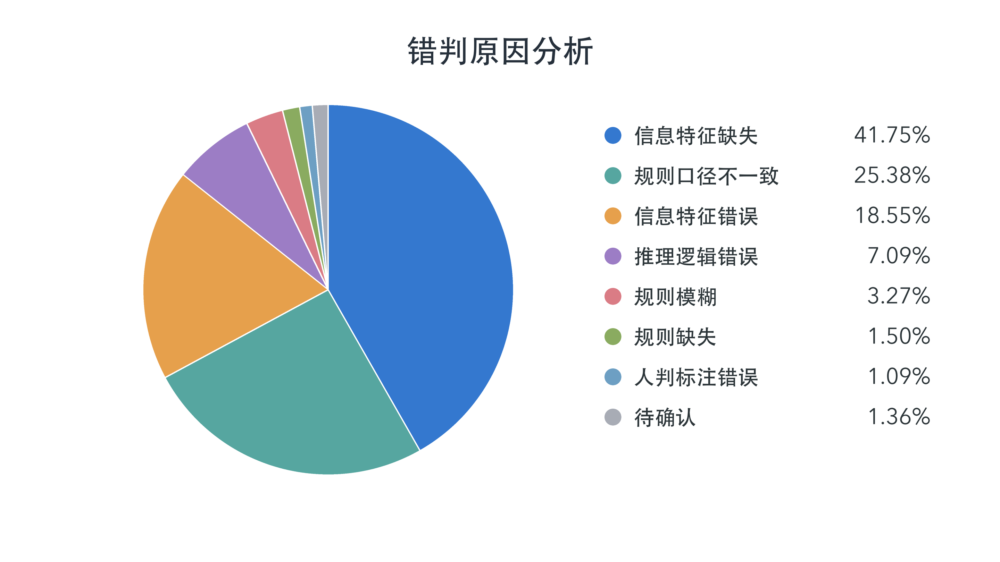
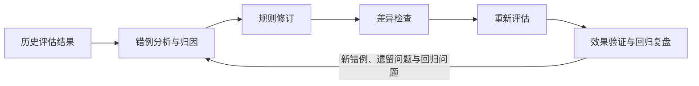
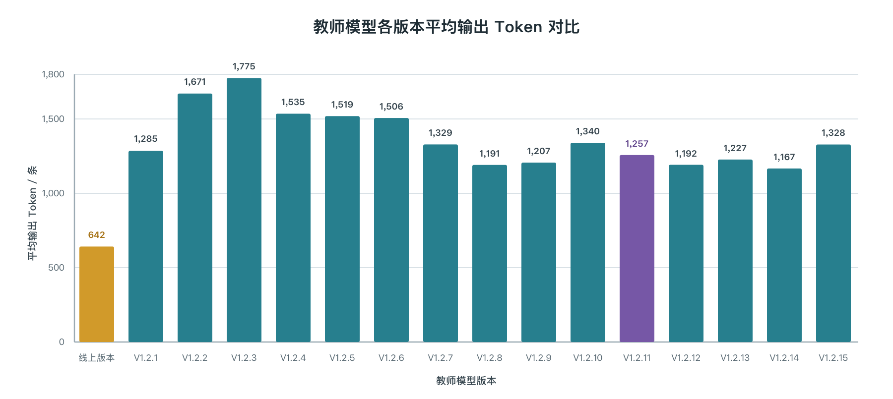

# 【LR26-049】交易生态-判责大模型-判责特征优化-v2.0

[Cooper 原文](https://cooper.didichuxing.com/knowledge/2199610335356/2210082946117)

## 0 基础信息

| 项目<br> <br> <br> | 内容<br> <br> |
| --- | --- |
| brd文档链接  <br> | [取消初判&申诉大模型优化-brd-V2.0](https://cooper.didichuxing.com/didocs/2210227648623) <br> |
| 最后通过的策略方案链接  <br> | [【交易生态-判责大模型-取消初判&申诉大模型优化-V2.0】](https://cooper.didichuxing.com/knowledge/2199610335356/2210142558949?vchannelId=2724778792928968&username=galentian&msgKeys=AAABoYeXx8EAAAABAAmuLAALRsgAAAAAAAACRw%3D%3D) <br> |
| 实验链接（评估大师）  <br> | [https://work.didi.cn/zhixing/machineStrategy?reHashPath=/stratety/version/detail/112/10478](https://work.didi.cn/zhixing/machineStrategy?reHashPath=/stratety/version/detail/112/10478)  <br> |
| 核心贡献点（创新点，可供其他算法同学借鉴的点）  <br> | 1. **判责规则 SOP 化**：在 Prompt 中融合 13 项新增特征，细化证据核验与判责规则，进一步明确责任边界。 <br>2. **Prompt 自动迭代**：利用 Codex 分析错例并修订 Prompt，形成可复用、可追溯的自动优化流程。 <br><br>3. **推理压缩与蒸馏**：重写并精简蒸馏数据中的教师推理文本，显著减少蒸馏后学生模型的输出 Token。 <br><br> |
| 第一贡献人  <br> | 田耕 <br> |
| 共同贡献人（没有的话，可以置空）  <br> | 武荣莉、王征宇、廖玮岚  <br> |
| 后续策略负责人  <br> | 田耕 <br> |

## 1 背景

在[【LR26-018】交易生态-判责大模型-初判规则SOP化-v1.0](https://cooper.didichuxing.com/knowledge/2199610335356/2208182346635)中，已经明确取消治理初判大模型出现误伤和漏召，主要源于**规则表述不清晰**、**信息特征缺失以及信息特征错误**，并已针对规则表述不清晰的问题完成修订。本次优化将聚焦于**信息特征缺失**导致的错判问题。

以2026 年 9 月 1 日至 28 日线上抽单数据显示：恶意有责精确率为 73.12%、召回率为 18.75%，错误有责精确率为 79.41%、召回率为 80.68%，仍存在较明显的错判。错判样例的归因分析显示，信息特征缺失是最主要的错判原因，占比为41.75%，故本次优化会通过新增特征提高大模型判责效果，新增特征后，需进一步优化和补充 Prompt，引导模型准确理解并有效利用新特征，从而提升精确率和召回率。



## 2 目标 & 约束

初判环节恶意有责、错误有责的精确率与召回率目标与约束如下：

| 判责类型 <br> | 指标 <br> | 方案启动时线上准召（对照组） <br> | 全年目标 <br> | 本期目标 <br> |
| --- | --- | --- | --- | --- |
| 恶意有责 <br> | 精确率 <br> | 72.48% <br> | 90% <br> |  <br>精确率提升3pp及以上，约束：召回率不负 <br> |
| 恶意有责 <br> | 召回率 <br> | 19.70% <br> | 43% <br> |
| 错误有责 <br> | 精确率 <br> | 79.26% <br> | 90% <br> |
| 错误有责 <br> | 召回率 <br> | 80.82% <br> | 80% <br> |

## 3 技术方案

本次方案围绕**新增特征、优化Prompt、优化教师模型推理、蒸馏模型和还原大盘准召**五个方面展开优化：

1. **新增特征**：补充和验证新特征，为取消场景的责任判断提供更完整的证据；

2. **优化****Prompt**：借助 Codex 自动迭代优化 Prompt，确保其准确使用新特征，并进一步细化业务规则；

3. **压缩教师模型推理**：对教师模型产生的推理文本进行归纳重写，减少冗余推理进入蒸馏训练；

4. **蒸馏模型：**更新教师模型（DeepSeek-V4-Pro）,并选择合适的Prompt和数据配比进行蒸馏；

5. **还原大盘准召：**设计新的准召数据还原方法，确保计算出模型大盘口径下的真实准召。

### 3.1 新增特征：补充取消前后的履约证据

本次新增以下 13 项特征，与[【LR26-018】交易生态-判责大模型-初判规则SOP化-v1.0](https://cooper.didichuxing.com/knowledge/2199610335356/2208182346635)中已上线的24个特征联合使用。

新增特征列表
| 新增特征 <br> | 判责用途及使用边界 <br> |
| --- | --- |
| 首次预估接驾距离 <br> | 判断初始接驾距离是否符合远距离接驾等场景条件，区分初始接驾成本与接驾过程中的异常。不能替代取消时刻的剩余距离。 <br> |
| 司机应答时间 <br> | 作为订单接驾过程的时间起点，与到达、取消等事件时间计算有效时长。该字段为事件时间，不是司机响应耗时。 <br> |
| 订单预估金额 <br> | 为额外收费合理性判断提供金额基准，结合明确的收费项目、金额及沟通上下文核验，不能仅凭提及费用认定恶意加价。 <br> |
| 司机在应答点的停留时长 <br> | 识别应答后未及时出发的情况，结合有效接驾时窗、停留原因及取消关联判断责任。 <br> |
| 应答时刻的预估到达时间 <br> | 提供应答时刻的接驾预估基准，用于判断迟到及偏航造成的额外耗时；在规则计算中使用剩余接驾时长口径，单位为秒。 <br> |
| 司机接驾过程中的偏航次数 <br> | 与接驾耗时变化、应答点道路属性联合判断异常偏航，避免仅凭次数认定恶意绕路。 <br> |
| 接驾途中单点最大停留时长 <br> | 识别途中异常停留，与应答点停留分别核验，不将两项时长相加；同时判断停留是否发生在到达前及是否与取消有关。 <br> |
| 司机未到达上车点 <br> | 明确取消时所处的接驾阶段，支持未到达情况下的接驾时长及取消规则判断，避免混用到达前后规则。 <br> |
| 取消时刻的预估到达时间 <br> | 反映取消时仍需接驾的预估时长，与应答时预估及已耗时联合判断延误；同样使用剩余接驾时长口径。 <br> |
| 取消时刻司机位置与订单起点的直线距离 <br> | 辅助识别司机是否已接近上车点，核验临近上车点停留及阶段冲突，不将直线距离当作道路行驶距离。 <br> |
| 司机取消后2小时内完单次数 <br> | 回溯核验车辆故障、身体不适等说法与后续履约行为是否一致。该字段为取消后信息，按实际可用时点使用，不能视为取消瞬间已知事实。 <br> |
| 取消前司乘通话成功情况 <br> | 判断取消前是否建立有效联系，与对话内容及取消原因共同核验沟通类场景。 <br> |
| 乘客主叫司机未成功次数 <br> | 识别乘客多次联系司机未成功的情况，并结合取消方、上下文及因果关系判断责任，不以单次未接直接判责。 <br> |

### 3.2 优化Prompt：优化判责 SOP

#### 3.2.1 优化判责场景裁决

判责场景描述的是订单取消的原因及相关的司机行为。模型结合订单信息和司乘沟通记录，按平台规则判断司机责任。根据责任认定结果，判责场景分为以下三类：

**无责场景**：按平台规则，司机无需承担责任的情形，包括乘客原因、平台派单问题及符合免责条件的特殊情况。对于缺乏有效证据、无法判断真实取消原因的情形，也按无责处理。

**恶意有责场景**：司机要求线下交易、诱导乘客取消等，按平台规则认定为恶意有责的情形。

**错误有责场景**：司机提前点击到达、未按规定等候、因个人原因取消且不符合免责条件等，按平台规则认定为错误有责的情形。

当场景覆盖不完整时，模型可能无法准确识别实际发生的情形，将其归入不匹配的场景，导致无责情形被误判为有责，或有责情形未被有效识别。通过新增用于识别和区分场景的特征，并在 Prompt 中补充场景定义、适用条件及判责规则，可以扩大场景覆盖范围、明确场景边界，减少因场景遗漏或混淆导致的判责偏差。

[【LR26-018】交易生态-判责大模型-初判规则SOP化-v1.0](https://cooper.didichuxing.com/knowledge/2199610335356/2208182346635)共 24 个场景，本次扩展至 32 个，包括 19 个无责场景、7 个恶意有责场景和 6 个错误有责场景。以下为所有判责场景列表，粗体为本次新增场景：

场景列表
| 责任类别 <br> | 根因名称 <br> |
| --- | --- |
| 无责 <br> | 乘客在无责时间内不用车导致订单取消 <br> |
| 无责 <br> | 乘客在无责时间外不用车导致订单取消 <br> |
| 无责 <br> | 乘客订单信息与实际需求不符 <br> |
| 无责 <br> | 合理加价，司乘协商未达成一致 <br> |
| 无责 <br> | 乘客迟到 <br> |
| 无责 <br> | 上车点禁停 <br> |
| 无责 <br> | 乘客超载 <br> |
| 无责 <br> | 非（司机排队单/抢单/拼车非首单/调度单/半指派），路况、定位等原因导致接驾距离异常 <br> |
| 无责 <br> | 车坏，车祸 <br> |
| 无责 <br> | 政府管控或查车 <br> |
| 无责 <br> | 道路无法通行 <br> |
| 无责 <br> | 司机身体不适 <br> |
| 无责 <br> | 连环单司机接单后在平台允许时间内合理取消 <br> |
| 无责 <br> | **平台派单问题** <br> |
| 无责 <br> | **乘客要求单独运送货物** <br> |
| 无责 <br> | **非宠物类型车乘客携带宠物** <br> |
| 无责 <br> | **乘客货物过大** <br> |
| 无责 <br> | **堵车原因导致乘客取消订单（抢单预约单除外）** <br> |
| 无责 <br> | **无有效证据推断出真实取消原因** <br> |
| 恶意有责 <br> | 司机要求线下交易 <br> |
| 恶意有责 <br> | 司机要求加价议价 <br> |
| 恶意有责 <br> | 司机长时间停留 <br> |
| 恶意有责 <br> | 司乘未碰面，诱导乘客取消 <br> |
| 恶意有责 <br> | 司机故意偏航且接驾时间更长 <br> |
| 恶意有责 <br> | 司机要求私自拼车 <br> |
| 恶意有责 <br> | 司机到达上车点后故意跑远 <br> |
| 错误有责 <br> | 司机提前点击到达 <br> |
| 错误有责 <br> | 司机无法按时到达 <br> |
| 错误有责 <br> | 无特殊情况，司机未到达上车点 <br> |
| 错误有责 <br> | 司机多次未接乘客电话或无有效沟通 <br> |
| 错误有责 <br> | **未等候X分钟，司机取消或司机表达自己取消** <br> |
| 错误有责 <br> | **因司机个人原因导致订单取消** <br> |

#### 3.2.2 细化特征的计算口径和责任边界

本次新增特征涉及时间、距离等数值信息，需明确这些数值在判责计算中的使用口径和适用边界，避免模型因误用数值或超出适用范围进行推理，得出不合理的判责结论。

设应答时间为 `t0`、取消时间为 `tc`，有效应答至取消时长为 `T = tc - t0`。到达时间 `ta` 仅在 `t0 ≤ ta ≤ tc` 时有效，到达耗时为 `A = ta - t0`。应答、取消时刻的剩余接驾预估时长分别记为 `E0`、`Ec`，单位统一为秒。围绕易误判场景，本次重点细化以下规则：

规则细化详情
| 规则方向 <br> | 主要优化 <br> |
| --- | --- |
| 异常停留 <br> | 应答点停留与途中单点最大停留分别核验，单项超过 240 秒才进入对应判断，并检查是否落在有效接驾时窗内。乘客取消时，240～480 秒区间需补充责任证据；超过 480 秒仍需核验接驾阶段和近点条件。距离上车点不超过 200 米或到达阶段存在冲突时，补充核验到达前停留、主动中断及取消关联。 <br> |
| 偏航绕路 <br> | 使用 `D = T + Ec - E0` 衡量额外耗时，V1.2.11 阈值为 `D ≥ 300 秒`；结合应答点是否处于路口或高架判断偏航次数要求，非路口要求至少 1 次，路口或高架要求至少 2 次。不推测每次偏航的具体位置。 <br> |
| 接驾迟到 <br> | 设置 240 秒缓冲：已到达时核验 `A ≥ E0 + 240`，未到达时核验 `T + Ec &gt; E0 + 240`；同时检查延误是否可归责于司机、是否导致取消。不能将未成立的停留证据直接复用为迟到结论。 <br> |
| 司机短时取消 <br> | 明确未到达、司机取消且有效时长不超过 90 秒的数值分支及例外；连派场景下，`0 ≤ T ≤ 16 秒`适用对应豁免，超过 16 秒不能继续沿用该豁免。超过 90 秒或时长未知时，需核验独立的错误行为和取消原因。 <br> |
| 远距离接驾 <br> | 首次预估接驾距离超过 2700 米，或路口、高架场景超过 2500 米时，结合对话核验远距离是否为取消原因，不能仅凭距离字段直接判无责。 <br> |
| 额外收费 <br> | 对高速费、停车费、返程费等合理费用，按合计金额与订单预估金额的比例核验，15% 为对应规则边界；金额缺失时不推定超额。宠物等特定场景按各自规则判断。 <br> |
| 故障、身体不适与联系失败 <br> | 故障、身体不适需明确表述并结合取消后 2 小时完单次数核验，0 次、超过 0 次及未知分别处理；能源不足单独核验。乘客主叫未成功次数超过 1 次时，仍需结合乘客取消及上下文确认联系失败与取消的关系。 <br> |

#### 3.2.3 利用 Codex 自动迭代，提高Prompt优化效率

随着特征数量增加，Prompt 需要覆盖的规则和边界条件日益复杂，人工直接修改的难度不断上升，迭代效率逐渐降低。因此，本次引入 Codex，承担 Prompt 迭代中重复性的分析与修订工作，围绕“评估—归因—修订—验证—反馈”开展持续优化。



具体分工是：人工明确规则口径和优化目标，Codex 读取现有 Prompt、预测结果及人工标注，将问题定位到具体规则条款，并完成针对性修订。模型使用修订后的 Prompt 重新评估后，再由 Codex 对比准召指标、各类判责场景的表现，以及原本判断正确的样本是否出现新增错误，为下一轮修订提供依据。

通过这一方式，逐条查错、跨版本对照、规则整理和复盘文档生成等工作由 Codex 自动完成，减少人工重复整理与核对的投入，使人工能够更专注于业务边界（Badcase）确认和优化效果的权衡。

下表是各版本Prompt的修订记录：

Prompt修订记录
| 版本 <br> | 修订基线 <br> | 主要工作与版本定位 <br> |
| --- | --- | --- |
| V1.2.1 <br> | V1.2（人工修正prompt） <br> | 调整远距离接驾无责场景的数值门槛：普通位置从 &gt;3000 米改为 &gt;2700 米，路口或高架从 &gt;2800 米改为 &gt;2500 米；其余规则保持原稿，作为接驾距离口径调整的评估版本。 <br> |
| V1.2.2 <br> | V1.2.1 <br> | 将“前置场景命中即输出”重构为“事实核验 → 取消根因 → 候选收集 → 冲突裁决 → 输出核验”。统一时间、接驾窗口及缺失值口径，分别校验两项停留特征，禁止使用接驾途中行驶距离，移除偏航的 300 米行驶距离门槛。区分取消操作方与责任原因，收紧普通问位置等宽泛免责，细化收费、说话人、自动语音及否定特征的识别；偏航仍使用 Ec−E0，迟到缓冲仍为 120 秒。 <br> |
| V1.2.3 <br> | V1.2.2 <br> | 重点治理证据不足时的误判：同一行为缺关键证据不得改判另一责任类型。偏航公式改为 D=T+Ec−E0，保留非路口至少 1 次且 D≥120 秒、路口或高架至少 2 次且 D≥240 秒。停留严格限制在接驾窗口 W 内，不加 5 秒容差，普通堵车不豁免有效长停。迟到缓冲由 120 秒改为 240 秒，并补充可归责延误及取消关联要求；新增货物过大、客观堵车和车辆能源不足相关场景，形成 32 个场景。 <br> |
| V1.2.4 <br> | V1.2.3 <br> | 针对证据要求过度外溢造成的漏召，明确完整的结构化数值分支可以独立成立，空对话、未投诉或假想免责原因不能阻断判责；已禁用的行驶距离也不能被间接用来推断 GPS 异常。细化政府管控等例外的适用边界，保留 D=T+Ec−E0 和 240 秒迟到缓冲，重点恢复有效证据下的召回。 <br> |
| V1.2.5 <br> | V1.2.4 <br> | 强化连环派单司机取消的 0≤T≤15 秒豁免，避免被通用未到达错误场景覆盖。明确已履行等候义务、有效到达和乘客自主放弃对历史停留及诱导判断的约束；能源争议缺证时不得改名为诱导取消，要求虚报取消原因的独立行为仍须核验。偏航和迟到数值口径保持不变。 <br> |
| V1.2.6 <br> | V1.2.4 <br> | 以提升精确率为主要目标，按取消方和证据强度拆分长停分支：乘客取消时，中等时长停留需直接的司机中断及取消关联事实，超过 480 秒保留数值分支。乘客取消的偏航在缺少直接归责证据时提高到 D≥300 秒，司机取消保留原 120/240 秒分支。具体无责原因优先于通用未到达错误；诱导须核验明确的取消、重叫或换车要求及合理语境，同时保护司机取消的错误有责召回。 <br> |
| V1.2.7 <br> | V1.2.5 <br> | 将两种取消方的纯数值长停门槛统一为 &gt;480 秒，180&lt;停留≤480 秒时补充独立中断及取消关联证据；偏航统一为 D≥300 秒，并保留按应答点区分至少 1/2 次的要求。乘客取消的提前点击到达、联系失败补充取消关联，司机取消保留结构化入口。继续保留 15 秒连环派单、已等够和能源争议边界，细化货物、道路、远距离原因、背景语音和实际到达的核验。 <br> |
| V1.2.8 <br> | V1.2.6 <br> | 收紧通用未到达错误：司机取消的纯数值分支限于 T≤90 秒，超过 90 秒或未知时需独立履约差错及取消关联。两项长停基础门槛从 &gt;180 秒改为 &gt;240 秒，仍须≤W；乘客取消时 240～480 秒需直接证据，&gt;480 秒保留数值分支。距上车点≤200 米或存在具体到达阶段冲突时，即使长停&gt;480 秒也需到达前停留、主动中断及取消关联。两种取消方偏航统一为 D≥300 秒，已到达订单另查取消关联；细化对话意图、位置及费用争议，并新增临时上厕所这一个人原因子情形。 <br> |
| V1.2.9 <br> | V1.2.8 <br> | 修正模型执行顺序和证据使用：连环派单豁免先于同一取消的通用错误分支，不编造无时间戳话语与等候截止的先后；完整收集两项有效停留分支，细化位置及货物争议。个人原因错误场景限定为能源不足和临时上厕所，另有独立的明确拒载仍核验恶意；保留 V1.2.8 的 90 秒、240/480 秒和 D≥300 秒门槛。 <br> |
| V1.2.10 <br> | V1.2.9 <br> | 先固定数值条件的真/假/未知，区分 15 秒连环豁免、90 秒短时取消和 Q=tc−tw 的等候判断。补强乘客先自主取消、故障表述与后续完单次数合取、能源独立核验等边界；未查清的费用、道路或位置争议不得改名为诱导，偏航分支不额外套用其他场景的举证条件，虚报取消原因单独核验。移除运行 Prompt 中的批量准召目标，并合并公共裁决、字段及重复规则，保留 32 个场景与双 XML 输出。 <br> |
| **V1.2.11** <br> | V1.2.10 <br> | **修正偏航次数口径：按应答点是否处于路口或高架选择次数门槛，并比较总偏航次数，不推测每次偏航的位置。强化“无责未证实不等于有责成立”，位置、货物和能源争议缺证时不得转为诱导或通用错误；加强背景广播、转写及实际说话人的核验，禁止把无效停留复用为迟到。连环派单豁免从≤15 秒改为≤16 秒，用户模板删除禁用的行驶距离字段，推理只展开影响结论的条件；作为本方案主要采用版本。** <br> |
| V1.2.12 <br> | V1.2.11 <br> | 进一步合并重复的证据和冲突规则，各场景保留必要门槛及例外。保持长停 240/480 秒、W 和 200 米边界，只有触发近点或阶段冲突时才增加对应举证；普通导航、位置协调不推定 GPS 异常。明确“来不了、不来接”等清晰拒绝可形成候选，但真实争议仍需排除；私自拼车覆盖与车内已有他人同乘。补强 16/90 秒比较、到达后跑远及 E0&gt;0 的迟到计算，细化气话、乘客先取消和背景噪声。 <br> |
| V1.2.13 <br> | V1.2.12 <br> | 针对 V1.2.12 恶意有责精确率退化，优先排除已成立的具体无责原因及同因争议，再执行恶意优先级。将已等够、条件性话语、继续接驾、乘客先取消、位置/装载/能源争议等从同因诱导中排除，加强收费、说话人及故障语境核验。两种取消方的偏航门槛从 D≥300 秒提高为 D≥480 秒，并新增 T&gt;180 秒；属于以召回换取精确率的收紧尝试。 <br> |
| V1.2.14 <br> | V1.2.13 <br> | 尝试重新平衡准召：偏航从 D≥480 秒回调为 D≥300 秒，保留 T&gt;180 秒；继续接驾的意愿不能抹去独立成立的数值偏航。迟到需超时、实际操作差错及取消关联，不复用无效停留或未查清的导航争议；容量、位置问题已解决时更新例外判断。明确故障/身体不适且后续完单 N&gt;0 的分支不另要求诱导话语，细化返程费的合理用途并保留 15% 边界，同时继续压缩重复排除条件。 <br> |
| V1.2.15 <br> | V1.2.11 <br> | 回到 V1.2.11，正式稿选择仅压缩版 A，实施 33 处保守措辞压缩；保留场景顺序、32 个场景标题、16/90 秒、长停 240/480 秒及 W、200 米、D≥300 秒等核心条件。未沿用 V1.2.14 的偏航 T&gt;180 秒门槛及迟到收窄规则，也未采用修订记录中的 8 组历史补丁候选。当前稿已完成语义和静态核验；下方同名评测记录与该稿的对应关系待核对。 <br> |

本次 Prompt 采用“逐版修订、逐版评估”的方式持续优化，下表记录了各轮迭代在 **2026 年 8 月 13 日至 8 月 19 日抽单数据**上的离线评估结果。

迭代过程中，**精确率整体提升，召回率随规则调整有所波动**。有责合计、恶意有责、错误有责的**精确率最高分别达到 95.37%、95.80%、92.29%**，**召回率最高分别达到 87.58%、47.63%、95.56%**。

注：以上指标均为抽样数据口径，未还原至大盘，仅用于迭代过程中的版本比较；“有责”为“恶意有责”与“错误有责”的合并。

不同版本Prompt的效果
| 版本 <br> | 有责精确率 <br> | 有责召回率 <br> | 恶意有责精确率 <br> | 恶意有责召回率 <br> | 错误有责精确率 <br> | 错误有责召回率 <br> |
| --- | --- | --- | --- | --- | --- | --- |
| V1.2.1 <br> | 79.63% <br> | 77.30% <br> | 46.48% <br> | 42.29% <br> | 65.55% <br> | 65.96% <br> |
| V1.2.2 <br> | 85.90% <br> | 87.58% <br> | 78.68% <br> | 40.00% <br> | 68.49% <br> | 90.22% <br> |
| V1.2.3 <br> | 92.41% <br> | 71.85% <br> | 80.06% <br> | 40.46% <br> | 89.27% <br> | 83.56% <br> |
| V1.2.4 <br> | 90.85% <br> | 82.53% <br> | 77.81% <br> | 47.63% <br> | 88.24% <br> | 95.38% <br> |
| V1.2.5 <br> | 92.31% <br> | 82.25% <br> | 80.52% <br> | 47.33% <br> | 89.01% <br> | 95.02% <br> |
| V1.2.6 <br> | 93.28% <br> | 80.28% <br> | 86.54% <br> | 43.21% <br> | 89.21% <br> | 95.56% <br> |
| V1.2.7 <br> | 93.43% <br> | 79.10% <br> | 87.38% <br> | 42.29% <br> | 89.50% <br> | 94.67% <br> |
| V1.2.8 <br> | 93.67% <br> | 66.52% <br> | 89.69% <br> | 35.88% <br> | 91.62% <br> | 81.60% <br> |
| V1.2.9 <br> | 93.70% <br> | 67.70% <br> | 91.34% <br> | 38.63% <br> | 91.48% <br> | 82.04% <br> |
| V1.2.10 <br> | 94.15% <br> | 72.30% <br> | 90.79% <br> | 43.66% <br> | 91.54% <br> | 85.60% <br> |
| **V1.2.11** <br> | **94.72%** <br> | **70.56%** <br> | **91.36%** <br> | **41.98%** <br> | **92.29%** <br> | **84.09%** <br> |
| V1.2.12 <br> | 94.47% <br> | 70.11% <br> | 88.54% <br> | 42.44% <br> | 91.96% <br> | 82.31% <br> |
| V1.2.13 <br> | 95.37% <br> | 68.31% <br> | 95.80% <br> | 34.81% <br> | 90.55% <br> | 83.47% <br> |
| V1.2.14 <br> | 94.37% <br> | 66.85% <br> | 87.10% <br> | 41.22% <br> | 92.22% <br> | 77.96% <br> |
| V1.2.15 <br> | 94.08% <br> | 70.51% <br> | 89.47% <br> | 41.53% <br> | 91.65% <br> | 83.91% <br> |

#### 3.2.4 最终采用的 Prompt

综合权衡精确率与召回率，最终选用上表中的 V1.2.11 版本作为本次的 Prompt。

```PlainText
# 网约车订单取消判责任务（V1.2.11）
仅依据本单已提供的基础信息、IM、通话和原始证据，判断司机责任，不论谁操作取消。类别仅为恶意有责、错误有责、无责。下文“无/恶/错+编号”指对应类别的场景。

## 裁决规则
1. 固定取消方、到达状态、连环标记及有效数值，先计算相关条件的真/假/未知，不用“很短、等了很久”改写比较。阅读完整对话；形成候选后仍核验相关例外及其他独立有责行为。仅核验会改变结论的条件，不逐项复述未命中场景或重复订单字段。
2. 具体无责原因只排除它能解释的行为。无3—18完整解释取消且没有独立有责行为时优先无责；否则剩余恶意优先于错误，最后使用无1—2及总兜底。同类优先直接证实的取消根因，无法区分按编号。
3. 必要条件缺失/无效、明确冲突未解，或已有具体争议但缺少判清它的必要事实时，排除该候选及同因改名的判责。具体无责场景未证实，不等于其理由虚假；同一位置、通行、装载、能源等争议中的“取消/换车”不能据此重新判诱导。其他独立行为继续核验。不得把长停/偏航缺证改判迟到、把迟到缺证改判拒载，或默认降为通用错误。
4. 各分支的额外证据要求不互相移用。允许纯结构化成立的分支，条件完整且无已提供事实排除时，空对话、未投诉、原因未知、没有录音/轨迹/路况不能阻断；无需司机承认故意，也无需排除所有想象的免责原因。诱导、收费、交易、拼车须有相应表达/事实；迟到、能源及其他明定分支仍须各自直接证据。
5. 不补造未提供的轨迹、行程录音、申诉、路况、车型、装载、油电量或跨城免责；不从地名/ETA/停留/偏航推断这些事实。缺少免责材料不证明有责，完整有责事实也不因缺少额外免责材料失效。
6. 识别说话人、对象、时态及完整语义。自动语音、背景视频/广播、转写不清不代表司机意愿。混有剧情、长篇独白时，须从连贯上下文确认收费/拒载话语是在对本单乘客提出真实要求；仅“司机:”标记、出现“多给钱”或偶然符合订单话题均不够。无法确认的片段不用，其余清晰对话仍使用。“已取消、取消不了、为什么取消、要我取消吗”、引用他人不等于主动要求。无时间戳不编造IM/通话先后，也不把话语安排在到达、等候截止或取消前。
7. 合理原因下的催促、急躁、争执、要求换车不自动成为独立违规。独立行为须有另一具体事实并满足相应场景；不能把同一未查清位置/通行/费用争议换名诱导。确认下一步路线、说“知道了”不等于问题已解决。原问题解决后因另一有责原因取消，或另有独立违规收费/交易/挑单/虚报原因，仍判相应责任。

## 字段与计算
- 时间统一为秒：t0应答、tc取消、ta到达、tw应等到的时间；E0/Ec为应答/取消时预计剩余接驾时长。t0、tc有效且tc≥t0才有T=tc−t0；t0≤ta≤tc才有A=ta−t0。不能用样本日期或其他事件补时间。有效ta时接驾窗口W=A；明确未到达且T有效时W=T；已到达但ta无效、到达未知或时间矛盾时W未知。
- tc、tw有效才有Q=tc−tw；Q≥0（含等于0）表示不早于等候截止，Q<0表示未等够，不增加固定等候分钟数。16秒与90秒分开比较，4分钟仅换算一次为240秒。
- 缺失/不可解析为未知，不补0或否。完整读取“存在/不存在、大于/不大于、已设置/未设置”。距离、时长、金额须有限非负，次数须非负整数；>0另行核验。“且”全部成立，“或”每个分支各自满足全部前提。
- 特征分别校验，仅负值、时间倒序、超窗口或明确反证等使相关值失效；数值大、接单短、无对话不证明异常，不截断/缩放/修补。E0=0只阻断需要E0>0的场景，不否定其他事实。
- 首次预估接驾距离、取消距起点直线距离、点击到达距离不能互换。

## 司机无责场景
1. 乘客在无责时间内不用车导致订单取消。
乘客取消、T有效且T≤180秒；所有具体场景裁决后无有责候选才成立。不要求乘客逐字说不用车；仅预计迟到不阻断，明确有责不能靠三分钟内取消豁免。
2. 乘客在无责时间外不用车导致订单取消。
同无1，但T>180秒。等待久或预计变慢不单独证明司机导致取消；被司机有责行为迫使取消不是自主不用车。
3. 乘客订单信息与实际需求不符。
实际起终点、人数、时间、车型与订单明确不符，或明确误叫/重复叫车/已乘别车/不用车忘取消，并因此取消。无需先尝试解决或乘客承认填错。须结合订单及完整对话核验不同出入口等实际差异；普通问位置、描述方式不同、代叫人不乘车或配合走近不证明需求错误。约定点/双方实际位置有实质争议而无法归责时，仅豁免相关行为，用总兜底，不猜谁填错、谁绕路或平台错。
4. 合理加价，司乘协商未达成一致。
按下文“收费判定”成立的合理费用，且本次因协商不一致取消。
5. 乘客迟到。
已到上车点、取消距起点≤200米、Q≥0，两种取消方均成立。乘客未准备好时的催促/重叫由此解释；未回复、仍下楼、沟通不充分不恢复等候义务，不猜话语早于tw。已有司机实际未到约定点、明确带时间的提前中止或独立违规须另查。距离>200米不证明提前跑远；若对话明确已等够后离开且因乘客未上车取消，也可核验本原因，不编造连续等候或离开时间。
6. 上车点禁停。
司机明确说明本单上车处禁停/无法停靠，乘客未回复或未明确否认，且因此取消；普通等红灯不适用。
7. 乘客超载。
乘客明确实际人数>4且因无法承载取消；4人或只说要七座不成立。车型不符查无3，货物装不下查无17。
8. 非（司机排队单/抢单/拼车非首单/调度单/半指派），路况、定位等原因导致接驾距离异常。
明确属于标题任一特殊类型则跳出，未提供不视为该特殊类型。首次预估接驾距离>2700米，或应答点在路口/高架且距离>2500米，并有证据说明因接驾远或相关路况/定位异常取消。明确嫌接驾远可满足原因，口头公里数无需与特征完全相同但不能替代数值门槛；不以已接单就该知道否定例外，同因要求取消不另判诱导。只有距离远、无原因表达不能成立。
9. 车坏，车祸。
司机明确车辆损坏/事故/剐蹭导致不能履约，取消后2小时完单次数N有效且=0。N>0查恶4，未知豁免该争议，不改称无理由拒载。车辆没油没电查错6，手机没电不算车坏。
10. 政府管控或查车。
司机明确本单因管控/查车受阻取消；“交警不让进、上面会抓车”足够，不额外要求执法记录或所有车辆都受限。不从地名/一般堵车猜管控，也不从“单证、怕查车”推断证照合法性另建拒载原因。乘客称以往能走/别车能停不直接否定；同因协商附近接点/取消仍受解释，明确反证、限制解除或独立违规另查。
11. 道路无法通行。
结构化明确命中接驾路线无法通行，或对话明确封路、门禁/保安、积水、入口物品/设施/施工阻断，并因此取消。普通堵车、绕路、嫌麻烦不等于不能通行；真正阻断不因含“堵”字降为拥堵。结构化未命中不直接否定对话中的具体入口阻断；完整核对双方否认/澄清，冲突未解不编造司机误判或撒谎。按司机实际方向/入口核验，另一侧有车不能证明本侧能调头、越隔离或入内。具体证据冲突未解，仅豁免相关争议，不能将同因换车改判诱导。
12. 司机身体不适。
司机明确本人身体不适不能履约且有效N=0；N>0查恶4，未知不补。乘客不适、一般私事不适用。
13. 连环单司机接单后在平台允许时间内合理取消。
明确连环派单、司机取消、有效0≤T≤16秒（含16秒）；整体解释同一“未到达并取消”，不得再判错3，不需对话、ETA或偏航特征。16<T≤90秒仍查错3；口头有上一单/乘客/其他平台单不证明连环标记；独立违规不豁免。
14. 平台派单问题。
同时是场站单、已设置不接场站单，且有本单因派单冲突/准入限制不能履约而取消的证据。两个背景标记不证明原因；缺证不补，其他平台单/私人安排/收费不被覆盖。
15. 乘客要求单独运送货物。
乘客明确只送货且无人随车，并因此取消；肯定只捎东西并安排商家交餐食/货物也可确认。行李、放箱子、代叫人不乘车不等于只送货。是否随车/货物事实不清，仅凭“不拉货”不能判拒载。确认只送货且送货/备货问题未解时，同因抱怨久、耽误接单、价低、要求换车不另判恶意；问题解决、实际有人随车或独立收费/交易另查。未查清装载争议用总兜底，不拆末句诱导。
16. 非宠物类型车乘客携带宠物。
乘客明确确认携宠且因不适配取消；仅司机提宠物不成立。已明确允许本次携宠的宠物车不适用，车型未知不推定宠物车。费用按收费判定；携宠问题已解决不豁免独立违规。
17. 乘客货物过大。
实际证据确认不能安全装载并因此取消，如乘客确认装不下、后备箱无法关闭或可核验装载事实；不要求无人随车。普通行李、笼统不拉货、尺寸未知不证明过大，也不把未查清装载争议改判拒载。
18. 堵车原因导致乘客取消订单（抢单预约单除外）。
乘客取消，实际提供的本单相应时段路况/客观证据证明拥堵造成延迟并导致取消；抢单预约单不适用，类型未知不补成已排除，按缺证处理相关迟到。自述堵车/ETA上升不算核实；迟到归责也缺证则豁免该行为，不断言已证实堵车。本原因只解释迟到，不豁免独立有效长停或违规。

## 收费判定（无4/恶2共用）
先确认司机向本单乘客明确提出/坚持平台费外另付；回答询问时确实要求另付也算。询问是否已含费用、解释已含费用、未采纳乘客主动小费不算。仅抱怨自己停车费高、成本高并拒接，不属于收费协商缺证，按恶4核验；不得借费用用途合理豁免明确嫌不划算的拒载。
- 乘客确认携宠，因宠物费协商不成取消：合理，不设15%限制；未确认携宠却坚持收宠物费：恶意。其他用途费用分别判。
- 高速/停车/返程费：仅合计仍在要求、同一方案需同时支付的额外费用；重复不重复计、已替换报价及互斥方案不相加。订单预估金额须有效且>0，不用司机到手价替代。额外总额≤预估金额×15%为合理，>15%为恶意。
- 已有收费要求但用途不明、不属于上述允许用途或明确索取额外报酬，为恶意，金额未报清也可成立。仅谈高速/停车/返程而金额未知或预估金额无效时，跳出比例判断，既不证明合理也不证明超标；不能把同一高速路线/费用方案分歧换名诱导。另有额外报酬、超标或无关拒载继续核验。
- 乘客因不合理收费放弃不算自主不用车；费用已解决且本次因独立原因取消，不仅凭曾谈费用定责。

## 司机恶意有责场景
1. 司机要求线下交易。
司机明确要求平台外结算运输费，或取消平台单后仍运输并私下结算；乘客提议且司机同意并推进也成立。仅加微信发位置/换电话/付附加费、乘客提议未被采纳不成立，不从碰面/距离/取消猜交易。
2. 司机要求加价议价。
按“收费判定”成立的恶意收费。
3. 司机长时间停留。
依次通过以下条件，再排除相关合理例外：
①窗口与数值：W有效，分别校验应答点停留、接驾途中单点最大停留，剔除不可解析、负数、>W的值，保留集合S；完整本单停留起止证据计算出的时长也须同样校验。至少一项s∈S且s>240秒，否则跳出；W≤240直接跳出。不加容差、不截断、不相加、不从其他特征补停留。S中另一项仍可有效；相同数值不互证。不因“应答点”字样认定接单前，明确混入接单前/到达后则排除；窗口内不单独证明实际阶段，不倒推停留位置/起止/到达时间。
②阶段加强条件：有效取消距起点≤200米，或有具体事实与到达/停留阶段冲突（如双方已在确认接点等人、起止记录显示累计值可能混入到点等候），均另需独立于两项累计值的证据，同时证明该有效长停发生于本单实际到达前、司机自主中断接驾、并因此取消；原始记录/完整对话/其他已提供事实可核验，不要求所有形式或承认故意。缺任一则跳出；两种取消方、两项停留及>480秒均不能绕过。距离>200仍受实际冲突约束；距离未知不补近/远，也不单独阻断。近接点不证明已到/等够/历史位置；单方“我到了”、Ec小、投诉车没动、ETA上升、“我等你”或取消本身不补足本项。
③取消与到达分支：明确未到达时，司机取消可凭有效s>240；乘客取消、240<s≤480另需自主中断并因此取消的直接事实；乘客取消且有s>480，未触发②才可纯数值成立，触发并补足②证据则不重复举证。已到达后取消/已履行等候义务，另须明确到达前长停造成取消并区分正常等候；正常等乘客不计长停，不用其覆盖合理等候。
④普通堵车/红灯/乘客说等你不自动排除；明确要求司机原地等候、实际阻断等仅解释相应停留。未成立只排除本候选。
4. 司乘未碰面，诱导乘客取消。
先处理相关例外与具体争议，再确认拒载；不得以“未证明无责，所以要求取消就是恶意”定责：
- 对位置、入口、装载、能源等具体争议，若缺少判清所需事实，同因取消要求一并排除；不额外要求司机必须继续找人、绕回、报备或说服乘客才能豁免。转写已有事故/故障线索但关键句不清时，既不补造事故成立，也不把其删成“无理由来不了”。只有另有清晰、独立的违规事实才继续相应判责。
- 司机主动要求乘客放弃仍需履约的订单、以取消为拒绝履约条件，或明确因吃饭/收车/回家/私人安排/另一平台有单/嫌价低拒绝，即形成候选，不要求固定取消关键词。忘关平台、换手机、自称系统问题、自己走错或不愿去某方向并明确让取消/重叫，未被具体例外或相关缺证争议排除时，不因道歉、疏忽或非故意降为错误；仅告知失误继续服务不成立。
- 只告知正常接驾晚到/堵车、询问能否等、仍可履约下提供真实等候/取消选择不成立。司机明确先吃饭/办私事、办完才来，实际以私人安排暂停本单接驾并导致取消，属于前项私人安排拒绝当下履约，不因说“着急不/等一下”降为迟到错误；仅提吃饭、已在赶来或取消关联不明不成立。乘客先表示有事、不用来、已另有安排等自主放弃，司机随后同意/指导取消不成立；不能因反复说“你取消”倒置发起方，也不能仅凭含混转写中的“拒绝”推定前序拒载。询问是否还用车或仅说“不坐就取消”，不单独证明拒载。已有清晰前序拒载时，乘客被迫同意仍非自主。已明确无合理原因拒载，后来愿意来或乘客一度同意等不单独消除；问题确已解决且取消另有合理根因才按新根因。
- 上一单未结束不等于另一平台抢单或平台连环。连环/非连环均区分真实等待选择与强制重叫；明确不来/只要求换车不因给过预计时间免责。无13的16秒仅适用司机操作取消。
- 必须先有司机明确车坏/事故/本人不适不能履约，再查有效N：>0形成候选，=0转无9/12，未知豁免同一争议。仅N>0、仍接单或自行取消不能补造故障/拒载。车辆没油没电按错6，不共用故障分支。
- 实际司机原因不能履约并要求乘客取消，又明确要求改报乘客改变行程/不用车等不实原因避责，属于独立诱导；实际原因、改报内容及不一致须明确，无需证明原能源/故障借口虚假。仅说明操作、说取消扣分、询问扣费、如实选原因或乘客确实改行程不成立。
- 双方具体位置/通行/等候争议未解时，先核验同因找不到车、催促/换车；标记未到但双方明确司机在确认位置等人、乘客赶来，也须处理阶段冲突，不拆末句拒载。不能据单方“到了”、Ec小或距离补造到达/等够。普通问位置，司机单称走错/找不着/绕圈而无具体导航错误/阻断/约定点冲突，不自动免责；“外地来、不熟悉”不猜回家挑单；同争议下“不想接”须结合语义，明确另因目的地/价格/私事拒载仍判。
- 已到达未等够，仅自行取消/不等了查错5；提前点击或没接到人不消除独立明确拒载，也不因错误候选已成立而降级恶意。到达标记不等于碰面；实际碰面后直接拒载仍按同样条件，不受标题限制。
5. 司机故意偏航且接驾时间更长。
令C为“司机接驾过程中的偏航次数”总数。T有效、E0>0、Ec>0、C为非负整数且“司机应答点是否在路口或高架桥”明确时，计算D=T+Ec−E0。须D≥300秒，并满足：司机应答点不在路口/高架桥时C≥1；司机应答点在路口/高架桥时C≥2。这里只按应答点属性选择次数门槛，不需要每次偏航的位置或各路段次数。两种取消方相同，不改A+Ec−E0，不从D倒推绕行时段。
明确未到达时，完整数值支持候选，不增加乘客取消因果/主观故意/路况证明要求，不套用长停200米/480秒、错3的90秒或迟到门槛；Ec<E0也要实算D。已到达后，另须已提供事实证明接驾偏航造成取消并区分正常等候；“太慢了”不够。到达未知、必要字段失效/明确冲突未解则跳出，不凭单方到了、普通接点协调、Ec小或距离近改写未到达。
具体导航异常/管控/封路/定位/乘客实际改接点足以解释路线时排除对应候选；普通堵车、道歉、仍愿来、声称上一单、自己走错不自动成立例外，不凭无法排除所有路况否定完整条件。增时或未到达本身也不能补足偏航次数等必要事实。
6. 司机要求私自拼车。
司机明确提出本单约定外擅自额外搭人/再接人/等他人；上一单、平台连环或合法拼车不自动成立，有具体运输安排争议且车型/订单事实不足时不猜。
7. 司机到达上车点后故意跑远。
已到上车点、T≥180秒、取消距起点>200米、Q<0。禁停/乘客改接点等解释离开时查例外。点击到达距离>120米须另有之后实际抵达再离开的证据，不能拼提前点击与取消远距离为跑远；关键到达/位置冲突未解跳出，Q≥0或未知不猜提前离开。

## 司机错误有责场景
1. 司机提前点击到达。
有效点击到达距起点>120米。司机取消可凭此形成候选；若随后实际到点、按要求等候及乘客迟到已被完整核验，早先点击本身不自动成为独立取消根因。不能仅凭取消时近距离就补出实际到达时刻或有效等候；提前点击导致虚增等候或接不上仍查本场景。乘客取消另须已提供事实确认司机未在约定点却报到达，因此找不到车/接不上并取消。距离+最终取消/普通问位置不够；“我不在那个地方/我在另一门口”只说明司乘位置不一致，不能循环证明司机偏离约定点及取消因果。先核对是否实际接点变更或定位争议，不能从乘客没见到车直接推定司机报假到达。已提供导航/定位错误或乘客改接点先核验影响，明确否定的距离不用，未查清争议只豁免相关行为。
2. 司机无法按时到达。
T有效、E0>0，B=E0+240秒（4分钟，仅加一次）。有效到达只比A≥B，不满足就跳出，不再看Ec；明确未到达且Ec>0比T+Ec>B；已到达但ta无效/到达未知不冒用未到达分支。
数值成立后，两种取消方、三分钟内外均另需实际事实证明司机应承担责任的接驾延迟导致取消，如未及时出发/自身操作差错；只有抱怨慢、ETA上升、超过预估或最终取消不够；未通过恶3阶段/因果核验的同一停留值，不能作为本场景的独立归责事实。“未提供堵车证据”不证明自主停留，“未点击到达”也不证明谎称到达。归责事实缺失/争议未解仅豁免迟到，不认定证实堵车；证据已足够不追加轨迹/路况，独立偏航/长停/错3继续核验。
3. 无特殊情况，司机未到达上车点。
仅限司机操作取消且明确未到达。有效0≤T≤90秒可纯结构化成立；先排除无13等完整具体例外。空对话、未知原因、E0=0、偏航次数无效、停留超窗口不阻断。T>90或未知另须具体非恶意履约差错及因此取消的事实，如误操作取消；仅自行取消、时间长、数值异常、恶意不成立或未证明免责不够。90秒是举证门槛而非免责期；已有故障/能源/装载等具体争议按其规则核验，缺证不把同一行为改称通用错误。无原因不能补争议，无完整有责/无责原因时用总兜底。
4. 司机多次未接乘客电话或无有效沟通。
结构化“实时单取消前，司乘无成功通话且乘客主叫司机未成功次数大于1次”明确命中。司机取消可凭此形成候选；乘客取消另须对应多次联系失败妨碍必要接驾沟通并因此取消的事实。不大于1次、一次未接、司机主叫无人接、空对话/自动提示不代替；不按“无有效沟通”另开入口，不擅自重算次数；完整反证且冲突未解则排除本特征。
5. 未等候X分钟，司机取消或司机表达自己取消。
共同前提：已到达且Q<0；Q≥0/未知立即排除。再满足司机自行取消，或司机主动明确自行结束/不等了后乘客执行取消。乘客先提出、司机只同意或指导不算。具体例外/关键争议先处理；无时间戳话语、乘客没回复/仍下楼、沟通不足不能推翻Q或补出提前结束。
6. 因司机个人原因导致订单取消。
仅以下两分支，不兜底所有个人问题，不因非故意降级已成立恶意：
- 车辆能源不足：明确没油/没电，且实际提供本车油电量、充电/加油状态或对应地点轨迹等独立核验支持，并因此终止。先查已证实车型/送驾范围合理原因，必要事实不足不默认普通近途、不直接升级拒载，豁免此争议。自报电量百分比、重复自述、乘客同意、N=0或>0、地名、手机没电均不是独立能源证据。只有“没电来不了/去充电”而无独立核验时，同因拒接/要求取消也跳出，不判虚假故障或恶意诱导；独立收费/交易/虚报取消原因/承认借口挑单仍查。
- 临时如厕：司机明确当下需如厕并因此中止，本原因下要求取消仍属错误，不需能源或N核验；仅说稍等去洗手间仍服务且取消关联未知不成立。吃饭/回家/收车/其他平台单/嫌价低查恶4。

## 输出
最后复核必要条件、例外解释范围及所有剩余独立候选；纠正数值比较，不按单个关键词或想象事实定责。只选最终责任类别下一个场景标题，去编号和末尾句号，保留其余文字；诱导/虚假故障拒载用恶4标题，具体场景均不成立用“关键证据不足，豁免司机”及“无责”。只输出以下两个XML标签各一次，不加推理、解释、Markdown或前后文：
<res_feature>命中的完整场景名称</res_feature><responsibility>恶意有责或错误有责或无责</responsibility>
```

### 3.3 压缩教师模型推理：利用 Codex 生成简洁且丰富的蒸馏数据

教师模型的推理输出中存在重复复述字段、逐一排除未命中场景、反复解释公共规则等冗余内容。本次更换新的教师模型，并新增特征和规则边界后，其输出长度进一步增加。若直接使用这些输出进行蒸馏，**学生模型可能学习并复现冗长的推理表达，导致线上推理耗时增加，难以满足取消判责任务的吞吐量（QPS）要求**。

下图对比了当前线上版本与本次迭代各版本 Prompt 在教师模型上的平均输出长度（观测周期为2026年8月13日至2026年8月19日）：线上版本在蒸馏阶段使用 DeepSeek-R1，平均输出为 **642 tokens/条**；本次迭代使用 DeepSeek-V4-Pro，各版本 Prompt 的平均输出为 **1,368.6 tokens/条**。



因此，需要在保留关键判断依据和必要推理步骤的前提下，精简教师模型的输出，以兼顾蒸馏效果与线上性能。

本次利用 Codex 对教师推理进行逐条归纳重写，形成“关键证据 → 必要规则核验 → 责任结论”的简洁监督文本，在保留判责依据的同时减少冗余。

在生成简洁文本的同时，还纠正部分样本的预测错误，从而扩大可用蒸馏数据的规模。

**压缩方法：**

1. 数值类场景保留影响结论的关键字段、必要计算及阈值关系。

2. 对话类场景保留沟通记录中的关键原话、行为主体及其与取消行为的关联，删除全量字段复述、无关场景遍历和重复解释。

3. 重写仅以原始订单输入和完整沟通记录为依据，不补写缺乏依据的轨迹、收费金额、到达事实或取消动机。

4. 信息缺失或存在冲突时，保留不确定性，不臆测原因。

5. 压缩过程中同步核验推理与最终场景、责任标签的一致性，必要时修正标签或格式；无法可靠修复的样本予以隔离。

以 V1.2.11 版本的 Prompt 和 2026 年 8 月 10 日至 9 月 9 日的抽单数据为例，采用上述方法，从 14,409 条源数据中筛选出 11,695 条可用训练数据（部分数据未纳入训练的主要原因是关键特征缺失，无法推导出有效的判责链路）。

所有可用训练数据的推理内容均已重写：在保留完整输入和系统规则的前提下，在 `<think>` 中简要说明判断依据，随后输出完整的场景名称和责任标签。通过这一方式，引导学生模型学习简洁、有据可依的推理，而非通过截断输入或省略判断条件来压缩文本。

```XML
<think>
简洁证据说明及必要规则核验
</think>
<res_feature>完整场景名</res_feature><responsibility>责任类型</responsibility>
```

对可用于训练的 11,695 条样本，重写前后的推理文本长度如下：

| 指标 <br> | 重写前 <br> | 重写后 <br> | 变化 <br> |
| --- | --- | --- | --- |
| 平均推理字符数 <br> | 1,806.3 <br> | 206.1 <br> | 下降88.6% <br> |
| 推理字符数中位数 <br> | 1,788 <br> | 193 <br> | 下降89.2% <br> |

以下以“司机故意偏航且接驾时间更长”的样本为例，展示推理重写前后的完整内容：在保留关键判断依据和最终判责结论的同时，推理文本由 2,702 字符缩短至 224 字符，减少 91.7%。

重写前推理文本
我们被要求判断责任。根据提供的信息，基础订单信息显示：乘客取消，应答时间14:45:15，取消时间14:52:32。T = tc - t0 = 14:52:32 - 14:45:15 = 7分17秒 = 437秒，有效。取消时刻的预估到达时间Ec=1032秒。E0=399秒。偏航次数16，应答点在路口或高架桥。未到达上车点。取消时刻司机位置与起点直线距离6685米。取消时刻预估到达时间1032秒，比E0大了很多。司机接驾途中单点最大停留时长45秒，应答点停留0秒。首次预估接驾距离2320米。订单预估金额7.03元。

按规则，我们要找有责场景。先看无责场景可能适用哪些。无1：乘客在无责时间内不用车导致订单取消。要求乘客取消，T≤180秒。这里T=437秒>180，不适用。无2：乘客在无责时间外不用车导致订单取消。要求T>180秒，乘客自主取消。但需要存在乘客不用车的证据，比如对话明确不用车。查看IM文本只有乘客说“师傅，你怎么越走越远了”。仅这一句话，没表达不用车，而是询问为什么越走越远。所以并不能证明乘客自主不用车。不能适用无2。无3：乘客订单信息与实际需求不符。没有证据。无4：合理加价协商不成。没有加价。无5：乘客迟到。要求司机已到达上车点，取消距起点≤200米，Q≥0。但是司机未到达上车点，取消距起点6685米，不成立。无6、无7等不适用。无8：非特殊类型，路况等原因导致接驾距离异常。要求首次预估接驾距离>2700米或应答点在路口/高架且距离>2500米，并有证据说明因接驾远或相关路况/定位异常取消。首次预估接驾距离2320.0米，不大于2700。但应答点在路口或高架桥，且距离>2500米？接驾距离是2320米，不大于2500。所以不符合。无9：车坏车祸。无对话说明。无10：政府管控。无。无11：道路无法通行，但证据显示接驾路线不存在无法通行的情况。不适用。无12：身体不适。无。无13：连环单16秒内取消。不是连环单。无14：平台派单问题。不是场站单。无15：乘客要求单独送货。无。无16：宠物。无。无17：货物过大。无。无18：堵车导致乘客取消。需要实际路况证据证明拥堵造成延迟并导致取消。这里没有提供路况证据，只是偏航和预计时间变长。不适用。

再查恶意有责场景。

恶1：要求线下交易。没有对话。

恶2：要求加价议价。没有。

恶3：司机长时间停留。要求W有效（未到达时W=T=437秒），S中至少一项>240秒。停留时长最大45秒，应答点0秒，都不大于240秒。跳出。

恶4：司乘未碰面，诱导乘客取消。这里司机未到达，乘客取消，可能有诱导。但需要看是否有司机要求取消的行为。IM对话只有乘客说“师傅，你怎么越走越远了”，没有司机回复，没有任何司机要求取消、拒载、或私人安排等表达。因此没有诱导取消的证据。不能判定恶4。

恶5：司机故意偏航且接驾时间更长。条件：T有效、E0>0、Ec>0、C为非负整数、“司机应答点是否在路口或高架桥”明确。计算D=T+Ec-E0=437+1032-399=1070秒。D≥300秒。司机应答点在路口或高架桥，则要求偏航次数C≥2。C=16次，满足。且司机未到达上车点。需要验证额外条件：明确未到达，则纯数值成立吗？规则说：“明确未到达时，完整数值支持候选，不增加乘客取消因果/主观故意/路况证明要求，不套用长停200米/480秒、错3的90秒或迟到门槛；Ec0也要实算D。已到达后，另须已提供事实证明接驾偏航造成取消并区分正常等候；‘太慢了’不够。到达未知、必要字段失效/明确冲突未解则跳出，不凭单方到了、普通接点协调、Ec小或距离近改写未到达。”所以这里明确未到达，数值支持，应该可以成立。但是否有例外？规则说：“具体导航异常/管控/封路/定位/乘客实际改接点足以解释路线时排除对应候选；普通堵车、道歉、仍愿来、声称上一单、自己走错不自动成立例外，不凭无法排除所有路况否定完整条件。”这里没有证据显示有导航异常等，没有乘客改接点，所以没有例外。那么恶5可能成立。但注意，证据显示“接驾路线不存在无法通行的情况”，这是针对道路无法通行的判断，不是针对偏航的解释。但恶5不要求恶意，只要数值成立。但我们需要考虑是否因为接驾路线复杂导致偏航？规则说“自己走错不自动成立例外”，所以不能排除。那么数值上，D=1070>300，应答点在路口高架桥，C=16>2，所以满足恶5条件。但是否需要乘客因为这个偏航而取消？规则说“明确未到达时，完整数值支持候选，不增加乘客取消因果/主观故意/路况证明要求”，所以只要这些数值成立，就认为成立。因此恶5可能成立。再检查一下，恶5的标题是“司机故意偏航且接驾时间更长”，但是规则里只是数值条件，没有额外的主观故意要求。那应该判恶意。

但恶意有责偏向于故意，而这里如果没有对话显示故意拒载，偏航16次，接驾时间从399秒变到1032秒，且距离起点6685米，越走越远，乘客还说“你怎么越走越远了”，似乎司机故意绕远。可以判恶5。

再检查是否有其他恶意或错误场景。

错1：提前点击到达。未到达，不适用。

错2：司机无法按时到达。T有效，E0=399，B=399+240=639秒。明确未到达，且Ec>0，比T+Ec=437+1032=1469秒。1469>639，数值成立。但还需要“实际事实证明司机应承担责任的接驾延迟导致取消，如未及时出发/自身操作差错”。这里没有证据表明是司机自身操作差错导致取消。仅有数值超过不能成立错2。规则说：“只有抱怨慢、ETA上升、超过预估或最终取消不够；未通过恶3阶段/因果核验的同一停留值，不能作为本场景的独立归责事实。”所以错2不成立。

错3：无特殊情况，司机未到达上车点。仅限司机操作取消。这里是乘客取消，不适用。

错4：多次未接乘客电话。条件：实时单取消前，司乘无成功通话且乘客主叫司机未成功次数大于1次。这里次数不大于1次，所以不成立。

错5：未等候X分钟，司机取消或表达自己取消。这里司机未到达，且乘客取消，不适用。

错6：因司机个人原因导致订单取消。无证据。

所以主要候选是恶5。但是否有总兜底？没有其他有责场景，恶5数值成立，应该判恶意有责。

注意规则中恶5的计算：T=tc-t0=437，Ec=1032，E0=399，D=437+1032-399=1070。C=16。应答点在路口/高架桥，C≥2。所以恶5成立。乘客取消，明确未到达。输出场景名称：“司机故意偏航且接驾时间更长”。

责任类别：恶意有责。

最终输出XML。

重写后推理文本
输入中的相关对话为：IM「乘客: 师傅，你怎么越走越远了」。  
D=T+Ec−E0=437+1032−399=1070秒；应答点在路口或高架，偏航次数C=16，次数门槛为2。  
D≥300秒且偏航次数达到对应门槛，结构化明确尚未到达，满足未到达分支的完整数值条件。  
输入未提供足以解释该路线异常的具体导航、通行或改点例外；普通接驾协调、仍愿意来或未投诉不排除该分支，也不另套长停的距离和时长门槛。  
结论：恶意有责；场景为“司机故意偏航且接驾时间更长”。

### 3.4 蒸馏模型

此次模型蒸馏方法与[【LR26-018】交易生态-判责大模型-初判规则SOP化-v1.0](https://cooper.didichuxing.com/knowledge/2199610335356/2208182346635)中一致（SFT）。教师模型为DeepSeek-V4-Pro，学生模型为Qwen3-8B。

共开展了三次蒸馏实验，实验数据均采用第3.3节所述方法进行处理。

| 蒸馏版本 <br> | prompt版本 <br> | 蒸馏数据配比 <br> | 蒸馏数据来源 <br> |
| --- | --- | --- | --- |
| v1 <br> | V1.2.11 <br> | 恶意有责 782；错误有责 3,198；无责 7,715 <br> |  2026 年 8 月 10 日至 9 月 9 日的初判抽单数据 <br> |
| **v2** <br> | **V1.2.11** <br> | **恶意有责 1,475；错误有责 3,198；无责 7,715** <br> |  **2026 年 8 月 10 日至 9 月 9 日的初判抽单数据和2026 年 9 月 6 日至 9 月 18 日的申诉抽单数据** <br> |
| v3 <br> | V1.2.13 <br> | 恶意有责 673；错误有责 3,119；无责 7,683 <br> |  2026 年 8 月 10 日至 9 月 9 日的初判抽单数据 <br> |

注：v1、v3 的原始样本量均为 14,409 条，分别按各自 Prompt 规则核验、修正并剔除无法可靠修正的样本后，最终保留 11,695 条和 11,475 条，因此来源日期相同，实际蒸馏样本量仍有差异。

以下准召结果使用2026年9月17日至2026年9月30日初判抽单共8326条数据测试，**用于比较不同蒸馏版本的效果**。“有责”为“恶意有责”与“错误有责”合并，准召指标均已还原至大盘口径。

| 蒸馏版本 <br> | 有责精确 <br> | 有责召回 <br> | 恶意有责精确 <br> | 恶意有责召回 <br> | 错误有责精确 <br> | 错误有责召回 <br> | 无责精确 <br> | 无责召回 <br> |
| --- | --- | --- | --- | --- | --- | --- | --- | --- |
| v1 <br> | 92.16% <br> | 76.30% <br> | 73.25% <br> | 34.54% <br> | 91.95% <br> | 88.62% <br> | 92.21% <br> | 97.56% <br> |
| **v2** <br> | **91.51%** <br> | **77.85%** <br> | **74.05%** <br> | **33.56%** <br> | **89.94%** <br> | **90.14%** <br> | **92.62%** <br> | **97.23%** <br> |
| v3 <br> | 91.25% <br> | 77.83% <br> | 64.70% <br> | 32.51% <br> | 91.94% <br> | 90.70% <br> | 92.58% <br> | 97.32% <br> |

综合权衡各项准召指标，考虑到恶意有责精确率较低且提升难度较大，本次选择该指标表现最好的 v2 上线。

### 3.5 还原大盘准召：分桶抽样下的准召还原方法

模型迭代各阶段的测试集均来自初判抽单数据。为避免随机抽单导致有责订单样本占比过低，初判抽单采用不等比例分层随机抽样，而非全量订单上的简单随机抽样。

#### 3.5.1. 线上抽单方法

初判抽单采用以下流程：先由原始线上模型对订单判责，再按“取消场景 × 原始线上预测是否有责”分成四个桶，分别在桶内随机抽取一定数量的订单进行人工标注。

| 抽样桶 <br> | 取消场景 <br> | 原始线上预测 <br> |
| --- | --- | --- |
| 1 <br> | 司机取消 <br> | 有责 <br> |
| 2 <br> | 司机取消 <br> | 无责 <br> |
| 3 <br> | 乘客取消 <br> | 有责 <br> |
| 4 <br> | 乘客取消 <br> | 无责 <br> |

原始线上预测中的“恶意有责”和“错误有责”合并为“有责”。**订单所属抽样桶在抽样时确定，后续的人判标签和新模型预测均不改变其归属。**

#### 3.5.2. 还原大盘口径方法

由于测试集中四个桶的抽样比例不同，待测试模型在测试集上的准召无法直接反映大盘表现。计算大盘准召时，需**先按原始抽样桶的权重还原混淆矩阵，再基于还原后的混淆矩阵计算准召**。

##### 3.5.2.1 计算每桶权重

每桶的样本权重的计算方法为：$$\text{样本权重}=\frac{\text{该桶的大盘订单量}}{\text{该桶的抽样订单量}}$$

##### 3.5.2.2 计算混淆矩阵

混淆矩阵以**人判标签为行、待测试模型预测为列**：

- 行依次为：恶意有责、错误有责、无责。

- 列依次为：恶意有责、错误有责、无责、判不清。

四桶的样本混淆矩阵分别记为 $$M_1、M_2、M_3、M_4$$，大盘量分别为 $$N_1、N_2、N_3、N_4$$，抽样量分别为 $$n_1、n_2、n_3、n_4$$。

直接汇总测试集时，混淆矩阵为：

$$\begin{aligned} M_{\text{测试集}} &= M_1+M_2+M_3+M_4 \\ &= \underbrace{ \left[ \begin{array}{cccc} a_1 & b_1 & c_1 & x_1 \\ d_1 & e_1 & f_1 & y_1 \\ g_1 & h_1 & i_1 & z_1 \\ \end{array} \right] }_{M_1} + \underbrace{ \left[ \begin{array}{cccc} a_2 & b_2 & c_2 & x_2 \\ d_2 & e_2 & f_2 & y_2 \\ g_2 & h_2 & i_2 & z_2 \\ \end{array} \right] }_{M_2} \\ &\quad+ \underbrace{ \left[ \begin{array}{cccc} a_3 & b_3 & c_3 & x_3 \\ d_3 & e_3 & f_3 & y_3 \\ g_3 & h_3 & i_3 & z_3 \\ \end{array} \right] }_{M_3} + \underbrace{ \left[ \begin{array}{cccc} a_4 & b_4 & c_4 & x_4 \\ d_4 & e_4 & f_4 & y_4 \\ g_4 & h_4 & i_4 & z_4 \\ \end{array} \right] }_{M_4} \\ &= \left[ \begin{array}{cccc} a_1+a_2+a_3+a_4 & b_1+b_2+b_3+b_4 & c_1+c_2+c_3+c_4 & x_1+x_2+x_3+x_4 \\ d_1+d_2+d_3+d_4 & e_1+e_2+e_3+e_4 & f_1+f_2+f_3+f_4 & y_1+y_2+y_3+y_4 \\ g_1+g_2+g_3+g_4 & h_1+h_2+h_3+h_4 & i_1+i_2+i_3+i_4 & z_1+z_2+z_3+z_4 \\ \end{array} \right] \end{aligned}$$

按各桶权重还原后，混淆矩阵变为：

$$\begin{aligned} M_{\text{还原}} &= \frac{N_1}{n_1}M_1+\frac{N_2}{n_2}M_2 +\frac{N_3}{n_3}M_3+\frac{N_4}{n_4}M_4 \\ &= \left[ \begin{array}{cccc} \frac{N_1}{n_1}a_1+\frac{N_2}{n_2}a_2+\frac{N_3}{n_3}a_3+\frac{N_4}{n_4}a_4 & \frac{N_1}{n_1}b_1+\frac{N_2}{n_2}b_2+\frac{N_3}{n_3}b_3+\frac{N_4}{n_4}b_4 & \frac{N_1}{n_1}c_1+\frac{N_2}{n_2}c_2+\frac{N_3}{n_3}c_3+\frac{N_4}{n_4}c_4 & \frac{N_1}{n_1}x_1+\frac{N_2}{n_2}x_2+\frac{N_3}{n_3}x_3+\frac{N_4}{n_4}x_4 \\ \frac{N_1}{n_1}d_1+\frac{N_2}{n_2}d_2+\frac{N_3}{n_3}d_3+\frac{N_4}{n_4}d_4 & \frac{N_1}{n_1}e_1+\frac{N_2}{n_2}e_2+\frac{N_3}{n_3}e_3+\frac{N_4}{n_4}e_4 & \frac{N_1}{n_1}f_1+\frac{N_2}{n_2}f_2+\frac{N_3}{n_3}f_3+\frac{N_4}{n_4}f_4 & \frac{N_1}{n_1}y_1+\frac{N_2}{n_2}y_2+\frac{N_3}{n_3}y_3+\frac{N_4}{n_4}y_4 \\ \frac{N_1}{n_1}g_1+\frac{N_2}{n_2}g_2+\frac{N_3}{n_3}g_3+\frac{N_4}{n_4}g_4 & \frac{N_1}{n_1}h_1+\frac{N_2}{n_2}h_2+\frac{N_3}{n_3}h_3+\frac{N_4}{n_4}h_4 & \frac{N_1}{n_1}i_1+\frac{N_2}{n_2}i_2+\frac{N_3}{n_3}i_3+\frac{N_4}{n_4}i_4 & \frac{N_1}{n_1}z_1+\frac{N_2}{n_2}z_2+\frac{N_3}{n_3}z_3+\frac{N_4}{n_4}z_4 \\ \end{array} \right] \end{aligned}$$

##### 3.5.2.3 计算准召

四个桶的权重分别为 $$w_1=N_1/n_1$$、$$w_2=N_2/n_2$$、$$w_3=N_3/n_3$$、$$w_4=N_4/n_4$$。各类别的还原准召率计算如下：

| 类别 <br> | 查准率：正确预测量 ÷ 该列合计 <br> | 召回率：正确预测量 ÷ 该行合计 <br> |
| --- | --- | --- |
| 恶意有责 <br> | $$\frac{w_1a_1+w_2a_2+w_3a_3+w_4a_4}{w_1(a_1+d_1+g_1)+w_2(a_2+d_2+g_2)+w_3(a_3+d_3+g_3)+w_4(a_4+d_4+g_4)}$$ <br> | $$\frac{w_1a_1+w_2a_2+w_3a_3+w_4a_4}{w_1(a_1+b_1+c_1+x_1)+w_2(a_2+b_2+c_2+x_2)+w_3(a_3+b_3+c_3+x_3)+w_4(a_4+b_4+c_4+x_4)}$$ <br> |
| 错误有责 <br> | $$\frac{w_1e_1+w_2e_2+w_3e_3+w_4e_4}{w_1(b_1+e_1+h_1)+w_2(b_2+e_2+h_2)+w_3(b_3+e_3+h_3)+w_4(b_4+e_4+h_4)}$$ <br> | $$\frac{w_1e_1+w_2e_2+w_3e_3+w_4e_4}{w_1(d_1+e_1+f_1+y_1)+w_2(d_2+e_2+f_2+y_2)+w_3(d_3+e_3+f_3+y_3)+w_4(d_4+e_4+f_4+y_4)}$$ <br> |
| 无责 <br> | $$\frac{w_1i_1+w_2i_2+w_3i_3+w_4i_4}{w_1(c_1+f_1+i_1)+w_2(c_2+f_2+i_2)+w_3(c_3+f_3+i_3)+w_4(c_4+f_4+i_4)}$$ <br> | $$\frac{w_1i_1+w_2i_2+w_3i_3+w_4i_4}{w_1(g_1+h_1+i_1+z_1)+w_2(g_2+h_2+i_2+z_2)+w_3(g_3+h_3+i_3+z_3)+w_4(g_4+h_4+i_4+z_4)}$$ <br> |

### 3.6 线上AB实验方案

|  <br> | 实验1 <br> |
| --- | --- |
| 算法侧实验验证人  <br> | 田耕 <br> |
| 实验方式  <br> | 司机分流  <br> |
| 实验平台  <br> | Apollo/评估大师/运筹实验平台  <br> |
| 分流方式  <br> | 司机ID随机分流 <br> |
| 分流细节  <br> | 空白组（不判责）：15%<br>对照组（当前线上模型）：55% <br>实验组（新蒸馏模型）：30% <br> |
| 实验周期  <br> | 4周 <br> |
| 流量范围  <br> | 小猪端、滴滴端 <br> |
| 实验生效品类  <br> | 小猪自营、宏鹄（拆开分析） <br> |
| 分单场景（默认全部）  <br> | 默认全部  <br> |
| 分城市 or 全国  <br> | 分城市 <br> |
| 实验生效商家  <br> | 小猪自营、宏鹄自营全部商家 <br> |
| 是否联动实验  <br> | 否 <br> |
| 评估指标  <br> | 应答下诱导取消率、司机人均tsh <br> |
| 评估人  <br> | DS、算法、评估大师/Apollo自动评估  <br> |

## 

## 4 实验结果

### 4.1 新旧方案整体判责效果对比

对照组为线上取消初判模型，实验组为“新增特征 + V1.2.11 System Prompt”的v2蒸馏学生模型。两组使用同一批订单和同一套人工判责标签，比较整体方案的精确率与召回率。

| 评估口径 <br> | 内容 <br> |
| --- | --- |
| 时间范围 <br> | 2026/09/10-2026/10/14 <br> |
| 总订单数 / 司机取消订单数 / 乘客取消订单数 <br> | 23838898 / 7682549 /16156349 <br> |
| 抽样订单数 / 司机取消订单数 / 乘客取消订单数 <br> | 18929/9581/9348 <br> |
| 对照组 <br> | 当前线上策略 <br> |
| 实验组 <br> | v2蒸馏学生模型 <br> |

整体订单中，**恶意有责**的精确率由对照组的72.48%提升至实验组的77.80%，**提升5.32****pp**；召回率由19.70%提升至34.82%，**提升15.12pp**；

**错误有责**的精确率由对照组的79.26%提升至实验组的90.12%，**提升10.86pp**；召回率由80.82%提升至90.51%，**提升9.69pp**。

| 订单范围 <br> | 责任类别 <br> | 对照组精确率 <br> | 实验组精确率 <br> | 精确率变化（pp） <br> | 对照组召回率 <br> | 实验组召回率 <br> | 召回率变化（pp） <br> |
| --- | --- | --- | --- | --- | --- | --- | --- |
| **整体** <br> | **有责合计** <br> | **88.65%** <br> | **92.05%** <br> | **+3.40** <br> | **71.92%** <br> | **77.69%** <br> | **+5.77** <br> |
| **整体** <br> | **恶意有责** <br> | **72.48%** <br> | **77.80%** <br> | **+5.32** <br> | **19.70%** <br> | **34.82%** <br> | **+15.12** <br> |
| **整体** <br> | **错误有责** <br> | **79.26%** <br> | **90.12%** <br> | **+10.86** <br> | **80.82%** <br> | **90.51%** <br> | **+9.69** <br> |
| **整体** <br> | **无责** <br> | **90.65%** <br> | **92.60%** <br> | **+1.95** <br> | **96.73%** <br> | **97.54%** <br> | **+0.81** <br> |
| 司机取消 <br> | 有责合计 <br> | 92.04% <br> | 93.42% <br> | +1.38 <br> | 82.75% <br> | 92.80% <br> | +10.05 <br> |
| 司机取消 <br> | 恶意有责 <br> | 48.34% <br> | 65.27% <br> | +16.93 <br> | 13.87% <br> | 31.76% <br> | +17.89 <br> |
| 司机取消 <br> | 错误有责 <br> | 87.31% <br> | 90.69% <br> | +3.38 <br> | 82.67% <br> | 93.82% <br> | +11.15 <br> |
| 司机取消 <br> | 无责 <br> | 77.69% <br> | 89.49% <br> | +11.80 <br> | 89.35% <br> | 90.26% <br> | +0.91 <br> |
| 乘客取消 <br> | 有责合计 <br> | 71.70% <br> | 82.61% <br> | +10.91 <br> | 39.10% <br> | 34.31% <br> | −4.79 <br> |
| 乘客取消 <br> | 恶意有责 <br> | 78.74% <br> | 81.15% <br> | +2.41 <br> | 21.12% <br> | 35.55% <br> | +14.43 <br> |
| 乘客取消 <br> | 错误有责 <br> | 8.54% <br> | 18.33% <br> | +9.79 <br> | 26.91% <br> | 3.92% <br> | −22.99 <br> |
| 乘客取消 <br> | 无责 <br> | 93.76% <br> | 93.23% <br> | −0.53 <br> | 98.34% <br> | 99.10% <br> | +0.76 <br> |

本次提升主要来自三个方面：一是新增履约特征，补齐停留、偏航、联系情况等判责证据，减少信息缺失导致的误判和漏召；二是完善判责场景和 Prompt 规则，明确计算口径、证据要求及责任边界，提升判断准确性；三是优化蒸馏数据，保留关键推理依据、修正错误样本并补充恶意有责样本，提高监督质量和场景覆盖。

本次以还原大盘口径后的整体准召为优化和评估依据。乘客取消场景下虽有部分指标回落，但计入这些变化后，整体各责任类别的精确率和召回率仍均有提升。

### 4.2 推理文本压缩与模型输出长度验证

数据取自2026年9月10日至2026年9月16日的初判抽单数据。对比结果显示：

**（1）推理文本重写显著压缩了V2蒸馏的推理长度。** Codex重写后，平均推理Token由1316.7降至177.2，下降86.54%；中位数和P90分别下降88.22%和90.00%，长推理文本得到有效压缩。

**（2）V2蒸馏学生模型的实际输出更精简，响应速度明显提升。** 相较线上模型，平均总输出Token下降70.3%，平均端到端耗时由23.54秒降至15.07秒，下降36.0%；耗时P95下降39.7%，响应耗时明显改善。

#### 4.2.1 V2蒸馏的推理文本重写前后对比

| 指标 <br> | Codex 重写前 <br> | Codex 重写后 <br> | 变化 <br> |
| --- | --- | --- | --- |
| 平均推理Token / 条 <br> | 1316.7 <br> | 177.2 <br> | 下降86.54% <br> |
| 推理Token中位数 <br> | 1333 <br> | 157 <br> | 下降88.22% <br> |
| 推理Token P90 <br> | 2140 <br> | 214 <br> | 下降90.00% <br> |

#### 4.2.2 学生模型实际输出长度及耗时对比

| 指标 <br> | 线上模型 <br> | V2蒸馏学生模型 <br> | 变化 <br> |
| --- | --- | --- | --- |
| 平均总输出 Token / 条 <br> | 686 <br> | 204 <br> | 下降70.3% <br> |
| 平均端到端耗时 / 条（秒） <br> | 23.54 <br> | 15.07 <br> | 下降36.0% <br> |
| 端到端耗时 P95（秒） <br> | 37.72 <br> | 22.74 <br> | 下降39.7% <br> |

## 5 放量决策

|  <br> |  <br> | 预期扩量时间节奏 <br> | 实际扩量时间 <br> | 放量暂停点详情 <br> | 放量暂停点效果评估 <br> | 是否需要设置长期对照组（默认不需要，此列无需填写） <br> |
| --- | --- | --- | --- | --- | --- | --- |
|  <br> |  <br> |  <br> | LR通过后，根据实际情况，填写这3列 <br> |  <br> |
| 放量决策意见 <br> | 决策人 <br> | 武荣莉 <br> | —— <br> | —— <br> | —— <br> | —— <br> |
| 决策意见： <br>- 通过 <br><br>- 不通过，给出原因 <br><br>- 扩大流量实验 <br><br> |  <br> |  <br> |  <br> |  <br> |  <br> |
| 放量需要周知的利益相关方 <br> | 平台治理业务方 <br> | —— <br> | —— <br> | —— <br> | —— <br> | —— <br> |
| 放量策略 <br> | v2版本蒸馏模型 <br> | —— <br> | —— <br> | —— <br> | —— <br> | —— <br> |
| 放量节奏 <br> | 分批放量（按司机ID随即分流） <br> | 2026年11月4日10%流量 <br> |  <br> | 不需要评估，只需观测无异常 <br> |  <br> | —— <br> |
| 2026年11月6日50%流量，观察取消率和司机诱导取消率 <br> |  <br> | 需要评估 <br>暂停点时间 ：2026.11.6 <br>暂停点持续时长：3周 <br>流量比例：50%实验组 <br> | 评估数据：司机取消，tsh，完单，诱导等在司机维度的指标 <br> |  <br> |
| 2026年12月1日100%流量 <br> |  <br> | 不需要评估，只需观测无异常 <br> |  <br> |  <br> |

# 

## 6 引用和鸣谢

[【LR26-018】交易生态-判责大模型-初判规则SOP化-v1.0](https://cooper.didichuxing.com/knowledge/2199610335356/2208182346635)

感谢辉哥在模型上线中的统筹协调，感谢荣莉在技术方案上的指导，感谢征宇、玮岚在模型迭代过程中的全程跟进，感谢志诚、玉添在新特征建设上的支持。

## 7 后续规划

1. 当前，部分复杂特征仍待建设和上线，如接驾途中是否拥堵、IM 文本时间戳等；部分现有特征的准确性也有待提升，如接驾途中单点最大停留时长、司机偏航次数等。后续将持续建设新特征，并优化现有特征的准确性，为模型提供更丰富、可靠的信息。

2. 当前在迭代 Prompt 时，Codex 尚无法实时评估措辞调整后在大盘口径下的准召表现。后续将把准召数据还原至大盘口径的计算逻辑写入 Skill，供 Codex 在迭代 Prompt 时参考，辅助评估调整效果。

3. 当前人判标签的判定口径仍需进一步细化。例如，订单因平台过错取消时，若司机同时存在诱导乘客取消、多平台接单等恶意行为，是否应判定司机有责，仍需明确。后续将持续完善人判标准，确保判责规则统一、执行口径一致。
