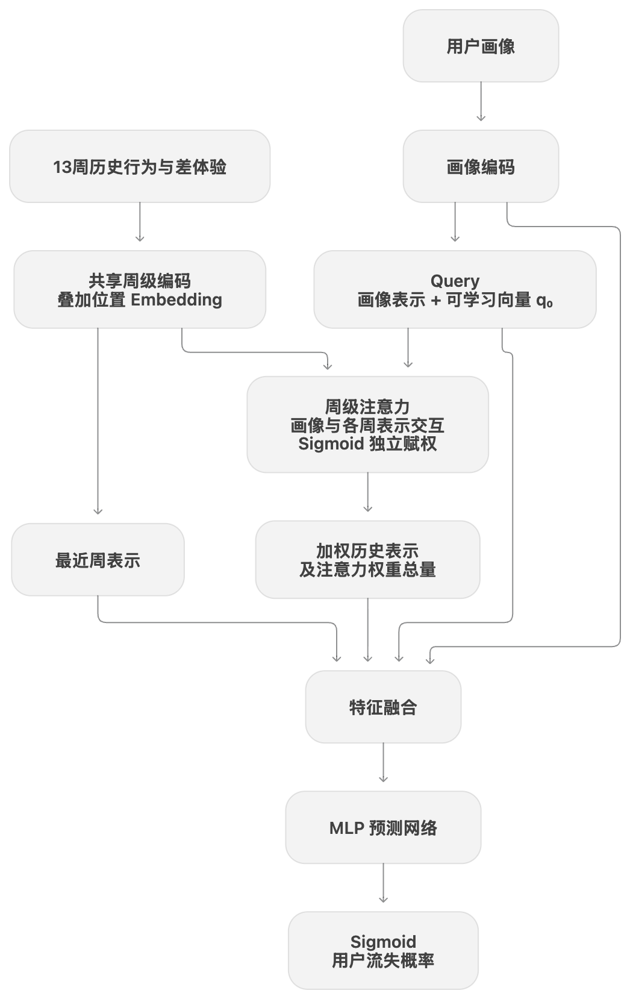
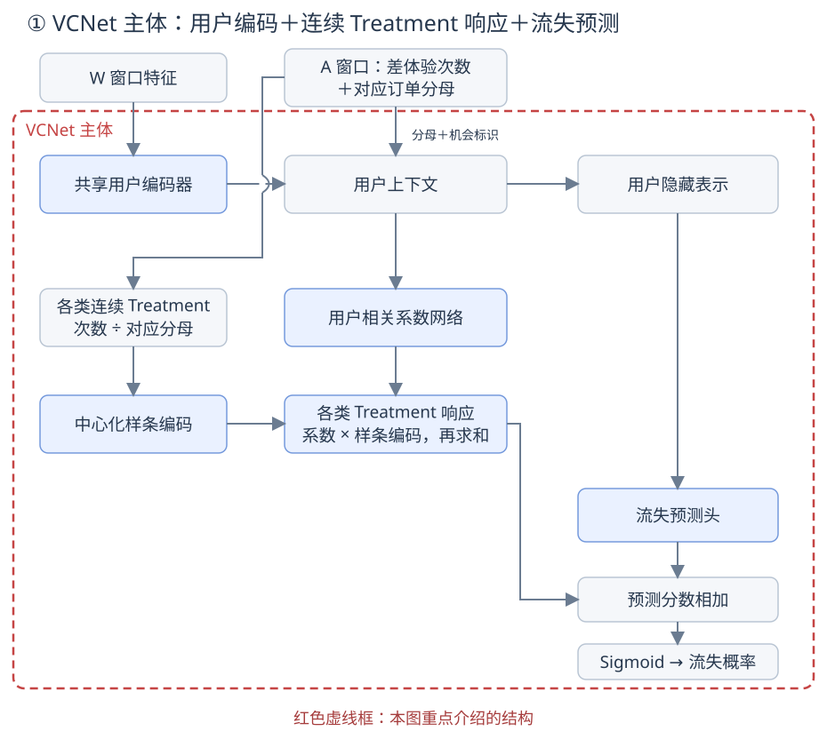
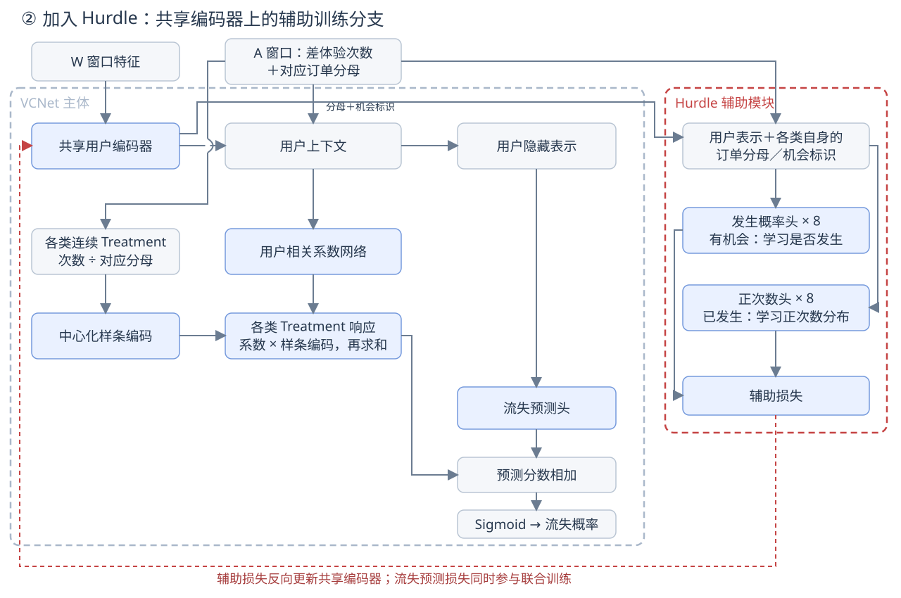
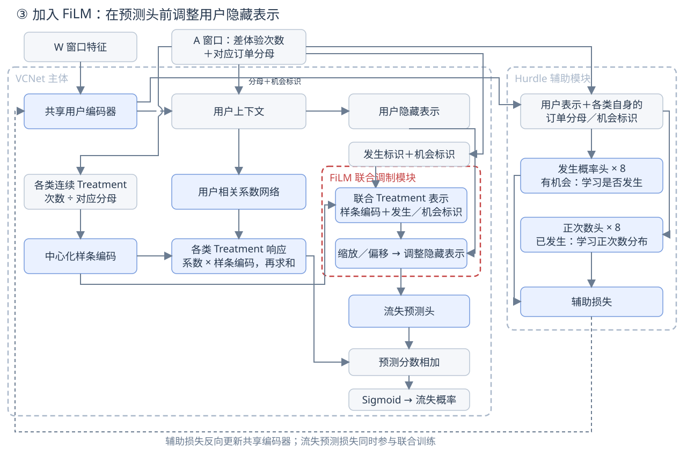

# 【LR26-050】交易效率-技术建设-乘客流失差体验归因离线探索-V1.0

[Cooper 原文](https://cooper.didichuxing.com/knowledge/2199610335356/2210099977988)

# 基础信息

| 项目   | 内容   |
| --- | --- |
| BRD 文档链接   | [[BRD]乘客流失差体验归因离线探索](https://cooper.didichuxing.com/knowledge/2199610335356/2210053655652)   |
| 最后通过的策略方案链接   | [交易效率-离线策略-乘客流失差体验归因离线探索-V1.0-V1](https://cooper.didichuxing.com/knowledge/2199610335356/2210041844491)   |
| 实验链接（评估大师）   | 无，离线类LR   |
| 核心贡献点   | 1. 引入**连续Treatment因果模型**，并结合业务改造模型结构。以VCNet为基础，通过Hurdle辅助任务增强共享用户表示，并利用FiLM建模多类差体验的联合影响，形成联合Hurdle-VCNet，支持不同治理强度下的用户流失效应估计。   2. 建立基于合成数据的**反事实评估**体系。在缺少真实反事实标签的情况下，**构造四类合成场景**，对比候选模型在不同预设机制下的效应估计误差，为模型选型提供依据。   3. 形成乘客流失的差体验**归因结论**，支持治理决策。评估不同治理强度下单项治理与联合治理的预测收益，并在联合治理基础上采用 Shapley 分摊各类差体验的贡献，识别主要收益来源与优先治理方向，为后续策略制定提供依据。    |
| 第一贡献人   | 李昊远   |
| 共同贡献人   | 吴健   |
| 后续策略负责人   | 李昊远   |

## 1 背景

乘客在呼单、应答、接驾和上车过程中，可能遇到等待超时、接驾距离过长、取消、改派等差体验。不同差体验的发生频率和对乘客后续使用的影响并不相同，因此，治理优先级不仅要看问题发生了多少，还需要评估：改善哪类体验，更有助于减少乘客流失；多类体验同时改善时，各项治理分别贡献了多少收益。

为衡量差体验对后续使用的影响，本项目将特征观察窗口结束后连续4周未发单定义为阶段性流失，并以流失概率的变化评估治理收益。选择4周，一方面与业务关注的**次月留存周期接近**，且包含完整的周时间周期，保持各观察窗口中工作日与周末的构成一致；另一方面，也是在流失判断的可靠性与反馈及时性之间取得平衡。

从历史数据看，连续1周未发单的用户中，约45%会在随后4周回流，说明短期未发单仍可能只是正常的出行间隔。当连续未发单时间达到4周时，后续4周回流率降至约26%；进一步延长至6周、8周，回流率分别降至约20%、17%。**继续等待能够提高判断的可靠性，但增益逐渐减小，也会推迟治理效果的评估。** 因此，采用4周作为统一的结果观察窗口，为不同差体验的治理收益比较和贡献分摊提供依据。

| 业务问题   | 需要提供的评估能力   |
| --- | --- |
| 哪类差体验更值得优先治理？   | 估计单类差体验改善后的流失变化   |
| 多类差体验同时治理，收益如何归因？   | 估计联合收益，并分配各项治理的贡献   |

围绕这一目标，项目首先建立流失预测模型，并通过修改差体验特征进行归因。但**预测准确不代表治理效应估计准确**，历史活跃度、供需等因素可能同时影响差体验与乘客流失。因此，进一步引入连续Treatment因果模型，通过合成数据验证模型反事实估计能力，再结合业务治理情景和 Shapley 方法评估、分配联合治理差体验收益。整体探索路线如下：

| 阶段   | 核心工作   | 主要解决的问题   |
| --- | --- | --- |
| 流失预测   | 构建DIN预测模型   | 用户历史和差体验能否有效预测后续流失   |
| 连续Treatment因果建模   | 构建 Hurdle-VCNet，并扩展到联合差体验建模   | 如何更有针对性地学习差体验剂量与流失响应   |
| 反事实验证   | 构造四类合成场景，对照 DIN 与 VCNet   | 模型的反事实推理是否准确   |
| 治理收益评估与归因   | 评估单项及联合治理的收益，采用Shapley分摊贡献   | 不同差体验治理能带来多少预测收益，各类差体验对联合收益分别贡献多少   |

## 2 目标 & 约束

本阶段以离线评估能力建设为目标，为后续治理方向选择提供依据。

| 类型   | 目标或产出   |
| --- | --- |
| **业务价值**   | 比较不同差体验、不同治理强度的预测收益，支持治理优先级判断   |
| **预测目标**   | 真实标签上的流失预测 AUC ≥ 0.80   |
| **效应评估**   | 通过合成数据上的 ATE 误差、MAE、PEHE 判断模型反事实推理能力   |
| **收益评估**   | 输出模型预测的流失率下降及归因贡献；实际业务收益待后续线上验证   |

## 3 技术方案

定义差体验如下表所示：

| 差体验   | 业务定义   | 发生率口径   |
| --- | --- | --- |
| 未应答超时   | 司机应答前乘客取消，且取消时间距发单时间超过 30 秒   | 对应差体验次数 ÷ 发单数   |
| 应答超时   | 峰期&gt;70s，非峰期&gt;30s；峰期 06:30-09:59 或 16:30-19:59   | 对应差体验次数 ÷ 应答数   |
| 应答超接驾距离   | 预计接驾距离&gt;3000米   | 对应差体验次数 ÷ 应答数   |
| 应答超接驾时间   | 预计接驾时间&gt;6分钟   | 对应差体验次数 ÷ 应答数   |
| 应答后乘客取消   | 应答后乘客取消，且取消时间距应答时间超过20秒   | 对应差体验次数 ÷ 应答数   |
| 应答后司机取消（排除改派）   | 应答后司机取消   | 对应差体验次数 ÷ 应答数   |
| 改派   | 发生改派   | 对应差体验次数 ÷ 含改应答数   |
| 全过程超时   | 发单时间到计费时间超过6分钟   | 对应差体验次数 ÷ 计费数   |

本方案分为**流失预测与反事实建模**、**治理差体验归因**两部分**。**先构建用户流失预测模型，再引入反事实建模，估计同一用户在不同差体验治理情景下的流失概率，进而评估治理收益，并通过 Shapley 方法量化各类差体验对联合治理收益的贡献。

### 3.1 流失预测与反事实建模

本方案首先通过流失预测模型学习差体验与用户流失概率之间的关系。用户活跃度、供需环境等因素可能同时影响差体验的发生和后续流失，因此，流失预测准确并不意味着治理效应估计准确。本方案纳入可观测的相关背景变量，并构建面向连续 Treatment 的响应模型，估计不同治理情景下的流失概率变化。

#### 3.1.1 借鉴DIN注意力机制的流失预测模型

用户不同时间的行为和差体验对后续流失的预测价值存在差异，且在历史统计特征中难以体现。因此，本方案在流失预测网络中引入 DIN 的注意力机制，对不同周的历史行为进行自适应加权，结合用户画像预测流失概率，刻画差体验与用户流失之间的关系。

| 环节   | 具体设计   |
| --- | --- |
| **数据输入**   | 13周**历史行为、差体验以及用户画像**，预测随后4周是否流失   |
| **周级特征编码**   | 历史行为向量叠加**时间Embedding**；用户画像单独编码   |
| **周级注意力**   | 以**用户画像**构造 Query，与**各周历史**交互，生成周级权重   |
| **流失预测**   | 聚合历史信息，结合**最近周**行为和**用户画像**，输出流失概率   |

模型结构如下所示：

**周级注意力设计：**

- **用户相关**：Query 以用户画像为基础，不同用户可以关注不同周。

- **独立赋权**：各周权重通过 Sigmoid 生成，多个周可以同时获得较高权重。

- **保留近期信息**：加权聚合结果与最近周行为、画像共同用于预测。

#### 3.1.2 联合Hurdle-VCNet模型

本方案以连续差体验发生率为 Treatment，利用 VCNet 学习流失响应；引入差体验预测辅助任务，为共享用户编码器提供额外监督；再通过 FiLM 表达多类差体验的联合影响。其中，考虑到差体验次数包含较多零值，辅助任务采用 Hurdle 结构，分别预测是否发生差体验及发生后的次数分布。

| 动机   | 模型设计   | 作用   | 模型结构   |
| --- | --- | --- | --- |
| 差体验次数存在大量零值，需要区分没有订单和有订单但未发生差体验。   | **订单机会标识**   | 本项目首先通过订单分母和机会标识区分两类零值。   | -模型输入-   |
| 差体验发生率是连续 Treatment，需要评估不同治理强度的流失变化。   | **VCNet**   | 通过样条编码表示连续Treatment，并由用户上下文生成相应系数。由此学习非线性且具有用户差异的流失响应，支持不同治理强度的流失预测。   |    |
| 差体验发生与用户流失可能受到供需、出行习惯等共同因素影响，希望通过额外监督，帮助编码器更充分地学习这些背景信息。   | **Hurdle**   | 在共享编码器后增加发生概率头和正次数头，将两个头的预测损失与流失预测损失加权相加，共同更新共享编码器，使其同时学习与流失、差体验是否发生及发生强度相关的信息。   |    |
| 多类差体验共同发生时，其影响可能存在放大、重叠或饱和效应，不能仅用单类影响相加描述。   | **FiLM**   | 根据多类 Treatment 的联合状态生成缩放与偏移参数，调整流失预测前的用户隐藏表示。由于调整参数由整组 Treatment 共同决定，某类 Treatment 的预测影响可以随其他 Treatment 状态变化，从而表达非加和性影响。   |    |

##### 3.1.2.1 模型输入

以用户为样本，按照时间先后划分为W、A、Y三个窗口。其定义为：

| 窗口   | 长度   | 数据   | 模型用途   |
| --- | --- | --- | --- |
| **W**   | 2026-03-02到2026-05-03（9 周）   | 历史活跃、发单与交易行为、历史差体验、用户画像及供需环境等特征   | 刻画用户之间原有的差异   |
| **A**   | 2026-05-04到2026-05-31（4 周）   | 八类差体验发生次数及活跃度特征（发单数、应答数等）   | 构造差体验发生率、发生标识及机会标识   |
| **Y**   | 2026-06-01到2026-06-28（4 周）   | 用户是否发单   | 构造流失标签：无发单为 1，否则为 0   |

##### 3.1.2.2 VCNet：连续Treatment响应

模型通过样条基函数将连续Treatment映射为一组随Treatment平滑变化的编码，并根据用户上下文生成对应样条基函数的系数，对这些编码进行加权组合。因此，模型无需分桶，就能预测不同Treatment下的响应，支持评估不同治理幅度，同时表达非线性影响及用户敏感性差异。

| 步骤   | 处理方式   | 作用   |
| --- | --- | --- |
| **用户编码**   | W 特征经过共享编码器，与 A 窗口订单分母、机会标识拼接   | 构造用户上下文   |
| **Treatment 编码**   | 每类 Treatment 转换为 8 个三次 B 样条基函数，并以零值为参照进行中心化   | 表示不同Treatment的变化   |
| **响应计算**   | 生成用户相关权重与样条编码加权求和   | 表达非线性响应与用户敏感性差异   |

不同的差体验的权重不同；同类差体验下不同用户的权重也不同。中心化保证 **Treatment 为零时，该类响应项为零**，不代表用户流失概率为零。

##### 3.1.2.3 Hurdle：辅助学习差体验发生情况

Hurdle 模块通过“发生概率预测头”和“正次数预测头”，分别学习用户是否会发生差体验，以及发生后的次数分布。两个预测头与流失预测任务共享用户编码，通过联合训练，促使共享用户表示**学习与差体验发生倾向和发生强度**相关的信息，为流失预测提供辅助监督。

| 分支   | 训练样本   | 学习目标   |
| --- | --- | --- |
| **发生概率预测头**   | A窗口有过历史订单的用户，包含发生差体验与未发生差体验两类   | 是否至少发生一次差体验   |
| **正次数预测头**   | A窗口发生过差体验的用户   | 通过零截断二项分布，结合订单规模学习发生次数   |

##### 3.1.2.4 FiLM联合调整特征

FiLM 模块通过八类差体验的联合状态生成用户隐藏特征的动态权重和偏移量，对用户表示进行逐维缩放和平移。由于这些参数由多类差体验共同决定，同一类差体验的预测影响能够随其他差体验状态变化，从而表达组合情况下可能出现的放大、重叠或饱和影响。

**3.1.2.5 总结**

联合 Hurdle-VCNet 通过 VCNet 学习非线性、具有用户差异的 Treatment 响应，利用 Hurdle 辅助监督增强用户表征，并通过 FiLM 表达多类Treatment 的联合影响，共同预测用户流失概率。训练完成后，将治理前后的状态输入同一模型，根据预测流失概率的变化评估治理收益，并进一步通过 Shapley 分摊各类差体验的贡献。

### 3.2 基于 Shapley 的治理归因

为使治理后的输入符合业务过程，本项目在降低目标差体验次数的同时，联动调整应答数、计费数等相关行为特征，再由模型预测治理后的流失概率。如下表所示，其中，$$k$$表示当前用户被治理的目标差体验次数，$$q$$表示预先统计并固定的全局应答转计费概率；$$kq$$表示预期增加的计费次数，可取非整数。

| 治理项   | 目标差体验次数   | 应答数   | 计费数   | 治理含义   |
| --- | --- | --- | --- | --- |
| 未应答超时   | −k   | +k   | +kq   | 将部分应答前超时取消转为及时应答，并按平均转化概率进入计费   |
| 应答超时   | −k   | 不变   | 不变   | 缩短应答等待时间，保留原有应答和计费状态   |
| 应答超接驾距离   | −k   | 不变   | 不变   | 改善接驾距离，保留原有应答和计费状态   |
| 应答超接驾时间   | −k   | 不变   | 不变   | 改善接驾时间，保留原有应答和计费状态   |
| 应答后乘客取消   | −k   | 不变   | +kq   | 减少乘客取消，并按平均转化概率进入计费   |
| 应答后司机取消   | −k   | 不变   | +kq   | 减少司机取消，并按平均转化概率进入计费   |
| 改派   | −k   | 不变   | +kq   | 与应答后取消含义一致   |
| 全过程超时   | −k   | 不变   | 不变   | 缩短全过程耗时，保留原有应答和计费状态   |

本项目需要将多类差体验联合治理带来的预测流失率下降，分摊到各类差体验。由于不同治理项可能存在收益重叠或交互，分别治理各项的收益不能直接相加；若依次加入治理项计算增量，又会受到加入顺序的影响。因此，采用 **Shapley 方法，对每类治理项在不同加入顺序下带来的边际收益取平均**，分摊联合治理的总预测收益。

| 步骤   | 操作   |
| --- | --- |
| **构造治理组合**   | 将八类差体验作为归因对象，选取不同差体验子集进行治理，更新目标次数及相关应答数、计费数，重新计算Treatment。   |
| **预测组合收益**   | 将治理后的状态输入模型，以“治理前流失概率－治理后流失概率”作为该组合的预测收益。   |
| **计算边际贡献**   | 比较某个组合加入某类治理项前后的收益差   |
| **计算Shapley贡献**   | 对所有可能的治理加入顺序下，该项带来的边际收益取平均，得到用户级贡献   |
| **人群汇总**   | 对用户贡献取平均，表示各类差体验的贡献   |

采用 Shapley 后，每类治理项的贡献同时考虑了“单独治理”和“与其他治理项配合”的情况，避免由单一加入顺序决定分摊结果；各类贡献之和等于联合治理的总预测收益。Shapley 结果是**特定人群、治理规则和强度下的模型收益分摊**。

## 4 实验结果

本项目通过合成数据实验评估模型对治理效应的估计能力：保留真实业务数据中的用户特征和差体验分布，通过人工预设规则生成流失概率和反事实真值，对比DIN与联合Hurdle-VCNet的预测误差，再使用选定模型开展真实数据上的治理收益评估与Shapley归因。

| 实验环节   | 核心问题   | 评估方式   |
| --- | --- | --- |
| 观测结果预测   | 模型能否预测用户流失？   | 比较合成标签上的 AUC   |
| 反事实效应评估   | 改变 Treatment 后，模型能否准确预测治理收益？   | 比较 ATE 误差、个体效应 MAE 和 PEHE   |
| 模型选型   | 哪个模型更适合后续用户级归因？   | 综合不同合成场景和治理强度下的表现   |
| 真实数据归因   | 各类差体验对联合治理收益分别贡献多少？   | 使用真实标签训练模型，计算 Shapley   |

### 4.1 实验设置

实验沿用第3.1.2.1节定义的W、A窗口输入。保留真实用户特征与差体验分布，通过预设人工规则生成流失概率和反事实真值。为覆盖差体验与用户流失之间可能存在的不同关系，实验设置以下四类合成场景。各场景的具体生成公式与参数见附录 E。

| 合成场景   | 模拟的业务场景   |
| --- | --- |
| 无效应   | 用户流失由历史行为及环境因素决定，A 窗口是否发生差体验、发生多少差体验，不额外影响流失概率。   |
| 线性效应   | 各类差体验对用户流失的影响按各自强度累加，不因其他差体验的出现而额外放大或减弱。   |
| 差体验交互   | 某些差体验共同发生时，可能进一步加重用户的不满，产生超出单项累加的影响。   |
| 人群异质性   | 不同用户对差体验的敏感程度不同，即使遇到相同程度的差体验，其流失风险的变化也不同。   |

上述情形用于检验模型在不同关系设定下的表现，不预先认定真实业务符合其中某一种。

### 4.2 模型对比与选型

本节对比DIN与联合Hurdle-VCNet在四类合成场景下的表现，首先比较流失预测能力，再按照治理规则，评估治理差体验0.5pp,1pp,2pp后的反事实估计误差。

**（1）流失预测能力**

| 合成场景   | DIN AUC   | 联合 Hurdle-VCNet AUC   |
| --- | --- | --- |
| 无效应   | 0.7088   | 0.7081   |
| 线性效应   | 0.8881   | 0.8890   |
| 差体验交互   | 0.8935   | 0.8942   |
| 人群异质性   | 0.8980   | 0.8988   |

两种模型的AUC接近，说明其观测流失预测能力相近。无效应场景的 AUC 低于其他场景，主要与合成数据的生成机制和标签抽样有关，具体分析见附录 F。本项目关注治理前后的流失概率变化，还需比较模型的反事实推理能力。

**（2）反事实推理能力**

采用 ATE 绝对误差评价整体平均收益，采用个体效应 MAE 和 PEHE 评价用户级效应准确性，计算方式见附录 D。下表对各类有效差体验的指标取算术平均，每格按 **DIN / 联合 Hurdle-VCNet** 排列，单位均为 pp，越低越好。

| 合成场景   | 治理强度   | 平均 ATE 绝对误差   | 平均效应 MAE   | 平均PEHE   |
| --- | --- | --- | --- | --- |
| 无效应   | 0.5 pp   | 0.00060 / 0.00147   | 0.00075 / 0.00280   | 0.00235 / 0.01177   |
| 无效应   | 1 pp   | 0.00133 / 0.00275   | 0.00163 / 0.00536   | 0.00426 / 0.01638   |
| 无效应   | 2 pp   | 0.00269 / 0.00553   | 0.00329 / 0.01046   | 0.00836 / 0.03064   |
| 线性效应   | 0.5 pp   | 0.00746 / 0.00291   | 0.02562 / 0.00999   | 0.12041 / 0.04386   |
| 线性效应   | 1 pp   | 0.01286 / 0.00646   | 0.04662 / 0.01867   | 0.15925 / 0.05877   |
| 线性效应   | 2 pp   | 0.02492 / 0.01335   | 0.09253 / 0.03722   | 0.30798 / 0.11328   |
| 差体验交互   | 0.5 pp   | 0.00434 / 0.00394   | 0.02370 / 0.01041   | 0.11551 / 0.04963   |
| 差体验交互   | 1 pp   | 0.00637 / 0.00622   | 0.04367 / 0.01874   | 0.15617 / 0.06239   |
| 差体验交互   | 2 pp   | 0.01292 / 0.01314   | 0.08685 / 0.03746   | 0.30275 / 0.12076   |
| 人群异质性   | 0.5 pp   | 0.00298 / 0.00245   | 0.02739 / 0.01195   | 0.12903 / 0.05544   |
| 人群异质性   | 1 pp   | 0.00397 / 0.00496   | 0.05091 / 0.02271   | 0.17723 / 0.07646   |
| 人群异质性   | 2 pp   | 0.00752 / 0.01014   | 0.10112 / 0.04512   | 0.34275 / 0.14696   |

> 补充：0.5 pp 包含 8 类差体验；应答后司机取消在 1、2 pp 下无有效评估样本，因此这两档包含 7 类。

**（3）消融实验**

为了检查各模块设计合理性，设置了消融实验。考虑到FiLM模块目的是处理差体验之间存在的影响，因此在差体验交互场景中进行消融实验比较，结果如下：

| 版本   | 治理强度   | ATE 绝对误差   | MAE   | √PEHE   |
| --- | --- | --- | --- | --- |
| w/o film   | 0.5 pp   | 0.008127   | 0.015444   | 0.085962   |
| w/o hurdle   | 0.5 pp   | 0.004982   | 0.011047   | 0.053596   |
| **Full**   | 0.5 pp   | **0.003937**   | **0.010412**   | **0.049629**   |
| w/o film   | 1 pp   | 0.012731   | 0.026564   | 0.098931   |
| w/o hurdle   | 1 pp   | 0.007058   | 0.019138   | 0.063126   |
| **Full**   | 1 pp   | **0.006218**   | **0.018743**   | **0.062389**   |
| w/o film   | 2 pp   | 0.026145   | 0.053710   | 0.192645   |
| w/o hurdle   | 2 pp   | 0.014795   | 0.038240   | 0.122106   |
| **Full**   | 2 pp   | **0.013136**   | **0.037460**   | **0.120761**   |

结果显示，**完整模型在三个治理强度下的 ATE 绝对误差、MAE 和 √PEHE 均最低**。移除 FiLM 后，个体效应估计误差明显增大，说明 FiLM 的联合调制有助于表达多类差体验之间的非加性关系，符合其设计预期。

移除 Hurdle 后，误差也有所增加，但幅度相对较小，表明在当前交互场景下，**Hurdle 辅助监督为完整模型提供了补充收益**。两者分别承担交互表达与辅助表示学习的作用，结果呈现一定的互补性。

同时，在其他未显式设置差体验组合额外影响的合成场景中，FiLM 的收益有限，部分指标出现退化，说明其效果具有场景依赖性。考虑到真实业务中可能存在差体验交互，我们保留该模块，以支持组合影响的建模。

**（4）结果分析与模型选择**

| 场景   | 实验结论   |
| --- | --- |
| 无效应   | DIN 的误差更低。在仅由用户背景决定流失的设定下，联合 Hurdle-VCNet增加的结构引入了噪声误差。   |
| 线性效应   | 联合 Hurdle-VCNet 在整体平均收益和用户级效应上均表现更好，三个治理强度下的平均 MAE 降低约 60%。   |
| 差体验交互   | 两种模型的平均 ATE 误差较接近，联合 Hurdle-VCNet 的用户级误差更低，平均 MAE 降低约 56%—57%。   |
| 人群异质性   | DIN 在部分治理强度下的平均 ATE 误差更低，但联合 Hurdle-VCNet 的用户级效应更准确，平均 MAE 降低约 55%—56%。   |

在线性效应、差体验交互和人群异质性三个场景中，联合 Hurdle-VCNet 的个体效应 MAE 和 PEHE 均低于 DIN。考虑到后续需要估计用户在不同治理状态下的流失变化，并据此进行贡献分摊，本项目选择联合 Hurdle-VCNet 作为治理收益评估与 Shapley 归因的基础模型。

### 4.3 真实数据治理收益与归因结果

完成模型选型后，使用真实流失标签训练联合 Hurdle-VCNet，模型 AUC 为 **0.8119**，达到前文设定的 0.80 预测目标。在此基础上，按照第 3.2 节的业务转换规则，分别计算单项治理和联合治理的预测收益，并通过 Shapley 分摊各类差体验的贡献。以下收益是整体预测流失率下降的百分点。

**（1）单项治理收益**

单独治理一类差体验，同时联动调整应答数、计费数等相关状态，得到各治理强度下的预测收益。

| 差体验   | A窗口占比（次数/总发单数）   | 降低 0.5 pp   | 降低 1 pp   | 降低 2 pp   | 降低 3 pp   |
| --- | --- | --- | --- | --- | --- |
| 未应答超时   | 8.9380%   | 0.051383   | 0.101368   | 0.199896   | 0.295750   |
| 应答超时   | 10.3404%   | 0.007207   | 0.014380   | 0.028350   | 0.042257   |
| 应答超接驾距离   | 5.2566%   | 0.001520   | 0.003061   | 0.006154   | 0.009479   |
| 应答超接驾时间   | 18.6383%   | 0.000708   | 0.001426   | 0.002596   | 0.003311   |
| 应答后乘客取消   | 7.3161%   | 0.035900   | 0.071648   | 0.142017   | 0.212355   |
| 应答后司机取消   | 0.6100%   | 0.072652   | —   | —   | —   |
| 改派   | 2.9604%   | 0.023692   | 0.047289   | 0.093524   | —   |
| 全过程超时   | 26.1964%   | 0.007366   | 0.014392   | 0.028559   | 0.043391   |

> 注：“—”表示该档目标降幅超过对应基线发生率，未评估，不表示收益为零。

各项治理的预测收益均为正。在共同可比较的**0.5 pp**强度下，应答后司机取消的收益最高，其次为未应答超时、应答后乘客取消和改派。在更大的可行治理幅度下，未应答超时与应答后乘客取消体现出较大的收益空间。

**（2）联合治理整体收益**

对当前强度下可参与治理的差体验同时进行改善，计算整体预测流失率的变化。

| 各参与差体验的目标降幅   | 联合治理范围   | 整体预测流失率下降   | 治理前预测流失率   | 治理后预测流失率   |
| --- | --- | --- | --- | --- |
| 各降低 0.5 pp   | 全部 8 类   | **0.199743 pp**   | 41.060211%   | 40.860468%   |
| 各降低 1 pp   | 7 类，不含应答后司机取消   | **0.251832 pp**   | 41.060211%   | 40.808378%   |
| 各降低 2 pp   | 7 类，不含应答后司机取消   | **0.494617 pp**   | 41.060211%   | 40.565593%   |
| 各降低 3 pp   | 6 类，不含应答后司机取消、改派   | **0.603435 pp**   | 41.060211%   | 40.456776%   |

**（3）Shapley贡献分摊**

在联合治理收益基础上，通过 Shapley 计算每类差体验在不同治理组合下的平均边际贡献。各类贡献之和等于对应方案的联合预测收益。

| 差体验   | 治理 0.5 pp   | 治理 1 pp   | 治理 2 pp   | 治理 3 pp   |
| --- | --- | --- | --- | --- |
| 未应答超时   | 0.051168   | 0.100725   | 0.197454   | 0.292168   |
| 应答超时   | 0.007238   | 0.014344   | 0.028224   | 0.042318   |
| 应答超接驾距离   | 0.001507   | 0.003019   | 0.006038   | 0.009803   |
| 应答超接驾时间   | 0.000685   | 0.001320   | 0.002213   | 0.003689   |
| 应答后乘客取消   | 0.035826   | 0.071536   | 0.141654   | 0.213064   |
| 应答后司机取消   | 0.072533   | —   | —   | —   |
| 改派   | 0.023489   | 0.046682   | 0.091111   | —   |
| 全过程超时   | 0.007298   | 0.014208   | 0.027924   | 0.042392   |
| **联合预测流失率下降**   | **0.199743**   | **0.251832**   | **0.494617**   | **0.603435**   |

在各降低 2 pp 的联合方案中，未应答超时和应答后乘客取消分别贡献 **0.197454 pp** 和 **0.141654 pp**，是主要收益来源，改派次之。各降低 0.5 pp 时，应答后司机取消的贡献最高，但其可治理幅度受到基线发生率限制。这些结果支持将**未应答超时、应答后取消及改派相关治理**作为优先进一步验证的方向。具体治理优先级还需结合策略可实现的降幅、实施成本及实际转化效果判断；Shapley 贡献表示当前人群和治理方案下的收益分摊，不是固定不变的差体验权重。

**（4）分析单项治理和shapley分摊贡献差异较小**

当前单项治理和联合治理的shapley分摊差异较小，补充2pp治理档位，按照差体验同时出现种类对人群分类，并在其内部计算差异（单项收益之和-联合收益），结果如下，能够看出随着共现种类增加，差异也更明显。

| 共现种类   | 人群占比   | 平均联合治理收益   | 平均差异（占联合收益）   | 个体绝对差异均值（占联合收益）   |
| --- | --- | --- | --- | --- |
| 1 类   | 23.50%   | 0.600243   | 0（0.00%）   | ≈0（≈0.00%）   |
| 2 类   | 17.38%   | 0.520881   | 0.002189（0.42%）   | 0.015449（2.97%）   |
| 3 类   | 14.42%   | 0.717886   | 0.009210（1.28%）   | 0.030368（4.23%）   |
| 4 类   | 10.45%   | 0.804166   | 0.014519（1.81%）   | 0.040208（5.00%）   |
| 5 类   | 6.69%   | 0.776459   | 0.023683（3.05%）   | 0.049421（6.36%）   |
| 6 类   | 3.76%   | 0.529297   | 0.033868（6.40%）   | 0.050486（9.54%）   |
| **7 类**   | **1.47%**   | **0.249115**   | **0.026944（10.82%）**   | **0.039669（15.92%）**   |
| **全体**   | **100%**   | **0.494617**   | **0.006479（1.31%）**   | **0.017052（3.45%）**   |

> 发现在共现种类多的人群中的联合治理收益较低，查看预测流失率发现，在高共现人群的原始预测流失率本身就低，治理带来的绝对下降空间小。可以理解为活跃度差异，活跃的用户会遇到更多的差体验，又因为本身活跃度高，流失率低。

## 5 放量决策

离线探索实验，无需放量。

## 6 引用和鸣谢

[归因](https://cooper.didichuxing.com/knowledge/2199610335356/2209236760391)

VCNet and Functional Targeted Regularization For Learning Causal Effects of Continuous Treatments，参考了这篇VCNet对连续Treatment建模的方法。

FiLM: Visual Reasoning with a General Conditioning Layer，参考了这篇FiLM，根据条件信息生成逐特征的缩放与偏移参数，调整网络中的特征表示。

CausalMTA: Eliminating the User Confounding Bias for Causal Multi-touch Attribution，使用shapley对广告的多触点进行归因。

## 7 后续规划

1. 产出的差体验贡献可以作为在相关优化问题中交易体验指标加权，作为27年交易效率优化的约束，使优化目标同时考虑交易效率和用户留存；

2. 随着策略上线和差体验分布变化，定期重新计算单项治理收益、联合收益及各项治理贡献，评估剩余治理空间和优先级变化，形成周期性分析报告。

3. 后续可以按城市，新老用户，活跃度等维度分析治理收益，识别对特定差体验敏感，改善收益更高的人群。

## 附录

### 附录A：DIN注意力机制计算过程

以用户画像表示$$s$$构造 Query，并加入共享可学习偏移$$q_0$$：

$$q=s+q_0$$

各周历史行为向量$$h_t$$作为Key和Value，通过注意力网络计算每周权重：

$$g_t=\sigma(MLP(q,h_t,q-h_t,q \odot h_t))$$

差值与乘积用于表达用户画像和周级历史之间的交互，使不同用户可以对不同周分配不同权重。各周权重通过 sigmoid 独立生成，不使用跨周 softmax 归一化，因此多个周可以同时获得较高权重。随后加权聚合历史表示：

$$p=\frac{1}{\sqrt{13}}\sum_{t=0}^{12}g_th_t$$

同时保留权重总量：

$$r=\sum_t g_t$$

预测输入由以下信息拼接：

$$z=[p,h_{12},q,p-q,p\odot q,s,r]$$

### 附录B：模型符号与计算公式

#### 1. 联合Hurdle-VCNet符号说明：

| 符号   | 含义   |
| --- | --- |
| $$X_W$$   | W 窗口输入特征   |
| $$j$$   | 差体验类型索引，$$j=1,\ldots,8$$   |
| $$c_j$$   | A 窗口第$$j$$类差体验的发生次数   |
| $$n_j$$   | 第$$j$$类差体验对应的发生机会（发单数，应答数，计费数）   |
| $$o_j$$   | 发生机会标识：$$n_j>0$$时为 1，否则为 0   |
| $$z_j$$   | 差体验发生标识：$$c_j>0$$时为 1，否则为 0   |
| $$t_j$$   | 差体验发生率：$$c_j/n_j$$；分母为零时记为 0   |
| $$r$$   | W 窗口特征经过共享编码器得到的用户表示向量   |
| $$s$$   | 用户表征与订单机会信息拼接形成的上下文：$$[r,\ell(n),o]$$；$$\ell(n)$$表示发生机会经过$$\log(1+n)$$和标准化后的值   |
| $$s_j$$   | 第$$j$$类差体验的上下文   |
| $$B_k(t_j)$$   | 第$$k$$个样条基函数在发生率$$t_j$$处的取值；本模型每类使用 8 个基函数   |
| $$\widetilde B_k(t_j)$$   | 中心化样条编码，即$$B_k(t_j)-B_k(0)$$   |
| $$\theta_{jk}(s)$$   | 根据上下文生成的第$$j$$类差体验、第$$k$$个样条基函数的系数   |
| $$m_j(s,t_j)$$   | 第$$j$$类Treatment响应项，作用于logit层面   |
| $$T$$   | 八类差体验的联合表示，由各类中心化样条编码、发生标识和机会标识拼接而成   |
| $$h_0$$   | 根据上下文$$s$$生成的初始用户隐藏向量   |
| $$\Delta\gamma,\Delta\beta$$   | 缩放增量和平移参数   |
| $$h$$   | FiLM调整后的用户隐藏向量   |
| $$\pi_j$$   | Hurdle 分支预测的、存在发生机会时第$$j$$类差体验至少发生一次的概率   |
| $$q_j$$   | Hurdle 正次数分支输出的二项分布参数   |
| $$y,\hat p$$   | 实际流失标签与模型预测流失概率；$$y=1$$表示流失   |

#### 2. VCNet连续Treatment响应

**（1）用户特征编码**

$$r=\operatorname{Encoder}(X_W), \qquad s=\operatorname{Concat}(r,\ell(n),o)$$

**（2）连续剂量响应**

每类差体验使用8个三次B样条基函数进行编码，并做中心化，目的是为了当某个差体验的$$Treatment=0$$时，保证输出的因差体验流失的相应项为0，即：

$$\widetilde B_k(t_j)=B_k(t_j)-B_k(0)$$

再通过差体验系数网络加权求和，即：

$$\theta_j(s)=\operatorname{MLP}_j(s)，\ m_j(s,t_j)= \sum_{k=1}^{8}\theta_{jk}(s)\widetilde B_k(t_j)$$。

三次B样条函数的配置与计算：

**1.基函数与节点配置**

每类差体验配置$$K=8$$个基函数，次数 $$p=3$$，内部节点数为：$$K-p-1=4$$，在$$[0,1]$$上等距设置内部节点，两端节点各重复$$p+1=4$$次，得到：$$\mathbf u= [0,0,0,0,\;0.2,\;0.4,\;0.6,\;0.8,\;1,1,1,1]$$，“三次”表示每个分段最高为三次多项式。节点用于构造平滑基函数，不表示按发生率分组训练独立模型。

**2.基函数计算**

从零次基函数开始：

$$B_{i,0}(t)= \begin{cases} 1,&u_i\le t<u_{i+1}\\ 0,&\text{其他}\end{cases}$$

通过Cox-de Boor公式递推：

$$B_{i,p}(t)= \frac{t-u_i}{u_{i+p}-u_i}B_{i,p-1}(t) + \frac{u_{i+p+1}-t}{u_{i+p+1}-u_{i+1}}B_{i+1,p-1}(t)$$

分母为0的项按0处理，依次计算$$p=1,2,3$$。最终得到$$B_k(t)=B_{k,3}(t)，k=1,\ldots,8$$，右端点$$t=1$$单独处理，使最后一个基函数为1，其余为0。

#### 3. Hurdle辅助分支

**（1）发生概率头（Gate Head）**

将第$$j$$类差体验的上下文表示：

$$s_j=\operatorname{Concat}(r,\ell(n_j),o_j)$$

输入预测头得到发生概率：

$$\pi_j = \sigma(MLP_{gate,j}(s_j))$$

**（2）发生次数头（Count Head）**

使用相同输入，输出次数分布参数：

$$q_j=\sigma\left(\operatorname{MLP}_{\mathrm{count},j}(s_j)\right)$$

对于发生次数大于零（$$c_j>0$$）的样本，采用零截断二项分布：

$$P(c_j\mid c_j>0,s_j,n_j) = \frac{ \binom{n_j}{c_j}q_j^{c_j}(1-q_j)^{n_j-c_j} }{ 1-(1-q_j)^{n_j} }, \quad c_j=1,\ldots,n_j$$

#### 4. FiLM联合调整特征

**（1）联合状态编码与参数生成**

通过八类差体验的联合状态$$T$$生成缩放和平移参数，以相同机会条件下的全零差体验$$T_0$$为参照，计算参数增量：

$$d=\operatorname{MLP}_{\mathrm{FiLM}}(T) -\operatorname{MLP}_{\mathrm{FiLM}}(T_0)$$

将d分成前后相同维度的两部分$$d=\operatorname{Concat}(d_{\gamma},d_{\beta})$$，分为缩放和平移两部分：

$$\Delta\gamma=\frac{1}{2}\tanh(d_\gamma)$$，$$\Delta\beta=\frac{1}{2}d_\beta$$

缩放增量通过$$\tanh$$限制幅度，避免对隐藏表示进行过度放大或缩小。$$T_0$$保证所有差体验为零时，参数增量为零。

**（2）用户表示调整与预测**

根据联合状态生成的参数，对初始用户表示$$h_0=MLP(s)$$进行逐维缩放和平移：

$$h=h_0\odot(1+\Delta\gamma)+\Delta\beta$$

与VCNet得到的Treatment响应共同预测流失概率：

$$\hat p= \sigma\left( \operatorname{MLP}_{\mathrm{out}}(h) +\sum_{j=1}^{8}m_j(s,t_j) \right)$$

### 附录C：Shapley计算口径

#### 1. 符号含义：

| 符号   | 含义   |
| --- | --- |
| $$\mathcal D$$   | 全部八类差体验的集合   |
| $$S$$   | 参与治理的差体验子集，$$S\subseteq\mathcal D$$   |
| $$\hat p_i(S)$$   | 用户$$i$$在治理组合$$S$$下的预测流失概率   |
| $$v_i(S)$$   | 治理组合$$S$$对用户$$i$$带来的预测收益   |
| $$\phi_{ij}$$   | 第$$j$$类差体验对用户$$i$$的 Shapley 贡献   |

#### 2. 收益

以未治理状态为基准，定义收益：$$v_i(S)=\hat p_i(\varnothing)-\hat p_i(S)$$

#### 3. Shapley贡献计算

对第$$j$$类差体验，比较其加入治理组合前后的收益变化：

$$v_i(S\cup\{j\})-v_i(S)$$

再对所有不包含$$j$$的组合进行加权平均：

$$\phi_{ij} = \sum_{S\subseteq\mathcal D\setminus\{j\}} \frac{|S|!\,(8-|S|-1)!}{8!} \left[ v_i(S\cup\{j\})-v_i(S) \right]$$

该权重等价于对所有治理加入顺序中的边际贡献取平均，并非对所有子集直接等权平均

#### 4. 加总一致性与人群汇总

Shapley满足加总一致性，各类贡献之和等于联合治理的总预测收益：

$$\sum_{j=1}^{8}\phi_{ij} = \hat p_i(\varnothing)-\hat p_i(\mathcal D)$$

在人群层面，对用户贡献取平均，并转换为百分点：

$$\overline{\phi}_j^{\,\mathrm{pp}} = 100\times\frac{1}{N}\sum_{i=1}^{N}\phi_{ij}$$

例如，某类差体验的平均贡献为0.05pp，表示在当前治理方案下，联合治理带来的预测流失率下降中有0.05pp分摊给该类差体验，负值表示其在不同组合中降低了预测收益。‍

### 附录D：反事实评价指标

#### 1. 合成标签：

$$p_i^*=g_{rule}(X_{W,i},A_i), \qquad y_i^{\mathrm{syn}}\sim\operatorname{Bernoulli}(p_i^*)$$

#### 2. 真实与预测治理效应：

按$$\tau_i=p_i^*(A_i)-p_i^*(A_i'), \qquad \hat\tau_i=\hat p_i(A_i)-\hat p_i(A_i')$$

其中，$$A_i'$$为按治理规则更新后的完整 A 窗口状态；若治理包含随机转换，则相应概率取该治理方案下的期望

#### 3. 平均效应及误差

| 指标   | 公式   | 含义   |
| --- | --- | --- |
| 真实ATE   | $$\mathrm{ATE}_{\mathrm{true}}=\frac1N\sum_i\tau_i$$     | 用户治理收益的真实平均值   |
| 预测ATE   | $$\mathrm{ATE}_{\mathrm{pred}}=\frac1N\sum_i\hat\tau_i$$     | 用户治理收益的预测平均值   |
| ATE绝对误差   | $$\mathrm{ATE\ Error} = \left|\mathrm{ATE}_{\mathrm{pred}}-\mathrm{ATE}_{\mathrm{true}}\right|$$   | 预测平均治理收益与真实平均治理收益之间的绝对偏差，越小越好。   |
| ATE相对误差   | $$\mathrm{ATE\ Relative\ Error} = \frac{\mathrm{ATE\ Error}} {|\mathrm{ATE}_{\mathrm{true}}|} \times100\%$$   | ATE绝对误差占真实平均治理收益绝对值的比例，衡量相对于真实收益规模的偏差，越小越好。真实ATE为零时不适用。   |
| MAE   | $$\mathrm{MAE}=\frac1N\sum_i|\hat\tau_i-\tau_i|$$   | 用户级治理绝对误差的平均值   |
| PEHE   | $$\mathrm{PEHE}=\sqrt{\frac1N\sum_i(\hat\tau_i-\tau_i)^2}$$   | 个体效应预测误差的均方根，对较大的个体误差更敏感   |

### 附录E：合成数据构造方式

合成数据保留真实业务中的用户特征、差体验分布及其相关性，通过人工设定的生成机制计算流失概率，再抽样生成二分类标签。

| 步骤   | 具体处理   |
| --- | --- |
| 保留原始输入   | 保留原表全部字段及其值，不重新生成 W、A 特征   |
| 计算基础风险   | 使用 W 窗口中的活跃度、距最近发单天数、发单趋势和城市供需代理构造基础流失分数   |
| 计算 Treatment   | 使用 A 窗口各类差体验次数除以对应机会数   |
| 设置场景机制   | 按无效应、线性、交互或人群异质性规则计算差体验影响   |
| 生成流失概率   | 将基础分数与差体验影响相加，经 sigmoid 转换为概率   |
| 生成标签   | 根据该概率生成 0/1 合成流失标签   |
| 计算反事实真值   | 治理后重新计算 Treatment，代入同一生成机制得到治理后概率   |

四个场景各自联合使用八类差体验，**不是为每一类差体验分别生成一套标签**。原始真实流失标签不参与合成，也不被覆盖。

#### 1. 基础流失风险

四个场景共用相同的基础风险项。

| 符号   | 信息来源   | 代码中的计算方式   |
| --- | --- | --- |
| $$a_i$$   | W 窗口总发单数$$O_i$$   | $$\operatorname{clip}(\ln(1+O_i)/\ln(101),0,2)$$   |
| $$r_i$$   | 距最近发单天数 $$R_i$$   | $$\operatorname{clip}(R_i/63,0,1)$$   |
| $$g_i$$   | W 窗口发单趋势 $$G_i$$   | $$\operatorname{clip}(G_i/5,-1,1)$$   |
| $$s_i$$   | 城市发单率 city_total_ecr代表供需特征   | $$1-\operatorname{clip}(ECR_i,0,1)$$   |

基础流失分数为：

$$b_i=-1.4-a_i+1.2r_i-0.6g_i+s_i$$

在这个设定下，历史活跃度较高、发单趋势上升的用户，基础流失风险较低；距最近发单时间较长、供需代理所表示的压力较大的用户，基础流失风险较高。上述方向和系数是实验设定，不是从真实流失标签估计得到的业务结论。

#### 2. Treatment定义及基础权重

各类 Treatment 按 A 窗口累计次数计算：

$$T_{ij}=\frac{\text{第 }j\text{ 类差体验次数}}{\text{对应机会数}}, \qquad z_{ij}=\frac{T_{ij}}{0.10}$$

分母为0时，Treatment取0，代码校验原始次数非负，整数，分子不超过分母。

| 编号   | 差体验   | Treatment 分母   | 基础权重$$\beta_j$$   |
| --- | --- | --- | --- |
| 1   | 未应答超时   | 呼单数   | 0.45   |
| 2   | 应答超时   | 应答数   | 0.25   |
| 3   | 应答超接驾距离   | 应答数   | 0.30   |
| 4   | 应答超接驾时间   | 应答数   | 0.35   |
| 5   | 应答后乘客取消   | 应答数   | 0.30   |
| 6   | 应答后司机取消   | 应答数   | 0.50   |
| 7   | 改派   | 含改派应答数   | 0.25   |
| 8   | 全过程超时   | 计费数   | 0.35   |

将基础 Treatment 分数记为：

$$L_i=\sum_{j=1}^{8}\beta_j z_{ij}$$

这里用0.1进行尺度转换，即Treatment为10%时，转换后的数值为1。

#### 3. 四类合成场景

各场景的流失概率统一计算为：

$$p_i=\sigma\!\left(\operatorname{clip}(b_i+E_i,-30,30)\right)$$

其中，$$E_i$$为不同场景下的差体验影响项；默认整体效应强度为1。

| 场景   | 差体验影响项$$E_i$$   | 对应含义   |
| --- | --- | --- |
| 无效应   | $$0$$   | 流失概率只由 W 背景信息决定，改变 Treatment 不产生真实收益   |
| 线性效应   | $$L_i$$   | 八类 Treatment 按固定权重相加，进入 sigmoid 前分数   |
| 差体验交互   | $$L_i+1.2(h_{i1}h_{i6}+h_{i3}h_{i4})$$   | 在基础效应上，额外加入两组差体验的交互影响   |
| 人群异质性   | $$m_iL_i$$   | 相同 Treatment 对不同用户产生不同强度的影响   |

**线性效应。** “线性”指 sigmoid 前分数对 Treatment 线性，流失概率本身并非线性。即使 Treatment 降幅相同，不同基础风险的用户，其流失概率降幅也可能不同。

**差体验交互。** 交互项使用饱和变换$$h_{ij}=1-e^{-z_{ij}}$$，具体设置两组交互：

| 交互组合   | 合成设定   |
| --- | --- |
| 未应答超时 × 应答后司机取消   | 两类 Treatment 同时较高时，额外增加流失分数   |
| 应答超接驾距离 × 应答超接驾时间   | 接驾距离和接驾时间同时较差时，额外增加流失分数   |

**人群异质性。** 用户敏感性系数为：

$$m_i=0.4+1.2r_i+0.7\left[1-\operatorname{clip}(a_i,0,1)\right]$$

该系数范围为 0.4—2.3。设定上，距最近发单时间更长、历史活跃度更低的用户，对差体验更加敏感。该系数共同调节八类 Treatment 的影响，并非为每个用户、每类差体验分别随机生成一个系数。

### 附录F：无效应场景 AUC 较低的原因分析

实验中，无效应场景下 DIN 与联合 Hurdle-VCNet 的 AUC 均约为 0.71，低于其他三个场景的约 0.89。为判断这一差异是否源于模型未充分学习，进一步使用**合成规则给出的真实流失概率**作为预测分数，对采样生成的合成标签计算 AUC。

| 评估对象   | AUC   |
| --- | --- |
| 无效应场景的真实生成概率   | **0.7091**   |

合成标签并非由流失概率直接确定，而是按该概率抽样生成。例如，流失概率为 70% 的用户仍可能被标记为“不流失”，概率为 30% 的用户也可能被标记为“流失”。因此，即使准确知道每个用户的真实流失概率，也无法完全区分最终的正负样本。本次真实生成概率的 AUC 为 **0.7091**，与两种模型已有的 AUC 接近。

### 附录G：Bootstrap置信区间

参数设置：

| 项目   | 设置   |
| --- | --- |
| 抽样单位   | 用户，一位用户对应预测表的一行   |
| 抽样方式   | 等概率、有放回抽样   |
| 每轮抽样次数   | N = 8253780次，与验证集用户数相同   |
| 重复轮数   | **1,000 轮**   |
| 随机种子   | 20261023   |
| 区间方法   | 取 1,000 个平均收益的**2.5% 和 97.5% 分位数**   |

结果如下：

**（1）单项治理收益**

| 差体验   | 降低 0.5 pp   | 降低 1 pp   | 降低 2 pp   | 降低 3 pp   |
| --- | --- | --- | --- | --- |
| 未应答超时   | 0.051383 \[0.051268, 0.051498\]   | 0.101368 \[0.101159, 0.101584\]   | 0.199896 \[0.199493, 0.200312\]   | 0.295750 \[0.295198, 0.296381\]   |
| 应答超时   | 0.007207 \[0.007186, 0.007230\]   | 0.014380 \[0.014339, 0.014421\]   | 0.028350 \[0.028276, 0.028426\]   | 0.042257 \[0.042147, 0.042368\]   |
| 应答超接驾距离   | 0.001520 \[0.001505, 0.001536\]   | 0.003061 \[0.003034, 0.003092\]   | 0.006154 \[0.006100, 0.006210\]   | 0.009479 \[0.009401, 0.009562\]   |
| 应答超接驾时间   | 0.000708 \[0.000699, 0.000716\]   | 0.001426 \[0.001410, 0.001440\]   | 0.002596 \[0.002566, 0.002622\]   | 0.003311 \[0.003270, 0.003350\]   |
| 应答后乘客取消   | 0.035900 \[0.035822, 0.035982\]   | 0.071648 \[0.071503, 0.071814\]   | 0.142017 \[0.141729, 0.142322\]   | 0.212355 \[0.211926, 0.212837\]   |
| 应答后司机取消   | 0.072652 \[0.072219, 0.073030\]   | —   | —   | —   |
| 改派   | 0.023692 \[0.023600, 0.023775\]   | 0.047289 \[0.047119, 0.047459\]   | 0.093524 \[0.093199, 0.093850\]   | —   |
| 全过程超时   | 0.007366 \[0.007354, 0.007379\]   | 0.014392 \[0.014370, 0.014413\]   | 0.028559 \[0.028517, 0.028602\]   | 0.043391 \[0.043334, 0.043446\]   |

**（2）联合治理收益**

| 各参与差体验的目标降幅   | 联合治理范围   | 整体预测流失率下降 / pp   | 治理前预测流失率   | 治理后预测流失率   |
| --- | --- | --- | --- | --- |
| 各降低 0.5 pp   | 全部 8 类   | **0.199743** \[0.199306, 0.200187\]   | 41.060211%   | 40.860468%   |
| 各降低 1 pp   | 7 类，不含应答后司机取消   | **0.251832** \[0.251515, 0.252172\]   | 41.060211%   | 40.808378%   |
| 各降低 2 pp   | 7 类，不含应答后司机取消   | **0.494617** \[0.493993, 0.495256\]   | 41.060211%   | 40.565593%   |
| 各降低 3 pp   | 6 类，不含应答后司机取消、改派   | **0.603435** \[0.602711, 0.604255\]   | 41.060211%   | 40.456776%   |

**（3）Shapley贡献分摊**

| 差体验   | 治理 0.5 pp   | 治理 1 pp   | 治理 2 pp   | 治理 3 pp   |
| --- | --- | --- | --- | --- |
| 未应答超时   | 0.051168 \[0.051055, 0.051282\]   | 0.100725 \[0.100517, 0.100939\]   | 0.197454 \[0.197059, 0.197866\]   | 0.292168 \[0.291620, 0.292785\]   |
| 应答超时   | 0.007238 \[0.007217, 0.007260\]   | 0.014344 \[0.014304, 0.014384\]   | 0.028224 \[0.028151, 0.028298\]   | 0.042318 \[0.042212, 0.042422\]   |
| 应答超接驾距离   | 0.001507 \[0.001492, 0.001523\]   | 0.003019 \[0.002991, 0.003048\]   | 0.006038 \[0.005984, 0.006091\]   | 0.009803 \[0.009728, 0.009886\]   |
| 应答超接驾时间   | 0.000685 \[0.000677, 0.000693\]   | 0.001320 \[0.001305, 0.001333\]   | 0.002213 \[0.002186, 0.002237\]   | 0.003689 \[0.003651, 0.003726\]   |
| 应答后乘客取消   | 0.035826 \[0.035748, 0.035908\]   | 0.071536 \[0.071393, 0.071701\]   | 0.141654 \[0.141375, 0.141962\]   | 0.213064 \[0.212639, 0.213543\]   |
| 应答后司机取消   | 0.072533 \[0.072099, 0.072908\]   | —   | —   | —   |
| 改派   | 0.023489 \[0.023397, 0.023571\]   | 0.046682 \[0.046514, 0.046848\]   | 0.091111 \[0.090789, 0.091433\]   | —   |
| 全过程超时   | 0.007298 \[0.007286, 0.007311\]   | 0.014208 \[0.014186, 0.014229\]   | 0.027924 \[0.027884, 0.027965\]   | 0.042392 \[0.042337, 0.042446\]   |
| **联合预测流失率下降**   | **0.199743** \[0.199306, 0.200187\]   | **0.251832** \[0.251515, 0.252172\]   | **0.494617** \[0.493993, 0.495256\]   | **0.603435** \[0.602711, 0.604255\]   |
