# 【LR26-055】乘客与增长-技术建设-Uplift模型评估因果可信性验证与指标优化 -V1.0

[Cooper 原文](https://cooper.didichuxing.com/knowledge/2199610335356/2210488010817)

## 基础信息

| 项目   | 内容   |
| --- | --- |
| BRD 文档链接   | 基础建设类工作，无对应BRD   |
| 最后通过的策略方案链接   | 基础建设类工作，无对应策略方案链接   |
| 实验链接（评估大师）   | 无，基础建设类LR   |
| 核心贡献点   | - 构建保留真值的十 treatment **结构因果模型（SCM）仿真系统**与参照评分体系，首次定量检验 Treatment Ratio 比例检查与 MTAUCC：**倾斜不代表模型预测反事实的能力差，也换算不出 MTAUCC 偏差**（Treatment Ratio 倾斜对应 −0.11 ～ +0.56 的偏差）（§4.2.2）。    - 把 MTAUCC 的增益拆为**基线差 **$$B(m)$$**（Top-K 内两组不打折时本来就会完单的数量之差）+ uplift **$$E(m)$$，MTAUCC 偏差 74%～100% 来自 $$B(m)$$（§3.3、§4.2.3）。    - 提出**残差校正 MTAUCC（M）**：在对照组上交叉拟合 LightGBM 估计不打折完单率 $$\hat\mu_{100}(X)$$，以 $$Y-\hat\mu_{100}(X)$$ 代替 $$Y$$。真实数据训练 96 个模型上，4 个倾斜 CFR 与不倾斜参照模型的差 +0.20～+0.54 → −0.07～+0.01，不倾斜模型排序与 R 相关 0.82，单模型标准差 0.141 → 0.063（§4.3.3）。   |
| 第一贡献人   | 詹传赞   |
| 共同贡献人   | 周之烁，李一鹏   |
| 后续策略负责人   | 詹传赞   |

**一页速览**

- 问什么：Treatment Ratio 更倾斜，能否说明 uplift 模型因果不可信、MTAUCC 虚高。

- 方法主线：仿真保留真值，比较倾斜、MTAUCC 与真实 MTAUCC → 分解偏差，定位基线差 $$B(m)$$ → 用对照组估计 $$\hat\mu_{100}(X)$$，残差替换完单，得到校正指标 M → 在 96 个真实模型上验证。

- 结论：Treatment Ratio 不倾斜时因果可信、倾斜时无法推测高估低估；MTAUCC 的偏差主要来自 $$B(m)$$；M 去掉倾斜模型的虚高，同时保留不倾斜模型排序（§4.1）。

---

## 1 背景

### 1.1 现状与问题

当前 uplift 模型离线评估以 MTAUCC 为主指标，并用 Treatment Ratio 比例检查作为可信性约束：按模型预测的 uplift 排序，Top-K 中实验组与对照组人数比偏离全量过多（"倾斜"）的模型不予采用。

该约束基于一条假设：**Top-K 人数比倾斜 → 模型利用了分流信息 → 预测反事实的能力差、MTAUCC 不可信**。这条假设此前没有验证；倾斜模型的 MTAUCC 往往更高，究竟是排序更好还是被泄漏抬高，也无法判断。

### 1.2 原因：真实日志无法回答

真实日志里每位乘客只拿到一个档位，反事实完单不可观测，真实排序质量（真实 MTAUCC）无从计算。要检验上述假设，需要一个已知真值、数据形态与真实日志一致的环境。

因此，本文**先用仿真检验 Treatment Ratio 与 MTAUCC 的可信性并定位 MTAUCC 偏差来源，再把仿真中的校正方法迁移到RCT 数据**。

### 1.3 本次定位

本次不上线新策略，而是检验并修正 uplift 模型的离线评估口径：回答 Treatment Ratio 能否作为因果可信性检查，并给出一个对两类分流泄漏（只带分流信息、与完单相关）都稳健的校正指标 M。

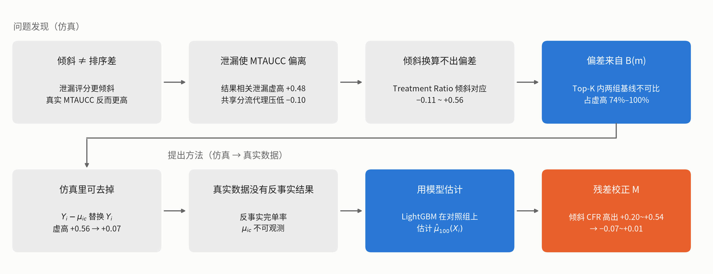

*图 1　本文主线。上排：仿真中发现 Treatment Ratio 检查不了因果可信性，MTAUCC 的偏差主要来自基线差* $$B(m)$$*；下排：从仿真到真实数据，用残差校正去掉* $$B(m)$$*。*

---

## 2 目标 & 约束

baseline：MTAUCC（记为 R）+ Treatment Ratio 比例检查（§3.0）

本文：仿真中检验 baseline 的可信性；真实数据上评估校正指标 M

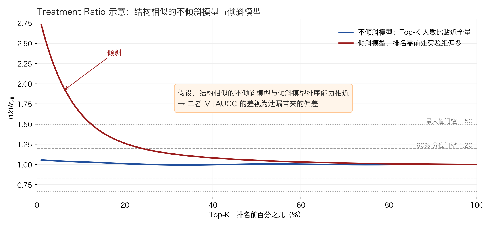

*图 2　Treatment Ratio 示意。蓝为不倾斜模型，红为倾斜模型；虚线、点线为 90% 分位与最大值门槛。*

假设：结构相似的不倾斜模型与倾斜模型排序能力相近。

| 目标   | 待验证问题   | 定义   | 结果   |
| --- | --- | --- | --- |
| 目标 1（仿真）   | Treatment Ratio 倾斜能否反映排序质量   | 倾斜越大，真实 MTAUCC 应越低   | 不成立：12 种组合中，更倾斜的泄漏评分真实 MTAUCC 在 100% 的数据集上高于噪声评分（§4.2.2.1）   |
| 目标 2（仿真）   | 倾斜能否提示 MTAUCC 的偏差   | Treatment Ratio 倾斜对应的偏差应可预测   | 不成立：Treatment Ratio 倾斜对应 −0.11 ～ +0.56，各类合并拟合 $$R^2$$ 0.01–0.02（§4.2.2.3）   |
| 目标 3（仿真）   | 偏差来源   | 定位主要来源并可消除   | $$B(m)$$ 占 74%～100%；仿真中替换后虚高 +0.56 → +0.07（§4.2.3）   |
| 目标 4（真实）   | 倾斜模型与结构相似不倾斜参照的差   | 接近 0；$$z$$ 变小   | $$z$$ 均值 2.08 → 0.68；9/10 比 R 更接近参照（§4.3.3.1）   |

| 约束   | 指标   | 定义   | 结果   |
| --- | --- | --- | --- |
| 约束 1（真实）   | 不倾斜模型排序保持   | 86 个不倾斜模型上 M 与 R 的 Spearman 相关接近 1   | 0.82（§4.3.3.2）   |
| 约束 2（真实）   | 不改坏正常模型   | M05–M09 校正前后都与不倾斜模型无显著差异   | 满足（§4.3.3.1）   |
| 约束 3（真实）   | 单模型稳定性   | 重抽样下单模型标准差不增大   | 不倾斜模型中位 0.141 → 0.063（§4.3.3.1）   |

---

## 3 技术方案

**前置总结**

- 评估指标：Treatment Ratio 与不倾斜/倾斜指标、MTAUCC（R）、仿真专有的真实 MTAUCC（§3.0）。

- 仿真系统：十 treatment、按乘客 ID 随机分流，生成与真实日志同形的数据并保留真值；用性质已知的参照评分模拟"泄漏/不泄漏、排序好/差"的模型（§3.1、§3.2）。

- 偏差分解：增益 = 基线差 $$B(m)$$ + uplift $$E(m)$$（§3.3）。

- 校正方法：对照组交叉拟合 $$\hat\mu_{100}(X)$$，以残差代替完单，得到 M（§3.4）。

### 3.0 评估指标定义

#### 3.0.1 Treatment Ratio 与不倾斜/倾斜指标

取实际拿到某折扣档（如 73 折）和 100 档的乘客，按模型预测的该档效应从高到低排序，前 $$k$$ 位称为**Top-K**：

$$r(k)=\frac{N_1(k)}{N_0(k)}$$

符号表（点击展开）
| 符号   | 类型   | 含义   |
| --- | --- | --- |
| $$k$$   | 整数，人数   | Top-K 长度，即排在最前的乘客数   |
| $$r(k)$$   | 非负比值   | Treatment Ratio：前 $$k$$ 位中处理组与对照组的人数比   |
| $$N_1(k)$$   | 计数   | 前 $$k$$ 位里实际拿到该折扣档的乘客数   |
| $$N_0(k)$$   | 计数   | 前 $$k$$ 位里实际拿到 100 档的乘客数   |

假设：小 $$k$$ 处的 $$r(k)$$ 高于全体人数比（曲线"倾斜"），就怀疑模型利用了分流信息、预测反事实的能力差。

仿真与真实数据用同一审计：每条折扣边（$$d$$ 档对 100 档）按模型预测的 $$d$$ 档完单概率减 100 档完单概率（即预测的 uplift）降序排序，在约 100 个等距检查点上看 Top-K 的 Treatment Ratio 偏离全量多少：

$$D(k)=\max\!\left(\frac{r(k)}{r_{\text{all}}},\ \frac{r_{\text{all}}}{r(k)}\right)$$

符号表（点击展开）
| 符号   | 类型   | 含义   |
| --- | --- | --- |
| $$k$$   | 检查点   | 排序 Top-K 的位置（去掉前 5%，Top-K 内对照组至少 100 人）   |
| $$r(k)$$   | 正数   | Top-K 内实验组人数 ÷ 对照组人数，即 Treatment Ratio   |
| $$r_{\text{all}}$$   | 正数   | 全量实验组人数 ÷ 对照组人数   |
| $$D(k)$$   | ≥1   | Top-K 比例相对全量的倍数偏差，1 为完全不倾斜   |

一条边通过：$$D(k)$$ 的 90% 分位 ≤ 1.20 且最大值 ≤ 1.50。九条边全过为**不倾斜**，否则为**倾斜**。

倾斜程度取九条边中最差的一条：

$$x=\max_{d}\ Q_{0.9}\bigl(D_d(k)\bigr)-1$$

符号表（点击展开）
| 符号   | 类型   | 含义   |
| --- | --- | --- |
| $$x$$   | 非负连续值   | 倾斜程度；门槛 1.20 对应 $$x=0.20$$   |
| $$d$$   | 离散档位   | 折扣档 97、94、…、73，共九条边   |
| $$D_d(k)$$   | ≥1   | 第 $$d$$ 条边在检查点 $$k$$ 上的倍数偏差   |
| $$Q_{0.9}(\cdot)$$   | 函数   | 对全部有效检查点取 90% 分位   |

#### 3.0.2 MTAUCC（R）

每位乘客按模型预测，沿档位从浅到深（$$100\to97\to\dots\to73$$）算每条边的边际 ROI（多出的预测完单 ÷ 多出的预测补贴成本），去掉非凸点；全部边按 ROI 从高到低排序，前 $$m$$ 条边相当于一条发券策略。按实际档位给每条边计入系数 $$\alpha$$，在前 $$m$$ 条边内累计增益和成本：

$$G(m)=S_1\frac{N_0}{N_1}-S_0,\qquad C(m)=C_1\frac{N_0}{N_1}$$

符号表（点击展开）
| 符号   | 类型   | 含义   |
| --- | --- | --- |
| $$m$$   | 整数，边数   | 排序前 $$m$$ 条边，相当于一条发券策略   |
| $$N_1$$、$$N_0$$   | 加权计数   | Top-K 内处理组、对照组的加权人数（权重为计入系数 $$\alpha$$ 与档位间人数平衡权重 $$w$$ 之积）   |
| $$S_1$$、$$S_0$$   | 加权计数   | Top-K 内处理组、对照组的加权完单数   |
| $$C_1$$   | 非负连续值（成本）   | Top-K 内处理组的加权补贴成本；对照组不发券，成本为 0   |
| $$N_0/N_1$$   | 正实数（比值）   | 把处理组人数缩放到与对照组一致   |
| $$G(m)$$   | 连续值（完单数）   | 累计完单增益：缩放后的处理组完单数减对照组完单数   |
| $$C(m)$$   | 连续值（成本）   | 累计补贴成本   |

按成本等距取 100 点，基线连接首尾：

$$\text{MTAUCC}=\frac{A_{\text{algo}}-A_{\text{line}}}{A_{\text{line}}}$$

符号表（点击展开）
| 符号   | 类型   | 含义   |
| --- | --- | --- |
| $$A_{\text{algo}}$$   | 连续值（面积）   | $$(C,G)$$ 曲线下面积，梯形法   |
| $$A_{\text{line}}$$   | 连续值（面积）   | 连接曲线首尾的直线下面积；终点为全员发 73 折   |

仿真中，模型预测取 $$\mu_{ic}+S_{ia}$$，用实际完单算出的称为**MTAUCC**，即离线评估实际算的值。结果表中的"随机排序"为参照：每人一组从浅到深递减的随机 ROI，重复 20 次取平均。

#### 3.0.3 真实 MTAUCC（仅仿真）

同一排序，增益和成本用潜在完单概率计算，得分公式同上：

$$G^{*}(m)=\sum_i\bigl(\mu_{i,\pi_m(i)}-\mu_{ic}\bigr),\qquad C^{*}(m)=\sum_i \mu_{i,\pi_m(i)}\bigl(1-\pi_m(i)/100\bigr)$$

符号表（点击展开）
| 符号   | 类型   | 含义   |
| --- | --- | --- |
| $$\pi_m(i)$$   | 离散档位   | 前 $$m$$ 条边给乘客 $$i$$ 的档位，未入选为对照档 $$c$$   |
| $$\mu_{i,\pi_m(i)}$$   | 概率，0–1   | 该档位下的潜在完单概率   |
| $$\mu_{ic}$$   | 概率，0–1   | 不发券（对照档 $$c$$）时的潜在完单概率   |
| $$G^{*}(m)$$   | 连续值（完单数）   | 真实累计完单增益   |
| $$C^{*}(m)$$   | 非负连续值（成本）   | 真实累计补贴成本   |

### 3.1 仿真系统设计

仿真用**结构因果模型（Structural Causal Model，SCM）**，即一组结构方程定义的**数据生成过程（Data Generating Process，DGP）**：先设置每人每档的完单概率，再模拟一次发券，得到与真实日志同形的数据，并保留真值。数据全部人工合成，不使用真实乘客日志。每个数据集对应**一次完整的发券活动**：每行一位乘客，分流和结果都在乘客维度。

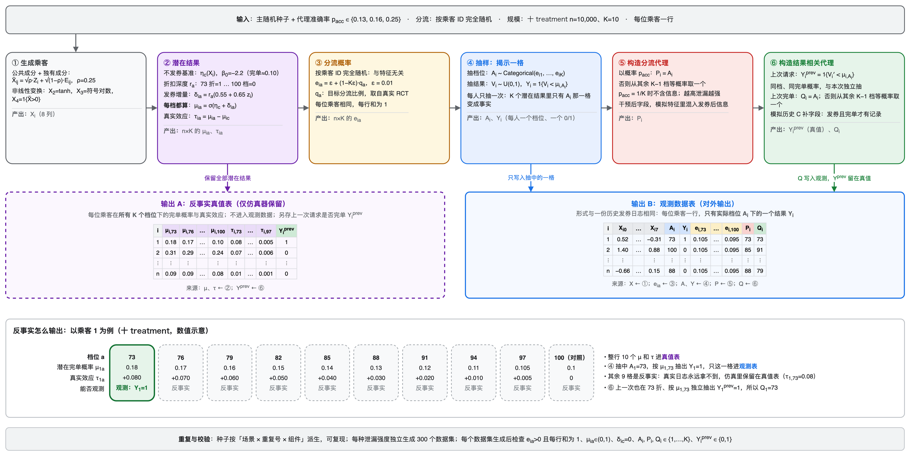

*图 3　仿真数据的生成过程（步骤 1–6）。上排为各步公式和产出；中排左为真值表（含* $$Y_i^{\mathrm{prev}}$$*）、右为观测数据表（含* $$P_i$$*、*$$Q_i$$*）；下排以一位乘客为例，十 treatment 潜在结果中只有抽中的一格成为观测；底部为重复与校验。*

| 步骤   | 做什么   | 产出   |
| --- | --- | --- |
| 1 生成乘客   | 8 列相关的干预前特征   | $$X_i$$   |
| 2 潜在结果   | 每人每档的完单概率和真实效应   | $$\mu_{ia},\ \tau_{ia}$$   |
| 3 分流概率   | 按乘客 ID 完全随机   | $$e_{ia}$$   |
| 4 抽样   | 抽实际档位，再抽是否完单   | $$A_i,\ Y_i$$   |
| 5 分流代理   | 按设定的分流信息含量复述实际档位。模拟模型学到历史拿到深折扣的乘客未来可能更容易因折扣完单，没有考虑乘客本身完单能力：泄漏字段越指向深折扣档，所有候选档的预测 uplift 越容易加分，且深折扣档加分更多，低估对照组  分流信息泄漏 → 预测 uplift 偏向历史深折扣乘客 → 排序 Top-K 内对照组基线相对更高 → MTAUCC 低估   | $$P_i$$   |
| 6 结果相关代理   | 上次完单则暴露实际档位。模拟模型学到乘客过去在哪个档位成功完单，并抬高该档的预测 uplift：越容易完单的人留下的结果泄漏越多，高估处理组  结果信息泄漏 → 预测 uplift 偏向易完单乘客 → 排序 Top-K 内处理组基线相对更高 → MTAUCC 高估   | $$Y_i^{\mathrm{prev}},\ Q_i$$   |

| 类别   | 内容   | 去向   |
| --- | --- | --- |
| 观测数据   | $$X_i$$、$$A_i$$、$$Y_i$$、$$e_{ia}$$、$$P_i$$、$$Q_i$$   | 对外输出，与历史发券日志同形   |
| 真值   | $$\mu_{ia}$$、$$\tau_{ia}$$、$$Y_i^{\mathrm{prev}}$$   | 仅仿真器保留，用于真实 MTAUCC   |

符号表（点击展开）
| 符号   | 类型   | 含义   |
| --- | --- | --- |
| $$X_i$$   | 向量，8 维   | 乘客 $$i$$ 的干预前特征   |
| $$A_i$$   | 档位   | 乘客 $$i$$ 实际拿到的档位，73、76、…、100，按 $$e_{i1},\dots,e_{iK}$$ 抽取   |
| $$Y_i$$   | 0/1   | 乘客 $$i$$ 本次是否完单，按 $$\mu_{i,A_i}$$ 抽取   |
| $$e_{ia}$$   | 概率，0–1   | 乘客 $$i$$ 被分到档位 $$a$$ 的概率，$$e_{ia}=\varepsilon+(1-K\varepsilon)\,q_a$$，与特征无关，每行和为 1   |
| $$P_i$$   | 档位   | 分流代理：以概率 $$p_{\mathrm{acc}}$$ 等于 $$A_i$$，否则从其余 $$K-1$$ 档等概率取一个   |
| $$Q_i$$   | 档位   | 结果相关代理：$$Y_i^{\mathrm{prev}}=1$$ 时等于 $$A_i$$，否则从其余 $$K-1$$ 档等概率取一个   |
| $$\mu_{ia}$$   | 概率，0–1   | 乘客 $$i$$ 拿到档位 $$a$$ 时的潜在完单概率   |
| $$\tau_{ia}$$   | 概率差，−1 到 1   | 档位 $$a$$ 的真实效应，$$\mu_{ia}-\mu_{ic}$$   |
| $$Y_i^{\mathrm{prev}}$$   | 0/1   | 乘客 $$i$$ 上一次请求是否完单，与本次同档、同完单概率，独立抽取   |

仿真参数（点击展开）
| 类别   | 参数   | 取值   | 含义   |
| --- | --- | --- | --- |
| 规模   | 乘客数 $$n$$   | 100,000   | 每个数据集的行数   |
| 规模   | 档位 $$v_a$$、档位数 $$K$$   | 73、76、…、100（$$K=10$$）   | 100 档为对照档 $$c$$   |
| 特征   | 特征数、相关系数 $$\rho$$   | 8 列、0.25   | 抽象协变量   |
| 完单   | 基准截距 $$\beta_0$$   | −2.2   | 不发券完单概率约 0.10   |
| 完单   | 平均效应强度 $$s$$   | 0.55   | 73 折完单 logit 的平均提升   |
| 完单   | 异质性系数   | 0.65   | 73 折效应约 −0.01 到 +0.16   |
| 分流   | 目标分流比例 $$q_a$$   | 0.10588、0.10348、0.10279、0.10078、0.10044、0.09897、0.09963、0.09693、0.09642、0.09468   | 取自真实 RCT   |
| 分流   | 最小分流概率 $$\varepsilon$$   | 0.01   |    |
| 泄漏   | 分流信息含量 $$p_{\mathrm{acc}}$$   | 0.13、0.16、0.25   | 随机水平 0.10；真实日志估计约 0.16–0.20   |
| 泄漏   | 结果相关代理的暴露概率   | 约 0.14   | 等于上次完单率   |

| 能模拟   | 不能模拟   |
| --- | --- |
| 按乘客 ID 完全随机的分流   | 真实业务中的完单率、效应大小   |
| 只带分流信息的泄漏；上次完单才暴露档位的泄漏   | 其他形式的泄漏   |
| 乘客维度的分流和结果；上一次请求的完单   | 订单维度明细、多次请求的时间结构   |
| 两次完单只通过特征关联   | 特征之外持续存在的个体差异   |
| —   | 司机运力、市场均衡、乘客间相互影响   |

### 3.2 参照评分与实验设计

模型的**因果可信性**分两层：

1. **不利用分流信息**：分数只依赖干预前特征。违反即**分流泄漏**。

2. **排序贴近真实效应（CATE）**：用真实 MTAUCC 衡量（§3.0.3）。

用性质已知的参照评分 $$S_{ia}$$ 代替模型分数，$$S_{ic}=0$$：

| 评分   | $$S_{ia}$$   | 是否泄漏   | 模拟的模型   | 理想的 Treatment Ratio 检查结果   |
| --- | --- | --- | --- | --- |
| 真实效应评分   | $$\tau_{ia}$$   | 否   | 理想模型   | 不倾斜   |
| 噪声污染评分 $$\lambda=2$$   | $$\tau_{ia}+\lambda\varsigma\,\xi_{ia}$$，$$\xi_{ia}\sim\mathcal N(0,1)$$   | 否   | 有信号但不准   | 不倾斜   |
| 置换评分   | 把真实效应在乘客之间随机打乱   | 否   | 无排序能力   | 不倾斜   |
| 反向评分   | $$-\tau_{ia}$$   | 否   | 排序完全反向   | 不倾斜   |
| 共享噪声评分 $$\lambda=1,\ 2,\ 4$$   | $$\tau_{ia}+\lambda\varsigma\,r_a\,\xi_i$$，$$\xi_i\sim\mathcal N(0,1)$$   | 否   | 有信号但不准，预测随折扣单调   | 不倾斜   |
| 共享分流代理污染评分 $$\lambda=0.25,\ 0.5,\ 1,\ 2$$   | $$\tau_{ia}+\lambda\varsigma\,r_a\cdot\operatorname{std}\bigl(r_{P_i}\bigr)$$   | **是**   | 学到"会拿到多深的折扣"   | 倾斜，但倾斜程度不等于排序质量   |
| 结果相关泄漏评分 $$\lambda=0.25,\ 0.5,\ 1,\ 2$$   | $$\tau_{ia}+\lambda\varsigma\cdot\operatorname{std}\bigl(\mathbf 1\{Q_i=a\}-\mathbf 1\{Q_i=c\}\bigr)$$   | **是**   | 学到历史补贴类字段   | 倾斜；MTAUCC 不应高于真实效应评分   |

符号表（点击展开）
| 符号   | 类型   | 含义   |
| --- | --- | --- |
| $$S_{ia}$$   | 连续值   | 乘客 $$i$$ 在档位 $$a$$ 上的参照评分，代替模型分数；$$S_{ic}=0$$   |
| $$\tau_{ia}$$   | 概率差，−1 到 1   | 档位 $$a$$ 的真实效应   |
| $$\varsigma$$   | 常数   | 信号尺度，$$\varsigma=\max\{\operatorname{sd}(\tau),\,0.02\}\approx0.042$$；$$\operatorname{sd}(\tau)$$ 为全部乘客、全部十 treatment $$\tau_{ia}$$ 的标准差   |
| $$\lambda$$   | 非负常数   | 污染强度，以 $$\varsigma$$ 为单位   |
| $$\xi_{ia}$$、$$\xi_i$$   | 连续值，标准正态   | 标准正态噪声：前者每档独立，后者各档共用   |
| $$\operatorname{std}(\cdot)$$   | 函数（标准化）   | 在全体乘客间减均值、除以标准差   |
| $$r_a$$   | 比例，0–1   | 档位 $$a$$ 的归一化折扣深度，73 折为 1   |
| $$r_{P_i}$$   | 比例，0–1   | 分流代理 $$P_i$$ 所指档位的归一化折扣深度   |
| $$\mathbf 1\{Q_i=a\}-\mathbf 1\{Q_i=c\}$$   | 离散，取 −1、0、1   | 结果相关代理指向档位 $$a$$ 记 1，指向对照档记 −1，其余记 0   |

**场景**

| 场景   | 分流信息含量 $$p_{\mathrm{acc}}$$   | 数据集数   | 每个数据集人数   |
| --- | --- | --- | --- |
| 弱泄漏   | 0.13   | 300   | 10 万   |
| 中泄漏   | 0.16   | 300   | 同上   |
| 强泄漏   | 0.25   | 300   | 同上   |

不依赖 $$p_{\mathrm{acc}}$$ 的评分合并为 900 个数据集。

**强度扫描**

| 扫描   | 评分   | $$\lambda$$   | 数据   | 用于   |
| --- | --- | --- | --- | --- |
| 噪声强度   | 噪声污染评分（强泄漏场景）   | 0.25 至 10，共 9 档   | 同上   | §4.2.2.1   |
| 泄漏强度   | 共享分流代理污染评分（三种 $$p_{\mathrm{acc}}$$）、结果相关泄漏评分   | 0.05 至 10，共 22 档   | 10 万人，每档 300 个数据集（结果相关泄漏评分 900 个）   | §4.2.2.3   |

22 档为 0.05、0.07、0.1、0.14、0.2、0.25、0.3、0.4、0.5、0.6、0.75、1、1.25、1.5、2、2.5、3、4、5、6、8、10，其中 0.25、0.5、1、2 与 §4.2.2.2 相同。

仿真中 Treatment Ratio 与真实数据用同一审计（§3.0.1）：九条边，预测取 $$\mu_{ic}+S_{ia}$$。

**汇总指标**

| 指标   | 定义   |
| --- | --- |
| 倾斜程度 $$x$$   | 最差边 $$D(k)$$ 90% 分位减 1（§3.0.1），取数据集均值   |
| 倾斜率   | 判为倾斜（至少一条边不过）的数据集比例   |
| 观测偏差   | MTAUCC − 真实 MTAUCC 的中位数   |
| 观测胜过真实效应评分   | MTAUCC 高于真实效应评分的数据集比例   |

### 3.3 偏差分解：基线差 $$B(m)$$

MTAUCC 按模型分数排序，前 $$m$$ 条边（一条边即"给某乘客从某档换到更深一档"）组成一个发券策略，在这个 Top-K 里比较实验组与对照组的完单。把实际完单 $$Y_i$$ 换成期望值后，增益可拆成两部分：

$$\bar G(m)=\underbrace{\frac{N_0}{N_1}\sum_{T_i=1}\alpha_i w_i\,\mu_{ic}-\sum_{T_i=0}\alpha_i w_i\,\mu_{ic}}_{B(m)\ \text{基线差}}+\underbrace{\frac{N_0}{N_1}\sum_{T_i=1}\alpha_i w_i\,\tau_{i,A_i}}_{E(m)\ \text{uplift}}$$

符号表（点击展开）
| 符号   | 类型   | 含义   |
| --- | --- | --- |
| $$m$$   | 整数   | 排序 Top-K 包含的边数，相当于一条发券策略   |
| $$\bar G(m)$$   | 连续值（完单数）   | Top-K 内的期望完单增益   |
| $$i$$   | 编号   | 乘客   |
| $$T_i$$   | 0/1   | 1 为实验组（拿到打折档），0 为对照组（100 档，不打折）   |
| $$A_i$$   | 档位   | 乘客 $$i$$ 实际拿到的档位，73、76、…、100   |
| $$\mu_{ic}$$   | 概率，0–1   | 乘客 $$i$$ **不打折时**的完单概率（$$c$$ 表示对照档 100）   |
| $$\tau_{i,A_i}$$   | 概率差   | 乘客 $$i$$ 在实际档位上的真实 uplift，$$\mu_{i,A_i}-\mu_{ic}$$   |
| $$\alpha_i$$   | −1/0/1   | MTAUCC 的 α 展开给该乘客在 Top-K 内的计入系数   |
| $$w_i$$   | 正数   | 档位间人数平衡权重 $$n_{100}/n_{A_i}$$   |
| $$N_1,\ N_0$$   | 正数   | Top-K 内实验组、对照组的加权人数，$$N_0/N_1$$ 把实验组缩放到与对照组同规模   |
| $$B(m)$$   | 连续值   | **基线差**：Top-K 内两组"不打折时本来就会完单"的数量之差；随机分组且排序不认档位时接近 0   |
| $$E(m)$$   | 连续值   | **效应**：Top-K 内实验组因折扣多出来的完单，这才是 MTAUCC 想量的东西   |

模型分数一旦能"认出"档位（分流泄漏），Top-K 里两组就不再可比，$$B(m)\ne0$$，MTAUCC 被抬高或压低。MTAUCC 的偏差相应拆成三部分：

$$\text{观测}-\text{真实}=\underbrace{M(G)-M(\bar G)}_{\text{抽样噪声}}+\underbrace{M(\bar G)-M(E)}_{\text{基线差部分}}+\underbrace{M(E)-\text{真实}}_{\text{效应差部分}}$$

符号表（点击展开）
| 符号   | 类型   | 含义   |
| --- | --- | --- |
| $$M(\cdot)$$   | 函数，输出比值   | 对一条增益曲线按 MTAUCC 取点、算得分；成本统一用期望成本   |
| 观测、真实   | 比值   | MTAUCC、真实 MTAUCC   |
| $$G$$、$$\bar G$$、$$E$$   | 连续值   | 实际增益、期望增益、uplift 部分   |

### 3.4 残差校正 MTAUCC：M

#### 3.4.1 仿真中去掉 $$B(m)$$

把增益里的 $$Y_i$$ 换成 $$Y_i-\mu_{ic}$$。由于

$$\mathbb E\bigl[Y_i-\mu_{ic}\bigr]=\begin{cases}\tau_{i,A_i}, & T_i=1\\ 0, & T_i=0\end{cases}$$

符号表（点击展开）
| 符号   | 类型   | 含义   |
| --- | --- | --- |
| $$\mathbb E[\cdot]$$   | 期望   | 对是否完单的随机性取平均   |
| $$Y_i$$   | 0/1   | 实际是否完单   |
| $$Y_i-\mu_{ic}$$   | 连续值   | 超出"不打折本来就会完单"的部分   |
| $$\tau_{i,A_i}$$、$$T_i$$   | 概率差；0/1   | 同 §3.3   |

实验组只剩 uplift，对照组期望为 0，两组的基线不管在 Top-K 里怎么分布都被抵消，增益的期望正好是 $$E(m)$$。

#### 3.4.2 真实数据：用对照组估计 $$\mu_{ic}$$

|    | 仿真   | 真实业务数据   |
| --- | --- | --- |
| $$\mu_{ic}$$   | 仿真器生成，每人已知   | 每人只拿到一个档位；实验组的人不打折会怎样，观测不到   |
| 能否直接用 $$Y_i-\mu_{ic}$$   | 能   | 不能，需要估计   |

数据来自随机实验：档位随机分配，对照组（100 档）是全体乘客的随机子集。因此对照组上"特征 → 完单"的关系，就是所有人不打折时的完单率：

$$\mu_{100}(x)=\Pr\bigl(Y_i=1\mid X_i=x,\ A_i=100\bigr)\approx\mu_{ic}$$

符号表（点击展开）
| 符号   | 类型   | 含义   |
| --- | --- | --- |
| $$X_i$$   | 向量   | 乘客 $$i$$ 的 314 个特征   |
| $$x$$   | 向量   | 特征的某一取值   |
| $$\mu_{100}(x)$$   | 概率，0–1   | 特征为 $$x$$ 的乘客拿到 100 档时的完单概率   |
| $$\Pr(\cdot\mid\cdot)$$   | 条件概率   | 在给定条件下的概率   |
| $$\approx\mu_{ic}$$   | —   | 只能用特征解释的部分近似；特征之外的个体差异估不到   |

$$B(m)$$ 来自"排序认出了档位，而认档位的特征同时决定基线完单"。只要这些特征在 $$X_i$$ 里，$$\hat\mu_{100}(X_i)$$ 就能把它们带来的基线差估出来。

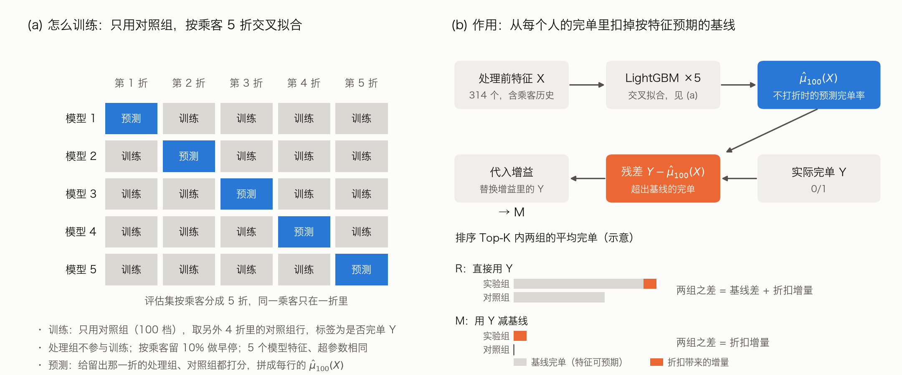

*图 4*　$$\hat\mu_{100}(X)$$ *的 LightGBM。(a) 只用对照组训练，按乘客 5 折交叉拟合，每行的预测来自没见过该乘客的模型；(b) 残差替换增益里的* $$Y$$*，Top-K 内两组的基线差被抵消。*

| 项   | 设置   | 目的   |
| --- | --- | --- |
| 训练样本   | 只用对照组（100 档）的行，标签为 $$Y_i$$   | 学到的是不打折的完单率，不混入 uplift   |
| 特征   | 314 个特征   | 与被评估模型的输入一致，泄漏特征也在内   |
| 交叉拟合   | 按乘客分 5 折；每折模型用另外 4 折的对照组训练，给留出折的实验组和对照组一起打分   | 避免对照组用到自己的标签，否则对照组残差被压向 0   |
| 早停   | 训练折内按乘客再留 10%   | 防止过拟合   |
| 参数   | 学习率 0.05、63 叶、叶内最少 200 行、特征与样本采样 0.8、L2 1.0、最多 600 轮、早停 50 轮   | —   |
| 效果   | 对照组完单 AUC 0.770   | —   |

#### 3.4.3 校正后的 MTAUCC

排序、去非凸点、α 展开、按成本取 100 点都与 MTAUCC 相同，只改增益里的完单：

$$G(m)=\frac{N_0}{N_1}\sum_{T_i=1}\alpha_i w_i\,Y_i-\sum_{T_i=0}\alpha_i w_i\,Y_i \qquad\Longrightarrow\qquad G_{\text{M}}(m)=\frac{N_0}{N_1}\sum_{T_i=1}\alpha_i w_i\,\bigl(Y_i-\hat\mu_{100}(X_i)\bigr)-\sum_{T_i=0}\alpha_i w_i\,\bigl(Y_i-\hat\mu_{100}(X_i)\bigr)$$

符号表（点击展开）
| 符号   | 类型   | 含义   |
| --- | --- | --- |
| $$G(m)$$   | 连续值   | 未校正的 Top-K 完单增益，由它算出 **R**（即 MTAUCC）   |
| $$G_{\text{M}}(m)$$   | 连续值   | 校正后的 Top-K 完单增益，由它算出 **M**   |
| $$\hat\mu_{100}(X_i)$$   | 概率，0–1   | LightGBM 给乘客 $$i$$ 的不打折完单率估计   |
| $$Y_i-\hat\mu_{100}(X_i)$$   | 连续值   | 残差：超出特征可预期基线的完单   |
| $$\alpha_i,\ w_i,\ N_0,\ N_1,\ T_i$$   | —   | 同 §3.3   |

成本仍用真实 $$Y_i$$ 计算。两组各自先扣掉可预期的部分，Top-K 里两组基线不同的部分被抵消。

### 3.5 技术选型

| 候选   | 优势   | 劣势   | 决策   |
| --- | --- | --- | --- |
| Treatment Ratio 比例检查作为可信性检查   | 不需要真值，计算简单   | 倾斜不代表排序差：更倾斜的泄漏评分真实 MTAUCC 反而更高（§4.2.2.1）；两类泄漏倾斜相近、偏差方向相反（§4.2.2.2）   | ❌ 不能精确表示高估或者低估MTAUCC。仅作"是否用到分流信息"的提示   |
| 按倾斜程度换算偏差：仿真中拟合 $$b(x)$$，从 R 中扣掉   | 只需倾斜程度 $$x$$ 一个量   | 分泄漏类型 $$R^2$$ 0.60–0.92，合并后 0.10–0.11；真实数据上与不倾斜模型的平均差距 0.173 → 0.379，反而扩大（§4.2.2.3、§4.3.3.4）   | ❌ 不采用   |
| 残差校正 M：对照组估计 $$\hat\mu_{100}(X)$$，以残差代替完单   | 不依赖泄漏类型，直接在数据上扣掉基线差；不重训被评估模型   | 尺度与 R 不同；要求随机实验数据，且泄漏特征在 $$X$$ 中   | ✅ 采用   |
| $$\hat\mu_{100}$$ 拟合方式：只用对照组 vs S-learner（全部档位训练，预测时置为 100 档）   | S-learner 样本更多，对照组 AUC 0.780   | S-learner $$z$$ 均值 0.82，高于只用对照组的 0.68（§4.3.3.3）   | ✅ 只用对照组 + 按乘客交叉拟合   |

---

## 4 离线评估

### 4.1 核心结论

**问题发现（仿真）**

| 问题   | 结论   | 关键数字   |
| --- | --- | --- |
| 模型学到泄漏后，Treatment Ratio 更倾斜能说明模型预测反事实的能力更差吗   | **不能**。倾斜只随泄漏变化，与排序好坏无关；更倾斜的模型可能排序更好   | 泄漏评分倾斜 0.734、倾斜率 100%、真实 MTAUCC 0.055；噪声评分倾斜 0.059、倾斜率 0%、真实 MTAUCC 0.049；12 种组合中泄漏评分在每个数据集上都排序更好   |
| MTAUCC 不泄漏时测得准吗   | 无偏   | 偏差在 ±0.001 以内；噪声评分反超理想模型的数据集 2%   |
| 泄漏会抬高 MTAUCC 吗   | 只带分流信息的泄漏不会，反而压低；**与完单相关的泄漏会大幅抬高**   | 共享分流代理泄漏偏差 −0.02 至 −0.11；结果相关泄漏：观测 0.58，真实 0.105，每个数据集都高于理想模型（0.150）   |
| Treatment Ratio 能提示 MTAUCC 虚高吗   | **不能**。两类泄漏倾斜相近、都判为倾斜，偏差方向相反   | 倾斜 0.28 对 0.31，倾斜率均 100%；偏差 +0.478 对 −0.109   |
| 倾斜程度能拟合成高估程度的函数吗   | **分泄漏类型只能粗略拟合，不分不行**   | 同类评分内 $$R^2$$ 0.60–0.92，各类合并 0.10–0.11；倾斜 0.2–0.4 内偏差从 −0.11 到 +0.56   |
| 偏差从哪来   | **大部分来自基线差 **$$B(m)$$：排序 Top-K 里，实验组与对照组"不打折时本来就会完单"的程度不同   | 结果相关泄漏：虚高 +0.56 中 +0.49 来自 $$B(m)$$；共享分流代理约 74%   |

**方法效果（真实数据）**

| 问题   | 结论   | 关键数字   |
| --- | --- | --- |
| 真实数据里有 $$B(m)$$ 吗   | 有。乘客历史特征同时认档位和预测完单；分数越认档位，R − M 越大   | 认档位 AUC 0.754；对照组完单 AUC 0.770；Spearman +0.87   |
| 倾斜模型的高出能消掉吗   | 能   | 4 个倾斜 CFR 与不倾斜 CFR 的差：+0.20\~+0.54 → −0.07\~+0.01；9/10 比 R 更接近参照   |
| 会不会改坏正常模型   | 不会   | M05–M09 前后都与不倾斜模型无显著差异；不倾斜模型 R、M 排序相关 0.82；单模型标准差 0.141 → 0.063   |
| 机制是否成立   | 成立   | 换 $$\hat\mu_{100}$$ 的容量、拟合方式结论不变；去乘客历史后 CFR 又高出 +0.11\~+0.20   |
| 能否用倾斜换算偏差代替   | 不能   | 与不倾斜模型平均差距 0.173 → 0.379   |

### 4.2 仿真

#### 4.2.1 评估方案

| 项   | 取值   |
| --- | --- |
| 数据   | SCM 合成数据，十 treatment，按乘客 ID 完全随机分流（§3.1）   |
| 规模   | 每个数据集 10 万人；每种 $$p_{\mathrm{acc}}$$ 300 个数据集，不依赖 $$p_{\mathrm{acc}}$$ 的评分 900 个   |
| 特征   | 8 维抽象协变量   |
| 标签   | 是否完单，不发券约 0.10   |
| 被评估对象   | 参照评分（§3.2）   |
| 基线   | 真实 MTAUCC   |
| 不确定性   | 数据集间分布（中位数、四分位）   |

#### 4.2.2 Treatment Ratio 与 MTAUCC 的可信性

##### 4.2.2.1 模型学到泄漏后，更倾斜也不说明模型预测反事实的能力更差

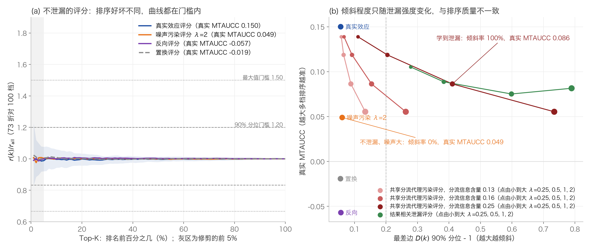

*图 5　(a)* $$p_{\mathrm{acc}}=0.25$$ *时不泄漏评分 73 折边的* $$r(k)/r_{\text{all}}$$*，虚线、点线为* $$D(k)$$ *的 1.20、1.50 门槛；(b) 各评分的倾斜程度* $$x$$ *与真实 MTAUCC，竖虚线为* $$x=0.20$$*。*

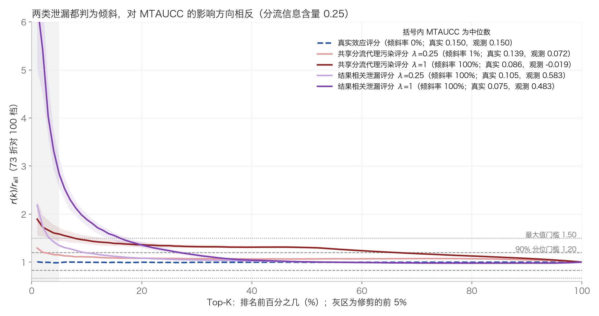

*图 6*　$$p_{\mathrm{acc}}=0.25$$ *时两类泄漏评分 73 折边的* $$r(k)/r_{\text{all}}$$*；虚线为真实效应评分。*

$$p_{\mathrm{acc}}=0.25$$、每个数据集 10 万人，300 个数据集：

结果表（点击展开）
| 评分   | 是否泄漏   | 倾斜程度 $$x$$   | 倾斜率   | 真实 MTAUCC   |
| --- | --- | --- | --- | --- |
| 真实效应评分   | 否   | 0.055   | 0.000   | 0.150   |
| 噪声污染评分 $$\lambda=2$$   | 否   | 0.059   | 0.000   | 0.049   |
| 置换评分   | 否   | 0.056   | 0.000   | −0.019   |
| 反向评分   | 否   | 0.055   | 0.000   | −0.057   |
| 随机排序（参照）   | —   | —   | —   | 0.075   |
| 共享分流代理污染评分 $$\lambda=0.25,\ 0.5,\ 1,\ 2$$   | 是   | 0.111 → 0.204 → 0.411 → 0.734   | 0.007 → 0.507 → 1.000 → 1.000   | 0.139 → 0.119 → 0.086 → 0.055   |

同一数据集上，共享分流代理污染评分对噪声污染评分 $$\lambda=2$$ 的配对比较（每格 300 个数据集）。12 种组合下，泄漏评分的真实 MTAUCC 在 100% 的数据集上更高：

结果表（点击展开）
| $$p_{\mathrm{acc}}$$   | 泄漏 $$\lambda$$   | 泄漏评分更倾斜   | 泄漏评分倾斜率   |
| --- | --- | --- | --- |
| 0.13   | 0.25 → 0.5 → 1 → 2   | 42% → 58% → 83% → 98%   | 0% → 0% → 0% → 1%   |
| 0.16   | 0.25 → 0.5 → 1 → 2   | 57% → 84% → 100% → 100%   | 0% → 0% → 10% → 95%   |
| 0.25   | 0.25 → 0.5 → 1 → 2   | 96% → 100% → 100% → 100%   | 1% → 51% → 100% → 100%   |

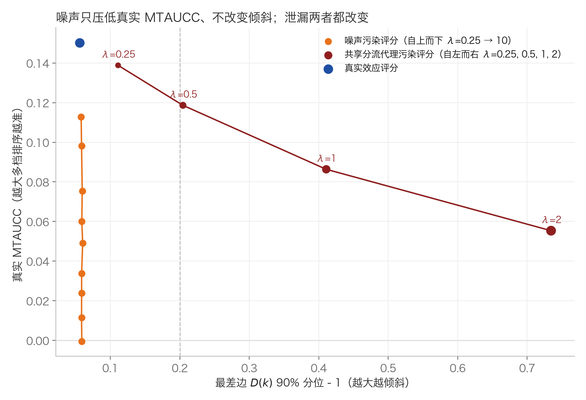

*图 7*　$$p_{\mathrm{acc}}=0.25$$*。噪声污染（9 档）与共享分流代理污染（4 档）的倾斜程度* $$x$$ *与真实 MTAUCC。*

结果表（点击展开）
| 评分   | 真实 MTAUCC   | 倾斜程度 $$x$$   | 倾斜率   |
| --- | --- | --- | --- |
| 真实效应评分   | 0.150   | 0.055   | 0.000   |
| 噪声污染评分 $$\lambda=0.25,\ 1,\ 3,\ 10$$   | 0.113 → 0.075 → 0.034 → −0.000   | 0.058 → 0.060 → 0.059 → 0.059   | 0.000 → 0.000 → 0.000 → 0.000   |

##### 4.2.2.2 泄漏类型不同，MTAUCC 偏差方向相反

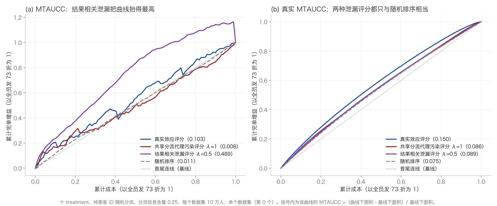

*图 8*　$$p_{\mathrm{acc}}=0.25$$*、10 万人、第 0 个数据集，横纵轴以"全员发 73 折"为 1。(a) 观测曲线；(b) 真实曲线。*

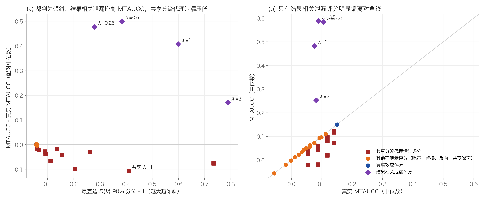

*图 9　10 万人。(a) 倾斜程度* $$x$$ *与观测偏差；(b) 观测与真实 MTAUCC，对角线表示测得准。*

每个数据集 10 万人。共享分流代理污染评分取 $$p_{\mathrm{acc}}=0.25$$ 的 300 个数据集，其余合并 900 个：

结果表（点击展开）
| 评分   | 是否泄漏   | MTAUCC 中位 \[四分位\]   | 真实 MTAUCC   | 观测偏差   | 观测胜过真实效应评分   | 倾斜程度 $$x$$   | 倾斜率   |
| --- | --- | --- | --- | --- | --- | --- | --- |
| 真实效应评分   | 否   | 0.150 \[0.121, 0.180\]   | 0.150   | +0.000   | —   | 0.056   | 0.000   |
| 噪声污染评分 $$\lambda=2$$   | 否   | 0.050 \[0.016, 0.083\]   | 0.049   | +0.001   | 0.019   | 0.060   | 0.000   |
| 共享噪声评分 $$\lambda=2$$   | 否   | 0.062 \[0.038, 0.089\]   | 0.061   | +0.001   | 0.027   | 0.055   | 0.000   |
| 置换评分   | 否   | −0.020 \[−0.041, 0.002\]   | −0.019   | −0.000   | 0.001   | 0.055   | 0.000   |
| 反向评分   | 否   | −0.057 \[−0.087, −0.026\]   | −0.057   | −0.000   | 0.001   | 0.056   | 0.000   |
| 随机排序（参照）   | —   | 0.075 \[0.045, 0.105\]   | 0.075   | +0.000   | 0.026   | —   | —   |
| 共享分流代理污染评分 $$\lambda=0.25,\ 0.5,\ 1,\ 2$$   | 是   | 0.072 → 0.020 → −0.019 → −0.020   | 0.139 → 0.119 → 0.086 → 0.055   | −0.067 → −0.099 → −0.105 → −0.075   | 0.000   | 0.111 → 0.204 → 0.411 → 0.734   | 0.007 → 0.507 → 1.000 → 1.000   |
| **结果相关泄漏评分** $$\lambda=0.25,\ 0.5,\ 1,\ 2$$   | 是   | **0.583 → 0.588 → 0.483 → 0.253**   | 0.105 → 0.089 → 0.075 → 0.082   | **+0.478 → +0.500 → +0.408 → +0.171**   | **1.000 → 1.000 → 1.000 → 0.993**   | 0.279 → 0.384 → 0.598 → 0.789   | 1.000 → 1.000 → 1.000 → 1.000   |

##### 4.2.2.3 倾斜程度换算不出观测偏差，分泄漏类型才能粗略拟合

目标：拟合函数 $$b(x)$$，由倾斜程度 $$x$$（§3.0.1）预测观测偏差 $$b$$（MTAUCC − 真实 MTAUCC）。

| 拟合   | 取值   |
| --- | --- |
| 自变量 $$x$$   | 倾斜程度：最差边 $$D(k)$$ 90% 分位减 1，取各数据集均值   |
| 因变量 $$b$$   | 观测偏差：MTAUCC − 真实 MTAUCC，取同一数据集配对后的中位数   |
| 拟合点   | 每档 $$\lambda$$ 一个汇总点，另加 $$\lambda=0$$（真实效应评分，$$x\approx0.056$$，$$b=0$$）   |

候选函数（都过原点：$$x=0$$ 时 $$b=0$$）：

| 候选函数   | 形式   | 参数个数   |
| --- | --- | --- |
| 二次多项式   | $$a\,x+c\,x^2$$   | 2   |
| 三次多项式   | $$a\,x+c\,x^2+d\,x^3$$   | 3   |
| 驼峰   | $$a\,x\,e^{-kx}$$   | 2   |
| 驼峰 + 线性项   | $$a\,x\,e^{-kx}+c\,x$$   | 3   |
| 升起后衰减   | $$a\,(1-e^{-kx})\,e^{-mx}$$   | 3   |
| 升起后衰减 + 线性项   | $$a\,(1-e^{-kx})\,e^{-mx}+c\,x$$   | 4   |
| 饱和上升 + 线性项   | $$a\,(1-e^{-kx})+c\,x$$   | 3   |

选法：对每个候选函数做留一交叉验证，每次去掉一个拟合点，用其余点拟合后预测这个点，算全部预测误差的 RMSE。RMSE 最小的函数作为该类评分的 $$b(x)$$。不按 $$R^2$$ 选，是因为参数越多 $$R^2$$ 越高。

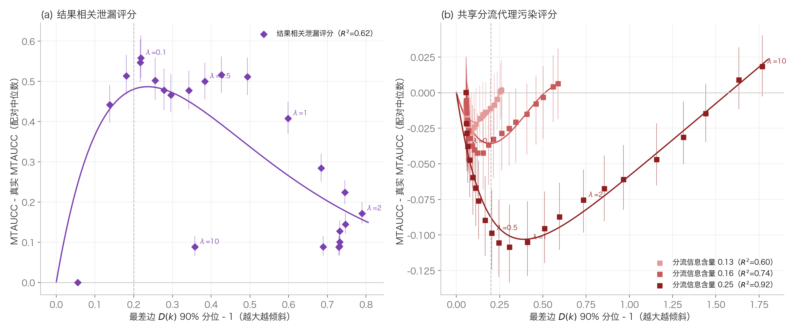

*图 10　10 万人。(a) 结果相关泄漏评分；(b) 共享分流代理污染评分（三种分流信息含量）。每点为一档* $$\lambda$$*，竖线为观测偏差的四分位距，曲线为留一 RMSE 最小的函数；竖虚线为* $$x=0.20$$*。*

拟合结果（$$x$$ 的范围为 0 到该类评分倾斜程度的最大值）：

结果表（点击展开）
| 评分   | 函数   | $$R^2$$   | 单个数据集 $$R^2$$   |
| --- | --- | --- | --- |
| 结果相关泄漏评分   | $$b(x)=5.60\,x\,e^{-4.23x}$$   | 0.62   | 0.56   |
| 共享分流代理污染评分 $$p_{\mathrm{acc}}=0.25$$   | $$b(x)=-0.162\,(1-e^{-5.54x})+0.103\,x$$   | 0.92   | 0.44   |
| 共享分流代理污染评分 $$p_{\mathrm{acc}}=0.16$$   | $$b(x)=-0.412\,x+1.40\,x^2-1.16\,x^3$$   | 0.74   | 0.08   |
| 共享分流代理污染评分 $$p_{\mathrm{acc}}=0.13$$   | $$b(x)=-0.400\,x+2.17\,x^2-2.32\,x^3$$   | 0.60   | 0.02   |

符号表（点击展开）
| 符号   | 类型   | 含义   |
| --- | --- | --- |
| $$R^2$$   | 比值，≤1   | 对各档 $$\lambda$$ 汇总点（22 个点加原点）的拟合优度   |
| 单个数据集 $$R^2$$   | 比值，≤1   | 用汇总点拟合的曲线预测**单个数据集**的观测偏差；负值表示不如直接用均值   |

#### 4.2.3 偏差来源 $$B(m)$$ 的占比与去除

数据集和评分与 §4.2.2.3 相同，各数取数据集均值；分解方式见 §3.3，去除方式见 §3.4.1。

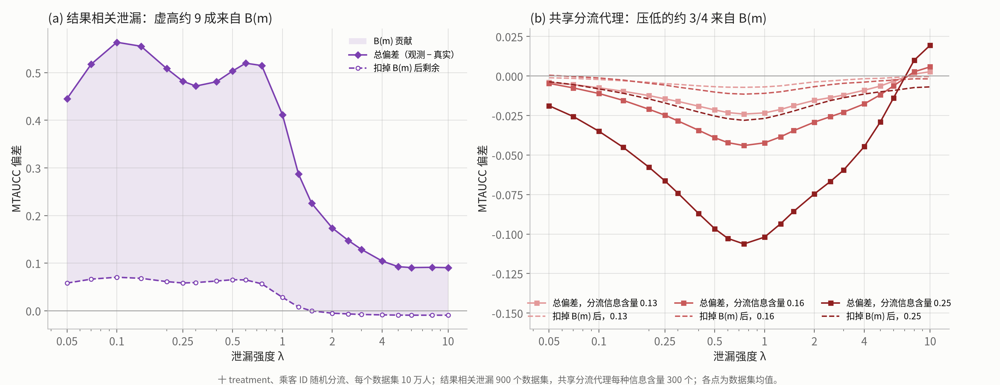

*图 11　仿真中 MTAUCC 的偏差（观测 − 真实）。实线为总偏差，虚线为扣掉* $$B(m)$$ *后剩下的部分；两线之间即* $$B(m)$$ *的贡献。*

结果表（点击展开）
| 泄漏   | $$\lambda$$   | MTAUCC   | 真实 MTAUCC   | 总偏差   | 其中 $$B(m)$$   | 扣掉 $$B(m)$$ 后   | $$B(m)$$ 占比   |
| --- | --- | --- | --- | --- | --- | --- | --- |
| 无（真实效应评分）   | 0   | 0.152   | 0.150   | +0.002   | +0.000   | +0.001   | —   |
| 结果相关   | 0.1   | 0.684   | 0.120   | **+0.564**   | **+0.493**   | +0.070   | 87%   |
| 结果相关   | 0.5   | 0.592   | 0.089   | +0.504   | +0.438   | +0.065   | 87%   |
| 结果相关   | 1   | 0.487   | 0.075   | +0.412   | +0.384   | +0.028   | 93%   |
| 结果相关   | 2   | 0.255   | 0.082   | +0.174   | +0.179   | −0.005   | ≈100%   |
| 共享分流代理（信息含量 0.25）   | 1   | −0.016   | 0.086   | −0.102   | −0.075   | −0.027   | 74%   |
| 共享分流代理（信息含量 0.16）   | 1   | 0.044   | 0.086   | −0.042   | −0.031   | −0.011   | 74%   |

| 列   | 含义   |
| --- | --- |
| MTAUCC   | 离线评估实际算的值，用实际完单 $$Y_i$$   |
| 真实 MTAUCC   | 同一排序下用仿真器的真实完单概率算，只有仿真里才有   |
| 其中 $$B(m)$$   | 用 $$\bar G(m)$$ 与 $$E(m)$$ 分别算 MTAUCC 后的差   |
| 扣掉 $$B(m)$$ 后   | 总偏差 − $$B(m)$$ 部分，剩下的是抽样噪声和效应部分的偏差；即 §3.4.1 用 $$Y_i-\mu_{ic}$$ 替换后剩下的偏差   |

用 $$Y_i-\mu_{ic}$$ 替换后，结果相关泄漏的虚高从 +0.56 降到 +0.07，共享分流代理从 −0.10 降到 −0.03。

### 4.3 真实数据

#### 4.3.1 评估方案

| 项   | 取值   |
| --- | --- |
| 数据   | [`kflower_strategy_dev.ecr_train_data_with_p_features`](https://datamap.didichuxing.com/detail?uri=hive://mycluster-tj:kflower_strategy_dev:ecr_train_data_with_p_features&keyword=ecr_train_data_with_p_features&version=next)，随机实验，折扣字段 `uabox_discount`   |
| 时间 / 规模   | 2025-08-26 至 2025-09-08，14 天，42 个城市，1,471,479 行   |
| 切分   | 按乘客哈希切分，训练集与评估集乘客不重叠；训练集 1,026,019 行、248,734 个乘客（96 个模型在这里训练）；评估集 445,460 行、107,698 个乘客（R、M、$$\hat\mu_{100}$$ 全部在这里计算）   |
| 特征   | 10 个类别特征（时段、星期、城市、双冒标记等）+ 304 个数值特征（网格实时供需、区域历史转化、乘客历史等）   |
| 标签   | 是否完单，整体均值 0.732   |
| 被评估对象   | 96 个模型（§4.3.2）   |
| 基线   | R（MTAUCC）；结构相似不倾斜模型参照   |
| 不确定性   | 按乘客有放回重抽评估集 50 次，96 个模型共用同一组样本，$$\hat\mu_{100}$$ 不重新拟合   |

真实数据各档行数与完单率：

| 档   | 73   | 76   | 79   | 82   | 85   | 88   | 91   | 94   | 97   | 100   |
| --- | --- | --- | --- | --- | --- | --- | --- | --- | --- | --- |
| 样本量（千）   | 46.8   | 46.8   | 45.7   | 44.7   | 44.0   | 44.3   | 45.0   | 43.7   | 42.8   | 41.7   |
| 完单率   | 0.742   | 0.744   | 0.744   | 0.741   | 0.732   | 0.734   | 0.728   | 0.730   | 0.719   | 0.707   |

#### 4.3.2 被评估模型

按 §3.0.1 的指标分为不倾斜与倾斜：

| 类别   | 个数   | 组成   |
| --- | --- | --- |
| 不倾斜模型   | 86   | 84 个 DRCFR、1 个 CFR、1 个 XGB T-learner   |
| 倾斜模型   | 10   | 4 个 CFR（M01–M04，6–8 条边不过）、6 个 DRCFR（M05–M10，1–4 条边不过）；按结构、训练目标、偏斜程度挑选   |

| 倾斜模型   | 结构 / 训练配方   | 不过的边数   |
| --- | --- | --- |
| M01   | CFR 标准 CovRank 0.03   | 6   |
| M02   | CFR arm-balanced CovRank 0.03   | 7   |
| M03   | CFR arm-balanced CovRank 0.05   | 8   |
| M04   | CFR score-bin-balanced CovRank 0.03   | 7   |
| M05   | DRCFR FiLM CovRank 0.05   | 1   |
| M06   | DRCFR 固定 factual weight + redline penalty   | 4   |
| M07   | DRCFR detached treatment weight + redline penalty   | 4   |
| M08   | DRCFR dual-anchor + CovRank 0.05   | 2   |
| M09   | DRCFR edge-ROI CovRank 0.20   | 1   |
| M10   | DRCFR XGB OOF-DR RankNorm + edge mask   | 1   |

$$B(m)$$ 的证据见附录 A。

#### 4.3.3 校正效果

指标：

| 指标   | 定义   | 希望   |
| --- | --- | --- |
| 与参照的差   | 倾斜模型 − 结构相似不倾斜模型参照（CFR 对不倾斜 CFR，DRCFR 对 84 个不倾斜 DRCFR 的中位）   | 接近 0   |
| $$z$$   | $$\lvert v-v_{\text{ref}}\rvert\,/\,\text{IQR}$$   | 小   |
| 不倾斜模型排序保持   | 86 个不倾斜模型上 M 与 R 的 Spearman 相关   | 接近 1   |
| 单模型标准差   | 重抽样下单个模型指标的标准差   | 小   |

符号表（点击展开）
| 符号   | 类型   | 含义   |
| --- | --- | --- |
| $$v$$   | 连续值   | 某倾斜模型的 R 或 M   |
| $$v_{\text{ref}}$$   | 连续值   | 结构相似不倾斜模型参照的 R 或 M   |
| $$\text{IQR}$$   | 连续值   | 84 个不倾斜 DRCFR 该指标的四分位距（R 为 0.099，M 为 0.062），使 R、M 可比   |

##### 4.3.3.1 倾斜模型：高出基本消掉

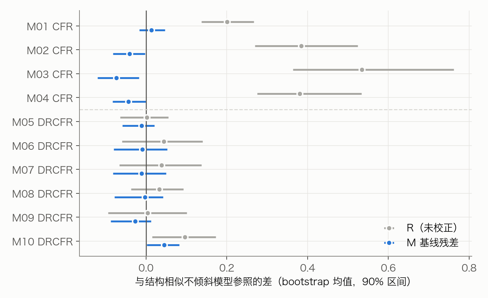

*图 12　10 个倾斜模型与结构相似不倾斜模型参照的差，灰为 R，蓝为 M；点为重抽样均值，线为 90% 区间。*

结果表（点击展开）
| 模型   | 倾斜程度 $$x$$   | R   | R 差 \[90% 区间\]   | M   | M 差 \[90% 区间\]   | $$z$$：R → M   |
| --- | --- | --- | --- | --- | --- | --- |
| M01 CFR   | 0.822   | 0.786   | +0.200 \[0.138, 0.267\]   | 0.343   | +0.014 \[−0.017, 0.046\]   | 2.26 → 0.35   |
| M02 CFR   | 1.460   | 0.969   | +0.384 \[0.270, 0.524\]   | 0.291   | −0.041 \[−0.082, −0.002\]   | 4.39 → 0.81   |
| M03 CFR   | 1.914   | 1.127   | +0.535 \[0.364, 0.762\]   | 0.260   | −0.073 \[−0.120, −0.017\]   | 6.09 → 1.46   |
| M04 CFR   | 1.561   | 0.964   | +0.381 \[0.275, 0.534\]   | 0.287   | −0.043 \[−0.082, −0.001\]   | 4.37 → 0.84   |
| M05 DRCFR   | 0.241   | 0.638   | +0.002 \[−0.064, 0.056\]   | 0.328   | −0.011 \[−0.058, 0.021\]   | 0.35 → 0.35   |
| M06 DRCFR   | 0.451   | 0.665   | +0.044 \[−0.060, 0.141\]   | 0.321   | −0.009 \[−0.080, 0.053\]   | 0.69 → 0.63   |
| M07 DRCFR   | 0.435   | 0.658   | +0.038 \[−0.066, 0.137\]   | 0.318   | −0.011 \[−0.082, 0.050\]   | 0.67 → 0.64   |
| M08 DRCFR   | 0.277   | 0.667   | +0.033 \[−0.037, 0.092\]   | 0.333   | −0.003 \[−0.078, 0.042\]   | 0.51 → 0.45   |
| M09 DRCFR   | 0.213   | 0.646   | +0.004 \[−0.094, 0.101\]   | 0.313   | −0.027 \[−0.088, 0.012\]   | 0.45 → 0.49   |
| M10 DRCFR   | 0.230   | 0.730   | +0.096 \[0.015, 0.173\]   | 0.378   | +0.045 \[0.002, 0.082\]   | 1.05 → 0.83   |

| 列   | 含义   |
| --- | --- |
| 倾斜程度 $$x$$   | 最差边 $$D(k)$$ 90% 分位减 1（§3.0.1）；86 个不倾斜模型为 0.075–0.196   |
| R、M   | 全样本值   |
| R 差、M 差   | 50 次重抽样中"该模型 − 参照"的均值，区间为 5%、95% 分位   |

结果表（点击展开）
| 汇总   | R   | M   |
| --- | --- | --- |
| $$z$$ 均值   | 2.08   | 0.68   |
| 比 R 更接近参照   | —   | 9 / 10   |
| 90% 区间含 0   | 5 / 10   | 6 / 10   |
| 单模型标准差（不倾斜模型中位）   | 0.141   | 0.063   |

M02–M04 校正后低于不倾斜 CFR 0.04–0.07，符合"泄漏损害排序"，不是校正过头。

##### 4.3.3.2 不倾斜模型：排序基本保留

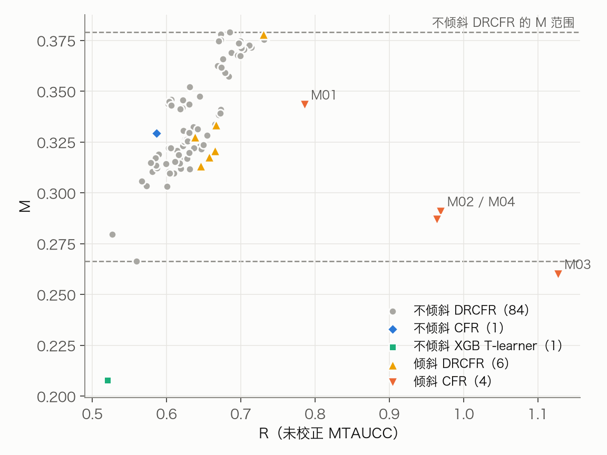

*图 13　96 个模型的 R 与 M；虚线为不倾斜 DRCFR 的 M 最小、最大值。*

结果表（点击展开）
| 指标   | 值   |
| --- | --- |
| 86 个不倾斜模型上 M 与 R 的 Spearman 相关   | 0.82   |
| 96 个模型上倾斜程度 $$x$$ 与指标的 Spearman 相关：R → M   | +0.45 → −0.09   |
| 倾斜模型落在不倾斜模型 M 范围（0.208–0.379）内   | 10 / 10   |

##### 4.3.3.3 消融：换 $$\hat\mu_{100}$$ 的拟合方式

如果 M 的效果确实来自"扣掉特征可预期的基线"，那么换模型容量、换拟合方式结论应不变；去掉同时认档位和预测完单的乘客历史特征后，校正应失效。

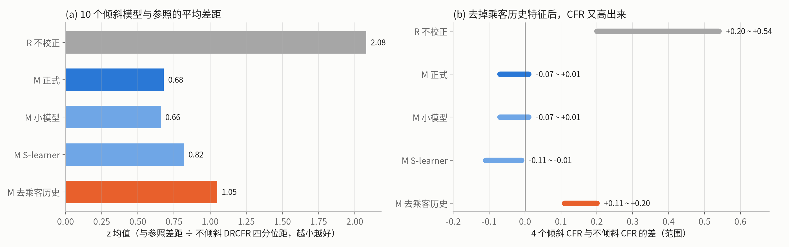

*图 14　不同* $$\hat\mu_{100}$$ *下的校正效果。(a) 10 个倾斜模型的* $$z$$ *均值；(b) 4 个倾斜 CFR 与不倾斜 CFR 之差的范围。*

结果表（点击展开）
| 变体   | $$\hat\mu_{100}$$ 怎么拟合   | 对照组 AUC   | $$z$$ 均值   | 比 R 接近   | 单模型标准差   | 4 个 CFR 与参照的差   |
| --- | --- | --- | --- | --- | --- | --- |
| R   | 不校正   | —   | 2.08   | —   | 0.141   | +0.20 \~ +0.54   |
| M 正式   | 只用对照组，314 个特征，63 叶   | 0.770   | 0.68   | 9   | 0.063   | −0.07 \~ +0.01   |
| M 小模型   | 只用对照组，314 个特征，15 叶、叶内最少 1000 行   | 0.768   | 0.66   | 9   | 0.063   | −0.07 \~ +0.01   |
| M S-learner   | 全部档位一起训练，档位作特征，预测时置为 100 档   | 0.780   | 0.82   | 9   | 0.062   | −0.11 \~ −0.01   |
| M 去乘客历史   | 只用对照组，去掉 63 个乘客历史特征，剩 251 个   | 0.691   | 1.05   | 8   | 0.109   | **+0.11 \~ +0.20**   |

##### 4.3.3.4 对比：按倾斜程度换算偏差

另一条路是：在仿真中拟合"倾斜程度 $$x$$ → MTAUCC 偏差"的函数 $$b(x)$$（§4.2.2.3，结果相关泄漏评分），再从倾斜模型的 R 中扣掉 $$b(x)$$。

结果表（点击展开）
| 指标   | 结果   |
| --- | --- |
| 与结构相似不倾斜模型的平均差距   | 0.173 → 0.379，扩大   |
| 接近的模型数   | 4 / 10（全是 CFR，修正后仍高 0.06–0.54）   |
| 不倾斜模型同样修正后   | 8 / 10 扩大   |

原因：Treatment Ratio 倾斜程度在不同泄漏类型下对应的偏差从 −0.11 到 +0.56，只看倾斜换算不出偏差；M 不依赖泄漏类型，直接在数据上估计并扣掉基线。

### 4.4 结论与局限

**仿真**

| 问题   | 回答   |
| --- | --- |
| 更倾斜能说明模型预测反事实的能力更差吗   | 不能。倾斜只提示用了分流信息，弱泄漏时检出率低；更倾斜的模型可能排序更好   |
| MTAUCC 测得准吗   | 不泄漏时无偏；噪声评分反超理想模型的数据集 2%   |
| 泄漏会抬高 MTAUCC 吗   | 只带分流信息的不会，反而压低，最多 0.11；与完单相关的会，观测 0.58、真实 0.105   |
| Treatment Ratio 能提示 MTAUCC 虚高吗   | 不能。两类泄漏倾斜相近、偏差方向相反；Treatment Ratio 倾斜对应 −0.11 到 +0.56 的偏差   |
| MTAUCC 偏差从哪来   | 大部分来自基线差 $$B(m)$$（结果相关泄漏 87%–100%，共享分流代理约 74%）   |

**真实数据**

| 问题   | 回答   |
| --- | --- |
| 真实数据里有 $$B(m)$$ 吗   | 有。乘客历史特征同时认档位（AUC 0.754）和预测完单（AUC 0.770）   |
| 真实数据上能否消掉   | 能。用 LightGBM 在对照组上估 $$\hat\mu_{100}(X)$$，以 $$Y-\hat\mu_{100}(X)$$ 代替 $$Y$$；4 个倾斜 CFR 与参照的差 +0.20\~+0.54 → −0.07\~+0.01，9/10 比 R 更接近   |
| 会不会改坏正常模型   | 不会。M05–M09 前后都与不倾斜模型无显著差异；不倾斜模型排序与 R 相关 0.82   |
| 机制是否成立   | 成立。$$\hat\mu_{100}$$ 的 LightGBM 换小模型、改用 S-learner 拟合，结论不变；去掉乘客历史特征后 CFR 又高出 +0.11\~+0.20   |
| 换一批评估乘客，同一模型的 M 比 R 波动小吗   | 小。按乘客有放回重抽评估集 50 次、模型不重训，不倾斜模型单模型标准差中位 0.141 → 0.063（M 尺度约为 R 的一半，折算后 0.22 → 0.19）   |
| 能否用倾斜换算偏差代替   | 不能。扣掉 $$b(x)$$ 后与不倾斜模型的平均差距 0.173 → 0.379   |
| 适用范围与边界   | M 与 R 尺度不同，用于模型间横向比较，不替代 MTAUCC；前提是随机实验数据，且泄漏特征在 $$X$$ 中   |

---

## 5 引用和鸣谢

- Shalit, U., Johansson, F. D., & Sontag, D. (2017). [Estimating individual treatment effect: generalization bounds and algorithms](https://arxiv.org/abs/1606.03976). *ICML 2017*.

- Hassanpour, N., & Greiner, R. (2020). [Learning Disentangled Representations for CounterFactual Regression](https://openreview.net/forum?id=HkxBJT4YvB). *ICLR 2020*.

- Ke, G., Meng, Q., Finley, T., et al. (2017). [LightGBM: A Highly Efficient Gradient Boosting Decision Tree](https://papers.nips.cc/paper/6907-lightgbm-a-highly-efficient-gradient-boosting-decision-tree). *NeurIPS 2017*.

- Chernozhukov, V., Chetverikov, D., Demirer, M., et al. (2018). [Double/debiased machine learning for treatment and structural parameters](https://doi.org/10.1111/ectj.12097). *The Econometrics Journal*, 21(1), C1–C68.

- Deng, A., Xu, Y., Kohavi, R., & Walker, T. (2013). [Improving the sensitivity of online controlled experiments by utilizing pre-experiment data](https://doi.org/10.1145/2433396.2433413). *WSDM 2013*.

感谢烁哥全程的指导和帮助，感谢一鹏提供的模型与数据。

---

## 6 后续规划

| 方向   | 内容   | 预期收益   |
| --- | --- | --- |
| 评估口径落地   | 后续在 PID 分流的 RCT 数据上训练的模型，用 M 辅助判断模型能力   | 模型选型不再被分流泄漏带来的虚高误导   |
| 仿真系统复用   | 基于仿真系统生成的数据，检验其他新评估指标的准确性   | 新指标上线前可在已知真值的数据上验证   |

---

## 附录

### 附录 A　$$B(m)$$ 的证据

#### A.1 特征既认档位，也预测完单

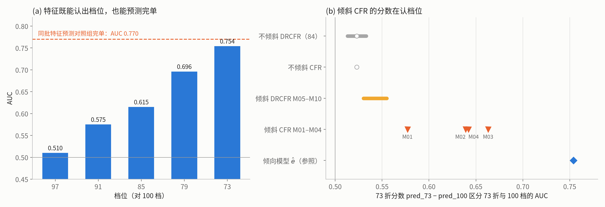

*图 A1　(a) 用特征训练的倾向模型区分各档与 100 档的 AUC，虚线为同批特征预测对照组完单的 AUC；(b) 各模型 73 折分数区分 73 折与 100 档的 AUC，条为范围、圆点为中位。*

| 现象   | 数字   | 含义   |
| --- | --- | --- |
| 特征能认出档位   | 73 折对 100 档 AUC 0.754，折扣越深越容易认   | 随机实验本应 0.5；乘客历史特征记录了此前拿到的折扣   |
| 同批特征能预测完单   | 对照组完单 AUC 0.770   | 认档位的特征同时决定基线完单 → $$B(m)$$ 的来源   |
| 区分档位最强的特征   | 近 1 月一口价/基础价比的最小、最大值，近 1 月冒泡数，城市，时段   | 以乘客历史价格类特征为主   |
| 倾斜 CFR 的分数在认档位   | M01–M04 AUC 0.577–0.663；不倾斜模型 0.513–0.533   | 倾斜 CFR 把认档位的信息学进了分数   |

| 子图   | 是否新训练模型   | 做法   |
| --- | --- | --- |
| (a) 柱   | 是，单独训练一个倾向模型 $$\hat e$$，与 $$\hat\mu_{100}$$ 不是同一个模型   | 评估集全部档位的行，314 个特征，标签为实际档位；LightGBM 十分类，按乘客 5 折交叉拟合，参数同 $$\hat\mu_{100}$$。对每档 $$a$$，取 $$A_i\in\{a,100\}$$ 的行，以 $$\hat e_a/(\hat e_a+\hat e_{100})$$ 为分数算区分 $$a$$ 档与 100 档的 AUC   |
| (a) 虚线   | 否，即 §3.4.2 的 $$\hat\mu_{100}$$   | 对照组行上，$$\hat\mu_{100}(X_i)$$ 预测是否完单的 AUC   |
| (b)   | 否，直接用 96 个被评估模型的预测   | 取 $$A_i\in\{73,100\}$$ 的行，以各模型的 73 折分数（预测的 73 折完单概率减 100 档完单概率）为分数、是否 73 折为标签算 AUC；0.5 表示分数不含档位信息。条为同组模型的范围，三角为 M01–M04，菱形为 (a) 中 $$\hat e$$ 的 73 折 AUC 作参照   |

#### A.2 R − M：真实数据里 $$B(m)$$ 的估计

R − M 即 M 扣掉的量，是 $$B(m)$$ 对 MTAUCC 贡献的估计。

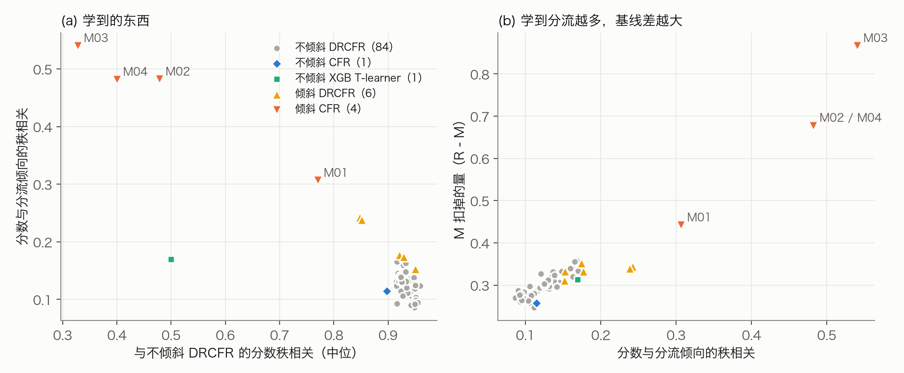

*图 A2　(a) 各模型分数与不倾斜 DRCFR 的秩相关，对分数与分流倾向的秩相关；(b) 分数与分流倾向的秩相关，对 R − M。*

结果表（点击展开）
| 模型   | 分数与分流倾向的秩相关   | R − M   |
| --- | --- | --- |
| 不倾斜 DRCFR（84）   | 0.09–0.17   | 0.25–0.36   |
| 不倾斜 CFR   | 0.115   | 0.257   |
| 倾斜 DRCFR M05–M10   | 0.15–0.24   | 0.31–0.35   |
| 倾斜 CFR M01   | 0.307   | 0.442   |
| 倾斜 CFR M02–M04   | 0.48–0.54   | 0.68–0.87   |

| 指标   | 定义   |
| --- | --- |
| 与不倾斜 DRCFR 的秩相关   | 在评估集全部 445,460 行（107,698 个乘客，与 96 个模型的训练集乘客不重叠，见 §4.3.1）上，该模型 73 折分数（预测的 73 折完单概率减 100 档完单概率）与每个不倾斜 DRCFR（不含自身）的 73 折分数算 Spearman 相关，取 84 个的中位；越接近 1，说明与不倾斜模型学到的 uplift 排序越像   |
| 分数与分流倾向的秩相关   | 73 折分数（同上）与 $$\log(\hat e_{73}/\hat e_{100})$$ 的 Spearman 相关；$$\hat e_a$$ 为倾向模型给出的分到 $$a$$ 档的概率，越高说明分数越在认档位   |
| R − M   | 未校正与校正后 MTAUCC 之差   |

| 发现   | 证据   |
| --- | --- |
| 分数越认档位，$$B(m)$$ 越大   | 96 个模型上两者 Spearman 相关 +0.87   |
| 不倾斜模型也有 $$B(m)$$   | 不倾斜模型 R − M 也有 0.25–0.36，M 与 R 尺度不同（不倾斜模型中位 0.33 对 0.63），M 只用于模型间横向比较   |
