# 【LR26-052】乘客与增长-技术建设-可变决策空间与双约束问题的Uplift 模型评估优化-V1.0

> [!info] 来源与复刻说明
> 来源：[Cooper 原文](https://cooper.didichuxing.com/knowledge/2199610335356/2210254021895)。按 2026-11-02 页面正文复刻，保留原章节、文字、数据、表格、公式和图片；折叠内容已展开。公式沿用网页中的 LaTeX，图片已保存为本地附件。网页导航、工具栏和评论不纳入正文。Markdown 的列表编号、表格合并单元格及字体样式可能与网页略有不同。

## 基础信息

| 项目 | 内容 |
| --- | --- |
| BRD 文档链接 | [【BRD】平台补贴与流量联合决策 V4](https://cooper.didichuxing.com/knowledge/2199610335356/2208200715557) |
| 最后通过的策略方案链接 | [平台联合决策 V4.0](https://cooper.didichuxing.com/knowledge/2199610335356/2208338685656) |
| 实验链接（评估大师） | 无，基础建设类LR |
| 核心贡献点 | - 首次提出适配「多类别多值&可变决策空间」、双约束的评估指标VMT-VUCS - 针对决策空间大、真实决策匹配率低造成的指标波动大、不可信问题，提出使用Top-K决策匹配真实决策的方法，并证明了Top-K指标 vs Top-1指标的理论误差上界 |
| 第一贡献人 | 陈嘉曦 |
| 共同贡献人 | 周之烁、吴铜、詹传赞 |
| 后续策略负责人 | 陈嘉曦 |

---

## 1 背景

### 1.1 业务背景

平台联合决策项目的目标为最大化完单，在幸运盒子展现场景，存在特价盒子补贴率上限、幸运盒子水位下限两个约束项；在幸运盒子不展现场景，存在特价盒子补贴率上限约束。

小猪历史Uplift模型均采用MT-AUCC指标，该指标针对不同折扣的决策空间，基于如下「补贴率约束下最大化完单问题」的贪心求解结果，评估了不同的补贴率约束下，模型最优决策相对Control组的完单提升，并不直接适用于多类别多值可变决策空间、双约束问题。

$$
\max_{j_i\in\mathcal J_i}\sum_{i\in S}bcr_{i,j_i},\qquad
\text{s.t. }\frac{\sum_i\hat c_{i,j_i}}{\sum_i\hat g_{i,j_i}}\le\alpha_t
$$

其中$\hat c_{i,j_i}$为预估特价盒子补贴额，$\hat g_{i,j_i}$为预估 应付GMV，$\alpha_t$为特价盒子补贴率上限。

为适配联合决策场景，我们需要搭建**适配多类别多值可变决策空间、双约束问题的评估指标**。

### 1.2 评估难点

- **双约束如何评估？**

    - 问题：MT-AUCC指标，以补贴率为横轴、完单提升为纵轴，进行曲线积分。

    - 解决方案：自然而然可以想到，在双约束场景下，以补贴率为X轴、幸运盒子水位为Y轴、完单提升为Z轴，可以求<u>曲面积分</u>。

- **可变决策空间如何评估？**

    - **问题：**

        - MT-AUCC指标中，每个冒泡的折扣决策空间都相同；同时为了保证每个冒泡命中真实决策的概率相同，会提前对每个真实决策下的冒泡进行采样，保证均匀分布。

        - 联合决策场景下，由于存在幸运盒子价格约束剪枝，且每个冒泡的可行默勾数不同，因此<u>每个冒泡的可行决策空间大小不同，在匹配RCT真实决策时的命中概率不同</u>。

    - 解决方案：1）建模每个冒泡命中真实决策的概率；2）在计算回放指标的时候，对冒泡进行逆概率加权

- **决策空间大且RCT样本不足，导致匹配率低、评估指标波动大**

    - 问题：联合决策空间多达560维，导致真实决策匹配率为1.2%，此时用于评估的冒泡样本只有千级别，且少数单样本贡献大的权重，导致评估指标波动高达112%，评估结果不置信

    - 解决方案：放宽到使用Top-K决策匹配RCT真实决策，使用Top-K来代替Top-1决策的样本label。

### 1.3 评估体系

我们搭建了如下Uplift模型离线评估指标体系，包含**VMT-AUCC@K（Variable Multi-Treatment Area Under Cost Curve）、VMT-VUCS@K（Variable Multi-Treatment Volume Under Constraint Surface）**两个指标：

| 指标 | 固定冒泡样本 | Control或参考定义 | 决策空间 | 评估目的 | 单位 |
| --- | --- | --- | --- | --- | --- |
| VMT-AUCC@K | 幸运盒子不展现场景 | 幸运100折、特价100折 | 特价折扣×默勾数 | 在<u>特价补贴率上限</u>约束下，相对Control的完单数增量 | 单 |
| VMT-VUCS@K | 幸运盒子展现场景 | 幸运盒子为可行最浅折扣、特价100折 | 幸运折扣×特价折扣×默勾数 | 在<u>特价补贴率上限、幸运水位下限</u>约束下，相对Control的完单数增量 | 单 |

**指标命名对应解决的问题**

|  | 单约束 | 多约束 |
| --- | --- | --- |
| 解决多决策空间 | MT-AUCC | MT-VUCS |
| 解决多决策空间+可变决策空间 | VMT-AUCC | VMT-VUCS |
| 解决多决策空间+可变决策空间+指标波动大 | VMT-AUCC@K | VMT-VUCS@K |

**必要性和普适性说明**

1. 必要性：

    1. MT-VUCS指标沿袭MT-AUCC的设计思路，是双约束问题下能够保证理论离在线一致的离线指标

    2. VMT-AUCC、VMT-VUCS建模每个冒泡命中真实决策的概率，是可行决策空间不稳定场景下的最直接解法；若不解决，在本场景中会出现幸运盒子水位上升时、完单提升上升的异常现象，评估不置信

    3. @K使用Top-K匹配策略，是在RCT评估样本不足的场景下稳定指标的创新解法；若不解决，指标在不同seed下波动为112%，评估不置信

2. 普适性：

    1. 适用于双约束、可变决策空间、RCT不足/决策空间大导致指标波动大的场景，且可以根据实际情况选择其中若干模块进行组合（如MT-AUCC@3、VMT-VUCS）

---

## 2 目标 & 约束

- 目标：

    - 完成适配双约束三treatment场景的评估指标体系搭建，并于平台联合决策V4项目使用

- 约束：

    - 同结构不同seed模型，评估指标波动<20%

    - 评估指标运行时间<30分钟

---

## 3 技术方案

### 3.1 符号定义

**符号定义表**

| 符号 | 含义 |
| --- | --- |
| $S,i,j$ | 固定样本集、冒泡索引、联合决策索引 |
| $\mathcal J_i,C_i,T_i$ | 完整可行决策集合、完整Control候选集合、Treatment候选集合 |
| $d_{l,j},d_{u,j},k_j$ | 幸运、特价的实付折扣率及默勾数；80折写0.8，优惠比例为$1-d_{u,j}$ |
| $j_i^{\mathrm{RCT}},j_i^t$ | 日志真实决策、名义资源点$t$返回的Top-1决策 |
| $S_{\mathrm{trt}},S_{\mathrm{ctrl}}$ | 按日志真实决策拆分的Treatment与Control样本集 |
| $S^t,\widetilde S^t$ | 当前模型策略的干预与非干预人群 |
| $N_{\mathrm{trt}}^t,\widetilde N_{\mathrm{trt}}^t$ | 干预、非干预人群中匹配前的日志Treatment人数 |
| $A_i^{\mathrm{trt},t},A_i^{\mathrm{ctrl},t}$ | 当前点两侧选中的Top-K决策集合 |
| $K_i^{\mathrm{trt}},K_i^{\mathrm{ctrl}}$ | 逐冒泡两侧实际集合大小，上限为配置K |
| $\overline{S_{\mathrm{trt}}^t},\overline{S_{\mathrm{ctrl}}^t},\overline{\widetilde S_{\mathrm{ctrl}}^t}$ | 干预 Treatment、干预 Control、非干预 Control的真实决策命中样本集 |
| $bcr_{ij},f^l_{ij},f^u_{ij},f^o_{ij}$ | 预测完单概率，以及完单条件下幸运、特价、其他品类概率 |
| $cost_{ij},\hat{gmv}_{ij}$ | 完单条件下的特价补贴与应付GMV |
| $\hat c_{ij},\hat g_{ij}$ | 乘一次BCR后的每冒泡期望特价补贴与总GMV |
| $p_i^{u\prime},\hat p_i^l,p_i^u,g^o_{ij}$ | 特价前置券后价、幸运应付GMV、特价应付GMV、其他品类预测条件GMV |
| $a^u_{ij},\tilde p^l_{ij},\tilde p^u_{ij}$ | 决策特价补贴、幸运实付价、特价实付价 |
| $y_i,c_i,g_i,L_i,U_i$ | 事实决策的完单label、实际cost、实际总GMV、重建的幸运/特价实付价 |
| $\alpha_t,\beta_t,\lambda_c,\lambda_r$ | 名义特价补贴率上限、幸运水位下限及两项非负乘子 |
| $\rho_i,P_i^C$ | 冻结的事实联合决策概率、完整Control集合概率 |
| $\omega_i^{\mathrm{trt}},\omega_i^{\mathrm{ctrl}}$ | Treatment、Control侧的未归一化逆概率权重，分别为$1/(K_i^{\mathrm{trt}}\rho_i)$、$1/(K_i^{\mathrm{ctrl}}\rho_i)$ |
| $\mu_T^t(v),\mu_C^t(v),\mu_0^t(v)$ | 三个命中侧对真实量$v$的SNIPS均值 |
| $\Delta Q^t,\widehat R^t,\widehat W^t$ | 折算后的完单数增量、真实回放补贴率、真实回放水位 |

### 3.2 MT-AUCC-Uplift模型指标设计通用思路

二分类任务通常使用 AUC 评估模型区分正负样本的能力，而 Uplift 模型更关注**约束下增量收益的排序能力**：在给定补贴率约束下，如何为不同冒泡样本分配决策，使总体完单提升最大。

因此，MT-AUCC采用各补贴率约束点下「模型求得的最优策略相对控制策略的完单增量」，来评估模型的在**多折扣决策空间**中的决策效果。但同一冒泡只能观测到实际执行决策下的结果，其他决策下的**反事实结果不可观测**，因此无法直接计算个体处理效应（ITE，Individual Treatment Effect）。为此，我们基于随机对照试验（RCT，Randomized Controlled Trial）数据，计算<u>干预组内实际决策为干预组 vs 实际决策为control组的平均处理效应</u>（ATE，Average Treatment Effect），以群体层面的平均增量收益评估策略效果。

MT-AUCC的原始计算流程如下：

1. **采样**：为保证每个冒泡匹配到真实决策的概率相同，对样本进行下采样，使得每个折扣下样本数量一致。

2. **固定Control组与Treatment组**：Control组为100折，Treatment组为非100折

3. **贪心求解**：计算冒泡样本 x 折扣决策粒度的边际ROI，从大到小排序

4. **截断**：在排序好的数列中选择多个截断点，并依据截断点前样本最深预估折扣，作为样本的模型决策结果

5. **回放**：对于每个截断点，用模型决策结果匹配RCT真实决策，基于真实决策的结果回放X轴补贴率、Y轴完单提升

6. **积分**：从原点出发，从左到右连线，求曲线下面积。

我们将MT-AUCC用于评估幸运盒子不展现场景、**决策空间为「特价盒子折扣 x 默勾数」时**，模型在不同特价补贴率上限约束下，相对 Control 策略带来的完单数增量。

此时引入3个问题：

1. **如何计算cost？**

    1. 「多折扣」决策空间下，$c_{ij}=\mathrm{bcr}_{ij}\,p_i^{u\prime}(1-d_j)$

    2. 「特价盒子 x 默勾」决策空间下，仅特价盒子完单时会产生特价盒子补贴额，且默勾会改变特价盒子完单概率，因此定义$c_{ij}=\mathrm{bcr}_{ij}\,f_{ij}^{u}\,p_i^{u\prime}(1-d_j^{u})$。

        1. 其中，$p_i^{u\prime}$为特价盒子前置券后价格；$f_{ij}^{u}$为冒泡$i$在联合决策$j$下、条件于完单的特价盒子完单概率。

2. **如何定义Control组？**

    1. 「多折扣」决策空间下，100折即为Control；

    2. 「特价盒子 x 默勾」决策空间下，特价盒子100折时，不管默勾如何改变，补贴都为0。因此我们定义Control组为<u>特价盒子为100折、默勾为模型最优决策（即BCR最高）</u>

3. **如何固定积分区域？**

    1. 「多折扣」决策空间：模型增加了单调性约束，使 BCR 和 cost 随折扣加深而上升，因此所有模型共用“最深折扣”终点策略，该策略即对应横轴补贴率的最大点。

    2. 「特价盒子 × 默勾」决策空间下，不存在随cost增加，BCR增加的单调性保证，因此，各模型的终点策略及对应补贴率可能不同，需要<u>统一固定积分区间为[0,1.5pp]</u>。

        1. 例如：从单勾幸运盒子变为勾选幸运盒子+特价盒子，此时特价盒子完单概率上涨导致cost上涨，但BCR可能会下降

4. **如何设定随机线？**

    1. 仅通过曲面下积分面积，即可比较不同模型的优劣。随机线的目的，是为了评估最优决策 vs 随机决策的完单提升。因此我们剔除了随机线，额外补充了随机初始化参数模型的评估结果，理论上<u>训练模型应优于随机初始化模型</u>。

两者的评估示例图如下：

| 多折扣决策下MT-AUCC | **特价盒子折扣 x 默勾数下**MT-AUCC |
| --- | --- |
| 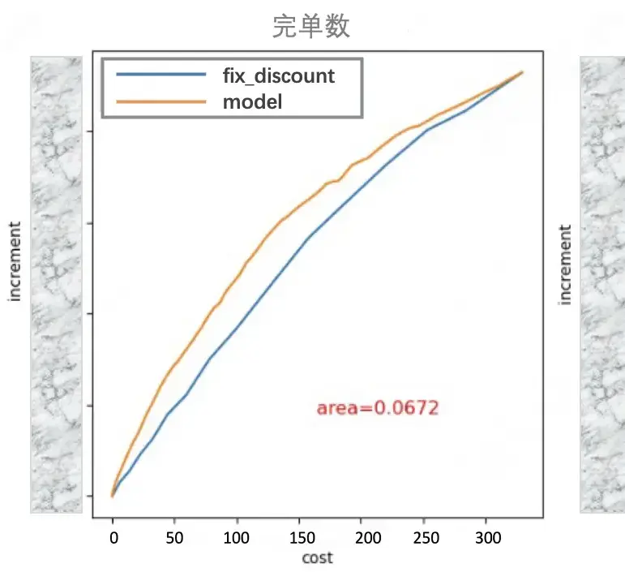 | 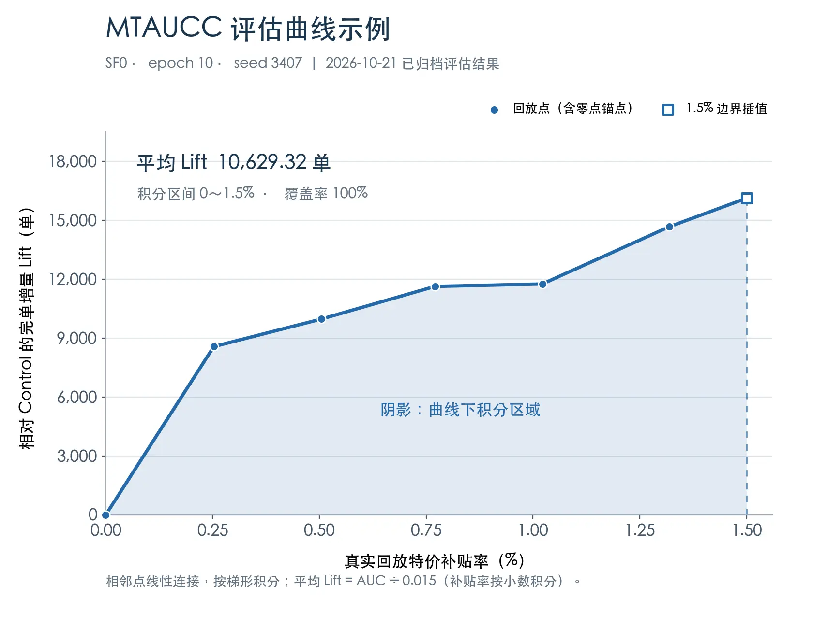 |

#### 3.2.1 固定Control组与Treatment组

仅对无幸运盒子展现的冒泡，取Control组为「特价盒子100折、幸运盒子100折」，其余为Treatment组。

$$
C_i=\{j\in\mathcal J_i:d_{l,j}=1,d_{u,j}=1\},\qquad T_i=\{j\in\mathcal J_i:d_{l,j}=1,d_{u,j}<1\}.
$$

依据此，将冒泡分为Control组冒泡和Treatment组冒泡：

$$
S_{\mathrm{ctrl}}=\{i\in S:j_i^{\mathrm{RCT}}\in C_i\},\qquad
S_{\mathrm{trt}}=S\setminus S_{\mathrm{ctrl}}.
$$

#### 3.2.2 求解单约束问题

约束点定义为，补贴率为0～2pp、0.25pp步长，共9点。在约束点$t=(\alpha_t)$下最大化完单的优化问题可定义为：

$$
\max_{j_i\in\mathcal J_i}\sum_{i\in S}bcr_{i,j_i},\qquad
\text{s.t. }\frac{\sum_i\hat c_{i,j_i}}{\sum_i\hat g_{i,j_i}}\le\alpha_t
$$

其中

- $\hat c_{i,j_i}$为预估特价盒子补贴额，$\hat g_{i,j_i}$为预估 应付GMV，$\alpha_t$为约束点$t$的特价盒子补贴率上限。

基于求解得到的非负乘子$\lambda_c$，定义决策得分和Top-1决策

$$
score_{ij}(\lambda_c)=bcr_{ij}-\lambda_c(\hat c_{ij}-\alpha_t\hat g_{ij}),
\qquad
j_i^t(\lambda_c)=\arg\max_j score_{ij}(\lambda_c).
$$

#### 3.2.3 划分干预冒泡与Top-1决策

依据得分Top-1决策所属组划分干预样本、非干预样本：

$$
S^t=\{i\in S:j_i^t\notin C_i\},\qquad \widetilde S^t=S\setminus S^t.
$$

在Treatment决策空间 $T_i$ 和Control决策空间 $C_i$ 中各自选Top-1决策：

$$
A_i^{\mathrm{trt},t}=\operatorname{Top}_{1}(T_i;score),\qquad
A_i^{\mathrm{ctrl},t}=\operatorname{Top}_{1}(C_i;score).
$$

最终，对Treatment组 $S_{trt}$ 中的干预样本，在Treatment决策空间 $T_i$ 中选择Top-1决策；对非干预样本和**Control组**$S_{ctrl}$**中的干预样本**，则在Control决策空间 $C_i$ 中选择Top-1决策。

#### 3.2.4 匹配真实决策

基于「特价盒子折扣、默勾数」的决策空间，用RCT的真实决策$j_i^{RCT}$匹配Top-1决策，得到匹配后的冒泡集：

- Treatment 组受干预且 Top-1 决策能匹配到 RCT 真实决策的冒泡：$\overline{S_{\mathrm{trt}}^t}=\{i\in S^t\cap S_{\mathrm{trt}}:j_i^{\mathrm{RCT}}\in A_i^{\mathrm{trt},t}\}$。

- Control 组受干预且 Top-1 决策能匹配到 RCT 真实决策的冒泡：$\overline{S_{\mathrm{ctrl}}^t}=\{i\in S^t\cap S_{\mathrm{ctrl}}:j_i^{\mathrm{RCT}}\in A_i^{\mathrm{ctrl},t}\}$。

- Control 组中未干预且 Top-1 决策能匹配到 RCT 真实决策的冒泡：$\overline{\widetilde S_{\mathrm{ctrl}}^t}=\{i\in\widetilde S^t\cap S_{\mathrm{ctrl}}:j_i^{\mathrm{RCT}}\in A_i^{\mathrm{ctrl},t}\}$

对冒泡真实值$v_i\in\{y_i,c_i,g_i\}$ ，得到加权后的各指标：

$$
\mu_T^t(v)=\frac{\sum_{i\in\overline{S_{\mathrm{trt}}^t}}\omega_i^{\mathrm{trt}}v_i}{\sum_{i\in\overline{S_{\mathrm{trt}}^t}}\omega_i^{\mathrm{trt}}},\qquad \mu_C^t(v)=\frac{\sum_{i\in\overline{S_{\mathrm{ctrl}}^t}}\omega_i^{\mathrm{ctrl}}v_i}{\sum_{i\in\overline{S_{\mathrm{ctrl}}^t}}\omega_i^{\mathrm{ctrl}}},\qquad \mu_0^t(v)=\frac{\sum_{i\in\overline{\widetilde S_{\mathrm{ctrl}}^t}}\omega_i^{\mathrm{ctrl}}v_i}{\sum_{i\in\overline{\widetilde S_{\mathrm{ctrl}}^t}}\omega_i^{\mathrm{ctrl}}}.
$$

其中

- $y_i$为真实完单标记

- $c_i$为真实特价盒子补贴额，$g_i$为真实 GMV

- $\omega_i^{\mathrm{trt}}=1$、$\omega_i^{\mathrm{ctrl}}=1$，分别为Treatment组和Control组的冒泡权重

- $\mu_T^t(v)$为受干预人群执行 Treatment Top-1 决策时，真实量$v$的加权均值，使用匹配成功的 Treatment 组冒泡估计。

- $\mu_C^t(v)$为受干预人群执行 Control Top-1 决策时，真实量$v$的加权均值，使用匹配成功的 Control 组冒泡估计，作为干预效果的对照。

- $\mu_0^t(v)$为未受干预人群执行 Control Top-1 决策时，真实量$v$ 的加权均值，使用匹配成功的 Control 组冒泡估计。

#### 3.2.5 回放完单提升和约束资源

记$N_{\mathrm{trt}}^t=|S^t\cap S_{\mathrm{trt}}|$为匹配前干预日志Treatment人数，$\widetilde N_{\mathrm{trt}}^t=|\widetilde S^t\cap S_{\mathrm{trt}}|$为非干预日志Treatment人数。

回放的完单提升、真实特价盒子补贴率为

$$
\Delta Q^t=N_{\mathrm{trt}}^t\left[\mu_T^t(y)-\mu_C^t(y)\right],\qquad \widehat R^t=\frac{N_{\mathrm{trt}}^t\mu_T^t(c)}{N_{\mathrm{trt}}^t\mu_T^t(g)+\widetilde N_{\mathrm{trt}}^t\mu_0^t(g)}.
$$

#### 3.2.6 固定区域的曲线积分

针对名义约束点回放得到$(\widehat R^t,\Delta Q^t)$，在**固定目标积分区间**$\mathcal I=[0,0.015]$**上**，进行曲线积分

完整覆盖时：

在目标区间边界用左右相邻点线性插值，超出部分不计积分。记截断后有序节点为 $(r_u,L_u)$，共有 $m$个节点，曲线积分结果为：

$$
AUC@K=\int_{\mathcal I}\Delta Q_K(r)\,dr,\qquad     MTAUCC@K=\frac{AUC@K}{|\mathcal I|}=\frac{AUC@K}{0.015}\quad\text{（单）}.
$$

覆盖不足时：

记有效曲线最小、最大回放补贴率为 $r_{\min},r_{\max}$，实际覆盖区间为 $\mathcal I_{\mathrm{covered}}=\mathcal I\cap[r_{\min},r_{\max}]$。在该交集内按同一线性插值和梯形规则积分，以覆盖区间平均Lift作为本次评估结果，同时报告覆盖比例：

$$
AUC_{\mathrm{covered}}=\int_{\mathcal I_{\mathrm{covered}}}\Delta Q_K(r)\,dr.
$$

$$
MTAUCC@K=\frac{AUC_{\mathrm{covered}}}{|\mathcal I_{\mathrm{covered}}|}\quad\text{（单）},\qquad  \mathrm{Coverage}=\frac{|\mathcal I_{\mathrm{covered}}|}{0.015}.
$$

### 3.3 MT-VUCS

搭建MT-VUCS用于评估幸运盒子展现场景下，模型在不同特价补贴率上限、幸运盒子水位下限约束下，相对 Control 策略带来的完单数增量。

MT-AUCC指标，以补贴率为横轴、完单提升为纵轴，进行曲线积分；那么自然而然可以想到，在双约束场景下，以补贴率为X轴、幸运盒子水位为Y轴、完单提升为Z轴，可以求<u>曲面积分</u>。

#### 3.3.1 固定Control组与Treatment组

仅对有幸运盒子展现的冒泡，取Control组为「特价盒子100折、幸运盒子为可行最浅折扣」，其余为Treatment组。

$$
d_{l,i}^0=\max\{d_{l,j}:j\in\mathcal J_i,d_{u,j}=1\},\qquad
C_i=\{j\in\mathcal J_i:d_{u,j}=1,d_{l,j}=d_{l,i}^0\},\qquad
T_i=\mathcal J_i\setminus C_i.
$$

依据此，将冒泡分为Control组冒泡和Treatment组冒泡：

$$
S_{\mathrm{ctrl}}=\{i\in S:j_i^{\mathrm{RCT}}\in C_i\},\qquad
S_{\mathrm{trt}}=S\setminus S_{\mathrm{ctrl}}.
$$

#### 3.3.2 求解双约束问题

约束点定义为，补贴率为0～3pp、0.5pp步长，水位下限为82%～97%、1pp步长，共112点。在约束点$t=(\alpha_t,\beta_t)$下最大化完单的优化问题可定义为：

$$
\max_{j_i\in\mathcal J_i}\sum_{i\in S}bcr_{i,j_i},\qquad
\text{s.t. }\frac{\sum_i\hat c_{i,j_i}}{\sum_i\hat g_{i,j_i}}\le\alpha_t,
\quad\frac{\sum_i\tilde p^l_{i,j_i}}{\sum_i\tilde p^u_{i,j_i}}\ge\beta_t.
$$

其中

- $\hat c_{i,j_i}$为预估特价盒子补贴额，$\hat g_{i,j_i}$为预估 应付GMV，$\alpha_t$为约束点$t$的特价盒子补贴率上限。

- $\tilde p^l_{i,j_i}$为幸运盒子冒泡实付价格，$\tilde p^u_{i,j_i}$为特价盒子冒泡实付价格，$\beta_t$为约束点$t$ 的幸运盒子水位下限。

基于求解得到的非负乘子$\lambda_c,\lambda_r$，定义决策得分和Top-1决策

$$
score_{ij}(\lambda_c,\lambda_r)=bcr_{ij}-\lambda_c(\hat c_{ij}-\alpha_t\hat g_{ij})
-\lambda_r(\beta_t\tilde p^u_{ij}-\tilde p^l_{ij}), \qquad
j_i^t(\lambda_c,\lambda_r)=\arg\max_j score_{ij}(\lambda_c,\lambda_r).
$$

#### 3.3.3 划分干预冒泡与Top-1决策

依据得分Top-1决策所属组划分干预样本、非干预样本：

$$
S^t=\{i\in S:j_i^t\notin C_i\},\qquad \widetilde S^t=S\setminus S^t.
$$

在Treatment决策空间 $T_i$ 和Control决策空间 $C_i$ 中各自选Top-1决策：

$$
A_i^{\mathrm{trt},t}=\operatorname{Top_1}(T_i;score),\qquad
A_i^{\mathrm{ctrl},t}=\operatorname{Top_1}(C_i;score).
$$

最终，对Treatment组 $S_{trt}$ 中的干预样本，在Treatment决策空间 $T_i$ 中选择Top-1决策；对非干预样本和**Control组**$S_{ctrl}$**中的干预样本**，则在Control决策空间 $C_i$ 中选择Top-1决策。

#### 3.3.4 匹配真实决策

基于「幸运盒子定价、特价盒子折扣、默勾数」的决策空间，用RCT的真实决策$j_i^{RCT}$匹配Top-1决策，得到匹配后的冒泡集：

- Treatment 组受干预且 Top-K 决策能匹配到 RCT 真实决策的冒泡：$\overline{S_{\mathrm{trt}}^t}=\{i\in S^t\cap S_{\mathrm{trt}}:j_i^{\mathrm{RCT}}\in A_i^{\mathrm{trt},t}\}$。

- Control 组受干预且 Top-K 决策能匹配到 RCT 真实决策的冒泡：$\overline{S_{\mathrm{ctrl}}^t}=\{i\in S^t\cap S_{\mathrm{ctrl}}:j_i^{\mathrm{RCT}}\in A_i^{\mathrm{ctrl},t}\}$。

- Control 组中未干预且 Top-K 决策能匹配到 RCT 真实决策的冒泡：$\overline{\widetilde S_{\mathrm{ctrl}}^t}=\{i\in\widetilde S^t\cap S_{\mathrm{ctrl}}:j_i^{\mathrm{RCT}}\in A_i^{\mathrm{ctrl},t}\}$

对冒泡真实值$v_i\in\{y_i,c_i,g_i,L_i,U_i\}$ ，得到加权后的各指标：

$$
\mu_T^t(v)=\frac{\sum_{i\in\overline{S_{\mathrm{trt}}^t}}\omega_i^{\mathrm{trt}}v_i}{\sum_{i\in\overline{S_{\mathrm{trt}}^t}}\omega_i^{\mathrm{trt}}},\qquad \mu_C^t(v)=\frac{\sum_{i\in\overline{S_{\mathrm{ctrl}}^t}}\omega_i^{\mathrm{ctrl}}v_i}{\sum_{i\in\overline{S_{\mathrm{ctrl}}^t}}\omega_i^{\mathrm{ctrl}}},\qquad \mu_0^t(v)=\frac{\sum_{i\in\overline{\widetilde S_{\mathrm{ctrl}}^t}}\omega_i^{\mathrm{ctrl}}v_i}{\sum_{i\in\overline{\widetilde S_{\mathrm{ctrl}}^t}}\omega_i^{\mathrm{ctrl}}}.
$$

其中

- $y_i$为真实完单标记

- $c_i$为真实特价盒子补贴额，$g_i$为真实 GMV

- $\omega_i^{\mathrm{trt}}=1$、$\omega_i^{\mathrm{ctrl}}=1$，分别为Treatment组和Control组的冒泡权重

- $L_i$、$U_i$为按 RCT 真实决策重建的幸运盒子冒泡实付价格、特价盒子冒泡实付价格

- $\mu_T^t(v)$为受干预人群执行 Treatment Top-1 决策时，真实量$v$的加权均值，使用匹配成功的 Treatment 组冒泡估计。

- $\mu_C^t(v)$为受干预人群执行 Control Top-1 决策时，真实量$v$的加权均值，使用匹配成功的 Control 组冒泡估计，作为干预效果的对照。

- $\mu_0^t(v)$为未受干预人群执行 Control Top-1 决策时，真实量$v$ 的加权均值，使用匹配成功的 Control 组冒泡估计。

#### 3.3.5 回放完单提升和约束资源

记$N_{\mathrm{trt}}^t=|S^t\cap S_{\mathrm{trt}}|$为匹配前干预日志Treatment人数，$\widetilde N_{\mathrm{trt}}^t=|\widetilde S^t\cap S_{\mathrm{trt}}|$为非干预日志Treatment人数。

回放的完单提升、真实特价盒子补贴率、真实幸运盒子水位为

$$
\Delta Q^t=N_{\mathrm{trt}}^t\left[\mu_T^t(y)-\mu_C^t(y)\right],\qquad \widehat R^t=\frac{N_{\mathrm{trt}}^t\mu_T^t(c)}{N_{\mathrm{trt}}^t\mu_T^t(g)+\widetilde N_{\mathrm{trt}}^t\mu_0^t(g)},\qquad \widehat W^t=\frac{N_{\mathrm{trt}}^t\mu_T^t(L)+\widetilde N_{\mathrm{trt}}^t\mu_0^t(L)}{N_{\mathrm{trt}}^t\mu_T^t(U)+\widetilde N_{\mathrm{trt}}^t\mu_0^t(U)}.
$$

#### 3.3.6 固定区域的曲面积分

**曲面积分可视化演示**

  2026-10-22-MTVUCS固定区域与曲面积分演示.html（0.2MB）

  [https://cooper.didichuxing.com/knowledge/2199610335356/2210254021895?anchor=783e8010-68b6-451a-8505-811413498d78](https://cooper.didichuxing.com/knowledge/2199610335356/2210254021895?anchor=783e8010-68b6-451a-8505-811413498d78)

针对名义约束点回放得到$(\widehat R^t,\widehat W^t,\Delta Q^t)$，曲面积分步骤为：

1. 固定积分区域：**所有模型共同使用区域**$\Omega$

2. 去重：回放三元组按$10^{-8},10^{-8},10^{-6}$容差去重，坐标相同而Lift不同的不同回放结果取算术平均。

3. 支持区域：按固定对角线拆分后投影到真实资源平面取并集，记为$\mathcal U$。

4. 曲面与裁剪

    1. 坐标按$(r/0.005,w/0.01)$缩放后做Delaunay剖分，记三角形为$\mathcal T_\ell$。保留$\mathcal P_\ell=\mathcal T_\ell\cap\mathcal U\cap\Omega.$ 新顶点Lift由原三角形线性插值

    2. 覆盖区域与覆盖率为：$\mathcal C=\bigcup_\ell\mathcal P_\ell,\qquad \mathrm{Coverage}=|\mathcal C|/|\Omega|.$

5. 曲面积分

    1. 完整覆盖时

        1. 对最终小三角形计算原始积分：$V_K=\iint_\Omega\Delta Q_K(r,w)\,dr\,dw=\sum_m a_m\frac{L_{m1}+L_{m2}+L_{m3}}3.$

            1. 其中，$a_m$为第$m$片在原始比例坐标下的面积，$L_{m1},L_{m2},L_{m3}$为插值后的三个顶点Lift

        2. 固定区域内的平均完单增量： $MTVUCS@K=\frac{V_K}{|\Omega|}=\frac{V_K}{0.0006965}\quad\text{（单）}$

    2. 覆盖不足时，对实际覆盖区域$\mathcal C$计算积分，以覆盖区域平均Lift作为本次评估结果

        1. $V_{\mathrm{covered}}=\iint_{\mathcal C}\Delta Q_K(r,w)\,dr\,dw.$

        2. $MTVUCS@K=\frac{V_{\mathrm{covered}}}{|\mathcal C|}\quad\text{（单）}$

### 3.4 决策概率

原始MT-AUCC指标中，决策空间为多折扣时，每个冒泡的折扣<u>决策空间都相同</u>；同时为了保证<u>每个冒泡命中真实决策的概率相同</u>，会提前对每个真实决策下的冒泡进行采样，保证均匀分布。

而在联合决策场景下，决策空间为「幸运盒子定价 x 特价盒子折扣 x 默勾数」时，由于存在幸运盒子价格约束剪枝，且每个冒泡的可行默勾数不同，因此<u>每个冒泡的可行决策空间大小不同，在匹配RCT真实决策时的命中概率不同</u>。

因此，我们需要1）建模每个冒泡命中真实决策的概率；2）在计算回放指标的时候，对冒泡进行逆概率加权。同时不同模型、不同指标，共用相同的决策概率。

#### 3.4.1 平滑先验概率

依据每个冒泡$i$的可行决策空间$\mathcal J_i$和RCT真实决策$j_i^{\mathrm{RCT}}$，可以得到相同可行决策下，每个决策的真实命中概率。即在相同可行决策空间$\mathcal J$中，记$n_{\mathcal J}$为冒泡数，$n_{\mathcal J,j}$为其中真实选择决策$j$的冒泡数，那么每个决策的真实命中概率为：

$$
\frac{n_{\mathcal J,j}}{n_{\mathcal J}}
=\frac{
\sum_{i\in S_{\mathrm{train}}}
\mathbf{1}\{\mathcal J_i=\mathcal J,\ j_i^{\mathrm{RCT}}=j\}
}{
\sum_{i\in S_{\mathrm{train}}}
\mathbf{1}\{\mathcal J_i=\mathcal J\}
}
$$

为避免0概率出现，每个空间**总计**加入1600份均匀伪计数，得到如下平滑先验概率。此时样本越多，结果越接近真实频率；样本越少，越接近空间内均匀分布。

$$
p_0(j\mid\mathcal J)=\frac{n_{\mathcal J,j}+1600/\lvert\mathcal J\rvert}{n_{\mathcal J}+1600}.
$$

#### 3.4.2 决策概率模型

平滑先验概率存在两个问题：1）可能掩盖同决策空间内的分配差异，导致逆概率权重不准确，例如同可行决策空间，不同城市可能存在分配差异；2）稀疏空间会被较强地拉向均匀分布。

为解决以上问题，我们使用了决策概率模型，在冒泡维度，基于BCR模型的特征，建模命中真实决策概率。

**建模对象表格**

| 对象 | 定义 |
| --- | --- |
| 样本粒度 | 冒泡 |
| 输入$X_i$ | 与BCR模型特征相同 |
| 模型输出 | 完整可行空间$\mathcal J_i$内各决策$j$的概率，空间内之和为1，空间外为0 |
| 分类label | 日志真实联合决策$j_i^{\mathrm{RCT}}$ |

| 建模步骤 | 图 |
| --- | --- |
| - 输入条件概率： - 记$d=(d_l,d_u)$为折扣组合，$k$为默勾数，联合决策$j$对应$(d,k)$；$m_i(d)$为该组合的可行默勾上限，可得到“折扣组合概率”和“组合内默勾概率” $p_0(d\mid\mathcal J_i)=\sum_{k=1}^{m_i(d)}p_0(d,k\mid\mathcal J_i),\qquad p_0(k\mid d,\mathcal J_i)=\frac{p_0(d,k\mid\mathcal J_i)}{p_0(d\mid\mathcal J_i)}.$ - 输出修正：折扣组合概率的修正$\delta_i^d(d)$、组合内默勾概率的修正$\delta_i^k(d,k)$ - 修正后条件概率：先将修正加到先验log概率，再做Softmax，得到修正后的条件概率 $\begin{aligned} p_C(d\mid X_i,\mathcal J_i) &=\operatorname{Softmax}_{d:\,m_i(d)>0} \left(\frac{\log p_0(d\mid\mathcal J_i)+\delta_i^d(d)}{T_d}\right),\\ p_C(k\mid d,X_i,\mathcal J_i) &=\operatorname{Softmax}_{1\le k\le m_i(d)} \left(\frac{\log p_0(k\mid d,\mathcal J_i)+\delta_i^k(d,k)}{T_k}\right). \end{aligned}$ - 其中训练时两个温度均为1；训练后用日期留出样本选择温度，当前固定$T_d=1.5$、$T_k=1.0$。 - 修正后联合决策概率：两分支相乘，得到联合决策概率： $p_C(j\mid X_i,\mathcal J_i)=p_C(d\mid X_i,\mathcal J_i)\,p_C(k\mid d,X_i,\mathcal J_i).$ - 训练loss：记$p_\theta$为训练中的未校准概率、$n_{\mathrm{train}}$为训练样本数，使用负对数似然 $\mathcal L(\theta)=-\frac1{n_{\mathrm{train}}}\sum_i\log p_\theta(j_i^{\mathrm{RCT}}\mid X_i,\mathcal J_i).$ | 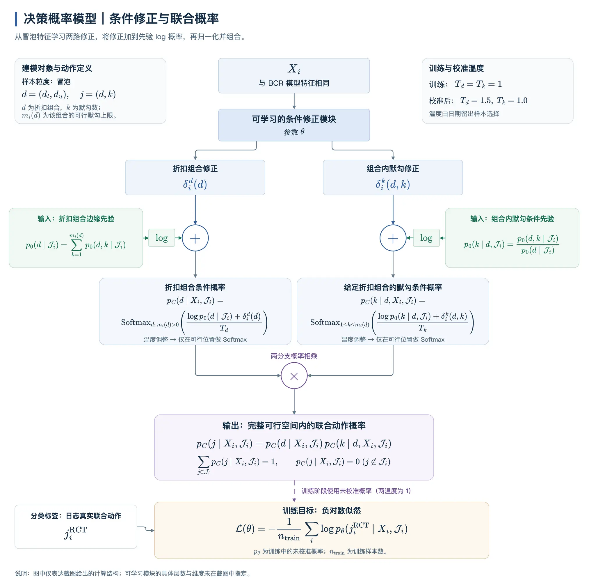 |

#### 3.4.3 概率模型混合先验概率

仅基于决策概率模型建模时，仍然可能输出极小概率，导致少量样本贡献大量权重。

因此，我们对上两步的结果进行混合，保留了97.5%的条件模型概率和2.5%的平滑先验概率，得到最终的决策概率：

$$
\widetilde p_i(j)=0.975p_C(j\mid X_i,\mathcal J_i)+0.025p_0(j\mid\mathcal J_i)
$$

那么命中RCT真实决策的概率为$\rho_i=\widetilde p_i(j_i^{\mathrm{RCT}})$，冒泡的逆概率权重为$\omega_i^{\mathrm{trt}}=1/(\rho_i)$、$\omega_i^{\mathrm{ctrl}}=1/(\rho_i)$。

由此得到**VMT-AUCC、VMT-VUCS**指标。

### 3.5 @K的设计

「幸运盒子定价 x 特价盒子折扣 x 默勾数」的联合决策空间多达560维，导致真实决策匹配率只有1.2%，此时用于评估的冒泡样本少、且少数单样本贡献大的权重，导致同结构、不同seed下模型的评估指标波动高达112%，且存在随机模型优于已训练模型，评估指标不置信。

**同结构、不同seed下模型的评估指标波动详情**

| K | seed17 | seed2027 | seed3407 | 平均干预匹配率（三seed范围） | 三seed波动率 | 评估图 |
| --- | --- | --- | --- | --- | --- | --- |
| 1 | 23,854.40 | 7,304.87 | 26,267.12 | 1.21%～1.38% | 112.96% | 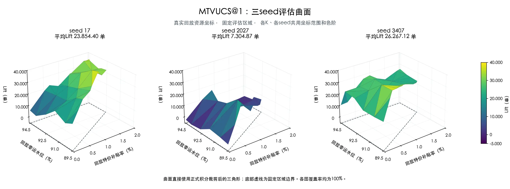 |

为提升匹配率，降低波动率，我们可以放宽匹配条件，基于以下原因，最终选择**放宽到使用打分score Top-K决策匹配RCT真实决策**，它保留了对默勾选择的评估，并直接沿用业务优化目标，无需额外定义距离尺度。

| 优点 | BCR/cost距离Top-K | 动作距离Top-K | 不匹配默勾 | **原score Top-K** |
| --- | --- | --- | --- | --- |
| 优先选择预测BCR/cost接近Top-1的动作 | ✓ | — | — | — |
| 优先选择折扣、默勾数接近Top-1的动作 | — | ✓ | — | — |
| **沿用求解时的收益与资源权衡** | — | — | — | **✓** |
| 保留对默勾选择能力的评估 | ✓ | ✓ | — | **✓** |
| 用K控制匹配集合大小 | ✓ | ✓ | — | **✓** |
| 无需额外设置距离尺度或维度权重 | — | — | ✓ | **✓** |

具体而言：

在Treatment决策空间 $T_i$ 和Control决策空间 $C_i$ 中各自选Top-K决策：

$$
A_i^{\mathrm{trt},t}=\operatorname{Top}_{K_i^{\mathrm{trt}}}(T_i;score),\qquad
A_i^{\mathrm{ctrl},t}=\operatorname{Top}_{K_i^{\mathrm{ctrl}}}(C_i;score).
$$

其中，$K_i^{\mathrm{trt}}=\min(K,|T_i|)$、$K_i^{\mathrm{ctrl}}=\min(K,|C_i|)$

此时冒泡的逆概率加权权重为：为$\omega_i^{\mathrm{trt}}=1/(K_i^{\mathrm{trt}}\rho_i)$、$\omega_i^{\mathrm{ctrl}}=1/(K_i^{\mathrm{ctrl}}\rho_i)$

用Top-K决策代替Top-1决策对应的完单label会丧失评估最优性，因此我们在附录A中证明了@K指标的有效性，即当模型在@K指标上的提升大于误差上界时，在@1指标上也一定有提升。

**VMT-VUCS@K 计算过程可视化**

  2026-10-22-MTVUCS固定冒泡动画演示.html（0.7MB）

   [https://cooper.didichuxing.com/knowledge/2199610335356/2210254021895?anchor=7456dc9d-2c35-4f79-9f5d-3dce12aecd28](https://cooper.didichuxing.com/knowledge/2199610335356/2210254021895?anchor=7456dc9d-2c35-4f79-9f5d-3dce12aecd28)

### 3.6 工程加速

为优化求解速度，做了以下工程向优化，单GPU机器上的评估耗时从90分钟优化至12分钟。

| 优化 | 当前实现 | 加速占比 |
| --- | --- | --- |
| 一次性计算公共量 | 一次推理：一轮读取checkpoint并推理，VMT-AUCC、VMT-VUCS、BR-DC复用本轮结果。多K评估也复用同一资源点的lambda求解。 一次计算：参考动作、归一化尺度、Control集合身份等，在每个worker初始化时计算，避免112个求解点重复遍历。 | 10% |
| 固定资源常驻显存 | BCR、预测cost、GMV等基础数组，每个worker只上传一次；不同补贴率、水位点只传新的约束参数，减少反复传输。 | 10% |
| GPU加速 | 用 **Triton CUDA算子**计算每轮候选动作score、选择Top-1、资源残差 | 40% |
| CPU加速 | MT-AUCC使用C++、OpenMP，利用CPU多线程加速 | 40% |

---

## 4 离线评估

### 4.1 均匀随机 vs 决策概率建模结果对比

**为什么需要决策概率建模而不是基于均匀随机假设？**

RCT是在可行决策空间均匀随机出真实决策，因此理论上使用均匀随机假设即可。但是在线 vs 离线的价格列表构造方式不同，例如离线有无车折叠而在线没有，导致离在线可行决策空间不同，离线不满足均匀随机假设。

基于均匀随机假设构建决策概率时，甚至会出现补贴率固定、幸运盒子水位从95上升至96时，完单提升的异常现象。而基于决策概率建模时，补贴率固定、幸运盒子水位上升时，Lift单调下降。

| 基于均匀随机假设的评估图 | 基于决策概率建模 |
| --- | --- |
| 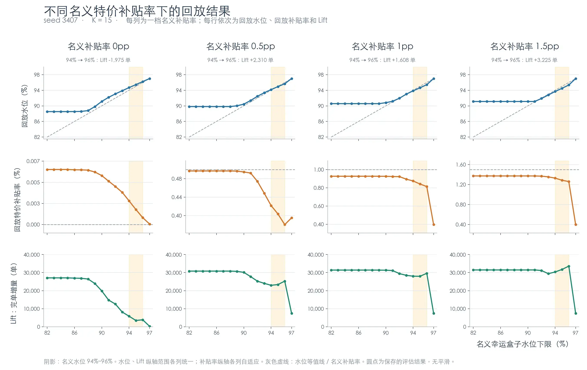 | 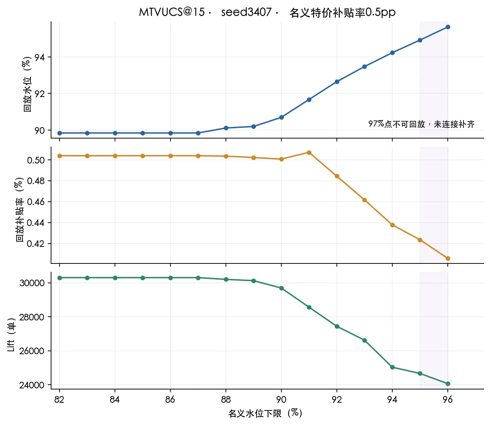 |

### 4.2 不同K的评估结果

基于同一BCR模型的3seed训练结果，对比了不同K下的指标波动。随K增加，匹配率增加，指标波动率下降。

最终选择VMT-VUCS@15、VMT-AUCC@5，两指标的波动均低于20%。

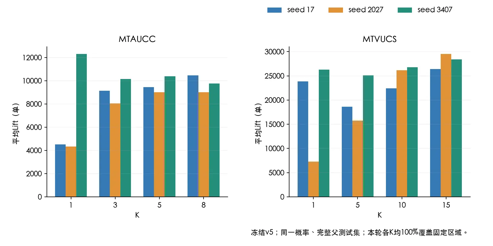

**（1）MT-AUCC：平均Lift（单）**

- 结论：最终选择K=5

| K | seed17 | seed2027 | seed3407 | 平均干预匹配率 | 三seed波动率 | 评估图 |
| --- | --- | --- | --- | --- | --- | --- |
| 1 | 4,521.64 | 4,340.35 | 12,311.30 | 2.92%～3.25% | 95.74% | 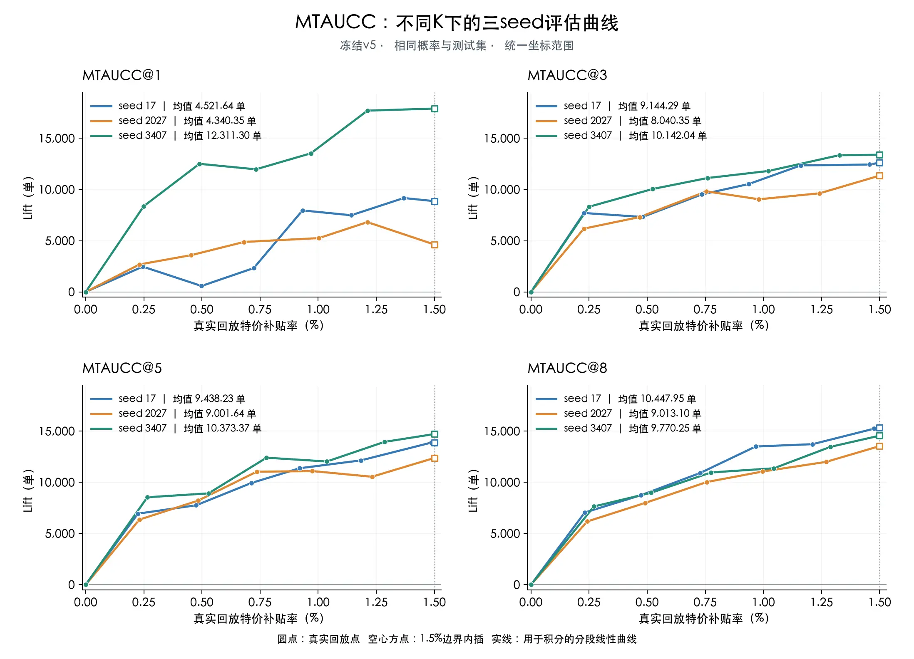 |
| 3 | 9,144.29 | 8,040.35 | 10,142.04 | 9.16%～9.70% | 23.12% |  |
| 5 | 9,438.23 | 9,001.64 | 10,373.37 | 15.49%～16.03% | 14.16% |  |
| 8 | 10,447.95 | 9,013.10 | 9,770.25 | 24.10%～24.65% | 14.75% |  |

**（2）MT-VUCS：平均Lift（单）**

- 结论：最终选择K=15

| K | seed17 | seed2027 | seed3407 | 平均干预匹配率 | 三seed波动率 | 评估图 |
| --- | --- | --- | --- | --- | --- | --- |
| 1 | 23,854.40 | 7,304.87 | 26,267.12 | 1.21%～1.38% | 112.96% |  |
| 5 | 18,627.32 | 15,731.76 | 25,073.12 | 6.52%～6.85% | 45.79% | 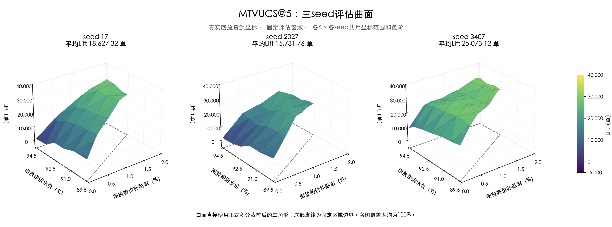 |
| 10 | 22,394.36 | 26,171.88 | 26,802.46 | 13.16%～13.54% | 17.92% | 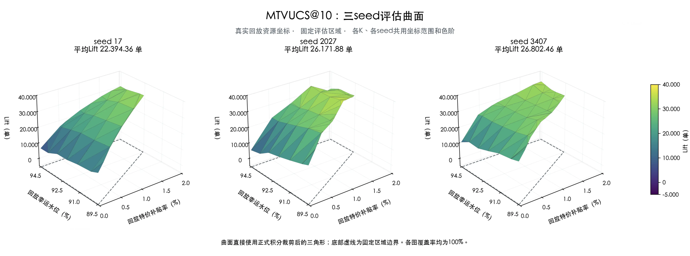 |
| 15 | 26,434.83 | 29,535.19 | 28,369.27 | 18.23%～18.62% | 11.08% | 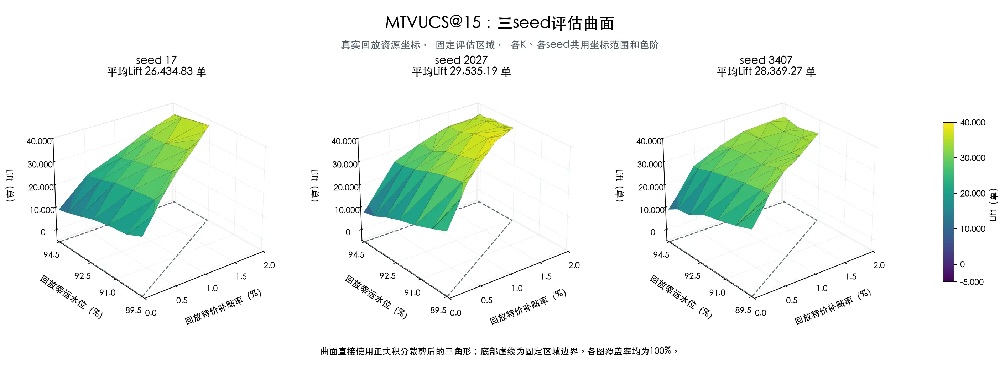 |

### 4.3 对比随机模型结果

固定VMT-AUCC@5、VMT-VUCS@15，比较3个训练seed与5个同结构、未训练的随机初始化模型。

结论： **三个训练模型均高于五个随机模型**，证明指标有效性

| 模型 | VMT-AUCC@5（单） | MTA UCC@5覆盖 | 图 | VMT-VUCS@15（单） | VMT-VUCS@15覆盖率 | 图 |
| --- | --- | --- | --- | --- | --- | --- |
| 训练seed17 | 9,438.23 | 100.00% | 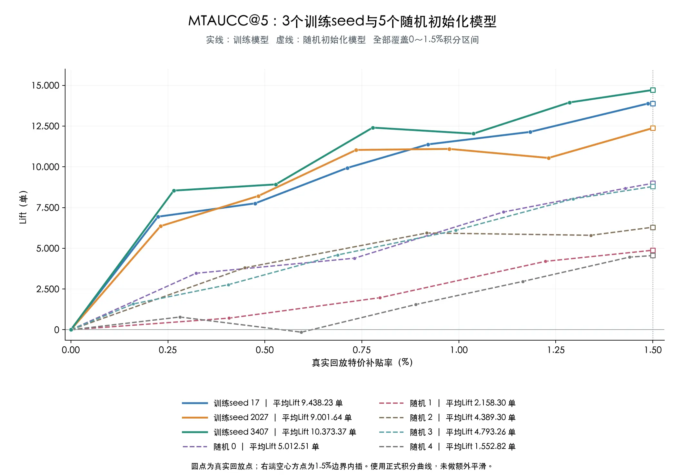 | 26,434.83 | 100.00% | 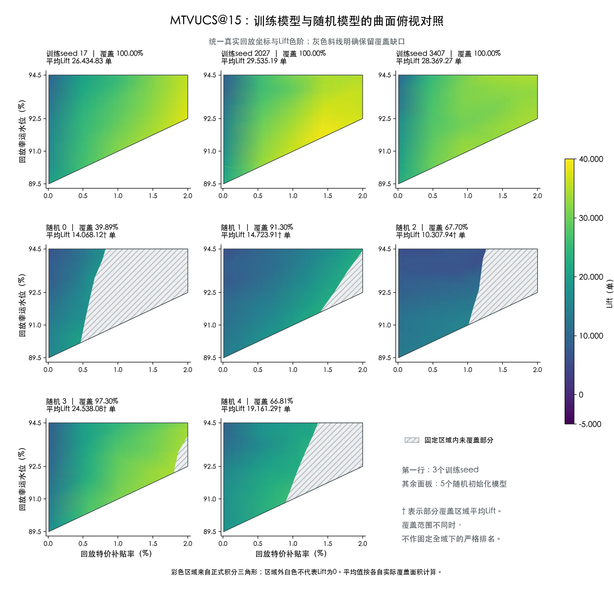 |
| 训练seed2027 | 9,001.64 | 100.00% |  | 29,535.19 | 100.00% |  |
| 训练seed3407 | 10,373.37 | 100.00% |  | 28,369.27 | 100.00% |  |
| 随机0 | 5,012.51 | 100.00% |  | 14,068.12† | 39.89% |  |
| 随机1 | 2,158.30 | 100.00% |  | 14,723.91† | 91.30% |  |
| 随机2 | 4,389.30 | 100.00% |  | 10,307.94† | 67.70% |  |
| 随机3 | 4,793.26 | 100.00% |  | 24,538.08† | 97.30% |  |
| 随机4 | 1,552.82 | 100.00% |  | 19,161.29† | 66.81% |  |

### 4.4 评估指标运行耗时

最终评估耗时为12分钟，低于约束中的30分钟。

| 范围 | 耗时 |
| --- | --- |
| 仅指标计算：求解、回放、积分，不含模型推理 | 12分钟 |
| 完整评估：包含一次冷推理及初始化、读写 | 19分钟 |

---

## 5 引用和鸣谢

引用

- [【BRD】平台补贴与流量联合决策 V4](https://cooper.didichuxing.com/knowledge/2199610335356/2208200715557)

- [平台联合决策 V4.0策略方案](https://cooper.didichuxing.com/knowledge/2199610335356/2208338685656)

- [平台联合决策V4评估指标-V1完整方案](https://cooper.didichuxing.com/knowledge/2199610335356/2210122436421)

- [RAS-AUCC：智能营销场景Uplift模型多Treatment评估指标改进](https://cooper.didichuxing.com/knowledge/share/page/XjpdgbO97Ltk#)

鸣谢

- 感谢之烁老师在评估指标体系搭建上的指导和在文档修改上的建议！

- 感谢吴铜在指标搭建上付出了超级多努力，包含初版评估指标搭建、指标波动归因、MT-VUCS@K评估指标！

- 感谢传赞在联合决策V4规划求解中的贡献！

- 感谢价格策略所有同学！

---

## 6 后续规划

- 基于VMT-VUCS@K、VMT-AUCC@K指标，进行模型迭代

- 上线模型迭代，回收在线实验结果，验证指标可用性

## 附A Top-K指标有效性证明

使用估计RCT分配概率得到的Top-K指标中，**只要模型A比B领先超过误差上限**$\overline B_{\mathrm{联合}}$，就能保证使用真实分配概率校正后的Top-1指标中，A仍然领先。

$$
\widetilde\Delta_K>\overline B_{\mathrm{联合}}
\quad\Longrightarrow\quad
\Delta_1^{\mathrm{true}}>0.
$$

详见：  从估计概率的Top-5评估推导真实概率的Top-1排序 [https://cooper.didichuxing.com/knowledge/2199610335356/2210121544434](https://cooper.didichuxing.com/knowledge/2199610335356/2210121544434)

---

## 附B BR-DC指标

BR-DC评估每个冒泡的Control折扣组合下，模型选择Top-K默勾，相比日志原有的随机默勾策略，能带来多少完单率提升，单位为pp

### 评估流程

1. **固定Control组**

对每个冒泡$i$，在完整可行决策集合$\mathcal J_i$中固定特价100折、选择最浅的可行幸运折扣$d_{l,i}^0$，得到Control组决策：

$$
d_{l,i}^0=\max\{d_{l,j}:j\in\mathcal J_i,d_{u,j}=1\},\qquad
C_i=\{j\in\mathcal J_i:d_{u,j}=1,d_{l,j}=d_{l,i}^0\}.
$$

2. **获取Top-K默勾决策**

在Control组决策内按预测BCR选择Top-K决策为$A_i=\operatorname{Top}_{K_i}(C_i;bcr_{ij}).$

其中，记Control组可行默勾数为$H_i=\lvert C_i\rvert$，$K_i=\min(K,H_i)$

3. **匹配并回放完单率提升**

模型侧使用Top-K决策，匹配RCT真实决策；随机侧，直接使用RCT真实决策，则匹配冒泡和逆概率权重为：

| 对比侧 | 实际进入回放的样本 | 命中样本的逆概率权重 |
| --- | --- | --- |
| 模型侧 | $\overline S_m=\{i\in S:j_i^{\mathrm{RCT}}\in A_i\}$，真实决策命中模型Top-K | $\omega_i^m=1/(K_i\rho_i)$ |
| 随机侧 | $S_{\mathrm{ctrl}}=\{i\in S:j_i^{\mathrm{RCT}}\in C_i\}$，真实决策落在Control组内 | $\omega_i^r=1/P_i^C$，其中$P_i^C=\sum_{j\in C_i}\widetilde p_i(j).$ |

模型侧和参考侧各自用权重和归一化，得到完单率提升为：

$$
\mathrm{BR}\text{-}\mathrm{DC}@K
=100\left(
\frac{\sum_{i\in\overline S_m}\omega_i^m y_i}{\sum_{i\in\overline S_m}\omega_i^m}
-
\frac{\sum_{i\in S_{\mathrm{ctrl}}}\omega_i^r y_i}{\sum_{i\in S_{\mathrm{ctrl}}}\omega_i^r}
\right)\quad\text{（pp）}.
$$

### 评估结果

**不同K下的波动**

基于同一BCR模型的3seed训练结果，对比了不同K下的指标波动：

- 三seed波动按最大值减最小值计算，单位为pp。

- K=1时三个seed存在正负方向分歧，K=3/5时均为正，最终选择K=5。

| K | seed17 | seed2027 | seed3407 | 模型命中数范围 | 模型命中率范围 | 三seed波动（极差，pp） |
| --- | --- | --- | --- | --- | --- | --- |
| 1 | +1.0236 | +1.8656 | -0.7220 | 21,276～24,376 | 1.31%～1.50% | 2.5875 |
| 3 | +0.4215 | +1.6204 | +0.3171 | 68,627～72,524 | 4.23%～4.47% | 1.3034 |
| 5 | +0.5037 | +0.8664 | +0.0959 | 116,367～119,855 | 7.18%～7.39% | 0.7706 |

**对比随机模型结果**

固定BR-DC@5，比较3个训练seed与5个同结构、未训练的随机初始化模型：

- BR-DC@5： 训练组均值+0.4887pp，随机组均值-0.3548pp。存在随机模型优于训练模型，该指标可信度较低。

| 模型 | BR-DC@5（pp） |
| --- | --- |
| 训练seed17 | +0.5037 |
| 训练seed2027 | +0.8664 |
| 训练seed3407 | +0.0959 |
| 随机0 | -0.6769 |
| 随机1 | -0.6926 |
| 随机2 | -0.3437 |
| 随机3 | -0.3110 |
| 随机4 | +0.2500 |
