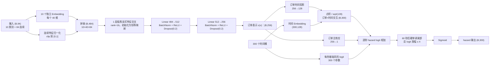

<!-- 请注意：文档内的附件与图片将在 2026/11/05 18:21:13  失效，请您在有效期内及时下载并保存至本地
Note: Attachments and images in the document will expire at 2026/11/05 18:21:13. Please download and save them locally within the valid period.-->

# CBA离散时间生存模型建模方法与模型结构

# CBA离散时间生存模型：建模方法与模型结构

> 代码基线：`/home/xiaoju/data9/hne/user_code/2/dongtingdong/designer/cba_model_1/pytorch_learning_08497`  
> 审阅日期：2026-09-22  
> 口径：本文以当前目录中的 `config.yaml`、`model.py`、`main.py`、`loss.py`、`eval_cba.py`、`feature_columns.txt` 为准。目录没有 Git 元数据，因此无法绑定 commit；后续代码变更时应同步更新本文。

## 1. 模型解决什么问题

模型预测订单发出后 0～300 秒内，乘客在司机应答前主动取消（CBA）的时间分布。它不是普通二分类模型，也不是当前文档早期方案中的 Cox 比例风险模型；实际训练入口 `main.py` 使用的是 `DiscreteTimeSurvivalModel`，直接输出 300 个一秒时间桶的条件取消风险。

对第 $$k$$ 秒，定义

$$q_k(x)=P(T\in(k,k+1]\mid T>k,x),\quad k=0,\ldots,299$$

其中：

- $$x$$：发单时可获得的订单、乘客、供需和历史行为特征；

- $$T$$：应答前取消时间，或司机应答造成的删失时间；

- $$q_k(x)$$：订单已经存活到第 $$k$$ 秒时，未来 1 秒内发生应答前取消的条件概率。

模型直接服务于流量分发、分单、PK、乘客引导等不同等待阶段。业务可以按当前已等待时长查询相应 hazard，也可以将多个相邻 hazard 合成为未来 3 秒、4 秒或更长窗口的取消概率。

## 2. 为什么使用生存分析

训练样本中存在系统性删失：

- 应答前乘客取消：可以观察到取消发生时间，记为事件 $$E=1$$；

- 司机先应答：只能知道在应答前乘客没有取消，无法知道如果继续等待会在何时取消，记为删失 $$E=0$$。

因此每个训练样本表示为

$$(x,T,E[,w])$$

- $$T$$：`wait_time`，取消或应答的观察时长；

- $$E$$：`event`，1 表示应答前取消，0 表示司机应答删失；

- $$w$$：可选样本权重。聚合样本可把 `ord_cnt` 作为第三个标签列。

当前示例启动配置使用 `--labelCols wait_time,event`，即一订单一行且不额外加权。训练表和验证表通过 `--trainInputs`、`--valInputs` 运行参数传入，不硬编码在模型中。

模型覆盖 0～300 秒。观察时长超过 300 秒的样本在训练时被管理性删失在 300 秒：保留前 300 个桶“尚未取消”的信息，但不会把 300 秒之后发生的取消误记到第 300 秒内。

## 3. 从 hazard 到业务所需概率

模型输出条件 hazard 后，生存概率与累计取消概率为

$$S_m(x)=P(T>m\mid x)=\prod_{k=0}^{m-1}(1-q_k(x))$$

$$F_m(x)=P(T\le m\mid x)=1-S_m(x)$$

订单已经等待 $$t$$ 秒时，未来 $$\Delta$$ 秒内的条件取消概率为

$$P(T\in(t,t+\Delta]\mid T>t,x) =1-\frac{S_{t+\Delta}(x)}{S_t(x)} =1-\prod_{r=t}^{t+\Delta-1}(1-q_r(x))$$

例如：

$$p_3(t)=1-\prod_{r=t}^{t+2}(1-q_r),\qquad p_4(t)=1-\prod_{r=t}^{t+3}(1-q_r)$$

代码在 log-survival 空间累计 $$\log(1-q_k)$$，避免 300 个概率连乘产生数值下溢；非整数查询时刻在 log-survival 空间做桶内线性插值。

## 4. 输入特征与预处理

### 4.1 输入契约

输入张量 shape 为 $$(B,94)$$，固定由 10 个类别特征和 84 个连续特征组成。字段名称和顺序必须严格等于：

$$\texttt{data.col\_sparse}+\texttt{data.col\_dense}$$

`main.py` 和 `eval_cba.py` 在读数据前执行名称、数量与顺序校验；任一错位都会直接报错。这一点很重要，因为模型按列位置解释特征。

### 4.2 类别特征

类别值只有同时满足“有限、整数、位于配置区间 $$[min,max)$$”才有效。有效值映射为 $$\text{index}=value-min+1$$，索引 0 专门作为 OOV。越界值、小数、NaN 和正负无穷都映射到 OOV，不做取模。

| 顺序   | 特征   | 有效配置区间   | Embedding 行数   |
| --- | --- | --- | ---: |
| 1   | pas_days_since_last_call   | \[0, 360)   | 361   |
| 2   | pas_is_dormant_28d   | \[0, 4)   | 5   |
| 3   | pas_has_history_180d   | \[0, 4)   | 5   |
| 4   | city   | \[0, 730)   | 731   |
| 5   | call_hour   | \[0, 48)   | 49   |
| 6   | dm_user_base_oneid_info_age   | \[0, 216)   | 217   |
| 7   | dm_user_base_oneid_info_gender_int   | \[-1, 4)   | 6   |
| 8   | dm_user_behv_netcar_htpp_is_student_int   | \[0, 4)   | 5   |
| 9   | dm_user_behv_netcar_htpp_vzt_city_num   | \[0, 134)   | 135   |
| 10   | dm_user_behv_netcar_htpp_car_is_churn_int   | \[0, 6)   | 7   |

每个类别字段独立使用 40 维 Embedding，拼接后得到 $$10\times40=400$$ 维表示。表中的区间是代码允许范围，不等价于业务上每个取值都一定出现。

### 4.3 连续特征

84 个连续特征在模型内部逐列归一化：

$$x'_j=\operatorname{clip}\left( \frac{x_j-base_j}{upper_j-base_j},0,1 \right)$$

`config.yaml` 中字段名为 `base_numeric` 和 `scale_numeric`，但 `scale_numeric` 实际含义是上界 $$upper$$，不是直接相除的 scale。

- NaN 使用该列的 $$base_j$$ 填充，因此归一化后为 0；

- 正无穷截断为 1，负无穷截断为 0；

- 当 $$upper_j-base_j<10^{-6}$$ 时分母改为 1；

- 上界低于下界，或统计量不是有限值时，模型拒绝初始化；

- `-999` 等有限业务哨兵不会被特殊改写，仍按配置上下界归一化。

连续特征的精确顺序如下：

1. 时间、空间、行程和实时供需（14 个）：`hour_sin`、`hour_cos`、`flat`、`flng`、`tlng`、`tlat`、`start_dest_distance`、`est_start_dest_dur`、`coord_last_5min_start_1circle_incl_center_hxz_hh_api_order_finish_cnt_kf`、`coord_last_5min_start_1circle_incl_center_hxz_hh_api_order_strive_cnt_kf`、`coord_last_5min_start_1circle_incl_center_hxz_hh_api_order_create_cnt_kf`、`coord_hxz_hh_realtime_active_driver_cnt_1circle_incl_center`、`coord_hxz_hh_realtime_idle_driver_cnt_1circle_incl_center`、`bucketize_dm_user_base_oneid_info_age`。

2. 乘客画像、出行偏好和累计行为（26 个）：`dm_user_mkt_netcar_ordacc_jie_last_second_call_day`、`dm_user_mkt_netcar_ordacc_jie_route_point_max_cnt`、`dm_user_mkt_netcar_ordacc_jie_point_distibute_max`、`dm_user_base_oneid_info_car_prob`、`dm_user_vzt_pub_rfmpeat_kflw_r`、`dm_user_vzt_pub_rfmpeat_kflw_f`、`dm_user_vzt_pub_rfmpeat_kflw_p`、`dm_user_vzt_pub_rfmpeat_kflw_a`、`dm_user_vzt_pub_rfmpeat_kflw_t`、`dm_user_mkt_netcar_ordacc_jie_call_decay`、`dm_user_mkt_netcar_ordacc_jie_finish_order_ratio`、`dm_user_mkt_netcar_ordacc_jie_real_time_driver_wait_get_on_time_mean`、`dm_user_mkt_netcar_ordacc_jie_real_time_order_charge_dis_sub_mean`、`dm_user_mkt_netcar_ordacc_jie_real_time_start_distance_mean`、`dm_user_mkt_netcar_ordacc_jie_real_time_end_distance_mean`、`dm_user_mkt_netcar_ordacc_jie_real_time_answer_dur_mean`、`dm_user_mkt_netcar_ordacc_jie_point_distibute_max_ratio`、`dm_user_mkt_netcar_ordacc_jie_call_week_order_cnt_mean`、`dm_user_mkt_netcar_ordacc_jie_interval_week_mean`、`dm_user_behv_netcar_htpp_business_prob`、`dm_user_behv_netcar_htpp_travel_prob`、`dm_user_behv_netcar_htpp_education`、`dm_user_behv_netcar_htpp_large_hub`、`dm_user_behv_netcar_htpp_business_trip`、`dm_user_behv_netcar_htpp_life_service`、`dm_user_behv_netcar_htpp_medical_treatment`。

3. 近 1/3/7/14/28 天 CBA 与应答历史（20 个）：每个窗口依次包含 `pas_cba_cnt_*d`、`pas_call_cnt_*d`、`pas_cba_cancel_dur(_avg)_*d`、`pas_answer_dur(_avg)_*d`。精确列名以 `feature_columns.txt` 为准，其中 1 天列带 `avg`，3/7/14/28 天部分列名不带 `avg`。

4. 自营与三方履约历史（16 个）：自营和三方各包含 7/14/28 天应答后乘客取消数、14/28 天应答后乘客取消率、14/28 天完单率、28 天平均起终点距离。

5. 长周期历史（8 个）：`pas_call_cnt_90d`、`pas_cba_cnt_90d`、`pas_cba_cancel_dur_avg_90d`、`pas_answer_dur_avg_90d`、`pas_call_cnt_180d`、`pas_cba_cnt_180d`、`pas_answer_dur_avg_180d`、`pas_cba_cancel_dur_avg_180d`。

各特征的业务语义可结合知识库中的 [CBA模型特征](https://cooper.didichuxing.com/knowledge/2199610335356/2209647178947) 查看；模型接口的最终准绳仍是当前仓库的 `config.yaml` 与 `feature_columns.txt`。

## 5. 模型结构

### 5.1 总体结构

### 5.2 低秩显式特征交叉

拼接后的 484 维输入先经过一层 rank=16 的低秩交叉层：

$$x_1=x_0+x_0\odot U(Vx_0)+b$$

其中 $$V:484\rightarrow16$$，$$U:16\rightarrow484$$。$$U$$ 和 $$b$$ 初始化为 0，所以训练开始时该层严格等于恒等映射；第一步反向传播时先更新 $$U$$，此时 $$V$$ 的梯度会因 $$U=0$$ 而为 0，随后两者共同学习类别、数值、供需与历史行为之间的显式乘性交互。

### 5.3 订单编码器

交叉后的 484 维特征经过两层 MLP：

$$484\rightarrow512\rightarrow256$$

每层 Linear 后均使用 BatchNorm、ReLU 和 Dropout(0.2)，输出 256 维订单表示 $$z(x)$$。

### 5.4 订单与时间的交互

每个一秒时间桶有一个 128 维可学习向量 $$e_k$$。订单表示投影为

$$p(x)=W_pz(x)\in\mathbb{R}^{128}$$

第 $$k$$ 个时间桶在施加单调尾部前的原始 logit 为

$$\ell_k^{raw}(x) =a(x)+b_k+\frac{p(x)^\top e_k}{\sqrt{128}}$$

- $$a(x)$$：订单主效应，由 $$256\rightarrow1$$ 线性层生成；

- $$b_k$$：第 $$k$$ 秒的全局基础风险 logit，共 300 个；全部初始化为 -5.1，对应基础单秒 hazard 约为 0.61%（完整初始输出还会叠加随机初始化的订单主效应与时间交互）；

- $$p(x)^\top e_k/\sqrt{128}$$：订单与等待时间的低秩交互，使同一订单的风险形状可以随时间变化。

这比 Cox 比例风险模型更灵活：模型没有强制不同订单之间的风险比随时间保持不变。

这里虽然使用了缩放点积，但不是 Attention：没有 query/key/value 聚合，也没有对时间桶做 attention softmax；它是订单表示与全部时间 Embedding 的低秩双线性交互。

### 5.5 60 秒后的硬单调风险头

配置 `MONOTONIC_START_SECOND=60`。代码保留 `hazard[0:60]` 自由变化，从 `hazard[60]`（对应 $$(60,61]$$ 秒）开始，强制条件 hazard logit 单调不减：

1. 以原始 $$\ell_{60}^{raw}$$ 作为尾部起点；

2. 将后续 239 个原始 logit 做 softmax，得到非负且和为 1 的涨幅分配；

3. 用累积和把总涨幅分配到 61～299 秒；

4. 每个订单的总涨幅为 $$4\cdot sigmoid(w^\top z+c)$$，因此位于 (0,4)。

该结构保证 60 秒后的 hazard 不下降，同时把 60～300 秒的总 logit 上涨限制在 4 以内，避免尾部概率无界饱和。控制层权重初始化为 0、偏置为 -6，因此初始总涨幅约为 $$4\cdot sigmoid(-6)\approx0.0099$$，模型从近似水平的尾部开始学习。第 59 秒到第 60 秒之间不受该约束。

### 5.6 当前启用与关闭的结构

| 结构   | 当前状态   | 配置   |
| --- | --- | --- |
| 低秩特征交叉   | 启用   | 1 层，rank=16   |
| 订单时间投影 gate   | 关闭   | 配置未启用   |
| 相邻时间 logit diffusion   | 关闭   | `TIME_LOGIT_DIFFUSION_ENABLED=false`   |
| 60 秒后硬单调尾部   | 启用   | 起点 60 秒，最大 logit 涨幅 4   |
| 旧 `DeepSurfModel`   | 未使用   | 训练入口不实例化   |

### 5.7 参数规模

| 模块   | 可训练参数量   |
| --- | ---: |
| 10 个类别 Embedding   | 60,840   |
| rank-16 特征交叉层   | 15,972   |
| 484→512→256 特征编码器（含 BN）   | 381,184   |
| 300×128 时间 Embedding   | 38,400   |
| 256→128 订单时间投影   | 32,896   |
| 订单主效应   | 257   |
| 300 个时间基础 logit   | 300   |
| 单调尾部总涨幅控制层   | 257   |
| 合计   | **530,106**   |

当前 `model.pt` 的 key 和 tensor shape 与上述结构一致；文件约 2.1 MB。state_dict 连同 BatchNorm 运行统计和归一化 buffer 共包含 531,812 个标量。

## 6. 损失函数

### 6.1 当前实际优化目标

当前 `config.yaml` 中三个辅助损失权重全部为 0，因此实际训练目标只有删失感知的离散时间生存负对数似然：

$$L=L_{survival\_NLL}$$

对事件样本，设事件落入第 $$b$$ 个桶：

$$L_i=-\sum_{k<b}\log(1-q_{ik})-\log q_{ib}$$

即事件前各完整时间桶贡献“存活”，事件桶贡献“取消”。

对删失样本：

$$L_i=-\sum_{edge_k\le T_i}\log(1-q_{ik})$$

只使用删失前已经完整观察的桶；若应答恰好发生在桶右边界，该桶可以确认未取消，因此计入存活损失。实现直接对 logits 使用 `softplus`，与稳定的 `BCEWithLogitsLoss` 等价。若存在样本权重，则按权重加权平均。

### 6.2 代码支持但当前未启用的辅助损失

| 辅助损失   | 作用   | 当前权重   |
| --- | --- | ---: |
| horizon pairwise rank   | 在 60/120/300 秒比较可观测 case-control 的累计风险，优化 time-AUC   | 0   |
| censoring-aware CDF anchor NLL   | 在 60/120/300 秒约束可观测样本的累计取消概率   | 0   |
| monotonic hazard soft penalty   | 惩罚相邻 hazard logit 下降   | 0   |

代码中的 Cox loss 与旧 `DeepSurfModel` 为遗留实现，不在当前训练链路中。旧知识库页面曾描述“离散 NLL + 排序 + CDF anchor”的组合损失；这不是当前 `config.yaml` 的实际配置。

## 7. 训练流程与超参数

训练入口为 `main.py`，流程如下：

1. 读取 YAML 并校验 300 个时间桶右边界严格递增；

2. 校验 94 个特征的名称、数量和顺序；

3. 用 DMLite `IterableTabularDataset` / `IterableTabularDataLoader` 流式读取训练表与验证表；

4. 前向计算 300 个 hazard logits；

5. 计算离散生存 NLL，反向传播，并检查全局梯度范数、零梯度比例和非有限梯度；

6. 完成验证、全量离线指标计算；

7. 保存 PyTorch state_dict，并导出 DMLite/ONNX 在线模型。

当前关键配置：

| 配置   | 当前值   |
| --- | --- |
| epoch   | 1   |
| 训练 batch size   | 10,240   |
| 验证 batch size   | 10,240   |
| DataLoader workers   | 0   |
| 训练 shuffle   | 开启，`shuffle_level=3`   |
| 优化器   | Adam   |
| 学习率   | 0.001，可被 `--lr` 覆盖   |
| 数值精度   | FP32   |
| 随机种子   | 未固定   |
| 学习率调度   | 无   |
| 梯度裁剪   | 无   |
| 早停   | 无   |

设备选择由 `torch.cuda.is_available()` 决定：有 CUDA 时使用 GPU，否则使用 CPU。虽然 YAML 中保留 accelerator/devices/strategy 等字段，当前手写训练循环并不通过 Lightning Trainer 消费这些配置。

同样，优化器实际固定为 Adam，`trainer_config.optimizer/optimizer_kwargs` 不驱动实现；训练/验证 shuffle、每轮验证和每 500 step 日志也由代码直接决定，并不读取 YAML 中同名的调度开关。当前循环没有 weight decay、混合精度、学习率 scheduler、梯度裁剪、best-checkpoint 或早停。验证 loss 只用于打印，所有 epoch 完成后保存最终 state_dict，且不保存 optimizer 状态。

`--modelInputs` 非空时可以先加载已有权重继续训练。但当前特征编码与 Embedding 规模已经调整为 10+84，旧特征版本 checkpoint 不应直接加载。

## 8. 评估方法

### 8.1 训练结束后的基础评估

`main.py` 对完整验证集执行两遍扫描：

- 第一遍收集 $$T,E,w$$，把司机应答视为删失事件，估计删失生存函数 $$G(t)$$；

- 第二遍按 batch 推理并流式累积指标，不保存 $$N\times300$$ 的完整预测矩阵。

代码计算：

- 可观测样本加权 AUC@1/3/6/10/20/30/40/50/60/120/300 秒；正样本为时点前取消，负样本为存活超过时点，时点前已应答删失的样本被排除，因此它不是 IPCW time-dependent AUC；

- 一秒条件取消概率的 IPCW Brier；

- 0～10、10～30、30～60、60～120、120～300 秒分段 Brier；

- 预测均值、IPCW 实际率、决策机会数、删失机会数和有效样本量。

### 8.2 可选精细评估

启动参数包含 `--detailedEval` 时，导出模型后再执行逐秒评估，并输出：

- 每秒预测均值与 IPCW 实际率；

- 每秒模型 Brier、固定基线 Brier 与 Brier Skill Score；

- AUC、PR-AUC、PR-AUC lift；

- Top 1%/5%/10% lift 与 recall；

- `one_second_detailed_metrics.csv`；

- `one_second_detailed_summary.json`；

- 值准与序准曲线 PNG。

排序指标使用 4,096 个 logit 直方图区间近似，避免存储数亿条“订单×存活秒”记录；代码字段 `pr_auc` 实际按直方图计算 weighted average precision。Brier 使用精确流式累加，一秒窗口 IPCW 对删失生存概率使用 0.02 下限，普通 IBS 使用 $$10^{-6}$$ 下限。

`eval_cba.py` 还支持业务窗口 $$(0,60]$$、$$(10,15]$$、$$(60,65]$$、$$(120,150]$$ 的条件取消概率检查、0～60 秒十分位校准、IPCW Integrated Brier Score，以及 30/60/120/300 秒 Brier。

## 9. 在线模型接口

导出时用 `OnlineModel` 包装训练模型：

- 输入：float tensor，shape $$(B,94)$$，字段顺序必须与 `feature_columns.txt` 完全一致；

- 输出名：`hazard`；

- 输出 shape：$$(B,300)$$；

- 输出值：已经过 sigmoid 的逐秒条件取消概率；

- ONNX 动态维：batch 维可变；

- 特征预处理在模型内部，因此 PyTorch 训练、离线评估和 ONNX 推理共用同一路径。

在线消费方不能把第 $$k$$ 列理解为“截至第 $$k$$ 秒的累计取消率”。它是订单已存活到该秒时的下一秒条件风险。累计概率与多秒窗口概率必须按第 3 节公式组合。

目录中的 `predict.py` 是遗留 TensorFlow 二分类示例，输出逻辑与当前 PyTorch/ONNX 生存模型不匹配，不应作为本模型的推理入口。

## 10. 代码与配置的一致性保护

当前实现包含以下防错机制：

- 强校验 `E_NUM=10`、`C_NUM=84` 与列表长度；

- 强校验传入特征名和顺序；

- 类别特征为异常值预留独立 OOV；

- 连续上下界、时间桶、损失配置进行合法性检查；

- loss 或梯度出现 NaN/Inf 时立即终止；

- 训练模型输出 logits，只有预测接口做 sigmoid，保证损失数值稳定；

- 生存概率在 log 空间累计；

- 训练代码设计为分别保存 PyTorch checkpoint 与在线 ONNX；

- 当前 checkpoint 的 tensor shape 已与配置和结构核对一致。

仓库自带的 `feature_validation.log` 记录了 5 项测试通过：schema/order、类别边界与异常值、连续归一化与 NaN/Inf、前后向及权重重载、临时 ONNX 动态 batch 1/5 一致性。需要注意，该测试使用随机初始化模型，临时 ONNX 随后被删除，且日志中的 tracer 路径指向另一个目录 `pytorch_learning_99341`；它没有验证当前 `model.pt` 或 DMLite 最终导出包。`onnx_validation.log` 只有 Hive 元数据访问记录，没有 ONNX checker、数值一致性结果或 PASS 标记。因此发布前仍应在 `pytorch_learning_08497` 环境重新执行测试，并对最终导出物做端到端数值校验。

## 11. 关键假设与已知限制

1. **最多建模 300 秒。** 300 秒后的取消只作为 300 秒管理性删失信息使用，模型不能外推 300 秒后的概率。

2. **60 秒后 hazard 被强制不下降。** 这是结构假设，适合抑制尾部波动，但必须通过分时段 Brier、校准曲线和业务窗口指标验证是否符合真实数据。

3. **当前只训练 1 个 epoch。** 没有早停和学习率调度，需结合训练/验证 loss 与离线指标判断是否欠拟合。

4. **辅助排序与 CDF 校准损失当前均关闭。** 当前模型完全依靠 proper survival NLL 学习；如果重新开启辅助项，文档与实验标识必须同步更新。

5. **特征统计量不是在本目录重新估计。** `FEATURE_PROCESSING.md` 说明当前 10+84 特征及上下界同步自另一版本；上线前需确认与目标样本分布、线上特征口径一致。

6. **冷启动依赖显式状态特征和默认值。** `pas_is_dormant_28d`、`pas_has_history_180d` 等用于区分长期未发单乘客，但默认值和有限哨兵仍需要数据链路保证语义一致。

7. **仓库没有 Git 元数据。** 无法从该目录确认变更历史和 commit，发布物应额外记录代码快照、配置、特征顺序、checkpoint 校验和与数据分区。

8. **独立评估脚本默认解析** `**run.sh**`**，但当前目录清单中没有该文件。** 单独运行 `eval_cba.py` 前需要提供包含正确表名、特征列和标签列的运行脚本。

9. **时间桶数量在多处固定为 300。** `TIME_BIN_EDGES` 用于训练和评估解释桶语义，在线导出 shape 也硬编码为 300；不能只修改 `N_TIME_BINS` 而不联动修改配置、评估和导出协议。

10. **BatchNorm 要求正确区分训练态和推理态。** 训练态 batch size 为 1 时 BatchNorm 无法正常工作；验证、在线包装和 ONNX 导出必须保持 `eval()`，当前代码已这样处理。

11. **当前目录不等于完整发布包。** 只发现约 2.1 MB 的 `model.pt`，没有持久化 `.onnx`、DMLite `output` 目录、评估 CSV/JSON/PNG 或可直接复现的 `run.sh`。`model.pt` 已与当前结构 strict-load 匹配，但最终上线仍需重新导出并验证完整服务产物。

## 12. 当前版本与旧文档的主要差异

| 项目   | 当前仓库事实   | 旧页面中可能看到的描述   |
| --- | --- | --- |
| 建模方法   | 300 桶离散时间生存模型   | Cox 比例风险或单风险分数   |
| 输入特征   | 10 类别 + 84 连续，共 94   | 5+71、7+75 或共 76   |
| 拼接维度   | 484   | 271 等旧维度   |
| 时间 Embedding   | 128 维   | 32 维   |
| 显式特征交叉   | 1 层 rank-16   | 未包含   |
| 60 秒后形状   | hard monotonic tail   | 无约束、diffusion 或软约束   |
| 实际损失   | 仅离散生存 NLL   | NLL + rank + CDF anchor   |
| 在线输出   | 300 个逐秒条件 hazard   | 单一风险分数或累计概率   |

后续排查、实验和上线评审应先锁定代码目录、`config.yaml`、`feature_columns.txt` 和 checkpoint，再引用对应版本的离线结果，避免把不同结构的实验结论混用。