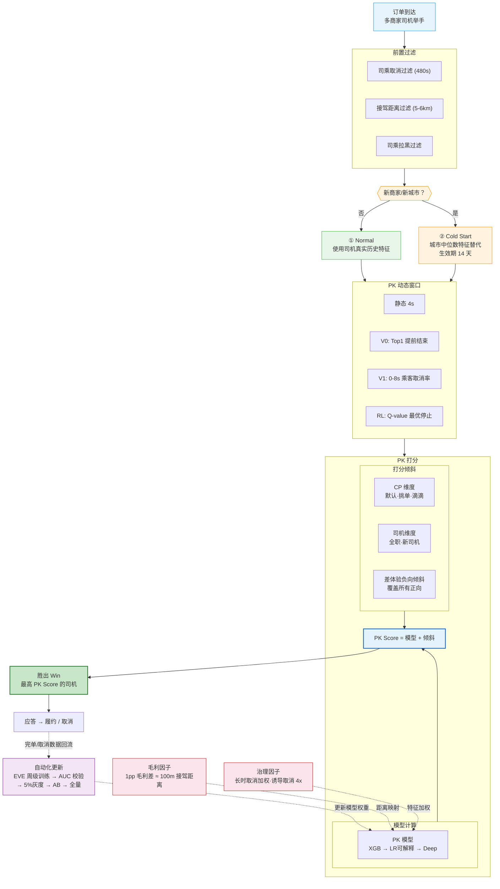

# PK 决策系统模块流程图

## 模块流水线

## 模块说明

| 模块 | Entity 页 | 作用 |
|---|---|---|
| **PK 模型** | [[wiki/entities/PK模型.md]] | 预测司乘组合的胜出完单概率 |
| **PK 动态窗口** | [[wiki/entities/PK窗口.md]] | 控制收集举手司机的时间，权衡等待与匹配质量 |
| **倾斜策略** | [[wiki/entities/倾斜策略.md]] | 在模型分之上叠加业务调整分 |
| **冷启动** | [[wiki/entities/冷启动系统.md]] | 新商家/新城市的特征替代方案 |
| **毛利因子** | [[wiki/entities/毛利因子.md]] | 将毛利率差异映射到接驾距离特征 |
| **治理因子** | [[wiki/entities/治理因子.md]] | 对长时取消/诱导取消司机加权惩罚 |
| **自动化更新** | [[wiki/entities/自动化更新机制.md]] | 模型权重的周级自动迭代 |

## 核心公式

> **PK Score = PK 模型打分 + 倾斜分**

其中：
- **PK 模型打分** = f(订单特征, 司机特征, 乘客特征, 供需特征)
  - 司机特征受**冷启动**（特征替代）和**治理因子**（取消加权）影响
  - 订单特征受**毛利因子**（距离映射）影响
- **倾斜分** = CP 倾斜 + 司机倾斜（差体验负向倾斜可覆盖全部正向）

## 各节点来源依据

> 下表列出流程图中每个节点所对应的 `raw/` 源文档。两个全局性文档几乎覆盖所有节点：`raw/00. 聚合决策串讲 .md`（架构串讲）和 `raw/PK相关文档索引.md`（策略索引），下方不再逐条重复，仅列出各节点的**专项来源**。

| 节点                                   | 主要来源文档                                                                                                                                                                                      |
| ------------------------------------ | ------------------------------------------------------------------------------------------------------------------------------------------------------------------------------------------- |
| **订单到达 / 多商家司机举手**                   | `raw/00. 聚合决策串讲 .md` §2.2 聚合PK交互图、§2.3.2 决策方式（同步/异步举手、多商家参与）                                                                                                                                |
| **司乘取消过滤 (480s)**                    | `raw/00. 聚合决策串讲 .md` §2.3.1 前置过滤表（司乘480s取消过滤，开关 `kflower_pk_open_api_filter_config`）                                                                                                        |
| **接驾距离过滤 (5-6km)**                   | `raw/00. 聚合决策串讲 .md` §2.3.1 前置过滤表（滴滴系不限/宏鹄花小猪6km/其他5km，开关 `kflower_grab_order_open_api_pk_distance_config`）                                                                                 |
| **司乘拉黑过滤**                           | `raw/00. 聚合决策串讲 .md` §2.3.1 前置过滤表                                                                                                                                                           |
| **新商家/新城市判断**                        | `raw/00. 聚合决策串讲 .md` §2.3.3 模型冷启动；`raw/07.冷启动/冷启动配置自动化策略方案.md`（城市商家判断逻辑、14天生效期）                                                                                                             |
| **Normal — 司机真实历史特征**                | `raw/03. PK可解释模型/PK司机历史特征重新建设.md`；`raw/03. PK可解释模型/【2024】PK可解释模型特征工程.md`；`raw/PBD - PK模型.md`（XGB 完整特征列表 `true_kflower_total_*`）                                                             |
| **Cold Start — 城市中位数特征替代 14天**       | `raw/07.冷启动/冷启动配置自动化策略方案.md`（"非替换特征的中位数"、14天规则）；`raw/05. 宏鹄冷启动/宏鹄出租车冷启动配置自动化.md`；`raw/00. 聚合决策串讲 .md` §2.3.3 冷启动表                                                                           |
| **静态 4s**                            | `raw/02. PK动态窗口策略/PK静态窗口时间片实验评估.md`；`raw/02. PK动态窗口策略/实验平台支持PK固定窗口的配置.md`                                                                                                                   |
| **V0: Top1 提前结束**                    | `raw/02. PK动态窗口策略/PK动态窗口策略V0.md`（胜出概率 > 0.95 提前结束）；`raw/02. PK动态窗口策略/PK动态窗口策略V0之线上分析.md`                                                                                                    |
| **V1: 0-8s 乘客取消率**                   | `raw/02. PK动态窗口策略/PK动态窗口策略V1之策略方案.md`（取消率 < 0.09 提前结束 / > 0.45 延长至 8s）；`raw/02. PK动态窗口策略/PK动态窗口策略V1之阈值选择.md`                                                                                |
| **RL: Q-value 最优停止**                 | `raw/02. PK动态窗口策略/PK动态窗口策略RL之策略方案.md`；`raw/02. PK动态窗口策略/PK动态窗口策略之强化学习方案.md`（等待价值设计与学习）                                                                                                      |
| **PK 模型 (XGB → LR → Deep)**          | `raw/PBD - PK模型.md`（XGB 模型规格）；`raw/03. PK可解释模型/【2024】PK可解释模型建设.md`（LR 建设）；`raw/03. PK可解释模型/【2024】PK可解释模型迭代版本汇总.md`（XGB→LR 版本演进）；`raw/03. PK可解释模型/PK可解释模型结构升级方案/PK可解释模型结构升级方案.md`（Wide&Deep） |
| **打分倾斜 (CP/司机/差体验)**                 | `raw/00. 聚合决策串讲 .md` §2.3.3 打分倾斜表（CP维度：默认/挑单/滴滴；司机维度：全职/新司机/差体验负向）                                                                                                                          |
| **PK Score = 模型 + 倾斜**               | `raw/00. 聚合决策串讲 .md` §2.3.3 价值计算："PK分数 = 模型计算 + 打分倾斜"                                                                                                                                       |
| **毛利因子**                             | `raw/04. PK引入因子/PK引入毛利因子/PK引入毛利因子.md`（策略设计）；`raw/04. PK引入因子/PK引入毛利因子/【2024】PK引入毛利因子模拟.md`（1pp ≈ 100m 映射）；`raw/06. 技术需求/PK引入毛利因子/PK引入毛利因子.md`（技术需求）                                          |
| **治理因子**                             | `raw/04. PK引入因子/PK引入司机长时取消因子/PK引入司机长时取消因子策略方案.md`（长时取消加权）；`raw/04. PK引入因子/PK引入司机长时取消因子/PK引入司机长时取消因子三期评估.md`（诱导取消 4x）；`raw/PK相关文档索引.md` §PK引入治理因子                                            |
| **胜出 Win → 应答 → 履约/取消**              | `raw/00. 聚合决策串讲 .md` §2.3.5 订单状态机、§2.3.6 胜者池                                                                                                                                                |
| **自动化更新 (EVE → AUC → 灰度 → AB → 全量)** | `raw/06. 技术需求/PK模型自动化更新机制/PK模型自动化更新机制.md`（完整流水线：每周二EVE调度 → AUC约束 → 5%小流量 → AB → 推全）；`raw/06. 技术需求/PK模型自动化更新机制/PK模型自动化更新实验配置（2026）.md`                                                       |
