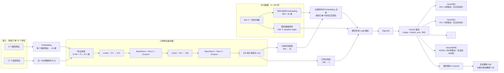

# cba模型-离线结果2


## 样本空间

呼叫订单

标签：

## 特征

冷启动问题：对于乘客特征，如何处理长期未发单的乘客？

28天内未发单的乘客占比：16% (2026-08-27发单，但是0827前28天未发单）

180天内未发单的乘客占比： 5%（2026-08-28发单，但是0828前180天未发单）

\-- 用 p_has_history_180d = 0 标识（无180d发单的乘客填充默认值0，有发单乘客值为1）

```PlainText
-- 呼单乘客
select
    count(a.base_passenger_id) cnt1,
    count(b.passenger_id) cnt2,
    count(c.passenger_id) cnt3
from
    (
        select
            distinct param ['passenger_id'] passenger_id,
            param ['base_passenger_id'] base_passenger_id,
            param ['order_origin'] order_origin
        from
            kflower_marketplace.ods_log_kflower_stgmatrix_hh
        where
            concat_ws('-', year, month, day) = '2026-08-28'
            and param ['order_origin'] = 3
    ) a
    left join (
        select
            distinct passenger_id
        from
            kflower_strategy.pas_cba_history
        where
            dt = '2026-08-27'
    ) b on a.base_passenger_id = b.passenger_id
    left join(
        select 
            distinct passenger_id 
        from kflower_strategy.pas_cba_long_term_state
        where dt = '2026-08-27'
    )c on a.base_passenger_id = c.passenger_id
```

## 模型结构

当前模型是共享参数的 300 个条件二分类 hazard 头；这些 hazard 联合定义了一个“取消发生在哪一秒或 300 秒内不取消”的完整多分类概率分布。



每秒取消风险 Logit = 订单主效应 + 每秒基础风险 + 订单特征 × 时间桶交互风险

### 损失函数

$$L = L_{discrete\_NLL} + 0.10 · L_{time\_rank} + 0.05 · L_{CDF\_anchor}$$

**删失感知的离散生存 NLL**

这是主损失：

\- 取消样本在事件桶之前贡献“存活”损失，在事件桶贡献“取消”损失；

\- 删失样本只对删失前已经完整观察的桶贡献“存活”损失；

\- 若删失恰好发生在桶右边界，该桶可确认存活，因此进入损失；

\- 支持逐样本权重。

**time-rank 辅助损失（排序）**

在 60、120、300 秒三个 horizon 上，比较可观测 case 与 control 的累计风险，使用有界 pairwise logistic loss 提升 time-AUC：

\- case：在 horizon 之前或恰好于 horizon 取消；

\- control：观察时长超过 horizon；

\- 每个 horizon 最多 4096 对；

\- 60/120 秒使用一对一匹配采样；

\- 300 秒从合法 case-control 笛卡尔积中做有界均衡采样；

\- 当前 \`ipcw_pairwise=false\`，该辅助项没有使用 IPCW。

**CDF-anchor 辅助损失（校准）**

在 60、120、300 秒直接约束累计取消概率 \`F(t|x)\`：

\- horizon 前已取消的是正样本；

\- 观察超过 horizon 的是负样本；

\- horizon 前已应答删失的样本不可判定，因此排除；

\- 三个 anchor 等权平均，再乘总损失权重 0.05。

这个辅助项是 proper Bernoulli NLL，但它只使用 time-AUC 可观测人群，不等同于对删失总体做 IPCW 校准。

消融实验结果（1s窗口 条件取消概率 IPCW Brier)

1. 离散生存 NLL

2. 离散生存NLL+排序辅助损失

3. 离散生存NLL+CDF_Anchor校准损失

4. 离散生存NLL+排序辅助损失+CDF_Anchor校准损失

	- 

	- 

	- 

{

  "orders": 154332586,

"decision_opportunities": 7201526781,

"model_brier": 0.0035444381730147653,

"global_fixed_baseline_brier": 0.00357046335011495,

"global_fixed_bss": 0.007289019532814023,

"per_second_fixed_baseline_brier": 0.003558472071763514,

"per_second_fixed_bss": 0.00394379904232145,

"ranking_score_bins": 4096

}

{

  "orders": 154332586,

"decision_opportunities": 7201526781,

"model_brier": 0.003560784671387508,

"global_fixed_baseline_brier": 0.00357046335011495,

"global_fixed_bss": 0.002710762659734356,

"per_second_fixed_baseline_brier": 0.003558472071763514,

"per_second_fixed_bss": -0.0006498855624987865,

"ranking_score_bins": 4096

}

{

  "orders": 154332586,

"decision_opportunities": 7201526781,

"model_brier": 0.003553887962284251,

"global_fixed_baseline_brier": 0.00357046335011495,

"global_fixed_bss": 0.004642363246822101,

"per_second_fixed_baseline_brier": 0.003558472071763514,

"per_second_fixed_bss": 0.0012882240992244665,

"ranking_score_bins": 4096

}

{

  "orders": 154332586,

"decision_opportunities": 7201526781,

"model_brier": 0.003568159291181206,

"global_fixed_baseline_brier": 0.00357046335011495,

"global_fixed_bss": 0.000645310904443197,

"per_second_fixed_baseline_brier": 0.003558472071763514,

"per_second_fixed_bss": -0.002722297441803745,

"ranking_score_bins": 4096

}

5. (左）对照（右）增加diffusion  "model_brier": 0.0035460482908244006,


6. 增加单调不减的软约束（损失函数）"model_brier": 0.0035832394570692455,


消融实验（业务窗口 条件取消概率 IPCW Brier/BSS)

每个存活秒都作为决策起点

分单使用3秒窗口，PK使用4秒窗口，最后使用宏平均 $$\boxed{ BSS = 1 - \frac{Brier_{model}}{Brier_{base}} }$$

	- BSS > 0 : 模型有价值

	- BSS <0 : 不如固定取消率

	- base: 固定取消率

业务窗口的条件取消概率 IPCW Brier 具体计算方式
对每个仍存活的“订单 × 秒”决策时刻$$t$$：

$$\begin{aligned} p_3(t) = 1 - \prod_{r=t}^{t+2}(1-q_r) \\ p_4(t) = 1- \prod_{r=t}^{t+3}(1-q_r) \end{aligned}$$

分别构造标签：

$$\begin{aligned} y_3(t) = I(T\in (t, t+3\=] )\\ y_4(t) = I(T\in (t, t+4]) \end{aligned}$$

司机在对应窗口内应答时，分别按各自窗口做IPCW删失校正。由于4秒窗口更长，3秒和4秒的IPCW权重可能不同。

分别计算：

$$\begin{aligned} Brier_3 = \frac{\sum w^{(3)}_{i,t}(p_{3,i,t}-y_{3,i,t})^2}{\sum w^{(3)}_{i,t}} \\ Brier_4 = \frac{\sum w^{(4)}_{i,t}(p_{4,i,t}-y_{4,i,t})^2}{\sum w^{(4)}_{i,t}} \end{aligned}$$

BSS的计算

两个窗口使用各自的固定基线：

$$\begin{aligned} BSS_3 = 1- \frac{Brier_3}{Brier_{3,base}}\\ BSS_4 = 1- \frac{Brier_4}{Brier_{4,base}} \end{aligned}$$

最后等权平均：

$$\boxed{ MacroBSS= \frac{BSS_3+BSS_4}{2} }$$

这等价于优化目标是：

$$\begin{aligned} \frac{1}{2}(\frac{Brier_3}{Brier_{3,base}}+\frac{Brier_4}{Brier_{4,base}}) \end{aligned}$$

只有当模型同时降低$$Brier_3$$ 和$$Brier_4$$ 时，才能保证Macro-BSS一定提高。

## 模型评估

**值准优先、序准兼顾**

**==值准评估：==**==订单×存活秒，计算MSE==

- 一秒窗口整体 IPCW MSE =  0.00520358 

【衡量条件概率 P(未来1秒内取消 | 订单已存活到当前秒) 的加权均方误差，越低越好】

	- pred=0.005171：模型预测均值。所有可评估的“订单×秒”机会中，模型预测的一秒条件取消概率。

	- actual=0.005206：真实标签均值

	- ==两者越接近，说明整体概率均值越准==

- time_band | MSE(Brier) | 订单×存活秒

	- 0_10s | 0.01299275 | 205670474      

	- 10_30s | 0.00462126 | 162436015      

	- 30_60s | 0.00406231 | 175168370     

	- 60_120s | 0.00387676 | 233456107    

	- 120_300s | 0.00257428 | 379470972

	- ==0～10 秒误差最高，之后逐渐降低；但各阶段取消率不同==

**模型效果总结：**

- 模型平均预测取消率为 `0.5171%`，实际为 `0.5206%`，整体均值校准较准。

- 但固定预测实际取消率的基线 MSE 约为 `0.005179`，略优于模型的 `0.005204`，对应 Brier Skill Score 约为 `-0.48%`。因此，当前模型在“值准”上尚未超过简单基线

**==保序的时变、场景化校准==**

第一步先做轻量后校准：

$$q^{cal}_{t,g} =\sigma\left(a_{t,g}+b_g\operatorname{logit}(q^{raw}_{t})\right), \quad b_g>0$$

第一版不要切得太细：

- 时间段 \\(t\\)：`0–10s / 11–30s / 31–60s / 61–120s / 121–300s`

- 场景 \\(g\\)：先只区分“分单/PK”

- 暂不按城市单独拟合，避免小样本过拟合

- \\(b_g>0\\) 保证场景内排序基本不变

- 将各秒 hazard 校准后重新计算真实窗口概率：

$$p^{cal}(t,\Delta) =1-\prod_{r=t+1}^{t+\Delta}(1-q^{cal}_r)$$

后续如果发现城市或供需分层存在明显偏差，再增加分层校准和全局回退。

## 未来价值计算


取所有当前一轮未匹配的订单，下一轮存活并进入分单的订单实际胜出司机的f和rd的平均值（其实是有偏的，只看了实际当前未匹配的订单，而不是所有订单在无匹配策略时的下一轮）

- 选择当前第N轮未匹配的订单。

- 只看紧邻的第N+1轮。

- 保留<u>所有存活并进入下一轮决策</u>的订单：

	- 下一轮匹配成功：取实际胜出司机的 f和 rd；

	- 下一轮未匹配：价值记为0。

- 按城市×发单小时取平均。

[订单等待的未来价值测算_0826_0901.csv](0fe59b8ea5a34dc3-订单等待的未来价值测算_0826_0901.csv)

[订单等待的未来价值测算_自适应小时合并.csv](e355f37a49600bde-订单等待的未来价值测算_自适应小时合并.csv)

存在的问题：

- 小城市样本量过小，自适应小时合并

	- 原小时订单数达到100：使用1小时参数

	- 不足100: 尝试所在3小时桶

	- 仍不足：尝试6小时桶 -> 12h -> 18h -> 24h 

	- 18h: 0–11点的原始小时使用 `0–17` 桶，12–23点的原始小时使用 `6–23` 桶。

- 如何更新这个参数测算？

	- by周更新，使用截止T-2的最近28个完整自然日

为什么不是按照 城市 × 时段 × 轮次 计算？

- 订单样本量小

- 当前后续轮次的订单是“前序轮次一直没匹配成功”的筛选样本，通常本身就越来越难匹配，那么随着轮次的增加，下一轮的价值可能会越来越小。这有悖于”等待下一轮更好的司机“的策略期望。

	- 郑州市 1天每个小时 1轮订单数<100单，多数<10单；下一轮匹配成功的订单数更少

[订单等待的未来价值测算_分轮次_dongtingdong_20260903172809.csv](e47b1d62579a08dc-订单等待的未来价值测算_分轮次_dongtingdong_20260903.csv)
