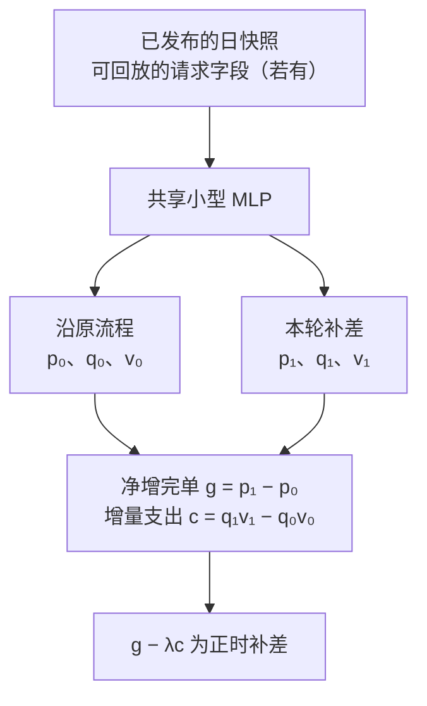

# 升舱模型迭代方案（讨论稿）

平台现在给候选车型补差，能多带来多少完单，又要多付多少补贴？本稿按**每天使用上一份已发布的数据快照**设计。先确认实验能区分本轮补差还是整套策略，再选模型。[[升舱模型训练样本口径（讨论稿）|一行样本、历史截止日、分组和标签]]

[[#下一轮升舱实验怎么选|下一轮实验]] · [[#初版共享 MLP 的输出和训练|初版模型与训练]] · [[#升舱序列先试 DIN，何时再试 HyFormer|DIN 与 HyFormer 的取舍]] · [[#CanniUplift 如何区分付补完单与净增完单|同分算例]] · [[#FunnelCausalNet 如何估算实付补贴|付补成本]] · [[#四、用历史实验验证|实验验证]] · [[#五、后续迭代用 RDD 拆解补差组的完单|后续 RDD 迭代]]

## 下一轮升舱实验怎么选

### 手里的数据能回答哪个问题？

| 能取回的数据                              | 这一轮可以做什么                                                                    |
| ----------------------------------- | --------------------------------------------------------------------------- |
| 按乘客随机分配的策略组，以及观察窗内的订单和账单            | 比较整套策略，保留未触发和零完单乘客。新流看每百名入组乘客新增多少完单人头，大盘看人均完单数，同时核对两组实付。只有分组汇总时，按报告的原始分母复核。 |
| 同一资格入口下，本轮抽中与未抽中的机会、分配概率、最终完单和账单都齐全 | 在两种动作都有机会被分到、后续规则相同的范围内，估本轮补差相对沿原流程的增量。大盘取每笔原始需求的首次合格机会，新流取每位乘客的首次合格机会。     |
| 在逐次样本上，还能回放两组动作前的本轮候选与报价，并关联此前的自费弹窗 | 先量出多少展现能唯一对上车型与价差、多少合格乘客至少有两条这类历史，再试报价序列。全体合格乘客和有历史乘客分别评估。                  |

**当前先核对逐次随机记录和财务归属。** 2025 年新流实验确认按乘客分组。2024 年有按概率触发升舱的机制记录，抽中和未抽中两侧的明细仍待取回核实。历史报价与反馈的表和字段已定位，近期可用历史的覆盖率仍待实测。[[#四、用历史实验验证|历史实验能验证什么]] · [[升舱模型训练样本口径（讨论稿）#1. 先确定一行能代表什么|分组与样本单位]] · [[升舱模型训练样本口径（讨论稿）#怎样还原一次自费预分单的报价与选择|报价与反馈的覆盖率]]

### 完单变化出在哪一步？

**符合资格 → 本轮分配补差 → 实际发起找车 → 商家找到升舱运力 → 升舱应答 → 应答后取消或履约完单**

逐次随机样本先核对补差组的分配比例。分配之后，每一步按原始需求去重，用上一步的需求数作分母看转化。

- **发起得少，还是发起后找不到车？** 前者核对分配记录和实际追加发单记录。后者按候选车型、商家拆找车成功率。找到运力后应答仍少，再查平台选优和商家预算熔断记录。[[升舱工程文档#逐单判断与回退|预算控制与 PK]]
- **应答多了，完单没跟上。** 分开等应答、换车和司机取消改派，分别核对应答后的乘客取消、司机取消，并沿父子单追到最终结果。
- **付补完单多了，全组多完的单却很少。** 看原勾选车型完单、自费预分单完单各变化了多少。最终收益回到最初随机分组的全体，包含未触发、由其他车型完单和最终未完单的样本。新流在同一观察窗按乘客去重。[[#CanniUplift 如何区分付补完单与净增完单|成交路径与净增的算例]]

> [!example]- 同样接入升舱，换车和改派的结果为什么要分开看？
> 2025 年 10 月 25–31 日，与同版且无新增场景的 V2 组 5 比，接入应答后换车的组 2 含改派应答率增加 0.14 个百分点，应答后含改派乘客取消率增加 0.25 个百分点，完单率下降 0.16 个百分点。接入司机取消改派的组 3 完单率增加 0.11 个百分点。[[花小猪/2025年LR/【LR25051】新流升舱策略优化v2#各场景额外收益分析|原实验的分组与指标]]

### 下一轮只改哪一项？

先比较历史 V2 和树模型。树模型分别估计补差和沿原流程的完单概率与实付金额，按两种动作的差值打分。第二轮固定样本、特征、目标和预算，只把树模型换成小型 MLP。两次都在独立随机样本上看同等实付补贴下多完了几单或新增了几个完单人头。[[#有逐次明细后怎样比较模型|逐项对照与验收]]

实付预测持续偏低，先对账，再拆「付补概率 × 付补时的平均金额」。成本估准后，如果补差组的完单率在某些预计付补概率区间仍持续高估或低估，固定成本单测 RDD。报价与反馈历史可用时，单独比较历史统计与 DIN。每轮把结果和取舍填入[[#每轮实验记录|实验记录]]。

## 一、升舱模型怎么选

2025 年新流 V2 用 XGBoost 预测乘客自费接受预分单的概率。历史方案还考虑过用 POSO 门控改善新客、流失客等小样本人群的接受度预测。[[新流升舱：接受度模型、取消分析与实验结果#用预分单接受度估计补差能改变多少完单|V2 接受度模型与选型记录]]

### 初版共享 MLP 的输出和训练

**神经网络的初版候选用一个小型 MLP 编码决策前信息。两种动作共享这部分网络，分别预测自己的完单和支出。** $A=0$ 表示本轮沿原流程，保留原有的自费预分单选择。$A=1$ 表示本轮被分配补差，即使最后由原车型接走，也保留在这一组。训练本轮动作需要同一资格入口下的两侧随机记录。只有乘客级策略分流时，两个分支对应各自被分配的整套策略。[[升舱模型训练样本口径（讨论稿）#1. 先确定一行能代表什么|样本粒度与分组]] · [[盲盒策略v1建模弹性#建模尝试|库内双头建模示例]] · [初版模型与结算口径的讨论](codex://threads/01a1f6c9-ad7f-71f2-8917-ea6b8e0b024a)

对每个动作 $a$，网络提供三个用于打分的量。$X$ 只含决策时已发布的日快照，以及服务当时已收到且两组都能回放的请求字段。

| 量 | 训练标签 | 用哪些样本训练 |
| --- | --- | --- |
| $p_a$ 最终完单概率 | $Y$。大盘逐次样本看这笔原始需求是否由任一车型完单。新流看该乘客在同一观察窗是否至少完单一次。 | 分到该动作且结果已观察完整的全部样本，包含完单和未完单。 |
| $q_a$ 发生付补的概率 | $S$。同一需求或同一乘客窗口内，是否发生可归属于平台的升舱补差结算。 | 分到该动作且账务已核齐的全部样本，包含有付补和零付补。 |
| $v_a$ 发生付补时的平均实付金额 | $C$。上述范围内财务对账后的累计净额，单位为元。 | 已发生补差结算且金额已核齐的样本。 |

**按 V2 的逐单结算口径，未完单时本单的升舱差价为零，原勾选车型完单时也无需为本轮候选付差价。** 当 $Y$ 和 $S$ 的统计范围一致时，首版可以直接输出 $p_a$、$r_a$、$v_a$，其中 $r_a$ 是已完单条件下的付补概率。图中的 $q_a=p_a r_a$ 据此算出，满足 $q_a\le p_a$。新流按乘客去重时，$S$ 和 $C$ 同样覆盖该乘客在观察窗内的合格订单。[[花小猪/2025年LR/【LR25051】新流升舱策略优化v2#约束条件|V2 的升舱补贴结算条件]]

**每条记录只监督它实际分到的动作。** 对结果和账务均已成熟的一行，令 $a=A_i$，可用下面的损失训练。两个分支共享的参数从两组样本学习。

$$
\begin{aligned}
L_i={}&\mathrm{BCE}(Y_i,p_a)
  +\alpha\,\mathrm{BCE}(S_i,q_a) \\
  &+\beta\,\mathbf{1}_{\{S_i=1\}}\,\ell_{\text{金额}}(C_i,v_a).
\end{aligned}
$$

前两项用二元交叉熵训练完单概率和付补概率。当 $q_a=p_a r_a$ 时，付补标签监督这个乘积。一笔被分到补差、最终由原车型完单且本窗对账无升舱支出的样本，记为 $A=1,Y=1,S=0,C=0$。第三项只在发生付补时计算，可用平方误差学习平均实付金额。$\alpha,\beta$ 是训练损失权重。账期未满或账单关联失败时，保留已知的完单标签，屏蔽尚未核实的财务标签。单笔机会只能观察一个动作的结果，$g_i$ 由可比随机组的预测差估计。[[升舱模型训练样本口径（讨论稿）#5. 从两组结果估计增量|收益、成本和随机留出的口径]]

### 门控用在哪里

**POSO 适合解决同一个目标在人群上学得不一样的问题。** 新客可能没有历史，沉默后回流的乘客可能仍有旧订单。可以用入组前已知的人群、历史单量和距上次完单天数生成权重，调节网络中哪些表示起作用。在本库的 MLP 实现中，门控逐维缩放隐层输出。第一轮可先按历史长度加权，无历史时将历史分支置零。若合并训练后新客或回流客的预测仍系统性偏高或偏低，再试 POSO。[[01 base_DSAR和POSO_DASR效率or效果对比|库内 POSO 实现]] · [POSO 原论文](https://arxiv.org/abs/2108.04690)

**PEPNet 同时处理场景差异和任务差异。** EPNet 可让不同场景对输入特征赋予不同权重，PPNet 用个性化信息调节各任务预测网络的隐层。放到升舱里，“本单是否完单”“这位新流乘客在窗口内是否完单”“平台实付多少”是不同的预测目标。“补／不补”是要比较的两个动作。先用普通的独立输出分别学各个目标，如果一起训练后某个目标持续比单独训练更差，再试 PPNet。两种门控都需要在升舱的随机留出样本上验证。[[PEPNet（2209762970438）#2.3 消融实验|库内 EP、PP 消融对照]] · [PEPNet 原论文](https://arxiv.org/abs/2302.01115)

### 新流、大盘和联合建模

下表用“大盘”指常规大盘人群，和新流互斥，便于对比。监控全平台时仍可包含新流。2025 年 9 月的大盘实验本身排除了新流实验人群和摇摆指定人群。[[大盘升舱实验评估#一、实验信息|历史大盘实验范围]]

| 范围 | 样本单位与目标 | 在日更数据下先做什么 |
| --- | --- | --- |
| 新流（新客、流失客） | 每位乘客首次入组一行，估窗口内新增完单人头，按增量实付补贴核对 CAC。 | 用昨日可见的人群、历史次数及距末次完单天数。新客容许空历史，回流客保留旧记录。先用静态特征比较树模型和小型 MLP，人群误差持续存在再试 POSO。 |
| 大盘（常规人群） | 有共同决策机会时，一笔原始需求一行，估任一车型最终完单的增量，线上核对订单 CR 和实付补贴。 | 先用近 14／28 天订单、完单、取消、等待等统计。有历史明细再比较日更订单序列。能取得本次候选时才试候选感知的 DIN。 |
| 大盘＋新流 | 共享输入，分别预测订单完单、窗口完单人头及各自口径的成本。新流人头标签每位乘客只使用一次。 | 先用共享底层和独立输出，按标签适用范围训练。两类人群分别评估钱效、标定阈值，多任务互相拖累再试 PPNet。 |

联合方案可以先给两类人群各设预算。若共用总预算，可用全平台增量完单作目标、新流人头或 CAC 作约束，同一笔支出只归集一次。

## 二、只有前一天的数据，哪些特征能用

设业务决策日为 $D$。首版输入是决策时**实际发布并在用的历史快照**，最新到 $D-1$。例如，11 月 19 日早上若 18 日数据尚未发布，就沿用 17 日版本。训练按线上所用的快照版本回放。当天发生的改勾选、近几分钟供需、其他订单的结果，都不从日终宽表倒填。

| 数据 | 首版用法 |
| --- | --- |
| 历史订单与行为 | 用 `kflower_strategy.trip_order_enriched_di` 的 `passenger_id`、`order_id` 组织过去订单。发单车型与定价锚点取 `call_car_level`、`call_max_est_price_amt`、`call_max_est_price_category`，有记录时取历史等待 `actual_answer_dur_sec` 和预估接驾 `eta_second_pick_dur`。`call_max_gmv_amt` 是最高应付价，`est_price_amt` 是发单代表行价格。 |
| 历史结果与序列 | `is_td_finish` 配 `finish_time`、`is_td_cancel` 配 `cancel_time`，另可用 `cancel_type`、`finish_category`。先做日粒度汇总。有逐单明细时，可在发版前按乘客整理近 120 天、最近 30 笔历史订单。只有按天汇总时，就用每日计数和比例。注册当天首次出现、尚无画像的乘客保留缺失标记。 |
| 本次请求自带字段（可选） | 候选车型、本轮报价、原勾选券后最高价等，只有**服务本来就收到，且两组在动作前的原值都能次日还原**才入模。历史模型用过这类入参。这次能否复用仍待核对。只有昨日画像时，同一乘客当天面对不同候选，模型只能给出按历史平均的估计。 |

近 120 天、最多 30 笔是库内逐单序列的参考窗口，实际取值要结合乘客历史的分布验证。[[面试准备/实习总结/价格策略实习总结#3.2.2 序列样本构造示例表|历史模板]] · [[新流升舱：接受度模型、取消分析与实验结果#哪些字段能进入钱效决策|历史模型的请求字段与行为统计]]

### 历史自费预分单报价与选择

假设同一位乘客曾接受比原勾选最高券后价贵 3 元的 B 车型，又在贵 10 元的 C 车型弹窗上点了“暂时不用”。弹窗记录能补上完单车型之外的信息，例如这位乘客放弃过哪种报价。大盘可按时间整理历次展现的候选车型、价差和选择，取决策前已发布的快照，供“本轮补差”和“沿原流程”两个分支共同使用。主动拒绝、超时和反馈缺失分别记录，平台补差后直接应答另记为升舱经历。

历史表和埋点已定位。先在有埋点定义的 Native 乘客端版本核对两项覆盖率，即能唯一匹配车型和价差的展现占比、至少有两次这类历史的大盘乘客占比。旧版接受度模型曾按特征空值率粗估，当时约 27% 的乘客有过预分单触达。当前两项覆盖率仍待实测，2026-11-18 分区的匿名计数受表权限限制。[[预分单接受度模型线上特征检查#这次检查发现什么|旧版触达率的估算依据]] · [[升舱模型训练样本口径（讨论稿）#怎样还原一次自费预分单的报价与选择|取数、报价匹配和覆盖率]]

### 升舱序列先试 DIN，何时再试 HyFormer

**大盘先给树模型和小型 MLP 相同的静态输入和训练目标。检验序列增益时，固定 MLP，只把历史统计换成轻量 DIN，并保留表现较好的静态模型作业务对照。** 首次叫车的新客用请求信息和已有画像打分，回流客有旧订单或弹窗记录时可以使用序列。

1. **本次报价与哪几次历史选择相似？** 假设原勾选最高券后价为 20 元，本轮 B 报价 24 元，贵 4 元，也就是 20%。既可以参考过去接受 B 加 3 元的经历，也可以参考其他车型相对贵 20% 时的选择。每条历史保留车型、绝对价差、相对价差、反馈和距今天数，原勾选最高价为正时才计算相对价差。本轮候选和报价在补差前已知、两组都能回放时，让 DIN 按候选给这些已发布的历史记录加权。[[知识体系/07-检索与推荐/专题/序列建模/DIN：候选感知兴趣网络|DIN 如何按候选读取历史]]
2. **拒绝报价后，继续等车的人怎样了？** 假设两人都曾拒绝加价 5 元，一人随后很快由原车型接走并完单，另一人则多次久等后取消。两人相同的拒绝可能对应不同的补差收益。首版可把 DIN 提取的报价反馈与原车型完单、久等后取消等历史统计一同送入 MLP。若本轮已等时长或候选供给也能在决策前取得并按原值回放，再把它们作为本轮条件。

**数据能否支撑跨域交互，要看两类历史能否在同一乘客身上对齐。** 除了统计有多少条，还要看同一车型是否出现过不同价差、相近价差下是否展示过不同车型，以及有报价反馈的乘客中有多少也有可用的履约历史。如果旧策略总给 B 配低价、给 C 配高价，这批记录主要支持对两种组合的预测，要把品牌偏好和价格敏感度拆开还需要更丰富的组合。

**当履约经历会改变哪些报价记录更值得参考时，再试轻量 HyFormer。** 例如，先从履约历史识别乘客常在久等后取消，再从报价历史读取他在类似等待条件下曾接受哪些价差。这需要历史弹窗发生时的等待条件也能还原。HyFormer 将上一层读到的历史与乘客画像、本轮候选等非序列特征结合，更新查询后再读历史，适合检验这种交互。原论文验证的是搜索点击率，升舱上的收益仍需单独验证。[[论文精读/HyFormer/HyFormer：CTR中的序列建模与特征交互#3.2 总体框架|HyFormer 的逐层交互]] · [HyFormer 原论文](https://arxiv.org/html/2601.12681v2)

**实验先检验候选加权，再检验多层交互。** 各版使用相同的乘客画像、本轮请求和已发布的历史。MLP 先按车型、价差和距今天数汇总行为，第一次对照只将报价历史的汇总换成 DIN。两类历史都有足够覆盖时，再比较“分别读取两条序列一次，再用 MLP 合并”与轻量 HyFormer，两者使用相同的逐条记录和相近的模型容量。

有逐次随机分配明细时，各版沿用相同的完单与成本口径，分别在验证集标定阈值，然后用同一份按乘客隔离的独立随机样本比较**同等实付补贴下，大盘新增多少完单、新流新增多少完单人头**。同时报告有历史人群和全体合格人群的结果，后者含空历史乘客。自费接受度仅作诊断，因为原本就会自费完单的人在得到补贴后也可能照常完单。只有乘客级整套策略分流时，按原实验单位评估策略效果。[[#有逐次明细后怎样比较模型|随机留出与同预算评估]]

## 三、V2 怎样控预算，新方案改什么

### V2 已有总补贴预算

2025 年新流 V2 的原式要求所有选中机会的**预期升舱补贴合计**不超过预算 $B$。记 $\Delta\mathrm{price}_i$ 为追加车型与原勾选最高券后价的差额（元），$\Delta P_i$ 为追加后整张表单完单概率的预估提升。V2 用 $\Delta P_i$ 近似由升舱车型完单并付补的概率。

$$
\sum_i z_i\,\Delta\mathrm{price}_i\,\Delta P_i \le B,\qquad B=GMV_0\,\theta .
$$

$\theta$ 是补贴率。原文参数表将 $GMV_0$ 写作“历史大盘补贴率”，与公式的金额单位不一致，复算具体预算金额需核对 GMV 基数。V2 的收益项是 $(1-P_{\text{自费接受}})\Delta P_i$。在价差和 $\Delta P_i$ 均为正时，单位预估补贴带来的收益化简为 $(1-P_{\text{自费接受}})/\Delta\mathrm{price}_i$，超过 $\lambda$ 才发起升舱。所以 V2 本来就有预算乘子，调高 $\lambda$ 会筛掉更多候选。[[花小猪/2025年LR/【LR25051】新流升舱策略优化v2#约束条件|V2 预算原式]] · [[花小猪/2025年LR/【LR25051】新流升舱策略优化v2#规划求解|逐单判断]]

**预算和 CAC 用在两处。** 新流 V2 实验组用过 $\lambda=0.16$，LR 记载 2025-11-17 配置新预算后放量。放量另看“增量升舱补贴 ÷ 新增完单人头”是否不超过 20 元，并核对人头收益、大盘指标和 ROI。工程文档还记有商家预算用尽时由 PK 熔断。新方案沿用总预算的思路，把本来就会完单但发生了补差的支出也用实付账单学出来。[[花小猪/2025年LR/【LR25051】新流升舱策略优化v2#3.2 新流放量后评估|新预算与放量]] · [[花小猪/2025年LR/【LR25051】新流升舱策略优化v2#后续放量组结论|CAC 放量标准]] · [[升舱工程文档#逐单判断与回退|商家预算熔断]]

另有一份大盘实验预算方案给出了金额例子，按参试流量 GMV 的 0.3% 测算，每日总预算约 6.3 万元，两组各 3.15 万元。这些数属于该轮大盘实验。[[大盘升舱实验预算#预算|大盘日预算与商家预算包]]

### 决策单位与结果

两组有共同资格入口、能关联本轮随机分配时，下面的 $i$ 是一次升舱机会。缺候选明细时，仍可按昨日人群估计启用升舱的平均效果。要进一步区分车型或价差，必须有可回放且在线可用的候选信息。只有随机策略分组时，只能比较每名入组乘客**采用整套策略**的收益和成本。具体取法见[[升舱模型训练样本口径（讨论稿）#1. 先确定一行能代表什么|样本粒度与分组]]。

| 量 | 在规划里表示什么 |
| --- | --- |
| $z_i$ | $1$ 为本次给候选补差，$0$ 为沿原流程继续。支持自费预分单的入口保留原有自费选择。 |
| $g_i$ | 同类样本“现在升舱”与“沿原流程”的最终成功概率之差 $p_1(X_i)-p_0(X_i)$。大盘的成功是该需求最终完单，新流的成功是该乘客在同一观察窗内至少完单一次。 |
| $c_i$ | 两种动作在同一观察窗内预计实付升舱补贴之差。仅在财务对账完成且确认无支出时记零，待结算或关联失败的记录保留待核。 |

### CanniUplift 如何区分付补完单与净增完单

CanniUplift 研究给一家店发券后，顾客在整个平台多花了多少钱。作者把各商家的平台视角预测相加，用同一用户的实际平台总 GMV 监督这个和（PGA）。升舱只要按原始需求归并父子单，就可以直接用任一车型最终是否完单来训练收益，再用成交途径解释组间差异。论文中按是否核销拆解发券组结果的 RDD，是后续可单独验证的收益模型。[[因果营销论文地图/论文/CanniUplift|CanniUplift 精读]] · [论文原文 §3.3](https://arxiv.org/html/2607.05242v1#S3.SS3) · [[#五、后续迭代用 RDD 拆解补差组的完单|升舱的 RDD 验证方法]]

**有两种情况会发生补差，但平台最终仍只完成原本就能完成的那趟出行。** 一种是换了接单车型。升舱车先到，原勾选车型稍后也可能接到。另一种是换了付差价的人。乘客原本愿意自费接受同一候选，平台补差后仍完成同一趟车。同样是付了 4 元，若乘客沿原流程会取消，这 4 元也可能挽回一单。这几种情形在账上都留下 4 元支出。要估计补差多带来了多少完单，还要比较从同一资格入口随机分配的两组。

**同一个 V2 分数，可以对应不同的钱效。** 以下是假设数据。甲、乙两类的预测自费接受度相同，价差都是 4 元，因此两类按 V2 打分相同。每类各有 100 笔需求被分到补差组，另有 100 笔走原流程。假设对照全程无补差，每笔付补完单实际结算 4 元。

| 需求 | 原流程完单 | 补差组全部完单 | 其中付补完单 | 每多完一单花费 |
| --- | ---: | ---: | ---: | ---: |
| 甲，原车型较容易接到 | 80 单 | 81 单 | 15 单 | 60 ÷ 1 = **60 元** |
| 乙，原车型较难接到 | 50 单 | 56 单 | 15 单 | 60 ÷ 6 = **10 元** |

两类都花了 60 元。甲类通过其他途径完成的订单从 80 单降到 66 单，新增 15 笔付补完单后，整组净增 1 单。乙类的其他途径从 50 单降到 41 单，整组净增 6 单。这是组间的净变化，单个乘客原本会怎么选仍不可观测。**换到新流，将两组的最终结果改为同一窗口内至少完单一次的去重乘客数**，同一个人完成两单仍只计一人。[[升舱模型训练样本口径（讨论稿）#4. 完单和实付补贴怎么打标签|原始需求、完单人头与观察窗]]

### FunnelCausalNet 如何估算实付补贴

FunnelCausalNet 在每个随机券档内，用“成交概率 × 成交后的平均金额”估计人均 GMV，再比较券档。迁到升舱，最有用的是分开估计**有多少机会真的发生平台补差，以及一旦付补平均要付几元**。这两个数都可以用结算记录核对。[[因果营销论文地图/论文/FunnelCausalNet_漏斗与收入#1. 旧流程、因果对象与漏斗识别|FunnelCausalNet 精读]] · [论文原文 §4.1](https://arxiv.org/html/2608.11675v1#S4.SS1)

按同一需求、同一观察窗取已对账结果。对给定的决策前信息 $X$，$p_a$ 是动作 $a$ 下的最终完单概率，$r_a$ 是已经完单时发生平台付补的条件概率，$v_a$ 是发生付补时的平均实付净额。因为这笔价差只在升舱车型完单后结算，有

$$
\begin{aligned}
q_a(X)&=P(S=1\mid A=a,X)\\
      &=P(Y=1\mid A=a,X)\,P(S=1\mid Y=1,A=a,X)=p_a(X)r_a(X),\\
m_a(X)&=q_a(X)\,v_a(X),\\
c_i&=m_1(X_i)-m_0(X_i).
\end{aligned}
$$

先在每个动作内估计预计支出 $m_a$，再相减得到增量成本 $c_i$。若观察窗最多结算一次、当次报价差可用且逐笔与实付一致，$v_a$ 可直接取这笔价差。对照全窗禁补时直接取 $m_0=0$。若只跳过本轮，后续仍可获补，就要估计沿原流程的支出。只有按乘客分流且大盘目标是窗口内**完单数**时，收益用人均完单数之差。成本分解里的“完单”仍取同窗内**至少完成一单**的事件。[[升舱模型训练样本口径（讨论稿）#4. 完单和实付补贴怎么打标签|财务归属、观察窗与人均完单数]]

回到甲类算例，补差组完单率是 $81/100$，完单后的付补比例是 $15/81$，所以每次机会的付补概率是 $15/100$。每笔 4 元，对照无补贴，$c=0.15\times4=0.60$ 元／机会。与此对应的收益是 $g=0.81-0.80=0.01$ 单／机会。一次机会的付补概率和净增完单由两种不同的观测得到。

### 在预算内选哪些机会升舱

设 $B$ 为相对同一原流程可多用的补贴预算。若财务给的是总额，先扣除原流程预计使用的补贴。在收益单位一致的一组机会里，求预算范围内最大的总增量。

$$
\begin{aligned}
\max_{z_i\in\{0,1\}}\quad & G(z)=\sum_i z_i g_i \\
\text{满足}\quad & C(z)=\sum_i z_i c_i \le B .
\end{aligned}
$$

新流若要将 CAC 纳入这版规划，另加 $C(z)\le 20\,G(z)$，其中 $G(z)$ 必须是新增完单人头。净增人头为正时才报告 CAC。大盘按原始需求估完单增量，并监测订单 CR 的呼叫分母。联合建模时，“新增一单”和“新增一个完单人头”分别核算。

### 离线选阈值，线上做一次判断

有本轮随机对照时，在验证集上比较多档 $\lambda$，选择满足预算和业务约束、增量最大的候选阈值。另用独立随机留出样本评估所选策略。线上在资格入口计算 $g_i-\lambda c_i$，正值补差。日更画像支持提前计算人群分数。逐笔判断若要区分同一人的不同候选，仍需可用的请求字段。日更标定控制的是预计支出，当日的硬额度要由能看到当日消耗的预算模块执行。

> [!info]- 新流同时约束预算和 CAC，线上需要几次判断？
> 若明确将 CAC 也纳入拉格朗日求解，预算乘子记为 $\lambda_B$，CAC 乘子记为 $\mu$。单个机会的净值为 $(1+20\mu)g_i-(\lambda_B+\mu)c_i$。两项乘子离线确定，线上可折合为一个有效阈值 $(\lambda_B+\mu)/(1+20\mu)$。这种逐单打分求的是放宽耦合约束后的解，适用于单次、可加的期望增量。小批次若必须严格卡住预算且单笔支出不可拆，可用 0/1 整数规划核对离线最优解。若后续要在同一需求上反复补差或比较多个候选，应以整条策略为单位评估，避免叠加同一次出行的收益。

> [!example]- 单／元与元／新增完单如何换算？
> 每 100 笔同类需求，原流程预计完 60 单，升舱后预计完 66 单。假设原流程没有这笔补贴，升舱后其中 25 笔各结算 4 元。平台多付 100 元，多完 6 单，钱效为 **0.06 单／元**，即**每多完成一单约花 16.7 元**。

## 四、用历史实验验证

**能还原逐次随机记录和 V2 分数时，先验证同分能不能再分出钱效。** 用动作前可回放的 V2 分数分桶，再按决策前已知的人群或原车型供给特征预先划分子组。每个子组都保留全部随机入组样本，分别算补差组的实际付补频率、两组最终完单率之差和实付成本之差。如果付补频率相近的子组仍有稳定的净增差异，再检验新排序能否在同样预算下多带来完单。供给特征仅使用打分时已能取得的值。

### 2025 年新流实验能复盘整套策略

10 月 25–31 日的实验在等待应答页按 PID 设置无升舱空白组、V1 和多种 V2 配置。若能取回明细，按原组保留所有入组乘客，包括未触发的人。在同一观察窗，每组列出**每百名入组乘客的付补完单数、去重完单人数和实付补贴（元）**。V2 与空白组的完单人数差给出启用该策略的人头增量，两组实付差给出增量成本。仅有报告汇总时，按报告保留的分母复核策略效果。[[花小猪/2025年LR/【LR25051】新流升舱策略优化v2#3.1 新流升舱评估|分流与原始组配置]] · [[花小猪/2025年LR/【LR25051】新流升舱策略优化v2#拉新指标|去重人头与 CAC]]

### 2024 年随机升舱有机会验证本轮补差

工程文档写明通过接受度门槛后按概率触发升舱，11 月 12–18 日的评估也有随机组实绩。要估计门槛内的本轮效果，需同时取回通过门槛后抽中和未抽中的机会、当时的分配概率，以及同一后续规则下的最终完单和账单。[[升舱工程文档#逐单判断与回退|随机触发条件]] · [[升舱策略评估与优化思路#重要结论|2024 年 11 月随机组结果]]

历史 SQL 能定位 Apollo 乘客分流实验 `kf_upgrade_dialog_render_official`。2026-11-19 数易抽查分流表返回“没有库表权限”。历史分区能否读取、是否另有抽中与未抽中的逐次决策日志，均待核实。[[分商家升舱中间结果评估（1108-1112）#评估结果|Apollo 取数 SQL]]

### 有逐次明细后怎样比较模型

| 比较方案 | 用什么打分 | 要验证的问题 |
| --- | --- | --- |
| 历史 V2 | 冻结历史自费接受度分数，用当时报价和 V2 公式排序。 | 原排序在可比预算下能带来多少净增完单？ |
| 直接估计完单与金额的 XGBoost | 在补差和沿原流程两组内，各自拟合最终完单 $p_a$ 和含零支出的平均实付 $m_a$。用两种动作之差 $g=p_1-p_0$ 和 $c=m_1-m_0$ 按 $g-\lambda c$ 打分。 | 相比 V2，改用净增完单和真实支出来排序，能否在同预算下多带来完单？ |
| 同目标的小型 MLP | 沿用树模型的样本划分、决策前特征、动作、完单与实付标签，以及 $g-\lambda c$ 评分规则，只更换预测模型。 | 相比同目标的树模型，换网络还有多少额外的净增收益？ |
| 独立预测付补概率 | 固定完单预测，把直接估计 $m_a$ 改为分别估计 $q_a$、$v_a$，用 $q_a v_a$ 计算支出。 | 把付补频率和金额分开估，是否改善实付预测？ |
| 初版候选，付补概率服从结算关系 | 用 $p_a r_a$ 得到 $q_a$，仍用 $q_a v_a$ 计算支出。 | 结算关系能否进一步改善付补校准和同预算完单？ |

比较成本结构时，先固定同一套完单预测，再评估联合训练的完整初版。核对共同资格、原始分流与分配概率、当时在用的日快照、最终完单和实付账单。两组都有原分数或能用动作前字段回算时，才比较 V2 同分人群。早于 V2 的数据只能回算模拟分数。

各版在验证集分别标定阈值，再用同一份按乘客隔离的独立随机留出样本评估。对两种动作都有随机覆盖的机会，用与各版规则一致的实际观察结果，按原动作分配概率的倒数加权，估计各版在这部分机会上的完单和实付支出。在相同预算下比较**新增完单人头（新流）或新增完单数（大盘）**，同时报告支出和增量的不确定性。若留出样本中两版支出仍有明显差距，先列明差额，预算对齐后再判断谁的收益更高。

比较树模型和 MLP 前可约定同等预算下值得换模型的最小收益。若 MLP 相对树模型的收益差区间整体高于这个值，进入下一轮验证。区间整体低于它，沿用树模型。区间跨过它，记为待复验。[[升舱模型训练样本口径（讨论稿）#5. 从两组结果估计增量|随机留出、分配概率和财务核对]]

### 每轮实验记录

每轮填一行，注明离线随机留出或线上随机实验。两版实付使用同一分母，净增填写新版相对基线的差值和区间。新流写去重人头，大盘写完单数。

| 样本期、人群与分流单位 | 基线 → 试验版及本轮改动 | 两版实付（元） | 净增人头或单量及区间 | 决定与依据 |
| --- | --- | --- | --- | --- |
|  |  |  |  |  |

## 五、后续迭代用 RDD 拆解补差组的完单

初版直接预测最终完单 $p_1$，付补概率 $q_1$ 用于估计成本。后续要检验的是，**让付补路径也参与计算 $p_1$，能否把同一预算留给净增完单更多的机会？**

### CanniUplift 怎样把路径放进预测

RDD（Redemption-based Decomposition Denoising）按是否核销拆开发券组的成交结果。以 $\rho$ 表示模型预测的核销概率。作者同时预测核销和未核销两条路径各自的 GMV 增量，再按概率加权。以 $\hat y_0$ 表示不发券时的基线，发券组的预测可简写为

$$
\hat y_1=\hat y_0+\rho\,\hat\delta_{\text{核销}}+(1-\rho)\,\hat\delta_{\text{未核销}}.
$$

核销标签训练路径概率，真实 GMV 监督合并后的结果。论文另做了一个对照，同样给模型核销标签，仅把核销预测作为辅助任务，以此检验让路径概率直接参与结果计算的价值。[[因果营销论文地图/论文/CanniUplift|CanniUplift 精读]] · [论文 §3.4](https://arxiv.org/html/2607.05242v1#S3.SS4) · [论文 §4.5 消融](https://arxiv.org/html/2607.05242v1#S4.SS5)

### 升舱只需再估一个完单概率

在补差组按同一需求和观察窗拆分。**发生补差结算的路径已经完单**，这条路径的完单概率由结算规则确定为 1。**没有发生补差结算的路径**同时包括原车型、自费候选等其他途径完单，以及最终未完单。记后一路的完单概率为 $u_1(X)=P(Y=1\mid A=1,S=0,X)$。升舱的候选实现为

$$
\begin{aligned}
p_1^{\mathrm{RDD}}(X)&=q_1(X)+(1-q_1(X))\,u_1(X),\\
g^{\mathrm{RDD}}(X)&=p_1^{\mathrm{RDD}}(X)-p_0(X).
\end{aligned}
$$

沿用上文甲类的假设数字。100 笔分配补差的机会里有 15 笔付补完单。余下 85 笔里，66 笔通过其他途径完单，19 笔未完单。代入后，$0.15+0.85\times(66/85)=0.81$，与对照的 $0.80$ 相比仍是每百次净增 1 单。用同一组数核对条件概率时，初版的 $r_1=15/81$ 在**已完单**中看付补，RDD 的 $u_1=66/85$ 在**未付补**中看完单。这里能观察到实际成交路径，某位乘客在另一个动作下会不会完单仍是未知的。

### 怎样单独检验 RDD

1. **确认路径标签可用。** 在已对账的共同资格样本中核对“付补完单、其他途径完单、未完单”三类计数，加总应等于该组机会数。新流按同一乘客窗口归到三类中的一种，即至少一笔付补完单、有完单但全窗无付补、全窗未完单。每位乘客只进入一类。检查 $S=1,Y=0$ 的记录是否来自跨期、父子单关联或财务归属错位。未核齐的行保留缺失标记。
2. **固定成本，只换补差组的完单预测。** 模型对照版本沿用初版直接预测的补差组完单率 $p_1$。RDD 版本先冻结在训练集上拟合的初版，用它提供决策前的 $q_1$、对照完单预测 $p_0$ 和两组成本，再训练 $u_1$。使用补差组已核齐且 $S=0$ 的样本监督 $u_1$，并用补差组全部路径已核齐的样本监督合并后的完单概率。线上只需 $X$ 和预测出的路径概率，实际是否付补留作训练与核对。
3. **在相同实付预算下验收。** 两个版本使用相同的分流、输入、结算标签和可比的模型容量。分别在验证集标定阈值，在按乘客隔离的独立随机留出集比较全体合格机会的完单概率校准，以及同预算新增完单人头或单量和不确定性。若改善只出现在某条路径的拟合上，同预算完单收益仍未在独立样本重现，就沿用直接预测完单的初版。序列或人群门控可另作单项实验。[[#有逐次明细后怎样比较模型|基线与预算口径]]
