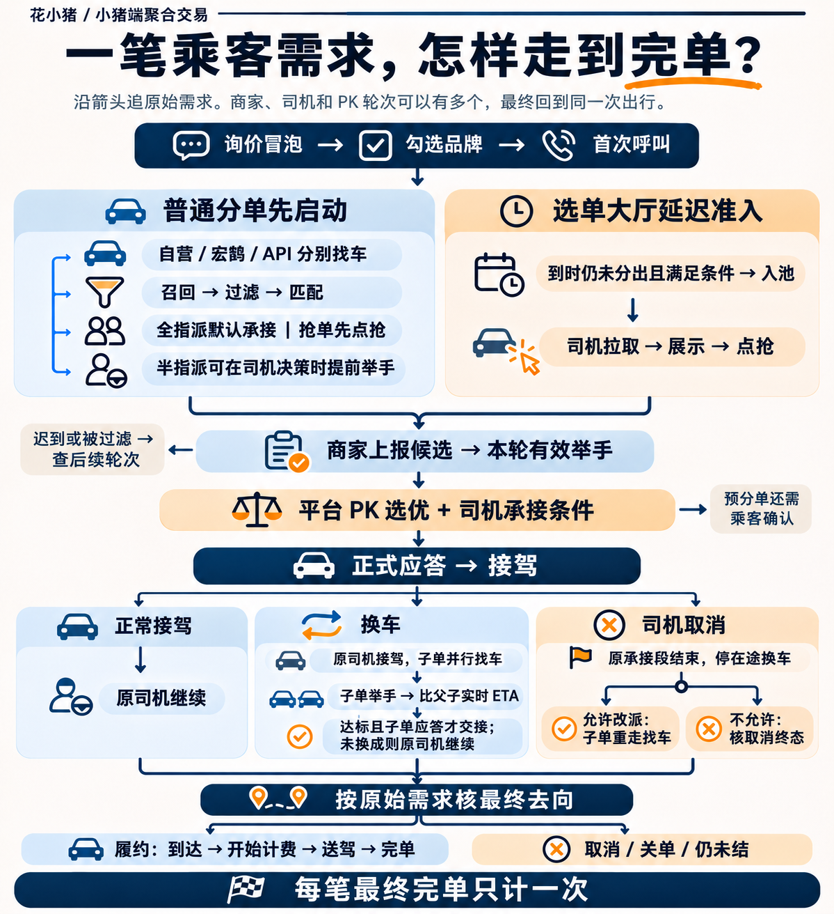

# 交易策略与指标图册

沿一笔原始需求，从首次呼叫追到最终完单，或从策略决策追到实际执行、履约结果和训练反馈。

## 从策略场景进入

| 场景 | 这张图回答什么 |
| --- | --- |
| [预分单](03%20策略场景/01%20预分单.md) | 什么时候额外找车、选哪种车型、何时展示、乘客接受后为何仍可能不应答。 |
| [升舱](03%20策略场景/02%20升舱.md) | 哪些候选值得补差、有多少真正找到运力、同预算多完成多少单。 |
| [换车](03%20策略场景/03%20换车.md) | 什么情况下换、是否实际交接，乘客少等多久以及司机多投入多少。 |
| [等应答页表单](03%20策略场景/04%20等应答页表单.md) | 策略推荐什么、页面最终展示什么、乘客改了什么、实际追加并完成了什么。 |
| [策略协同与归因](03%20策略场景/05%20策略协同与归因.md) | 同一笔需求遇到多个策略时，怎样追事件先后、最终承接和真实增量。 |

## 从模型自进化进入

- [决策日志与训练样本](04%20模型自进化/01%20决策日志与训练样本.md)。从预分单和升舱的候选、决策、执行及结果构建样本，核对哪些是可观察标签。
- [模型迭代与上线验证](04%20模型自进化/02%20模型迭代与上线验证.md)。从中间损失定位模型问题，沿离线、策略回放、线上对照验证。

场景页各有可核对的中间事件、计数对象和资料链接。涉及历史实验或工程版本的流程按对应资料解释，城市、策略开关、日志可用性和指标口径需按当期核实。五个方向的历史材料可从 [交易专项与模型自进化资料总览](花小猪/交易策略/02.%20交易专项与模型自进化/00-总览.md) 进入。

## 从指标进入

| 这次要解释的量 | 第一刀从哪里拆 | 沿哪些中间环节继续 |
|---|---|---|
| [平台完单量与完单率](02%20指标拆解/01%20平台完单量与完单率.md) | 原始呼叫 × 首次应答率 × 应答后完单率 | 分别回到呼叫、首次承接和应答后的最终去向。补贴变化接 [升舱](03%20策略场景/02%20升舱.md) 核同预算增量。 |
| [冒泡转呼叫率与品牌竞争呼叫](02%20指标拆解/02%20冒泡转呼叫率与品牌竞争呼叫.md) | 询价转呼叫、冒泡完单率、单笔需求的勾选品牌 | 按真实勾选快照核默勾、加勾和补勾。等待中的追加，接 [等应答页表单](03%20策略场景/04%20等应答页表单.md)。 |
| [应答率与首次应答时长](02%20指标拆解/03%20应答率与首次应答时长.md) | 有无首次应答、已应答人群等了多久、PK 是否提前结束 | 从有效举手追到本轮胜者、司机承接条件和正式应答。乘客已接受但仍在等，接 [预分单](03%20策略场景/01%20预分单.md)。 |
| [召回覆盖、播单覆盖与举手率](02%20指标拆解/04%20召回覆盖、播单覆盖与举手率.md) | 覆盖订单数、每单候选数、同粒度的播单后举手 | 追新增或缺失的候选经过过滤、匹配、播单、举手后去了哪里。 |
| [商家 PK 胜率与完单份额](02%20指标拆解/05%20商家%20PK%20胜率与完单份额.md) | 有效举手构成、同轮竞争胜率、最终品牌 | 从品牌多勾口径追同轮 only / both、胜者应答及最终履约，和平台总量对照。 |
| [应答后完单与司乘取消](02%20指标拆解/06%20应答后完单与司乘取消.md) | 首次应答后直接完单、换车、改派、最终终止 | 查取消由谁发起、这笔需求是否被接回。有交接或司机取消，接 [换车](03%20策略场景/03%20换车.md)。 |
| [乘客总等待时长 ETP](02%20指标拆解/07%20乘客总等待时长%20ETP.md) | 同一时钟切首次应答前、承接交接、最终接驾、到达后 | 到达版和计费版分别算。应答后的交接时长接 [换车](03%20策略场景/03%20换车.md)，并看司机接驾投入。 |
| [司机接驾时长与接驾距离](02%20指标拆解/08%20司机接驾时长与接驾距离.md) | 每笔需求承接几段、每段占用多长 | 查父子段、上一单占用、预估距离及司机构成。 |
| [差供需冒泡占比与调价调度](02%20指标拆解/09%20差供需冒泡占比与调价调度.md) | 格子阈值、冒泡权重、触发范围 | 分开跟踪调价到呼叫与调度到按时到格，两路回到最终完单。 |

## 按交易先后读

> [!info]- 展开原始交易撮合总图
> 

1. [冒泡、呼叫与商家机会](01%20交易阶段/01%20冒泡、呼叫与商家机会.md)。从一次原始呼叫还原各商家为什么可以参与。
2. [商家召回、匹配与司机决策](01%20交易阶段/02%20商家召回、匹配与司机决策.md)。普通分单与选单大厅怎么形成候选，三种模式分别何时举手。
3. [平台举手、PK 与正式应答](01%20交易阶段/03%20平台举手、PK%20与正式应答.md)。同一候选的平台状态和司机状态，何时能汇成一次正式应答。
4. [接驾、换车改派与履约](01%20交易阶段/04%20接驾、换车改派与履约.md)。原司机仍在接驾的换车、原司机已退出的改派，以及最后的乘客与司机时间线。

> [!example]- 展开 12 道复盘验算题
> 历史实验题标明原表，其余事件序列和数字用于走图。每道题从对应页面进入。
>
> | 要查的问题 | 沿链路能判定什么 |
> |---|---|
> | [一次询价到完单](02%20指标拆解/02%20冒泡转呼叫率与品牌竞争呼叫.md) | 100 次冒泡均完 56 单。呼叫从 80 笔变为 70 笔，CR 从 70% 变为 80%，冒泡完单率仍是 56%。另有取消重发时先核 C 的去重。 |
> | [召回、播单和举手为何不同步](02%20指标拆解/04%20召回覆盖、播单覆盖与举手率.md) | 召回 V2.1 原表：端内召回率 54.70% 到 53.11%，播单率 51.99% 到 51.98%，举手率 47.93% 到 47.05%，三项分母均为端内呼叫。先查过滤掉的 OD 能否匹配，再查不同模式的实播与举手。 |
> | [同单从普通和大厅两路找车](01%20交易阶段/02%20商家召回、匹配与司机决策.md) | 构造一笔需求，两路均有候选，普通入口还有第二轮。平台覆盖计 1 笔，参与入口有 2 个；举手与胜者按商家、司机、PK 轮查。 |
> | [半指派提前举手又跨轮](01%20交易阶段/03%20平台举手、PK%20与正式应答.md) | 首轮甲暂胜后拒绝；次轮乙先举手再确认，正式承接。3 条举手表记录，对应 2 个候选轮次和 1 笔应答。缺正式应答记录时停在确认环节。 |
> | [商家的胜率变化发生在哪里](02%20指标拆解/05%20商家%20PK%20胜率与完单份额.md) | 两组各 100 笔多勾需求，各一轮且都有有效举手。only 从 20 笔变 60 笔，均胜；both 胜率都为 50%。总体胜率从 60% 到 80%，变化完全来自竞争构成。 |
> | [全指派的应答与最终成交](02%20指标拆解/06%20应答后完单与司乘取消.md) | 高价值订单转全指派原表：命中转换订单中，实验组相对对照组的竞争应答率差 +1.11 个百分点、竞争完单率差 −4.03 个百分点、改派率差 +4.38 个百分点。追取消后能否改派接回，再看各运力最终完成几单。 |
> | [换车未成后由谁完单](01%20交易阶段/04%20接驾、换车改派与履约.md) | 子单停止、父司机仍接驾，可由父单完单；若父司机取消、改派子单接回，则由新司机完单。两条路径各计 1 笔平台完单，承接段分别为 1、2 段。 |
> | [同一笔换车的两种时长](02%20指标拆解/07%20乘客总等待时长%20ETP.md) | 构造 0 秒呼叫、20 秒甲应答、100 秒乙应答、105 秒甲段结束、220 秒乙到达、240 秒计费。乘客四段为 20+80+120+20=240 秒。两位司机均非连环，按到达／取消口径接驾占用为 85+120=205 秒。 |
> | [调度任务到了哪里](02%20指标拆解/09%20差供需冒泡占比与调价调度.md) | 100 个下发任务都有轨迹。40 个既命中行为接受又按时到格，另 10 个未命中行为接受却按时到格。到格应计 50 个；再看目标地呼叫、播单、应答和最终完单。 |
> | [预分单增加是否等于商家新增](01%20交易阶段/03%20平台举手、PK%20与正式应答.md) | 借用享道实验提出的问题做构造验算。互斥归属后，普通、补勾、预分单完单从 85/5/10 变为 83/2/15。预分单多 5 单，该品牌总量仍是 100；平台净变化还要看其他品牌。 |
> | [PK 的 0 秒从哪里来](02%20指标拆解/03%20应答率与首次应答时长.md) | 按历史动态窗口文档，先排单勾自营立即胜出，再查触发资格、空白组与日志精度。相隔不到 1 秒的两条记录可能显示同一秒，单靠这一列无法区分机制。 |
> | [端内和端外是否有运力替代](02%20指标拆解/04%20召回覆盖、播单覆盖与举手率.md) | 召回 V1.0.2 原文记录端内、端外召回量方向相反。按渠道×商家追可召回、实播和最终完单；要认定是同一批司机被腾挪，还须对上司机和时间。 |
>
> 原始数表见 [召回 V2.1 实验表](../商家交易策略知识库/raw/商家召回策略V2/商家召回策略V2.1/商家召回策略V2.1实验评估.md) · [全指派转换实验表](https://cooper.didichuxing.com/knowledge/2199610335356/2200078243596)。
>
> **两道需要专项证据的问题。** both 胜率变了，若要归因到某个实时特征，须核缺失与填充、同批候选复算分数、胜负翻转及后续履约。乘客分流与城市时间片结果相反，须核两套实验的分配单位、时段、城市与重复呼叫，再按各自设计估计误差。[实时特征排查](https://git.xiaojukeji.com/bwh_stg/trading-efficiency-wiki/blob/9847514d22aee1525646d16e07d8429ab57a267a/wiki/%E8%AF%8A%E6%96%AD%E6%8C%87%E5%8D%97/PK%E5%AE%9E%E6%97%B6%E7%89%B9%E5%BE%81%E7%BC%BA%E5%A4%B1%E4%B8%8E%E5%A1%AB%E5%85%85%E8%AF%8A%E6%96%AD.md) · [实验结论冲突排查](https://git.xiaojukeji.com/bwh_stg/trading-efficiency-wiki/blob/9847514d22aee1525646d16e07d8429ab57a267a/wiki/%E8%AF%8A%E6%96%AD%E6%8C%87%E5%8D%97/%E8%B0%83%E5%B1%82PID%E4%B8%8E%E6%97%B6%E9%97%B4%E7%89%87%E7%BB%93%E8%AE%BA%E5%86%B2%E7%AA%81%E8%AF%8A%E6%96%AD.md)

## 拿到一次异动，怎样走这本图册

**先固定比较对象。** 写下端口、城市、时段、样本单位、首次入组时刻和跟到哪个终点。原始需求、订单—司机对、商家 PK 轮、地理格子各有自己的分母。把两个时期或实验组各自的分子、分母、缺失数放在一起。

**再挑一个能区分解释的中间事件。** 调度有下发，就从全部下发任务查有几名司机在目标窗口按时到格。行为接受用来解释过程，有司机未命中接受判据也会到达。人到了，再查有无目标地播单、谁应答，以及目标格与周边各完成几单。提前举手已上报，则查是否有效入窗，随后同时对齐平台胜者和司机决定。每查到一个事件，都能决定下一步该看哪段。

**最后核贡献与证据。** 同一队列的恒等式可以精确对账。分组均值可写成“各组样本占比 × 各组均值”之和，用同城、同时段、同模式的组内变化去核样本构成变化。判断策略作用时，再对齐分流前资格、实际触达、动作后的事件、最终结果及对照组。保留全量分配样本，并报告执行漏损；无法区分的解释写明还缺哪个事件。

**资料范围。** 指标拆解依据花小猪本地知识库及相应 LR，策略场景依据各页所列工程与实验材料。策略按原文标明适用方和记录时点，表名与字段用作定位历史证据。具体业务日期的开关、事件完整性与线上指标需要结合当期记录核对。
