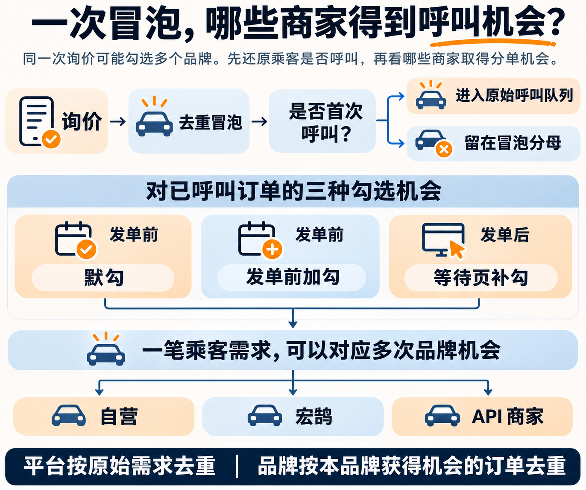

# 冒泡、呼叫与商家机会

同一次询价可能勾选多个品牌。先还原乘客是否呼叫，再看哪些商家取得分单机会。

## 从一次冒泡追到商家

| 停在哪一步 | 对照哪些记录 | 下一步怎么分 |
|---|---|---|
| 有询价 | 冒泡标识、端口、城市、品类与勾选快照 | 按真实快照还原勾选。同一冒泡的多行逐字段取最大值，可能拼出从未出现的勾选组合。 |
| 有原始呼叫 | 非改派呼叫标记、首次呼叫时间 | 一笔需求进大盘一次。等待页补勾可以改变参与竞争的品牌，对已有呼叫单独标记。 |
| 某品牌获得机会 | 呼单表的来源、订单、品牌、是否预分单 | 拆默勾、加勾、补勾；按品牌看给机会后的召回和应答。预分单的机会单列。 |

历史小猪端冒泡按 `combine_trace_id_by_pid` 去重，排除等待应答页。自营一口价、特快、特价在历史品牌口径中分别计数。跨到 PBD 或滴滴主端要重读该端的渠道和品类范围。

**如何识别变化。** 同一批原始需求，若每单勾选的品牌数发生变化，单个商家的竞争呼叫就可能波动。先比较平台呼叫笔数，再比较品牌勾选组合和补勾时点，最后看品牌获得机会后的应答。直接把各品牌呼叫相加会重复计算多勾需求。

**查数据。** 订单与标签按 `source_id + order_id` 回连，再核日期与跨日。商家呼单明细入口为 `kflower_dw.dwd_kf_trd_unity_order_anycar_di`。追未应答要从全量呼叫开始。

## 接着查

[冒泡转呼叫率与品牌竞争呼叫](../02%20指标拆解/02%20冒泡转呼叫率与品牌竞争呼叫.md) · [商家召回、匹配与司机决策](02%20商家召回、匹配与司机决策.md) · [平台完单量与完单率](../02%20指标拆解/01%20平台完单量与完单率.md)

## 文档依据

- [交易漏斗分端口径](https://git.xiaojukeji.com/bwh_stg/trading-efficiency-wiki/blob/9847514d22aee1525646d16e07d8429ab57a267a/wiki/%E6%8C%87%E6%A0%87/%E4%BA%A4%E6%98%93%E6%BC%8F%E6%96%97%E5%88%86%E7%AB%AF%E5%8F%A3%E5%BE%84%E5%90%88%E5%90%8C.md) · 29–68行
- [预分单表单分析](../../%E4%BA%A4%E6%98%93%E7%AD%96%E7%95%A5/01.%20%E4%BA%A4%E6%98%93%E7%AD%96%E7%95%A5/%E4%BA%A4%E6%98%93%E6%95%88%E7%8E%87%E6%96%B9%E5%90%91/02.%20%E4%BA%A4%E6%98%93%E6%A8%A1%E5%BC%8F/12.%20%E9%A2%84%E5%88%86%E5%8D%95/%E4%BA%AB%E9%81%93%E6%8E%A5%E5%85%A5%E9%A2%84%E5%88%86%E5%8D%95%E5%AE%9E%E9%AA%8C%E5%88%86%E6%9E%90/%E9%A2%84%E5%88%86%E5%8D%95%E8%A1%A8%E5%8D%95%E5%88%86%E6%9E%90.md) · 6–61、72–113行
- [小猪端取消与完单 SQL](https://cooper.didichuxing.com/knowledge/2199610335356/2199613339934) · 26行

[交易链路与指标导航](../00%20交易链路与指标导航.md)
