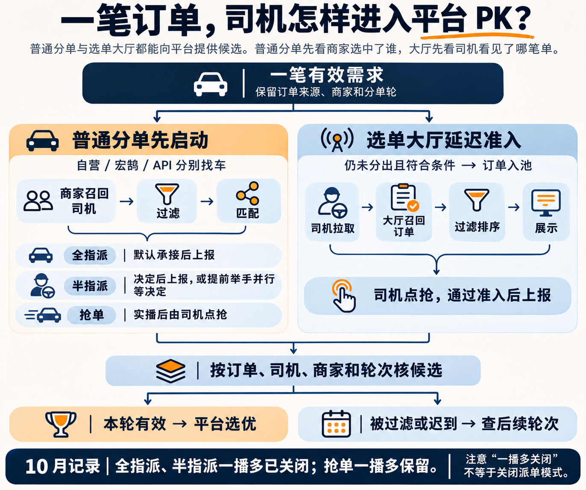

# 商家召回、匹配与司机决策

普通分单与选单大厅都能向平台提供候选。普通分单先看商家选中了谁，大厅先看司机看见了哪笔单。

## 普通分单

先在每个商家内查召回矩阵。召回形成订单—司机对（OD），过滤会改变候选范围；匹配在可用司机与订单之间做选择。自营、宏鹄的匹配重构方案对每个 OD 评估规则允许的全指派、半指派、抢单动作，保留一种模式及对应边权，再由 TP 或 GS 选配。此为方案记录，复盘须查当时是否生效。API 内部匹配按品牌实现。

| 模式 | 商家何时上报 | 接下来分开看 |
|---|---|---|
| 全指派 | 系统默认司机承接，商家上报候选 | 平台是否收到、是否有效、最终胜者是谁。 |
| 半指派，等决定再报 | 播单，司机接受或按规则默认接受后上报 | 拒绝、等待和默认动作分别看回调。 |
| 半指派，提前举手 | 为缩短等待，商家先带司机信息上报，同时播单并等待司机决定 | 保留平台竞争与司机决定两条时间线，直到同一候选具备承接条件。 |
| 抢单 | 播单，司机主动点抢后上报 | 未点抢、点抢后商家内选优、上报后平台落选是三个位置。 |

普通分单在商家内还可能经过 Duse-PK。未被匹配、已匹配未实播、已实播无决策回调分别留数。每个实际播出的 OD 有自己的模式。正常匹配与一播多补充流程分别核配置。历史补播方案里 GS 使用剩余运力，TP 考虑供需、候选数和播单上限。**10 月记录 §3.4.4 已写明全指派、半指派一播多关闭，抢单一播多保留。** 原文指轮次与 TopSpeed，抢单一播多沿用原进入规则和 RGS 匹配；具体业务日期仍需核开关。

## 选单大厅怎样汇入同一次 PK

同一笔需求先给普通轮次分单。等待配置时长后仍未分出、且满足准入条件，才进入大厅；资料示例是 7 秒。另一端司机打开或刷新大厅 → 按位置召回订单 → 过滤、排序、展示 → 司机点抢并通过准入 → 候选上报平台。一笔单可以同时留在大厅、又被普通轮次召回。按原始需求分别数仅普通、仅大厅、两路都有，并保留每个候选的入口。API 参与普通聚合竞争；大厅资料明确低 CPM 过滤覆盖自营和宏鹄司机，其他商家是否接入要查当期配置。PK 特征中的 `is_grab_from_cyborg` 可辅助识别选单举手。要查有展示而未点抢的订单，需要大厅曝光和点击记录。

**查数据。** 召回矩阵 `kflower_marketplace.ods_log_kflower_stgmatrix_hh` 按商家、分单轮、订单与司机看 OD。播单日志 `kflower_marketplace.ods_log_kflower_orderbroadcast_hh` 保留模式、来源和时间。商家的分单轮与平台 PK 轮须另核映射。

## 接着查

[召回覆盖、播单覆盖与举手率](../02%20指标拆解/04%20召回覆盖、播单覆盖与举手率.md) · [平台举手、PK 与正式应答](03%20平台举手、PK%20与正式应答.md) · [应答率与首次应答时长](../02%20指标拆解/03%20应答率与首次应答时长.md)

## 文档依据

- [召回 V2.1 方案](../../商家交易策略知识库/raw/商家召回策略V2/商家召回策略V2.1/商家召回策略V2.1策略方案.md) · 29–68行
- [召回 V2.1 实验](../../商家交易策略知识库/raw/商家召回策略V2/商家召回策略V2.1/商家召回策略V2.1实验评估.md) · 29–52行
- [匹配重构 V1.0-V2](https://cooper.didichuxing.com/knowledge/2199610335356/2209500732798) · 25–63、343–387、465–477、872–874行
- [匹配开发进展表](https://cooper.didichuxing.com/team-file/2199582756311/2210256066732) · 238–266行
- [一播多当时状态](https://cooper.didichuxing.com/knowledge/2199610335356/2209095466589) · 464–472、600–609行
- [历史补播方案](https://cooper.didichuxing.com/team-file/2199582756311/2206650408272) · 48–56行
- [选单当前策略梳理](https://cooper.didichuxing.com/team-file/2199582756311/2209971618471) · 98–214行
- [选单来源标识](../../%E4%BA%A4%E6%98%93%E7%AD%96%E7%95%A5/01.%20%E4%BA%A4%E6%98%93%E7%AD%96%E7%95%A5/%E4%BA%A4%E6%98%93%E6%95%88%E7%8E%87%E6%96%B9%E5%90%91/01.%20%E4%BA%A4%E6%98%93%E6%95%88%E7%8E%87/07.%20%E8%81%9A%E5%90%88PK/03.%20PK%E5%8F%AF%E8%A7%A3%E9%87%8A%E6%A8%A1%E5%9E%8B/PK%E5%8C%BA%E5%88%86%E5%8D%8A%E6%8C%87%E6%B4%BE%E6%A8%A1%E5%BC%8F%E7%AD%96%E7%95%A5%E6%96%B9%E6%A1%88.md) · 29–45行
- [召回 OD 矩阵快照](../../%E4%BA%A4%E6%98%93%E7%AD%96%E7%95%A5/01.%20%E4%BA%A4%E6%98%93%E7%AD%96%E7%95%A5/%E4%BA%A4%E6%98%93%E6%95%88%E7%8E%87%E6%96%B9%E5%90%91/01.%20%E4%BA%A4%E6%98%93%E6%95%88%E7%8E%87/01.%20%E5%88%86%E5%8D%95%E8%AE%BE%E8%AE%A1/%E5%95%86%E5%AE%B6%E5%88%86%E5%8D%95%E8%81%94%E5%90%88%E5%86%B3%E7%AD%96/%E5%95%86%E5%AE%B6%E5%88%86%E5%8D%95%E8%81%94%E5%90%88%E5%86%B3%E7%AD%96V1%E7%AD%96%E7%95%A5%E6%96%B9%E6%A1%88/%E5%88%86%E5%8D%95%E9%87%8D%E6%9E%84%E2%80%94%E2%80%94%E5%8C%B9%E9%85%8D%E8%81%94%E5%90%88%E5%86%B3%E7%AD%96V1.0/%E5%8C%B9%E9%85%8D%E9%87%8D%E6%9E%84-%E7%A6%BB%E7%BA%BF%E5%8F%82%E6%95%B0%E6%B5%8B%E7%AE%97/%E5%8F%AC%E5%9B%9EOD%E7%9F%A9%E9%98%B5%E5%80%99%E9%80%89%E8%A7%84%E6%A8%A1%E5%88%86%E6%9E%90.md) · 4–16、29–43行
- [交易策略串讲](https://git.xiaojukeji.com/bwh_stg/trading-efficiency-wiki/blob/9847514d22aee1525646d16e07d8429ab57a267a/raw/department-baseline/common/trading-strategy-introduction.md) · 56–104、132–166行
- [不提前举手扩量实验](https://git.xiaojukeji.com/bwh_stg/trading-efficiency-wiki/blob/9847514d22aee1525646d16e07d8429ab57a267a/wiki/%E5%AE%9E%E9%AA%8C%E4%B8%8E%E5%A4%8D%E7%9B%98/%E4%B8%8D%E6%8F%90%E5%89%8D%E4%B8%BE%E6%89%8B%E6%89%A9%E9%87%8F%E5%AE%9E%E9%AA%8C%E9%93%BE.md) · 34–52、70–74行

[交易链路与指标导航](../00%20交易链路与指标导航.md)
