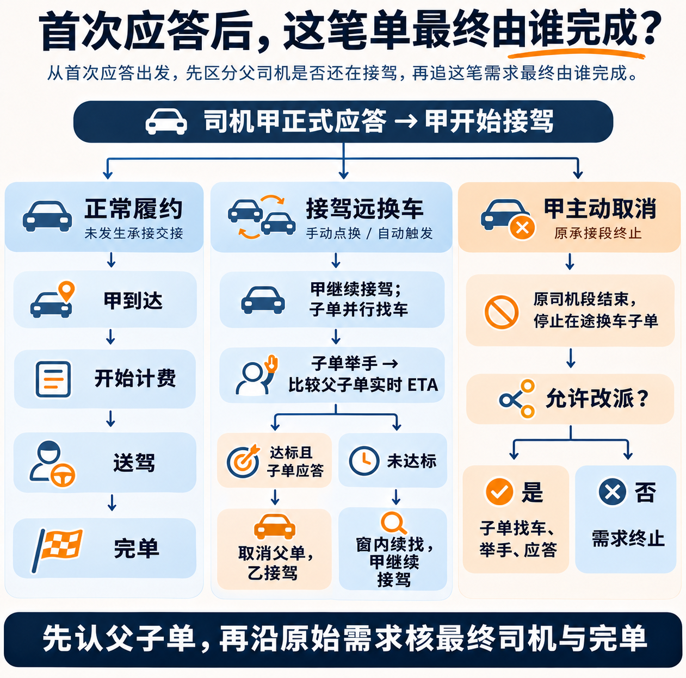

# 接驾、换车改派与履约

首次应答以后，乘客仍在同一次出行内，承接司机和订单号都可能变化。

| 应答后发生什么 | 中间必须看到什么 | 这笔原始需求怎样收尾 |
|---|---|---|
| 正常接驾 | 当前司机到达，乘客上车、开始计费 | 追最终完单；到达后取消保留为单独出口。 |
| 发起换车 | 策略轮询 → 实际发换车子单 → 子单找车。父司机还在接驾 | 新司机成功应答并交接，父单取消，由新司机履约；未换成则原司机继续，可后续再轮询。 |
| 原司机主动取消 | 原承接段结束；若已有换车子单，核停止状态与锁 | 允许改派则改派子单重走找车、举手、PK、应答；未获准或未找回时查原需求最终状态。 |
| 乘客取消或系统关单 | 查取消主体、发生在应答前或后、指向父单还是子单 | 沿原始号确认是否还有有效承接，核最终完单与关单标签。 |

**先证实交接，再计算时长。** 接驾远换车原始流程里，轮询先分不换、手动、自动。手动要乘客点换才发子单；自动命中可直接发子单。子单有司机举手后，比较父、子单实时接驾 ETA。达到版本规定的改善门槛才让子单应答并取消父单；未达到可在本次找车窗口里继续找，窗口结束则回到原司机。历史图示用了 90 秒的 ETA 改善门槛、90 秒的找车窗口和 120 秒轮询周期，三者含义各异。父司机点击到达后结束该轮询。

若父司机在这期间取消，追两个出口：可改派则停止换车子单、切换到改派子单；不可改派则停止换车子单并核关单。V2.2.1 记录的改派锁从 15 秒调整为 3 秒。锁时长与上面的三个时间条件各自按复盘日期核实。

用父子关系、原应答、子单发起与应答、父单取消、最终司机和完单标签拼一个序列。共享原始号只说明同一笔需求，不能仅按时间邻近推出哪张单是直接父单。换车策略输出“自动／手动”也需要与实际发子单、实际换成分开。

**数据入口。** 历史策略轮询 `kflower_marketplace.ods_log_kflower_athena_guide_answer_after_rec_h` 有 `oid`、`change_car_type`、`first_access`。父子样例用 `parent_order_id`，原始需求归一见项目 SQL。司机到达、开始计费、取消、完单分别保留；来源只有计费时间时，不能由此精确还原乘客上车时刻。

## 接着查

[应答后完单与司乘取消](../02%20指标拆解/06%20应答后完单与司乘取消.md) · [乘客总等待时长 ETP](../02%20指标拆解/07%20乘客总等待时长%20ETP.md) · [司机接驾时长与接驾距离](../02%20指标拆解/08%20司机接驾时长与接驾距离.md)

## 文档依据

- [接驾远换车原始流程图](3361887197a23c56-流程图.svg)
- [低意愿换车复盘](../../2025%E5%B9%B4LR/%E3%80%90LR25032%E3%80%91%E4%BD%8E%E6%8E%A5%E9%A9%BE%E6%84%8F%E6%84%BF%E6%8D%A2%E8%BD%A6%E7%AD%96%E7%95%A5V1.md) · 58–64、262–270行
- [换车 V2.2.1 改派锁修复](../../%E4%BA%A4%E6%98%93%E7%AD%96%E7%95%A5/01.%20%E4%BA%A4%E6%98%93%E7%AD%96%E7%95%A5/%E4%BA%A4%E6%98%93%E6%95%88%E7%8E%87%E6%96%B9%E5%90%91/02.%20%E4%BA%A4%E6%98%93%E6%A8%A1%E5%BC%8F/14.%20%E5%BA%94%E7%AD%94%E5%90%8E%E6%8D%A2%E8%BD%A6/02%E3%80%81%E6%8E%A5%E9%A9%BE%E8%BF%9C%E6%8D%A2%E8%BD%A6%E7%AD%96%E7%95%A5v2/%E6%8E%A5%E9%A9%BE%E8%BF%9C%E6%8D%A2%E8%BD%A6v2.1/%E6%8E%A5%E9%A9%BE%E8%BF%9C%E6%8D%A2%E8%BD%A6v2.1.3%E5%AE%9E%E9%AA%8C%E8%AF%84%E4%BC%B0.md) · 9–25行
- [换车轮询 SQL](../../%E4%BA%A4%E6%98%93%E7%AD%96%E7%95%A5/01.%20%E4%BA%A4%E6%98%93%E7%AD%96%E7%95%A5/%E4%BA%A4%E6%98%93%E6%95%88%E7%8E%87%E6%96%B9%E5%90%91/02.%20%E4%BA%A4%E6%98%93%E6%A8%A1%E5%BC%8F/14.%20%E5%BA%94%E7%AD%94%E5%90%8E%E6%8D%A2%E8%BD%A6/02%E3%80%81%E6%8E%A5%E9%A9%BE%E8%BF%9C%E6%8D%A2%E8%BD%A6%E7%AD%96%E7%95%A5v2/%E6%8E%A5%E9%A9%BE%E8%BF%9C%E6%8D%A2%E8%BD%A6v2.1/%E6%8E%A5%E9%A9%BE%E8%BF%9C%E6%8D%A2%E8%BD%A6v2.1.1%E5%AE%9E%E9%AA%8C%E8%AF%84%E4%BC%B0/%E6%8E%A5%E9%A9%BE%E8%BF%9C%E6%8D%A2%E8%BD%A6v2.1.1%E4%B8%8A%E7%BA%BF%E5%90%8E%E6%A0%A1%E9%AA%8C.md) · 434–458行
- [换车父子应答样例](../../%E4%BA%A4%E6%98%93%E7%AD%96%E7%95%A5/01.%20%E4%BA%A4%E6%98%93%E7%AD%96%E7%95%A5/%E4%BA%A4%E6%98%93%E6%95%88%E7%8E%87%E6%96%B9%E5%90%91/02.%20%E4%BA%A4%E6%98%93%E6%A8%A1%E5%BC%8F/14.%20%E5%BA%94%E7%AD%94%E5%90%8E%E6%8D%A2%E8%BD%A6/02%E3%80%81%E6%8E%A5%E9%A9%BE%E8%BF%9C%E6%8D%A2%E8%BD%A6%E7%AD%96%E7%95%A5v2/%E6%8E%A5%E9%A9%BE%E8%BF%9C%E6%8D%A2%E8%BD%A6v2.2/%E6%8E%A5%E9%A9%BE%E8%BF%9C%E6%8D%A2%E8%BD%A6-%E8%AE%A8%E8%AE%BAWIP.md) · 149–195行
- [交易效率指标与 SQL](../../%E4%BA%A4%E6%98%93%E7%AD%96%E7%95%A5/01.%20%E4%BA%A4%E6%98%93%E7%AD%96%E7%95%A5/%E4%BA%A4%E6%98%93%E6%95%88%E7%8E%87%E6%96%B9%E5%90%91/01.%20%E4%BA%A4%E6%98%93%E6%95%88%E7%8E%87/02.%20%E8%AF%84%E4%BC%B0%E4%BD%93%E7%B3%BB/%E4%BA%A4%E6%98%93%E6%95%88%E7%8E%87%E6%8C%87%E6%A0%87.md) · 38–107、192–302、332–459、675–742、1881–1891行
- [交易漏斗分端口径](https://git.xiaojukeji.com/bwh_stg/trading-efficiency-wiki/blob/9847514d22aee1525646d16e07d8429ab57a267a/wiki/%E6%8C%87%E6%A0%87/%E4%BA%A4%E6%98%93%E6%BC%8F%E6%96%97%E5%88%86%E7%AB%AF%E5%8F%A3%E5%BE%84%E5%90%88%E5%90%8C.md) · 29–68行
- [运力侧实际完单时刻样例](https://cooper.didichuxing.com/knowledge/2199610335356/2199613452971) · 9–13行

[交易链路与指标导航](../00%20交易链路与指标导航.md)
