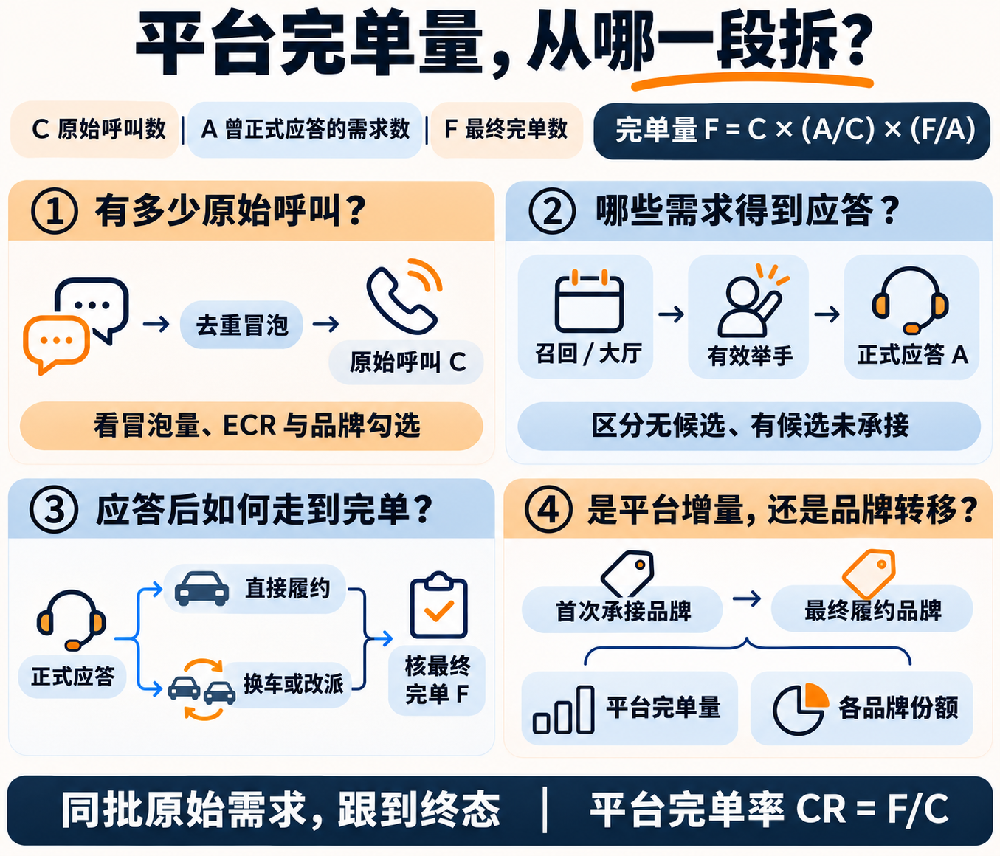

# 平台完单量与完单率

先把完单量拆成呼叫规模、获得应答和应答后完单。哪个量发生变化，就沿哪段查。

## 哪些数可以相乘

以同一端、同一批首次呼叫的原始需求为起点，追到观察窗收尾。C 为原始呼叫笔数，A 为其中至少有一次正式应答的笔数，F 为其中最终完单的笔数。**完单量 = C × (A/C) × (F/A)，完单率 CR = F/C = (A/C) × (F/A)。** 分母为零的比率留空。两期比较时同时列 C、A、F，能看清规模与转化分别变了多少。

| 首先出现差异 | 接着看什么 | 用哪条证据区分解释 |
|---|---|---|
| C | 冒泡量、询价转呼叫、端口和品类构成 | 冒泡相近时核真实勾选与首次发单；品牌竞争机会多也可能只是同一单多勾。 |
| A/C | 各商家召回覆盖、播单覆盖、有效举手，胜者能否应答 | 回原始需求分开“全程无候选”“有候选无胜者”“胜者未正式应答”。日志未齐的需求单列。 |
| F/A | 第一次应答后直接完成、保留原司机换车、司机取消改派、最终未完单 | 查子单是否承接，并追最终完单；同一需求可以经历不止一次换车或改派。 |

**复核贡献。** 需要给两期笔数搭桥时，可以固定替换次序 C → r → q（r=A/C，q=F/A）。三个贡献依次为 `(C₁−C₀)r₀q₀`、`C₁(r₁−r₀)q₀`、`C₁r₁(q₁−q₀)`，和等于 F₁−F₀。顺序会影响交互部分归到哪一项，适用于两期比率都可定义时。公式说明变化出现在哪一段；要把贡献归到策略，还要看分流、实际动作和中间事件。

## 接着查

[冒泡转呼叫率与品牌竞争呼叫](02%20冒泡转呼叫率与品牌竞争呼叫.md) · [应答率与首次应答时长](03%20应答率与首次应答时长.md) · [应答后完单与司乘取消](06%20应答后完单与司乘取消.md)

## 文档依据

- [交易漏斗分端口径](https://git.xiaojukeji.com/bwh_stg/trading-efficiency-wiki/blob/9847514d22aee1525646d16e07d8429ab57a267a/wiki/%E6%8C%87%E6%A0%87/%E4%BA%A4%E6%98%93%E6%BC%8F%E6%96%97%E5%88%86%E7%AB%AF%E5%8F%A3%E5%BE%84%E5%90%88%E5%90%8C.md) · 29–68行
- [交易效率指标与 SQL](../../%E4%BA%A4%E6%98%93%E7%AD%96%E7%95%A5/01.%20%E4%BA%A4%E6%98%93%E7%AD%96%E7%95%A5/%E4%BA%A4%E6%98%93%E6%95%88%E7%8E%87%E6%96%B9%E5%90%91/01.%20%E4%BA%A4%E6%98%93%E6%95%88%E7%8E%87/02.%20%E8%AF%84%E4%BC%B0%E4%BD%93%E7%B3%BB/%E4%BA%A4%E6%98%93%E6%95%88%E7%8E%87%E6%8C%87%E6%A0%87.md) · 38–107、192–302、332–459、675–742、1881–1891行
- [部门指标基线](https://git.xiaojukeji.com/bwh_stg/trading-efficiency-wiki/blob/9847514d22aee1525646d16e07d8429ab57a267a/raw/department-baseline/directions/trading-efficiency/metric/index.md) · 66–83、94–102行
- [商家份额排查](https://git.xiaojukeji.com/bwh_stg/trading-efficiency-wiki/blob/9847514d22aee1525646d16e07d8429ab57a267a/wiki/%E8%AF%8A%E6%96%AD%E6%8C%87%E5%8D%97/API%E5%95%86%E5%AE%B6%E4%BB%BD%E9%A2%9D%E4%B8%8E%E6%8E%A5%E9%A9%BE%E8%B7%9D%E7%A6%BB%E8%AF%8A%E6%96%AD.md) · 14–32行

[交易链路与指标导航](../00%20交易链路与指标导航.md)
