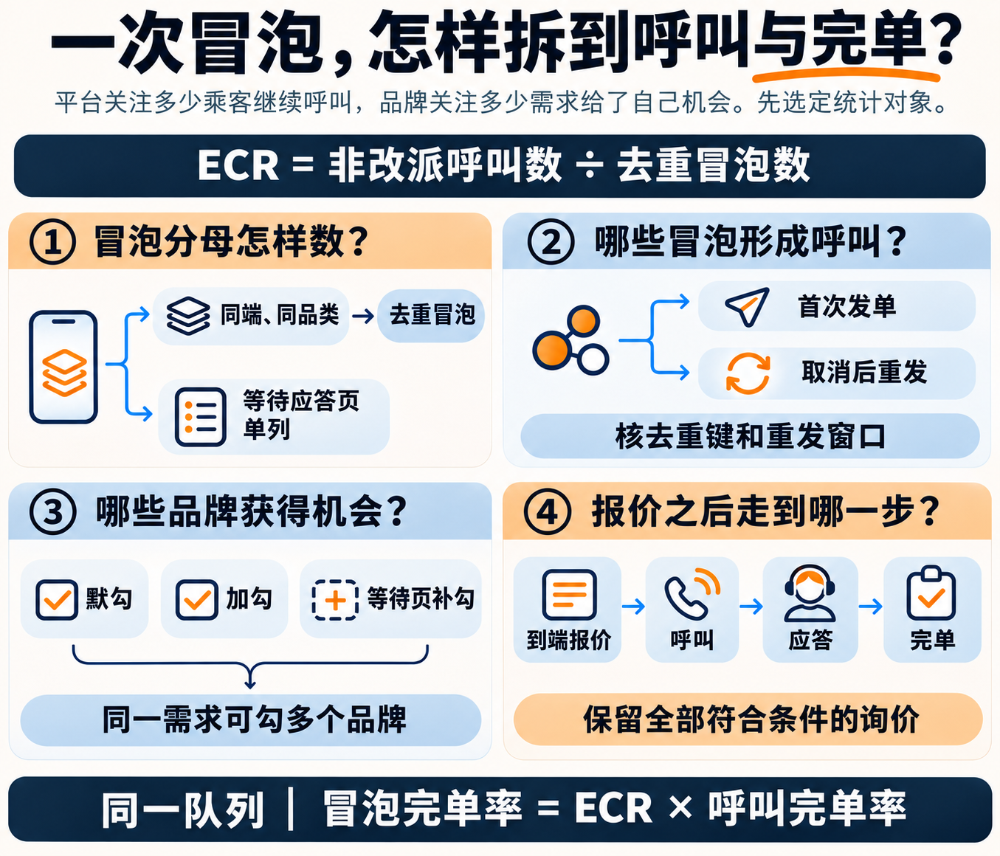

# 冒泡转呼叫率与品牌竞争呼叫

平台关注多少乘客继续呼叫，品牌关注多少需求给了自己机会。先选定统计对象。

按同一端和同一时间窗平铺四列：去重冒泡、非改派呼叫、首次正式应答、归一完单。ECR 的变动可以来自两端计数和样本构成。先核冒泡去重规则、品类范围、呼叫归一，且看两期是否都排除等待应答页。

**沿定价动作追。** 若调价实验有随机档位，按原始分配档位列出符合条件的询价、实际到端报价、继续呼叫、后续应答、最终完单。实际展示有缺口，就先查下发到展示；展示相近而继续呼叫不同，再看进入呼叫的人群改变了多少。比较价格策略对完单的作用时保留所有原先分配的可比询价，另列实际触达用于解释执行。若档位由模型自选，先核资格和实验分流，按所选档位的差异只作描述。

**沿品牌机会追。** 分别列起始勾选、发单前加勾、等待页补勾的订单数，同时报告“至少一个该品牌”的去重订单数。同一单可有多个品牌，商家竞争呼叫合计可超过平台原始呼叫。历史三方“客观呼叫”另排被自营应答的需求，该分母已使用结果信息。比较获得机会后的商家表现，要说明用的是哪一种分母。

**看哪里产生差异。** 固定城市、时段、品类，对同一原始需求对齐冒泡与发单快照。品牌机会变了但平台呼叫稳定，先看品牌组合；平台呼叫也变了，再回到冒泡量和 ECR。

## 从一次冒泡追到最终有车

同一端、同一批去重冒泡中，记 B 为冒泡数、C 为与这些冒泡对应的呼叫数、F 为这些呼叫最终完成的单数。两段使用相同的 C 时，需求满足率（冒泡完单率）可以对账为 **F/B = ECR × CR = (C/B) × (F/C)**。并列 B、C、F 与两段转化，能看清报价或车型展示改变的是继续呼叫的人数，还是呼叫以后真正完成的单数。跨期回补时，以原队列归属完单。

乘客取消后自行重发，要单列原始发单数、重发量和按业务规则去重的需求数。平台改派沿父子单归一；乘客重发需核乘客、出行关联键和去重窗口。来源未给已验收的重发归并规则时，保留两套计数，并标明哪套口径可与冒泡连接。 [需求满足率原口径](https://git.xiaojukeji.com/bwh_stg/trading-efficiency-wiki/blob/9847514d22aee1525646d16e07d8429ab57a267a/wiki/%E6%8C%87%E6%A0%87/demand-satisfaction-rate.md) [享道预分单对取消重发的追问](https://cooper.didichuxing.com/team-file/2204461264302/2206520415630)

## 接着查

[冒泡、呼叫与商家机会](../01%20交易阶段/01%20冒泡、呼叫与商家机会.md) · [平台完单量与完单率](01%20平台完单量与完单率.md) · [差供需冒泡占比与调价调度](09%20差供需冒泡占比与调价调度.md)

## 文档依据

- [交易漏斗分端口径](https://git.xiaojukeji.com/bwh_stg/trading-efficiency-wiki/blob/9847514d22aee1525646d16e07d8429ab57a267a/wiki/%E6%8C%87%E6%A0%87/%E4%BA%A4%E6%98%93%E6%BC%8F%E6%96%97%E5%88%86%E7%AB%AF%E5%8F%A3%E5%BE%84%E5%90%88%E5%90%8C.md) · 29–68行
- [预分单表单分析](../../%E4%BA%A4%E6%98%93%E7%AD%96%E7%95%A5/01.%20%E4%BA%A4%E6%98%93%E7%AD%96%E7%95%A5/%E4%BA%A4%E6%98%93%E6%95%88%E7%8E%87%E6%96%B9%E5%90%91/02.%20%E4%BA%A4%E6%98%93%E6%A8%A1%E5%BC%8F/12.%20%E9%A2%84%E5%88%86%E5%8D%95/%E4%BA%AB%E9%81%93%E6%8E%A5%E5%85%A5%E9%A2%84%E5%88%86%E5%8D%95%E5%AE%9E%E9%AA%8C%E5%88%86%E6%9E%90/%E9%A2%84%E5%88%86%E5%8D%95%E8%A1%A8%E5%8D%95%E5%88%86%E6%9E%90.md) · 6–61、72–113行
- [部门指标基线](https://git.xiaojukeji.com/bwh_stg/trading-efficiency-wiki/blob/9847514d22aee1525646d16e07d8429ab57a267a/raw/department-baseline/directions/trading-efficiency/metric/index.md) · 66–83、94–102行
- [LR26.053 动调调度](https://cooper.didichuxing.com/knowledge/2199610335356/2210480578095) · §3.1–3.2、§4.3–4.5 与附录 E

[交易链路与指标导航](../00%20交易链路与指标导航.md)
