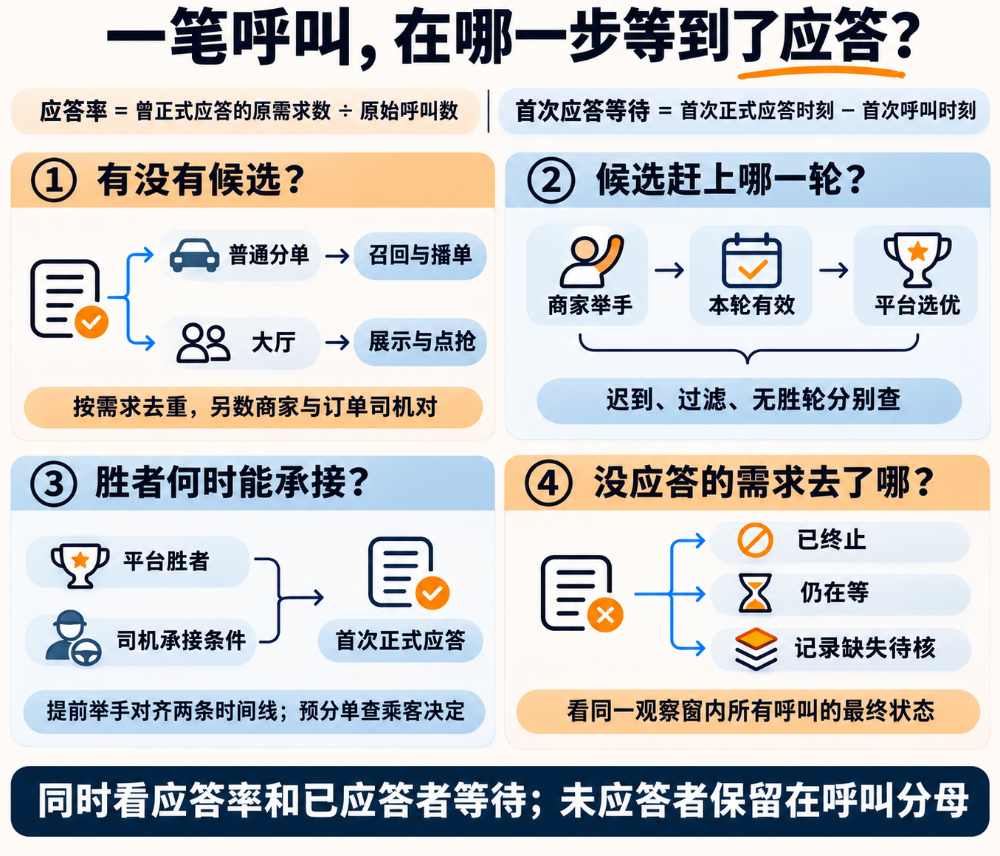

# 应答率与首次应答时长

一次呼叫有没有应答，以及应答的乘客等了多久，是同一条链上的两个统计问题。

**两种分母。** 原需求视角 AR=A/C。部门“单均应答时长”按应答样本计算首次正式应答时刻减首次呼叫时刻，分母是应答量（剔除改派）。部门表另有竞争呼叫版应答率，即剔除改派的应答订单数 ÷ 小猪端竞争呼叫订单数。实际复盘先写明分端、是否含改派、分母的含义。同一批 C 若有部分订单始终未应答，它们仍进 AR 分母，却没有已实现的首次应答时长。

| 定位 | 顺着哪个中间事件追 | 可以排开的解释 |
|---|---|---|
| 呼叫后无应答 | 先查商家机会、有无召回覆盖、有无实际播单或大厅候选，再查该需求全程是否出现有效举手 | 区分没有可选司机、已有匹配却未有效上报、有效候选最后未承接。 |
| 有效举手后仍在等 | 对齐上报、入窗、决策、司机确认、实际应答五个时点 | 同一候选的确认和 PK 可以并行。把两个持续时间相加会重复算重叠区间。 |
| 首次应答的均值发生变化 | 在同一观察期限按距呼叫的相同经过时间看“已首次应答／未曾应答已终止／未曾应答仍等待”的需求数；再分商家、模式、轮次 | 长等待的需求可能取消，或在另一时期获得应答；已应答人群的构成也会改变均值。 |

追未应答从全量呼叫开始。超时体验特征可能包含主动取消；要确认关单主体须回订单终态。正式应答之后若有第二位司机承接，首次应答时钟仍停在第一位。

## 看到“0 秒胜出”先查哪条路径

先写清计时起终点。一次 PK 的举手至决策耗时，只覆盖乘客从呼叫到首次应答的一部分。对同一批 PK 轮先分单勾自营、品牌 only／both 及 Top1 状态，再查该轮是否符合动态窗口的资格、有无提前结束记录、实际胜者与应答时刻。

历史动态窗口分析中，单勾自营可以立即选出司机；当时 Top1 为提前举手或滴滴司机的场景不适用动态窗口。两条落表时间若只精确到秒，同一秒内先后发生的事件也显示 0 秒。若无法识别空白组或缺当期触发日志，只能报告各类时长的分布和样本量。 [PK 动态窗口线上分析](../../PK%E7%AD%96%E7%95%A5%E7%9F%A5%E8%AF%86%E5%BA%93/raw/02.%20PK%E5%8A%A8%E6%80%81%E7%AA%97%E5%8F%A3%E7%AD%96%E7%95%A5/PK%E5%8A%A8%E6%80%81%E7%AA%97%E5%8F%A3%E7%AD%96%E7%95%A5V0%E4%B9%8B%E7%BA%BF%E4%B8%8A%E5%88%86%E6%9E%90.md)

## 接着查

[商家召回、匹配与司机决策](../01%20交易阶段/02%20商家召回、匹配与司机决策.md) · [平台举手、PK 与正式应答](../01%20交易阶段/03%20平台举手、PK%20与正式应答.md) · [召回覆盖、播单覆盖与举手率](04%20召回覆盖、播单覆盖与举手率.md) · [乘客总等待时长 ETP](07%20乘客总等待时长%20ETP.md)

## 文档依据

- [交易漏斗分端口径](https://git.xiaojukeji.com/bwh_stg/trading-efficiency-wiki/blob/9847514d22aee1525646d16e07d8429ab57a267a/wiki/%E6%8C%87%E6%A0%87/%E4%BA%A4%E6%98%93%E6%BC%8F%E6%96%97%E5%88%86%E7%AB%AF%E5%8F%A3%E5%BE%84%E5%90%88%E5%90%8C.md) · 29–68行
- [部门指标基线](https://git.xiaojukeji.com/bwh_stg/trading-efficiency-wiki/blob/9847514d22aee1525646d16e07d8429ab57a267a/raw/department-baseline/directions/trading-efficiency/metric/index.md) · 66–83、94–102行
- [交易效率指标与 SQL](../../%E4%BA%A4%E6%98%93%E7%AD%96%E7%95%A5/01.%20%E4%BA%A4%E6%98%93%E7%AD%96%E7%95%A5/%E4%BA%A4%E6%98%93%E6%95%88%E7%8E%87%E6%96%B9%E5%90%91/01.%20%E4%BA%A4%E6%98%93%E6%95%88%E7%8E%87/02.%20%E8%AF%84%E4%BC%B0%E4%BD%93%E7%B3%BB/%E4%BA%A4%E6%98%93%E6%95%88%E7%8E%87%E6%8C%87%E6%A0%87.md) · 38–107、192–302、332–459、675–742、1881–1891行
- [聚合决策串讲](../../PK策略知识库/raw/00.%20聚合决策串讲%20.md) · 11–17、25–66、119–129、155–162行
- [预分单表单分析](../../%E4%BA%A4%E6%98%93%E7%AD%96%E7%95%A5/01.%20%E4%BA%A4%E6%98%93%E7%AD%96%E7%95%A5/%E4%BA%A4%E6%98%93%E6%95%88%E7%8E%87%E6%96%B9%E5%90%91/02.%20%E4%BA%A4%E6%98%93%E6%A8%A1%E5%BC%8F/12.%20%E9%A2%84%E5%88%86%E5%8D%95/%E4%BA%AB%E9%81%93%E6%8E%A5%E5%85%A5%E9%A2%84%E5%88%86%E5%8D%95%E5%AE%9E%E9%AA%8C%E5%88%86%E6%9E%90/%E9%A2%84%E5%88%86%E5%8D%95%E8%A1%A8%E5%8D%95%E5%88%86%E6%9E%90.md) · 6–61、72–113行
- [不提前举手扩量实验](https://git.xiaojukeji.com/bwh_stg/trading-efficiency-wiki/blob/9847514d22aee1525646d16e07d8429ab57a267a/wiki/%E5%AE%9E%E9%AA%8C%E4%B8%8E%E5%A4%8D%E7%9B%98/%E4%B8%8D%E6%8F%90%E5%89%8D%E4%B8%BE%E6%89%8B%E6%89%A9%E9%87%8F%E5%AE%9E%E9%AA%8C%E9%93%BE.md) · 34–52、70–74行
- [未应答超时特征样例](../../%E4%BA%A4%E6%98%93%E7%AD%96%E7%95%A5/01.%20%E4%BA%A4%E6%98%93%E7%AD%96%E7%95%A5/%E4%BA%A4%E6%98%93%E6%95%88%E7%8E%87%E6%96%B9%E5%90%91/07.%20%E6%8A%80%E6%9C%AF%E6%B2%89%E6%B7%80/%E6%8A%80%E6%9C%AF%E5%BB%BA%E8%AE%BE2026/Attribution/%E5%BD%92%E5%9B%A0/%E6%95%B0%E6%8D%AE%E9%9B%86/%E6%95%B0%E6%8D%AE%E9%9B%86%E6%9E%84%E9%80%A0v0.md) · 8–23行

[交易链路与指标导航](../00%20交易链路与指标导航.md)
