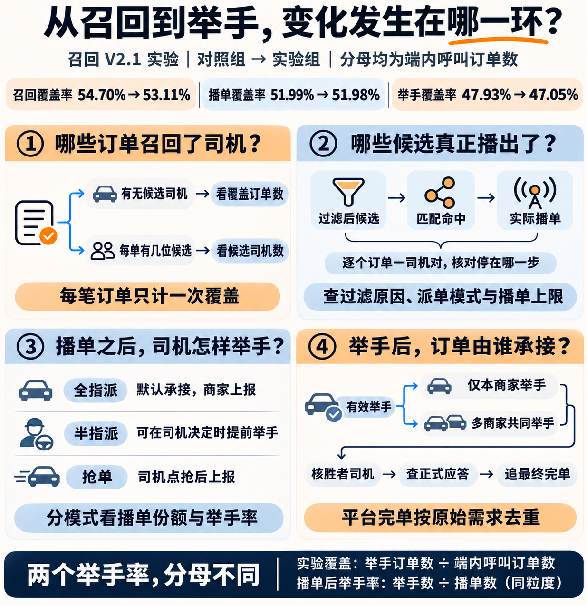

# 召回覆盖、播单覆盖与举手率

先看多少订单至少有一位候选，再看每单有多少司机、真正播给谁以及谁举手。

召回 V2.1 实验按端内呼叫看召回订单覆盖、播单订单覆盖、举手订单覆盖。用同批订单分别计算“至少一次召回／播单／举手的去重订单数 ÷ 端内呼叫订单数”。**部门举手率另取举手数 ÷ 播单数，分子与分母须同粒度。** 一个是从呼叫起算的覆盖，另一个是播单后的条件转化，两者回答的问题不同。

| 中间位置 | 最值得并排看的两组数 | 下一步 |
|---|---|---|
| 召回矩阵 | 至少有一位司机的订单数、每单候选数 | 将召回订单分为原先无候选与原先已有候选。仅候选密度变化时，分空闲／连环、距离与 ETA 层；看增加的是否为原本无司机的订单。 |
| 过滤、匹配、播单 | 过滤前后唯一 OD、匹配命中 OD 与实际播出 OD | 找首次出现差异的位置；再查匹配资源竞争、模式、轮次、上限。 |
| 播单到上报 | 各模式实播、主动接受／点抢、提前举手、确认回调 | 同一候选多条举手记录按用途拆；选单大厅用曝光→点抢→上报单独观察。 |
| 到达平台以后 | 原先无覆盖而本期／实验期被覆盖的需求、有效举手、胜出应答与最终完单 | 扩召回若只给已有较多候选的单增加 OD，覆盖率和平台完单不必同步。因果判断需可比对照。 |

V2.1 的评审还问了两个连续的问题：当召回与播单的表现不一致，先看被过滤的 OD 原来是否有机会播出；当播单与举手表现不一致，再将播单按全指派、半指派和抢单拆开，比较各模式份额和各自的播单后举手率。继续到胜出时，分开独举直接胜出与共同举手后胜出。这样每一次追问都落在相邻两步上。

同一司机可能连到多个订单。按订单看覆盖之外，再按司机看唯一连边、被多单争用与未播原因。对一播多需区分历史设计与 10 月记录中的生效模式。扩召回实验中，“原本无候选”需要同一输入回放旧规则、双跑或保留旧规则命中标记来识别。普通实验与对照两组是不同的需求，只能按组比较覆盖分布，不能据此给单笔打上新增标签。

## 同时影响多个渠道时，怎样追一次召回调整

召回 V1.0.2 的历史评估中，自营、宏鹄的召回量在端内和端外方向相反，端内播单的 TP 份额也发生变化。复盘先将呼叫按渠道划成互斥范围。若报表的“端外”已含 PBD，先剥出 PBD 或保留原端外合计；随后在各渠道内按商家、TP／GS、空闲／连环司机拆。

每格并排列呼叫量、至少一次被召回的订单数、唯一 OD、实播、有效举手、应答和最终完单。先看各格内部哪一步变了，再用实际数量和权重合回所选渠道总量。仅轮询次数变化也会改变 OD 事件条数；同一司机是否转去服务别的渠道，需要司机标识与时间段，或可比实验来核验。 [召回 V1.0.2 分端实验](../../%E4%BA%A4%E6%98%93%E7%AD%96%E7%95%A5/01.%20%E4%BA%A4%E6%98%93%E7%AD%96%E7%95%A5/%E4%BA%A4%E6%98%93%E6%95%88%E7%8E%87%E6%96%B9%E5%90%91/01.%20%E4%BA%A4%E6%98%93%E6%95%88%E7%8E%87/01.%20%E5%88%86%E5%8D%95%E8%AE%BE%E8%AE%A1/%E5%95%86%E5%AE%B6%E5%88%86%E5%8D%95%E8%81%94%E5%90%88%E5%86%B3%E7%AD%96/%E5%95%86%E5%AE%B6%E5%88%86%E5%8D%95%E8%81%94%E5%90%88%E5%86%B3%E7%AD%96V1%E7%AD%96%E7%95%A5%E6%96%B9%E6%A1%88/%E5%88%86%E5%8D%95%E9%87%8D%E6%9E%84%E2%80%94%E2%80%94%E5%8F%AC%E5%9B%9E%E8%AE%BE%E8%AE%A1%E6%96%B9%E6%A1%88V1/%E5%8F%AC%E5%9B%9E%E9%87%8D%E6%9E%84V1.0/%E5%8F%AC%E5%9B%9E%E9%87%8D%E6%9E%84%E6%97%B6%E9%97%B4%E7%89%87%E5%AE%9E%E9%AA%8CV1.0.3/%E5%8F%AC%E5%9B%9E%E9%87%8D%E6%9E%84V1.0.3%E6%97%B6%E9%97%B4%E7%89%87%E5%AE%9E%E9%AA%8C%E8%AF%84%E4%BC%B0.md) [端内外召回排查](https://git.xiaojukeji.com/bwh_stg/trading-efficiency-wiki/blob/9847514d22aee1525646d16e07d8429ab57a267a/wiki/%E8%AF%8A%E6%96%AD%E6%8C%87%E5%8D%97/%E5%8F%AC%E5%9B%9E%E7%AB%AF%E5%86%85%E5%A4%96%E8%85%BE%E6%8C%AA%E8%AF%8A%E6%96%AD.md)

## 接着查

[商家召回、匹配与司机决策](../01%20交易阶段/02%20商家召回、匹配与司机决策.md) · [应答率与首次应答时长](03%20应答率与首次应答时长.md) · [商家 PK 胜率与完单份额](05%20商家%20PK%20胜率与完单份额.md)

## 文档依据

- [召回 V2.1 方案](../../商家交易策略知识库/raw/商家召回策略V2/商家召回策略V2.1/商家召回策略V2.1策略方案.md) · 29–68行
- [召回 V2.1 实验](../../商家交易策略知识库/raw/商家召回策略V2/商家召回策略V2.1/商家召回策略V2.1实验评估.md) · 29–52行
- [召回 OD 矩阵快照](../../%E4%BA%A4%E6%98%93%E7%AD%96%E7%95%A5/01.%20%E4%BA%A4%E6%98%93%E7%AD%96%E7%95%A5/%E4%BA%A4%E6%98%93%E6%95%88%E7%8E%87%E6%96%B9%E5%90%91/01.%20%E4%BA%A4%E6%98%93%E6%95%88%E7%8E%87/01.%20%E5%88%86%E5%8D%95%E8%AE%BE%E8%AE%A1/%E5%95%86%E5%AE%B6%E5%88%86%E5%8D%95%E8%81%94%E5%90%88%E5%86%B3%E7%AD%96/%E5%95%86%E5%AE%B6%E5%88%86%E5%8D%95%E8%81%94%E5%90%88%E5%86%B3%E7%AD%96V1%E7%AD%96%E7%95%A5%E6%96%B9%E6%A1%88/%E5%88%86%E5%8D%95%E9%87%8D%E6%9E%84%E2%80%94%E2%80%94%E5%8C%B9%E9%85%8D%E8%81%94%E5%90%88%E5%86%B3%E7%AD%96V1.0/%E5%8C%B9%E9%85%8D%E9%87%8D%E6%9E%84-%E7%A6%BB%E7%BA%BF%E5%8F%82%E6%95%B0%E6%B5%8B%E7%AE%97/%E5%8F%AC%E5%9B%9EOD%E7%9F%A9%E9%98%B5%E5%80%99%E9%80%89%E8%A7%84%E6%A8%A1%E5%88%86%E6%9E%90.md) · 4–16、29–43行
- [交易策略串讲](https://git.xiaojukeji.com/bwh_stg/trading-efficiency-wiki/blob/9847514d22aee1525646d16e07d8429ab57a267a/raw/department-baseline/common/trading-strategy-introduction.md) · 56–104、132–166行
- [一播多当时状态](https://cooper.didichuxing.com/knowledge/2199610335356/2209095466589) · 464–472、600–609行
- [历史补播方案](https://cooper.didichuxing.com/team-file/2199582756311/2206650408272) · 48–56行
- [商家排查 SQL](../../%E4%BA%A4%E6%98%93%E7%AD%96%E7%95%A5/01.%20%E4%BA%A4%E6%98%93%E7%AD%96%E7%95%A5/%E4%BA%A4%E6%98%93%E6%95%88%E7%8E%87%E6%96%B9%E5%90%91/00.%20%E4%BA%A4%E6%98%93%E5%9F%BA%E7%A1%80/%E4%BA%A4%E6%98%93%E7%AD%96%E7%95%A5-%E7%BA%BF%E4%B8%8A%E7%9B%91%E6%8E%A7%26%E9%97%AE%E9%A2%98%E6%8E%92%E6%9F%A5/%E4%BA%A4%E6%98%93%E7%AD%96%E7%95%A5-%E7%BA%BF%E4%B8%8A%E7%9B%91%E6%8E%A7%26%E9%97%AE%E9%A2%98%E6%8E%92%E6%9F%A5.md) · 21–151、164–172行
- [司机唯一连边与未播诊断口径](https://git.xiaojukeji.com/bwh_stg/trading-efficiency-wiki/blob/9847514d22aee1525646d16e07d8429ab57a267a/wiki/%E6%8C%87%E6%A0%87/%E5%8F%B8%E6%9C%BA%E5%94%AF%E4%B8%80%E8%BF%9E%E8%BE%B9%E4%B8%8E%E6%9C%AA%E6%92%AD%E8%AF%8A%E6%96%AD%E5%8F%A3%E5%BE%84.md)

[交易链路与指标导航](../00%20交易链路与指标导航.md)
