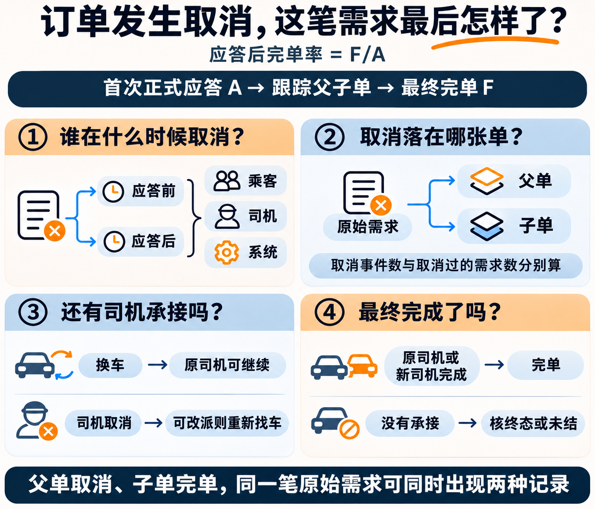

# 应答后完单与司乘取消

取消发生在一张订单、一段司机承接或一笔乘客需求上。先找到被取消的对象。

对已正式应答的原始需求，先算 **F/A**。完整且终态已知时，A−F 是应答后最终未完单的需求数。再从中找司乘取消和其他终态；观测窗还未走完的订单单列。一次父单取消且子单完单，同时属于“发生过取消”和“原始需求最终完单”。

| 复盘对象 | 对应中间环节 | 分母和判读 |
|---|---|---|
| 应答前乘客取消 | 呼叫 → 等待中取消，尚无正式应答 | 用呼叫订单作分母，回看无候选、等待轮次和并行确认。 |
| 应答后乘客／司机取消 | 先看首次应答与取消时刻，再看取消主体和含改派标记 | 部门乘客版分子剔除改派、分母含改派应答；司机含改派版分子、分母均含改派。看板若用其他版本分别列示。 |
| 发起换车 | 被轮询 → 建议换车 → 实发子单 → 子单有举手 → 父子实时 ETA 比较达标 → 子单应答并交接 → 最终完单 | 分别计算各步到下一步的条件转化。未换成的需求仍可能由原司机履约。 |
| 司机取消后改派 | 可改派 → 成功发改派子单 → 再应答 → 最终完单 | 比较具备资格、实际尝试与被接回的需求数；区分无机会、找车失败、接回后又终止。 |

“胜出后履约率”在部门口径中分母为 PK 胜出数，分子要求胜出后应答且无司乘取消；“应答后完单率”则以已应答的原需求为分母，允许换车和改派后完成。复盘报两者时给每列标明对象。

## 接着查

[接驾、换车改派与履约](../01%20交易阶段/04%20接驾、换车改派与履约.md) · [平台完单量与完单率](01%20平台完单量与完单率.md) · [乘客总等待时长 ETP](07%20乘客总等待时长%20ETP.md)

## 文档依据

- [部门指标基线](https://git.xiaojukeji.com/bwh_stg/trading-efficiency-wiki/blob/9847514d22aee1525646d16e07d8429ab57a267a/raw/department-baseline/directions/trading-efficiency/metric/index.md) · 66–83、94–102行
- [交易漏斗分端口径](https://git.xiaojukeji.com/bwh_stg/trading-efficiency-wiki/blob/9847514d22aee1525646d16e07d8429ab57a267a/wiki/%E6%8C%87%E6%A0%87/%E4%BA%A4%E6%98%93%E6%BC%8F%E6%96%97%E5%88%86%E7%AB%AF%E5%8F%A3%E5%BE%84%E5%90%88%E5%90%8C.md) · 29–68行
- [小猪端取消与完单 SQL](https://cooper.didichuxing.com/knowledge/2199610335356/2199613339934) · 26行
- [接驾远换车原始流程图](3361887197a23c56-流程图.svg)
- [低意愿换车复盘](../../2025%E5%B9%B4LR/%E3%80%90LR25032%E3%80%91%E4%BD%8E%E6%8E%A5%E9%A9%BE%E6%84%8F%E6%84%BF%E6%8D%A2%E8%BD%A6%E7%AD%96%E7%95%A5V1.md) · 58–64、262–270行
- [换车父子应答样例](../../%E4%BA%A4%E6%98%93%E7%AD%96%E7%95%A5/01.%20%E4%BA%A4%E6%98%93%E7%AD%96%E7%95%A5/%E4%BA%A4%E6%98%93%E6%95%88%E7%8E%87%E6%96%B9%E5%90%91/02.%20%E4%BA%A4%E6%98%93%E6%A8%A1%E5%BC%8F/14.%20%E5%BA%94%E7%AD%94%E5%90%8E%E6%8D%A2%E8%BD%A6/02%E3%80%81%E6%8E%A5%E9%A9%BE%E8%BF%9C%E6%8D%A2%E8%BD%A6%E7%AD%96%E7%95%A5v2/%E6%8E%A5%E9%A9%BE%E8%BF%9C%E6%8D%A2%E8%BD%A6v2.2/%E6%8E%A5%E9%A9%BE%E8%BF%9C%E6%8D%A2%E8%BD%A6-%E8%AE%A8%E8%AE%BAWIP.md) · 149–195行
- [换车 V2.2.1 改派锁修复](../../%E4%BA%A4%E6%98%93%E7%AD%96%E7%95%A5/01.%20%E4%BA%A4%E6%98%93%E7%AD%96%E7%95%A5/%E4%BA%A4%E6%98%93%E6%95%88%E7%8E%87%E6%96%B9%E5%90%91/02.%20%E4%BA%A4%E6%98%93%E6%A8%A1%E5%BC%8F/14.%20%E5%BA%94%E7%AD%94%E5%90%8E%E6%8D%A2%E8%BD%A6/02%E3%80%81%E6%8E%A5%E9%A9%BE%E8%BF%9C%E6%8D%A2%E8%BD%A6%E7%AD%96%E7%95%A5v2/%E6%8E%A5%E9%A9%BE%E8%BF%9C%E6%8D%A2%E8%BD%A6v2.1/%E6%8E%A5%E9%A9%BE%E8%BF%9C%E6%8D%A2%E8%BD%A6v2.1.3%E5%AE%9E%E9%AA%8C%E8%AF%84%E4%BC%B0.md) · 9–25行

[交易链路与指标导航](../00%20交易链路与指标导航.md)
