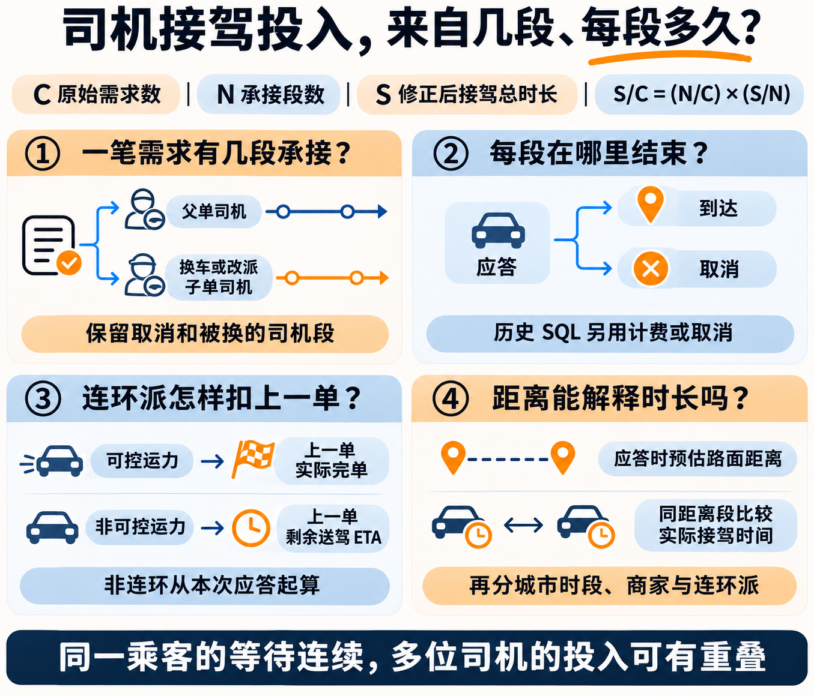

# 司机接驾时长与接驾距离

司机侧先数承接了几段，再看每一段占用多久。换车期间，两位司机的投入都要保留。

归一司机接驾资料的修订正文采用各应答段至到达／取消的时间，与归一订单数 C 相除；同份资料历史 SQL 采用计费／取消终点。部门单均接驾另以应答量为分母。**复盘结论要同时写终点、分母和连环修正版本。**

设实际纳入的司机承接段数为 N、按所选版本修正后的段时长之和为 S，则 `S/C = (N/C) × (S/N)`（C、N 非零）。先看每笔原需求发生几段承接，再追段均多久。将段按商家、连环派与司机退出原因分组，可区分新增被换司机段、同类段变长，以及司机结构发生变化。

| 运力、派单类型 | 部门计费／取消版本的修正 |
|---|---|
| 可控、非连环 | 从本次应答算到开始计费或取消。 |
| 可控、连环 | 从上一单实际完成算起；本单在上一单完成前已取消，接驾占用记零。 |
| 非可控、非连环 | 从本次应答算到开始计费或取消。 |
| 非可控、连环 | 从本次应答起算，扣上一单剩余送驾 ETA；取消前等待不足该 ETA 时记零。 |

**接驾距离如何配合。** 部门平均接驾距离是应答时预估路面接驾距离总和除以应答量（含改派）。先看距离分布与样本覆盖，继而比较同距离段、同城市时段的实际接驾时长，再看各组应答占比。距离与时长相关，仍需考虑连环派上一单占用和到达／计费打点的差异。部门送驾时长占比 = 送驾时间 ÷（送驾时间 + 修正后接驾时间）。送驾时间从开始计费到结束计费，先并排看两项时间总量，再追司机类型和承接段数。

## 接着查

[接驾、换车改派与履约](../01%20交易阶段/04%20接驾、换车改派与履约.md) · [乘客总等待时长 ETP](07%20乘客总等待时长%20ETP.md) · [应答后完单与司乘取消](06%20应答后完单与司乘取消.md)

## 文档依据

- [归一司机接驾时长](https://git.xiaojukeji.com/bwh_stg/trading-efficiency-wiki/blob/9847514d22aee1525646d16e07d8429ab57a267a/wiki/%E6%8C%87%E6%A0%87/normalized-driver-pickup-duration.md) · 15–31行
- [四类司机接驾修正](https://git.xiaojukeji.com/bwh_stg/trading-efficiency-wiki/blob/9847514d22aee1525646d16e07d8429ab57a267a/wiki/%E6%8C%87%E6%A0%87/avg-pickup-duration.md) · 29–54行
- [交易效率指标与 SQL](../../%E4%BA%A4%E6%98%93%E7%AD%96%E7%95%A5/01.%20%E4%BA%A4%E6%98%93%E7%AD%96%E7%95%A5/%E4%BA%A4%E6%98%93%E6%95%88%E7%8E%87%E6%96%B9%E5%90%91/01.%20%E4%BA%A4%E6%98%93%E6%95%88%E7%8E%87/02.%20%E8%AF%84%E4%BC%B0%E4%BD%93%E7%B3%BB/%E4%BA%A4%E6%98%93%E6%95%88%E7%8E%87%E6%8C%87%E6%A0%87.md) · 38–107、192–302、332–459、675–742、1881–1891行
- [部门指标基线](https://git.xiaojukeji.com/bwh_stg/trading-efficiency-wiki/blob/9847514d22aee1525646d16e07d8429ab57a267a/raw/department-baseline/directions/trading-efficiency/metric/index.md) · 66–83、94–102行
- [商家份额排查](https://git.xiaojukeji.com/bwh_stg/trading-efficiency-wiki/blob/9847514d22aee1525646d16e07d8429ab57a267a/wiki/%E8%AF%8A%E6%96%AD%E6%8C%87%E5%8D%97/API%E5%95%86%E5%AE%B6%E4%BB%BD%E9%A2%9D%E4%B8%8E%E6%8E%A5%E9%A9%BE%E8%B7%9D%E7%A6%BB%E8%AF%8A%E6%96%AD.md) · 14–32行

[交易链路与指标导航](../00%20交易链路与指标导航.md)
