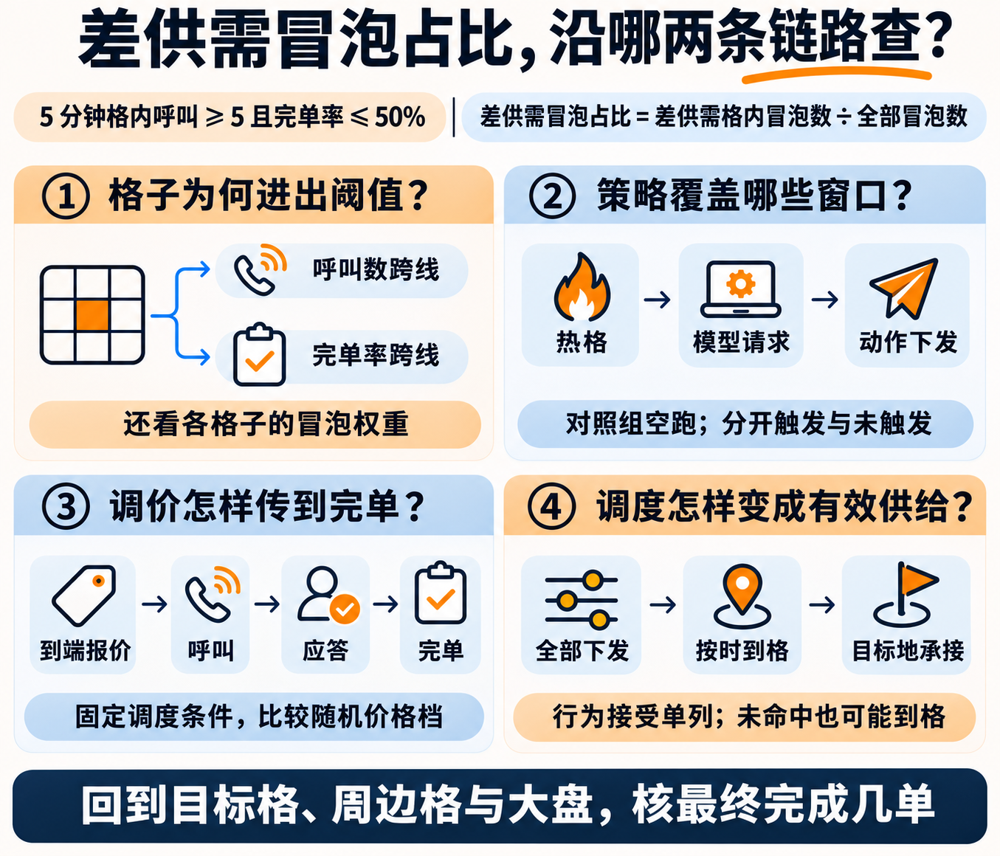

# 差供需冒泡占比与调价调度

先弄清哪个格子跨过判定阈值，再追乘客看到的价格、司机实际到达和最终由谁完成服务。

## 同一个占比，哪些东西能让它变

LR26.053 按 5 分钟地理格子观察，格内呼叫至少 5 次且完单率不高于 50% 时判差供需。**差供需冒泡占比 = 判为差供需的格子内冒泡总数 / 全部格子冒泡总数。** 比较两个时期，先看格内呼叫数与完单率是否跨阈，再看各格子承载的冒泡量和全盘分母。即使差供需格子数相同，冒泡分布也能改变占比。

## 先对齐三个窗口

- **请求时刻 T。** 原文 §4.4.1 的模型覆盖分析先取最近 10 分钟呼叫大于 2 单的热格，再限定为已召回、已请求模型且未来标签可得的窗口。
- **结果窗口。** 从 T 往后 10 到 15 分钟，即 `[T+10, T+15)`，用实际呼叫和完单计算真实差供需标签。按格数算覆盖和按冒泡量加权算覆盖可以得到不同结论。考察调度是否及时，则按任务时间戳核是否在对应目标时空到达。
- **实验比较窗口。** 对照空跑配置于 10 月 15 日上线，原文后续分析取 10 月 16–29 日。原文 §4.3 的可观测配对要求城市、日期对、格子和 5 分钟时段对应，实验与对照两侧均有冒泡。并排报告全量、满足配对条件及会触发的窗口数，能看见筛选改变了哪些分母。

## 从评审的五个问题反推要留哪些中间指标

| 从哪问起 | 哪批对象、哪些事件 | 这个对照能区分什么 |
|---|---|---|
| **问 5 · 被策略触发的格子，完单怎样？** | 在原实验分组内，用决策前信息让对照侧空跑同一模型，找本来也会触发的窗口。报告触发覆盖、每窗完单，以及全量窗口完单。 | 大盘混合了触发与未触发。另看调出地／邻近格的完单，区分目标地承接和区域间转移。 |
| **问 1 · 价格经哪一步影响乘客？** | 在调度条件可比时，按 0%、5%、10%、15%、20%、25% 六个随机调价档列询价、价格实际到端、呼叫、应答、完单，同时看各段条件率。 | 区分呼叫意愿改变和呼叫后的服务转化改变。只选已呼叫者会漏掉价格对前段的作用。如果要解释司机为何更愿承接，再核司机实际收益、应答和应答后取消。 |
| **问 2 · 发出的司机任务有多少变成可用运力？** | 从所有已下发任务出发，对每位司机分别记录行为接受、途中接单、是否在目标窗口内到格，再追目标地播单、应答、完单。区分调入司机与当地司机。 | 未按时到格先追执行；已到格再看目标时段是否还有需求、承接是否只是转移。 |
| **问 4 · 每增加一位调度司机，格子完单怎样？** | 固定价格和可比需求条件，分别看调度 0→1、1→2、2→3 人，每档列分配人数、实际到达人数、每窗完单。 | 区分“多派一人”和“确实多到一人”。按实到人数分组会引入接受、路况等选择因素。 |
| **问 3 · 很少使用的组合卡在哪？** | 对每个价格档 × 调度人数列可行窗口、被选窗口、实际执行窗口、随机对照样本量与完单。 | 同样调 1 人，固定可调司机或可比候选，比较原价与涨 5%。先看组合是否可行和真实下发数，再看对照样本数及每窗完单。模型的最多 48 种候选是 8 个司机子集 × 6 档价格，同人数可以对应不同司机。 |

### 为什么不能把“行为接受 → 到达”直接相乘

原文附录 E.2 将“行为接受”定义为下发后前 3 分钟向目标靠近至少 50 米。司机延迟出发、拥堵、绕路，可能未命中这一判据但最终到达；也可能先被判接受，随后途中接单，错过目标窗口。用**全部下发任务**交叉统计“行为接受／未命中 × 按时到达／未按时到达”，缺轨迹另列。目标窗口内到达率用按时到达任务数除以可观察的已下发任务数，同时报告轨迹覆盖率。

| 中间事件 | 下一步 |
|---|---|
| 司机途中接了单 | 看订单起点是否已服务目标区域、终点与预计结束时间能否赶上目标窗口。确实无法补到时，再查目标区域的供给缺口是否还在、有无其他司机补足。 |
| 司机按时到格，未获播单 | 先查目标窗口的实际呼叫量，再查是否已有其他司机承接，或调入的运力过多。 |
| 到格、有播单、未应答 | 看司机拒绝、超时、任务退出及平台 PK；再查接驾距离、派单模式。 |
| 司机后来应答或完单 | 核订单起点是否在目标区域、是否在约定时窗内，最后比较该格全部司机的完单。 |

**复用到别的 LR。** 先写出指标如何计算，找两条都能使数值变化的业务路径。然后找一个能区分它们的中间事件，如司机是否在目标时间内到格。最后选好策略出手前就可界定的比较对象，把中间事件和终点放回同一观察窗。原文 §4.3–4.5 已报告配对窗口、纯涨价／纯调度与部分承接分析。逐档价格效果、每多派一人的边际效果以及组合间优劣需各自的可比数据；空跑仅重建候选资格。

## 接着查

[冒泡转呼叫率与品牌竞争呼叫](02%20冒泡转呼叫率与品牌竞争呼叫.md) · [应答率与首次应答时长](03%20应答率与首次应答时长.md) · [平台完单量与完单率](01%20平台完单量与完单率.md)

## 文档依据

- [LR26.053 动调调度](https://cooper.didichuxing.com/knowledge/2199610335356/2210480578095) · §3.1–3.2、§4.3–4.5 与附录 E
- [供需调节、运力与预算](03%20供需调节、运力与预算.md) · 供需判定、价格与运力调度

[交易链路与指标导航](../00%20交易链路与指标导航.md)
