---
aliases:
  - 花小猪交易效率新人串讲
  - 预分单、升舱、换车与等应答页表单新人串讲
tags: [花小猪, 交易效率, 新人串讲]
date: 2026-11-23
---

# 花小猪交易效率新人串讲

## 1 组内业务与乘客交易链路

### 1.1 平台、运力商与乘客交易链路

#### 1.1.1 聚合平台与运力商

聚合打车中，**流量端**是乘客发起呼叫的入口，**运力商**负责匹配司机。乘客从花小猪端、滴滴端或第三方渠道叫车，一次呼叫可以同时分发给多个运力商。自营、宏鹄使用平台提供的分单能力，曹操、T3 等通过接口接入的商家使用各自的分单系统。商家找到可以承接这笔订单的司机，向平台提交候选司机，这一动作称为**举手**。有多个候选时，**聚合 PK** 在平台侧决定由谁承接。[聚合决策串讲](https://cooper.didichuxing.com/knowledge/2199610335356/2201667444955) · [交易流程全景](https://cooper.didichuxing.com/knowledge/2199610335356/2206185153132)

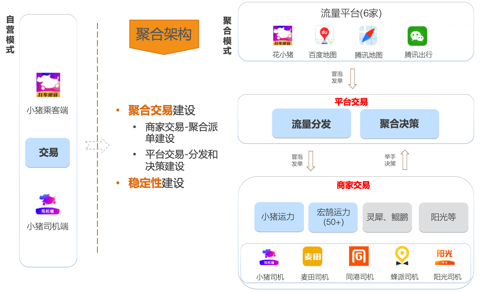

*平台向运力商分发呼叫，运力商匹配司机并向平台举手，平台确定承接方。* [架构原图](https://cooper.didichuxing.com/knowledge/2199610335356/2201667444955)

#### 1.1.2 冒泡、勾选与发单

乘客输入起终点，系统询价并展示预估表单，这一环节称为**冒泡**。表单既展示单个商家的车型，也展示组合多项运力的“盒子”，例如特价盒子。页面先给出各行价格及默认勾选状态。乘客可以改选，点击叫车后，平台按**最终勾选的车型**发起正式呼叫。首次发起呼叫时选中的车型称为**原勾选车型**。

#### 1.1.3 等应答、等接驾与行程

**等应答**期间，平台分发需求，运力商匹配司机并提交候选，平台据此确定承接方。平台确定承接司机、形成正式应答后，订单进入**等接驾**阶段，乘客端展示接单司机。乘客上车、司机开始计费后进入行程，行程结束后完单、支付。[乘客页面与主时序](https://cooper.didichuxing.com/didocs/2209354754565) · [交易流程全景](https://cooper.didichuxing.com/knowledge/2199610335356/2206185153132)

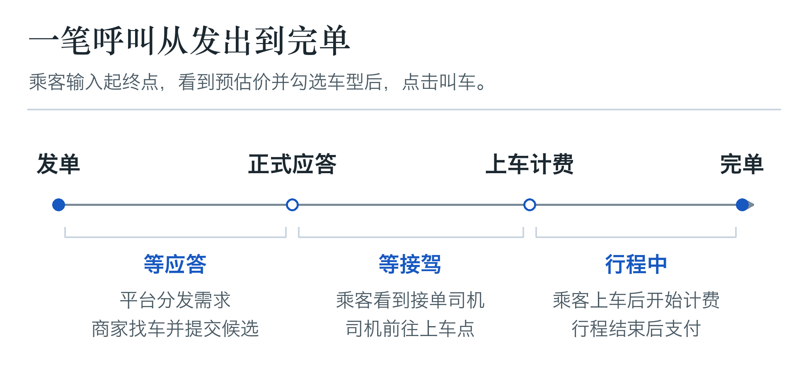

*首次呼叫至正式应答为等应答，正式应答至上车为等接驾。* [乘客侧打车流程](https://cooper.didichuxing.com/didocs/2209354754565) · [交易流程全景](https://cooper.didichuxing.com/knowledge/2199610335356/2206185153132)

### 1.2 交易策略分工与上下游协作

#### 1.2.1 交易策略的主要业务

交易策略涉及订单成交、乘客等待时长、司机接驾投入和平台成本。商家侧负责司机召回与分单，平台侧负责向运力商分发订单、从候选司机中确定承接方。供需调度调节不同区域和时段的运力分布，接驾治理在应答后识别履约风险。[团队分工与项目](https://cooper.didichuxing.com/knowledge/2199610335356/2205084602724) · [交易策略与上下游方向](https://cooper.didichuxing.com/knowledge/2199610335356/2204349565074)

| 业务方向      | 主要决策                                                                                                                                                                                                                  | 代表性项目评审（LR，2025–2026）                                                                                                                                                                                        |
| --------- | --------------------------------------------------------------------------------------------------------------------------------------------------------------------------------------------------------------------- | ------------------------------------------------------------------------------------------------------------------------------------------------------------------------------------------------------------ |
| 商家交易      | 召回可能接单的司机，按司乘匹配价值分单。商家可以指派司机、向司机播单供抢单，或在大厅展示订单供司机选择。[商家分单与交易模式](https://cooper.didichuxing.com/knowledge/2199610335356/2209560439907)                                                                                 | 首轮并行启动 TopSpeed 匹配司机 [LR25004](https://cooper.didichuxing.com/knowledge/2199610335356/2204304953766) 按预计完单数选择召回方式 [LR26-046](https://cooper.didichuxing.com/knowledge/2199610335356/2210000513733)        |
| 平台交易      | 按流量来源和运力情况向商家分发订单。多个商家提交候选时，平台在聚合 PK 窗口内比较司机，选出承接方。[端流量分发](https://cooper.didichuxing.com/knowledge/2199610335356/2207043572052) · [PK 目标与接驾距离](https://cooper.didichuxing.com/knowledge/2199610335356/2208936812656) | 按取消风险调整 PK 等待时长 [LR25010](https://cooper.didichuxing.com/knowledge/2199610335356/2204562271351) 在履约率约束下优先选接驾更近的司机 [LR26-032](https://cooper.didichuxing.com/knowledge/2199610335356/2208936812656)        |
| 供需调度      | 识别运力短缺的区域和时段，引导空闲司机提前前往。[无单调度](https://cooper.didichuxing.com/knowledge/2199610335356/2205431323794)                                                                                                                  | V2 按补贴回报选调度目的地 [LR25031](https://cooper.didichuxing.com/knowledge/2199610335356/2205431323794) V3 优先向预计能缩短空闲时长的司机派发无补贴任务 [LR26-034](https://cooper.didichuxing.com/knowledge/2199610335356/2209438550271) |
| 接驾体验与交易生态 | 识别接驾过远、司机低接驾意愿等风险，处理诱导取消、取消判责、安全分单及反作弊。[组内项目分工](https://cooper.didichuxing.com/knowledge/2199610335356/2205084602724) · [判责模型评审](https://cooper.didichuxing.com/knowledge/2199610335356/2210082946117)                | 结合规则和模型识别低接驾意愿，触发换车 [LR25032](https://cooper.didichuxing.com/knowledge/2199610335356/2205469953587) 新增偏航、停留、通话等取消判责证据 [LR26-049](https://cooper.didichuxing.com/knowledge/2199610335356/2210082946117)    |

#### 1.2.2 冒泡页表单与增长补贴的分工

**冒泡页联合决策**由乘客与增长方向负责，选择幸运盒子定价、特价盒子折扣和默认勾选范围。表单再经价格取整、排序、折叠和同价车型合并等处理，生成乘客看到的车型列表。乘客确认呼叫后，平台根据所选车型及对应价格分发订单。[冒泡页联合决策与乘客交易时序](https://cooper.didichuxing.com/didocs/2209354754565) · [表单策略分类与工程依赖](https://cooper.didichuxing.com/knowledge/2199610335356/2209922731640)

竞争人群升舱面向近 14 天内曾跨平台询价的乘客。入组条件是同一乘客在两个平台的询价记录中，起点、终点和时间相匹配。增长侧在发券、升舱和无车赔之间分配预算，决定向哪些乘客提供升舱权益。交易策略针对每笔呼叫判断生效场景，按预算门槛筛选候选车型，并根据实际履约结果结算。[竞争人群多抓手联合决策](https://cooper.didichuxing.com/knowledge/2199610335356/2206652243628)

### 1.3 核心指标

| 指标 | 计算口径 | 业务用途 |
| --- | --- | --- |
| 应答率（AR） | 小猪端竞争呼叫中获得司机应答的比例，常规口径剔除改派重复应答 | 衡量追加车型对呼叫应答率的影响 |
| 成交率（CR） | 完单数 ÷ 呼单数，同一实验比较采用相同的呼单口径 | 衡量呼叫到完单的转化 |
| 新流增量获客成本（CAC） | 新流包括新客和 90 天以上无完单的流失乘客。按相同流量规模折算后，两组升舱补贴之差 ÷ 两组完单乘客人数之差 | 衡量每新增一名新流完单乘客的补贴成本 |
| 乘客总等待时长（ETP） | 换车实验将父子单归并，对最终完单的需求统计首次呼叫至开始计费的时长 | 同时覆盖等应答和等接驾，换车后不重新起算 |

**AUC** 衡量二分类模型对正负样本的排序能力。商家应答模型以商家是否应答为预测目标，预分单接受度模型预测乘客是否接受报价，接驾远换车模型预测乘客是否在应答后取消。[接受度模型评估](https://cooper.didichuxing.com/knowledge/2199610335356/2205042388899) · [应答率模型评估](https://cooper.didichuxing.com/knowledge/2199610335356/2204226054240)

同一次出行可能在取消或换车后生成子单。换车评估将父子单归并为一笔原始需求，按最终状态统计“归一完单”。实验结果中，两个比率的差值用百分点表示，相对变化率用百分比表示。[Wiki · 应答率](https://git.xiaojukeji.com/bwh_stg/trading-efficiency-wiki/blob/11b2a3402ee2e5052e40f1d724b5da4ce06134de/wiki/%E6%8C%87%E6%A0%87/response-rate.md) · [Wiki · 归一乘客 ETP](https://git.xiaojukeji.com/bwh_stg/trading-efficiency-wiki/blob/11b2a3402ee2e5052e40f1d724b5da4ce06134de/wiki/%E6%8C%87%E6%A0%87/normalized-passenger-etp.md) · [新流 CAC 定义](https://cooper.didichuxing.com/knowledge/2199610335356/2206081553120)

> [!example]- 首次应答率、应答后完单率与归一完单率
> 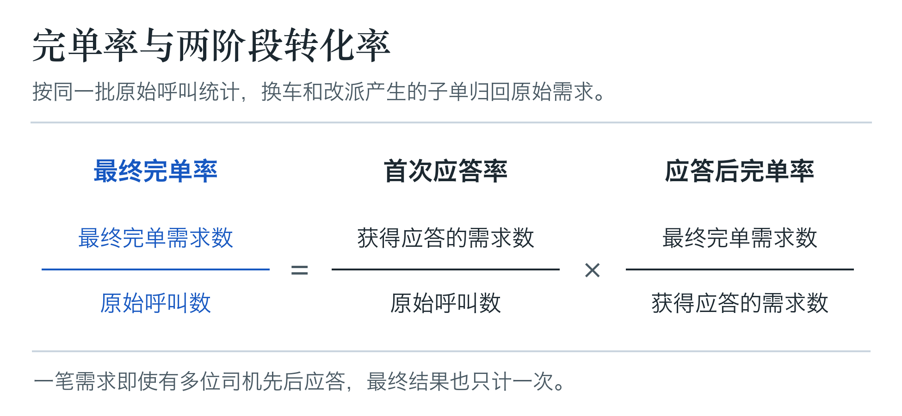
> 对同一批原始需求，完单率 = 首次应答率 × 应答后完单率。换车或改派后，按这笔需求的最终结果计一次。[指标图册原图](交易链路与指标拆解图册/图片/平台完单量与完单率.png) · [交易流程与状态](https://cooper.didichuxing.com/knowledge/2199610335356/2206185153132)

## 2 交易策略与产品形态

### 2.1 普通预分单

#### 2.1.1 未勾选车型找车与乘客确认

普通预分单发生在原勾选车型尚未应答时。平台先看乘客起点及周边网格最近 5 分钟的发单数和应答率，决定等多久开始向未勾选车型找车。到达触发时间后，平台从符合条件的车型中筛出乘客预计愿意接受报价的候选，向对应商家发单。原勾选车型继续找车。[预分单策略整理](https://cooper.didichuxing.com/knowledge/2199610335356/2202629755786) · [触发时间与车型筛选](https://cooper.didichuxing.com/knowledge/2199610335356/2206174605973) · [网格指标与首轮缓存](https://cooper.didichuxing.com/knowledge/2199610335356/2202875090617)

商家找到司机后，乘客才会看到候选车型、报价和接驾信息。无论报价高于还是低于原勾选车型，都由乘客确认。乘客接受后，平台判断这名司机能否承接。若乘客拒绝或确认超时，原呼叫继续。[产品示例](https://cooper.didichuxing.com/knowledge/2199610335356/2204428832540)

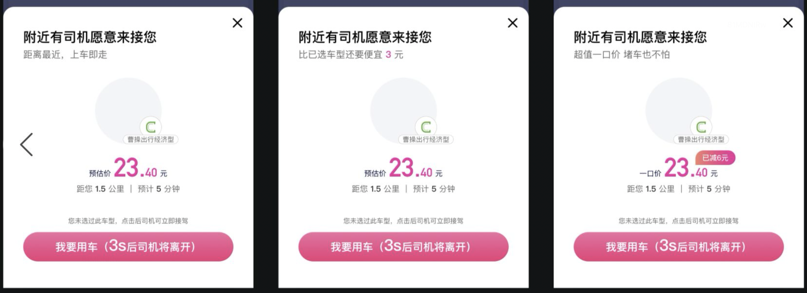

*中间一屏的候选报价比原勾选车型低 3 元。弹窗同时展示预计接驾时间，由乘客确认是否接受。* [弹窗原图](https://cooper.didichuxing.com/knowledge/2199610335356/2204428832540)

#### 2.1.2 触发时间、车型筛选与承接

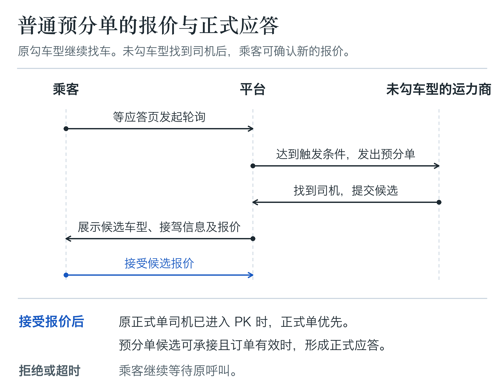

乘客接受预分单报价时，如果原勾选车型的司机已进入平台的候选比较环节（PK），原勾选车型的司机优先。预分单候选取得承接资格且订单仍有效时，形成预分单正式应答。[图册原图](交易链路与指标拆解图册/图片/01%20预分单.png) · [预分单与升舱工程流程](https://cooper.didichuxing.com/knowledge/2199610335356/2206174605973) · [聚合 PK 中的正式单优先规则](https://cooper.didichuxing.com/knowledge/2199610335356/2201667444955)

Athena 策略服务确定**触发时间和候选车型**，分单系统和商家负责匹配司机，聚合 PK 确定承接方。[预分单与升舱工程流程](https://cooper.didichuxing.com/knowledge/2199610335356/2206174605973)

> [!example]- 各系统的判断条件与原始工程泳道图
> | 环节 | 处理方 | 决策逻辑 |
> | --- | --- | --- |
> | 计算触发时间 | 乘客端、乘客 API、Athena 策略服务 | 等应答页持续轮询。首次轮询时，根据起点及周围一圈网格最近 5 分钟的发单数和应答率计算触发时间并缓存。后续轮询复用已缓存的触发时间，并检查订单状态、拒绝次数和触发频率 |
> | 筛选本轮候选车型 | Athena | 未勾选车型按价格排序，经过权限、风控、名单等过滤。升舱按每元补贴对应的预计增量完单筛选车型，普通预分单按预测的乘客接受度筛选。两者均限制单轮发出的车型数 |
> | 找司机并处理举手 | 分单系统、运力商、聚合 PK | 执行司乘匹配、播单，商家回传司机。历史 PK 流程对预分单候选采用先到先得。乘客确认预分单时，若已有正式单司机在 PK 流程中，正式单优先 |
>
> 

**商家找司机和再次提交候选的三次评审**

- **司机召回范围。** 原策略按供需和乘客已等待的时间调整找车半径。V2 在非连环派场景扩大初始半径，先预估候选司机应答后司乘取消的风险。对按轮次匹配司机的订单，再根据本轮结束前订单被其他商家应答或被乘客取消的概率，决定筛选司机的松紧程度。实验包含普通预分单，改变的是商家提交司机前的筛选。[LR25040 · 商家召回策略优化 V2.0](https://cooper.didichuxing.com/knowledge/2199610335356/2205438753806)
- **同一商家再次提交司机。** 原先 API 商家的司机在 PK 落选、或乘客拒绝预分单后，商家便失去在这笔订单上继续竞争的机会。此次允许商家再次提交司机。若暂时胜出的司机尚未确认，平台也可继续等待评分更高且已确认的司机。一期多轮举手只接入阳光出行。[LR25053 · API 多轮举手能力建设](https://cooper.didichuxing.com/knowledge/2199610335356/2206172524014)
- **更多 API 商家接入。** 在阳光一期验证后，本次实验让花小猪端 T3、享道、如祺接入城市的订单也支持多轮举手。三家商家可在司机 PK 落选、预分单被拒等情况下继续提交候选。评审提出推全建议，实际扩量日期栏待填。[LR26-024 · API 多轮举手 V1.0](https://cooper.didichuxing.com/knowledge/2199610335356/2208630137979)

#### 2.1.3 触发策略的四次迭代

| 版本 | 策略变更 | 实验结果 |
| --- | --- | --- |
| V1 | 所有场景等应答超过 60 秒后，向自营或宏鹄发起，每轮呼叫两个品牌 | 相比无预分单组，CR 提高 0.21 个百分点 |
| V2 | 部分场景提前到 30 秒，分别测试价格最低的两个车型和全部可用车型 | 相比 V1，两组均未观察到正向收益。呼叫全部车型的一组乘客接受度显著下降 |
| V3 | 增加接受度模型，过滤预测接受度较低的车型，同时测试不同触发时间 | 多轮实验均未观察到大盘 CR 显著提升 |
| V4 | 改为按网格实时供需确定触发时间，单轮候选数也可配置 | 一期无显著提升。二期调整阈值后，选中方案的大盘 CR 显著提高 0.14 个百分点 |

在一组 V4 端内实验中，所在区域应答率低于 76% 时从第 0 秒触发，76% 至不足 84% 时从第 15 秒触发，其他情况从第 40 秒触发，每轮找三个品牌。[预分单 V1–V4](https://cooper.didichuxing.com/knowledge/2199610335356/2202629755786) · [端内实验参数](https://cooper.didichuxing.com/knowledge/2199610335356/2201120863381) · [二期实验结果](https://cooper.didichuxing.com/knowledge/2199610335356/2201406448494)

#### 2.1.4 同品牌跨品类找车

**API 商家。** 旧逻辑按品牌去重。以 T3 为例，乘客勾选了包含 T3 的特价盒子，盒外的 T3 经济车型也会被过滤，即使两个品类可用的运力不同。2025 年 11 月 4–17 日，团队在 11 城按乘客分流，实验组允许同品牌跨品类预分单。[LR25045 实验设计](https://cooper.didichuxing.com/knowledge/2199610335356/2205990435210)

**API 商家完单量显著增加 1.04%，小猪端滴滴运力完单量显著下降 1.63%。** 全平台完单量变化为 +0.05%，未达统计显著。应答前乘客取消率显著下降 0.12 个百分点。该次评审记录显示，除曹操等个别商家外，其余 API 商家当时已全量采用同品牌跨品类预分单。[LR25045 · API 预分单品类拆分](https://cooper.didichuxing.com/knowledge/2199610335356/2205990435210)

**自营、宏鹄。** 同品牌跨高价品类预分单方案针对低价品类尚未应答、同品牌高价品类仍有可用司机的场景。方案按已勾选品类、累计应答率和等待时长决定是否开放下一价格档，并限制重复询问。V0 适用于小猪端和小程序，已由出行快选静默发单的运力跳过本次预分单。2026 年 5 月的项目记录将“5 月 22 日上线后启动实验”列为待办。[可控运力高价品类预分单方案](https://cooper.didichuxing.com/knowledge/2199610335356/2206126985177) · [端与品类范围](https://cooper.didichuxing.com/knowledge/2199610335356/2205938220031) · [5 月排期](https://cooper.didichuxing.com/team-file/2199582756311/2207747919479)

### 2.2 升舱

#### 2.2.1 免费加派与差价结算

**升舱**让符合条件的未勾选车型直接参与应答。乘客不用再确认报价，也无需为这次加派另付差价。以新流 V2 为例，交易策略逐笔比较“让乘客自付差价确认报价”和“免费加派”两种情况下的预计完单概率及补贴支出。每元补贴带来的预计增量完单超过门槛，平台才对该候选车型免费加派。当候选车型能提高预计完单率且价差相同时，乘客越可能自付，免费升舱每花一元补贴预计能多带来的完单就越少。[新流 V2 的判断与门槛](https://cooper.didichuxing.com/knowledge/2199610335356/2204889260287)

只有升舱车型最终完单才结算补贴，金额为该车型预估券后价减去原勾选车型中最高的预估券后价。新流 V1 的 API 运力由对应商家承担补贴，自营、宏鹄运力由平台承担。[LR25006 · 升舱产品与出资规则](https://cooper.didichuxing.com/knowledge/2199610335356/2204428832540)

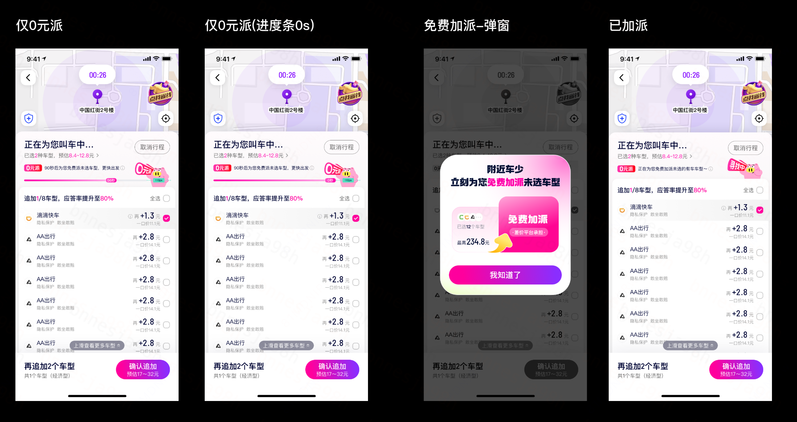

*第三屏提示已免费加派车型，乘客可以继续等待应答。* [等待页升舱原图](https://cooper.didichuxing.com/knowledge/2199610335356/2204428832540)

#### 2.2.2 适用人群、入口与放量范围

**新流升舱。** 新流包括当日新注册或注册后尚未完单的新客，以及 90 天以上无完单的流失乘客。两次评审分别记录了免费加派的引入和扩展。

- **V1 从普通预分单增加免费加派。** 原先乘客等候期间收到未勾选车型的报价，需要自行确认并承担差价。V1 在供需较差、原单尚未应答时，从这些候选中选出值得补差的车型，直接参加应答。2025 年 4 月 18 日，新流人群按选定预算配置完成放量。[LR25006 · 新流预分单升舱 V1](https://cooper.didichuxing.com/knowledge/2199610335356/2204428832540)
- **V2 扩充运力，调整补贴决策并试验新入口。** V1 仅在等应答时触发，覆盖曹操、阳光、首汽、哈啰等 API 商家。V2 加入 T3、享道、如祺及兜底运力，并更新了乘客自付接受度模型。估算补贴支出时，V1 按加派后整张表单的完单概率计算，V2 改用加派前后预计完单率之差近似实际需要付补的概率。新流实验还分别测试应答前取消挽留、应答后换车、司机取消后改派三个入口，最终选定“等应答＋司机取消后改派”放量。同期独立的大盘 V2 专项未放量。[LR25051 · 新流升舱 V2 与放量决定](https://cooper.didichuxing.com/knowledge/2199610335356/2206081553120)

**换车、改派和升舱怎样衔接。** 在接驾远换车中，原司机还在接驾，平台找到符合条件的新司机后才交接。司机主动取消时，原司机已退出，平台进入改派判断，决定是否重新找车。升舱决定的是这次找车可以免费加派哪些车型。新流 V2 在换车和改派中都测试过升舱，最终新增的入口是司机取消后的改派，平台在该入口仍要逐笔判断哪些车型符合升舱条件。[接驾远换车流程](https://cooper.didichuxing.com/knowledge/2199610335356/2207853025753) · [新流升舱的分组与放量](https://cooper.didichuxing.com/knowledge/2199610335356/2206081553120)

**竞争人群升舱。** 同一乘客近 14 天在两个平台询过价，且两次询价的起点、终点和时间相匹配，就纳入竞争人群。增长侧 ACTI 先分配优惠券、升舱、无车赔等权益及预算。乘客发单后，系统读取本次呼叫对应的权益配置，交易侧再按该项目原有的场景和门槛判断是否免费加派。接入新流升舱的新增场景在竞争人群评审中列为后续计划。[LR26-001 · 线上调用与后续计划](https://cooper.didichuxing.com/knowledge/2199610335356/2206652243628)

- **按人群配置权益。** 原先一个实验组最多选一类人群、给一套组合。11 城实验按价格和时间敏感度，从竞争人群中圈出四类子人群，分别配置折扣和权益。实验另列了一组未投放该策略的竞争乘客。例如，时间敏感的两类乘客可获升舱和无车赔，仅价格敏感的乘客获得较深折扣。[LR25028 · 分人群多抓手策略](https://cooper.didichuxing.com/knowledge/2199610335356/2205183981137)
- **从人工配置改为联合决策。** 原先人工确定各组发什么权益、各项分多少预算。V0 在四类竞争子人群中，预测不同折扣和时效权益组合对乘客发单、完单的影响，同时考虑升舱等权益实际触发的机会，再在共同预算下选择组合。[LR25042 · 多抓手联合决策 V0](https://cooper.didichuxing.com/knowledge/2199610335356/2205948348659)
- **从四类子人群扩到全体竞争人群。** V1 用全体竞争人群的数据求解策略，让此前未纳入四类的竞争乘客也参与权益分配。2026 年 1 月 21–27 日，在相同乘客补贴率下，该方案比只覆盖四类的策略多带来 0.27% 的大盘完单。后续记录为联合策略组 90%、空白组 10%。[LR26-001 · 多抓手联合决策 V1](https://cooper.didichuxing.com/knowledge/2199610335356/2206652243628)

2026 年 10 月的表单策略记录中，“0 元派”在等应答页生效，冒泡页可提前提示。乘客在等待页看到的是免费加派提示。同一页上的补勾表单由乘客自己确认追加车型（2.3 节）。实验覆盖范围由已开通城市和目标人群名单确定。[10 月表单策略盘点 · 升舱配置](https://cooper.didichuxing.com/knowledge/2199610335356/2209922731640)

#### 2.2.3 从发单到完单的升舱漏斗

2024 年 11 月 7–14 日，27 城评估按同一批订单追踪了五个环节。**135,507 笔可升舱发单中，35,397 笔获得司机举手，占 26.1%。** 该比例为可升舱发单到司机举手的转化率。[27 城升舱漏斗](https://cooper.didichuxing.com/knowledge/2199610335356/2203361898172)

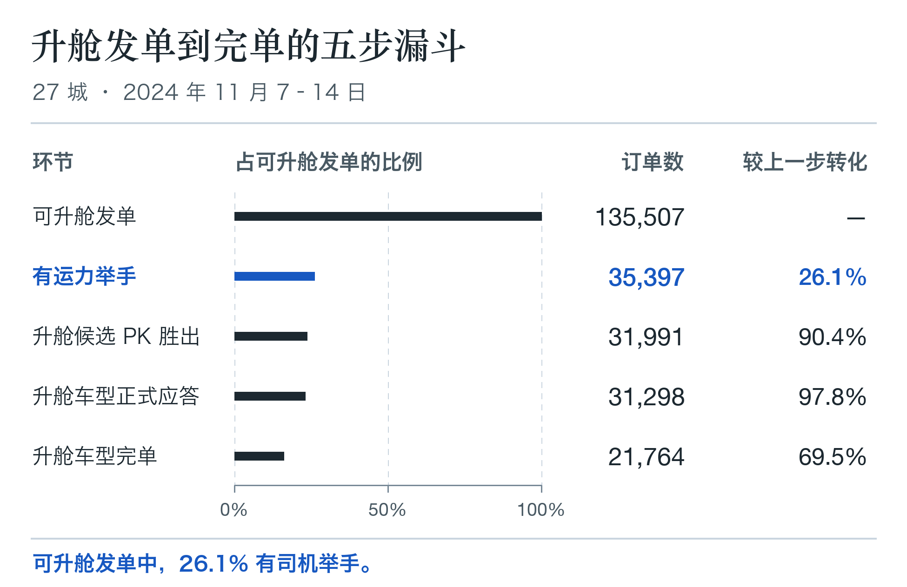

横条表示各环节订单数占 **135,507 笔可升舱发单**的比例，右列为各环节订单数占**上一步订单数**的比例。其中，`is_upcabin_ans` 标记的升舱车型正式应答为 31,298 笔，最终由升舱车型完单的有 21,764 笔。平台增量完单按实验组和对照组的总完单差异评估（3.3 节）。[27 城原始漏斗](https://cooper.didichuxing.com/knowledge/2199610335356/2203361898172) · [Wiki · 发单、举手与升舱应答的记录口径](https://git.xiaojukeji.com/bwh_stg/trading-efficiency-wiki/blob/11b2a3402ee2e5052e40f1d724b5da4ce06134de/wiki/%E6%8C%87%E6%A0%87/%E9%A2%84%E5%88%86%E5%8D%95%E6%95%B0%E6%8D%AE%E8%A1%80%E7%BC%98%E4%B8%8E%E5%8F%A3%E5%BE%84.md)

### 2.3 等应答页表单

#### 2.3.1 乘客补勾与追加呼叫

**等待页补勾是先确认车型，再找司机。** 乘客发起呼叫后，原勾选车型持续找车。等应答页上方展示已呼叫车型、预估价和应答倒计时，下方列出还可以追加的车型。**默勾**是系统预先选中某些车型，**补勾**是乘客在等待期间调整并提交选择。乘客点击“确认追加”后，平台才向新增车型的商家发单找车。**普通预分单则先找司机，再由乘客确认报价。**[等应答页追加流程](https://cooper.didichuxing.com/didocs/2209354754565) · [普通预分单承接流程](https://cooper.didichuxing.com/knowledge/2199610335356/2206174605973)

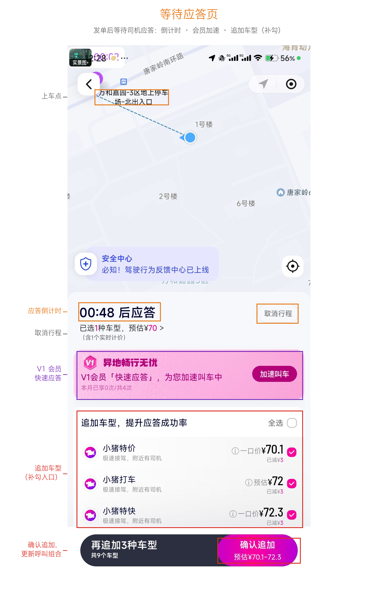

*图中原单只呼叫了 1 款车型，预估价为 70 元。下方 3 款待追加车型分别报价 70.1、72、72.3 元，乘客可以取消其中的勾选，也可以按当前选择确认追加。* [等应答页原图](https://cooper.didichuxing.com/didocs/2209354754565)

冒泡表单和补勾表单均支持**同价车型合并展示**。前两批放量城市中，商家品类数超过 15 的城市将实时计价车型价格向下取整，再合并符合条件的同价车型。这两批中的中小城市只取整。两种方案均保留一口价原有的展示方式。同一行可展示多个车型，实际呼叫范围由乘客最终确认的车型集合决定。[同价合并适用页面与车型](https://cooper.didichuxing.com/knowledge/2199610335356/2203536755479) · [按城市和品类数执行的方案](https://cooper.didichuxing.com/knowledge/2199610335356/2203517848692)

**实时计价车型的价格展示。** 此前花小猪端的主流量已将实时计价向下取整到元，再合并同价车型。此次补上“四舍五入到元”的配置，在预估页和等应答页对同一批乘客采用一致的展示方式。2026 年 5 月的实验比较向下取整到元、四舍五入到元和四舍五入到角，三组均合并同价车型。评审决定保留向下取整到元。[LR26-019 · 表单价格取整能力补齐](https://cooper.didichuxing.com/knowledge/2199610335356/2208435863848)

#### 2.3.2 首次推荐与再次推荐

**最近确认的默勾方案。** 2026 年 11 月 9 日更新的需求记载，交易策略和产品已确定将等应答页全量切回价格规则。按该规则，首次展示按价格上限预选车型，乘客手动补勾后的再次展示不再预选。此前的实验配置按开关分流，只有命中模型开关的订单按预计应答率推荐，其余走价格规则。截至 11 月 23 日，可查记录尚未给出切换完成日期及实际流量占比，线上是否已全部按价格默勾仍未确认。[全量切回价格规则的需求](https://cooper.didichuxing.com/knowledge/2199610335356/2210316043924) · [首次、再次推荐及开关规则](https://cooper.didichuxing.com/knowledge/2199610335356/2209643167089) · [等应答页默勾实验配置](https://ab.intra.hongyibo.com.cn/launch/102/normal/65356)

两套规则都决定页面初始勾上哪些车型。价格规则按原单和自营车型的价格确定上限。应答率算法从便宜的候选开始，选到预计应答率达到门槛为止。[等应答页默勾策略](https://cooper.didichuxing.com/knowledge/2199610335356/2209643167089)

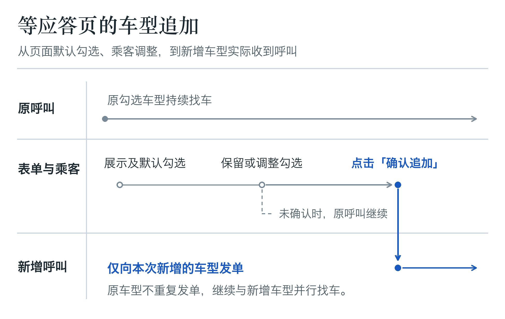

乘客可以修改页面推荐的车型，点击“确认追加”后，平台才向新增车型发单。[等应答页产品流程](https://cooper.didichuxing.com/didocs/2209354754565) · [首次与再次推荐规则](https://cooper.didichuxing.com/knowledge/2199610335356/2209643167089)

| 方案 | 首次推荐 | 乘客手动补勾后的再次推荐 |
| --- | --- | --- |
| 价格规则 | 记原单最高展示价为 $p$，小猪自营特快展示价为 $q$。默认勾选价格不超过 $\max(\min(1.2p, p+30), q)$ 的车型 | 不再默认勾选，由乘客自行选择 |
| 应答率算法 | 冒泡询价时预估每个商家单独被呼叫时的应答率。等待页读取缓存，逐个加入候选，取累计应答率达到阈值所需的最少车型 | 剔除原单和此前追加中已经呼叫过的车型，用剩余候选重新计算 |

#### 2.3.3 历史补勾推荐使用的商家应答率模型

在冒泡页，原先平台先定补贴折扣，再按折后价格决定默认勾选哪些车型。联合决策 V2 改为对同一次询价一起选择折扣与默认勾选组合。为估计一个组合能否等到司机应答，V2 用 XGBoost 预测每个商家单独被呼叫时的应答概率 $p_i$。[LR25003 · 平台补贴与流量分发联合决策 V2](https://cooper.didichuxing.com/knowledge/2199610335356/2204226054240)

等应答页曾复用这个分数。推荐策略按价格从低到高逐个加入候选，在商家应答相互独立的假设下，用 $1-\prod_i(1-p_i)$ 计算“至少一家应答”的概率。此前已呼叫的车型从候选中剔除，同一商家同时出现在多个品类时按实际发单品类计一次。新流升舱 V1 也复用单商家分数，估计加入一个候选能带来多少应答机会（3.2.2 节）。[单商家模型与训练标签](https://cooper.didichuxing.com/knowledge/2199610335356/2204226054240) · [等待页累计应答率计算](https://cooper.didichuxing.com/knowledge/2199610335356/2202145631386)

**从应答率推算成交，改为直接预测完单。** 原 V2 从商家应答率推算整单成交，难以反映司机或乘客在应答后取消。团队先在 V2 中对照测试新的三任务模型，随后随联合决策 V3 推全。新模型把每笔呼叫中的每个商家作为一条输入，先把类别特征编码为向量，再与订单、运力、商家和乘客的数值特征一起送入共享的多层感知机（MLP）。三个预测头分别估计整单完单概率、已完单时各商家承接的概率，以及单独呼叫该商家时的应答概率。前两项用于冒泡页的车型和折扣决策，第三项供下游交易使用。[LR25038 · 联合决策多任务模型](https://cooper.didichuxing.com/knowledge/2199610335356/2205698304808)

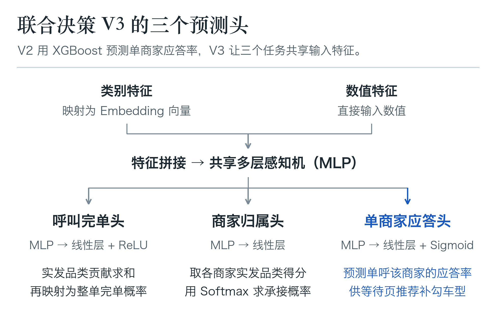

历史等待页算法读取其中的**单商家应答概率**。该预测头在评审测试集上的 AUC 为 **0.889**。[评审原图](2025年LR/附件/LR25038/002.png) · [三个预测头与离线评估](https://cooper.didichuxing.com/knowledge/2199610335356/2205698304808)

> [!example]- 三个预测头的结构、损失和分任务结果
> | 预测任务 | 从网络输出到业务结果 | 该任务的离线 AUC |
> | --- | --- | ---: |
> | 整单完单概率 | 线性层和 ReLU 输出各品类的非负贡献。按各商家实际发出的品类取值，求和后映射为整单完单概率 | 0.784 |
> | 完单商家归属 | 线性层输出各商家的完单贡献。对同一呼叫的候选商家做 Softmax，得到已完单条件下各商家的承接概率 | 0.901 |
> | 单商家应答概率 | 线性层和 Sigmoid 直接给出单商家应答概率。历史等待页读取冒泡时缓存的这类概率，用于补勾推荐 | 0.889 |
>
> 前两项服务于冒泡页车型组合及成本的计算，第三项同时给下游交易提供单商家分数。三个指标来自同一次离线评估。训练时两个二分类头使用二元交叉熵，商家归属头使用多分类交叉熵，三项损失加权求和。[模型架构图与分任务评估](https://cooper.didichuxing.com/knowledge/2199610335356/2205698304808) · [等待页缓存的使用方式](https://cooper.didichuxing.com/knowledge/2199610335356/2209643167089)

#### 2.3.4 补勾推荐阈值实验与规则切换需求

2026 年 6 月，团队比较了应答率阈值为 60、70、80 的三组和原规则组。以 60 组为例，6 月 8–14 日实验期的追加订单率比规则组高 0.271 个百分点，但 6 月 1–7 日基线期已高 0.262 个百分点。扣除原有差异后，三组的追加订单率变化分别为 **+0.009、−0.030、−0.034 个百分点**。[下线前实验评估](https://cooper.didichuxing.com/knowledge/2199610335356/2208410044516) · [全量切换需求](https://cooper.didichuxing.com/knowledge/2199610335356/2210316043924)

三组算法和原价格规则在主要指标上均无显著差异。[补勾方案与实验结果](https://cooper.didichuxing.com/knowledge/2199610335356/2208410044516)

上游冒泡页原先以最大化完单为目标。联合决策 V4 用完单、转化、一口价份额等多项指标共同决定幸运盒子定价、特价盒子折扣及默认勾选数量。它改变的是乘客询价时看到的表单。等待页此前依赖的单商家应答率在 V4 中停止输出，因此等待页另提了切回价格规则的需求。[LR26-043 · 冒泡页联合决策 V4 离线规划](https://cooper.didichuxing.com/knowledge/2199610335356/2209798651511) · [等应答页切回价格规则的需求](https://cooper.didichuxing.com/knowledge/2199610335356/2210316043924)

#### 2.3.5 补勾与预分单的渠道变化

2026 年 1 月 8–22 日，12 城实验在两组都允许享道升舱的前提下，只给实验组开放享道普通预分单。1 月 9–22 日的评估显示，实验组享道预分单完单增加，享道补勾渠道的人均呼单量变化为 +0.05%，人均应答量下降 14.18%，人均完单量下降 15.21%。合计各渠道，享道人均完单量变化为 −0.134%。平台去重呼叫 CR 下降 0.035 个百分点，两种统计方法估计的平台完单量变化方向相反。[享道接入预分单实验](https://cooper.didichuxing.com/knowledge/2199610335356/2206448056263)

#### 2.3.6 页面展示的预计应答时长

等应答页展示**从乘客发起呼叫到司机应答的预计时长**。模型以分钟为输出单位。训练用实际应答时长作标签，输入包括订单价格、起终点距离，以及乘客起点附近的订单量和运力情况。[应答时长 V1 训练代码](https://cooper.didichuxing.com/knowledge/2199610335356/2202161139203) · [Wiki · 应答时长预估模型](https://git.xiaojukeji.com/bwh_stg/trading-efficiency-wiki/blob/11b2a3402ee2e5052e40f1d724b5da4ce06134de/wiki/%E6%A8%A1%E5%9E%8B/%E5%BA%94%E7%AD%94%E6%97%B6%E9%95%BF%E9%A2%84%E4%BC%B0%E6%A8%A1%E5%9E%8B.md)

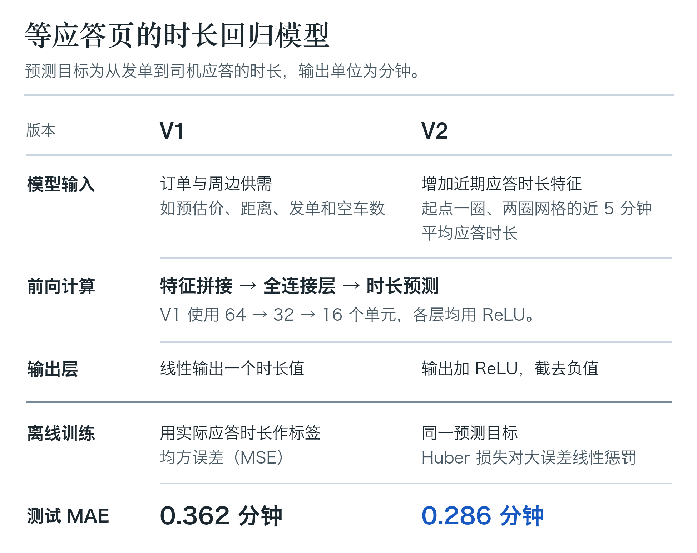

V1 直接输出一个时长。V2 增加了起点附近一圈、两圈网格近 5 分钟的平均应答时长，并把输出限制为非负值。训练时，较大的预测误差改用线性惩罚，减轻极端长等待样本对模型的影响。等待页测试集上的平均绝对误差从 **21.7 秒降到 17.2 秒**。[V1 等应答页训练代码](https://cooper.didichuxing.com/knowledge/2199610335356/2202161139203) · [V2 版本与离线对照](https://cooper.didichuxing.com/knowledge/2199610335356/2202161093299)

> [!example]- V1 至 V3 的网络、训练目标与模型对照
> | 迭代 | 网络与训练目标 | 等待页离线结果 |
> | --- | --- | --- |
> | V1 | 特征拼接后依次经过 **64 → 32 → 16** 个单元的全连接层。各层使用 ReLU、批归一化和 10% Dropout，最后用一个线性单元输出时间，以均方误差训练 | 平均绝对误差（MAE）为 0.362 分钟，约 21.7 秒 |
> | V2 | 损失改为 Huber，减小异常长等待对训练的影响。输出改用 ReLU 保证非负，并加入起点周围网格近 5 分钟的平均应答时长 | 同表 MAE 为 **0.286 分钟，约 17.2 秒**。树模型 XGBoost 对照为 0.292 分钟 |
>
> MAE 是预测时长与实际时长之差的绝对值取平均。后续 V3 还试验了门控特征交叉网络（GDCN），用于学习不同特征的交互权重。[V2、V3 改动与分场景离线评估](https://cooper.didichuxing.com/knowledge/2199610335356/2202161093299)

### 2.4 应答后换车

#### 2.4.1 接驾远与司机低接驾意愿

**接驾远换车**适用于原司机已应答、预计接驾时长超过门槛的订单。乘客点击“帮我寻找”或系统自动触发后，分单系统寻找预计更早到达的司机，原司机继续接驾。平台找到符合交接条件的候选后取消原车、切换司机。未找到合适候选时，原司机继续接驾。[接驾远换车 V2.1 产品流程](https://cooper.didichuxing.com/knowledge/2199610335356/2207853025753)

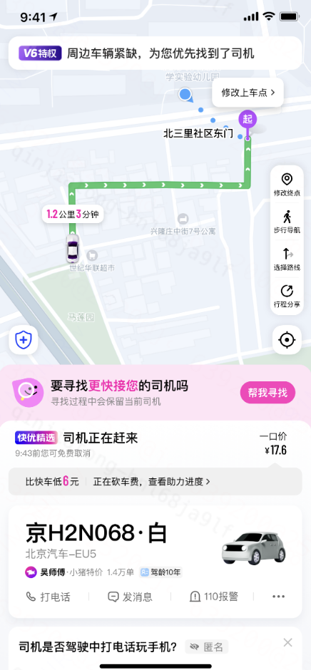　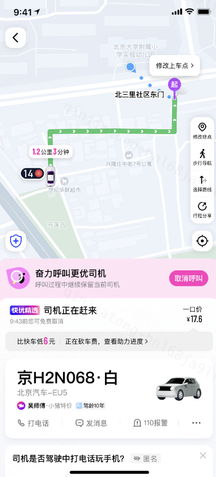

*左图为乘客手动发起换车的入口。右图为发起后的页面，寻找新司机期间保留原车。* [换车页面原图](https://cooper.didichuxing.com/knowledge/2199610335356/2207853025753)

**司机低接驾意愿换车**处理司机可能诱导乘客取消或不再接驾的应答单。V0 根据拒接电话、聊天关键词和抢单后停留识别风险。V1 新增偏航、行驶缓慢、到达后走远等规则，同时利用模型识别接驾异常。高风险时平台替乘客取消原单并重新发单，较低风险时询问乘客是否换车，未命中时原司机继续接驾。[LR25032 · 低接驾意愿换车 V1](https://cooper.didichuxing.com/knowledge/2199610335356/2205469953587)

#### 2.4.2 接驾远换车的触发与生效

V1 在预计接驾时长超过 300 秒时显示手动入口，约一成符合条件的乘客点击找车。V2.1 对仍在等候且接驾较远的订单，改为分别判断“是否开始另找司机”和“是否把订单交给新司机”。[LR26-013 · 从手动入口到取消风险分档与司机交接](https://cooper.didichuxing.com/knowledge/2199610335356/2207853025753)

1. **触发找车。** 接驾期间每两分钟轮询一次。预计接驾时长达到准入门槛后，平台按乘客应答后取消概率和用车意愿分档。取消风险高且用车意愿高时自动找车，中风险时展示手动入口，低风险时保留原车。如果原司机与乘客的直线距离已不足 50 米，自动找车降为手动，由乘客决定是否发起。[V2.1 分档与距离保护](https://cooper.didichuxing.com/knowledge/2199610335356/2207853025753) · [取消风险与意愿的工程配置](https://cooper.didichuxing.com/knowledge/2199610335356/2205391437033)
2. **司机交接。** 找到候选司机后，平台实时比较新旧司机到上车点的预计剩余时长。新司机预计至少早到 90 秒，才满足交接的时间条件。对非连环派订单，交接时若原司机与乘客的直线距离仍不足 50 米，平台保留原司机。[换车生效条件](https://cooper.didichuxing.com/knowledge/2199610335356/2207853025753) · [Wiki · 换车后的重新匹配](https://git.xiaojukeji.com/bwh_stg/trading-efficiency-wiki/blob/11b2a3402ee2e5052e40f1d724b5da4ce06134de/wiki/%E6%A6%82%E5%BF%B5%E4%B8%8E%E6%9C%BA%E5%88%B6/%E5%BA%94%E7%AD%94%E5%90%8E%E6%8D%A2%E8%BD%A6%E7%9A%84%E9%87%8D%E6%96%B0%E5%8C%B9%E9%85%8D%E6%9C%BA%E5%88%B6.md)

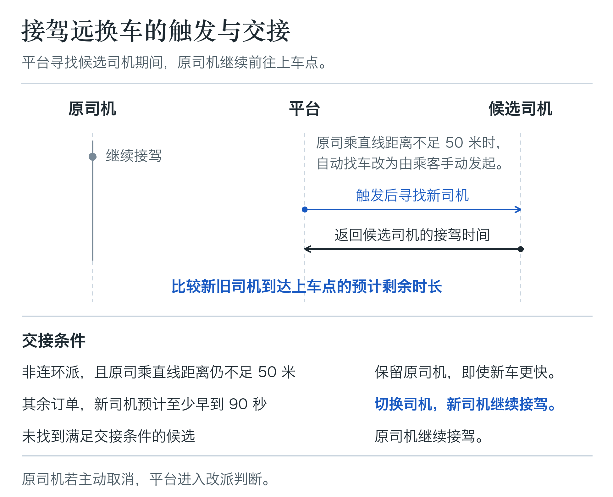

寻找候选期间，原司机继续接驾。原司机主动取消后，平台按改派流程判断是否重新发单。[图册原图](交易链路与指标拆解图册/图片/03%20换车.png) · [接驾远换车与交接条件](https://cooper.didichuxing.com/knowledge/2199610335356/2207853025753) · [时间片实验](https://cooper.didichuxing.com/knowledge/2199610335356/2209278876507)

V2.1.2 复盘发现，换车过程中如果原司机（父单司机）取消，平台再次改派时会检查与上一次改派的间隔。两次改派相隔不足 15 秒，第二次会被拦截。后续修复将最小间隔缩短到 3 秒。[V2.1.2 问题定位](https://cooper.didichuxing.com/knowledge/2199610335356/2206213943292) · [改派锁修复复盘](https://cooper.didichuxing.com/knowledge/2199610335356/2206903780552)

#### 2.4.3 接驾远换车的取消预测模型

**V2.1 预测应答后乘客取消的概率。** 训练样本取已经应答的订单，以乘客取消为正例、完单为负例，剔除司机取消。输入包括 22 项订单特征、28 项供需特征、16 项乘客历史特征和 71 项司机历史特征。训练集覆盖 2025 年 7 月 1–28 日，测试集覆盖 7 月 29 日至 8 月 4 日。取消预测的测试集 AUC 为 **0.76**。[LR26-013 · 样本、特征与测试](https://cooper.didichuxing.com/knowledge/2199610335356/2207853025753)

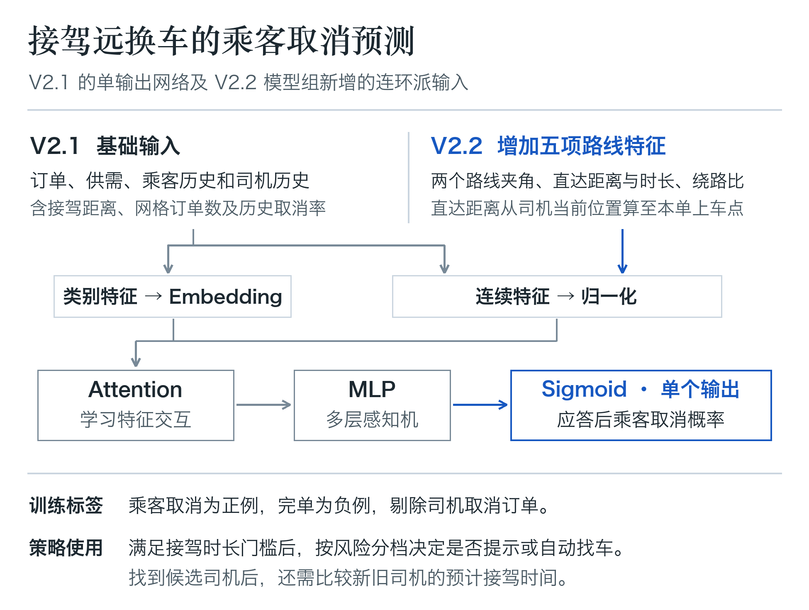

V2.1 将类别特征编码、连续特征归一化，再用注意力层学习特征间的关系，经多层感知机输出**一个乘客取消概率**。V2.2 把五项连环派路线特征加入连续输入。取消分数用于判断是否发起找车，交接时另行比较两位司机的预计接驾时长，并检查原司机与乘客的距离（2.4.2 节）。[V2.1 原始架构与触发流程](https://cooper.didichuxing.com/knowledge/2199610335356/2207853025753) · [V2.2 新增特征](https://cooper.didichuxing.com/knowledge/2199610335356/2209278876507)

> [!example]- 取消与用车意愿的双任务对照，以及研发代码中的 ESMM 结构
> 另一组离线实验比较了**取消预测与用车意愿预测**的单任务和联合训练结果。完单记为有用车意愿。对取消单，意愿标签结合乘客填写的取消原因和后续是否重呼判断。同一天内，同一乘客在相同起终点的前后两次发单相隔不超过 10 分钟，即记为重呼。两项任务单独训练时，XGBoost 的取消／意愿 AUC 为 0.762／0.660，MLP 为 0.777／0.657。联合训练的 MMoE 和 ESMM 在对照表中均约为 0.76／0.65。[取消与用车意愿建模对照](https://cooper.didichuxing.com/knowledge/2199610335356/2205183639844) · [Wiki · 换车取消与意愿模型](https://git.xiaojukeji.com/bwh_stg/trading-efficiency-wiki/blob/11b2a3402ee2e5052e40f1d724b5da4ce06134de/wiki/%E6%A8%A1%E5%9E%8B/%E6%8E%A5%E9%A9%BE%E8%BF%9C%E6%8D%A2%E8%BD%A6%E5%8F%96%E6%B6%88%E4%B8%8E%E6%84%8F%E6%84%BF%E6%A8%A1%E5%9E%8B.md)
>
> 固定版本的实现先用特征注意力编码输入，再经共享全连接层（512 → 256 → 256）分到两个预测塔。每个塔经 128 → 64 → 32 个单元后输出一个概率。第一项损失用取消标签监督取消概率，第二项用“取消且仍有用车意愿”的标签监督两个塔概率的乘积。两项损失均为二元交叉熵。上述代码实现的是双任务模型。LR26-013 评审的模型为单输出结构，取消预测 AUC 为 0.76。[换车模型训练代码 · 固定版本](https://git.xiaojukeji.com/bwh_stg/trade-of-passenger/blob/cdef137c38e2640e33754bbdba3c9bcfb12be3bb/pickup_far_exchange/model.py)

#### 2.4.4 连环派换车与时间片实验

**连环派**指司机还在服务上一单时，已经接到下一单。设 A 为司机当前位置、B 为上一单下车点、C 为本单上车点。乘客要等 A→B→C 全程，原司机计入本单的接驾时长为 B→C。V2.1 已对接驾时间较长的订单按取消风险分档。V2.2 专门扩大连环派订单的找车范围，把上一单尚未走完的路线纳入判断。时间片实验的模型组先按 A→B→C 总时长筛选，180 秒以内保留原车，超过 180 秒再按取消概率决定是否展示手动入口或自动找车。[LR26-031 · 连环派换车 V2.2](https://cooper.didichuxing.com/knowledge/2199610335356/2209278876507)

**V2.2 沿用 V2.1 的取消预测网络，增加了连环派路线特征。** 模型新增两个路线夹角、A 至 C 的直达路面距离与预计时长，以及绕路比，用于描述司机送达上一单的行驶方向与本单上车点的关系，以及途经上一单下车点产生的绕行。最终评审在同一测试集上比较了旧、新模型，整体取消预测 AUC 从 **0.7398 升至 0.7446**，连环派子集从 **0.7432 升至 0.7440**。同轮线上实验还扩大了换车触发范围，线上结果对应模型与触发规则的组合。[LR26-031 · 新旧模型同批对照](https://cooper.didichuxing.com/knowledge/2199610335356/2209278876507)

换车会占用同一区域的候选司机。2026 年 7 月 9–22 日，23 城按小时交替运行 V2.1 和 V2.2。按评审的大盘口径，**完单量显著增加 0.31%，CR 显著提高 0.29 个百分点**。把换车父子单归回同一次需求后，归一完单数增加 0.06%，未达显著。[时间片实验的两套完单口径](https://cooper.didichuxing.com/knowledge/2199610335356/2209278876507)

在最终完单的原始需求中，首次呼叫至开始计费的平均时长**缩短 2.7 秒**。在获得过应答的原始需求中，司机平均接驾时长**增加 2.1 秒**。两项变化均显著。V2.2 时间片实验方案通过评审，9 月 8 日放量至 30%。[LR26-031 · 等待、接驾投入与放量记录](https://cooper.didichuxing.com/knowledge/2199610335356/2209278876507)

10 月 9 日的项目跟踪显示，后续放量实验以 90% 流量运行 V2、10% 流量保留 V1，观察长期效果。两组的完单量和 CR 差异均不显著。同一份记录中，代表城市另做时间片实验，以年初 V0 为对照。[10 月 9 日放量与时间片实验跟踪](https://cooper.didichuxing.com/team-file/2199582756311/2209976315965)

#### 2.4.5 司机低接驾意愿的识别模型

司机低接驾意愿 V0 用拒接电话、聊天关键词、抢单后长时间停留等规则识别风险。V1 每两分钟轮询一次，输入截至本轮的对话、通话、行驶和停留记录。同一订单的每次轮询都能形成训练样本。低意愿正例包括判责为诱导取消，以及乘客取消时勾选“司机要求我取消”“司机不来接我”等原因的订单。[LR25032 · 低接驾意愿样本与特征](https://cooper.didichuxing.com/knowledge/2199610335356/2205469953587)

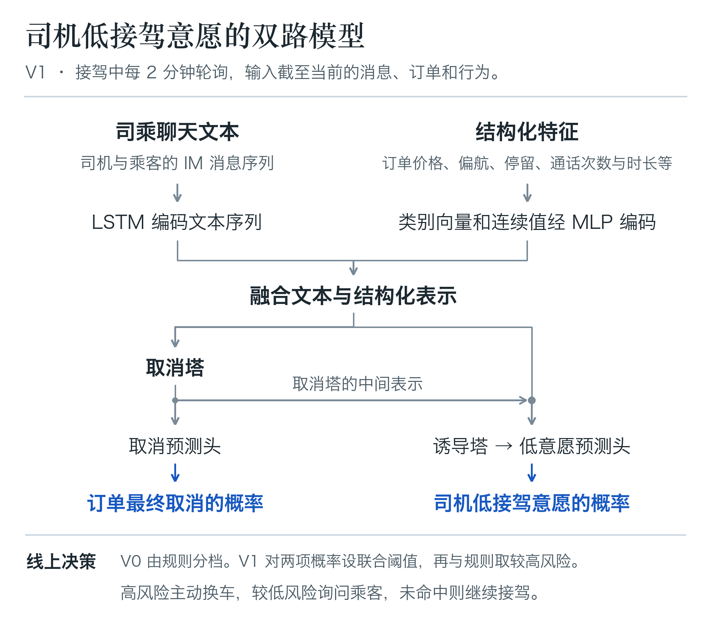

**取消塔**预测订单最终取消的概率，**诱导塔**预测司机低接驾意愿的概率。两个塔共享司乘聊天的 LSTM 编码和订单、通话、行驶等结构化特征，诱导塔还接收取消塔的中间表示。每轮轮询按两个概率的组合确定风险档位，再与规则判定取较高档位，决定主动换车、询问乘客或继续接驾。[评审原图](2025年LR/附件/LR25032/007.png) · [LR25032 · 双塔与风险分级](https://cooper.didichuxing.com/knowledge/2199610335356/2205469953587)

2025 年 8 月 30 日至 9 月 12 日，“新增规则＋模型”实验组的策略命中占应答订单 **3.99%**，比 V0 规则组高 **2.94 个百分点**。同一实验中，自营和宏鹄的归一最终乘客取消率显著下降 **1.20 个百分点**，小猪端全运力 CR 显著提高 **0.51 个百分点**。新增规则与模型共同生效的策略于 2025 年 11 月 7 日放量至 100%。[LR25032 · 模型结构、阈值与线上分组](https://cooper.didichuxing.com/knowledge/2199610335356/2205469953587)

## 3 新流升舱策略迭代

### 3.1 业务目标与覆盖人群

新流升舱覆盖两类乘客。一类是当日新注册或注册后尚未完单的新客，另一类是 90 天以上没有完单的流失乘客。V1 在等应答阶段从未勾选车型中选车免费加派。V2 扩充可选运力、更新补贴成本估算，并验证能否在原司机取消后继续免费找车。V2 的放量要求是完单乘客人数有增量，每新增一名完单乘客的成本（CAC）不高于 20 元，并且大盘交易指标没有负向变化。同一乘客在评估期内完单多次，只计一名完单乘客。比较流量占比不同的两组时，先把补贴和完单乘客人数折算到相同的流量规模，再求增量。[LR25051 目标、人群与指标口径](https://cooper.didichuxing.com/knowledge/2199610335356/2206081553120)

$$
\mathrm{CAC}=\frac{\text{相比对照组多付的升舱补贴}}{\text{相比对照组多转化的完单乘客人数}}
$$

### 3.2 V1 与 V2 的策略差异

#### 3.2.1 V2 的新增运力、实验入口与放量选择

V1 在乘客等待应答时触发，覆盖的 API 商家包括曹操、阳光、首汽、哈啰。V2 加入 T3、享道、如祺，并以滴滴和出租车兜底。在原有等应答场景之外，V2 实验分别测试了三个新增入口。乘客应答前点击取消时，在挽留环节判断是否升舱。乘客应答后换车时，扩大本次换车的车型范围。原司机取消时，在为乘客重新找车的过程中判断能否升舱。改派子单继承原单对各车型的钱效判断，已经符合条件的车型立即找车，其余车型继续轮询。[运力范围与产品入口](https://cooper.didichuxing.com/knowledge/2199610335356/2206081553120) · [车型轮询与改派继承规则](https://cooper.didichuxing.com/knowledge/2199610335356/2204853092942)

当期新流评审选择「等应答＋司机取消后改派」放量。应答前取消挽留和应答后换车为同轮测试的另外两个入口。[LR25051 · 实验分组与放量决定](https://cooper.didichuxing.com/knowledge/2199610335356/2206081553120)

#### 3.2.2 V1 的商家应答率与乘客接受度模型

原普通预分单让乘客决定是否自付差价接受候选车型。针对仍在等应答的新流订单，V1 要进一步决定是否值得为乘客补差，为此分别预测**商家单独被呼叫时的应答概率**和**乘客自付差价时接受报价的概率**。两个模型均采用梯度提升树（XGBoost），各自使用不同的样本和标签训练。[LR25006 · 升舱分数的模型输入](https://cooper.didichuxing.com/knowledge/2199610335356/2204428832540)

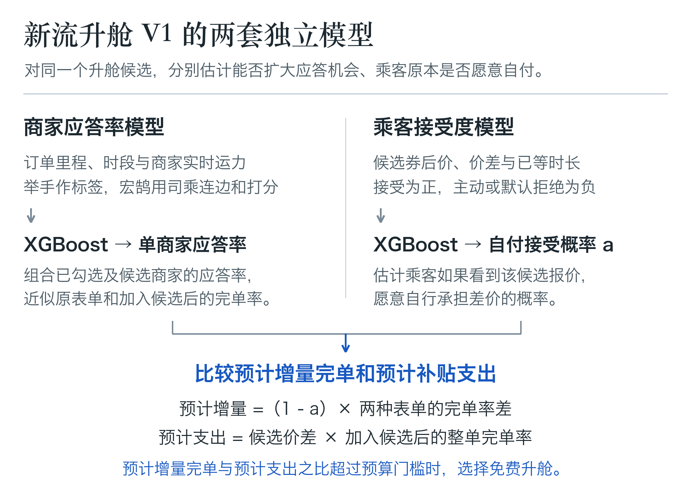

策略将商家应答率合成为整单应答率。加入候选带来的整单应答率增幅越大、乘客自付时的接受概率越低，免费升舱的预计完单增量越大。V1 用加入候选后的整单完单率估算付补概率，再乘以候选价差估算补贴支出。[V1 收益、成本与候选求解](https://cooper.didichuxing.com/knowledge/2199610335356/2204428832540) · [商家应答模型](https://cooper.didichuxing.com/knowledge/2199610335356/2204226054240)

> [!example]- 两个模型的训练标签和应答率评估口径
> | 模型 | 输入与训练标签 | 在升舱策略中的用途 |
> | --- | --- | --- |
> | 单商家应答率 | 输入订单时间与里程、商家实时空车及举手数、近一周同网格同时段的运力统计。多数品牌很少被单独呼叫，训练用商家是否举手表示应答能力。宏鹄共用分单矩阵，只能报出一个司机，另根据司乘是否连边及订单相对打分构造标签 | 在商家独立假设下，先合成原勾选组合的应答率，再加入候选重算。V1 用两者之差估计新增应答机会。原评审中，单商家模型在全渠道品类上的 AUC 为 0.91，聚合后判断整单能否应答的 AUC 为 0.82 |
> | 乘客预分单接受度 | 每条样本对应一笔订单中的一个候选车型。输入包括券后价、价差、已等待时长和乘客历史反馈，标签取自实际展示过的报价，接受记为正例，主动拒绝和默认拒绝均记为负例 | 输出自付接受概率 $a$。其他条件相同时，自付接受概率越高，免差价带来的预计完单增量越小。模型的训练版本与同批测试结果见 4.1 |

**V1 离线测算先筛品牌，再选最低价候选。** 团队先按已发单品牌等条件过滤未勾选的运力，再取剩余候选中券后价最低的一项，估算补差带来的完单增量和预计支出。计算时以应答概率近似完单概率。V2 更新了付补概率的估算，化简后的钱效分不再显式包含原表单应答率。[单商家 XGBoost 标签与测试口径](https://cooper.didichuxing.com/knowledge/2199610335356/2204226054240) · [V1 离线求解与近似](https://cooper.didichuxing.com/knowledge/2199610335356/2204428832540) · [V2 钱效推导](https://cooper.didichuxing.com/knowledge/2199610335356/2204889260287)

#### 3.2.3 V2 的预计增量完单与补贴成本

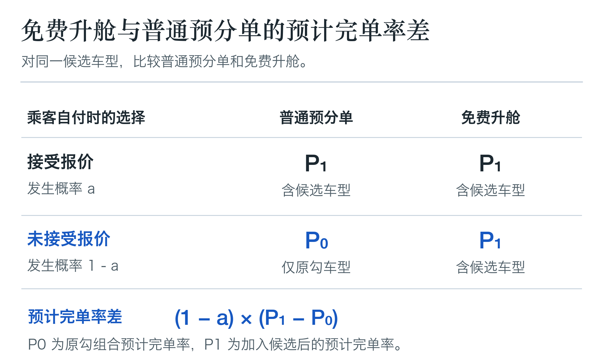

**向候选车型发起免费加派之前，策略先估算预计增加的完单和补贴支出。完单后，系统按实际承接车型结算，只有升舱车型完单才补差。** [升舱 V2 预计支出与结算条件](https://cooper.didichuxing.com/knowledge/2199610335356/2204889260287)

V2 以普通预分单为基线估算免费升舱的收益。乘客愿意自付时，两种策略都会把候选车型加入呼叫。乘客未接受报价时，普通预分单保留原勾选组合，免费升舱将候选车型加入呼叫。[新流升舱 V2 策略推导](https://cooper.didichuxing.com/knowledge/2199610335356/2204889260287)

V2 在补贴预算内选择预计能增加完单的候选车型。记 $P_0$ 为原勾选车型组合的预计完单率，$P_1$ 为增加候选车型后整张表单的预计完单率，$a$ 为乘客自付差价时接受该车型的概率。普通预分单中，乘客接受报价则按 $P_1$ 估计，未接受报价时原车型继续找车，按 $P_0$ 估计。两种策略的预计完单率之差为 $\Delta CR$。[升舱优化目标与收益推导](https://cooper.didichuxing.com/knowledge/2199610335356/2204889260287)

$$
\Delta CR=P_1-\big[aP_1+(1-a)P_0\big]=(1-a)(P_1-P_0).
$$

实际发生补贴时，单笔金额 $d$ 等于候选车型预估券后价减去原勾选车型的最高预估券后价。V1 用升舱后整个表单的完单率 $P_1$ 估算付补概率。V2 改用 $P_1-P_0$ 近似，预计成本相应为 $d(P_1-P_0)$。[V1 与 V2 付补概率的建模口径](https://cooper.didichuxing.com/knowledge/2199610335356/2204889260287)

在价差和预计完单增量均为正时，**每元补贴的预计增量完单**化简为 $(1-a)/d$。该值高于预算门槛 $\lambda$ 时，策略选择升舱。V2 使用更新后的接受度模型估计 $a$，模型的样本、校准与门槛调整见第 4 章。[V2 成本约束与求解](https://cooper.didichuxing.com/knowledge/2199610335356/2204889260287) · [接受度模型迭代](https://cooper.didichuxing.com/knowledge/2199610335356/2205042388899)

### 3.3 线上实验与放量

#### 3.3.1 V2 整体效果与各新增入口的实验结果

2025 年新流 V2 分两期评估。9 月 18–24 日评估扩大运力范围和更新策略后的整体效果。10 月 25–31 日在等应答页按乘客分流，增加三个单场景组和一个全场景组，并保留 V2 无新增场景组、V1 组和无升舱空白组。[两期实验范围](https://cooper.didichuxing.com/knowledge/2199610335356/2205850462147) · [实验分组及完整结果](https://cooper.didichuxing.com/knowledge/2199610335356/2206081553120)

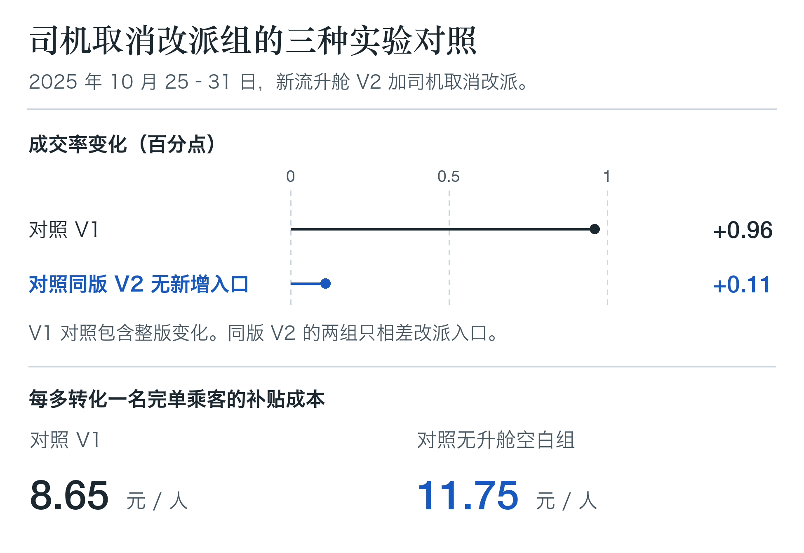

**V2 加司机取消改派组**相对 V1 组，人均完单显著增加 0.89%，CR 显著提高 0.96 个百分点。与模型、运力相同的 V2 无新增场景组相比，增加改派入口后的 CR 差值为 +0.11 个百分点。该实验组的增量 CAC 相对 V1 组为 8.65 元，相对无升舱空白组为 11.75 元。[LR25051 · 10 月实验分组与评估](https://cooper.didichuxing.com/knowledge/2199610335356/2206081553120)

以 V2 无新增场景组为基线，应答前取消挽留组的 CR 提高 0.03 个百分点，应答后换车组降低 0.16 个百分点，三个场景全部接入时提高 0.07 个百分点。[各入口的单场景与全场景结果](https://cooper.didichuxing.com/knowledge/2199610335356/2206081553120)

#### 3.3.2 新流放量与大盘实验结果

五个 V2 实验组中，**V2 加司机取消改派**相对 V1 的增量 CAC 最低。按实验期的去重呼叫人群折算，推全后预计每天比 V1 多转化 **1,637 名**新流完单乘客，在五组中最高。评审选定该组作为新流升舱的放量方案。2025 年 11 月 17 日配置新预算后，该组使用 80% 流量，无升舱空白组使用 10%。以无升舱空白组为基线，10 月实验折算的全量日均增量为 2,719 名完单乘客，增量 CAC 为 11.75 元。11 月 24 日至 12 月 7 日复评，按相同口径折算后，日均新增 **1,971 名完单乘客，增量 CAC 为 14.05 元**，低于 20 元的放量门槛。随后该策略放量至 95%，保留 5% 空白组。[LR25051 放量后评估](https://cooper.didichuxing.com/knowledge/2199610335356/2206081553120)

2025 年 9 月 19–25 日的大盘实验排除了新流实验人群和指定摇摆人群。大盘 V2 同时更换策略和接受度模型，相比老策略，CR 显著提高 0.23 个百分点，应答前乘客取消率显著下降 0.28 个百分点。对于实验组覆盖的入口，同期大盘复盘记为“所有场景”，最终 LR 记为“无新增场景”。上述指标反映新策略、新模型和运力调整的整体效果。当期放量的是新流 V2 加司机取消后改派，大盘 V2 专项未放量。[大盘实验评估](https://cooper.didichuxing.com/knowledge/2199610335356/2205502223917) · [两类人群的放量决定](https://cooper.didichuxing.com/knowledge/2199610335356/2206081553120) · [Wiki · 新流升舱 V2 复盘](https://git.xiaojukeji.com/bwh_stg/trading-efficiency-wiki/blob/11b2a3402ee2e5052e40f1d724b5da4ce06134de/wiki/%E5%AE%9E%E9%AA%8C%E4%B8%8E%E5%A4%8D%E7%9B%98/%E6%96%B0%E6%B5%81%E5%8D%87%E8%88%B1V2%E5%AE%9E%E9%AA%8C.md)

## 4 策略与模型自进化

新流升舱的一次离线测算中，乘客实际接受自付报价的比例为 **29.5%**，旧模型平均预测 **14.9%**，新模型平均预测 **28.8%**。接受度直接进入升舱的钱效计算，因此新流升舱从 V1 切换到 V2 做对照实验时，团队用新模型重新测算补贴门槛，并比较两组的完单增量与补贴成本。[新旧模型接受率与门槛测算](https://cooper.didichuxing.com/knowledge/2199610335356/2205216754598) · [LR25051 · 新流升舱 V2 线上对照](https://cooper.didichuxing.com/knowledge/2199610335356/2206081553120)

预分单和升舱已有按真实报价反馈重训模型、校准概率、复核策略收益的记录。将样本、特征、模型生成和策略反馈串成端到端自动流程，是新流补贴的调研方向。[线上报价与样本核验](https://cooper.didichuxing.com/knowledge/2199610335356/2203226211063) · [新流补贴自进化调研](https://cooper.didichuxing.com/knowledge/2208612170863/2209050763373)

### 4.1 预分单与升舱共用的接受度模型

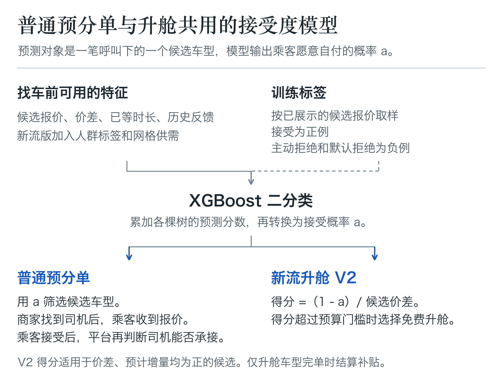

模型输出乘客自付时接受报价的概率 $a$。普通预分单按 $a$ 筛选候选车型。新流升舱 V2 中，当价差和预计完单增量均为正时，每元补贴的预计增量完单取决于接受概率和价差。价差相同的候选中，$a$ 越高，升舱的钱效得分越低。[接受度训练与特征](https://cooper.didichuxing.com/knowledge/2199610335356/2205042388899) · [预分单车型筛选](https://cooper.didichuxing.com/knowledge/2199610335356/2206174605973) · [V2 门槛与结算](https://cooper.didichuxing.com/knowledge/2199610335356/2204889260287)

#### 4.1.1 从规则补标签到真实反馈训练

**新流升舱 V1 用真实报价反馈重训模型。** 旧版训练集也为乘客没有看过的候选报价推定接受或拒绝标签。V1 改用实际展示过的预分单报价。乘客接受记正例，主动拒绝和默认拒绝都记负例。模型新增相对原勾选价的价差、价差比例及单位里程报价。新客和流失乘客发单后，策略为每个候选车型估算补差收益。**XGBoost 二分类模型**读取候选价格、已等待时长、乘客过去 14 天和 28 天的接受与拒绝记录等特征。每轮新增一棵树修正已有预测，累加各树的分数，最终输出接受概率 $a$。[LR25006 · 模型输入与训练](https://cooper.didichuxing.com/knowledge/2199610335356/2204428832540) · [预分单状态定义](https://cooper.didichuxing.com/knowledge/2199610335356/2206548317762) · [升舱使用接受概率的方式](https://cooper.didichuxing.com/knowledge/2199610335356/2204889260287)

| 历史版本 | 训练样本、特征与模型设置 | 评估结果 |
| --- | --- | --- |
| 早期线上版本 `pre_dispatch_acc__v4` | 为扩充训练数据，同一订单内没有实际发出预分单的车型也按规则补标签。后续离线评估按订单和车型关联线上打分与报价反馈 | 线上日志回查 AUC 约 0.63。在另一次历史真实反馈测试中，原扩样模型 AUC 为 0.658 |
| 真实反馈重训的 XGBoost | 用实际展示报价的接受、主动拒绝和默认拒绝记录训练，加入价格与候选价差等特征。一轮实验设置学习率 0.09、最大树深 8、迭代 400 轮，并对五个特征施加单调约束 | 该轮离线 AUC 为 0.698 |
| 后续候选 `upgrade_cabin_v5` | 将 SQL 中的特征计算迁到算子，修正乘客特征缺失值填充，取消对单位里程报价的单调约束，保留对等待时长、券后价、价差和价差比例的约束 | 离线 AUC 为 0.699。在真实反馈测试中，较旧模型的 0.658 提升 0.041 |

该轮训练中，正负样本数量之比约为 1∶3，正样本权重设为 3。同一运力出现在特快盒子内外时，升舱按业务规则应取盒外价。核验时发现线上曾同时传入两份报价，团队修正了训练数据中询价记录、车型与价格的匹配条件，并将线上取价问题提交工程处理。[原始训练实验与版本记录](https://cooper.didichuxing.com/knowledge/2199610335356/2203030231213) · [盒内外报价核验](https://cooper.didichuxing.com/knowledge/2199610335356/2203226211063)

普通预分单展示报价后才有自付反馈。候选车型若走免费升舱，乘客无需确认自付报价，只会留下后续履约结果。历史复盘将升舱引起的预分单样本分布变化列为偏差校正问题。[升舱策略复盘 · 接受度样本变化](https://cooper.didichuxing.com/knowledge/2199610335356/2203399000384)

#### 4.1.2 新流模型的特征与离线结果

V1 的接受度模型主要使用订单、价格和乘客历史。2025 年新流升舱 V2 沿用 XGBoost，增加新客、流失、普通乘客三类人群标签和起点网格近 5 分钟应答数等供需特征，将新分数用于新流订单的升舱补贴判断。训练样本覆盖 6 月 1 日至 7 月 31 日，测试样本覆盖 8 月 1–7 日。模型训练设置了单调约束。其他输入相同时，等待越久，预测接受概率不下降。券后价、价差或价差比例越高，预测接受概率不上升。离线评估在同一测试集上分别统计大盘和新流样本的接受度 AUC。[模型训练与特征说明](https://cooper.didichuxing.com/knowledge/2199610335356/2205042388899) · [LR25051 离线对照](https://cooper.didichuxing.com/knowledge/2199610335356/2206081553120)

| 同一测试集上的模型 | 大盘 AUC | 新流 AUC |
| --- | ---: | ---: |
| 旧模型 | 0.692 | 0.663 |
| 只加人群标签 | 0.703 | 0.676 |
| 只加供需特征 | 0.736 | 0.714 |
| 同时加人群标签和供需特征 | 0.737 | 0.717 |

新流和大盘升舱均在线上实验中验证过新策略与新模型的组合。当期选定放量的是新流 V2 加司机取消后改派，大盘 V2 专项未放量。普通预分单也使用接受度筛选车型，现有记录未说明是否同步换模。[大盘实验分组](https://cooper.didichuxing.com/knowledge/2199610335356/2205502223917) · [LR25051 放量决定](https://cooper.didichuxing.com/knowledge/2199610335356/2206081553120)

当期使用的接受度模型为 XGBoost。选型方案另将 POSO 门控网络列为候选架构，用于按人群调节特征权重。[新流模型选型记录](https://cooper.didichuxing.com/knowledge/2199610335356/2205140085855) · [Wiki · 接受度模型版本与校准](https://git.xiaojukeji.com/bwh_stg/trading-efficiency-wiki/blob/11b2a3402ee2e5052e40f1d724b5da4ce06134de/wiki/%E6%A8%A1%E5%9E%8B/%E9%A2%84%E5%88%86%E5%8D%95%E6%8E%A5%E5%8F%97%E5%BA%A6%E4%B8%8E%E5%8D%87%E8%88%B1Lambda.md)

#### 4.1.3 接受度更新后的升舱门槛

门槛测算先对齐新旧模型的训练集和测试集，再比较其平均接受概率。在这批新流样本中，新模型估计的报价未被接受的概率约为旧模型的 **0.84 倍**。同期升舱公式还移除了“原表单未应答概率”这一项。按原表单应答率 70% 折算，两项变化合计使策略得分约为原来的 2.8 倍，对应的离线测算门槛也约为原门槛的 2.8 倍。2025 年 10 月 25–31 日的线上实验中，V1 对照组实际配置为 **0.08**，五个 V2 组统一配置为 **0.16**。各 V2 组采用相同的门槛配置，用于比较新增入口的影响。[新旧模型与升舱门槛测算](https://cooper.didichuxing.com/knowledge/2199610335356/2205216754598) · [实验组实际参数](https://cooper.didichuxing.com/knowledge/2199610335356/2206081553120)

### 4.2 预分单与升舱的方案与调研

#### 4.2.1 预分单与升舱联合补贴（讨论稿）

《预分单 C 补（含升舱）策略 WIP》将**部分补差**纳入候选方案。草案保留原触发时机，每轮轮询选两个车型。原流程按接受度分数筛选车型，草案进一步比较每个候选的四种处理方式，包括全额补差、部分补差、无补贴预分单和本轮跳过。[预分单 C 补与升舱联合决策原稿](https://cooper.didichuxing.com/knowledge/2199610335356/2202634494123)

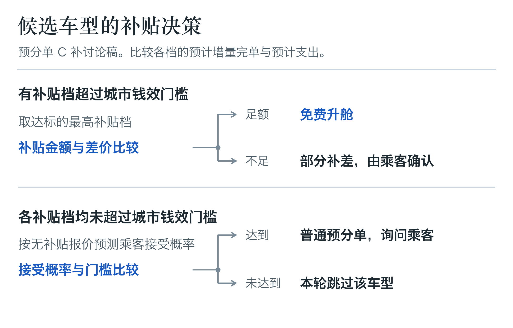

讨论稿使用原勾选品牌的应答概率和乘客在不同补贴金额下接受候选车型的概率，估计各档的增量完单。策略按**预计增量完单 ÷ 预计支出**衡量钱效，选择超过城市门槛的最高补贴档。若各补贴档均未达标，则按无补贴时的接受概率决定是否发出普通预分单。[团队 WIP · 补贴动作与模型需求](https://cooper.didichuxing.com/knowledge/2199610335356/2202634494123) · [Wiki · 预分单与升舱策略演进](https://git.xiaojukeji.com/bwh_stg/trading-efficiency-wiki/blob/11b2a3402ee2e5052e40f1d724b5da4ce06134de/wiki/26%E5%B9%B4%E9%A1%B9%E7%9B%AE/b063-project-%E9%A2%84%E5%88%86%E5%8D%95%E4%B8%8E%E5%8D%87%E8%88%B1%E7%AD%96%E7%95%A5%E6%BC%94%E8%BF%9B.md)

#### 4.2.2 新流补贴端到端自进化（调研）

新流补贴自进化方案处于调研阶段，覆盖**业务问题定义、数据与样本、特征构建、模型结构生成、策略优化反馈**五个环节。方案中，Agent 负责任务决策与工具调用，Skill 保存业务口径、操作流程和可执行脚本。各环节的数据、训练与反馈接口均列为调研项。[沈江湖串讲 · 新流补贴自进化设计（5.2）](https://cooper.didichuxing.com/knowledge/2208612170863/2209050763373)

### 4.3 其他业务的自动训练与模型选型

#### 4.3.1 新人首单发券的自动训练

首单券面向已注册且尚未完单的新客。乘客访问首页时，策略在 3 至 10 元的当日立减券中选取一档，目标是在完单获客成本约束下提高访问完单率。[新人首单天降链路，第 5.1 节](https://cooper.didichuxing.com/knowledge/2208612170863/2209050763373)

> [!example]- 首单券的 EVE 定时训练与 Apollo 线上调用
> 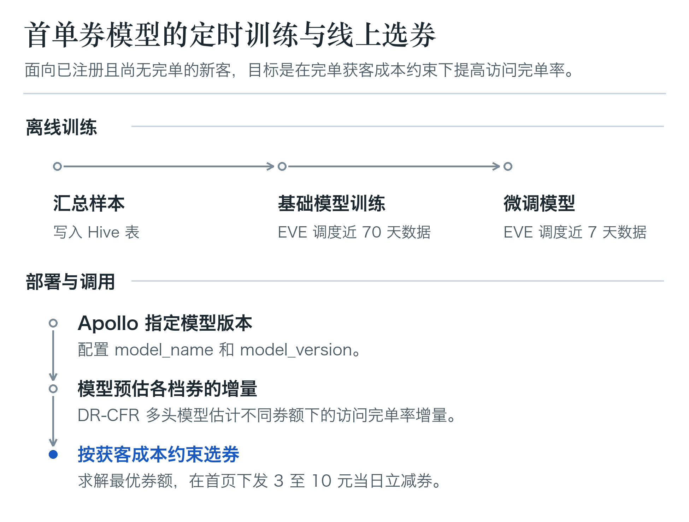
>
> EVE 用近 70 天的数据更新基础模型，再用近 7 天数据微调。线上读取 Apollo 指定的模型版本，使用 DR-CFR 多头模型给出的各档券转化增量，结合完单 CAC 约束求解券额。[沈江湖串讲 · 模型结构、调度、部署与求解](https://cooper.didichuxing.com/knowledge/2208612170863/2209050763373)

**首单券相关 LR**

- **首单券预算分配。** 原先全国统一调控新客首单补贴，本次先试验不同补贴水平，再按城市分组配置。在整体人均核销成本（首单券核销总金额 ÷ 核销人数）相当时，比较访问新客中完成首单的人数占比。[LR26-042 · 新客首单分城市调控补贴](https://cooper.didichuxing.com/knowledge/2199610335356/2209794347993)
- **首单券模型迭代。** 新人首单原先定期按固定结构重训，流失首单主要依靠人工根据每次随机实验更新模型。评审将候选模型的提出、训练和多次复验连成自动流程，在新人首单券数据上选型，再用流失乘客首单数据验证迁移效果。新增候选的效果记录来自离线实验。[LR26-060 · 因果推断 AutoResearch Skill](https://cooper.didichuxing.com/knowledge/2199610335356/2210140195247)

#### 4.3.2 聚合 PK 模型重训与商家匹配离线选型

聚合 PK 对两版自动重训模型分别开展了线上对照实验。两版迭代模型分别用 2026 年 1 月 23–29 日、1 月 28 日至 2 月 3 日的数据重训，以原线上模型为对照，按乘客随机分流，实验流量为 5%。第一版的人均完单无显著变化，应答后乘客取消率显著下降 0.12 个百分点，平均应答距离缩短 28.78 米。第二版的人均完单同样无显著变化，应答率显著下降 0.10 个百分点。[PK 模型自动化更新实验评估](https://cooper.didichuxing.com/knowledge/2199610335356/2206703206886) · [Wiki · PK 模型自动更新](https://git.xiaojukeji.com/bwh_stg/trading-efficiency-wiki/blob/11b2a3402ee2e5052e40f1d724b5da4ce06134de/wiki/%E6%A8%A1%E5%9E%8B/PK%E6%A8%A1%E5%9E%8B%E8%87%AA%E5%8A%A8%E6%9B%B4%E6%96%B0%E5%90%88%E5%90%8C.md)

商家匹配的 AutoResearch 离线实验分别对司机抢单、候选司机在 PK 中胜出和最终履约三个预测任务进行模型选型，并用三个随机种子复核候选结构。在抢单预测任务中，基础 DNN 的平均对数损失为 0.054697，三塔加 DCNv2 模型为 0.053848。[商家匹配 AutoResearch 实验记录](https://cooper.didichuxing.com/knowledge/2199610335356/2209568096288)
