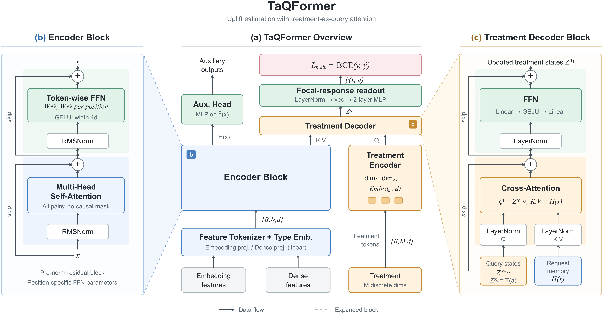
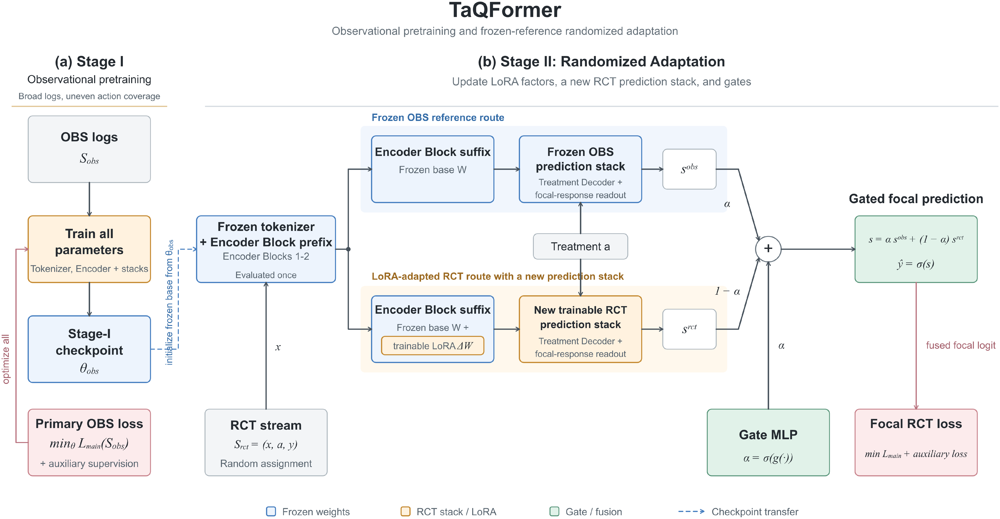
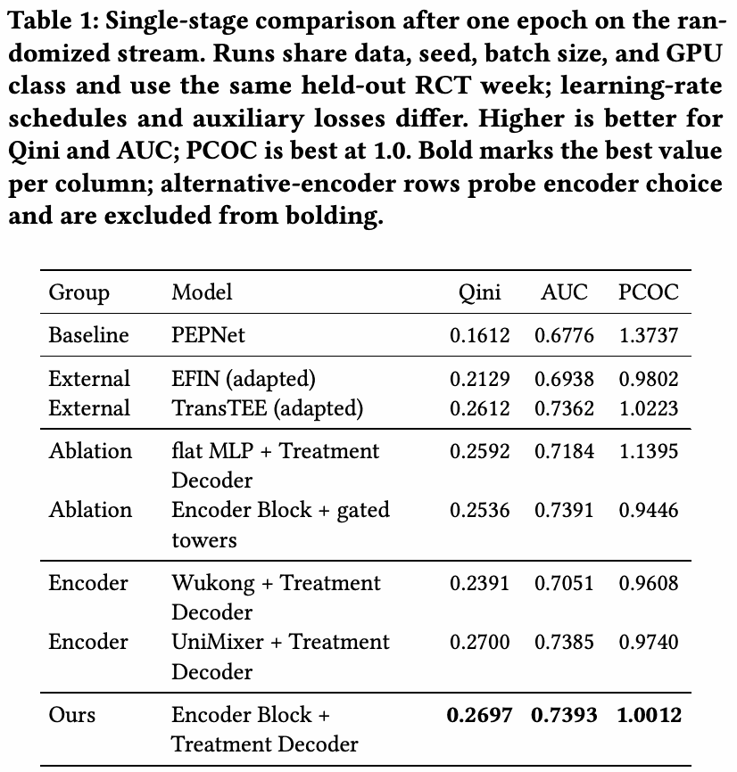
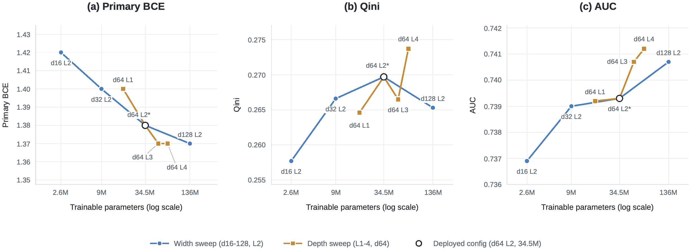
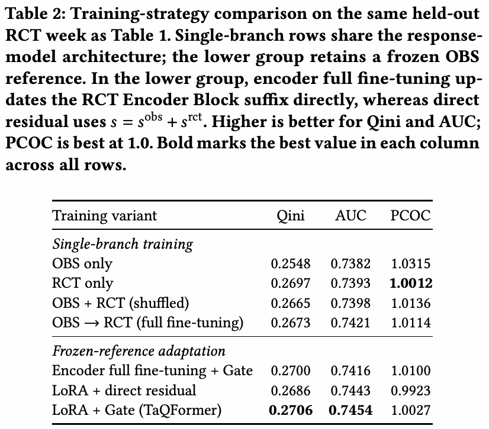
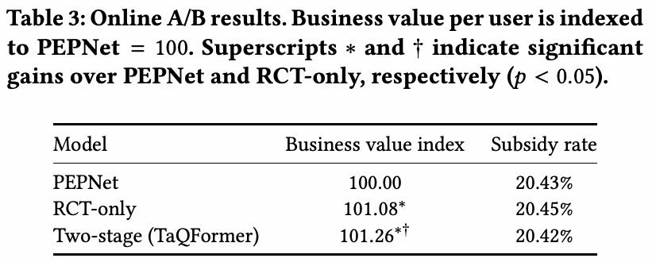

# TaQFormer：多维优惠券建模与 OBS–RCT 融合

论文：**TaQFormer: A Treatment-as-Query Transformer with Data-Fusion for Multidimensional Treatment Modeling in Coupon Allocation**  
作者：Jiahong Li、Zeqin Yang、Yu Xiang、Zhifan Jiang、Jingqi Ma、Enzheng Hua、Jixing Xu、Jun Wu、Fei Wang、Enyun Yu、Jiecheng Guo；机构为滴滴出行。  
版本：[arXiv:2610.26199v1](https://arxiv.org/abs/2610.26199v1)，2026-10-19 提交；本文按预印本 v1 解读，不推定会议录用。  
原文：[HTML](https://arxiv.org/html/2610.26199v1) · [在线 PDF](https://arxiv.org/pdf/2610.26199v1) · [本地 PDF](./assets/source/paper.pdf) · [LaTeX 源码](./assets/source/draft.tex)  
代码：本版本未提供公开代码链接。  
范围：覆盖摘要、正文全部章节和小节、公式（1）—（15）、全部 3 图和 3 表，以及方法性无编号表达式。原文没有技术附录、独立算法块或定理证明章节。逐项核对见 [覆盖清单](./coverage.md)。

> 本笔记按章节做中文归纳与技术解释，不是逐句译文。“论文明确说明”指原文陈述；“从图中可以看出”指图表观察；“直观理解”“阅读判断”和“解释性公式”属于辅助理解。未公开的信息不自行补全。原图与原表归原作者所有，来源许可标为 CC BY-NC-ND 4.0；这里保留原始内容和来源，用于个人精读。

## 1. 前置信息：总览、摘要与引言

### 1.1 一句话总览

TaQFormer 把每个品类的折扣编码为独立 query，让它们读取同一份请求特征，再联合预测**完整折扣组合下某个目标品类的成交概率**；用观测日志预训练、RCT 上的 LoRA 适配和双分支 logit 门控，在补贴率近似一致的线上实验中提高人均业务价值。

### 1.2 研究背景与核心问题

同一请求可以同时看到多个可替代服务品类。某一品类降价不仅可能增加自身成交，还可能把其他品类的需求吸引过来。因此，只估计某一折扣的孤立效果不足以支持联合优惠券分配。当前价格、服务质量、供给和市场条件也会改变响应。

原文的三个问题分别是：

1. **组合动作的结构共享。** 一个动作包含多个品类折扣，组合数随品类数和档位数增大。同一品类折扣相同的不同动作应能共享信息，同时仍需考虑其余品类折扣对目标响应的影响。线上 PEPNet 基线先把各维 embedding 融成一个向量，再送入门控预测塔，无法一直保留坐标级查询。
2. **大规模偏置日志与小规模随机数据如何结合。** OBS 覆盖大量请求，但历史策略造成请求—动作覆盖不均；RCT 能在随机支持范围内比较 treatment，规模却小。需要保留 OBS 学到的表征，同时用随机监督校正响应预测。
3. **反事实质量与工程价值如何共同验证。** 预测损失降低不等于 uplift 排序改善，模型更大也不保证分配收益更高。需要离线 RCT 评价、全候选动作推理压测和成本可比的线上 A/B 实验。

### 1.3 核心思路与贡献边界

论文贡献是三个相互配合的设计：按品类分解的 treatment queries 与联合响应读出；保留冻结 OBS 参考的两阶段随机适配；能够共享请求计算的全 treatment 并行服务，并给出生产验证。

线上实验持续 14 天，双阶段模型相对 PEPNet 的人均业务价值提高 **1.26%**，相对 RCT-only 的额外相对提升约 **0.178%**。这些指标是目标品类完成交易形成的业务价值，业务计算方式和绝对值未公开，不能直接称为 GMV、利润或整个市场总收益。实验设计和全部数字见第 5.7 节。

**阅读判断：** treatment-as-query 并非本文首次提出；本文更应被理解为面向联合折扣决策的结构化建模、随机适配和部署方案。OBS 预训练也不自动保证因果正确，识别仍有假设与支持集边界。

## 2. 相关工作（原文 §2）

### 2.1 结构化 treatment 的 uplift 建模

早期 uplift 工作主要研究随机实验中的二元干预；后续扩展到多 treatment、不同结果类型以及有成本的分配。神经异质性处理效应模型使用 treatment-specific heads、连续剂量响应函数或正交目标，相关例子包括 Dragonnet、VCNet、RieszNet。

与本文最接近的是 **TransTEE** 和 **EFIN**。TransTEE 支持离散、连续和结构化 treatment，通过 treatment self-attention 建模交互，并让 treatment 表征查询协变量；EFIN 使用 treatment-conditioned attention，并将估计的增量加到自然响应上。TaQFormer 保留每个折扣坐标的 token，经过 cross-attention 后用非线性联合读出预测目标品类响应，并加上 OBS–RCT 适配流程。不能把 TransTEE 中的 treatment self-attention 直接当成 TaQFormer 已实现的模块。

### 2.2 随机数据与观测数据融合

历史策略会让未经调整的结果比较受到混杂影响，条件估计需要充分调整和重叠性。RCT 的随机比较也仅针对试验人群和动作支持集成立。已有方法包括联合估计、自适应加权、表征迁移和预测校正，各有自己的识别假设。

本文选择表征迁移加随机适配：OBS 提供预测信息，RCT 调整响应估计，减少对 OBS 无混杂假设的依赖。论文没有给出“任意 OBS 偏置都能被门控消除”的理论保证，也没有将 gate 输出解释为可信度概率。

### 2.3 Transformer、容量与工业推理

TabTransformer、FT-Transformer 将注意力用于表格特征；HiFormer、Wukong 等研究异质特征交互和容量；OneTrans、RankMixer、TokenMixer-Large、UniMixer、WHALE 等进一步探索统一交互、序列建模或更高效的 token mixing。它们说明容量和推理效率的重要性，但大多聚焦排序或响应预测。

本文的区别在评价对象：固定训练预算下同时考察 BCE、AUC 和 **uplift 排序**，还要求对每个请求打分全部可行动作。容量实验的结论不能从普通预测任务的 scaling 规律直接推出。

## 3. 问题定义（原文 §3）

### 3.1 耦合的多 treatment 场景（原文 §3.1）

输入单位是一次在线决策请求，而不是用户完整轨迹。$X_i=x_i$ 表示决策时可用的上下文，$A_i\in\mathcal A$ 是实际分配动作。$\mathcal M=\{1,\dots,M\}$ 按**原价由高到低**排列品类。一个 treatment 是完整的多维干预，一个 action 是满足业务约束的某个具体组合：

$$
a=(a_1,\dots,a_M)\in\prod_{m\in\mathcal M}\mathcal D_m, \qquad \text{(1)}
$$

$a_m$ 是折扣深度，**值越大代表优惠越深**。不要把它直接读成“支付原价的几折”。各品类共享固定步长的网格：

$$
\mathcal D=\{d_k=d_{\min}+(k-1)\Delta:k=1,\dots,K\},
    \qquad \Delta>0. \qquad \text{(2)}
$$

各品类允许的范围可不同，即 $\mathcal D_m\subseteq\mathcal D$，但步长一致。业务要求高价品类的折扣深度严格小于低价品类：

$$
\mathcal A=
    \left\{a\in\prod_{m\in\mathcal M}\mathcal D_m:
    a_{m+1}-a_m\ge\Delta,\;m=1,\dots,M-1\right\}. \qquad \text{(3)}
$$

因此所有可行动作满足 $a_1<\cdots<a_M$；相邻维至少差一个档位，就保证任意较高价品类的优惠更浅。$a_0$ 是**最浅的可行组合**，不一定是完全不发券。约束减少组合数，但动作空间仍随品类数和折扣档位组合式增长。

**直观理解：** 先根据业务规则列出合法优惠组合，再让模型在这些组合之间做比较。顺序约束是候选集的硬过滤，不是训练中的软惩罚，也不是对模型输出施加单调性保证。

### 3.2 因果目标与识别（原文 §3.2）

目标只针对一个 focal category。对一次符合条件的曝光，$Y(a)\in\{0,1\}$ 表示采取完整动作 $a$ 后，在归因窗口内是否完成该目标品类的交易；其他品类的折扣仍会影响这一结果。原文无编号定义为：

$$
\tau(x;a,a_0)=\mathbb E[Y(a)-Y(a_0)\mid X=x],
$$

$$
\mu(x,a)=\mathbb E[Y(a)\mid X=x],\qquad
\tau(x;a,a_0)=\mu(x,a)-\mu(x,a_0).
$$

模型 $\hat y(x,a)$ 估计曝光到目标品类完单的概率。它不直接输出每个品类的全部效应矩阵，也不直接以真实个体 uplift 作为监督标签；一个请求只能观测到实际分配动作的事实结果。

从 OBS 识别响应曲面需要四项假设：

- **一致性：** 当 $A=a$ 时，观测结果就是 $Y(a)$。
- **无干扰：** 一个请求的结果不依赖其他请求所分配的动作。
- **条件可交换性／无混杂：** 给定上下文后，潜在结果与动作分配独立。
- **正性：** 对 OBS 人群中的每个上下文和每个可行动作，分配概率为正。

对应的原文无编号表达式为：

$$
\{Y(a):a\in\mathcal A\}\perp\!\!\!\perp A\mid X,
\qquad \Pr(A=a\mid X=x)>0.
$$

在这些条件下：

$$
\mu(x,a)=\mathbb E[Y\mid X=x,A=a],
$$

$$
\tau(x;a,a_0)=\mathbb E[Y\mid X=x,A=a]
-\mathbb E[Y\mid X=x,A=a_0].
$$

RCT 微调在试验支持集内使用随机监督，降低对 OBS 无混杂假设的依赖。**论文未证明**其能够修复完全没有覆盖的动作，也未证明真实供需环境必然满足无干扰假设。本文没有专门的识别定理、误差界或一致性证明。

### 3.3 下游分配决策（原文 §3.3）

预测概率先结合“在完成交易条件下的期望业务贡献”，得到请求 $i$ 在动作 $a$ 下的期望业务价值 $\hat r_{ia}$。这一步的业务转换公式保密，但所有线上实验组使用相同规则。

$c_{ia}$ 表示单位业务价值对应的补贴成本，因此期望补贴支出是 $c_{ia}\hat r_{ia}$。注意它不是一次请求的固定绝对补贴金额。给定补贴率目标 $\rho$，原文将总体分配写为两个分别编号的式子：

$$
\max_{b\in\mathcal B}\quad
    \sum_{i\in\mathcal I}\sum_{a\in\mathcal A}
    b_{ia}\hat r_{ia} \qquad \text{(4)}
$$

$$
\text{s.t.}\quad
    \sum_{i\in\mathcal I}\sum_{a\in\mathcal A}
    b_{ia}(c_{ia}-\rho)\hat r_{ia}\leq 0, \qquad \text{(5)}
$$

其中 $\mathcal I=\{1,\ldots,n\}$，$\mathcal B$ 是二元分配矩阵的集合，每个请求只选择一个动作：

$$
b_{ia}\in\{0,1\},\qquad \sum_{a\in\mathcal A}b_{ia}=1.
$$

公式（5）控制的是总体期望补贴成本与总体期望业务价值的比率。为解释该含义，在总期望价值为正时，它**等价变形**为：

$$
\frac{\sum_{i\in\mathcal I}\sum_{a\in\mathcal A}b_{ia}c_{ia}\hat r_{ia}}
{\sum_{i\in\mathcal I}\sum_{a\in\mathcal A}b_{ia}\hat r_{ia}}\leq\rho.
$$

对固定非负拉格朗日乘子 $\lambda\ge0$，松弛后的目标按请求分离，线上采用：

$$
a_i^\star
    =
    \arg\max_{a\in\mathcal A}
    \hat r_{ia}\bigl(1-\lambda(c_{ia}-\rho)\bigr). \qquad \text{(6)}
$$

$\lambda$ 离线基于日志校准，使实际补贴率接近 $\rho$；线上打分全部候选动作后取最大。论文没有给出乘子的具体搜索算法、更新频率或在线纠偏控制器。

**直观理解：** 模型负责回答“给这个请求这组券，目标品类成交的可能性多大”；分配器再把它换算成价值，并用成本乘子压低过于昂贵的方案。

**约束层级：** 可行动作集合与每请求一个动作是硬结构；总体补贴率是优化问题中的约束；部署用离线校准的 $\lambda$ 实现近似成本控制，论文没有声称公式（6）对每个请求或每段实时流量都严格满足补贴率上限。系统也没有描述探索动作、fallback 策略或额外预测器，不能自行补入。

## 4. TaQFormer 模型（原文 §4）

### 4.1 架构（原文 §4.1）

**Figure 1：TaQFormer 架构。** (a) 特征编码器、treatment decoder、独立的目标响应读出及辅助分支；(b) pre-norm 自注意力与 token-wise FFN；(c) treatment 状态查询请求 memory 的解码块。沿 (a) 从输入读到输出，再用 (b)(c) 查看模块内部；图支持“请求编码与动作解码分离”的计算结构。

#### 4.1.1 输入、输出与完整信息流

| 层级 | 输入与处理 | 输出与用途 |
|---|---|---|
| 请求 tokenizer | 决策时可用的标量、类别 embedding、预训练结构向量 | $X(x)\in\mathbb R^{N\times d}$ |
| 请求 encoder | 固定语义字段 token 经自注意力和私有 FFN | 与动作无关的 $H(x)\in\mathbb R^{N\times d}$ |
| treatment encoder | 完整动作的各维折扣 | $T(a)\in\mathbb R^{M\times d}$ |
| treatment decoder | 折扣 token 作 query，请求 memory 作 key/value | $Z^{(L)}$，每个折扣坐标一条解码后的表示 |
| 目标响应 readout | 展平并联合读取全部坐标 | 标量 logit $s(x,a)$ 和成交概率 $\hat y(x,a)$ |
| 全动作推理 | 固定请求，遍历合法动作的张量批次 | $\{\hat y(x,a):a\in\mathcal A\}$，交给分配器 |
| 辅助分支 | pooled memory 或相应任务分支 | 辅助监督；不作为下游分配输入 |

原文的 $X_i$ 是随机变量／上下文记号，$X(x)$ 是 tokenizer 输出；第 4.3 节的 $X$ 又表示请求批次，阅读时按上下文区分。

#### 4.1.2 Feature tokenizer 与 encoder

每个标量特征、类别 embedding、预训练结构向量分别形成自己的 token；相同输入类型共享投影，并添加 type embedding。位置遵循固定特征顺序，而非任意可交换的序列元素。

encoder 堆叠 pre-RMSNorm Transformer blocks，每块交替使用多头自注意力和 FFN。区别于普通共享 FFN，每个 token 位置有**私有 FFN 参数**，让不同语义字段拥有自己的通道变换。Figure 1 标明这里是 all-pairs self-attention，没有 causal mask；token-wise FFN 使用 GELU、宽度为 $4d$。自注意力仍负责跨字段交互。输出完整 memory $H(x)$ 给 decoder，pooled summary $\bar h(x)$ 可交给辅助头。

**直观理解：** “年龄”“价格”“供给状态”等字段即使都被编码成同维向量，也不必经过同一套字段内变换；注意力负责交换信息，私有 FFN 负责各字段自己的加工。具体特征列表、token 数 $N$、结构向量预训练方式没有公开。

#### 4.1.3 组合式 treatment 编码

品类 $j$ 的映射为 $e_j:\mathcal D_j\to\mathbb R^d$：

$$
T(a) = [\,e_1(a_1),\dots,e_M(a_M)\,] \in \mathbb R^{M\times d}. \qquad \text{(7)}
$$

同一品类具有同一折扣值的动作共享 $e_j(d)$，而不同品类使用独立 embedding 表。因此“某品类给同样折扣”在不同完整组合之间可以共享信息，同时保留品类身份。

这里是坐标级参数共享，不是把每个完整 action ID 当成完全独立类别，也不是所有品类共用一张不区分身份的表。各坐标保留到 attention decoder 之后才由 readout 联合读取。

#### 4.1.4 Treatment-aware cross-attention

decoder 堆叠 $L$ 个 pre-norm block，初值为 $Z^{(0)}=T(a)$。在第 $\ell$ 层，上一层的 treatment 状态作 query，始终用同一个请求 memory 作 key/value：

$$
\widetilde Z^{(\ell)}
    = Z^{(\ell-1)} + \mathrm{CA}^{(\ell)}\!\bigl(\mathrm{LayerNorm}(Z^{(\ell-1)}),\, \mathrm{LayerNorm}(H(x))\bigr). \qquad \text{(8)}
$$

对注意力头 $h$，$Q_h^{(\ell)}$ 与 $K_h^{(\ell)}$ 分别是归一化 treatment 状态、特征状态投影后的矩阵，坐标到特征的注意力为：

$$
P_h^{(\ell)}(x,a)=
    \mathrm{softmax}\!\left(
    \frac{Q_h^{(\ell)}\bigl(K_h^{(\ell)}\bigr)^\top}{\sqrt{d_h}}
    \right)\in\mathbb R^{M\times N}. \qquad \text{(9)}
$$

$P_h^{(\ell)}$ 每一行对应一个 treatment 坐标，每一列对应一个请求特征 token。改变某品类折扣可以改变其关注的市场特征。随后是 FFN 残差更新：

$$
Z^{(\ell)}
    = \widetilde Z^{(\ell)} + \mathrm{FFN}^{(\ell)}\!\bigl(\mathrm{LayerNorm}(\widetilde Z^{(\ell)})\bigr). \qquad \text{(10)}
$$

这里 decoder 使用 LayerNorm，encoder 使用 RMSNorm，不能混写。decoder 始终读取完整的 $N\times d$ memory，而不是预先压缩成一个 pooled 向量。

**直观理解：** 不同折扣各自“询问”请求中哪些信号与自己相关；经过多层后，query 已包含先前检索的请求信息，可以继续细化查询。式（8）—（10）只明确 cross-attention 和 FFN，不能从中额外推定存在 treatment-token self-attention。

#### 4.1.5 联合读出与跨品类依赖

经过 $L$ 层及最终 LayerNorm，独立的两层 GELU MLP 读取所有解码坐标：

$$
\begin{aligned}
    s(x,a) &= f\!\bigl(\mathrm{vec}(\mathrm{LayerNorm}(Z^{(L)}))\bigr), \\
    \hat y(x,a) &= \sigma\bigl(s(x,a)\bigr).
    \end{aligned} \qquad \text{(11)}
$$

$\mathrm{vec}$ 将所有 $M$ 个坐标展平，$f$ 做非线性联合映射。于是目标品类的预测既依赖自己的折扣，也依赖其他品类折扣。

**直观理解：** 每个品类折扣先从同一请求中提取相关信息，最终由一个联合判断器汇总，给出目标品类的成交概率。跨品类响应依赖明确落在联合读出上，而不是每个 token 各自独立输出本品类结果后简单相加。

**边界：** 此结构允许学习折扣组合的非线性关系，但没有显式保证响应单调、因果识别或对未覆盖组合的可靠外推。原文也没有报告专门检验跨品类替代效应的独立实验。

### 4.2 两阶段训练：观测预训练与随机适配（原文 §4.2）

**Figure 2：TaQFormer 的两阶段训练。** (a) OBS 上训练所有模块；(b) 保留冻结的 OBS 路线，共享冻结 encoder 前缀，并对后缀进行 LoRA 适配。仅更新 LoRA 因子、新初始化的 RCT prediction stack（包含 treatment encoder）和 gate；门控输入 stop-gradient，目标 logits 融合，直接辅助输出来自 RCT stack。读图时先区分共享前缀、两条后缀和两套预测头，再看 gate 的输入与输出。

原文把 prediction stack 定义为 treatment encoder、Treatment Decoder Blocks、目标响应 readout 和辅助头的组合，不能将它仅理解成最后一层线性分类器。

#### 4.2.1 Stage I：OBS 预训练

在 OBS 数据上训练 tokenizer、整个 encoder 和 prediction stacks，共一个 epoch。目标是原文公式（15）的主任务 BCE 加辅助监督。它学习日志分布下的请求表征和 treatment-aware 响应；覆盖不均、有限样本和模型误设仍可能造成响应曲面误差。

论文没有宣称这一阶段直接获得无偏反事实估计，也没有在本阶段给出显式倾向评分重加权公式。不要将 PEPNet 基线所保留的 propensity 辅助项误安到 TaQFormer 上。

#### 4.2.2 Stage II：冻结参考与参数高效 RCT 微调

完整保留 Stage I 模型，作为不计算梯度的 OBS 参考路线。同时构造不同的 RCT 路线：

1. tokenizer 和 encoder 前缀冻结、共享且只计算一次。
2. 最后 $L_{\mathrm a}$ 个 encoder blocks 计算两次：原始冻结权重给出 $H^{\mathrm{obs}}(x)$；加入 LoRA 的后缀给出 $H^{\mathrm{rct}}(x)$。
3. LoRA 放在后缀的 attention projections 和 token-wise FFN factors 上；所有 encoder 基础权重保持冻结。
4. OBS prediction stack 从 Stage I 保留；RCT prediction stack **重新初始化并训练**，包括自己的 treatment embeddings $T^{\mathrm{rct}}(a)$。

对冻结矩阵 $W$，适配路线使用：

$$
W' = W + (\eta / r) AB, \qquad \text{(12)}
$$

$A$、$B$ 是可训练的低秩因子，$r$ 是秩，$\eta$ 是缩放常数。此处 $A$ 是 LoRA 因子，而第 3 节的 $A_i$ 是分配动作，属于原文符号复用。

原文在这一段用“前 $L-L_{\mathrm a}$ 个 Encoder Blocks”表示共享前缀，但前文 $L$ 用于 treatment decoder 深度，存在记号复用。部署配置消除了实现层面的歧义：**encoder 4 层，前 2 层共享冻结、后 2 层双路计算；decoder 2 层**。不能把这里的 $L$ 一律代入 2 后得出“没有共享前缀”。

**直观理解：** OBS 路线像一个保留原状的参考预测器；RCT 路线复用底层表征，在较高层做低秩适配，并重新学习如何读取 treatment。它不是在整个旧模型上直接进行全参数微调。

#### 4.2.3 请求—动作级 gate：融合的是 logits

OBS 分支使用 $H^{\mathrm{obs}}(x)$ 与冻结的 $T^{\mathrm{obs}}(a)$，输出 $s^{\mathrm{obs}}(x,a)$。RCT 分支使用 $H^{\mathrm{rct}}(x)$ 和独立的 $T^{\mathrm{rct}}(a)$，输出 $s^{\mathrm{rct}}(x,a)$。

小型 MLP $g$ 接收下列输入：适配后 memory 的 mean/max pooling 拼接、RCT treatment tokens、两支 logits、两者绝对差；这些 gate 输入都停止梯度：

$$
\alpha(x,a) =
   \sigma\Bigl(
   g\bigl(
   \mathrm{sg}\bigl[
   \bar H^{\mathrm{rct}}(x),\,
   T^{\mathrm{rct}}(a),\,
   s^{\mathrm{obs}},\,
   s^{\mathrm{rct}},\,
   |s^{\mathrm{obs}}-s^{\mathrm{rct}}|
   \bigr]
   \bigr)
   \Bigr), \qquad \text{(13)}
$$

$\bar H^{\mathrm{rct}}(x)$ 是 $H^{\mathrm{rct}}(x)$ 的 mean-pooled 与 max-pooled token 拼接，$\mathrm{sg}$ 表示 stop-gradient。gate 既依赖请求，也依赖当前候选动作，不是全局固定混合系数。

$$
\begin{aligned}
   s(x,a) &=
   \alpha(x,a)\,s^{\mathrm{obs}}(x,a)
   + \bigl(1-\alpha(x,a)\bigr)\,s^{\mathrm{rct}}(x,a),\\
   \hat y(x,a) &= \sigma\bigl(s(x,a)\bigr).
   \end{aligned} \qquad \text{(14)}
$$

$\alpha$ 越大，冻结 OBS logit 的权重越大。融合发生在 sigmoid **之前**，不是两个成交概率的直接加权平均。论文明确说明 gate 权重**不是经过校准的因果可靠性度量**。

**直观理解：** 对不同请求和券组合，模型学习怎样组合“旧日志路线的判断”与“随机数据适配路线的判断”。两个预测差得多只是 gate 的输入信息，不能自动解释成哪一支更可信。

#### 4.2.4 梯度、目标与辅助监督

Stage II 在 RCT 上训练一个 epoch，以融合预测计算同一主任务 BCE。可训练参数是 LoRA 因子、整套 RCT prediction stack 和 gate；OBS 路线、tokenizer、基础 encoder 权重冻结。

stop-gradient 只阻断“通过 gate 输入回传到表征”的路径。$s^{\mathrm{rct}}$ 仍直接出现在公式（14）中，故主损失仍能沿显式混合路径更新 RCT 分支。gate 和 RCT 路线因此仍通过最终预测**联合优化**，并没有被彻底解耦。

| 模块 | Stage I | Stage II |
|---|---|---|
| Tokenizer、encoder 前缀 | 训练 | 冻结且共享 |
| Encoder 后缀基础权重 | 训练 | 两路线均冻结 |
| Encoder 后缀 LoRA 因子 | 此阶段未使用 | 在 RCT 路线训练 |
| OBS prediction stack | 训练 | 冻结参考 |
| RCT prediction stack | 此阶段未建立独立分支 | 新初始化，全部训练 |
| Gate | 此阶段未使用 | 训练，输入停止梯度 |
| 主任务输出 | 单路线完单概率 | 融合 logit 的 sigmoid |
| 直接辅助输出 | 对应辅助头 | 来自 RCT stack，不经过 focal gate |

辅助任务或使用 decoder 模板预测请求级标签，或读取请求和 treatment 表征的 stop-gradient 副本；缺失标签做 mask。论文没有公开完整辅助任务清单、逐头损失公式、权重、gate 隐层宽度或所有优化器设置。**确切可复现的损失只有主任务形式；不能自行写出一个带假定权重的完整总损失。**

### 4.3 Treatment 并行服务（原文 §4.3）

训练和推理接口不对称：训练样本只有策略实际分配的一个 $(x,a)$ 及事实标签；推理则需要同一请求的全部可行动作响应。并行实现保留原模型函数，不重新训练一个近似模型。

对 batch size 为 $B$ 的请求批次 $X$，请求编码仅运行一次。原文无编号张量表达式如下：

$$
H(X)\in\mathbb R^{B\times N\times d},\qquad
T(\mathcal A)\in\mathbb R^{|\mathcal A|\times M\times d}.
$$

可行动作表存为常量张量。只在 decoder 引入动作维，将 $B|\mathcal A|$ 个请求—动作对展平为一次解码批次，再 reshape 为 $B\times|\mathcal A|$ 响应矩阵。

原文给出的每请求计算量从

$$
|\mathcal A|(C_{\mathrm{enc}}+C_{\mathrm{dec}})
$$

降低为

$$
C_{\mathrm{enc}}+|\mathcal A|C_{\mathrm{dec}}.
$$

所有动作在一次适合加速器的 static tensor pass 中处理，没有逐 action 循环或数据依赖控制流。双阶段进一步共享 tokenizer 与前两个 encoder blocks；后两个 blocks 分别计算 OBS 和 RCT memory，各自计算一次后在全部动作间复用。

**直观理解：** 请求本身不随候选优惠券变化，所以只“读请求”一次，再批量回答 33 个优惠方案的问题。双分支只重复一部分编码器，不会为每个动作都重跑两套完整模型。

**边界：** decoder 成本仍随 $|\mathcal A|$ 增长；论文只验证当前 33 个动作。共享编码降低重复工作，但没有消除未来组合空间膨胀的问题。

## 5. 实验（原文 §5）

原文按六个问题组织：整体效果（RQ1）、架构选择（RQ2）、容量（RQ3）、两阶段训练（RQ4）、服务效率（RQ5）和线上收益（RQ6）。离线表中的架构比较都是 RCT 直接训练；数据融合效果另由 Table 2 检验，不能把两张表的实验条件混为一谈。

### 5.1 实验设置（原文 §5.1）

#### 5.1.1 数据、训练预算与部署配置

| 项目 | 论文公开配置 |
|---|---|
| Treatment | $M=2$ 个服务品类，$|\mathcal A|=33$ 个可行动作 |
| Encoder | $d=64$；4 blocks；4 attention heads；FFN width 为 $4d$ |
| Decoder | $L=2$ blocks |
| Stage II encoder suffix | $L_{\mathrm a}=2$，只适配最后两个 blocks |
| LoRA | $r=16$，$\eta=16$ |
| 部署容量 | 34.5M 参数配置 |
| OBS 数据 | 数千万条 |
| RCT 数据 | 数百万条 |
| 训练轮次 | 单阶段 1 epoch；双阶段每阶段各 1 epoch |
| 离线硬件 | 单张 NVIDIA RTX 6000D |
| 比较控制 | 相同数据切分、seed、batch size 和 GPU 类别；相同 held-out RCT week |
| 未统一因素 | 不同方法的学习率日程和辅助损失不同 |

架构与容量实验使用 Stage II 相同的 RCT 训练集。数据量仅描述部署规模，不代表做过数据规模敏感性实验；精确样本数、训练 batch size、具体时间切分日期等未公开。后文服务压测的 batch size 256 不能自动当成训练 batch size。

#### 5.1.2 三种离线指标分别衡量什么

- **Qini：** 对 $|\mathcal A|-1=32$ 个非参考动作分别处理，将分配到该动作和 $a_0$ 的请求按预测 uplift 排序，计算 normalized Qini coefficient，最后对 32 个动作平均。它检验 treatment 效果的排序能力。
- **AUC：** 在事实分配动作下，预测成交概率与观测完单标签之间的 ROC AUC；它检验响应区分能力。
- **PCOC：** 总预测概率除以总观测结果，越接近 1 越好；它检验总体校准。绝对概率进入分配器，因此总体校准影响补贴控制。

**解释性公式（将原文的文字定义写成式子，不另占论文编号）：**

$$
\mathrm{PCOC}=\frac{\sum_i\hat y(x_i,A_i)}{\sum_i y_i}.
$$

PCOC 接近 1 不意味着每个用户、每个 treatment 或每个分组都校准；AUC 更高也不直接推出 Qini 更高。原文未给出 Qini 的积分实现或归一化分母，不能擅自套用某一种库的计算公式。

#### 5.1.3 主任务损失与辅助目标

主标签 $y$ 为“符合条件的曝光是否在归因窗口内完成目标品类交易”。原文主损失为：

$$
\mathcal L_{\mathrm{main}}(\mathcal S)
=
\sum_{(x,a,y)}
\ell_{\mathrm{BCE}}\!\left(y,\hat y(x,a)\right), \qquad \text{(15)}
$$

这里的 $\mathcal S$ 表示相应训练数据集，但原式求和下标仅写 $(x,a,y)$，本笔记保留这一写法。**解释性公式：** 单样本 BCE 的标准展开为

$$
\ell_{\mathrm{BCE}}(y,p)=-y\log p-(1-y)\log(1-p).
$$

Stage I 使用 OBS，Stage II 使用 RCT 上的融合预测；辅助损失与主目标共同训练，缺失辅助标签被 mask。论文没有 head-level ablation，因此不能把总收益具体归因于某个辅助头。

### 5.2 RQ1：整体效果（原文 §5.2）

**Table 1：随机数据上训练一个 epoch 的比较。** 所有模型使用同一 held-out RCT week，数据、seed、batch size、GPU 类别相同，学习率日程和辅助损失不同。Qini 与 AUC 越高越好，PCOC 越接近 1 越好；原表粗体只在排除替代 encoder 行之后评选。读表时需区分 Baseline、External、Ablation、Encoder 与 Ours 五组。

为便于检索，以下转录保留原表数值和加粗位置：

| Group | Model | Qini | AUC | PCOC |
|---|---|---:|---:|---:|
| Baseline | PEPNet | 0.1612 | 0.6776 | 1.3737 |
| External | EFIN (adapted) | 0.2129 | 0.6938 | 0.9802 |
| External | TransTEE (adapted) | 0.2612 | 0.7362 | 1.0223 |
| Ablation | flat MLP + Treatment Decoder | 0.2592 | 0.7184 | 1.1395 |
| Ablation | Encoder Block + gated towers | 0.2536 | 0.7391 | 0.9446 |
| Encoder | Wukong + Treatment Decoder | 0.2391 | 0.7051 | 0.9608 |
| Encoder | UniMixer + Treatment Decoder | 0.2700 | 0.7385 | 0.9740 |
| Ours | Encoder Block + Treatment Decoder | **0.2697** | **0.7393** | **1.0012** |

基线的工业适配方式也影响比较：PEPNet 使用共享 MLP、融合 treatment embeddings、逐层 gate 和任务塔，保留 propensity 与 pairwise 辅助项；EFIN 将 treatment 维度变成 tokens，并将原单层加性注意力替换为多头注意力，仍有自然响应与干预损失；TransTEE 保留 treatment-token cross-attention、添加任务头，因为数据随机而移除 propensity regularization。

**结论与证据：** 相比 PEPNet，TaQFormer 的 Qini 从 0.1612 到 0.2697，AUC 从 0.6776 到 0.7393，PCOC 从 1.3737 接近到 1.0012。它在 PEPNet、EFIN、TransTEE 这组比较中拥有最佳点估计，TransTEE 已相当接近。由于完整损失不同，不能把全部差距归因于单个 attention 模块，也不能将点估计差异称为离线统计显著。

### 5.3 RQ2：架构选择（原文 §5.3）

本节复用 Table 1，无需重复图片。两个消融和两个替代骨干分别回答不同问题：

- **去掉 Transformer encoder、改为 flat MLP：** Qini 降到 0.2592，AUC 降到 0.7184，PCOC 变为 1.1395，支持请求特征交互模块有贡献。
- **保留 encoder，decoder 改为 fused-treatment gated towers：** AUC 仍为 0.7391，但 Qini 降到 0.2536，PCOC 为 0.9446。说明近似的预测区分能力可以对应更弱的 uplift 排序。该变体还保留生产辅助损失，不能认为这是完全隔离 decoder 结构的纯消融。
- **Wukong encoder：** Qini 0.2391、AUC 0.7051、PCOC 0.9608，表现弱于原 encoder。
- **UniMixer encoder：** Qini 0.2700，略高于原 encoder 的 0.2697；AUC 0.7385 和 PCOC 0.9740 则略弱。总体相近，支持 decoder 可迁移到其他 encoder。

替代 encoder 使用相同深度和 hidden width，但参数量**没有对齐**。因此“TaQFormer 在 Table 1 所有行的所有指标都最优”是错误的；原表也明确排除了替代 encoder 行的加粗比较。

### 5.4 RQ3：容量选择（原文 §5.4）

**Figure 3：一个 RCT epoch 后的单阶段容量比较。** 三个子图依次为主任务 BCE、Qini 和 AUC；横轴是参数量，对数刻度。蓝色为宽度扫描，橙色为深度扫描，空心点为部署配置。宽度为 $d_{\mathrm{model}}\in\{16,32,64,128\}$，固定 L2；深度扫描固定 $d_{\mathrm{model}}=64$，L1—L4 分别对应 encoder 2/4/6/8 层与 decoder 1/2/3/4 层。全部为单 seed、单 epoch，验证损失是主任务 BCE。

总共七个不同配置，参数量从 2.6M 到 136M。宽度与深度扫描共享部署配置 d64 L2，因此不是八个独立配置。L2 是实验设置标签，**不是整个模型只有两层**；部署点为 encoder 4 层、decoder 2 层、34.5M 参数。

从图中可以看出，BCE 随容量增大总体下降或平台化，AUC 多数改善，但 Qini 不单调：

- 深度扫描中，AUC 从 L1 的 0.7392 到 L4 的 0.7412；Qini 在 L4 达到 0.2737，中间的 L3 却降到 0.2665。
- 宽度 128、136M 参数的模型 AUC 达到 0.7407，但 Qini 只有 0.2653，低于宽度 32、9M 参数模型的 0.2666。
- 论文报告宽度 128 配置的 wall-clock 成本与 51.5M 参数的 L3 配置大致相当，但没有给出完整训练时长表。

**证据支持的结论：** 在本次固定训练预算下，不能只按更低 BCE 选择 uplift 模型。部署使用 34.5M 配置，是效果与服务成本的工程折中，不是宣称它有最高离线 Qini。单 seed、单 epoch、有限配置也不足以建立普遍 scaling law。

### 5.5 RQ4：两阶段训练（原文 §5.5）

**Table 2：同一 held-out RCT week 上的训练策略比较。** 上半部分是相同响应架构的单分支训练；下半部分均保留冻结 OBS 参考。Encoder full fine-tuning 仅将 RCT 后缀改为直接全参数更新；direct residual 使用两支 logits 相加。Qini/AUC 越高越好，PCOC 越接近 1 越好；粗体在全部行中比较。

| 分组 | Training variant | Qini | AUC | PCOC |
|---|---|---:|---:|---:|
| Single-branch training | OBS only | 0.2548 | 0.7382 | 1.0315 |
| Single-branch training | RCT only | 0.2697 | 0.7393 | **1.0012** |
| Single-branch training | OBS + RCT (shuffled) | 0.2665 | 0.7398 | 1.0136 |
| Single-branch training | OBS → RCT (full fine-tuning) | 0.2673 | 0.7421 | 1.0114 |
| Frozen-reference adaptation | Encoder full fine-tuning + Gate | 0.2700 | 0.7416 | 1.0100 |
| Frozen-reference adaptation | LoRA + direct residual | 0.2686 | 0.7443 | 0.9923 |
| Frozen-reference adaptation | LoRA + Gate (TaQFormer) | **0.2706** | **0.7454** | 1.0027 |

**先分清两类“full fine-tuning”。** 上组的 OBS → RCT 是常规单分支顺序训练，所有 Stage I 模块在 RCT 上全参数微调，没有冻结参考和 gate；下组则仍有冻结参考，只把 RCT encoder 后缀的 LoRA 换成全参数更新。两者不是同一实验。

OBS-only 到 shuffled 再到常规 sequential，Qini、AUC 和总体校准逐步改善；但 conventional sequential 的 Qini 0.2673 仍低于 RCT-only 的 0.2697，即使 AUC 更高。这证明在本次实验中，添加 OBS 数据本身不自动改善 uplift 排序。

完整 LoRA + Gate 的 Qini/AUC 分别为 0.2706/0.7454，相比 conventional sequential 均高 0.0033，PCOC 从 1.0114 接近到 1.0027。它相对 RCT-only 的 Qini 仅高 **0.0009**，AUC 高 **0.0061**；PCOC 最接近 1 的仍是 RCT-only，不能称两阶段在所有指标上都更好。

固定 LoRA、改 gate 为直接 residual 时，原文使用无编号式：

$$
s(x,a)=s^{\mathrm{obs}}(x,a)+s^{\mathrm{rct}}(x,a).
$$

与之相比，gated fusion 的 Qini 0.2706 高于 0.2686，AUC 0.7454 高于 0.7443。固定 gate 后，LoRA 比后缀全参微调在三个指标上均有更优点估计，同时更新更少参数。

**证据边界：** 没有多 seed 不确定性估计，因此这些小幅离线差距不能直接称为显著；与 conventional sequential 的差异同时包含冻结参考、新预测栈、适配方式和融合设计，评价的是完整方案，不是单独隔离某一因素。论文也未给出具体可训练参数比例。

### 5.6 RQ5：服务效率（原文 §5.6）

比较原始“每个 action 重跑完整 encoder”的实现与第 4.3 节的 treatment-parallel 实现。配置为 NVIDIA RTX 6000D、服务 batch size 256，500 QPS、10 分钟 load test，统计 P99 serving latency。

| 模型 | 原始实现 P99 | Treatment-parallel P99 | 证据含义 |
|---|---:|---:|---|
| 单阶段 RCT | 29 ms | 18 ms | 共享请求编码也能改善单分支服务 |
| 双阶段 OBS–RCT | 34 ms | 21 ms | 原文报告约 38% 降低 |

两行都是正文数字的整理，不是额外的源论文表格。此实验支持“复用请求表示、静态图中批量处理动作”能显著减少重复计算；双阶段上线配置可在该条件下打分全部 33 个动作。

**边界：** 这是指定硬件、batch size、QPS 和压测时长下的结果，不能理解成所有流量下都有 21 ms，也不能把它当成未来更多品类、更大候选集的性能保证。论文未公开一个单独的数值化延迟 SLA 上限。

### 5.7 RQ6：线上影响（原文 §5.7）

按 user ID hash 固定分组，确保同一用户在 14 天期间一直使用同一模型。三组分别是生产 PEPNet、单阶段 RCT-only 和双阶段模型，各占 5% 流量，各有百万级样本；共享分配器和补贴率目标。

**Table 3：线上 A/B 结果。** 人均业务价值以 PEPNet 为 100；上标 $*$ 表示优于 PEPNet，$\dagger$ 表示优于 RCT-only，显著性水平为 $p<0.05$。读表时同时检查业务价值和实际补贴率，避免把增加补贴带来的变化误当成模型收益。

| Model | Business value index | Subsidy rate |
|---|---:|---:|
| PEPNet | 100.00 | 20.43% |
| RCT-only | $101.08^{*}$ | 20.45% |
| Two-stage (TaQFormer) | $101.26^{*\dagger}$ | 20.42% |

三组实际补贴率几乎一致，双阶段反而略低。相对生产控制组，RCT-only 人均业务价值提高 1.08%，双阶段提高 1.26%。原文明确说明，三组所有两两比较都通过 CUPED-adjusted 双样本 $t$ 检验，$p<0.05$。

**解释性计算：** 双阶段相对 RCT-only 的新增收益为

$$
\left(\frac{101.26}{101.08}-1\right)\times100\%\approx0.178\%.
$$

这与“相对控制组的提升幅度相差 0.18 个百分点”表达不同，也不能说双阶段相对 RCT-only 又提高 1.26%。业务价值的定义、绝对量、精确样本量、置信区间、CUPED 协变量和具体 $p$ 值没有公开。

试验后模型推广到全量流量；原文称截至 2026 年 10 月已全量运行数月。**全量运行时间不是 A/B 实验时长**，不能把长期运行表述成持续数月的随机对照因果证据。

## 6. 结论与后续方向（原文 §6）

论文总结：结构化 treatment queries、联合目标响应读出、保留冻结参考的 OBS–RCT 训练，以及共享请求计算的并行服务，共同形成可部署的联合优惠券方案。离线结果支持相对生产模型更好的 uplift 排序和总体校准；线上对照实验支持完整双阶段方案在可比补贴率下提升人均业务价值。

作者计划把联合分配扩展到**超过 7 个服务品类**，需要进一步处理动作覆盖、候选动作选择和服务效率。注意目前实验只涉及 2 个品类、33 个动作，不能把未来规划当成已完成的验证。

### 6.1 阅读后的证据边界检查

| 容易过度解读的说法 | 本文实际支持的范围 |
|---|---|
| 首创 treatment-as-query | 相关工作已明确 TransTEE 等先行工作；本文是具体组合与工业实现 |
| 模型给出每个品类的完整因果效应 | 主输出是一个目标品类在完整动作下的成交概率 |
| Gate 能判断哪条路线因果上可信 | gate 为 RCT 结果预测优化，其权重不是校准的因果可靠性 |
| 加 OBS 一定提升 uplift | shuffled 和 conventional sequential 的 Qini 仍低于 RCT-only |
| 更大模型一定更好 | BCE/AUC 和 Qini 的趋势不完全一致，且只测单 seed、单 epoch |
| 离线消融完全隔离结构因素 | 部分变体辅助损失不同，替代 encoder 参数量不匹配 |
| 每个请求都严格守住补贴率 | 硬候选限制与总体成本控制不同；线上用校准乘子近似实现总体目标 |
| 证明了多品类大规模动作空间能力 | 已测 2 品类、33 动作，更高维扩展尚待评估 |
| 已公开完整复现材料 | 业务转换、特征、辅助损失及多项训练细节未披露，未给出代码链接 |

### 6.2 可迁移的设计认识

**阅读判断：** 最值得借鉴的是把“请求表征”“结构化动作读取”“成本分配”拆成清晰接口：这样既便于复用请求计算，也能把模型质量与分配器收益分开检验。第二个可借鉴点是用保留参考的随机适配控制小 RCT 数据下的更新范围；但其有效性应在具体数据覆盖和线上目标下验证，不能从本论文推出通用最优性。

## 7. 来源与覆盖说明

正文遵循原文 §1—§6 顺序；摘要与引言已去重合并到第 1 节，相关工作保留在第 2 节。原论文没有 appendix、algorithm 环境、独立 theory/proof 章节；不能为了补齐模板而虚构内容。

15 个源编号公式完整保留，公式（4）（5）按原文分开；无编号的因果目标、识别条件、表示形状、解码初值、服务复杂度及 residual fusion 已放在相应章节。“PCOC 展开”“BCE 展开”“补贴率等价式”和“0.178% 换算”明确标为解释或等价变形，不冒用论文编号。

3 张图由作者源码中的独立 PDF 图直接渲染并裁去外部留白；3 张表从原论文 PDF 做对象级裁剪，保留标题、数值、分组、加粗和显著性标记。Table 1 在 RQ1/RQ2 共享使用，正文引用而不重复嵌图。图内出现的简写公式与正文对应内容一起保留。

参考文献不是额外技术章节，不逐篇翻译或声称已独立精读；原文完整 26 条文献保存在 [BibTeX](./assets/source/oneuplift_refs.bib) 和本地 PDF 第 9 页。本笔记的相关工作陈述依据本论文对相关文献的描述。

- [覆盖清单](./coverage.md)：章节、小节、公式、图表与无编号技术项的逐项核对。
- [原始 LaTeX](./assets/source/draft.tex)：核对公式、版本与未公开细节。
- [原始 PDF](./assets/source/paper.pdf)：核对图表与版面。
- [浏览器预览](./TaQFormer-精读预览.html)：从本 Markdown 生成，附带本地数学渲染组件，可离线阅读。
